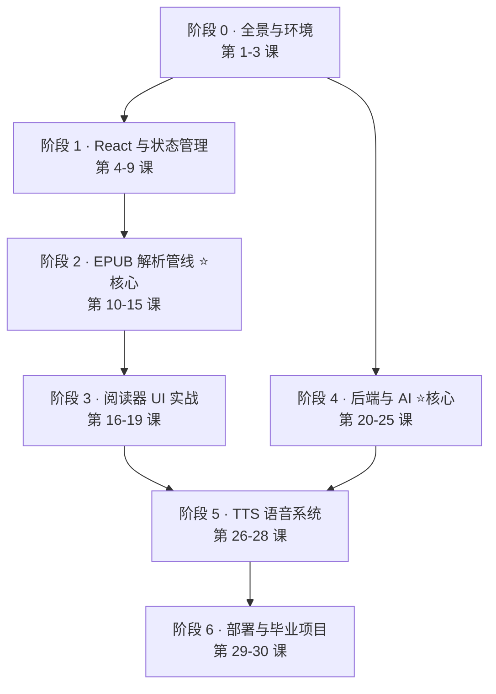
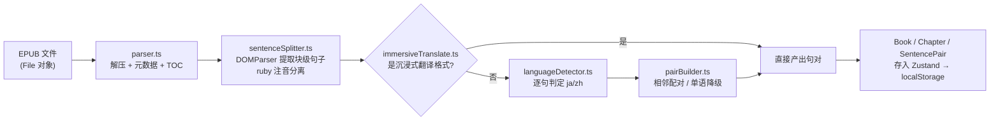
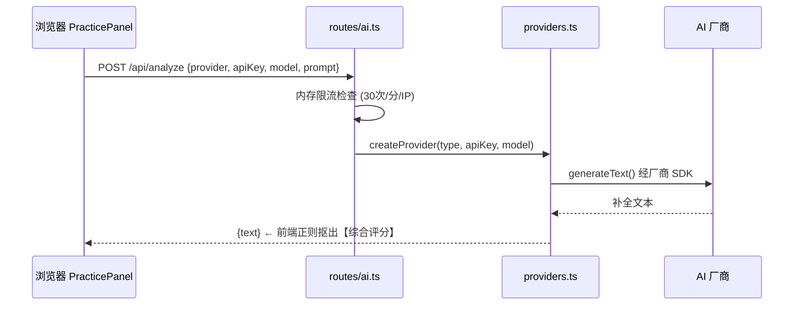

# baku-yomi 全栈课程大纲（30 节）

> 以本项目为唯一教材，从零基础到能独立讲清、改造、维护整个项目。
> 排课原则：先跑起来 → 前端基础 → 项目核心（EPUB 管线）→ 后端与 AI → TTS → 工程化毕业。

## 学习路线总览

> ⭐ 两个核心阶段是面试被追问最多的部分；阶段 2 和阶段 4 可在完成阶段 0 后并行学习。

---

## 阶段 0 · 全景与环境搭建（第 1-3 课）

| 课 | 主题 | 知识点 | 实操作业 |
|---|---|---|---|
| 1 | 项目全景：这是什么、怎么运作 | 产品定位（双语阅读 + 回译练习）；BYOK 模式；浏览器端 + 轻后端的整体架构；三大流程鸟瞰 | 打开线上 Demo（或本地跑通），完整体验导入→阅读→回译→朗读 |
| 2 | 环境搭建与代码库导览 | Node ≥ 22 / pnpm；`pnpm dev` 双进程结构；目录职责划分（components/hooks/lib/stores/theme + server） | 画出自己版本的目录结构图，标注每个目录的一句话职责 |
| 3 | 工具链速览：Vite + TS + ESM | Vite dev server 与代理；`tsc -b` 构建流程；ESM `type: module`；`tsx` 直接跑 TS 后端的原理 | 故意制造一个 TS 类型错误，观察 `pnpm build` 与 `pnpm dev` 的不同表现 |

**阶段产出**：能运行的项目 + 自己手绘的架构图。

---

## 阶段 1 · React 与状态管理基础（第 4-9 课）

| 课 | 主题 | 知识点 | 实操作业 |
|---|---|---|---|
| 4 | React 19 核心 | 组件、JSX、props、受控组件；`App.tsx` 与 `MainLayout.tsx` 的组合方式 | 给设置弹窗加一个新开关项 |
| 5 | Hooks 体系 | useState/useEffect/useRef/useCallback；自定义 Hook 设计——精读 `useAnalysis` / `useEpubParser` / `useTextSelection` | 写一个 `useKeyPress` 自定义 Hook 并在阅读页使用 |
| 6 | Zustand 入门 | 为什么选 Zustand 而非 Redux/Context；`create` API；组件外用 `useStore.getState()` | 把第 5 课的开关接入一个新的 uiSlice 字段 |
| 7 | slice 模式与 persist | store 切片拆分（book/bookmark/practice/settings/ui 五个 slice）；`persist` 中间件 → localStorage；版本迁移思路 | 用 DevTools 查看 localStorage 里各 store 的实际存储结构 |
| 8 | 样式体系与主题 | Tailwind CSS 4 的 vite 插件用法；CSS 变量驱动的 6 主题；`themeStore.applyBodyClass` + Canvas overlay 动效 | 新增一个「樱花」主题：配色 + body class + 简单特效 |
| 9 | 组件分层实践 | layout/Sidebar/TopBar 的 props 流转；列表渲染与 key；条件渲染 | 在侧栏书架加排序功能（按最近阅读时间） |

**阶段产出**：理解「UI = f(store)」的数据流；能独立加一个小功能。

---

## 阶段 2 · EPUB 解析管线（第 10-15 课）⭐ 项目差异化核心

| 课 | 主题 | 知识点 | 实操作业 |
|---|---|---|---|
| 10 | EPUB 格式原理 | ZIP 容器；OPF 元数据； spine 与 TOC；XHTML 内容文档 | 手动把一个 .epub 改名为 .zip 解压，对照看 container.xml/OPF |
| 11 | 解析主流程 `parseEpubFile` | `@lingo-reader/epub-parser` API；TOC 扁平化 `flattenToc`；元数据安全取值 `extractText`/`extractCreator`；封面探测策略 | 加 console.log 追踪一本书从 File 到 Book 对象的每一步变换 |
| 12 | 句段提取 `sentenceSplitter` | DOMParser 用法；块级元素选择与去重（跳过内嵌 p/div 的外层）；空行过滤；纯文本兜底分支 | 找一本格式怪异的书导入，分析哪些句子切分错了、为什么 |
| 13 | ruby 注音与 HTML 净化（安全专题） | `<ruby>/<rt>/<rp>` 结构；文本与展示 HTML 双轨保存；`sanitizeRubyHtml` 白名单占位符替换法；XSS 与 `dangerouslySetInnerHTML` 的风险边界 | 手写一个含 `<script>` 的测试 HTML，验证净化函数是否剥除干净 |
| 14 | 语言检测 `languageDetector` | 中日文区分难点（汉字共享）；假名/注音符号码点范围判定；启发式方法的局限 | 写 5 个边界 case（纯汉字日文句、混排句）手测检测函数 |
| 15 | 配对算法 `pairBuilder` + 沉浸式翻译兼容 | 相邻 JA↔ZH 扫描（`i += 2` 跳过已配对）；单语降级；未配对日语保留以便回填；沉浸式翻译 span class 结构识别 | 用 Vitest 给 `buildPairs` 写第一个单元测试（JA→ZH、ZH→JA、混合、单语四种 case） |

**阶段产出**：能白板画出完整解析管线；pairBuilder 有自己的测试覆盖。**这是面试的核心弹药库。**

---

## 阶段 3 · 阅读器 UI 实战（第 16-19 课）

| 课 | 主题 | 知识点 | 实操作业 |
|---|---|---|---|
| 16 | 阅读主界面 `ReadingView` | 句对卡片列表渲染；`scrollToPairId` 滚动定位；虚拟化思考（长章节性能） | 实现阅读时自动高亮当前播放中的句子 |
| 17 | 练习面板 `PracticePanel` + 分析结果展示 | 表单状态流；提交 loading/error 态；AnalysisPanel 渲染 AI 返回的 Markdown | 给提交按钮加防重复点击（禁用态） |
| 18 | 书签系统 | `bookmarkSlice` 数据结构；`SelectionPopover` + `useTextSelection` 选区交互；书签跳转联动 | 给书签加备注文字功能 |
| 19 | 键盘交互体系 | j/k/gi/Esc 快捷键路由；输入焦点冲突处理；`ShortcutHelp` 帮助面板 | 新增快捷键：`,` / `.` 跳转上/下一章 |

**阶段产出**：读懂两个最大组件（18KB+14KB），掌握复杂 UI 的状态组织方式。

---

## 阶段 4 · 后端与 AI（第 20-25 课）⭐ 服务端核心

| 课 | 主题 | 知识点 | 实操作业 |
|---|---|---|---|
| 20 | Hono 框架入门 | Web 标准 Request/Response 风格；路由与子路由挂载（`app.route`）；中间件概念 | 给 `/health` 加一个返回版本号和运行时长的字段 |
| 21 | 服务入口精读 `server/index.ts` | CORS 生产/开发双策略及原因；`serveStatic` 托管 dist；SPA fallback 原理；为什么生产不配 CORS 反而最安全 | 本地模拟生产模式构建启动，验证刷新任意路径不 404 |
| 22 | Vercel AI SDK | `generateText` 统一接口；LanguageModelV1 抽象；多模型切换的成本 | 用 curl 直接调 `/api/analyze` 走通一次真实 AI 调用 |
| 23 | 工厂模式与 BYOK | `createProvider` switch 工厂；openai-compatible 兼容层（接本地模型）；BYOK 威胁模型：Key 到底经过谁 | 接入一个 OpenAI 兼容的免费/本地端点并成功调用 |
| 24 | Prompt 工程 | 三个 prompt 的角色设计（提示不给答案/译文改写/评分纠错）；输出格式约束技巧；中文 prompt 的注意点 | 改写分析 prompt 让它额外输出「语法点标签」，观察效果差异 |
| 25 | 限流与可靠性 | 固定窗口计数器实现；内存桶的过期清扫；单机限制 → Redis 滑动窗口的演进路线；错误透传策略 | 把限流阈值改为可配置（env），并用脚本连打验证 429 |

**阶段产出**：能讲清一次 AI 请求的完整生命周期；理解 BYOK 安全边界。

---

## 阶段 5 · TTS 语音系统（第 26-28 课）

| 课 | 主题 | 知识点 | 实操作业 |
|---|---|---|---|
| 26 | TTS 原理与双引擎 | msedge-tts（免配置 Edge 接口）vs VOICEVOX（本地引擎/音质）；speaker/style 概念；Docker profile 按需启停 | 分别用两个引擎合成同一句，对比延迟和音质并记录 |
| 27 | 服务端缓存设计 | Map 注册表（策略模式）；字节上限缓存 + LRU 触碰时间戳驱逐；缓存统计接口 `/api/tts/cache/stats`；缓存键设计（text+speaker+options） | 观察命中/驱逐计数变化；把上限调到 1MB 复现驱逐行为 |
| 28 | 客户端音频管理 `voicevox.ts` | 单例 HTMLAudioElement 生命周期；Blob URL 缓存与释放；`prefetchVoicevox` 预取消除卡顿；播放结束回调驱动连续朗读；React 外读 store 的技巧 | 实现「连续朗读时提前高亮下一句」 |

**阶段产出**：能画出双层缓存的读写路径图，解释预取为什么能掩盖网络延迟。

---

## 阶段 6 · 工程化部署与毕业项目（第 29-30 课）

| 课 | 主题 | 知识点 | 实操作业 |
|---|---|---|---|
| 29 | Docker 化与自托管 | Dockerfile 多阶段构建（node build → 运行镜像）；compose profiles；`.env` 配置面（PORT/TTS_DEFAULT_PROVIDER/TTS_CACHE_MAX_BYTES）；镜像体积优化 | 自己从零 build 镜像并跑通 `docker compose up`，记录每层作用 |
| 30 | 毕业项目：结构化输出改造 | AI SDK `generateObject` + JSON Schema；消灭前端正则抠分数；补齐 pairBuilder/sentenceSplitter 测试；更新 README 截图与文档 | 完成改造 → 全量回归（导入→回译→评分显示）→ 提交 PR 式 commit |

**毕业标准**：不看书向别人讲完三条核心流程；毕业项目的结构化评分链路自己动手写完。

---

## 附 A · 难度与依赖矩阵

| 阶段 | 课数 | 难度 | 前置 | 面试权重 |
|---|---|---|---|---|
| 0 全景环境 | 1-3 | ★☆☆☆☆ | 无 | 低（但决定第一印象） |
| 1 React/状态 | 4-9 | ★★☆☆☆ | 阶段 0 | 中 |
| 2 EPUB 管线 | 10-15 | ★★★★☆ | 阶段 1 | **极高** |
| 3 阅读器 UI | 16-19 | ★★★☆☆ | 阶段 1-2 | 中 |
| 4 后端/AI | 20-25 | ★★★☆☆ | 仅需阶段 0 | **极高** |
| 5 TTS | 26-28 | ★★★☆☆ | 阶段 4 | 中 |
| 6 部署毕业 | 29-30 | ★★★★☆ | 全部 | 高（证明所有权） |

## 附 B · 每课固定节奏建议（约 60-90 分钟/课）

1. **读**（20min）：按「关键文件」精读当课代码，带着作业里的问题读
2. **画**（10min）：手绘当课数据流小图（比截图记得牢）
3. **做**（30-50min）：完成实操作业——所有作业都是对项目的真实小改动，做完项目就是你的了
4. **讲**（5min）：用自己的话对着空气讲一遍当课内容（费曼法）

## 附 C · 学习进度打卡表

- [ ] 第 1-3 课　完成日期：____
- [ ] 第 4-9 课　完成日期：____
- [ ] 第 10-15 课　完成日期：____（里程碑：能画 EPUB 管线全图）
- [ ] 第 16-19 课　完成日期：____
- [ ] 第 20-25 课　完成日期：____（里程碑：能讲清 AI 请求生命周期）
- [ ] 第 26-28 课　完成日期：____
- [ ] 第 29-30 课　完成日期：____（里程碑：毕业项目合入）

---

*配套阅读：[project-study-guide.md](./project-study-guide.md)（架构总览与面试防守点）。生成于 2026-08-26。*
