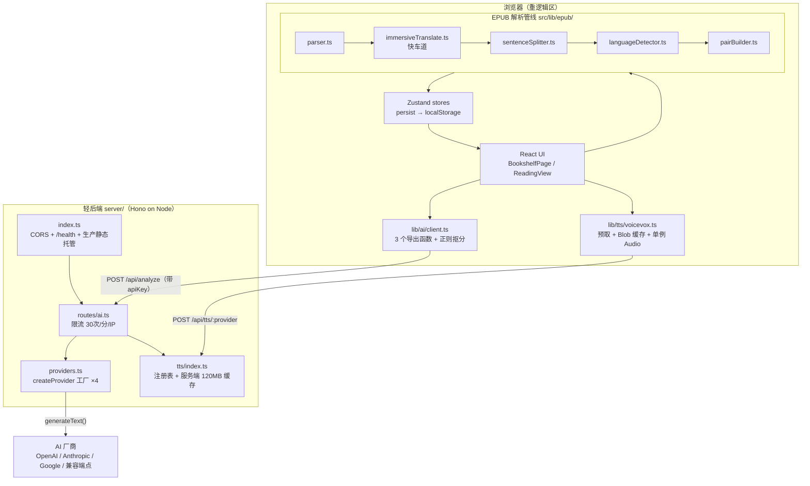

# 第 1 课 · 项目全景：这是什么、怎么运作

> 所属阶段 0 · 预计时长 90 分钟 · 难度★☆☆☆☆

## 学习目标

- 用自己的话向别人解释 baku-yomi 的产品定位与「回译练习」玩法
- 说清 BYOK（Bring Your Own Key）模式是什么、用户的 API Key 在这条链路上经过了谁
- 不看资料画出「EPUB 解析 → AI 回译分析 → TTS 朗读」三大流程的鸟瞰图
- 指出本项目「浏览器端重逻辑 + 轻后端」架构的分工边界
- 能把 baku-yomi 与沉浸式翻译插件、Lute、LingQ 做出至少三个维度的差异化对比
- 对三大流程涉及的核心文件能说出「文件里有哪些导出、大致分几段」，而不只是知道文件名

## 前置检查

- 无需任何前置知识，这是第一课。
- 只需要：一台能跑现代浏览器的电脑，以及（可选）一个任意 AI 厂商的 API Key 用于体验完整流程。
- 本课会大量贴源码片段，但**不要求你逐行看懂**——目标是建立地图，细节留给后面 29 课。

## 关键文件

| 文件 | 职责 |
|---|---|
| `package.json` | 项目元信息与全部脚本入口，`dev`/`build`/`start` 三条命令定义了项目的三种运行形态 |
| `src/App.tsx` | 前端总入口组件：根据 `useUIStore` 的 `currentView` 决定渲染书架还是阅读页 |
| `src/main.tsx` | React 挂载点，用 `ThemeProvider` 包裹 `App` |
| `src/lib/epub/parser.ts` | EPUB 解析管线第一站：解压 ZIP、提取元数据与目录 |
| `src/lib/epub/sentenceSplitter.ts` | 把章节 HTML 切成句子数组 |
| `src/lib/epub/languageDetector.ts` | 逐句判定日文/中文 |
| `src/lib/epub/pairBuilder.ts` | 把相邻的日中句子配成 `SentencePair` |
| `src/lib/epub/immersiveTranslate.ts` | 沉浸式翻译导出格式的专用解析器（管线里的「快车道」） |
| `server/index.ts` | 后端唯一入口：Hono 应用 + CORS 策略 + 生产静态托管 |
| `server/routes/ai.ts` | 提供 `POST /api/analyze` 与 TTS 子路由，内置内存限流 |
| `server/providers.ts` | AI 提供商工厂 `createProvider`，屏蔽 OpenAI/Anthropic/Google 差异 |
| `server/tts/index.ts` | TTS 双引擎注册表与服务端音频缓存 |
| `src/lib/ai/client.ts` | 前端调用 `/api/analyze` 的封装（三个导出函数：提示生成 / 译文优化 / 分析） |
| `src/lib/tts/voicevox.ts` | 浏览器端 TTS 客户端：预取、Blob 缓存、单例音频播放 |

## 正文

### 概念讲解

**baku-yomi 是什么？** 它是一个「AI 辅助日语双语阅读器」。你导入一本 EPUB 日语书，它把书拆成一句一句的**句对**（日语原句 + 中文书里自带的对应翻译，或机翻补充），然后你可以做「回译练习」：

1. 看中文译文，凭自己的水平把它回译成日语；
2. 点提交，AI 会拿你的译文和原文对照，给出评分、纠错和讲解。

这个练习方式借鉴了语言学习中经典的「回译法」（back-translation）：产出比输入更能暴露你的真实水平，而 AI 恰好是一个不知疲倦、随叫随到的批改老师。

**BYOK 模式是什么？** BYOK = Bring Your Own Key。本项目**不内置任何 AI 服务账号**：你在设置面板（`AISettingsPanel.tsx`）里填入自己的 API Key，前端每次请求时把 Key 直接塞进请求体发给后端，后端用它去调厂商。好处是项目作者零成本、用户自由选厂商；代价是你要理解 Key 的流向——本课后面会讲清楚它经过谁。

**为什么是「浏览器端重逻辑 + 轻后端」？** 因为最重的活——解析一本几十 MB 的 EPUB、切句、配对、存书架——全部可以在浏览器完成（ZIP 解压有纯 JS 库，localStorage 够存书架）。后端只干两件浏览器确实干不了的事：**替你调 AI 厂商**（避免浏览器直连的 CORS 与密钥管理问题）和 **TTS 合成**（msedge-tts 这类接口在浏览器端有跨域限制）。这个分工决定了代码库的结构：`src/lib/` 下是一大坨纯函数管线，`server/` 下只有薄薄一层胶水。

### 数据模型：三大流程共同围绕的三个 interface

在进入代码之前，先把整本书数据的「形状」钉死。`src/types/book.ts` 一共 26 行，导出三个嵌套的 interface：

```ts
export interface Book {
  id: string;
  title: string;
  author: string;
  description?: string;
  publisher?: string;
  chapters: Chapter[];
  coverUrl?: string;
  importedAt: number;
}

export interface Chapter {
  id: string;
  title: string;
  index: number;
  pairs: SentencePair[];
}

export interface SentencePair {
  id: string;
  japanese: string;
  japaneseHtml?: string; // HTML with <ruby> tags preserved for furigana display
  chinese: string;
  chapterIndex: number;
  pairIndex: number;
}
```

三个值得咀嚼的细节：

1. **`japaneseHtml` 是唯一允许携带 HTML 的字段**，且只保留 `<ruby>` 注音结构——日语学习场景里注音（振り仮名）是刚需，但任意 HTML 进 React 有 XSS 风险，所以上游管线做了白名单净化。这是「需求驱动的例外」：其他字段一律纯文本。
2. **`chinese` 允许为空字符串**而不是 `undefined`——单语降级路径统一填 `''`，消费方只需判空字符串一种情况，不用处理「字段缺失」。类型设计上的小决定，省掉下游无数 `?? ''`。
3. **冗余的定位字段是刻意的**：pair 里同时有 `chapterIndex` 和 `pairIndex`，Chapter 里又有 `index`——扁平化后的句对卡片要频繁做「跳转第 N 章第 M 句」，冗余存储换来 O(1) 定位，不用每次反查父数组。

id 的命名规则也值得记下：Book 是 `` `book-${Date.now()}` ``，SentencePair 是 `` `ch${chapterIndex}-p${pairIndex}` ``——前者全局唯一靠时间戳，后者在书内可预测、可重建（重新导入同一本书会生成相同 pair id），这让练习记录能跨导入会话对上号。

### 与同类产品的对比分析

学一个项目，先回答「它和已有工具差在哪」比直接读代码更有效。拿三个常被拿来类比的工具对比：

| 维度 | 沉浸式翻译（浏览器插件） | LingQ（在线平台） | Lute（本地开源阅读器） | **baku-yomi** |
|---|---|---|---|---|
| 核心动作 | 网页双语对照翻译 | 阅读中点词查词典、积累生词库 | 阅读中点词标生熟度、复习生词 | **句对级回译练习 + AI 批改** |
| 练习形态 | 无（只管输入不管产出） | 生词卡片复习（SRS） | 生词回忆测试 | 主动产出：中文→日语回译，AI 给评分与讲解 |
| 内容来源 | 任意网页，可导出 EPUB | 自家付费书库 + 导入 | 本地文本/EPUB | 本地 EPUB（对沉浸式翻译导出格式做了专门适配） |
| 账号/隐私 | 插件账号 + 云翻译服务 | 必须注册账号，数据在云端 | 完全本地 | 完全本地：书存 localStorage，AI 用你自己的 Key，作者零服务器成本 |
| 计费模式 | 免费+会员 | 订阅制 | 免费开源 | 免费开源，BYOK 自担 AI 成本 |

三条最有信息量的差异：

1. **「产出型练习」是独有卖点。** LingQ/Lute 都在解决「读得懂吗」（输入侧），baku-yomi 解决「写得出吗」（输出侧）。回译暴露的是语法、搭配、语感层面的真实短板，这是查词典式阅读永远测不出来的。为此项目专门设计了 `practiceSlice`（练习状态）、`AnalysisPanel`（批改展示）这一整条 UI 链路——同类产品里找不到对应物。

2. **「句对」而不是「单词」是它的基本单位。** 沉浸式翻译插件恰好证明了双语语料的获取可以免费完成（它导出的 EPUB 里日中逐段交错），于是 baku-yomi 干脆不做翻译引擎，专注做「把这种现成的双语书变成练习题」的后半程。这也是 `src/lib/epub/immersiveTranslate.ts` 这个文件存在的理由：识别并解析沉浸式翻译的标记结构，直接拿到高质量句对，跳过通用的启发式配对路径。

3. **BYOK + 全本地是架构选择也是产品立场。** LingQ 用订阅费覆盖服务器和 AI 成本；baku-yomi 把成本和密钥都还给用户，换来的是：作者零运维、书籍数据不出浏览器、AI 厂商随便换（`server/providers.ts` 里 OpenAI/Anthropic/Google/openai-compatible 四选一）。代价是没有「开箱即用」体验——第一件事永远是填 Key。

当然也要诚实说清它**没有**什么：没有单词级查词典、没有 SRS 生词本、没有移动端。如果你被问到「这个项目和 XX 有什么区别」，能同时说出优势与取舍，才是真正理解了这个产品。

### 代码走读

按「用户视角的一条生命线」来走读：导入书 → 阅读 → 回译 → 朗读。这次我们把每个相关文件的**完整结构**过一遍，不再只挑片段。

#### ① 前端的门面：`main.tsx` + `App.tsx`

先看真正的启动文件 `src/main.tsx`，全文只有 13 行：

```tsx
import { StrictMode } from 'react'
import { createRoot } from 'react-dom/client'
import './index.css'
import App from './App.tsx'
import { ThemeProvider } from './theme/ThemeProvider.tsx'

createRoot(document.getElementById('root')!).render(
  <StrictMode>
    <ThemeProvider>
      <App />
    </ThemeProvider>
  </StrictMode>,
)
```

四层洋葱从外到内：`createRoot` 接管 `index.html` 里的 `<div id="root">` → `StrictMode`（开发期故意双调用来暴露副作用 bug）→ `ThemeProvider`（六主题系统的上下文提供者，第 12 课专讲）→ `App`。注意 `./App.tsx` 这种带扩展名的 import 写法不是笔误——它是 `allowImportingTsExtensions` 编译选项允许的，第 3 课解释为什么。

再看 `src/App.tsx` 全文：

```tsx
export default function App() {
  const currentView = useUIStore((s) => s.currentView);

  return (
    <MainLayout>
      {currentView === 'bookshelf' ? <BookshelfPage /> : <ReadingView />}
      <WelcomeGuide />
      <SettingsModal />
    </MainLayout>
  );
}
```

整个应用其实只有两个页面：书架 `BookshelfPage` 和阅读器 `ReadingView`，靠 Zustand store 里的一个字符串字段 `currentView` 切换。没有路由库——这是理解本项目 UI 层的第一把钥匙：**一切状态都在 store 里，UI 是它的投影**。另外两个组件 `WelcomeGuide` 和 `SettingsModal` 是「全局浮层」：它们自己内部决定显示与否（比如 settingsSlice 里有对应的开关字段），所以 App 层不需要给它们传任何 props。

> 🎯 **边学边练 1**：打开 `src/stores/uiSlice.ts`，找到 `currentView` 的类型定义。它是字符串字面量联合类型吗？除了 `'bookshelf'` 还有几个取值？再顺手数一数 `src/components/settings/SettingsModal.tsx` 顶部 import 了哪些 slice——你会第一次直观感受到「store 是所有组件的共享心脏」。

#### ② 流程一：EPUB 解析（全在浏览器）

管线位于 `src/lib/epub/`，五个文件依次接力：

```
parser.ts → [immersiveTranslate.ts 快车道] → sentenceSplitter.ts → languageDetector.ts → pairBuilder.ts
```

**入口 `parser.ts`（211 行）的结构**：底部一个大导出 `parseEpubFile(file: File): Promise<Book>`，上面堆着四个私有辅助函数，各管一件小事：

- `flattenToc(toc)`：EPUB 目录是树形的（章里嵌节），递归拍平成一维数组；
- `extractText(value)` / `extractCreator(value)`：EPUB 元数据的形状五花八门（可能是字符串、可能是 `{_, $}` 包装对象、creator 还可能是数组），这两个函数负责「不管什么形状都给我抠出纯文本」——典型的**防御式编程**，因为第三方解析库返回的数据不可全信；
- `extractCoverFromSpineHtml(...)`：找封面。先看 manifest 是否声明了 `cover-image` 属性，然后在前几个 spine 条目的 HTML 里用正则匹配 `` 或 SVG 封面的 `<image href="...">`。

主流程 `parseEpubFile` 分五步：

1. `initEpubFile(file)` 解压 ZIP 并建索引（`@lingo-reader/epub-parser` 库的能力）；
2. 抽元数据：书名（兜底用去掉 `.epub` 后缀的文件名）、作者、简介、出版社；`bookId = \`book-${Date.now()}\`` 用时间戳生成；
3. **预加载全部 spine HTML 到一个 `Map<string, string>`**——注意这是内存换随机访问的关键决定：后面章节切分要按 spine 顺序反复读取，一次载入避免二次解压；
4. 找封面，且有一个容易忽略的细节：解析库给的封面是 `blob:` URL，**刷新页面就失效**，所以代码里专门把它 `FileReader.readAsDataURL` 转成 data URL 再存进 Book 对象，才能活过 localStorage 持久化；
5. 按 TOC 切章：把拍平后的 TOC 条目按各自在 spine 中的位置排序，相邻两条 TOC 之间的 spine HTML 合并交给 `extractPairsFromHtml`；如果一本书根本没有可用 TOC，就退化为「每个 spine 文件算一章」的兜底路径。

```ts
function extractPairsFromHtml(htmlParts: string[], chapterIndex: number) {
  const combined = htmlParts.join('\n');
  return (
    extractImmersiveTranslatePairs(combined, chapterIndex) ??
    buildPairs(extractSentences(combined), chapterIndex)
  );
}
```

这 7 行是整条管线的中枢调度：优先走沉浸式翻译快车道，识别不出该格式才落到通用路径。

**切句 `sentenceSplitter.ts`（60 行）**：导出一个 `ExtractedSentence` 接口（`text` 纯文本 + 可选 `html` 保留注音版 HTML）和一个 `extractSentences(html)` 函数。逻辑三段：

1. 用浏览器原生 `DOMParser` 把 XHTML 解析成文档，`querySelectorAll('p, h1..h6, div, li')` 取块级元素；
2. 对每个块：如果里面还嵌着 `p`/`div` 就跳过（防止父子重复计数），剥掉 `<rt>/<rp>` 注音得到纯文本，若含 `<ruby>` 则额外产一份**白名单净化过的 HTML**（`sanitizeRubyHtml` 只保留 ruby/rt/rp 三种标签，其余全部剔除，保证后续塞进 React 时安全）;
3. 一个块一句（日语排版的句子天然以段落为单位），若整个文档一块都没匹配到，退化为按 body 文本换行切分。

**语言判定 `languageDetector.ts`（26 行）**：中日文共享大量汉字，靠汉字没法区分，但假名是日语独占的。于是判定规则简单粗暴而有效：含平假名(U+3040-309F)或片假名(U+30A0-30FF)即为日语；不含假名但含 CJK 统一表意文字(U+4E00-9FFF)即为中文；否则 `unknown`。全文就三个纯函数，是「启发式算法不需要复杂」的好例子。

**配对 `pairBuilder.ts`（96 行）**：`buildPairs(sentences, chapterIndex)` 先给每句打上语言标签，然后用一个关键判断分流——只要全书存在**任意一处**相邻的一日一中对，就认定这本书是显式双语排版，走扫描配对循环（JA→ZH 或 ZH→JA 各前进两行）；否则整本书按单语处理，每行都当作日语原文、中文留空。混合排版也有兜底：配不上对的孤行若是日语则单独保留（`chinese: ''`），保证部分双语的章节依然可读可练。每个 pair 的 id 形如 `` `ch${chapterIndex}-p${pairIndex}` ``，是后续练习记录的主键。

把切句器全文贴出来（60 行里最核心的 33 行），对照上面三段描述逐块验证：

```ts
export function extractSentences(html: string): ExtractedSentence[] {
  const parser = new DOMParser();
  const doc = parser.parseFromString(html, 'text/html');

  const sentences: ExtractedSentence[] = [];

  const blocks = doc.querySelectorAll('p, h1, h2, h3, h4, h5, h6, div, li');

  for (const block of blocks) {
    if (block.querySelector('p, div')) continue;

    const text = getTextWithoutRuby(block);
    if (text.length === 0) continue;

    const rubyHtml = block.querySelector('ruby')
      ? sanitizeRubyHtml(block.innerHTML)
      : undefined;

    sentences.push({ text, html: rubyHtml });
  }

  if (sentences.length === 0) {
    const clone = doc.body.cloneNode(true) as HTMLElement;
    for (const rt of clone.querySelectorAll('rt, rp')) rt.remove();
    const body = clone.textContent ?? '';
    const lines = body.split(/\n+/).map((l) => l.trim()).filter(Boolean);
    for (const line of lines) {
      sentences.push({ text: line });
    }
  }

  return sentences;
}
```

注意两个「懒」得很聪明的地方：① 它不做句内切分（不按 `。！？` 断句），一个 `<p>` 就是一句——对小说排版来说粒度刚好，且避免了缩写、引号等断句歧义；② 兜底分支处理的是「全书没有一个标准块级元素」的怪书，直接按换行劈开文本。管线代码的可靠性往往就体现在这些不起眼的 fallback 里。

> 🎯 **边学边练 2**：打开 DevTools 的 Sources 面板（或 VS Code），找到 `sentenceSplitter.ts` 第 19 行 `if (block.querySelector('p, div')) continue;`。想一想：删掉这一行会发生什么？（提示：`<div><p>...</p></div>` 这类嵌套会让同一段文字被切几次？）然后在 `languageDetector.ts` 里把 `"漢字のテスト"` 和「汉字测试」分别喂给你脑子里的 kanaRegex，验证判定结果。

#### ③ 流程二：AI 回译分析（前后端协作）

前端 `src/lib/ai/client.ts` 一共 107 行，导出**三个**函数，全部打同一个接口 `POST /api/analyze`，区别只在 prompt 构造器和返回值处理：

- `generateBacktranslateHints(config, original, chinese)` → 返回纯文本提示（做题前给点线索）；
- `optimizeTranslationForBacktranslation(config, original, chinese)` → 把机翻译文改写成适合回译的版本（机翻太直译时练不了）；
- `analyzeTranslation(config, original, chinese, userTranslation, pairId)` → 核心函数，返回结构化的 `AnalysisResult`。

三个函数的 fetch 写法完全一致，请求体就是五个字段：

```ts
const response = await fetch('/api/analyze', {
  method: 'POST',
  headers: { 'Content-Type': 'application/json' },
  body: JSON.stringify({
    provider: config.type,
    apiKey: config.apiKey,
    model: config.model,
    baseUrl: config.baseUrl,
    prompt,
  }),
});
```

**API Key 就在这一步离开浏览器**——明文躺在 JSON 请求体里。`analyzeTranslation` 多做一步「非结构化→结构化」转换：

```ts
const rawMarkdown: string = data.text;
// Extract score
const scoreMatch = rawMarkdown.match(/【综合评分】\s*(\d+)/);
const score = scoreMatch ? parseInt(scoreMatch[1], 10) : 0;
```

评分是从 AI 返回的 Markdown 里**正则抠出来**的——这是一个务实但脆弱的设计，第 30 课会用结构化输出改造它。最后组装的 `AnalysisResult` 里 `errors`/`strengths`/`suggestions` 三个数组目前都是空占位，真正的内容全在 `rawMarkdown` 字符串里等 UI 渲染。

请求到达后端 `server/routes/ai.ts`（65 行），完整结构分四段：

1. **挂载**：`ai.route('/tts', tts)` 把 TTS 子路由挂在 `/api/tts` 下面；
2. **限流器**：模块级常量 `RATE_LIMIT_WINDOW_MS = 60_000`、`RATE_LIMIT_MAX = 30`，加一张 `Map<ip, { count, resetAt }>` 滑动窗口表，另有 `setInterval` 每 5 分钟清扫过期桶防内存泄漏；
3. **处理器**：先按 `x-forwarded-for` 头取客户端 IP 做限流检查（超限返 429），再校验必填字段 `provider/apiKey/model/prompt`（缺了返 400），然后：
   ```ts
   const llm = createProvider(provider, apiKey, model, baseUrl);
   const result = await generateText({ model: llm, prompt });
   return c.json({ text: result.text });
   ```
4. **错误出口**：厂商调用抛错统一捕获成 500 + 错误消息。

工厂 `server/providers.ts`（33 行）只有一个导出 `createProvider(type, apiKey, model, baseUrl): LanguageModelV1`，switch 四个分支分别调用 `@ai-sdk/openai`、`@ai-sdk/anthropic`、`@ai-sdk/google` 的构造函数，第四个分支 `openai-compatible` 支持自定义 `baseUrl`（接 DeepSeek、Ollama 等兼容 OpenAI 协议的服务）。四个分支殊途同归：都返回 Vercel AI SDK 的 `LanguageModelV1` 统一接口，所以上层 `generateText` 完全不用关心背后是谁——这就是**适配器模式**消灭 if-else 扩散的教科书案例。

**Key 的流向到此明确**：浏览器设置面板 → 请求体 → 本项目后端内存（不落盘）→ 厂商 SDK → 厂商服务器。后端是「过手不过夜」，这正是 BYOK 的信任边界，第 23 课会展开威胁模型。

> 🎯 **边学边练 3**：打开 `server/providers.ts`，问自己一个问题：如果要新增一个「Cohere」提供商，需要改哪几处？（答案线索：装包 `@ai-sdk/cohere` → import → 加一个 case。）再到 `src/types/settings.ts` 里找 `AIProviderType` 类型定义，确认前端设置面板的下拉选项是不是也由这个联合类型约束——体会「类型定义即前后端契约」。

#### ④ 流程三：TTS 朗读（双引擎 + 双层缓存）

服务端 `server/tts/index.ts` 是一个**策略模式注册表**：

```ts
const providers = new Map<string, TTSProvider>();
providers.set('voicevox', new VoicevoxProvider());
providers.set('microsoft', new MicrosoftTTSProvider());

const defaultProviderName = process.env.TTS_DEFAULT_PROVIDER ?? 'microsoft';
```

两个引擎实现分别在 `microsoft.ts`（msedge-tts，免配置白嫖 Edge 的接口）和 `voicevox.ts`（本地引擎，音质更好但要自己起 Docker 服务），都实现统一的 `TTSProvider` 接口（见 `types.ts`）。路由部分有三条：`GET /cache/stats`、`POST /cache/clear` 两条缓存管理路由必须**注册在 `/:provider` 之前**（否则 `stats` 会被当成 provider 名吃掉——注释里专门提醒了这个坑），以及核心的 `POST /:provider` 合成接口。服务端还有一层自己的音频缓存：`Map<string, Buffer>`，上限默认 120MB（环境变量 `TTS_CACHE_MAX_BYTES` 可调），同样带 LRU 式驱逐与命中统计。

浏览器端的 `src/lib/tts/voicevox.ts`（约 360 行，本项目最大的 lib 文件之一）负责「好体验」部分。它的特点是大量使用**模块级单例状态**而非 React state：`currentAudio`（当前播放的单例 Audio）、`voiceCache`（`Map<string, VoiceCacheItem>` 存 Blob URL）、`cacheBytes/cacheHits/cacheEvictions` 等统计计数，以及两组监听器集合向 React 侧广播播放状态变化。核心导出包括：

- `prefetchVoicevox(text, speaker?, options?)`：预合成但不播放；
- `playVoicevox(text, speaker?, pairId?, options?)`：确保已缓存 → 创建/复用单例 Audio → 播放；
- `getVoicevoxSpeakers()`：拉取 VOICEVOX 音声列表（带并发去重的 promise 缓存）;
- `getVoicevoxCacheStats()` / `clearVoicevoxCache()` / `setVoicevoxCacheLimit(maxBytes)`：缓存观测与管理。

```ts
export function prefetchVoicevox(text: string, speaker = 1,
  options?: VoicevoxSynthesisOptions): Promise<void>
```

`prefetchVoicevox` 允许在朗读当前句时就**提前合成下一句**，音频以 Blob URL 形式缓存在内存 Map 里，配合字节上限驱逐（`setVoicevoxCacheLimit`，默认 80MB）。所以你连续朗读时几乎感觉不到网络延迟——第 26-28 课专讲这套东西。

> 🎯 **边学边练 4**：在 `src/lib/tts/voicevox.ts` 里找到 `DEFAULT_MAX_CACHE_BYTES` 常量和 `evictVoiceCache()` 函数，回答：缓存满时驱逐策略是什么顺序？再到 `server/tts/index.ts` 找 `TTS_CACHE_MAX_BYTES`，确认两层缓存的默认容量分别是多少。最后想一层问题：为什么浏览器端和服务端**都要**做缓存，只留一层行不行？

#### ⑤ 后端的门面：`server/index.ts` 完整结构

三大流程讲完，最后把后端唯一的启动文件整个过一遍——它只有 36 行，却浓缩了生产环境要考虑的四件事：

```ts
import { serve } from '@hono/node-server';
import { serveStatic } from '@hono/node-server/serve-static';
import { Hono } from 'hono';
import { cors } from 'hono/cors';
import ai from './routes/ai';

const isProd = process.env.NODE_ENV === 'production';

const app = new Hono();

// CORS: restrict to known origin in production, allow all in dev
if (isProd) {
  const allowedOrigin = process.env.CORS_ORIGIN;
  if (allowedOrigin) {
    app.use('/*', cors({ origin: allowedOrigin }));
  }
  // No CORS middleware in prod without explicit origin = same-origin only
} else {
  app.use('/*', cors());
}

app.route('/api', ai);

app.get('/health', (c) => c.json({ status: 'ok' }));

// Production: serve built frontend from dist/
if (isProd) {
  app.use('/*', serveStatic({ root: './dist' }));
  // SPA fallback: serve index.html for any unmatched route
  app.get('/*', serveStatic({ root: './dist', path: 'index.html' }));
}

const port = Number(process.env.PORT ?? 3003);
console.log(`Server running on http://localhost:${port}`);

serve({ fetch: app.fetch, port });
```

结构上从上到下正好四段，顺序就是中间件的注册顺序（Hono 按注册顺序匹配，所以这段代码的行序即请求的穿越次序）：

1. **CORS 策略分岔**：开发模式 `cors()` 无参数全放行——反正有 Vite 代理，浏览器看到的都是同源；生产模式只在配置了 `CORS_ORIGIN` 时挂严格白名单，没配则干脆不挂 CORS 中间件，效果是「仅同源可访问」。注意这个设计的语义：**默认收紧、显式放开**，与很多项目「默认全开再想着关」相反。
2. **业务路由挂载**：`app.route('/api', ai)` 把第③④节讲的 AI 与 TTS 路由整体挂进 `/api` 前缀下；
3. **健康检查**：`/health` 返回 `{"status":"ok"}`，给容器编排和监控探针用，第 2 课作业里你已经亲手打过它；
4. **生产静态托管**：仅在 `NODE_ENV=production` 时生效。两行的分工值得细品：第一行 `serveStatic` 处理真实存在的静态资源（JS bundle、图片），第二行 SPA fallback 把所有未匹配路径都指回 `index.html`——因为这是单页应用，用户直接刷新 `/book/xxx` 这种前端路由时服务器上并不存在对应文件，必须交给 React 接管路由。

最后一行 `serve({ fetch: app.fetch, port })` 是 Hono 生态最优雅的一笔：Hono 应用本质上就是一个符合 Web 标准 `fetch` 签名的函数，`@hono/node-server` 只负责把这个函数接到 Node 的 HTTP 端口上。框架无关的写法让同一份路由代码未来可以直接迁去 Bun/Deno/Cloudflare Workers——这也是选 Hono 而非 Express 的核心理由之一。

> 🎯 **边学边练 5**：在开发模式下访问一个不存在的路径如 `http://localhost:5174/api/nothing`，观察返回什么状态码；再对比生产思路想一想：为什么 `/health` 要挂在 `/api` 之外？（提示：如果健康检查也走 `/api` 前缀，未来给 `/api/*` 加鉴权或限流中间件时会误伤探针。）

### 图示

整体架构与三大流程鸟瞰：



## 实操作业

### 基础（必做）：跑通产品闭环

1. 启动项目（具体环境搭建在第 2 课，本作业可先用线上 Demo 或请同学帮忙跑一份）：
   ```bash
   pnpm install && pnpm dev
   ```
2. 打开 `http://localhost:5174`，首次会看到 `WelcomeGuide` 引导页，跟着走完。
3. 导入一本**自带中文翻译**的日文 EPUB（沉浸式翻译导出的格式最佳）；没有的话，随便一本日文 EPUB 也行，管线会走单语降级路径。
4. 进入阅读页，确认看到的是一句日语 + 一句中文的卡片列表（`SentencePairCard`）。
5. 任选一句，点开练习面板（`PracticePanel`），把中文回译成日语并提交：
   - 未配 API Key 时应收到明确的错误提示（记下文案，第 20 课你会知道它从哪来）；
   - 配了 Key 后等待 AI 返回，确认能看到 `AnalysisPanel` 渲染出的 Markdown 讲解与【综合评分】。
6. 配置 TTS（默认 msedge-tts 零配置即可用），点一句日语听朗读，再点「连续朗读」感受预取带来的流畅度。

### 进阶（推荐）：带着地图读代码

1. 对照「关键文件」表格，在编辑器里逐个打开这些文件，只为确认一件事：**文件存在、导出名与课程描述一致**。不求看懂实现。
2. 在 `src/types/book.ts` 中找到 `Book`、`Chapter`、`SentencePair` 三个 interface，抄下每个的字段名——这三个类型是整本书数据的心脏，后面十几课都会反复出现。
3. 用 DevTools 的 Application 面板查看 localStorage，找出书籍持久化用的 key（提示：与 Zustand persist 相关，名字里应该有 book），看看一条真实数据长什么样。
4. 断网状态下重新加载页面：书架还在吗？翻页呢？提交回译呢？记录哪些功能存活——验证「浏览器重逻辑」的边界到底在哪。

### 挑战（选做）：给管线动一次小手术

1. 修改 `src/lib/epub/sentenceSplitter.ts` 的 `querySelectorAll` 选择器，把 `li` 从块级元素列表中去掉，重启后重新导入一本含列表的书，观察句子切分有何变化，再把改动还原。
2. 在 `languageDetector.ts` 的 `isJapanese` 里临时加一行 `console.log(text)`，导入书时打开控制台，亲眼看着每一句话流经这个函数——这条日志会让你彻底理解「管线」二字。看完删掉。
3. **验收标准**：挑战部分完成后，你能不看资料回答「从拖入 EPUB 文件到屏幕上出现句对卡片，数据经历了哪四次形状变换」（File → Book → Chapter[] → SentencePair[]）。

## 本课与面试

**Q1：「介绍一个你读过的开源项目的整体架构。」**
答题要点：用「分层 + 数据流」作答，不要报菜名式罗列技术栈。示范框架：baku-yomi 是三层结构——浏览器内的纯函数管线（EPUB 解析五文件接力，产出 SentencePair 数据模型）、Zustand store 作为唯一状态源并持久化到 localStorage、Hono 轻后端只承担 AI 代理与 TTS 合成两个浏览器干不了的职责。收尾补一句设计动机（隐私 + BYOK 零成本），体现「知其所以然」。

**Q2：「用户的 API Key 在你的系统里是怎么流转的？如何证明它不会被泄漏？」**
答题要点：画清五跳链路（设置面板 → localStorage → POST 请求体 → 后端内存 → 厂商 SDK）；强调后端「过手不过夜」——只在转发瞬间存在于内存变量，不落盘不打日志；同时诚实指出残留风险（HTTPS 传输依赖、localStorage 受 XSS 影响），以及限流器（30 次/分/IP）只是防滥用而非防泄漏。区分「我能保证的」和「我依赖外部前提的」是加分项。

**Q3：「如果让你给一段中日混排的文本判断每句话是什么语言，你怎么做？」**
答题要点：先说结论性洞察——汉字无法区分中日，但假名是日语独占码位；所以规则引擎（U+3040-30FF 假名检测优先，其次 U+4E00-9FFF）即可高准确率解决，无需机器学习。再补充工程化思考：短句误判怎么办（结合上下文投票）、为什么这个方案适合本项目（纯函数、零依赖、可在浏览器毫秒级跑完全书）。

**Q4：「你的项目里有没有「能用但脆弱」的设计？你会怎么改进？」**
答题要点：拿真实案例说话——AI 评分是从 Markdown 里正则抠出来的（`/【综合评分】\s*(\d+)/`），prompt 一变措辞就可能解析失败静默得 0 分。改进方向：让模型输出 JSON Schema 约束的结构化结果（Vercel AI SDK 的 `generateObject`）、加解析失败的重试与告警。面试官考察的是你对自己代码缺点的诚实度和演进思路，答「没有」或泛泛而谈都是雷区。

## 常见坑

- **以为后端存了你的书**：没有。书籍数据全在浏览器 localStorage，换浏览器/清缓存书就没了——这是设计而非缺陷（隐私友好），第 7 课讲 persist 时你会看到具体存储键。
- **以为 API Key 存在服务器上**：Key 存在前端 settingsSlice 并持久化到 localStorage，每次请求随请求体发送；后端只在转发那一瞬间持有它。
- **没配 Key 就点提交**：报错是预期行为。BYOK 模式的第一步永远是打开设置面板填 Key、选厂商和模型。
- **导入的书没有中文对照**：`pairBuilder` 会走单语降级路径，练习功能依然可用，只是少了「现成译文」这一参照物。
- **封面刷新后消失 ≠ 数据丢了**：解析库给出的 `blob:` URL 天生不能跨会话存活；`parser.ts` 已把它转成 data URL 再持久化。如果你自己往 `Book` 里塞 blob URL 类型的字段，就会踩同一个坑。
- **把「轻后端」理解为「没后端」**：限流、CORS、静态托管、SPA fallback 都在后端那 36 行 `index.ts` 里。生产部署（第 29 课）时它是唯一的进程，别想着只发静态文件完事。

## 自测题

1. baku-yomi 的三大核心流程分别主要由哪些目录/文件承载？哪些在浏览器执行、哪些在后端？
   <details><summary>答案</summary>EPUB 解析：`src/lib/epub/`（parser → immersiveTranslate/sentenceSplitter → languageDetector → pairBuilder），全在浏览器；AI 回译分析：前端 `src/lib/ai/client.ts` + 后端 `server/routes/ai.ts` 与 `server/providers.ts`，跨前后端；TTS：后端 `server/tts/` 合成 + 前端 `src/lib/tts/voicevox.ts` 播放与缓存。</details>

2. BYOK 模式下，用户的 API Key 从哪里出发、途经哪些环节、最终到达哪里？后端会持久化它吗？
   <details><summary>答案</summary>从前端设置面板（settingsSlice，持久化在 localStorage）出发 → 放进 POST /api/analyze 请求体 → 后端 `createProvider(provider, apiKey, model, baseUrl)` 用它构造厂商 SDK 客户端 → 发往厂商服务器。后端仅在转发瞬间在内存中使用，不落盘、不存储。</details>

3. 为什么说本项目后端是「轻后端」？列出它承担的两类职责。
   <details><summary>答案</summary>因为重活（EPUB 解压、切句、配对、书架存储）都在浏览器完成。后端只负责：① 代理 AI 厂商调用（解决浏览器直连的跨域问题并提供限流保护）；② TTS 音频合成（msedge-tts/VOICEVOX 接口不适合浏览器直连）。</details>

4. 前端是如何从 AI 返回的 Markdown 文本中得到数字评分的？这个设计有什么隐患？
   <details><summary>答案</summary>`client.ts` 的 `analyzeTranslation` 用正则 `/【综合评分】\s*(\d+)/` 从返回文本里抠数字，匹配不到则得 0 分。隐患：依赖 prompt 让模型稳定输出该标记，模型偶尔改写措辞就会解析失败——第 30 课用 `generateObject` + JSON Schema 结构化输出根治。</details>

5. 应用没有引入 react-router，它是怎么在「书架页」和「阅读页」之间切换的？
   <details><summary>答案</summary>`App.tsx` 读取 `useUIStore((s) => s.currentView)`，根据该字段条件渲染 `<BookshelfPage />` 或 `<ReadingView />`；切换动作就是修改 uiSlice 里的 `currentView` 字段。UI 完全是 store 状态的投影。</details>

6. 与 LingQ、Lute 这类「点词阅读器」相比，baku-yomi 在学习法上的根本差异是什么？这个差异决定了哪些独有代码？
   <details><summary>答案</summary>LingQ/Lute 解决输入侧（查词、标生熟度），baku-yomi 解决输出侧（回译产出 + AI 批改）。由此产生的独有代码：practiceSlice（练习状态管理）、PracticePanel/AnalysisPanel 组件链路、client.ts 的 analyzeTranslation 及配套 prompt、SentencePair 以句为单位的配对管线——这些在单词导向的产品里都没有对应物。</details>

7. `parser.ts` 为什么要花力气把封面的 `blob:` URL 转成 data URL？如果省略这步会发生什么现象？
   <details><summary>答案</summary>`blob:` URL 只在当前页面会话内有效且不被 localStorage 序列化保留，刷新或下次打开后图片地址失效。省略这步的现象是：导入当天书架封面正常，之后每次刷新封面都裂图，其余数据完好。</details>

8. 后端限流的桶为什么要定期清扫（那个 5 分钟一次的 `setInterval`）？不清扫会有什么后果？
   <details><summary>答案</summary>rateBuckets 以 IP 为 key 存在 Map 里，过期条目不会自动消失。公网部署时每个来访 IP 都会产生一个条目，长期不清扫 Map 无限增长导致内存缓慢泄漏。清扫逻辑按 `resetAt <= now` 删除过期桶，把稳态内存控制在活跃用户量级。</details>
