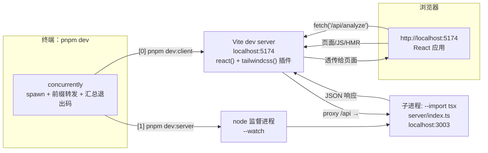

# 第 2 课 · 环境搭建与代码库导览

> 所属阶段 0 · 预计时长 90 分钟 · 难度★★☆☆☆

## 学习目标

- 在本机装好 Node ≥ 22 与 pnpm，并成功跑起 `pnpm dev` 双进程
- 说清 `pnpm dev` 背后同时运行的是哪两个进程、各监听哪个端口、谁代理给谁
- 对 `package.json` 里**全部七条 scripts** 逐条说清「这条命令被谁展开、最终执行的是什么」
- 讲出 concurrently 把两条命令拧成一条的工作机制，以及 Node 内置 `--watch` 的重启原理
- 对着仓库逐个讲出 `components/hooks/lib/stores/theme/types/server` 七个目录的一句话职责
- 画出自己版本的目录结构图并标注职责（阶段产出之一）

## 前置检查

- 已完成第 1 课：能口头描述三大流程与「浏览器重逻辑 + 轻后端」分工。
- 本课开始需要真实代码环境：Git、Node.js ≥ 22（后面会解释为什么是 22）、pnpm ≥ 9。

## 关键文件

| 文件 | 职责 |
|---|---|
| `package.json` | 定义 `dev`/`dev:client`/`dev:server`/`build`/`start`/`lint`/`preview` 七条脚本，本课的主舞台 |
| `vite.config.ts` | 前端构建配置：React 插件、Tailwind 插件、**5174 端口与 `/api` 代理到 3003**（第 3 课逐行精读） |
| `src/main.tsx` | 前端启动挂载点：`ThemeProvider` 包裹 `<App />` |
| `src/App.tsx` | 视图切换中枢：按 `useUIStore` 的 `currentView` 渲染书架或阅读页 |
| `server/index.ts` | 后端启动入口：Hono 应用，默认端口 **3003** |
| `eslint.config.js` | ESLint 9 flat config（第 3 课细讲） |
| `.env`（可选） | 后端环境变量文件，由 `--env-file-if-exists=.env` 自动加载 |

## 正文

### 概念讲解

**为什么要求 Node ≥ 22？** 看 `package.json` 里这条脚本：

```json
"dev:server": "node --env-file-if-exists=.env --watch --import tsx server/index.ts"
```

其中 `--env-file-if-exists` 是 Node v22 才引入的命令行开关（旧版只有 `--env-file`，且文件不存在时会直接报错）。此外 React 19 + Vite 7 这套现代依赖本身也要求较新的 Node。所以请用 nvm/fnm/volta 等版本管理器装上 Node 22 LTS 或更高。

**双进程开发模式是什么？** 前端和后端是两个独立程序：

- **前端 dev server**：Vite，监听 **5174** 端口（注意不是默认的 5173，这是项目刻意配置的），负责以秒级速度热更新你改的任何前端代码；
- **后端 API server**：Node 直跑 Hono，监听 **3003** 端口，负责 `/api/analyze` 和 `/api/tts`。

浏览器只访问 5174；当页面代码请求 `/api/...` 时，Vite 的 proxy 配置把这个请求原样转发给 3003——对浏览器来说就像前后端同源一样，天然规避了跨域问题。`concurrently` 这个 devDependency 负责把两条命令拧成一条 `pnpm dev`，两份输出交错打印在同一个终端里（各自带 `[0]`/`[1]` 前缀）。

**为什么不干脆在后端开 CORS、让浏览器直连 3003？** 技术上可行（`server/index.ts` 开发模式确实 `cors()` 全放行了），但走代理有三个实际好处：① **同源免预检**——浏览器对跨域请求可能先发 OPTIONS 预检，代理让每次请求都少一个往返；② **Cookie/凭据模型简单**——同源请求天然带上自身凭据，不用折腾 `credentials: 'include'` 和服务端 `Access-Control-Allow-Credentials`；③ **生产形态一致**——上线后由 Hono 同时托管前端和 API（见第 1 课的静态托管段），开发期的代理只是把「未来的同源」提前模拟出来。理解了这层，你就明白代理配置不是开发期的权宜之计，而是生产架构的彩排。

**pnpm 和 corepack 又是什么？** `package.json` 里没有 `packageManager` 字段，但课程统一用 pnpm：它比 npm 快、省磁盘（全局内容寻址存储 + 项目内硬链接，十个项目装同一个 React 只占一份空间），且严格的依赖隔离能提前暴露「偷用未声明依赖」的隐患。`corepack enable` 是 Node 自带的包管理器版本代理：它在 PATH 里放好 pnpm/yarn 的 shim，之后你敲 `pnpm` 时 corepack 会按项目的声明自动匹配版本。装完可以用 `pnpm -v` 自检。

### 代码走读一：package.json 七条脚本逐行拆解

先把完整的 scripts 块抄下来，然后一条不漏地拆：

```json
"scripts": {
  "dev": "concurrently \"pnpm dev:client\" \"pnpm dev:server\"",
  "dev:client": "vite",
  "dev:server": "node --env-file-if-exists=.env --watch --import tsx server/index.ts",
  "build": "tsc -b && vite build",
  "start": "NODE_ENV=production node --env-file-if-exists=.env --import tsx server/index.ts",
  "lint": "eslint .",
  "preview": "vite preview"
}
```

先建立一个心智模型：npm/pnpm 执行 script 时，会把 `node_modules/.bin/` 临时加进 PATH——所以脚本里可以直接写 `vite`、`tsc`、`concurrently` 这些包提供的可执行文件名，不需要写完整路径。
顺带两条约定俗成：① 生命周期名（`pretest`/`postinstall` 这类）会被包管理器自动钩住执行，本项目没用到，但读别人的 package.json 时要留个心眼；② `pnpm <name>` 会优先匹配内置命令（如 `pnpm test`），自定义脚本撞名时要显式写 `pnpm run <name>`——本项目七条脚本名都不与内置命令冲突，所以两种写法等价。

**① `dev`**

```text
concurrently "pnpm dev:client" "pnpm dev:server"
```

- `concurrently`：devDependency 里的多进程编排工具（v9）；
- 它接收两个参数，每个参数是一条要并发运行的命令；注意命令里写的仍是 pnpm script 名，所以实际是 pnpm 再往下展开一层；
- 没有加任何额外旗标，用的是全默认行为：两个子进程**同时启动、各自独立**，一个崩了另一个照跑，直到全部退出 concurrently 才退出（想「一死全死」需要显式加 `--kill-others`，本项目没用）。

**② `dev:client`**

```text
vite
```

零配置启动 Vite dev server？不完全——配置在 `vite.config.ts` 里（端口 5174、`/api` 代理）。这行的价值在于提醒你：Vite 的所有行为都可以收敛进配置文件，让命令行保持极简。
另一个细节：脚本名里的冒号只是命名约定（`dev:client` = dev 的子任务），pnpm 并不因此赋予任何层级语义；但 `pnpm dev:client` 这种「跳过父脚本直接跑子任务」的用法是完全合法的——第 2 步进阶作业就会单独启动前端验证这一点。


**③ `dev:server`**

```text
node --env-file-if-exists=.env --watch --import tsx server/index.ts
```

逐段拆解：

| 参数 | 含义 |
|---|---|
| `node` | 用真正的 Node 运行时跑后端（不是 Deno/Bun） |
| `--env-file-if-exists=.env` | 有 `.env` 就加载为环境变量，没有也不报错 |
| `--watch` | 源码变化时自动重启进程（Node 内置能力，不需要 nodemon） |
| `--import tsx` | 注册 tsx 的模块加载钩子，让 Node 能直接吃 TypeScript |
| `server/index.ts` | 入口文件，TypeScript 源码，无需预编译 |

**④ `build`**

```text
tsc -b && vite build
```

`&&` 是 shell 的短路顺序执行：先跑 TypeScript 编译器构建模式做类型检查（本项目里它因 `noEmit` 只查不产码），通过才轮到 Vite 打包产出 `dist/`。任何一个失败都会中断链条。这是「类型守门员 + 打包工人」的两段式流水线，第 3 课整课都在拆它。

**⑤ `start`**

```text
NODE_ENV=production node --env-file-if-exists=.env --import tsx server/index.ts
```

和 `dev:server` 两处不同：一是开头内联设置 `NODE_ENV=production`（Unix 风格写法，Windows cmd 不认，见常见坑）；二是**去掉了 `--watch`**——生产进程不该因为文件变动而重启，这是刻意省略而非遗漏。`NODE_ENV=production` 会激活 `server/index.ts` 里的生产分支：CORS 收紧到 `CORS_ORIGIN` 指定的源、开始从 `dist/` 托管打包产物并提供 SPA fallback。

**⑥ `lint`**

```text
eslint .
```

对整个仓库根目录跑 ESLint 9。规则集来自仓库根的 `eslint.config.js`（flat config），它自己声明了忽略 `dist` 和作用范围 `**/*.{ts,tsx}`，所以「`.`」虽然名义上是全仓库，实际检查范围完全由配置文件说了算。

**⑦ `preview`**

```text
vite preview
```

用 Vite 起一个**纯静态文件服务器**来预览 `dist/` 里的构建产物。注意它的定位：快速验证打包结果长什么样，不是生产服务器——它不会代理 `/api`，也没有 Hono 的限流和 TTS。想本地完整预演生产形态，应该用 `pnpm build` 之后再 `pnpm start`（由 Hono 同时托管 dist 和 API）。
（`vite preview` 默认跑在 4173 端口，与开发期的 5174、后端的 3003 互不相干——三个端口三种身份，别混。）
顺带把三个端口一次记牢：**5174 = 开发期前端正门，3003 = 后端本体，4173 = 构建产物预览**。端口是进程身份的第一标签，报障时先确认对方在说哪个端口的事。

（这条速记同样适用于第 29 课的 Docker 部署：容器内部永远是 3003，对外映射的端口才是变化的那个。）

**附：后端认得的环境变量全名单。** `.env` 里能配什么？把源码里出现的 `process.env.XXX` 全部搜出来，一共五个：

| 变量 | 默认值 | 消费处 | 作用 |
|---|---|---|---|
| `PORT` | `3003` | `server/index.ts` | 后端监听端口 |
| `NODE_ENV` | 无（`start` 脚本内联设为 `production`） | `server/index.ts` | 切换生产分支：CORS 收紧 + 托管 `dist/` |
| `CORS_ORIGIN` | 未配置则仅同源 | `server/index.ts` | 生产模式允许的跨域来源 |
| `TTS_DEFAULT_PROVIDER` | `microsoft` | `server/tts/index.ts` | TTS 请求未指明引擎时的兜底选择 |
| `TTS_CACHE_MAX_BYTES` | `125829120`（120MB） | `server/tts/index.ts` | 服务端音频缓存上限 |

这张表本身就是一次微型代码走读的产物——「grep process.env」是接手任何后端项目的第一个动作，建议养成习惯。

照着这张表，一份「够用」的 `.env` 长这样（按需取用，全部可省略）：

```bash
# .env —— 仅后端读取，前端代码接触不到它
# PORT=4000                    # 后端换端口（记得同步改 vite.config.ts 的代理目标）
# CORS_ORIGIN=https://your-domain.com
# TTS_DEFAULT_PROVIDER=voicevox
# TTS_CACHE_MAX_BYTES=268435456   # 256MB
```

两个安全提醒：① 这个文件只被**后端**的 `--env-file-if-exists` 加载，Vite 前端代码有自己独立的 `import.meta.env` 体系，两者互不相通——别把给前端的配置写在这里；
② 密钥防误提交：本仓库 `.gitignore` 已明确忽略 `.env`、`.env.local`、`.env.production`（保留 `.env.example` 作模板），所以写了真实 Key 也不会进版本库——但前提是你别去删这条忽略规则。

**附：17 个依赖各是干什么的。** `pnpm install` 装回来的东西不该是黑盒。按运行位置分类：

**dependencies（前后端运行时都要，共 14 个）：**

| 包 | 用在哪 | 一句话职责 |
|---|---|---|
| `react` / `react-dom` | 浏览器 | UI 框架与 DOM 渲染器（React 19） |
| `zustand` | 浏览器 | 极简状态管理，五个 slice 的载体 |
| `react-icons` | 浏览器 | 图标组件库 |
| `@lingo-reader/epub-parser` | 浏览器 | EPUB 解压与解析（管线第一站的引擎） |
| `ai` | 后端 | Vercel AI SDK 核心：`generateText` 与统一模型接口 |
| `@ai-sdk/openai` / `anthropic` / `google` | 后端 | 三家厂商的适配器，被 `createProvider` 工厂调用 |
| `hono` + `@hono/node-server` | 后端 | Web 框架本体 + 把 Hono 接上 Node HTTP 的适配层 |
| `msedge-tts` | 后端 | 微软 Edge 语音接口客户端（TTS 引擎一） |
| `tsx` | 后端（含生产） | TS 模块加载钩子——因为 `start` 也用它，所以必须在 dependencies |

**devDependencies（仅开发期需要，共 13 个）：** 构建链 `vite`、`typescript`、`@vitejs/plugin-react`、`tailwindcss` + `@tailwindcss/vite`；质量链 `eslint` 全家（`@eslint/js`、`typescript-eslint`、两个 react 插件、`globals`）；编排 `concurrently`；类型包 `@types/node`、`@types/react(-dom)`。

判断一个包放哪边的试金石：**生产环境执行 `pnpm install --prod` 后程序还能不能跑**。`tsx` 能过这个测试（start 要用），`vite` 不能（产物已打好在 dist/）。

> 🎯 **边学边练 1**：打开 `package.json` 数一数 dependencies 和 devDependencies 各有哪些包。回答三个问题：① `tsx` 为什么放在 dependencies 而不是 devDependencies？（提示：看 `start` 脚本。）② `msedge-tts` 是给前端还是后端用的？③ `concurrently` 为什么反过来只在 devDependencies？

最后附一张「双进程现象速查表」，调试前先对号入座：

| 现象 | 根因 |
|---|---|
| 终端日志混在一起但有 `[0]/[1]` 前缀 | concurrently 的行级转发，属正常现象 |
| 改后端代码后限流计数清零 | `--watch` 冷重启，模块级 Map 归零 |
| 新建的文件改了不触发后端重启 | 未被 import 的文件不在监视的模块图里 |
| 杀掉一个子进程另一个还在跑 | concurrently 默认互不干预（无 `--kill-others`） |
| 5174 页面 API 全部 500/ECONNREFUSED | 后端进程没起来或崩在启动阶段，看 `[1]` 的输出 |
| `.env` 改了没生效 | env 文件不热加载；且变量名必须精确为 `.env` |

### 代码走读二：concurrently 与 node --watch 的工作原理

**concurrently 怎么工作？** 它本质上是对 `child_process.spawn` 的一层编排封装：

1. 启动时为每条命令 spawn 一个子进程（shell 执行），记录到一张进程表里；
2. 给每个子进程的 stdout/stderr 接上**带前缀的转发管道**：子进程每吐出一行，concurrently 就加上 `[0]`/`[1]`（或自定义名字）和专属颜色再打印到自己的终端——所以你看到的交错日志其实是「收一行印一行」，不是两个终端在抢屏幕；
3. 监听所有子进程的 exit 事件：全部结束后按各自的退出码汇总出自己的退出码（任一非零即整体非零，方便 CI 判断失败）;
4. 默认**不干预**兄弟进程——这正是理解「杀掉后端前端还活着」现象的关键：concurrently 只是房东，租客之间互不过问。

顺带一提：为什么不用更简单的 `&` 并发符（`pnpm dev:client & pnpm dev:server`）？因为 `&` 在很多环境下有日志混杂无法区分、父 shell 提前退出带走后台任务、Windows 兼容性差等一堆问题；concurrently 用几十 KB 的依赖换来了前缀、颜色和可靠的进程管理，是一笔划算的交易。

concurrently 还有一个常被忽略的能力：**输入转发**。默认情况下你敲进终端的按键会原样传给第一个子进程（所以 Ctrl+C 会同时结束整棵进程树）；配合 `--handle-input` 旗标还能用 `0:restart` 这样的语法向指定编号的子进程发命令。本项目没用到，但知道这层存在，你就明白那些「在 dev 终端里敲 rs 重启」的技巧是怎么实现的。


**node --watch 怎么工作？** 它是 Node 从 v18.11 起逐步稳定的内置监视器，原理可以概括为「父子进程模式」：

1. 你敲下的 node 进程并不直接运行你的代码，而是把自己变成**监督者**，fork 一个子进程去真正执行 `server/index.ts`；
2. 监督者跟踪子进程**实际加载过的模块图**（哪些 `.ts/.js/.json` 文件被 require/import 过就盯哪些，而不是傻盯整个磁盘目录）；
3. 任一被盯文件变更 → 监督者杀掉旧子进程、重新 spawn 一个新的——注意是**冷重启**：内存里的变量、连接池、限流的 Map 全部归零；
4. 子进程崩溃时监督者会打印错误并保持待命，等你改完文件保存即自动重试。

两个由此而来的实用结论：① 后端改代码后所有内存态（包括 AI 路由的 rateBuckets）都会清空，调试限流时别惊讶计数器归零；② 它监视的是「加载过的模块」，如果你新建了一个文件但还没被 import，改它不会触发重启。
补充两个边界细节：① 想监视「还没被加载」的文件，可以用 `--watch-path=./server` 显式圈定目录，代价是失去模块图的精确性；② `--watch` 的重启是「杀掉再起新进程」，不是热替换——后端没有 HMR 这回事，请求处理到一半的连接会随旧进程一起被切断，开发时偶尔遇到的「改代码瞬间接口报 ECONNRESET」就是它。


> 🎯 **边学边练 2**：保持 `pnpm dev` 运行。① 观察终端里 `[0]` 和 `[1]` 分别对应哪条命令；② 在 `server/index.ts` 里随便加一行 `console.log('hot!')` 并保存，数一数几秒后看到重启输出——验证 `--watch` 生效；③ 杀掉 `[1]` 进程（Ctrl+C 不行，那会全停；用任务管理器或另开终端找 PID），确认 `[0]` 的 Vite 仍在服务页面——验证 concurrently 默认互不过问。做完还原文件。

把三层进程关系画成一棵树（以 Unix 为例）：

```text
pnpm dev                          ← 你敲下的命令
└── concurrently                  ← 房东：spawn 下面的租客，转发日志，汇总退出码
    ├── [0] vite                  ← 前端 dev server :5174
    └── [1] node --watch …        ← 监督者：自己不跑业务代码
        └── node server/index.ts  ← 真正跑 Hono 的子进程 :3003
                                   （文件变更 → 被杀掉 → 由监督者重新 spawn）
```

数一数：一条 `pnpm dev` 实际产生了**四个**进程。调试时用 `ps | grep node` 亲眼验证一下，你会对「谁是谁」有实体感——尤其是「改后端代码死的是最里层那个子进程，监督者和 concurrently 都还活着」这件事。

### 代码走读三：目录职责逐一走读

```
baku-yomi/
├── src/
│   ├── components/   # 所有 UI 组件
│   ├── hooks/        # 自定义 React Hook
│   ├── lib/          # 与 UI 无关的核心纯逻辑（本项目最值钱的代码）
│   ├── stores/       # Zustand store 切片
│   ├── theme/        # 主题系统
│   ├── types/        # 全局 TypeScript 类型定义
│   ├── App.tsx       # 视图切换中枢
│   └── main.tsx      # 挂载入口
└── server/           # 轻后端（Hono on Node）
```

各目录内部的真实文件与职责：

| 目录 | 实际内容 | 一句话职责 |
|---|---|---|
| `src/components/layout/` | `MainLayout.tsx`、`Sidebar.tsx`、`TopBar.tsx` | 页面骨架：侧栏 + 顶栏 + 内容区 |
| `src/components/bookshelf/` | `BookshelfPage.tsx`、`BookCard.tsx` | 书架页与书籍卡片 |
| `src/components/import/` | `EpubUploader.tsx` | EPUB 文件拖拽上传入口 |
| `src/components/reader/` | `ReadingView.tsx`、`SentencePairCard.tsx`、`PracticePanel.tsx`、`SelectionPopover.tsx`、`BookmarkList.tsx`、`ShortcutHelp.tsx` | 阅读主界面全家桶：句对卡片、练习面板、划词弹窗、书签列表、快捷键帮助 |
| `src/components/analysis/` | `AnalysisPanel.tsx` | 渲染 AI 返回的 Markdown 分析结果 |
| `src/components/settings/` | `SettingsModal.tsx`、`AISettingsPanel.tsx`、`VoiceSettingsPanel.tsx` | 设置弹窗：AI 配置（BYOK 填 Key 处）与语音配置 |
| `src/components/onboarding/` | `WelcomeGuide.tsx` | 新手引导浮层 |
| `src/hooks/` | `useEpubParser.ts`、`useAnalysis.ts`、`useTextSelection.ts` | 把异步流程（解析书/AI 分析）和 DOM 选区包装成 Hook 供组件使用 |
| `src/lib/epub/` | `parser.ts`、`sentenceSplitter.ts`、`languageDetector.ts`、`pairBuilder.ts`、`immersiveTranslate.ts` | ⭐ EPUB 解析管线核心：解压→切句→语言判定→配对，含沉浸式翻译格式兼容 |
| `src/lib/ai/` | `client.ts`、`prompts.ts` | 前端侧 AI 调用封装与三个 prompt 的文案 |
| `src/lib/tts/` | `voicevox.ts` | 浏览器端音频客户端：预取、Blob 缓存、单例播放 |
| `src/stores/` | `bookSlice.ts`、`bookmarkSlice.ts`、`practiceSlice.ts`、`settingsSlice.ts`、`uiSlice.ts` | Zustand 的五个切片：书、书签、练习、设置、UI 状态 |
| `src/theme/` | `ThemeProvider.tsx`、`themeStore.ts`、`ThemeOverlays.tsx`、`ThemeIndicator.tsx`、`overlays/{Moon,Rain,Snow,Stars}Canvas.tsx` | 六主题系统 + Canvas 天气动效（雨雪星空月亮） |
| `src/types/` | `book.ts`、`analysis.ts`、`settings.ts`、`index.ts` | `Book`/`Chapter`/`SentencePair`/`AnalysisResult` 等核心类型，前后端共享词汇表 |
| `server/` 根 | `index.ts`、`providers.ts` | Hono 入口 + AI 提供商工厂 `createProvider` |
| `server/routes/` | `ai.ts` | `/api/analyze` 主路由（限流在此）+ 挂载 TTS 子路由 |
| `server/tts/` | `index.ts`、`microsoft.ts`、`voicevox.ts`、`types.ts` | TTS 双引擎：msedge-tts 与 VOICEVOX，策略模式注册表 |

一个值得记住的分层直觉：`types/` 是契约，`lib/` 是引擎（不认识 React），`stores/` 是内存与持久化的桥梁，`hooks/` 把引擎接上 React，`components/` 只管画界面。

再看一眼后端入口如何确定自己的端口：

```ts
const port = Number(process.env.PORT ?? 3003);
console.log(`Server running on http://localhost:${port}`);
serve({ fetch: app.fetch, port });
```

默认 3003，可用环境变量 `PORT` 覆盖——Docker 部署时就是靠它换端口（第 29 课）。`.env` 文件里配的变量正是在这里生效的：`--env-file-if-exists=.env` 把它们注入 `process.env`，优先级低于真正的系统环境变量。

再往深一层：每个核心文件的**对外导出**。目录表告诉你「去哪找」，这张导出表告诉你「找到后能用什么」：

| 文件 | 关键导出 | 形态 |
|---|---|---|
| `src/lib/epub/parser.ts` | `parseEpubFile(file: File): Promise<Book>` | 异步函数，管线总入口 |
| `src/lib/epub/sentenceSplitter.ts` | `extractSentences(html)`、`ExtractedSentence` | 纯函数 + 类型 |
| `src/lib/epub/languageDetector.ts` | `isJapanese` / `isChinese` / `detectLanguage` | 三个纯函数 |
| `src/lib/epub/pairBuilder.ts` | `buildPairs(sentences, chapterIndex)` | 纯函数 |
| `src/lib/ai/client.ts` | `analyzeTranslation` 等 3 个异步函数 | 均打 `POST /api/analyze` |
| `src/stores/uiSlice.ts` | `useUIStore` | Zustand hook |
| `src/lib/epub/immersiveTranslate.ts` | `extractImmersiveTranslatePairs(html, chapterIndex)` | 返回 `SentencePair[] \| null`：null = 不是该格式 |
| `src/lib/tts/voicevox.ts` | `playVoicevox` / `prefetchVoicevox` / `getVoicevoxSpeakers` 等 | 浏览器端播放与缓存的全部入口 |
| `server/index.ts` | 无（顶层直接启动 `serve()`） | 副作用脚本 |
| `server/routes/ai.ts` | 默认导出 Hono 子应用 `ai` | 被父应用挂载 |
| `server/tts/index.ts` | 默认导出 Hono 子应用 `tts` | 被 ai.ts 挂载 |

一眼扫过去能发现一个一致性约定：**lib 层全是命名导出的纯函数，路由层全是默认导出的 Hono 子应用**。这种「按层决定导出风格」的纪律让 import 写法可预测。

`server/tts/types.ts` 也顺带一提：它定义的 `TTSProvider` 接口是两个引擎实现（`microsoft.ts`、`voicevox.ts`）必须遵守的合同——新增第三个引擎时，先实现这个接口，再到 `tts/index.ts` 的注册表里挂一行，路由层零改动。

> 🎯 **边学边练 3**：打开 `src/types/index.ts`，看它是怎么把同目录其他类型文件 re-export 出来的。然后做一个「契约追踪」：从 `SentencePair` 类型出发，grep 一下它在 `lib/epub/`、`components/reader/`、`stores/practiceSlice.ts` 三处分别以什么方式被使用（构造 / 展示 / 存储）。做完你会对「类型是骨架」有肌肉记忆。


`components/` 内部的组织逻辑也值得点破：它**按功能域分目录**（layout/bookshelf/reader/settings…）而不是按文件类型分（不是 `components/buttons/`、`components/modals/` 这种技术分类）。好处是改一个功能时相关组件聚在一起，删一个功能时一个目录就能带走。`reader/` 是最大的子目录，因为阅读器是产品的主战场；`onboarding/` 只有孤零零一个 `WelcomeGuide.tsx`，但它代表「首次体验」这个独立关注点，值得单独立户。这种「按业务切、不按技术切」的直觉，比任何目录规范文档都管用。


### 代码走读四：一次请求的完整生命周期

把第 2 步基础作业里的健康检查放大成慢动作，数一数一次 `GET /health` 一共经过几站：

1. 浏览器解析 URL `http://localhost:5174/health`，向 5174 发起 TCP 连接——它以为自己在跟「网站本体」通信；
2. Vite dev server 接受连接，先查静态模块表：`/health` 不是任何源码模块的路径；
3. Vite 遍历 `vite.config.ts` 的 proxy 规则，发现 `/health`……等等，规则前缀是 `/api`，`/health` **不匹配**！那这个请求怎么到的后端？——重看作业你会发现：`http://localhost:5174/health` 其实返回的是 Vite 的 SPA fallback（index.html），真正打到后端的写法是 `http://localhost:5174/api/...`。如果你当时观察到的是 HTML 而不是 JSON，恭喜你比课程预设多想了一步；
4. 换成 `POST /api/analyze` 重放一遍：这次命中 `/api` 前缀 → Vite 以 HTTP 客户端身份向 `http://localhost:3003/api/analyze` 发起**第二个独立请求**（浏览器对此完全无感知）→ Hono 按 `app.route('/api', ai)` 的挂载关系剥掉前缀，交给 `routes/ai.ts` 里注册的 `post('/analyze')` 处理器 → 处理器返回的 JSON 原路经 Vite 回给浏览器；
5. 对比两个端点的结论：**代理是按路径前缀选择性生效的**，不在前缀内的路径永远到不了后端。这也是为什么后端的 `/health` 在开发期只能通过直连 3003 访问。

最后对照生产模式收个尾：上线后没有 Vite 了，前端和 API 同域由 Hono 一站伺服，「代理」这个角色消失，浏览器直连的就是 `server/index.ts` 里那个应用本体。开发期的链路是「浏览器 → Vite → Hono」三跳，生产只有「浏览器 → Hono」两跳——排障时先分清自己在哪条链路上，能省掉大半无效排查。

> 🎯 **边学边练 4**：分别访问 `http://localhost:3003/health` 和 `http://localhost:5174/health`，对比响应体；再用 curl 直接打 `curl http://localhost:3003/api/analyze -X POST -H "Content-Type: application/json" -d '{}'` 观察缺字段的 400 错误——绕过浏览器和 Vite 直连后端是排查 API 问题的基本功。


> 🎯 **边学边练 5**：趁热打铁做一次「生产彩排」：`pnpm build` 成功后运行 `pnpm start`，访问 `http://localhost:3003/`——这次页面和 API 同在 3003。用 DevTools 确认 `/api/*` 请求不再经过任何代理（Network 面板里请求直接打到 3003）。做完 Ctrl+C 回到开发模式。

### 图示

`pnpm dev` 双进程与请求流向：



读图指引：这张图和「代码走读四」的生命周期一一对应——浏览器发出的每条线都标了目的地，注意 `fetch('/api/analyze')` 这条线的两段式路径：先到 Vite（5174），再由 Vite 转手到 Node（3003），响应沿原路折返。把这张图默画出来，本课的验收就完成了一半。

最后送一份「API 不通」的三步排障法，遇到问题按顺序走：
1. **看终端 `[1]` 的输出**——后端崩没崩、有没有收到请求的迹象；
2. **绕过中间层直连**——`curl http://localhost:3003/api/...` 能通就是代理/前端的问题，不能通才是后端的问题；
3. **看 Network 面板的请求详情**——状态码（404 = 路径没匹配上代理或路由；429 = 限流；500 = 厂商调用报错）会直接告诉你卡在哪一站。

## 实操作业

### 基础（必做）：跑通环境

1. 安装依赖并启动：

   ```bash
   corepack enable          # 让 package.json 指定的包管理器可用
   pnpm install
   pnpm dev
   ```
2. 确认终端出现两行关键日志：Vite 的 `Local: http://localhost:5174/` 和后端的 `Server running on http://localhost:3003`。
   （提示：后端那行日志只在进程成功监听端口后才打印；如果只看到 Vite 的日志而没有后端的，先去 `[1]` 前缀下找报错。）
3. 打开浏览器 DevTools 的 Network 面板，分别访问 `http://localhost:3003/health` 和 `http://localhost:5174/health`，记录两个响应体的差异。`server/index.ts` 里确实有 `app.get('/health', ...)` 返回 `{"status":"ok"}`，但代理规则只覆盖 `/api` 前缀——那么 5174 上响应这个请求的到底是谁？把你的猜想写下来，「代码走读四」会揭晓答案。
4. 故意停掉其中一个进程再操作页面，记录现象：杀掉后端后导入书籍是否还能工作？AI 练习呢？（体会哪些功能真需要后端。）
5. 合上本课讲义，凭记忆画出目录结构图，每个目录标注一句话职责；画完再对照上面的表格查漏。
6. 打开 DevTools 的 Sources 面板 → Page 树，展开 `localhost:5174` 的 `src/` 目录：你会发现所有 `.ts/.tsx` 文件都在，且内容是被转译过的 JS——这是第 3 课「Vite 按需转译」的第一眼实物。

### 进阶（推荐）：解剖启动链

1. 单独运行 `npx vite`（不经过 `pnpm dev`），确认前端能独立跑起来；再单独运行 `npx concurrently --help`，浏览一遍选项列表，找出 `--kill-others` 和 `--names` 两个旗标并读懂用途。
2. 给 `dev` 脚本临时改成 `concurrently --names "web,api" "pnpm dev:client" "pnpm dev:server"`，观察日志前缀从 `[0]/[1]` 变成 `[web]/[api]`，体会前缀只是展示层约定。改回原样。
3. 在项目根创建一个只含 `PORT=4000` 的 `.env` 文件，重启 `pnpm dev`，确认后端日志变成 `Server running on http://localhost:4000` 且此时页面 `/api` 请求会失败——因为 `vite.config.ts` 还代理到 3003。这个实验让你亲眼看见「环境变量」和「代理目标」是两套独立的配置。删掉 `.env`。
4. 把 Node 版本切到 20（如果装了版本管理器），运行 `pnpm dev:server`，截图记录报错信息，作为「为什么要求 Node ≥ 22」的第一手证据。切回 22。
5. 用 `pnpm store path` 找到 pnpm 的全局内容寻址存储位置，再看项目 `node_modules/.pnpm` 目录的结构——理解 pnpm「全局存一份、项目里硬链接」省磁盘的机制。

### 挑战（选做）：改造启动体验

1. 给 `dev` 脚本加上 `--kill-others`：现在手动杀掉任一子进程会发生什么？思考这种策略适合什么团队习惯（严格一致 vs 灵活调试），再决定要不要保留，最后**还原**。
2. 写一个（或口头设计）方案：让后端在 `--watch` 重启时保住限流桶数据不丢失。提示方向：把桶状态挪到独立子进程/文件/SQLite。不必实现，但要说清楚数据放哪、何时读写、崩溃一致性怎么办——这是第 29 课部署话题的预习。
3. 对比实验：把 `dev` 脚本改成 Unix 风格的 `"pnpm dev:client & pnpm dev:server"`，在 Windows PowerShell 和 Git Bash 里各跑一次，记录两种结果——亲身体会为什么概念讲解里说 concurrently 是「划算的交易」。改回原样。
4. **验收标准**：① 能不看资料复述七条脚本各自展开后的完整命令；② 能画出 concurrently→两个子进程→(监督者→子进程) 的三层进程树；③ 进阶作业的四项实验都有记录。

## 本课与面试

**Q1：「你的项目是怎么同时启动前端和后端的？」**
答题要点：说出三件事——① package.json 里 `dev` 用 concurrently 并发 spawn 两条子命令；② 各自职责（Vite 5174 / Node+tsx 3003）；③ 浏览器只连 5174，`/api` 由 Vite proxy 转发实现开发期同源。能补一句「生产形态则合并为一个 Node 进程托管静态产物 + API」立刻区分于背模板的候选人。

**Q2：「为什么你们的 dev server 要用 concurrently 而不是一个进程同时干两件事？」**
答题要点：关注点分离——前端要 HMR 与代理，后端要自己的生命周期与环境变量，硬塞一个进程会让两边互相牵连（比如后端崩溃拖死热更新）。concurrently 提供统一入口、日志前缀/着色和退出码汇总，成本只是一个 devDependency。也承认代价：默认互不感知，需要时才上 `--kill-others`。

**Q3：「Node 内置的 --watch 和 nodemon 有什么区别？你为什么选内置的？」**
答题要点：机制差异——nodemon 是外部进程包装器（轮询/chokidar 监听目录），`node --watch` 由运行时自身实现，监督者跟踪的是**模块加载图**而非目录树，误触发少且零额外依赖。选择理由：少一个依赖就少一份供应链与维护负担；配合 `--import tsx` 已构成完整 TS 开发循环。诚实补充：`--watch` 不能像 nodemon 那样自定义重启事件钩子，需求复杂时仍有迁移可能。

**Q4：「用户报障说改了 .env 但没生效，你怎么排查？」**
答题要点：按链路排查——① 文件名必须精确是 `.env`（`--env-file-if-exists` 只认命令行指定的这一个，不识别 `.env.local` 等）；② 改动后必须重启进程，env 文件不会热加载；③ 优先级：真实系统环境变量 > .env；④ 确认消费方确实读 `process.env.XXX`（如 `PORT ?? 3003`）。展示「沿数据流向逐段验证」的方法论比直接给答案重要。

## 常见坑

- **用了 Node 20 及以下**：`dev:server` 会因不认识 `--env-file-if-exists` 参数直接启动失败。先用 `node -v` 自检，低于 22 就升级。
- **访问了 3003 端口**：直接打开 `http://localhost:3003` 在开发模式下没有前端页面（生产模式才有静态托管）。开发时永远只开 5174。
- **`.env` 不存在导致慌张**：不会报错，参数名里的 `-if-exists` 就是为此设计的。想配 `PORT`/`CORS_ORIGIN` 时再创建即可。
- **Windows 下 `start` 脚本报错**：`"start": "NODE_ENV=production node ..."` 是 Unix 风格的内联环境变量写法，Windows cmd 不认。用 Git Bash/WSL 运行，或在 PowerShell 里先 `$env:NODE_ENV='production'` 再执行后面的 node 命令。
- **以为 `pnpm preview` 能测 API**：`vite preview` 只伺服 `dist/` 静态文件，没有 `/api` 代理。本地完整预演生产要用 `pnpm build && pnpm start`。
- **改了后端内存态相关逻辑却疑惑计数清零**：`--watch` 是冷重启，rateBuckets 这类模块级 Map 每次重启都归零，这不是 bug。
- **新建文件没被 import 时改它后端不重启**：`--watch` 盯的是已加载的模块图，孤儿文件不在监控范围。第一次遇到容易误判为「watch 失灵」。
- **装完依赖敲 `pnpm dev` 提示「command not found」**：多半是 corepack 没启用或 Node 版本太老不带它。先 `node -v` 确认 ≥ 22，再 `corepack enable`（Windows 下可能需要管理员终端），最后 `pnpm -v` 验证。
- **以为 `.env` 是给前端配变量的地方**：它只被后端的 `--env-file-if-exists` 加载；前端要用环境变量得走 Vite 的 `import.meta.env` 体系（且只有 `VITE_` 前缀的变量会暴露给浏览器）——两套体系互不相通，写错位置就是「怎么都不生效」。
- **在 `pnpm dev` 终端里按一次 Ctrl+C 以为只停了前端**：Ctrl+C 发给的是整棵进程树，concurrently 和两个子进程一起退。想只重启后端，依赖的是 `--watch` 的自动重启，不需要手动干预。
- **以为 `pnpm dev` 只有一个 node 进程**：实际是 concurrently→vite/node监督者/Hono子进程 四层进程树（见代码走读二的进程树图）。用任务管理器杀进程时别杀错层——杀了监督者，子进程会变孤儿但业务可能还在跑。
- **在 PowerShell 里跑 `NODE_ENV=production node ...` 失败就以为后端有 bug**：那只是 `start` 脚本的 Unix 语法在 Windows 上水土不服。开发期你根本不需要跑 `start`，用 `dev` 即可。

## 自测题

1. `pnpm dev` 实际启动了哪两个进程？分别监听什么端口？浏览器应该访问哪个？
   <details><summary>答案</summary>`vite`（前端 dev server，端口 5174，由 `vite.config.ts` 配置）和 `node --import tsx server/index.ts`（Hono 后端，默认端口 3003，可被 `PORT` 覆盖）。浏览器只访问 5174。</details>

2. 页面里 `fetch('/api/analyze')` 发往 5174，最终是谁处理了这个请求？中间经过了什么机制？
   <details><summary>答案</summary>请求先到 Vite dev server，命中 `vite.config.ts` 中 `proxy: { "/api": "http://localhost:3003" }` 的代理规则，被转发到 3003 的 Hono 应用，由 `routes/ai.ts` 注册的 `POST /analyze` 处理器处理后原路返回。对浏览器而言全程同源。</details>

3. `node --env-file-if-exists=.env --watch --import tsx server/index.ts` 中的三个参数各起什么作用？
   <details><summary>答案</summary>`--env-file-if-exists=.env`：存在则加载该文件为环境变量，不存在静默跳过（Node 22+ 才有）；`--watch`：监视源码变更自动重启进程；`--import tsx`：预加载 tsx 模块，注册转译钩子使 Node 能直接执行 TypeScript。</details>

4. 为什么杀掉后端进程后，本地导入 EPUB 和翻阅读书仍然正常，但提交练习会失败？
   <details><summary>答案</summary>EPUB 解析管线（`src/lib/epub/*`）完全在浏览器执行，书籍数据存于 localStorage，均不依赖网络；而练习提交要经 `fetch('/api/analyze')` → Vite 代理 → 后端 → AI 厂商，后端一死这条链就断了。</details>

5. `src/stores/` 下有哪五个切片？各自大致管理什么？
   <details><summary>答案</summary>`bookSlice`（书籍/章节/当前阅读位置）、`bookmarkSlice`（书签）、`practiceSlice`（练习与分析结果）、`settingsSlice`（BYOK 配置与偏好）、`uiSlice`（视图切换等 UI 状态，如 `App.tsx` 读的 `currentView`）。</details>

6. `start` 脚本相比 `dev:server` 少了哪个参数、多了哪个前缀？各意味着什么行为差异？
   <details><summary>答案</summary>少了 `--watch`（生产进程不随文件变动重启，避免意外中断服务），多了 `NODE_ENV=production` 前缀（激活 `server/index.ts` 中的生产分支：CORS 收紧为 `CORS_ORIGIN`、从 `dist/` 托管前端产物并提供 SPA fallback）。</details>

7. concurrently 默认情况下，其中一个子进程崩溃退出了，另一条命令和 concurrently 自身分别会发生什么？想要「一死全死」该怎么做？
   <details><summary>答案</summary>默认互不干预：幸存的子进程继续运行，concurrently 继续等待剩余进程，直到全部退出后才结束并以退出码汇总结果。要「一死全死」需显式加 `--kill-others` 旗标，本项目未使用。</details>

8. `pnpm lint` 里的「`.`」会不会真的检查仓库里每一个文件？由什么决定实际范围？
   <details><summary>答案</summary>不会。「`.`」只是起点，实际范围由 `eslint.config.js` 决定：`files: ['**/*.{ts,tsx}']` 限定只查 TS/TSX 文件，`globalIgnores(['dist'])` 排除构建产物，其余扩展名的文件根本不进入检查。</details>
