# 第 3 课 · 工具链速览：Vite + TS + ESM

> 所属阶段 0 · 预计时长 105 分钟 · 难度★★☆☆☆

## 学习目标

- 讲清 Vite dev server「按需原生 ESM 服务 + esbuild 预构建」的工作原理，以及它与 webpack 式全量打包的区别
- 简述 HMR 的完整闭环：文件变更如何变成浏览器里的一次精准模块替换，React Fast Refresh 在其中扮演什么角色
- 对 `vite.config.ts` 全部 13 行做到逐行解释（每个 import、每个配置字段各管什么）
- 解释 `pnpm build` 中 `tsc -b` 的角色：Project References 双 tsconfig、只做类型检查不产出 JS（`noEmit`）
- 把三份 tsconfig 里**每一个字段**说清「开了它约束/启用了什么」，包括几个冷门的 `erasableSyntaxOnly` 与 `noUncheckedSideEffectImports`
- 说明 `"type": "module"` 对 Node 的意义，以及 `--import tsx` 让 Node 直跑 TS 的钩子机制
- 读懂本项目的 ESLint flat config，知道每段 extends 引入了什么规则集
- 通过实验观察「类型错误在 `pnpm dev` 不拦、在 `pnpm build` 必拦」并解释原因

## 前置检查

- 已完成第 2 课：`pnpm dev` 能跑通，理解 5174/3003 双进程与 `/api` 代理。
- 已读过第 2 课列出的 `package.json` scripts，对 `dev:server` 那串参数有印象。

## 关键文件

| 文件 | 职责 |
|---|---|
| `package.json` | `"type": "module"` 声明整个包是 ESM；`build` 脚本串联 `tsc -b && vite build` |
| `vite.config.ts` | dev server 行为（端口/代理）与插件注册 |
| `tsconfig.json` | 解决方案根配置：自身无文件，仅引用下面两个子项目 |
| `tsconfig.app.json` | `src/` 浏览器端代码的编译选项（含 DOM lib、JSX） |
| `tsconfig.node.json` | `vite.config.ts` 等 Node 侧文件的编译选项 |
| `eslint.config.js` | ESLint 9 flat config 定义 |
| `server/index.ts` | 被 tsx 直接执行的 TS 入口，验证「Node 吃 TS」的活标本 |

## 正文

### 概念讲解

**Vite dev server 为什么快？** 传统打包器（webpack 时代）启动时要先把全项目依赖图打包成一个巨大的 bundle 再启动服务——项目越大启动越慢。Vite 换了思路：

1. **源码按需以原生 ESM 提供**。浏览器自己会发 `import` 请求，Vite 只在浏览器请求某个模块时才即时转译它（TS → JS 用 esbuild，比同类快一个数量级），所以 dev 启动时间基本与项目大小无关。
2. **依赖预构建（pre-bundling）**。`node_modules` 里的第三方包（如 React、Zustand）是 CJS/UMD 或碎片化 ESM，浏览器没法直接高效引用。Vite 启动时用 esbuild 把它们打成单个 ESM 文件缓存到 `node_modules/.vite`，之后几乎零成本复用。
3. **HMR（热模块替换）**。你改一个组件文件，Vite 精确定位受影响的模块链，只让浏览器重新拉取这几个模块，状态都不丢。

**HMR 原理简述。** 把上面第 3 点展开成一个闭环，共四步：

1. **通道建立**：dev server 会向页面注入一个客户端脚本（`@vite/client`），它在浏览器里与 Vite 服务器保持一条 WebSocket 长连接——这是所有热更新指令的下行通道。
2. **变更捕获**：你保存文件，Vite 服务器的文件监视器收到事件，在内存里的**模块导入图**上从被改的模块出发向上游爬，寻找最近的「HMR 边界」（声明了接受更新的模块，React 组件文件天然是边界）。
3. **精准推送**：找到边界后，服务器通过 WebSocket 发一条消息，告诉浏览器「这个 URL 的模块变了」。浏览器端把该模块 URL 加上时间戳查询参数重新 fetch——于是只有受影响的几个模块被重新转译下载，其余网络请求为零。
4. **边界处理**：边界模块执行自己的 accept 回调来换新代码。React 项目里这由 `@vitejs/plugin-react` 注入的 **React Fast Refresh** 运行时接管：它能替换组件函数体同时**保住 useState/useRef 的现有值**，所以你调样式时输入框里的字不会消失。如果一路爬到入口都没找到边界（比如改了 `main.tsx` 本身），Vite 放弃精准更新，退化为整页刷新。

记住这条分界线：**有边界 → 局部替换且状态保留；无边界 → 整页 reload**。后面实验里你会亲手触发两种情况。

拿一个具体场景把四步串成时间线。假设你正在改 `src/components/reader/SentencePairCard.tsx` 并保存：

```text
t=0ms     保存文件，Vite 服务器的 watcher 收到 change 事件
t≈5ms     在模块图中定位 SentencePairCard 模块，向上游爬：
          ReadingView → App → main.tsx
          发现 SentencePairCard 自身就是 HMR 边界（React 组件）→ 停止上爬
t≈10ms    通过 WebSocket 推送 { type: 'update', updates: [...] } 消息
t≈15ms    浏览器里的 @vite/client 收到消息，
          fetch('/src/components/reader/SentencePairCard.tsx?t=1724640000000')
          ——时间戳查询参数绕过缓存，拿到 esbuild 现转译的新模块

t≈25ms    react-refresh 运行时比对新旧组件：同一组件函数 → 只换函数体，
          该组件树内所有 useState/useRef 的值原样保留
总耗时 ≈ 一帧以内；网络面板里只多了一条请求
```
**为什么 React 需要 Fast Refresh，普通 JS 模块却不需要？** 因为普通模块的「状态」就是模块级变量，重新执行一遍模块体即可完整复原；而 React 组件的真正状态（hooks 的值、DOM 里用户敲了一半的输入框）活在 React 渲染树的 fiber 节点和真实 DOM 里，重新执行组件函数会把这些全部清零。Fast Refresh 的本质是在「重跑模块」与「保留状态」之间架桥：它让 react-refresh 运行时缓存旧组件的 hooks 链表，替换函数体后把链表重新接回去——这也是为什么它的能力边界恰好是「只换组件实现，不改 Hook 的数量与顺序」（Hook 顺序变了链表对不上号，只能放弃并整页刷新）。

**`tsc -b` 是干什么的？** `-b` 是 Build Mode（构建模式），用于 **Project References** 项目：一个仓库里有多份 tsconfig 各管一块代码时，`tsc -b` 按 `references` 依赖关系依次检查/编译每个子项目，并用 `.tsbuildinfo` 文件做增量——没改过的子项目直接跳过。本项目正是这种结构。

**关键认知：这个项目里 `tsc -b` 不产出任何 JS**。看 `tsconfig.app.json`：`"noEmit": true`。也就是说 `tsc -b` 在 `build` 脚本里纯粹当**类型检查器 + 类型守门员**用，真正把代码打成浏览器产物的另有其人——后面的 `vite build`（内部用 esbuild/Rollup）。分工：**tsc 管"类型对不对"，Vite 管"产物怎么打"**。这也解释了一个经典现象：dev 时写错类型照样能跑（esbuild 转译时不查类型），build 时必被 tsc 拦下。

**ESM 与 `"type": "module"` 是什么？** ES Modules 是 JS 官方标准模块系统（`import`/`export`），CommonJS 是 Node 的历史方案（`require`）。Node 靠两种方式区分文件该按哪种规范解析：扩展名（`.mjs` vs `.cjs`），或最近的 `package.json` 里的 `"type"` 字段。本项目声明了 `"type": "module"`，于是**所有 `.js` 文件都按 ESM 解析**，后端代码里可以放心写 `import`。注意 `tsconfig.app.json` 里还有一条 `"verbatimModuleSyntax": true`：强制你写 `import type { Foo }` 来引入纯类型——这样打包器和 tsx 都能确定哪些 import 该在运行时被整体删除，不会误留副作用导入。

**在本项目里找证据。** 概念讲完，去代码里验证三处「`"type": "module"` 的既成事实」：
1. `eslint.config.js` 是 `.js` 后缀却通篇 `export default`——若没有 type: module，Node 会把它当 CJS 解析并直接语法报错；
2. `server/index.ts` 全部用 `import`，没有任何 `require`；
3. `tsconfig` 两兄弟的 `"module": "ESNext"` 与之呼应：类型系统按 ESM 处理模块语法，运行时（tsx/Vite/Node）也按 ESM 执行，三层假设一致。


**tsx 怎么让 Node 直跑 TypeScript？** 第 2 课见过这条命令：

```

node --env-file-if-exists=.env --watch --import tsx server/index.ts
```

`--import tsx` 在进程启动的最早期预加载 tsx 包，它向 Node 注册 **module hooks**（定制 resolve 和 load 两个环节）：每当 Node 要加载一个 `.ts/.tsx` 文件，hook 先用 esbuild 把它转译成内存中的 JS 再交还。整个过程没有落盘的中间产物、不需要 watch 编译进程，配合 Node 自带的 `--watch` 就是完整的「改完即重启」开发体验。这是目前跑 TS 后端最轻量的方案之一（对比：老派做法要先 `tsc` 编译出 `dist/` 再 `node dist/index.js`）。

最后一个必须破除的误会：**tsx 只负责「让 TS 能跑」，不负责「保证类型正确」**。它和 Vite 的 esbuild 一样只擦除类型注解，`const x: number = "oops"` 这种错误在 tsx 眼里毫无问题。后端的类型安全由两道防线兜底：编辑器里的 TS 实时检查（日常主力），以及需要时的 `npx tsc --noEmit -p tsconfig.node.json` 手动全检——不过注意本项目的 node 配置只覆盖 `vite.config.ts`，想全量查 server/ 还得等第 29 课讨论 CI 时再补一份配置。

### 代码走读一：vite.config.ts 逐行讲解

全文一共 13 行，但每一行都有存在理由：

```ts
import { defineConfig } from "vite";
import react from "@vitejs/plugin-react";
import tailwindcss from "@tailwindcss/vite";

export default defineConfig({
  plugins: [react(), tailwindcss()],
  server: {
    port: 5174,
    proxy: {
      "/api": "http://localhost:3003",
    },
  },
});
```

| 行 | 内容 | 逐行解释 |
|---|---|---|
| 1 | `import { defineConfig } from "vite"` | 导入配置辅助函数。它只是提供类型提示与智能补全，运行时原样返回入参——纯粹为了编辑器体验和类型安全 |
| 2 | `import react from "@vitejs/plugin-react"` | 官方 React 插件，两大职责：① 用 Babel/esbuild 处理 JSX 转译；② 注入 **React Fast Refresh** 运行时，让 HMR 替换组件时保住 state |
| 3 | `import tailwindcss from "@tailwindcss/vite"` | Tailwind CSS v4 的新接入方式：作为一等 Vite 插件直接参与转换管线，不再经过 PostCSS 插件链，速度更快、配置更少 |
| 5 | `export default defineConfig({...})` | Vite 支持 ESM 配置文件正是因为整个包声明了 `"type": "module"`；Node/Vite 都能直接加载这份 `.ts` 配置 |
| 6 | `plugins: [react(), tailwindcss()]` | 插件数组决定 Vite 的转换管线能力。顺序在此无关紧要，但每个插件都会拦截特定类型的模块请求做加工 |
| 7 | `server: {...}` | 只影响 `vite` 开发服务器的行为块（对 `vite build` 无效） |
| 8 | `port: 5174` | 覆盖默认的 5173。刻意错开是为了避免与其他项目的 dev server 撞端口——多项目并行的开发者会感谢这个决定 |
| 9-11 | `proxy: { "/api": "http://localhost:3003" }` | 反向代理规则：所有路径以 `/api` 开头的请求不再由 Vite 处理，而是转发给 3003 的 Hono 后端并把响应原样带回。字符串简写等价于 `target` + 默认 `changeOrigin: false`；开发期前后端同源就是靠它 |

值得体会的设计观：这份配置**没有**出现别名 alias、环境变量切换、构建优化等常见内容——因为项目规模还不需要。读懂「配置里有什么」之前先读懂「为什么可以没有什么」。

### 代码走读二：三份 tsconfig 字段逐一解释

**根配置 `tsconfig.json`：**

```jsonc
{
  "files": [],
  "references": [
    { "path": "./tsconfig.app.json" },
    { "path": "./tsconfig.node.json" }
  ]
}
```

- `files: []`：根配置自己不直接包含任何源文件，它只是一张「目录页」；
- `references`：声明两个子项目。`tsc -b` 按此依次检查，各自独立的 `.tsbuildinfo` 让未变动的子项目跳过重查。

**子项目一 `tsconfig.app.json`（管 `src/`），逐字段拆：**

| 字段 | 值 | 解释 |
|---|---|---|
| `tsBuildInfoFile` | `./node_modules/.tmp/tsconfig.app.tsbuildinfo` | 增量构建信息文件的存放位置；放进 `.tmp` 是为了避免被某些工具误当成源码扫描 |
| `target` | `ES2022` | 决定「允许使用哪一代 JS 语法/标准库特性」的下限。因为真正降级转译由 esbuild 做，这里的 target 主要影响类型检查允许的语法面 |
| `useDefineForClassFields` | `true` | 类字段用 `Object.defineProperty` 语义（ES2022 标准）而非旧的赋值语义。ES2022 下默认即 true，显式写出是自我文档化 |
| `lib` | `["ES2022", "DOM", "DOM.Iterable"]` | 可用的类型声明集：ES2022 标准库 + 浏览器 DOM 全家桶。`DOM.Iterable` 让 `NodeList` 可以直接 `for...of`——切句器 `querySelectorAll(...)` 的遍历靠它 |
| `module` | `ESNext` | 「模块语法按最新 ESM 处理」，import/export 原样保留交给下游工具，绝不转成 require |
| `types` | `["vite/client"]` | 自动纳入的 `@types` 白名单：只装 Vite 客户端类型（资源导入、`import.meta.env` 等）。白名单制避免了全量 `@types` 相互污染 |
| `skipLibCheck` | `true` | 不检查第三方 `.d.ts` 内部的类型错误，只检查你自己的代码。大幅提速，业界标配 |
| `moduleResolution` | `bundler` | TS5 新解析模式：模拟打包器的行为——支持 package.json `exports` 字段、允许省略扩展名。凡是被打包器消费的代码都应该用它 |
| `allowImportingTsExtensions` | `true` | 允许 `import App from './App.tsx'` 这种带扩展名的写法（`main.tsx` 正是这么写的）；要求搭配 `noEmit`，因为 tsc 自己产不出这种产物 |
| `verbatimModuleSyntax` | `true` | 「写什么 import 就保留什么 import」：纯类型必须显式 `import type`，否则 build 报错。转译器因此可以机械删类型导入而不改变语义 |
| `moduleDetection` | `force` | 强制把每个文件都当作 ES 模块（哪怕没有 import/export）。防止某个无导入的工具文件被当成全局脚本引发诡异的作用域问题 |
| `noEmit` | `true` | 不产出任何 JS——tsc 在本项目里专职查类型的法律依据 |
| `jsx` | `react-jsx` | JSX 编译为自动导入的 `_jsx()` 调用（来自 `react/jsx-runtime`），不需要再手动 `import React` |
| `strict` | `true` | 严格模式总开关：`strictNullChecks`、`noImplicitAny`、`strictFunctionTypes` 等一揽子启用。空值安全全靠它 |
| `noUnusedLocals` / `noUnusedParameters` | `true` | 未使用的局部变量/函数参数视为编译错误。死代码无处藏身 |
| `erasableSyntaxOnly` | `true` | TS 5.8 新选项：禁止 enum、namespace、构造器参数属性这类「转译时会产生运行时代码」的 TS 方言，只许用可被简单擦除的语法。收益是与 strip-only 工具链（esbuild、tsx、Node 原生类型擦除）完全兼容 |
| `noFallthroughCasesInSwitch` | `true` | switch 分支不许隐式贯穿（除非空分支或显式注释），防一类经典 bug。`providers.ts` 的四路 switch 受益于此 |
| `noUncheckedSideEffectImports` | `true` | TS 5.6 新选项：副作用导入（如 `import './index.css'`）也必须能解析到真实文件，否则报错。防止拼错路径的样式导入静默丢失 |
| `include` | `["src"]` | 本子项目只管 `src/` 目录 |

**子项目二 `tsconfig.node.json`（管 `vite.config.ts`）**：与 app 版的差异恰好勾勒出「Node 环境」的边界——`target/lib` 升为 `ES2023` 且**没有 DOM**（配置文件跑在 Node 里，不该看见 window）；`types` 换成 `["node"]`（要 `process.env` 这类 Node API 类型）；没有 `useDefineForClassFields` 和 `jsx`（没有类字段与 JSX 需求）；`include` 只有 `["vite.config.ts"]`。其余严格选项两边一字不差——同一套质量标准，两个运行环境。

**子项目二 `tsconfig.node.json` 的字段同样值得逐个过**（只列与 app 版不同或需要强调的）：

| 字段 | 值 | 解释 |
|---|---|---|
| `target` / `lib` | `ES2023` | 比 app 版高一代：配置文件只在开发者的本机 Node 上跑，不必迁就老运行时，可以用最新的标准库类型 |
| `types` | `["node"]` | 注入 `@types/node`：`process.env`、`__dirname` 等 Node 全局才有类型 |
| `include` | `["vite.config.ts"]` | 精确到单文件。将来若加 `vitest.config.ts` 之类的 Node 侧文件，要记得补进来 |
| （缺失项）`jsx`、`useDefineForClassFields` | 无 | 不是遗漏：Node 侧没有 JSX 也没有类字段代码，写了反而误导 |
| 其余（bundler/verbatim/noEmit/strict 等） | 与 app 完全一致 | 同一套质量红线 |


为什么连 `vite.config.ts` 都要有独立 tsconfig？因为它运行在 Node 环境，若混进 app 配置会被 DOM 类型污染检查范围。`tsc -b` 保证两边各查各的、互不越界。

**`strict` 到底打开了哪些开关？** 它是七个子选项的打包快捷方式，逐个点名：

| 子选项 | 拦住什么 bug |
|---|---|
| `noImplicitAny` | 参数/变量隐式成为 `any`——类型系统形同虚设的起点 |
| `strictNullChecks` | 忘记处理 `null/undefined`（JS 十大错误来源之首） |
| `strictFunctionTypes` | 函数参数类型的不安全双向协变 |
| `strictBindCallApply` | `bind/call/apply` 的参数类型不检查 |
| `strictPropertyInitialization` | 类属性声明了却没初始化 |
| `noImplicitThis` | `this` 指向不明（回调里丢 this 的经典坑） |
| `alwaysStrict` | 输出强制严格模式（本项目 noEmit，仅约束检查行为） |

面试里能说出「strict 是一组选项的合集，其中 strictNullChecks 影响最大」就超过多数候选人了。

**回到 `vite.config.ts`：如果删掉某一行会怎样？** 用「反事实」检验理解深度：

| 删掉 | 后果 |
|---|---|
| `plugins: [react()]` | JSX 无人转译，浏览器报语法错；Fast Refresh 失效，改组件变整页刷新 |
| `plugins: [tailwindcss()]` | `index.css` 里的 `@import "tailwindcss"` 无人处理，样式全裸奔 |
| `port: 5174` | 退回默认 5173；若端口被占 Vite 会自动 +1，与其他项目撞车风险上升 |
| `proxy: { "/api": ... }` | 页面所有 AI/TTS 请求打到 5174 自己身上，得到 index.html 或 404，后端日志一片安静 |

> 🎯 **边学边练 1**：打开 `tsconfig.app.json`，临时把 `"lib"` 里的 `"DOM"` 删掉，跑一次 `pnpm build`。观察报错指向哪些文件（提示：`sentenceSplitter.ts` 里的 `DOMParser`、`document`）。这个实验证明 DOM 类型不是凭空存在的，而是 `lib` 字段注入的。改回来。

> 🎯 **边学边练 2**：全局搜索 `import type`，数一数项目里有多少处。再找一处普通 `import` 只引入了类型的例子（如果找不到——说明 `verbatimModuleSyntax` 已经把团队训练好了）。最后看一眼 `src/types/settings.ts` 被 `server/providers.ts` 引用的那行：跨前后端的类型共享就发生在这里。

**tsx 的两个钩子各自在什么时机介入？** 把「Node 加载一个 .ts 文件」的过程拆开看：

1. **resolve 钩子**：Node 拿到 `import ai from './routes/ai'`，先问解析器「这个说明符指向哪个 URL？」。tsx 的 resolve 钩子把 `./routes/ai` 补全成 `file:///…/server/routes/ai.ts`——补全逻辑包括尝试 `.ts/.tsx/.mts` 等扩展名和目录下的 `index.ts`；
2. **load 钩子**：Node 准备读取该 URL，tsx 的 load 钩子拦截，读出源码文本，交给 esbuild 做「只擦类型、不改语义」的转译，返回 `{ format: 'module', source: <JS 文本> }`；
3. Node 对返回的 JS 文本照常走模块图递归、实例化、求值。每个被 import 的 .ts 文件都重复 1-2 步，全部发生在内存。

这套机制是 Node 官方 `--experimental-loader`（现已转正为 module customization hooks）的标准用法，理解了它，你就同时理解了 ts-node、tsx、以及 Node 原生「类型擦除」实验特性之间的亲缘关系。

### 代码走读三：构建脚本的两段式与后端直跑现场

```json
"build": "tsc -b && vite build"
```

`tsc -b` 读根配置后分别检查两个子项目，因 `noEmit` 只报类型错不出 JS；全部通过才轮到 `vite build` 打包出 `dist/`。对比表：

| 选项 | tsconfig.app.json（管 `src/`） | tsconfig.node.json（管 `vite.config.ts`) | 为什么不同 |
|---|---|---|---|
| `target` / `lib` | ES2022 + `DOM, DOM.Iterable` | ES2023（无 DOM） | 浏览器代码要 window/document；配置文件跑在 Node 里 |
| `types` | `["vite/client"]` | `["node"]` | 前端要 Vite 特有的资源导入类型；后者要 process/env |
| `jsx` | `react-jsx` | 无 | 只有前端有 JSX |
| 共同点 | `strict` 全家桶、`noEmit: true`、`verbatimModuleSyntax`、增量信息存 `node_modules/.tmp/*.tsbuildinfo` | 同左 | 同一套严格标准，且都不产出 JS |

再看后端直跑 TS 的现场：

```ts
// server/index.ts —— 没有任何编译步骤，node --import tsx 直接执行
import { serve } from '@hono/node-server';
import { Hono } from 'hono';
...
const port = Number(process.env.PORT ?? 3003);
serve({ fetch: app.fetch, port });
```

文件扩展名是 `.ts`，import 的是 npm 包，顶层就是可执行语句。生产模式 `start` 脚本同样用 tsx 直跑——**这个项目从头到尾不存在「后端编译产物目录」**，省掉一整层构建心智负担。注意 `erasableSyntaxOnly` 在这里的价值闭环：正因为全库禁用了需要真实转译的 TS 方言，tsx 的「擦除式」快速转译才永远够用，前后端共享同一条工具链假设。

**开发与生产两条完整链路对照。** 把第 2 课的进程知识和本课的工具链知识拼成一张全景：

| | 开发（`pnpm dev`） | 生产（`pnpm build && pnpm start`） |
|---|---|---|
| 前端代码 | Vite 按需转译，浏览器吃原生 ESM，无产物落盘 | `vite build` 打包进 `dist/`，Hono 静态托管 |
| 类型检查 | 不做（esbuild 只擦类型），编辑器实时提示兜底 | `tsc -b` 全量把关，不过则无产物 |
| 后端代码 | tsx 内存转译 + `--watch` 热重启 | tsx 内存转译，无 watch |
| 环境变量 | `.env` 可选加载，CORS 全放行 | `NODE_ENV=production`，CORS 白名单 + SPA fallback |
| 进程数 | 2 个（Vite + Node） | 1 个（Node 同时伺服静态与 API） |

这张表也解释了为什么 `preview` 脚本存在感低：它只覆盖「静态产物」一列，缺了 API 半边天；本地完整预演必须用 `start`。

顺带补一刀：生产链路里 Vite 彻底退场——`dist/` 是纯 HTML/JS/CSS 静态文件，伺服它们的只需 Hono 的 `serveStatic`。构建工具只在「产出产物」那一刻存在，运行时不依赖它，这是前端工程化与后端部署解耦的关键性质。

> 🎯 **边学边练 4**：跑一次 `pnpm build`（成功后），打开 `node_modules/.tmp/` 找到两份 `.tsbuildinfo` 文件，随便用文本编辑器瞄一眼里面记录了什么（文件指纹与版本号）；再立即重跑 `pnpm build` 对比耗时——增量检查生效时第二次明显更快。最后进 `node_modules/.vite/deps/` 数数有几个预构建产物文件，它们就是 dev 启动加速的实体。


### 代码走读四：ESLint flat config

```js
export default defineConfig([
  globalIgnores(['dist']),
  {
    files: ['**/*.{ts,tsx}'],
    extends: [
      js.configs.recommended,
      tseslint.configs.recommended,
      reactHooks.configs.flat.recommended,
      reactRefresh.configs.vite,
    ],
    languageOptions: {
      ecmaVersion: 2020,
      globals: globals.browser,
    },
  },
])

```
（`ecmaVersion: 2020` 只是告诉 ESLint 解析器可以接受到 ES2020 为止的语法，如可选链 `?.`；它不影响代码能跑在什么浏览器上——那是 target 和转译器的事。）

flat config 是 ESLint 9 的默认格式：一个普通的 ESM 数组，元素即配置对象，按顺序合并。逐行解读：`globalIgnores(['dist'])` 排除构建产物；`files` 限定这套规则只作用于 ts/tsx；四段 extends 依次引入——JS 推荐规则、typescript-eslint 推荐规则（利用类型信息之外的语法规则）、react-hooks 规则（防 `useEffect` 依赖数组漏项这类 bug）、react-refresh 规则（保证 HMR 边界安全，如组件文件必须只导出组件）。`globals.browser` 声明 `window`/`document` 等浏览器全局变量不是未定义变量。

注意最后一条与本课程的呼应：react-refresh 规则是在**静态检查层面保护 HMR 边界**——上一节讲的 HMR 闭环若碰到「一个文件既导出组件又导出工具函数」，Fast Refresh 无法确定替换范围只能整页刷新，这条规则会在 lint 时直接警告你。

四段 extends 各自最有代表性的规则，值得能报出名字：

| 来源 | 代表规则 | 拦什么 |
|---|---|---|
| `js.configs.recommended` | `no-undef`、`no-unused-vars` | 未声明变量、声明未用——JS 层底线 |
| `tseslint.configs.recommended` | `no-explicit-any`、`no-non-null-assertion` | 滥用 `any` 与 `!` 断言（parser.ts 里那行 `eslint-disable-next-line @typescript-eslint/no-explicit-any` 正是在向它请假） |
| `reactHooks.configs.flat.recommended` | `rules-of-hooks`、`exhaustive-deps` | 条件分支里调 Hook（违反 Hooks 语义）；`useEffect` 依赖数组漏项导致闭包读到旧值 |
| `reactRefresh.configs.vite` | `only-export-components` | 组件文件混出非组件导出，破坏 Fast Refresh 边界 |

一个观察：这套组合里**没有**启用需要类型信息的 tseslint 配置（`recommendedTypeChecked`）——那类规则更准但要跑完整类型检查，lint 速度会慢一个量级。快与准的取舍在每个团队都会遇到。

flat config 的数组式结构还意味着扩展它极其直接。比如要解决「server 文件被 `globals.browser` 误伤」这个已知问题，只需在数组里**追加**一个配置对象：

```js
export default defineConfig([
  globalIgnores(['dist']),
  {
    files: ['**/*.{ts,tsx}'],
    extends: [/* 现有四段 */],
    languageOptions: { ecmaVersion: 2020, globals: globals.browser },
  },
  // 新增：Node 侧文件的专属环境
  {
    files: ['server/**/*.{ts,tsx}'],
    languageOptions: { globals: globals.node },
  },
]);
```

后一个对象的 `globals` 会覆盖前一个对象对 `server/**` 文件的设定——「后面的同名配置赢」就是 flat config 的全部合并哲学，没有 `.eslintrc` 时代的层叠文件与继承优先级那套心智负担。

> 🎯 **边学边练 3**：跑 `pnpm lint`，确认当前零告警。然后随便挑一个组件文件，在组件外再 export 一个普通函数（比如 `export const helper = () => 1`），重新 lint——你应该看到 react-refresh 插件的警告。这就是「HMR 边界安全」从原理变成规则的现场。还原。

### 图示

一次 `pnpm build` 与一次页面加载中各工具的接力：

```mermaid
flowchart TD
    subgraph Build["pnpm build = tsc -b → vite build"]
        A["tsc -b<br/>读 tsconfig.json references"] --> A1["检查 src/<br/>(tsconfig.app.json)"]
        A --> A2["检查 vite.config.ts<br/>(tsconfig.node.json)"]
        A1 & A2 -- "noEmit：只报类型错，不出 JS" --> B{"类型全部通过?"}
        B -- 否 --> ERR["exit ≠ 0，构建失败"]
        B -- 是 --> C["vite build<br/>esbuild/Rollup 打包 → dist/"]
    end
    subgraph DevServer["pnpm dev:client · Vite dev server"]
        D["浏览器请求 main.tsx"] --> E["esbuild 即时转译该模块"]
        E --> F["返回原生 ESM<br/>import 继续触发下一批请求"]
        F --> G["第三方包命中 node_modules/.vite 预构建"]
    end
    subgraph HMRLoop["HMR 闭环"]
        W["保存文件"] --> X["服务器沿模块图<br/>找最近 HMR 边界"]
        X -- "WebSocket 推送" --> Y["@vite/client 加时间戳<br/>重新拉取该模块"]
        Y --> Z["Fast Refresh 换组件体<br/>state 保留"]
        X -- "无边界" --> R["整页 reload"]
    end
    subgraph Backend["pnpm dev:server"]
        H["node --import tsx"] --> I["module hooks 拦截 .ts 加载"]
        I --> J["esbuild 内存转译 → 执行 server/index.ts"]
        K["--watch：文件变更 → 重启进程"] -.-> H
    end
```



（顺带一提：三条链里唯一「双向」的是后端那条——`--watch` 的虚线箭头表示它不是数据流，而是控制流：文件系统事件反过来指挥进程的生死。）

读图指引：左上角是「一次构建」的接力——tsc 先按 references 分兵两路查类型，`noEmit` 让它只输出错误判定，全绿才放行给 `vite build` 真正打包；右侧上下两块分别是前端 dev 的「按需转译」循环和后端的「钩子转译 + 监视重启」循环。三条链共用同一个 esbuild，只是编排方式不同：Vite 把它当按需转译器，tsx 把它当模块加载钩子，`vite build` 把它当预打包器。

## 实操作业

### 基础（必做）：亲手制造一个类型错误

1. 保持 `pnpm dev` 运行，打开 `src/App.tsx`，故意写一个类型错误，例如把第 9 行改成：
   ```tsx
   const currentView: number = useUIStore((s) => s.currentView);
   ```
   （`currentView` 实际是字符串联合类型，赋给 `number` 必然报错。）
2. 观察现象并记录：
   - 终端里的 Vite 是否报错？
   - 浏览器页面是否照常工作、HMR 是否照常热更新？
3. 另开一个终端执行 `pnpm build`，确认第一步 `tsc -b` 就以类似下面的错误退出，`vite build` 根本没机会运行：
   ```
   src/App.tsx(9,11): error TS2323: Cannot redeclare exported variable 'currentView'.
   // 或 error TS2322: Type 'string' is not assignable to type 'number'.
   ```
4. 把错误还原。再做一个进阶实验：在 `vite.config.ts` 里写同样的风格错误（如 `const port: number = "5174";`），重复第 2-3 步——体会这次是谁在哪个阶段抓住它（提示：`tsconfig.node.json`）。
5. 最后跑一次 `pnpm lint`，看看同一份干净代码下 ESLint 有没有额外意见。

### 进阶（推荐）：观察 HMR 的两种结局

1. 保持 `pnpm dev` 运行，打开阅读页任意一个组件（如 `SentencePairCard.tsx`），在 JSX 里加一段文字并保存——确认页面局部更新、无整页刷新（DevTools Network 里只多了对该模块的重新请求，带时间戳参数）。
2. 在 `src/main.tsx` 里加一行无害代码（比如 `console.log('boot')`）并保存——观察这次是不是整页刷新了。对照正文「有边界/无边界」的分界线解释原因，然后还原。
3. 打开 DevTools Network 面板筛选 WS，找到那条常驻的 WebSocket 连接；改一个组件文件保存，观察这条通道上闪过的 HMR 消息帧——亲眼确认「WebSocket 下行通知」不是传说。
4. 删掉 `node_modules/.vite` 目录后重启 `pnpm dev`，观察终端里 Vite 重新预构建依赖的日志；第二次重启时对比启动速度——体会预构建缓存的意义。
5. 不用浏览器也能拿到物证：`curl http://localhost:5174/src/lib/epub/parser.ts` 直接向 Vite 请求一个源码模块，观察返回的是**已擦除类型的 JS** 而非 TS 原文——这就是「浏览器吃原生 ESM、Vite 即时转译」的最直接证据。

### 挑战（选做）：给 tsconfig 动手术

1. 把 `verbatimModuleSyntax` 从 `tsconfig.app.json` 里删掉，然后在某文件故意写 `import { Book } from './types/book'`（Book 仅是类型），跑 `pnpm build` 观察是否还拦得住；再想想为什么这个选项被恢复为「必配」。还原一切。
2. 给 `tsconfig.node.json` 的 `lib` 加上 `"DOM"` 并在 `vite.config.ts` 里写 `document.title`——确认能过编译，然后回答：既然能过，为什么当初要把 DOM 排除在外？（答案方向：类型可用性 ≠ 运行时正确性，排除 DOM 让「在 Node 配置里碰浏览器 API」这种必然的错误尽早暴露。）还原。
3. **验收标准**：① 基础作业两组实验输出已记录并能口头解释原因；② 能画出「保存文件 → WebSocket → 边界查找 → 模块重取/Fast Refresh 或整页刷新」的 HMR 流程图；③ 挑战实验后仓库 `pnpm build && pnpm lint` 恢复干净。
4. **延伸思考（口头作答即可）**：如果把 `package.json` 的 `"type": "module"` 删掉再跑 `pnpm dev:server`，第一个报错会出现在哪一层？（提示：tsx 的钩子转译出的 JS 是 ESM 文本，而 Node 会把无 type 标记的 `.js` 按 CJS 解析——想想 `import` 语法在哪个环节炸掉。）

### 常见疑问三连

**「为什么不用 ts-node？」** ts-node 默认走完整的 TypeScript 编译器做转译，大项目每次启动都慢；tsx 用 esbuild 快一个量级且零配置支持 ESM。本项目 `dev:server` 对启动速度敏感（`--watch` 频繁重启），tsx 是更优解。

**「为什么不用 Bun/Deno 直接跑？」** 都能直跑 TS，但生态兼容性与团队既有 Node 运维经验是现实约束；Hono 恰好是跨运行时框架，未来想换 Bun 只需改启动命令，路由代码一行不动。

**「为什么不干脆前后端合成一个 Vite 中间件进程？」** 可行（Vite 支持 `configureServer` 里挂 Express/Hono 中间件），但会让后端生命周期绑死在 Vite 上：生产部署、容器化、独立扩容都别扭。双进程看似多一个终端，实则保住了两边各自独立的部署形态。

## 本课与面试

**Q1：「Vite 为什么比 webpack 快？快在哪几个阶段？」**
答题要点：分两段答——dev 阶段：不做启动期全量打包，源码按需以原生 ESM 即时转译（esbuild），依赖预构建缓存于 `node_modules/.vite`，启动耗时与项目规模解耦；更新阶段：基于精确模块图的 HMR 只重取受影响模块。补一句本质洞察：esbuild 用 Go 写、并行转译，单文件吞吐高一个数量级；而 webpack 的慢主要慢在全量构建与 JS 单线程。

**Q2：「dev 环境类型错了也能跑，怎么保证线上代码类型正确？」**
答题要点：讲清双轨机制——dev 轨道 esbuild 只擦类型不检查（速度优先），build 轨道 `tsc -b` 以 `noEmit` 模式做全量类型守门，CI/部署脚本里 `tsc -b && vite build` 的短路语义保证类型不过则无产物。可延伸：本地实时反馈可叠加编辑器 TS server 或 `tsc --noEmit --watch`。

**Q3：「为什么要拆成两份 tsconfig？一份不行吗？」**
答题要点：因为两类代码运行在不同宿主——`src/` 跑在浏览器（需要 DOM lib、vite/client 类型、jsx），`vite.config.ts` 跑在 Node（需要 node 类型、不能有 DOM 污染）。Project References + `tsc -b` 让两者各查各的且增量跳过。反例论证：合并会导致 DOM 类型泄漏进配置文件，`document` 之类的错误用法无法被发现。

**Q4：「说说 HMR 是怎么工作的？为什么有时改代码会整页刷新？」**
答题要点：完整闭环四步（注入 @vite/client 建 WebSocket → 服务器沿模块图找 HMR 边界 → 推送带时间戳的模块 URL → 边界回调/Fast Refresh 换新保状态）；整页刷新发生在「找不到边界」时（改动直达入口模块，或文件混入了非组件导出破坏了 Fast Refresh 边界——lint 的 react-refresh 规则就是防这个的）。能把原理与工程约束连起来答的是高手。

## 常见坑

- **以为 `tsc -b` 会产出 dist**：不会，两份子 tsconfig 都是 `noEmit: true`，产物完全来自 `vite build`。找「后端编译产物」也找不到——后端始终靠 tsx 直跑源码。
- **在纯类型导入处偷懒写普通 `import`**：开了 `verbatimModuleSyntax` 后，`import { Book } from './types'` 若 `Book` 只是类型，会在 build 报错或被打包器保留成无效运行时导入。正确写法 `import type { Book } ...`。
- **想用 enum 却被编译器拒绝**：`erasableSyntaxOnly` 禁止 enum/namespace/参数属性。请改用 `as const` 对象或联合字面量类型——这与 tsx/esbuild 的擦除式转译保持同构。
- **给 `.env` 改名却疑惑没生效**：只有精确的 `.env` 会被 `--env-file-if-exists=.env` 加载；`.env.local`、`.env.development` 这类 Next.js 风格命名本项目并不识别。
- **ESLint 报 `window is not defined` 类误报于 server 文件**：flat config 目前 `globals.browser` 应用于全部 ts/tsx。若后续给 `server/` 加规则，应为其单独加一段 `files: ['server/**']` + `globals.node` 的配置对象——这也是读懂 flat config 的实际用途。
- **改了组件却总是整页刷新**：多半是该文件除了组件还导出了别的东西（工具函数、常量对象），破坏了 Fast Refresh 边界。把非组件导出挪走，或留意 react-refresh 的 lint 警告。
- **在 Node 侧配置里写了 DOM 代码却疑惑能过编译**：如果你手动给 `tsconfig.node.json` 加上 `"DOM"`，`document` 就有了类型，但运行时依然是 Node——类型可用性不等于运行时正确性。这正是默认配置刻意排除 DOM 的原因，别图省事加回去。
- **好奇为什么没有 `vite.config.ts` 的类型报错却跑不起来**：配置文件本身由 Vite 用 esbuild 即时转译加载，语法错误会直接崩掉 dev server 并打印堆栈；这类错误不走 tsc，所以 `pnpm lint` 和编辑器都未必提前发现。改完配置记得看终端而不是只看编辑器波浪线。
- **给 `pnpm lint` 报了 no-unused-vars 却以为 tsc 也会管**：两套系统各查各的——ESLint 的 `no-unused-vars` 管 JS 层面，TS 的 `noUnusedLocals` 管类型层面，本项目两边都开了，所以删代码时要把两边的告警都清零才算干净。

## 自测题

1. Vite dev server 启动快的关键设计是什么？它如何处理 `node_modules` 里的第三方依赖？
   <details><summary>答案</summary>源码不做启动期全量打包，而是按浏览器请求以原生 ESM 按需即时转译（esbuild）；第三方依赖则在启动时用 esbuild 预构建为单文件 ESM 缓存在 <code>node_modules/.vite</code>，兼顾浏览器兼容性与请求数量。</details>

2. 本项目中 `tsc -b` 与 `vite build` 各自负责什么？为什么两者都要有？
   <details><summary>答案</summary><code>tsc -b</code> 按 Project References 检查 <code>src/</code>（app 配置）与 <code>vite.config.ts</code>（node 配置）两个子项目的类型，因 <code>noEmit: true</code> 只查不产码，充当构建前的类型守门员；<code>vite build</code> 负责真正的打包产出 <code>dist/</code>。前者保类型正确性（esbuild 不查类型），后者保产物。</details>

3. `tsconfig.app.json` 与 `tsconfig.node.json` 最关键的三处差异是什么？
   <details><summary>答案</summary>① <code>lib/types</code>：app 带 DOM 与 <code>vite/client</code>，node 带 <code>ES2023</code> 与 <code>"types": ["node"]</code>；② app 独有 <code>jsx: "react-jsx"</code>；③ <code>include</code> 分别是 <code>["src"]</code> 与 <code>["vite.config.ts"]</code>。其余严格选项两边一致。</details>

4. `"type": "module"` 写在 package.json 里改变了什么？`verbatimModuleSyntax` 又约束了什么？
   <details><summary>答案</summary><code>"type":"module"</code> 使本包所有 <code>.js</code> 文件被 Node 按 ESM 解析，<code>import/export</code> 可直接使用；<code>verbatimModuleSyntax</code> 要求类型与值导入严格分开书写（<code>import type</code>），使转译器能机械地删除类型导入而不改变运行时语义。</details>

5. `node --import tsx server/index.ts` 中，tsx 是通过什么机制让 Node 执行 TypeScript 的？和「先 tsc 编译再 node dist」相比省掉了什么？
   <details><summary>答案</summary>tsx 在启动时通过 <code>--import</code> 预加载并向 Node 注册 module hooks，在 load/resolve 环节用 esbuild 把 <code>.ts</code> 转译进内存后再交给 Node 执行。相比先编译方案，省掉了独立的编译步骤、落盘的产物目录和 watch 编译进程，源码即运行入口。</details>

6. `erasableSyntaxOnly` 禁止了哪几类语法？它与本项目「前后端共用擦除式转译」的工具链有什么因果关系？
   <details><summary>答案</summary>禁止 enum、namespace、构造器参数属性这类转译时会生成真实运行时代码的 TS 方言，只允许可被纯文本擦除的语法。因果：esbuild（Vite）与 tsx 都采用擦除式转译，不做方言到 JS 的完整 lowering；禁掉这些语法后，同一份源码在任何擦除式工具下的行为完全一致，不会出现「tsc 能编、esbuild 语义不同」的分裂。</details>

7. HMR 闭环中，「找到 HMR 边界」和「找不到边界」分别走向什么结局？React Fast Refresh 在其中贡献了什么？
   <details><summary>答案</summary>找到边界：仅受影响模块被加时间戳重新请求并由边界回调替换，React 场景下 Fast Refresh 换组件实现同时保留 useState/useRef 状态，页面不闪；找不到边界：退化为整页 reload。Fast Refresh 的额外贡献是把「每个组件文件都是合法边界」常态化，而 react-refresh 的 ESLint 规则在源头阻止破坏边界的混合导出。</details>

8. `allowImportingTsExtensions` 为什么必须搭配 `noEmit` 才能开启？`main.tsx` 里 `import App from './App.tsx'` 若在无此选项的项目里会发生什么？
   <details><summary>答案</summary>带 .ts/.tsx 扩展名的导入只有在「不产出 JS」的前提下才自洽——tsc 一旦要 emit，就得把 <code>'./App.tsx'</code> 重写成 <code>'./App.js'</code>，而这类重写在 bundler 模式下无法可靠完成，所以 TS 规定二者互斥。没有该选项时，上述导入直接报编译错误 TS5097。</details>
