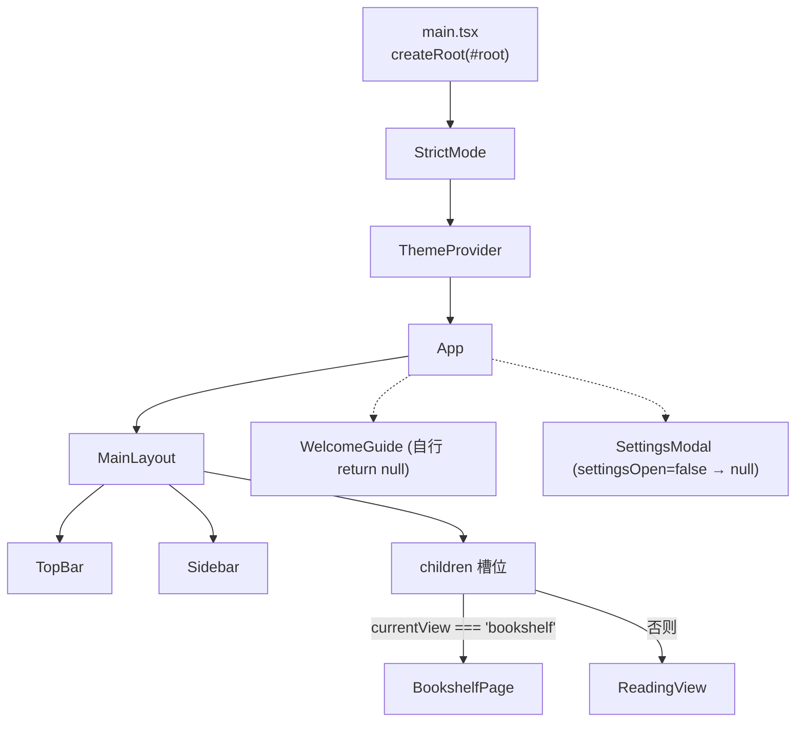
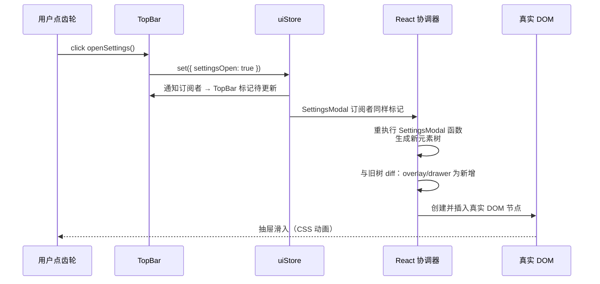

# 第 4 课 · React 19 核心：组件、JSX、props 与受控组件

> 所属阶段 1 · 预计时长 60-90 分钟 · 难度★★★☆☆

## 学习目标

- 能用自己的话解释「组件 = 接收 props 返回 UI 的函数」，并在本项目里指出至少 5 个函数组件（`App`、`MainLayout`、`TopBar`、`Sidebar`、`SettingsModal`……）。
- 能读懂 `App.tsx` 的组合式布局：`MainLayout` 通过 `children` prop 包裹页面内容。
- 能区分两种渲染控制：条件渲染（`&&` / 三元 / 提前 return null）与列表渲染（`map` + `key`）。
- 能说清受控组件的数据流向：`value` 来自 state、`onChange` 写回 state。
- 能从「虚拟 DOM 与协调（reconciliation）」的层面解释：改一个 state 后浏览器里到底发生了什么。
- 能回答高频面试题：「React 的 Diff 算法做了哪些假设？」「受控与非受控的区别？」「为什么要写 key？」
- 独立完成实操作业的三个层级：基础开关项 → 进阶状态生命周期思考 → 挑战 Tab 扩展。

- 能说出本项目「组件树 + store」的双层结构：组件树负责描述 UI 形状，store 负责持有跨组件数据。

## 前置检查

- 已完成第 3 课：本地 `pnpm dev` 能同时跑起前端（5174 端口）与后端（3003 端口）。
- 了解第 2 课的目录职责划分：本课只碰 `src/App.tsx`、`src/main.tsx`、`src/components/layout/` 与 `src/components/settings/` 四处。
- 浏览器装好 React DevTools 扩展——本课新增了多个用它观察的检查点。

## 关键文件

| 文件 | 职责 |
|---|---|
| `src/main.tsx` | 应用入口：把 `<App />` 挂到 `#root`，外层包 `StrictMode` 与 `ThemeProvider` |
| `src/App.tsx` | 根组件：决定当前显示书架还是阅读器 |
| `src/components/layout/MainLayout.tsx` | 全局骨架：顶栏 + 侧栏 + 主内容区，通过 `children` 接收页面 |
| `src/components/settings/SettingsModal.tsx` | 设置抽屉：条件渲染的经典样本，含 Tab 切换 |

## 正文

### 概念讲解

**React 组件是普通函数**。输入是 props（父组件传来的只读数据），输出是一段描述 UI 的对象（React 元素）。React 负责把这些描述高效地变成真实 DOM——你从不直接操作 DOM。

**JSX 是语法糖**。`<MainLayout><p>hi</p></MainLayout>` 编译后等价于嵌套的 `jsx()` 调用：

```tsx
// 你写的
<MainLayout><p>hi</p></MainLayout>

// 编译器（Vite 内的 esbuild/Babel）生成的近似物
jsx(MainLayout, { children: jsx('p', { children: 'hi' }) })
```

`jsx(type, props)` 返回的只是一个普通 JS 对象，形如 `{ type: MainLayout, props: { children: … } }`——**它不是 DOM 节点，是「对 DOM 的描述」**，所以叫虚拟 DOM。这个认识解释了很多后续现象：

- JSX 里能写任何 JS 表达式，因为 `{}` 本质就是在调函数时传参；
- 组件名必须大写——小写会被当成字符串标签 `'div'` 而非变量引用；
- 返回的「元素」很便宜，创建一万个也不碰真实 DOM，贵的是后面把它变成 DOM 的那一步。

三条高频语法规则：

1. 只能有一个根元素（或用 `<>…</>` Fragment）；
2. `{}` 内放表达式，不能放语句（`if` 要换成三元或提前算好变量）;
3. `class` 写成 `className`，事件用驼峰如 `onClick`。

**props 是单向向下的**。父组件把数据和回调函数作为 props 传下去；子组件想改变状态，只能调用父传下来的回调。这条「数据向下、事件向上」的单向数据流贯穿整个项目。

#### 单向数据流在本项目的完整实例

把「数据向下、事件向上」放到本课四个文件里验证一遍：

- **向下**：`App` 把 `currentView` 算出的页面元素作为 children 传给 `MainLayout`；`MainLayout` 不持有任何页面数据。
- **向上**：`TopBar` 想打开设置，不是自己去改某个全局变量，而是调用 store 的 `openSettings()` action——「事件」向上交给状态容器，「数据」再流下来让所有订阅者更新。子组件从不直接修改父组件传来的东西（props 对象在开发模式下是只读冻结的）。
- **旁路**：`WelcomeGuide`、`SettingsModal` 这类常驻组件通过 store 直接拿数据，绕过了层层 props 传递。这不是对单向流的破坏，而是第三条通道（全局状态）——第 9 课会系统讨论「什么时候该用哪条通道」。

记住这个判断口诀：**父子之间走 props，跨子树共享走 store，DOM 反向通知走回调**。本项目所有组件通信都能归进这三类。

**受控组件**指表单元素的值完全由 React state 驱动：`<input value={draft} onChange={(e) => setDraft(e.target.value)} />`。输入框显示什么由 state 决定，用户每敲一个键触发 `onChange` 更新 state，state 再驱动重新渲染。好处是「UI = f(state)」，任何时候 state 都是唯一事实来源。第 9 课的 `BookCard` 重命名框是这个理论的完整落地。

#### state 是快照：批处理与「同一次渲染里的旧值」

还有一个初学阶段最容易踩的认知偏差要提前钉死：**set 函数之外读到的 state 是本次渲染的快照，而不是「实时值」**。

```tsx
function handleClick() {
  setCount(count + 1);   // count 是这次渲染捕获的闭包变量
  setCount(count + 1);   // 两次都基于同一个快照 → 只 +1
}
```

两次调用会被**批处理**（batching）合并成一次重渲染，而两次读到的 `count` 都是同一个闭包变量，所以最终只加 1。想连续累加要用函数式更新：`setCount(c => c + 1)`——updater 收到的参数是「上一个最新值」。这个特性在本项目里同样成立：`themeStore.setMode` 这类单字段 set 无所谓，但第 7 课 `bookSlice` 里基于 `state` 计算新值的 action 全部依赖这条语义。

顺带记住结论的另一半：批处理意味着「一次事件处理器里的多次 set 只引发一次 render」，所以不必为了性能手动合并 set 调用——React 已经替你做了。

#### 通用原理：虚拟 DOM 与协调（reconciliation）

既然每次 render 都生成一棵全新的元素树，React 怎么避免整页重建？答案是**协调算法**：

1. **触发**：state/props 变化 → 该组件被标记为待更新；
2. **渲染**：从该组件开始重新执行函数，得到新元素树；与上一棵树递归对比；
3. **提交**：把差异以最小操作量打到真实 DOM（改文本就改文本节点，加条目只插入新节点）；
4. **收尾**：执行布局效应、同步上一次渲染遗留的 effect 清理函数（第 5 课细讲）。

全树对比理论上是 O(n³)，React 靠两条假设降到 O(n)：

- **不同类型的元素产生不同的子树**：`<BookshelfPage />` 换成 `<ReadingView />` 时，前者整棵子树直接销毁重建，不做内部对比——这解释了自测题里「切换视图 state 会丢」的现象；
- **同层的子元素通过 `key` 识别身份**：key 相同即视为同一个组件实例，DOM 节点被移动/复用而非重建，组件内的 state 得以保留。

理解这两条假设后，「为什么 key 要稳定」「为什么条件渲染用三元会卸载组件」都不再是需要死记的规则，而是算法的直接推论。

### 代码走读

按应用启动顺序读四个文件，全部为完整文件走读。

**1. 入口 `main.tsx` —— 全文仅 13 行**

```tsx
import { StrictMode } from 'react'
import { createRoot } from 'react-dom/client'
import './index.css'
import App from './App.tsx'
import { ThemeProvider } from './theme/ThemeProvider.tsx'

createRoot(document.getElementById('root')!).render(
  <StrictMode>
    <ThemeProvider>
      <App />
    </ThemeProvider>
  </StrictMode>,
)
```

逐行看：

- `createRoot(document.getElementById('root')!)` 是 React 18+ 的新挂载 API（取代旧的 `ReactDOM.render`），返回一个「根」对象，后续所有更新都发生在它之下；`!` 告诉 TS 这个元素一定存在（Vite 脚手架保证 `index.html` 里有 `<div id="root">`）。
- `import './index.css'` 把全局样式注入构建管线——Tailwind 4 的入口就在这个文件的第一行（第 8 课展开）。
- `StrictMode` 在开发模式下会把每个组件**渲染两次**、把 effect 也多跑一轮（挂载→卸载→再挂载），用来暴露副作用不干净的问题。以后调试时看到「日志打了两遍」先想到它，这不是 bug。
- 包裹顺序 `StrictMode > ThemeProvider > App` 决定了 Context 的作用域：`ThemeProvider` 里提供的 `ThemeContext` 只有它的后代能消费，`App` 及其整棵子树都在内。

**2. 根组件 `App.tsx` —— 全文 18 行，条件渲染 + 组合**

```tsx
export default function App() {
  const currentView = useUIStore((s) => s.currentView);

  return (
    <MainLayout>
      {currentView === 'bookshelf' ? <BookshelfPage /> : <ReadingView />}
      <WelcomeGuide />
      <SettingsModal />
    </MainLayout>
  );
}
```

三个知识点：

- `currentView` 来自 Zustand store（第 6 课细讲），这里只需知道它是一个会变的字符串 `'bookshelf' | 'reader'`。三元表达式就是最朴素的「路由」——注意按上面讲的第一条 Diff 假设，两侧类型不同意味着切换即整树卸载重建。
- `<WelcomeGuide />` 和 `<SettingsModal />` 始终挂在树上，内部自己根据状态决定返回 `null` 还是真 UI——这是「常驻组件自隐藏」模式。返回 `null` 的组件函数仍然执行了，只是产出为空；与条件挂载的区别见常见坑第 5 条。
- `App` 把整块内容当 `children` 传给 `MainLayout`。

**3. `MainLayout.tsx` —— 全文 21 行，children 组合模式**

```tsx
export function MainLayout({ children }: { children: React.ReactNode }) {
  const currentView = useUIStore((s) => s.currentView);

  return (
    <div className="app-shell min-h-screen" style={{ color: 'var(--text)' }}>
      <div className="app-frame">
        <TopBar />
        <div className={`app-workspace ${currentView === 'reader' ? 'app-workspace-reader' : ''}`}>
          <Sidebar />
          <main className={`app-main ${currentView === 'reader' ? 'app-main-reader' : ''}`}>
            {children}
          </main>
        </div>
      </div>
    </div>
  );
}
```

逐层看：

- `children` 是一种特殊的 prop：写在标签之间的内容都会进到这个槽位。`MainLayout` 不关心里面是书架还是阅读器，它只负责骨架——这就是组合优于继承。
- 它自己也订阅了 `currentView`，用于给 workspace/main 两个容器切换 class。同一份数据在 `App` 和 `MainLayout` 各订了一次，互不干扰——Zustand 订阅是「按组件粒度」的（第 6 课机制详解）。
- `style={{ color: 'var(--text)' }}` 直接引用 CSS 变量，颜色随主题自动变化而无需任何 React 参与——这是第 8 课主题体系的伏笔。
- 模板字符串拼 className 实现了视图相关的样式切换。留意一个细节：`currentView` 变化会让 `MainLayout` 重渲染，但 `{children}` 位置上的元素类型没变，所以页面组件并不会因此卸载。

**4. `SettingsModal.tsx` —— 全文 63 行，受控状态 + 条件渲染教科书**

```tsx
type SettingsTab = 'ai' | 'voice';

export function SettingsModal() {
  const { settingsOpen, closeSettings } = useUIStore();
  const [activeTab, setActiveTab] = useState<SettingsTab>('ai');

  if (!settingsOpen) return null;

  return (
    <div className="settings-drawer-overlay" onClick={closeSettings}>
      <aside
        className="settings-drawer settings-drawer-enter"
        onClick={(e) => e.stopPropagation()}
      >
        <div className="settings-drawer-header">
          <h2 className="settings-drawer-title">设置</h2>
          <button onClick={closeSettings} className="settings-close-btn" title="关闭设置">
            <FiX size={18} />
          </button>
        </div>

        <div className="settings-tabs" role="tablist" aria-label="设置分类">
          <button role="tab" aria-selected={activeTab === 'ai'}
            className={`settings-tab ${activeTab === 'ai' ? 'active' : ''}`}
            onClick={() => setActiveTab('ai')}>
            AI
          </button>
          <button role="tab" aria-selected={activeTab === 'voice'}
            className={`settings-tab ${activeTab === 'voice' ? 'active' : ''}`}
            onClick={() => setActiveTab('voice')}>
            语音
          </button>
        </div>

        <div className="settings-drawer-content">
          {activeTab === 'ai' ? <AISettingsPanel /> : <VoiceSettingsPanel />}
        </div>

        <div className="settings-drawer-footer">
          <button onClick={closeSettings} className="btn btn-primary px-6 py-2.5">
            完成
          </button>
        </div>
      </aside>
    </div>
  );
}
```

逐段精读：

- `const [activeTab, setActiveTab] = useState<SettingsTab>('ai')`：局部 UI 状态（哪个 Tab 激活），不需要全局共享，所以留在组件里，而 `settingsOpen` 这种跨组件开关才进 store。判断标准：**这个状态需要被几个互不为父子的组件看到？**
- `if (!settingsOpen) return null;`：提前 return 必须放在所有 Hooks 之后——Hooks 以调用顺序记录身份，顺序反了 React 直接报错（第 5 课讲原理）。
- 遮罩 `onClick={closeSettings}` 关闭整个抽屉；抽屉本体 `stopPropagation` 阻止冒泡，否则点抽屉内部也会冒泡到遮罩把弹窗关掉。这是模态框的标准交互三件套之一（另两件是 Esc 关闭和焦点管理，本项目用全局快捷键系统实现 Esc）。
- Tab 按钮：激活态完全由 `activeTab` 派生——`aria-selected` 和 `className` 都是同一份数据算出来的，没有任何手动 DOM class 操作。这就是声明式的含义：你只描述「activeTab 是 ai 时长什么样」。
- 内容区三元：切 Tab 时 `AISettingsPanel` 卸载、`VoiceSettingsPanel` 挂载，两个面板内部的表单草稿互不保留——又是第一条 Diff 假设的应用。

项目里真正的受控表单在 `BookCard.tsx` 的重命名输入框（第 9 课精读）：`value={titleDraft}` + `onChange={(e) => setTitleDraft(e.target.value)}`，回车提交、Esc 还原，全部靠监听 `onKeyDown` 判断 `e.key`。

**5. 组件树全景：把 React DevTools 当地图用**

读完四个文件后，你的脑中应该有这张静态结构图（层级即 React DevTools Components 面板的展开形态）：

```text
StrictMode
└─ ThemeProvider            ← Context.Provider + ThemeOverlays + 全局快捷键
   └─ App                   ← 订阅 currentView，决定主区域内容
      └─ MainLayout         ← 订阅 currentView，切换布局 class
         ├─ TopBar          ← 订阅多个 store（第 9 课精读）
         ├─ Sidebar         ← 订阅两个 store（第 9 课精读）
         ├─ {children}      ← BookshelfPage 或 ReadingView（二选一）
         │   └─ BookCard ×N ← key={book.id} 的列表项
         ├─ WelcomeGuide    ← 自隐藏
         └─ SettingsModal   ← 自隐藏 + 内部 activeTab
```

对照真实面板核对三件事：(1) `BookshelfPage` 与 `ReadingView` 是否真的互斥存在；(2) `BookCard` 的数量是否等于书架上的书；(3) 点开任意 `BookCard` 能看到 `book` prop 的完整对象——props 在 DevTools 里完全透明，这是调试 props 流转的第一工具。

一个值得养成的习惯：**读任何 React 项目先画这棵树**。组件树是项目的骨架图，store 是血液系统；骨架清楚了，后面每一课的知识才有挂靠点。

### 图示



一次点击设置按钮后的完整链路（把本课所有概念串起来）：



### 边学边练

以下检查点请**边读边做**，每个不超过 5 分钟，做完再继续往下读。

**练习 1：亲眼看见 StrictMode 双渲染**

在 `App.tsx` 的函数体第一行加 `console.log('App render', currentView);`，刷新页面。Console 里会出现两条相同日志——这就是开发模式下 StrictMode 的双渲染。再删掉这行日志。思考：生产构建（`pnpm build`）会有几条？（一条都没有——console.log 不是你留下的理由。）

**练习 2：用 React DevTools 验证「常驻但隐藏」**

打开 React DevTools 的 Components 面板，找到 `SettingsModal`（它在 `App` 下、`WelcomeGuide` 旁边）。此时它是隐藏的，但节点就在树上。点开右上角齿轮图标让它显示，观察右侧 Props 面板里的变化。试着在面板里翻找 `activeTab`——只要弹窗打开过一次，这个值就一直在。

**练习 3：亲手制造一次 Hooks 顺序错误**

把 `SettingsModal.tsx` 里的 `if (!settingsOpen) return null;` 临时剪切到 `useState` 那一行之前，保存。Console 立刻抛出 "Rendered fewer hooks than expected"。看完报错恢复原状。你刚刚验证了 Hooks 铁律不是风格建议而是运行时约束。

**练习 4：观察 stopPropagation 的必要性**

在 `SettingsModal.tsx` 的 `<aside>` 上临时删掉 `onClick={(e) => e.stopPropagation()}`，打开设置后点抽屉标题「设置」二字——弹窗直接关闭了，因为点击冒泡到了遮罩的 onClick。恢复原状。

**练习 5：数一数一次点击触发了几个组件重渲染**

给 `App.tsx`、`MainLayout.tsx` 各加一行 `console.log('xxx render')`，然后点击侧栏开关按钮（`toggleSidebar`）。观察哪些日志出现、哪些没出现：`App` 没出现（它只订 `currentView`），`MainLayout` 出现了吗？它订的也是 `currentView`——如果没出现，说明 Zustand 的 selector 帮你过滤掉了无关更新。把这个现象记下来，第 6 课揭晓原理。测完删掉全部日志。

**练习 6：验证 state 快照语义**

在 `SettingsModal.tsx` 里临时给 Tab 栏加一个测试按钮：

```tsx
<button onClick={() => { setActiveTab('ai'); setActiveTab('voice'); }}>test</button>
```

点击后 Tab 停在「语音」——第二次 set 生效。再改成两次 `setActiveTab(t => (t === 'ai' ? 'voice' : 'ai'))`，点击后回到「AI」——updater 链式生效了两次。测完删除按钮。

### 实操作业

大纲作业：**给设置弹窗加一个新开关项**。目标是在设置里加一个「盲打模式提示音」式的纯 UI 开关（本课先用 `useState` 实现，第 6 课升级为接入 store）。按基础/进阶/挑战三层完成：

**基础层（必做）**

1. 打开 `SettingsModal.tsx`，观察现有两个 Tab（`'ai' | 'voice'`）如何用 `activeTab` 三元切换。
2. 在 `settings-drawer-content` 里、Tab 内容下方加一块「实验性功能」区域：
   ```tsx
   const [soundHint, setSoundHint] = useState(false);
   ```
   渲染一行 label + `<input type="checkbox" checked={soundHint} onChange={(e) => setSoundHint(e.target.checked)} />`。注意这是标准受控组件写法。
3. 开关切换后，让设置标题旁边出现一个小徽标：`{soundHint && <span>已启用</span>}`，练习 `&&` 条件渲染。

验收标准：
- [ ] 打开设置能看到新开关，点击可切换勾选态且「已启用」徽标随之出现/消失；
- [ ] 浏览器 Console 无 React 报错（尤其没有 Hooks 顺序警告）。

**进阶层（推荐）**

4. 给开关加一段说明文字，仅在开启时显示：`{soundHint && <p className="text-xs opacity-60">开启后在切换盲打模式时播放提示音（占位功能）</p>}`——体会同一份数据派生两处 UI。
5. 做一组对照实验并记录结论：(a) 开关切到开 → 关闭弹窗 → 重开，勾选态还在吗？(b) 刷新页面后再打开呢？(a) 应该保留（return null 未卸载组件）、(b) 归零（JS 世界全部重来）。把两个结论写进 commit message——这正是「局部 state 的生命周期边界」的第一手体感。

**挑战层（选做）**

6. 把单个开关扩展成第三个 Tab：`type SettingsTab = 'ai' | 'voice' | 'lab'`，新增一个「实验室」面板承载你的开关，仿照现有两个 button 的结构补齐 `role="tab"` / `aria-selected` / 激活态 className。完成后对照自测题第 6 题想一想：切走再切回来，开关状态还在吗？

## 本课与面试

**Q1：什么是虚拟 DOM？它为什么能提升性能？**
答题要点：(1) 虚拟 DOM 是「对 UI 的 JS 对象描述」，render 产出的是这棵描述树；(2) 性能来自**批量与最小化**的真实 DOM 操作——DOM API 是最昂贵的浏览器接口，React 先在内存里 diff 出最小变更集再一次提交；(3) 加分项：主动指出「虚拟 DOM 并不总是比精心手写的原生操作快，它买的是可维护性与性能下限」，面试官会眼前一亮。

**Q2：React 的 Diff/协调算法基于哪些假设？**
答题要点：两条——不同类型元素产生不同子树（直接重建）；同层子元素靠 key 识别身份（复用移动）。由此推导出 O(n) 复杂度。能顺着说出「跨层级移动节点会导致子树重建」更佳。

**Q3：受控组件和非受控组件的区别？各适用什么场景？**
答题要点：受控 = value 由 state 驱动、唯一事实来源是 React（本项目所有输入框）；非受控 = DOM 自己持有值，React 用 ref 读取（如 `Sidebar.tsx` 里那个隐藏的 `<input type="file">`——文件选择天然适合非受控）。追问「什么时候非受控更好」：性能敏感的超大表单、集成第三方 DOM 库。

**Q4：JSX 是什么？为什么组件名要大写？**
答题要点：JSX 编译为 `jsx()` 工厂调用，产出元素对象；大写标识符才会被当作变量求值，小写被当作 HTML 字符串标签——`<book />` 渲染的是未知元素而不是你的组件。

**Q5：为什么 state 要不可变更新（造新对象）而不是直接改？**
答题要点：React/Zustand 都靠**引用比较**判断「变没变」（`Object.is`）；原地修改不产生新引用，比较结果永远是「没变」，UI 不更新。此外不可变让「前后两次快照」可随时对比，是时间旅行调试和 memo 化的基础。本项目的 `updatePairChinese`（bookSlice）是三层不可变映射的标准范例，第 7 课逐行走读。

**Q6：`return null` 和条件挂载 `{open && <Modal/>}` 有什么区别？**
答题要点：前者组件函数照常执行、state 保留、Hooks 照跑；后者连函数都不执行、卸载即销毁 state。选择依据：需要保留表单草稿等瞬时状态用前者，需要彻底重置用后者。

**Q7：StrictMode 会不会影响生产环境？**
答题要点：不会。双渲染、effect 双执行只在开发模式发生，目的是暴露非幂等的副作用；生产包里 StrictMode 是空操作。答出「它是检测器不是行为变更」即可。

**Q8：props 为什么设计成只读？子组件改父组件的状态的正确姿势是什么？**
答题要点：只读保证数据流向可追溯——任何 UI 变化都能沿所有权链找到源头。正确姿势是「回调上抛」：父传回调，子调用之，状态变更永远发生在拥有它的那一层。本项目实例：`BookCard` 收 `onOpen` 回调而非自己改 `currentView`。

**Q9：一次 setState 之后 React 立刻重新渲染了吗？**
答题要点：不是立刻同步渲染。更新先进入调度队列，同一批次内的多次更新合并为一次渲染（自动批处理），时机由 React 调度器决定（并发特性下还可能被中断/恢复）。答题时能区分「触发更新」「重渲染」「提交 DOM」三个阶段即可超过多数候选人。

## 常见坑

1. **在条件 return 之后调用 Hooks**：`useState` 必须永远在每次渲染中以相同顺序执行。把 `if (!open) return null` 写在 `useState` 之前，React 直接抛 "Rendered fewer hooks than expected"。正确姿势：先声明所有 Hooks，再提前 return（练习 3 已亲历）。
2. **直接改 state 再 set**：如 `arr.push(x)` 后 `setArr(arr)`，引用没变 React 认为无需重渲染。必须造新引用：`setArr([...arr, x])`。
3. **忘写列表 `key` 或用数组下标当 key**：下标 key 在插入/删除/排序时会导致复用错乱的组件。第 9 课作业做排序时会亲眼见到。
4. **混淆受控与非受控**：给了 `value` 却忘了 `onChange`，输入框会「打不了字」——因为每次渲染都把它强制重置回同一个值。
5. **误以为 return null 的组件已卸载**：`SettingsModal` 关闭后 `activeTab` 其实还保留着（下次打开仍是上次的 Tab）。想要「每次打开都回到第一个 Tab」，要么条件挂载，要么在 `openSettings` 时重置——先想清楚要哪种语义。
6. **依赖快照值做连续更新**：`setCount(count + 1)` 连写两次只加一。凡「基于上一个值」的更新一律用 updater 函数形式。

## 自测题

<details>
<summary>1. 为什么 <code>&lt;SettingsModal /&gt;</code> 在 App 里始终被渲染，却看不到它？</summary>

组件函数仍然执行了，但内部 `if (!settingsOpen) return null;` 使其输出为空，React 渲染出 nothing。这是「逻辑上常驻、视觉上隐藏」的模式；区别于条件挂载（`{open && <Modal/>}`），后者连组件函数都不执行、state 会丢失。
</details>

<details>
<summary>2. <code>MainLayout</code> 为什么用 <code>children</code> 而不是接收一个 <code>view="bookshelf"</code> 的 prop 自己 switch？</summary>

children 让 MainLayout 与具体页面解耦：它不需要 import 各页面组件，也不随新增页面而修改。组合模式使布局组件纯粹负责结构，符合开闭原则；而 prop-switch 会让布局组件知道并依赖所有页面。
</details>

<details>
<summary>3. 受控 input 输入一个字符，从键盘事件到像素更新中间发生了什么？</summary>

keydown → 浏览器预输入 → onChange 触发 → setState 调度更新 → React 重渲染组件函数，拿到新的 state 值 → diff 发现 input 的 value 变化 → 提交到真实 DOM 显示。若中途任何一步断了（没有 onChange 更新 state），DOM value 会被拉回旧值，表现为「无法输入」。
</details>

<details>
<summary>4. JSX 里 <code>{currentView === 'bookshelf' ? &lt;A/&gt; : &lt;B/&gt;}</code> 切换时，A 的内部 state 会保留吗？</summary>

不会。三元两侧是不同位置的元素类型，按协调算法第一条假设（不同类型产生不同子树），A 被整体卸载、B 挂载，A 的 state 销毁。想保留需提升 state 到共同父级/store，或用 CSS 隐藏而非卸载。
</details>

<details>
<summary>5. 虚拟 DOM 的两条 Diff 假设是什么？它们分别解释了你已见的哪个现象？</summary>

假设一：不同类型元素产生不同子树——解释了视图切换/Tab 切换时组件状态丢失；假设二：同层子元素靠 key 识别——解释了列表增删时为何要求稳定业务 id。两条合起来把 O(n³) 的树对比降到 O(n)。
</details>

<details>
<summary>6. <code>SettingsModal</code> 关闭再打开，<code>activeTab</code> 还是上次停留的 Tab 吗？为什么？</summary>

是的。关闭只是 return null，组件未卸载、Hook 状态未销毁，activeTab 保持原值。这与「刷新页面后回到 ai」不矛盾——那是整个应用的 JS 状态都没了。若产品要求每次打开回到默认 Tab，应在 openSettings 动作里顺带重置，或改为条件挂载。
</details>

<details>
<summary>7. 为什么 <code>setCount(count + 1)</code> 连续调用两次最终只加一？怎么修？</summary>

同一批次内两次调用被合并为一次渲染，且两次读取的都是当次渲染闭包里的同一个 count 快照，所以两次计算结果相同、后写覆盖前写。修复：使用函数式更新 setCount(c =&gt; c + 1)，updater 依次接收上一个结果。这也是为什么 bookSlice 里基于旧 state 的 action 都写成 set((state) =&gt; ...)。
</details>

<details>
<summary>8. 面试题：「React 就是因为虚拟 DOM 才快的，对吗？」怎么答才严谨？</summary>

不完全对。虚拟 DOM 的价值是把「随意重渲染」的性能下限抬高——开发者随便写，React 保证 DOM 操作最少。但对比极致优化的原生代码（精准更新某个文本节点），虚拟 DOM 多了一层 diff 开销反而更慢。它的真正卖点是以可接受的运行时开销换取声明式的开发模型与可维护性。能主动指出这一点通常是大加分项。
</details>
