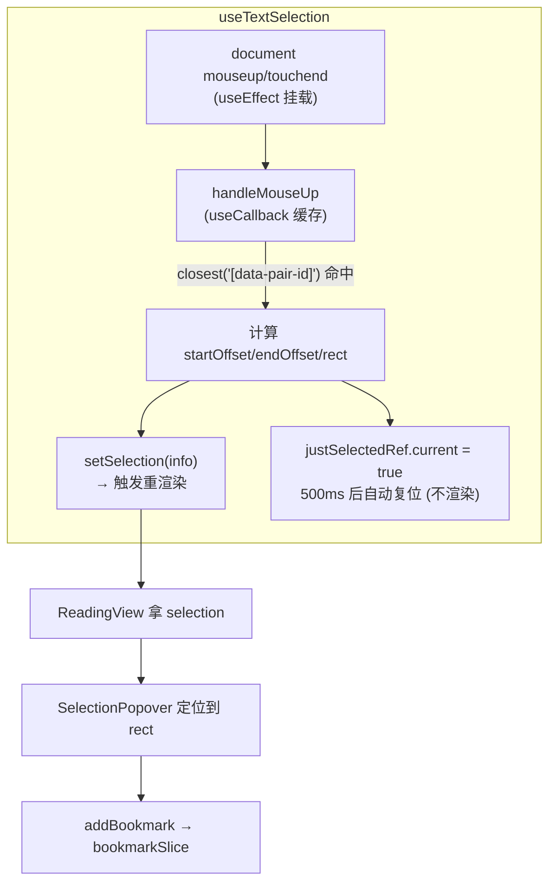
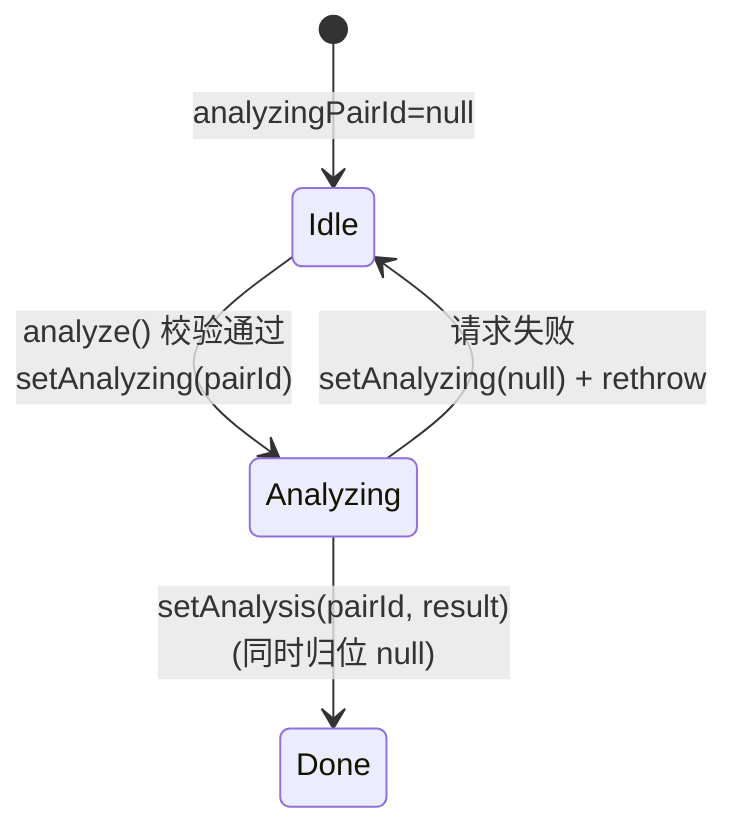

# 第 5 课 · Hooks 体系与自定义 Hook 设计

> 所属阶段 1 · 预计时长 60-90 分钟 · 难度★★★★☆

## 学习目标

- 能分别说出 `useState` / `useEffect` / `useRef` / `useCallback` 的适用场景与常见误用。
- 能解释自定义 Hook 的本质：「复用**有状态的逻辑**，不复用 state 本身」。
- 能从实现机制层面回答「为什么 Hooks 不能写在条件分支里」。
- 精读 `useAnalysis`，说清「Hook 编排多个 store + 异步请求」的职责分层。
- 精读 `useEpubParser`，掌握 `parsing/error/parseFile` 三件套式的异步状态封装。
- 精读 `useTextSelection`，理解 `useRef` 存放「不触发渲染的可变标记」（`justSelectedRef`）的动机。
- 能识别并修复「闭包捕获旧值」（stale closure）——本课最重要的通用原理。
- 完成实操作业三层：写一个 `useKeyPress` 并逐步加深（防误触 → 泛化 → 组合键）。

## 前置检查

- 已完成第 4 课：能读懂 `App.tsx` 的组合结构，理解受控组件与条件渲染、state 快照语义。
- 已掌握 JS 闭包基础：知道「内层函数引用外层变量时，捕获的是定义那一刻的环境」——本课的闭包陷阱全建立在这句话上。

## 关键文件

| 文件 | 职责 |
|---|---|
| `src/hooks/useAnalysis.ts` | 封装「提交回译 → 调 AI 分析 → 写回 store」全流程，返回 `{ analyze, analyzingPairId }` |
| `src/hooks/useEpubParser.ts` | 封装 EPUB 解析的异步状态：`{ parseFile, parsing, error }` |
| `src/hooks/useTextSelection.ts` | 全局监听 mouseup/touchend，把浏览器选区解析成 `SelectionInfo` |

## 正文

### 概念讲解

**Hooks 解决的问题**：函数组件本来没有状态、没有生命周期。Hooks 是一组「钩进」React 渲染机制的函数，让函数组件拥有状态（`useState`）、执行副作用（`useEffect`）、持有跨渲染的可变值（`useRef`）、缓存函数引用（`useCallback`）。两条铁律：只在组件或自定义 Hook 顶层调用；每次渲染必须以相同顺序调用。

四个基础 Hook 的分工：

| Hook | 一句话 | 本项目实例 |
|---|---|---|
| `useState` | 会触发重渲染的值 | `useEpubParser` 的 `parsing`、`error` |
| `useEffect` | 渲染后同步外部世界（DOM 事件、订阅、定时器） | `useTextSelection` 挂载/卸载 document 监听 |
| `useRef` | 不触发渲染的任意可变容器；`.current` 改变不引起渲染 | `justSelectedRef`、Sidebar 的 `fileInputRef` |
| `useCallback` | 缓存函数引用，依赖不变则返回同一个函数 | `analyze`、`handleMouseUp` |

**为什么需要 useCallback**：组件每次重渲染，函数体里的所有函数都是新建的。若把它作为 prop 传给被 memo 的子组件、或放进另一个 Hook 的依赖数组，引用不稳定会导致无意义重渲染/重复执行。`useCallback(fn, deps)` 在 deps 不变时归还上次那个函数。

**自定义 Hook = 以 `use` 开头的普通函数，内部调用其他 Hooks**。它的价值不是省代码行数，而是**命名一个业务能力**：调用方拿到的是语义化接口（`parseFile/parsing/error`），而不是一堆散落的 setState。两个组件调用同一个自定义 Hook，得到的是**两份完全独立的状态副本**——复用的是逻辑骨架，不是数据。

#### 通用原理一：Hooks 规则为什么存在

React 内部为每个组件维护一条 **Hook 链表**：第一次渲染时按调用顺序逐个创建节点（`useState(0)` 是节点 1，`useRef()` 是节点 2……），之后每次重渲染都**按同样的顺序走一遍链表取值**。所谓「state 记在哪里」，答案是「记在链表的第 N 个格子里」，与变量名无关。

由此两条铁律都是推论：

- **不能放在条件/循环里**：某次渲染少调了一个 Hook，后面的格子全部错位，React 从格子 3 取出的可能是你以为是格子 2 的 state。开发模式下 React 会检测到数量不符并抛 "Rendered fewer hooks than expected"（第 4 课练习 3 你已亲手触发）。
- **只能在组件/自定义 Hook 里调用**：链表挂在「正在渲染的组件实例」上，在事件回调或普通函数里调用时根本没有这个上下文。

第 6 课还会看到这条原理的延伸：Zustand 把状态放模块级 store 而非 Hook 链表里，所以它能在 React 之外被读取。

#### 通用原理二：闭包陷阱（stale closure）

每个组件渲染 = 执行一次组件函数 = 创建一套全新的局部变量和闭包。**effect 和回调捕获的是「它们被创建那次渲染」的变量快照**：

```tsx
function Counter() {
  const [count, setCount] = useState(0);
  useEffect(() => {
    const id = setInterval(() => {
      console.log(count);      // 永远打印 0！
    }, 1000);
    return () => clearInterval(id);
  }, []);                      // 空依赖 → effect 只创建一次 → 闭包永远是最初那次渲染的
}
```

定时器回调里的 `count` 不是「当前的 count」，而是首次渲染时的 0——interval 只注册了一次，它抱着第一次渲染的闭包过一辈子。三种修复路径，各有适用场景：

1. **写进依赖数组** `[count]`：count 变了就销毁旧 interval 建新的。正确但每秒重建定时器；
2. **函数式更新** `setCount(c => c + 1)`：不读外部 count，让 React 传最新值进来。计数场景最优解；
3. **改用 ref** `countRef.current`：ref 是跨渲染稳定的容器对象，读写都绕开快照语义（本项目 `justSelectedRef` 正是此思路）。

判断标准一句话：**回调里读到的响应式数据，要么进依赖数组，要么换成 ref/store——不存在第三种侥幸**。`useAnalysis` 的依赖数组就是按这个标准写的，下面走读时会对照。

### 代码走读

按复杂度从低到高精读三个真实 Hook，全部完整走读。

**1. `useEpubParser.ts` —— 全文 35 行，异步操作状态三件套**

```ts
import { useState, useCallback } from 'react';
import { parseEpubFile } from '../lib/epub/parser';
import { useBookStore } from '../stores/bookSlice';
import type { Book } from '../types';

export function useEpubParser() {
  const [parsing, setParsing] = useState(false);
  const [error, setError] = useState<string | null>(null);
  const addBook = useBookStore((s) => s.addBook);

  const parseFile = useCallback(
    async (file: File): Promise<Book | null> => {
      setParsing(true);
      setError(null);
      try {
        const book = await parseEpubFile(file);   // 纯逻辑在 lib 层
        if (book.chapters.length === 0) {
          setError('未能从EPUB中提取到日中句对。请确认文件格式正确。');
          return null;
        }
        addBook(book);                            // 副作用收敛到 store
        return book;
      } catch (e) {
        const msg = e instanceof Error ? e.message : 'EPUB解析失败';
        setError(msg);
        return null;
      } finally {
        setParsing(false);
      }
    },
    [addBook]
  );

  return { parseFile, parsing, error };
}
```

注意它的分层：**真正的解析算法在 `src/lib/epub/parser.ts` 的 `parseEpubFile`（阶段 2 主角），这个 Hook 只负责三件事**——开关 `parsing` 标志、收集 `error` 文案、成功后调 `addBook` 入库。`finally` 保证无论成败 loading 都会熄灭。空章节检查放在 try 内部而非抛异常，是因为「解析成功但内容为空」是业务分支而非程序错误，错误文案也更友好。`useCallback` 的依赖是 `[addBook]`：Zustand 的 action 引用永远稳定，所以 `parseFile` 整个生命周期只有一个实例。这是「UI 组件薄、lib 纯函数厚、Hook 当粘合剂」的项目惯例，你在阶段 4 会看到后端同样分层。

一个值得思考的边界情况：如果用户在解析进行中卸载了这个 Hook 所属的组件，`setParsing(false)` 会对已卸载组件调用——React 新版已不再为此告警（该调用是无害的空操作），但若要绝对严谨可以在 effect 清理里置一个 `alive` ref。项目选择简单优先，这是合理的取舍。

**2. `useAnalysis.ts` —— 全文 44 行，编排两个 store + 远程请求**

```ts
export function useAnalysis() {
  const { setAnalysis, setAnalyzing, analyzingPairId } = usePracticeStore();
  const aiProvider = useSettingsStore((s) => s.getActiveAIProvider());

  const analyze = useCallback(
    async (
      pairId: string,
      original: string,
      chinese: string,
      userTranslation: string
    ) => {
      if (!aiProvider.apiKey) {
        throw new Error('请先在设置中配置AI API Key');
      }
      if (!userTranslation.trim()) {
        throw new Error('请先输入你的日语回译');
      }

      setAnalyzing(pairId);
      try {
        const result = await analyzeTranslation(
          aiProvider,
          original,
          chinese,
          userTranslation,
          pairId
        );
        setAnalysis(pairId, result);
        return result;
      } catch (e) {
        setAnalyzing(null);
        throw e;          // 把错误抛给 UI 层展示
      }
    },
    [aiProvider, setAnalysis, setAnalyzing]
  );

  return { analyze, analyzingPairId };
}
```

四个值得咀嚼的细节：

- 它同时消费 `practiceSlice`（结果与 loading）和 `settingsSlice`（BYOK 配置），但自己不持有任何业务数据——数据全部住 store，Hook 只是流程编排者。
- 两道前置校验（apiKey、非空译文）用 **throw** 表达「这不是这个函数能消化的错误」，把展示决策留给调用方；成功路径 `setAnalysis` 内部会把 `analyzingPairId` 归位为 null（见 `practiceSlice.ts` 的实现：一次 set 同时写字典和清标志）；失败路径显式 `setAnalyzing(null)` 后 **re-throw**，构成一对完整的状态机迁移。
- `analyzeTranslation` 的五个参数全部由调用方显式传入，Hook 不自己去 ReadingView 捞「当前选中的句子」——参数即契约，谁调用谁负责准备输入。
- `aiProvider` 出现在依赖数组里：用户切换 AI 供应商时 `analyze` 才会重建。若漏写它，闭包会捕获旧配置——这就是上面讲的 stale closure 的经典事故现场。反过来注意 `analyzingPairId` **不在**返回的 useCallback 依赖里也没问题：它是通过返回值实时暴露的，不参与闭包捕获。

顺带指出一处可以更严谨的写法：第一行 `usePracticeStore()` 不带 selector 整店订阅（第 6 课讲代价），且 `(s) => s.getActiveAIProvider()` 在 selector 里调用了方法——因为该方法基于 `get()` 取数并返回既有对象的引用，这里恰好安全。安全的原因在第 6 课展开。

**3. `useTextSelection.ts` —— 全文 88 行，DOM API + useRef 标记位**

前半部分是类型与监听回调：

```ts
export interface SelectionInfo {
  pairId: string;
  startOffset: number;
  endOffset: number;
  text: string;
  rect: DOMRect;
}

export function useTextSelection() {
  const [selection, setSelection] = useState<SelectionInfo | null>(null);
  const justSelectedRef = useRef(false);

  const handleMouseUp = useCallback(() => {
    const sel = window.getSelection();
    if (!sel || sel.isCollapsed || !sel.rangeCount) {
      setSelection(null);
      return;
    }

    const text = sel.toString().trim();
    if (!text) {
      setSelection(null);
      return;
    }

    const range = sel.getRangeAt(0);

    // 检查是否在 SentencePairCard 内
    const container = range.commonAncestorContainer;
    const pairCard = (container instanceof Element ? container : container.parentElement)
      ?.closest('[data-pair-id]');

    if (!pairCard) {
      setSelection(null);
      return;
    }

    const pairId = pairCard.getAttribute('data-pair-id');
    if (!pairId) {
      setSelection(null);
      return;
    }

    const rect = range.getBoundingClientRect();

    // 计算相对于文本内容的偏移
    const preRange = document.createRange();
    preRange.selectNodeContents(pairCard);
    preRange.setEnd(range.startContainer, range.startOffset);
    const startOffset = preRange.toString().length;
    const endOffset = startOffset + text.length;

    justSelectedRef.current = true;
    setSelection({
      pairId,
      startOffset,
      endOffset,
      text,
      rect,
    });

    // 500ms 后重置标记
    setTimeout(() => {
      justSelectedRef.current = false;
    }, 500);
  }, []);
```

这段是一连串**早退守卫（early return guard）**：无选区 → 空 text → 不在句对卡片内 → 无 pairId，四种非法情况统一归零 selection 后直接返回，主逻辑零嵌套。核心计算只有一处值得细看：再造一个从卡片开头到选区起点的 `preRange`，用 `preRange.toString().length` 得到纯文本偏移 `startOffset/endOffset`。书签系统（第 18 课）正是靠这对偏移量把高亮重新贴回原文——存 Range 对象本身没法持久化，存纯文本偏移才能进 localStorage。

后半部分是 effect 与导出：

```ts
  useEffect(() => {
    document.addEventListener('mouseup', handleMouseUp);
    document.addEventListener('touchend', handleMouseUp);
    return () => {   // 清理函数：卸载时摘掉监听
      document.removeEventListener('mouseup', handleMouseUp);
      document.removeEventListener('touchend', handleMouseUp);
    };
  }, [handleMouseUp]);

  const clearSelection = useCallback(() => {
    window.getSelection()?.removeAllRanges();
    setSelection(null);
  }, []);

  // 导出标记，供外部判断
  const hasJustSelected = () => justSelectedRef.current;

  return { selection, clearSelection, hasJustSelected };
}
```

三个设计点：

- **事件委托**：不在每个句子卡上绑事件，而是挂一份 document 级监听，用 `closest('[data-pair-id]')` 向上找归属——选区落在卡片外就置空。一章几百个句对，委托省掉几百份监听器。
- **ref vs state 的教科书对比**：`selection` 变化要驱动 `SelectionPopover` 弹出 → 用 state；`justSelectedRef` 只是给键盘路由（防止刚选中就被快捷键抢走）看的瞬时标记，500ms 后自动复位，变化不需要任何重渲染 → 用 ref。判断标准只有一条：**这个值变了需不需要 UI 跟着变？**
- 返回的 `clearSelection` 同时清浏览器选区（`removeAllRanges`）和 state，供 Esc 快捷键调用；两个动作缺一不可——只清 state 弹窗消失但蓝色选区还挂着，只清选区弹窗还赖着不走。

### 图示



`useAnalysis` 的一次成功分析的状态机迁移：



### 边学边练

以下检查点请边读边做，每个不超过 5 分钟。

**练习 1：观察 Hook 链表的「身份即顺序」**

在 `useEpubParser` 里把 `const [error, setError] = useState<string | null>(null);` 移到 `parsing` 声明之前，保存后去页面导入一本书。功能完全正常——交换顺序没坏，因为**每次渲染的顺序一致**。再试着把其中一个 useState 包进 `if (false) {}`，Console 立刻报错。恢复原状。结论：顺序本身不重要，「每次一致」才重要。

**练习 2：亲眼看见 stale closure**

新建临时文件或在任意组件里粘贴：

```tsx
const [n, setN] = useState(0);
useEffect(() => {
  const id = setInterval(() => console.log('snapshot:', n), 1000);
  return () => clearInterval(id);
}, []);
```

无论你怎么点击按钮增加 n，日志永远是初始值。然后把依赖改成 `[n]` 再看——日志跟上了，但 DevTools Network/Performance 里能看到 interval 在反复重建。测完删除。

**练习 3：验证 Zustand action 引用的稳定性**

在 `Sidebar` 组件里加 `console.log('render')`，然后随便读几句书触发多次渲染。同时在 `useEpubParser` 的 `parseFile` 定义处加 `console.log('parseFile rebuilt')`。你会发现 Sidebar 刷屏而 parseFile 几乎不说话——`[addBook]` 恒定，useCallback 直接归还旧函数。测完删除日志。

**练习 4：感受清理函数的必要性**

注释掉 `useTextSelection` 里 `return () => {...}` 的整个清理块（保留 addEventListener），保存热更新后在正文划词选中。popover 可能弹出两次或行为错乱——热更新重新挂载了组件但旧监听还在，同一个 mouseup 触发了两份 handler。看完恢复代码。

**练习 5：区分「需要渲染」与「不需要渲染」**

打开 React DevTools 高亮 `ReadingView` 的更新，在正文划词。能看到组件因 `selection` 变化而闪烁高亮；然后想象如果把 `justSelectedRef` 改成 `useState`，同一次操作会多出两次闪烁（置 true、500ms 后置 false）。不用真改，口头推演即可——这就是 ref 存在的意义。

### 实操作业

大纲作业：**写一个 `useKeyPress` 自定义 Hook 并在阅读页使用**。按基础/进阶/挑战三层完成：

**基础层（必做）**

1. 新建 `src/hooks/useKeyPress.ts`。先定接口（想清楚再动手）：
   ```ts
   export function useKeyPress(targetKey: string, handler: (e: KeyboardEvent) => void): void
   ```
   内部用一个 `useEffect`：`document.addEventListener('keydown', onKey)`，回调里比较 `event.key === targetKey` 时才调用 `handler(e)`。
2. 处理两个正确性问题：
   - 依赖数组写 `[targetKey, handler]`，否则换 handler 后闭包过期（正是本课 stale closure 一节的内容）；
   - 返回清理函数移除监听（对照 `useTextSelection.ts` 的 effect 写法）。
3. 防误触：输入框打字不应触发。参考 `ThemeProvider.tsx` 的做法——`const tag = event.target.tagName; if (tag === 'INPUT' || tag === 'TEXTAREA' || tag === 'SELECT') return;`
4. 在阅读页使用：挑一个行为验证，比如 `useKeyPress('f', () => console.log('F pressed'))`，确认聚焦输入框时按 F 无日志、点正文区域按 F 有日志。

验收标准：
- [ ] Hook 位于 `src/hooks/useKeyPress.ts`，签名带类型标注，无 any；
- [ ] 在普通区域按键触发 handler，焦点在 input/textarea 内不触发；
- [ ] 组件卸载后按键不再触发（可在 React DevTools 卸载该组件验证，Console 无泄漏报错）。

**进阶层（推荐）**

5. 思考题落笔：`handler` 若不包 `useCallback`，每次渲染都是新函数，你的 `useEffect` 会发生什么？把答案写进 commit message。（答案方向：反复 remove/add 监听，功能仍对但有开销——体会依赖数组的意义。）
6. 给 Hook 增加「忽略修饰键组合」：`e.ctrlKey || e.metaKey || e.altKey` 为真时不触发，避免劫持浏览器快捷键 Ctrl+F。
7. 切换验证：把 `'f'` 改成 `'g'` 后新键生效、旧键失效——这检验了你把 `targetKey` 写进了依赖数组。

**挑战层（选做）**

8. 泛化为 `useHotkey(combo: string, handler)`，支持 `'shift+f'` 这类组合解析：把 combo 按 `+` 拆开，末段是主键、其余是修饰键，回调里逐一比对 `e.shiftKey/e.ctrlKey/e.metaKey`。写完后用 `useKeyPress` 的原签名做一层兼容包装，保证阅读页已有调用不用改——体会「好接口向下兼容」的成本。

## 本课与面试

**Q1：为什么 Hooks 不能写在条件语句/循环里？**
答题要点：React 按「调用顺序」为每个组件维护 Hook 链表，首次渲染建格子、后续渲染按序取格子；条件调用会让格子错位，React 开发模式直接抛错。答出「链表/顺序敏感」四个字就算合格，能说出「所以条件逻辑应放进 Hook 的参数或 updater 里」是加分项。

**Q2：useEffect 的依赖数组是怎么工作的？漏写会怎样？多写会怎样？**
答题要点：effect 每次渲染后被比对——依赖浅比较不变则跳过本次执行。漏写 → 闭包捕获旧值（stale closure，举 useAnalysis 的 aiProvider 例子）；多写 → 引用不稳定的对象（每次渲染新建的数组/对象/函数）导致 effect 反复执行。ESLint exhaustive-deps 就是防这两类错的。

**Q3：useMemo 和 useCallback 的区别与共同本质？**
答题要点：useMemo 缓存**计算结果**，useCallback 缓存**函数引用**（等价于 `useMemo(() => fn, deps)`）。共同本质都是「依赖不变就归还上次产物」。什么时候必要：产物会进入其他 Hook 的依赖数组、作为 prop 传给 memo 化子组件、或计算本身昂贵（BookCard 的 progressPct）。反问「所有东西都包一层是不是更好」→ 否，缓存本身有比较与内存成本，默认不包、有证据再包。

**Q4：什么是 stale closure？项目中哪里体现？怎么避免？**
答题要点：异步/延迟执行的回调捕获了创建时刻的渲染快照。项目例子见 useAnalysis 的 aiProvider 依赖、useTextSelection 的空依赖 useCallback（因为它真的什么都不读所以合法）。三条出路：依赖数组、函数式更新、ref/store。能现场手写 interval 打 0 的例子最有说服力。

**Q5：自定义 Hook 复用了什么？两个组件调用同一个 Hook 会共享状态吗？**
答题要点：复用「有状态的逻辑骨架」，不复用数据——每次调用是独立的 Hook 链表片段，各自一份 state。需要共享数据时把状态提升到 store 或 Context（本项目 useTextSelection 若被两个组件同时调用会挂两份 document 监听，这也是清理函数必须存在的原因）。

**Q6：useEffect 与生命周期函数（componentDidMount 等）是什么关系？**
答题要点：不是简单映射。useEffect 的心智模型是「与外部系统同步」：deps 描述同步的输入，cleanup 描述撤销同步。`[]` 只是「同步源不变化」的特例而非「挂载钩子」。答出这个模型的人通常也能正确处理 StrictMode 下 effect 双执行的问题。

**Q7：为什么说「把可变标记放 useRef 而不是 useState」？什么情况下必须放 state？**
答题要点：ref 写入即时生效、零渲染成本、跨渲染稳定；state 变更触发调度渲染且读到的是快照。只要 UI 需要随该值变化就必须 state（如 selection 要驱动 popover）；纯程序内部判断用 ref（如 justSelectedRef、定时器 id）。

## 常见坑

1. **useEffect 忘记返回清理函数**：`useTextSelection` 若不 removeEventListener，热更新/卸载后会堆积多份监听，一次点击弹多个 popover。凡「添加了外部资源」必配「清理」（练习 4 已亲历）。
2. **闭包捕获旧 state**：effect 里读取的 props/state 是当次渲染的快照。要么把它们写进依赖数组，要么像本项目一样把可变状态放 store/ref。
3. **把不该渲染的东西放进 useState**：定时器 id、「刚刚发生过某事」这类标记用 `useRef`；否则每秒一次无意义重渲染。
4. **自定义 Hook 里没有抽象边界地乱塞**：对照 `useAnalysis`——它不 import fetch、不算 prompt（那是 `lib/ai/client.ts` 的活）。Hook 应编排而非实现；实现下沉到 lib 纯函数，才能像阶段 2 那样单测。
5. **在 useEffect 里同步 setState 导致渲染循环**：`useEffect(() => setX(compute(x)))` 且依赖含 x，无限循环。派生值应该 useMemo 或直接在 render 里算，不该经 effect 中转。

## 自测题

<details>
<summary>1. <code>useRef</code> 和 <code>useState(false)</code> 都能存布尔值，<code>useTextSelection</code> 为什么 <code>justSelected</code> 选 ref？</summary>

因为这个标记只服务于程序内部判断（键盘路由是否忽略本次按键），它的变化不需要驱动任何 UI 更新。用 useState 会带来两次多余的重渲染（set true、500ms 后 set false），还可能因异步批处理让同步读取读到旧值；ref 的 `.current` 写入立即生效且零渲染成本。
</details>

<details>
<summary>2. <code>useEpubParser</code> 的 <code>useCallback</code> 依赖数组是 <code>[addBook]</code>，为什么可以放心认为它几乎不会变？</summary>

addBook 是 Zustand store 创建时就确定的 action 函数，store 生命周期内引用恒定（不像普通函数每次渲染重建）。所以 parseFile 实际上全程稳定，传给子组件不会引发额外渲染。
</details>

<details>
<summary>3. <code>useAnalysis</code> 中如果把 <code>aiProvider</code> 从依赖数组里删掉会出什么 bug？</summary>

用户在设置里修改 apiKey 或切换供应商后，analyze 闭包里仍是旧的 aiProvider 对象——请求继续用旧 Key/旧模型，表现为「改了设置却不生效」，而且很难排查。这正是 ESLint exhaustive-deps 规则存在的原因。
</details>

<details>
<summary>4. 自定义 Hook 之间会共享 state 吗？两个组件都调用 <code>useTextSelection()</code> 会怎样？</summary>

不会共享。每个调用点是独立的 Hook 实例，各自拥有自己的 selection state 和各自的 document 监听（这也是要在清理函数中移除的原因——否则卸载一个组件，另一个组件的监听还在，只是没人消费了）。要全局共享状态应使用 Zustand 或 Context。
</details>

<details>
<summary>5. <code>useEffect(fn, [])</code> 与 <code>useEffect(fn)</code>（无依赖数组）的区别？项目里哪个地方接近前者？</summary>

前者只在挂载后执行一次（并在卸载前跑清理）；后者每次渲染后都执行。<code>useTextSelection</code> 的监听 effect 依赖 [handleMouseUp]，而 handleMouseUp 被 useCallback([]) 固定，效果等价于只绑定一次——这是「用稳定引用控制 effect 执行次数」的组合技。
</details>

<details>
<summary>6. 为什么 <code>handleMouseUp</code> 可以放心写 <code>useCallback(..., [])</code> 空依赖？写出你判断「空依赖是否安全」的检查清单。</summary>

因为它体内不读任何 props/state/可变的外部响应式数据：window/document 是全局 API，sel/text/range 都是局部变量，唯一写入目标是 justSelectedRef.current（ref 允许）。检查清单：(1) 有没有读 props 或 state？(2) 有没有读别的 Hook 返回的非稳定值？(3) 有没有读模块级的 let 可变变量？三项皆否才允许空依赖。
</details>

<details>
<summary>7. <code>clearSelection</code> 里为什么要同时调 <code>removeAllRanges()</code> 和 <code>setSelection(null)</code>？只留一个分别会怎样？</summary>

removeAllRanges 清的是浏览器原生选区（屏幕上那层蓝色高亮），setSelection 清的是驱动 popover 的 React 状态，两者是平行的两个世界。只留前者：popover 还挂着但底下没有选区；只留后者：弹窗消失但用户还能看到残留选区，且下一次 mouseup 的 isCollapsed 判断会被污染。
</details>

<details>
<summary>8. 面试题：「useEffect 里发起请求，组件卸载后响应才回来，会发生什么？怎么处理？」</summary>

setState 调用到已卸载组件上（React 18 起静默无害，但仍属逻辑泄漏），且响应可能覆盖新一次请求的结果（竞态）。标准答案两层：(1) 用 cleanup 里置 flag（或 AbortController.abort()）阻止过期响应落地；(2) 更进一步说明竞态判定——只接受「最后一次发起」的结果，可对比请求序号。useEpubParser 因为解析期间组件不太可能卸载且结果幂等入库，选择了从简，但要能说出取舍。
</details>
