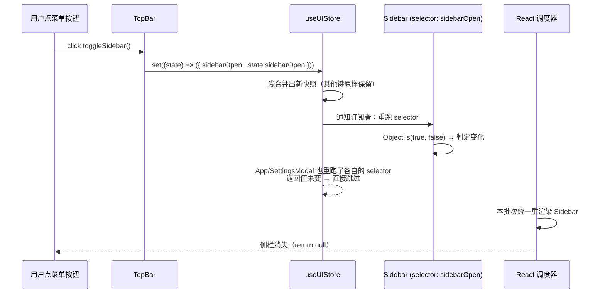
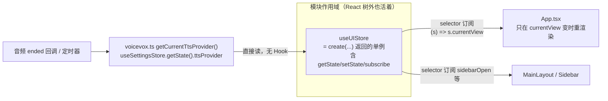

# 第 6 课 · Zustand 入门：为什么选它与组件外读 store

> 所属阶段 1 · 预计时长 60-90 分钟 · 难度★★☆☆☆

## 学习目标

- 能说出 Zustand 相对 Redux 与 Context+useState 的三条取舍理由。
- 掌握 `create` API 的最小形态：state + action 同住一个对象，`set` 支持函数式更新。
- 能正确使用 selector 订阅（`useUIStore((s) => s.currentView)`），解释不写 selector 的重渲染代价。
- 能在 **React 组件之外**用 `useSettingsStore.getState()` 读状态，并说出适用场景。
- 完成实操作业：把第 5 课设置弹窗里的开关接入 `uiSlice` 的新字段，实现全局持久可见。

## 前置检查

- 已完成第 4、5 课：理解受控组件与自定义 Hook。
- 第 5 课作业的开关（`useState` 版本）代码还在——本课要把它改造成全局状态。

## 关键文件

| 文件 | 职责 |
|---|---|
| `src/stores/uiSlice.ts` | 最小 Zustand store 样本：无 persist、纯 UI 开关（本课主教材） |
| `src/lib/tts/voicevox.ts` | 组件外读 store 的真实实例 `getCurrentTtsProvider()`（第 89-91 行） |
| `src/App.tsx` / `src/components/layout/MainLayout.tsx` | selector 订阅的两种消费姿势 |

## 正文

### 概念讲解

**为什么不是 Redux？** Redux 要求 action type、action creator、reducer、dispatch 四件套，样板代码量大，且其「单一 store + 不可变更新」的严格纪律是为超大规模应用设计的。baku-yomi 这类中小型项目里，Zustand 把这三层压缩成一层：**store 就是一个带方法的对象，`set` 直接改**。代价是少了时间旅行调试等重型设施——对本书项目完全够用。

三种方案放到一张表里比更直观：

| 维度 | Redux | Context + useState/reducer | Zustand |
|---|---|---|---|
| 样板量 | action type/creator/reducer/dispatch 四件套 | Provider + useContext 两件套 | 一个 `create()` 调用 |
| 更新粒度 | dispatch 全局通知，靠 connect/selector 过滤 | value 一变全体消费者重渲染 | selector 字段级订阅 |
| 组件外访问 | 需要 store 引入（可以做到） | 天然做不到 | `getState()` 一行 |
| 中间件生态 | 极其丰富 | 无 | 够用（persist/devtools 等） |
| 适合规模 | 大型多人协作、需要严格纪律 | 低频变化的小范围共享 | 中小型项目的默认解 |

#### 状态该放哪：三通道决策

学完本课后，你手里有了三个放状态的位置。每次新字段都值得过一遍这棵决策树：

```text
这个状态的消费方是谁？
├─ 只有一个组件用，且随组件销毁（表单草稿、hover 态）
│    → 组件局部 useState
├─ 父子之间传递，生命周期跟随着子树（book/onOpen 回调）
│    → props 单向流动
└─ 跨子树 / 非 React 模块需要读 / 需要跨会话保留
     → Zustand store（再按第 7 课的分类法挑 slice）
```

反着走这条树的代价你已经见过：第 5 课的开关用 `useState` 实现时，顶栏想看它就必须层层传 props——而设置弹窗和顶栏根本不是父子关系，「提升状态到共同父级」意味着提到 App 根上污染所有中间层。store 是为这种「拓扑上不相邻却共享语义」的状态准备的。

#### 为什么 uiSlice 里只有布尔与二元枚举

注意 `uiSlice` 的字段类型：两个 `boolean`、一个 `'bookshelf' | 'reader'`。这不是巧合——会话性 UI 状态天然是「开关与互斥选择」，没有数量、没有集合、没有嵌套结构。字段类型是 slice 职责的照妖镜：

- 出现 `Record<string, …>` 或数组 → 数据在积累，多半该去业务 slice（books、progress）；
- 出现需要持久化的用户偏好（字号、主题）→ settingsSlice / themeStore；
- 始终是布尔/枚举且刷新即复位 → uiSlice。

把这条规律记下，第 7 课打开五个 slice 时你会发现自己已经能预判每个文件的形状。

顺带一提：`currentView` 虽然是字符串枚举而非布尔，但它同样「无积累、刷新即复位」，所以留在 uiSlice 完全合理——类型只是线索，决策依据永远是生命周期与消费拓扑。

**从 useState 迁移到 store 的标准动作清单**

本课作业把第 5 课的开关从局部 state 搬进 store，这个动作以后会反复做，沉淀成五步清单：

1. **定归属**：按上面的决策树确认它确实属于全局（会话 UI 态 → uiSlice）。
2. **扩接口**：在 store 的 interface 里同时声明字段和 action——Zustand 的惯例是「字段 + 修改它的方法一起进店」，组件里不直接 `setState` 散改。
3. **换订阅**：`const [x, setX] = useState(init)` 一行换成 `const x = useXxxStore((s) => s.x)`，setter 调用点换成 action 调用。
4. **扫残留**：全局搜索旧 setter 名，确认没有遗漏的调用点；删掉不再需要的 import。
5. **验链路**：触发一次修改，确认**所有**消费方同步更新（本课是弹窗 checkbox 与顶栏圆点两处）。

第 2 步值得多说一句：为什么不暴露裸 store 让组件随便 `setState`？因为 action 是状态的「合法变更通道」——业务规则（如 trim 兜底、联动重置）都收拢在 action 里，将来排查「这个字段什么时候被谁改了」只需要看一处。散落的 `setState` 会把这个审计线索撕碎。

（这份清单同样适用于反向操作：把 store 字段降级回局部 state 时，把第 2、3 步倒着走即可。）

#### Zustand 内部机制一瞥：为什么它这么小

Zustand 核心源码压缩后只有几百字节，因为「store」的全部秘密就是这几行伪代码：

```ts
function createStore(createState) {
  let state;                    // 当前快照
  const listeners = new Set();  // 订阅者集合

  const setState = (partial) => {
    const next = typeof partial === 'function' ? partial(state) : partial;
    if (!Object.is(next, state)) {
      state = { ...state, ...next };        // 浅合并
      listeners.forEach((listener) => listener());  // 同步广播
    }
  };

  const getState = () => state;
  const subscribe = (fn) => { listeners.add(fn); return () => listeners.delete(fn); };
  // useStore hook 负责把 listeners 与 React 调度接通，
  // 并为每个 hook 实例缓存上一次的 selector 返回值做比较
}
```

读懂这段伪代码，本课所有现象都能自洽解释：浅合并发生在 `{ ...state, ...next }`；selector 比较发生在每个 hook 实例内部而非 store 全局；`getState()` 只是读一个模块级变量所以任何地方可用；「组件外写入也能让界面更新」是因为 `setState` 广播的对象正是 React hook 的订阅回调。**不必背 API，理解这 15 行就等于理解了 Zustand。**

**为什么不是 Context + useState？** Context 有两个结构性问题：

1. **性能**：Context value 一变，所有消费组件全部重渲染，无法按字段订阅；Zustand 用 selector 做字段级订阅，`currentView` 变化不会惊动只关心 `sidebarOpen` 的组件。
2. **组件外访问**：Context 只能在 React 树内读；而 TTS 播放器这类非 React 模块（定时器回调、audio ended 回调）也需要读配置。Zustand 的 store 是普通模块级对象，任何地方都能 `getState()`。

一句话总结 Zustand 心智模型：**store 是活在模块作用域里的单例对象，Hook 只是它的一扇窗**。

展开说这句心智模型的三个推论：

- **模块即生命周期**：ES Module 首次 import 时执行一次初始化，之后整个页面存续期间都是同一个对象——所以它天然是「单例」，不需要 Provider 往组件树里塞。
- **Hook 只是订阅器**：`useUIStore(selector)` 做的事是「订阅变化 + 返回选中值」，store 本体不依赖 React，先有 store 后有 Hook。
- **React 只是消费者之一**：音频回调、工具函数、甚至浏览器控制台都能读写同一个对象，地位与组件平等。

### 代码走读

**1. 最小完整样本：`uiSlice.ts`（全文仅 26 行）**

```ts
export type AppView = 'bookshelf' | 'reader';

interface UIState {
  settingsOpen: boolean;
  sidebarOpen: boolean;
  currentView: AppView;
  openSettings: () => void;
  closeSettings: () => void;
  toggleSidebar: () => void;
  setSidebarOpen: (open: boolean) => void;
  setCurrentView: (view: AppView) => void;
}

export const useUIStore = create<UIState>()((set) => ({
  settingsOpen: false,
  sidebarOpen: true,
  currentView: 'bookshelf',

  openSettings: () => set({ settingsOpen: true }),
  closeSettings: () => set({ settingsOpen: false }),
  toggleSidebar: () => set((state) => ({ sidebarOpen: !state.sidebarOpen })),
  setSidebarOpen: (open) => set({ sidebarOpen: open }),
  setCurrentView: (view) => set({ currentView: view }),
}));
```

要点逐条：

- `create<UIState>()(...)` 中间的 `()` 是给 TS 类型推断留的柯里化槽位（启用中间件时必需，第 7 课的 `persist(create()(...))` 会看到完整形态）。
- state 和 action 在同一个对象里，action 就是闭包持有 `set` 的普通函数。`set({ k: v })` 做**浅合并**——只动列出的键，其余原样保留。
- 需要基于旧值计算时传 updater 函数：`set((state) => ...)`。注意依然要返回**新对象/新数组**，和 React setState 一个脾气。
- 命名约定：本项目每个 store 导出 `useXxxStore`，保持「Hook 命名」让 lint 规则正常工作，虽然它在非组件文件里也会被调用。

再补一条容易忽略的设计信号：`uiSlice` 里同时存在 `toggleSidebar()` 和 `setSidebarOpen(open)` 两个 action，功能有重叠但语义分工明确——前者给键盘/按钮这类「翻转」场景，后者给「我知道目标态」的场景（比如路由守卫强制打开侧栏）。好 store 的接口设计跟好函数一样：每个 action 都能一句话说清使用场景，说不清的就是冗余。

**2. 组件内消费：selector 订阅**

回看第 4 课的 `App.tsx`：

```tsx
const currentView = useUIStore((s) => s.currentView);
```

括号里的 `(s) => s.currentView` 就是 **selector**：Zustand 在每次 store 变化后重跑它，只有返回值（这里靠引用比较）变了才重渲染该组件。对比 `MainLayout.tsx` 里同样的订阅——两个组件互不相干地各订各的字段。反例是 `TopBar.tsx` 开头：

```tsx
const { changeFontZoom } = useSettingsStore();
const { toggleSidebar, openSettings, currentView } = useUIStore();
```

不带参数调用 = 订阅整个 store，任何字段变化都会重渲染 TopBar。功能没错，但这是「图省事」写法；只取 action 时影响不大，取数据时应尽量用 selector（`getCurrentBook` 这种派生值例外，因为它内部基于 `get()` 取数，见下）。

另一个实用细节：`TopBar` 里 `useBookStore((s) => s.getCurrentBook())` 每次 store 变化都会执行 `find` 并可能返回新对象引用……实际上因为找到的是 `books` 数组里的既有元素，引用稳定，所以安全。**selector 返回引用稳定的东西**（原始值、既有对象、稳定 action），是避免死循环渲染的底线。

把 selector 的判定流程画成伪代码，帮助理解「什么时候我会重渲染」：

```text
store.set(...) 发生
  → 遍历所有订阅该 store 的 hook 实例
    → 对每个实例重跑 selector(newStore)
    → Object.is(selector(new), selector(prev))？
        相同   → 什么都不做（该组件不重渲染）
        不同   → 把该组件标记待更新，调度一次重渲染
```

所以「写好 selector」本质上是在替 Zustand 回答一个问题：**这个组件关心哪些字段？** 回答越精确，无关更新被过滤得越干净。

**3. 组件外读 store：`voicevox.ts` 的真实实例**

TTS 客户端要在音频回调、预取逻辑等非 React 环境里知道当前用哪个引擎，它的解法：

```ts
/** Read the current TTS provider from settings store (works outside React) */
function getCurrentTtsProvider(): string {
  return useSettingsStore.getState().ttsProvider;
}
```

`useSettingsStore` 虽以 `use` 开头，但它本质是 store 对象本身，挂有三个非 Hook 方法：

| API | 语义 | 典型场景 |
|---|---|---|
| `getState()` | 立刻读取当前快照 | 事件回调、工具函数、模块顶层 |
| `setState(partial)` | 组件外写入 | 测试种子数据、浏览器控制台调试 |
| `subscribe(fn)` | 订阅任意变化 | 非 React 模块联动 |

`makeVoiceCacheKey`（缓存键生成）和 fetch `/api/tts/${provider}` 的请求体都经由 `getCurrentTtsProvider()` 取值——每次调用都拿到**最新**快照，不存在闭包过期问题。这是 Context 方案做不到的，也是本课最重要的记忆点。

为什么强调「最新快照」？对比一下回调闭包的经典陷阱：

```ts
// 反面教材：把配置捕获进闭包
function setupPlayer(ttsProviderAtSetup: string) {
  audio.onended = () => {
    // 三分钟后触发时，ttsProviderAtSetup 可能早已过时
    fetch(`/api/tts/${ttsProviderAtSetup}/...`);
  };
}

// voicevox.ts 的做法：每次用时现取
audio.onended = () => {
  fetch(`/api/tts/${getCurrentTtsProvider()}/...`);  // 永远新鲜
};
```

长命名的回调（定时器、WebSocket 消息、audio 事件）存活期远超任意一次渲染，「用时现取」是唯一不会腐烂的模式。`getState()` 每次调用都穿透到 store 当前值，从根上消灭了这类 bug。

**4. uiSlice 的全项目消费地图**

把整个项目里订阅 `useUIStore` 的位置列全，你会得到一张「谁关心什么」的清单——这是理解 selector 粒度价值的最好材料：

| 消费组件 | 订阅内容 | 为什么是它 |
|---|---|---|
| `App.tsx` | `currentView` | 决定渲染书架还是阅读器，只此一个字段 |
| `MainLayout.tsx` | `currentView` | 切换 workspace/main 容器的布局 class |
| `Sidebar.tsx` | `sidebarOpen` / `currentView` / `setCurrentView` | 自身的显隐 + 「书架总览」按钮激活态 |
| `TopBar.tsx` | `toggleSidebar` / `openSettings` / `currentView` | 触发器 + 上下文文案（`LIBRARY / …`） |
| `SettingsModal.tsx` | `settingsOpen` / `closeSettings` | 自隐藏开关与遮罩关闭 |

观察 `currentView` 变化时的实际影响面：App 和 MainLayout 重渲染，而 Sidebar、SettingsModal 虽然也订了同一个 store 却纹丝不动——它们没订这个字段。如果 Sidebar 用的是整店订阅，每次切换视图它都会白渲一遍。这张表还揭示了一个架构事实：**uiSlice 的每个字段都有明确的消费群**，没有「先存着以防万一」的字段——这是判断 store 是否健康的好标准。

最后把「点一下侧栏开关按钮」的完整链路按时序走一遍，作为本课所有概念的总串联：



### 图示



### 边学边练

以下检查点请**边读边做**，每个不超过 5 分钟，做完再继续往下读。

**练习 1：数出一次点击触发的重渲染范围**

给 `App.tsx`、`MainLayout.tsx` 各加一行 `console.log('App render')` / `console.log('MainLayout render')`，然后在顶栏点设置按钮。预期：`App` 不打印（它只订 `currentView`），`MainLayout` 打印吗？——如果没打印，正是 selector 过滤了 `settingsOpen` 这条无关更新。测完删除日志。

**练习 2：亲手体验整店订阅的代价**

把 `MainLayout.tsx` 的 `const currentView = useUIStore((s) => s.currentView)` 临时改成 `const { currentView } = useUIStore();`，重复练习 1 的点击。现在 `MainLayout` 每次都打印了——因为整店订阅模式下任何字段变化都无法被过滤。恢复原状，把这个对照记下来。

**练习 3：在控制台读写 store**

在 `main.tsx` 末尾临时加一行：

```ts
(window as unknown as Record<string, unknown>).__ui = useUIStore;
```

刷新后在 DevTools Console 执行：

```js
__ui.getState().sidebarOpen      // 读
__ui.setState({ sidebarOpen: false })   // 写 —— 页面侧栏应立即消失
__ui.getState().sidebarOpen      // 再读，确认生效
```

这就是「store 是普通对象」的最直白证据。测完删除那行代码。

**练习 4：验证 selector 返回新引用的下场**

在 `App.tsx` 临时改成 `const bad = useUIStore((s) => ({ view: s.currentView }));` 并 log 它。随便触发任意 store 更新，Console 会警告 "The result of getSnapshot should be cached"或陷入无限渲染——每次 selector 都返回新对象，引用比较永远判「变」。恢复原状。记住：多字段要么分开订阅，要么 `useShallow`。


**练习 5：用 React DevTools 验证「订阅即精准」**

打开 React DevTools，选中 `App` 组件，点击右上角的「高亮更新」（Highlight updates）按钮。然后点设置齿轮：注意哪些组件轮廓闪烁——预期只有 `SettingsModal` 和 `TopBar`（它们分别订了 `settingsOpen` 与整店），而 `Sidebar`、`MainLayout` 不闪。如果和你根据消费地图的预测不符，回到 selector 定义找原因。

**练习 6：给 store 写一次「审计日志」**

利用 `subscribe` 在 `main.tsx` 临时加两行：

```ts
useUIStore.subscribe((state) => console.log('ui 变化:', state));
```

然后正常操作页面：开弹窗、切视图、收侧栏。Console 里每条日志都是变更后的完整快照——这就是「单一事实来源」的可观测形态：任何 UI 变化必先经过这里。测完删除。

### 实操作业

大纲作业：**把第 5 课的开关接入一个新的 uiSlice 字段**。按基础 / 进阶 / 挑战三层完成：

**基础层（必做）**

1. 在 `src/stores/uiSlice.ts` 的 `UIState` 接口加字段与 action：
   ```ts
   soundHintEnabled: boolean;
   toggleSoundHint: () => void;
   ```
   初始值给 `false`，action 用 `toggleSidebar` 同款写法：`set((state) => ({ soundHintEnabled: !state.soundHintEnabled }))`。
2. 改造 `SettingsModal.tsx`：删掉第 5 课的 `const [soundHint, setSoundHint] = useState(false)`，换成 `const soundHint = useUIStore((s) => s.soundHintEnabled);`，checkbox 的 onChange 调 `toggleSoundHint`。
3. 让状态跨组件可见：在 `TopBar.tsx` 加一行 `const soundHint = useUIStore((s) => s.soundHintEnabled);`，当为真时在 header 工具区渲染一个小圆点 `<span className="mode-dot active" />`（样式已存在于 index.css）。回到页面勾选开关，顶栏应实时亮起——这就是全局 store 与局部 state 的差别。
4. 刷新页面观察：开关回到 false。思考并记下一句话答案：为什么 uiSlice 不像 settingsSlice 那样持久化？（提示：这些是会话性 UI 状态，恢复到上次会话的弹窗开合反而怪异；哪些该持久是设计决策，第 7 课展开。）

验收标准：

- [ ] `uiSlice` 新增 `soundHintEnabled` 字段与 `toggleSoundHint` action，类型完整无 any；
- [ ] SettingsModal 中不再有本地 `useState` 版开关，勾选态由 store 驱动；
- [ ] 开关打开时顶栏圆点立即出现，关闭即消失（跨组件同步生效）；
- [ ] 刷新页面后状态复位为 false，且能口头说明原因。

**进阶层（推荐）**

5. 打开浏览器 DevTools Console 执行组件外写入实验：
   ```js
   // 先按练习 3 的方式临时暴露 __ui，然后：
   __ui.setState({ soundHintEnabled: true });
   ```
   不碰任何 UI，顶栏圆点应当亮起——体会 `setState` 在组件外的能力。再想一步：如果此时设置弹窗开着，弹窗里的 checkbox 会同步变成勾选吗？（会——因为它的 checked 也是从同一份 store 派生的。）
6. 给 `soundHintEnabled` 加一个「开启时 Console 打印」的副作用：在 `SettingsModal.tsx` 里用 `useEffect(() => { if (soundHint) console.log('提示音已启用'); }, [soundHint]);`，验证「store 变化 → 组件重渲染 → effect 感知」这条完整链路。

**挑战层（选做）**

7. 把练习 4 发现的问题工程化解决：安装/引入 `zustand/react/shallow` 的 `useShallow`，写一个同时取 `settingsOpen` 和 `sidebarOpen` 两个布尔字段的组件订阅，要求既不触发无限渲染、又能正常工作。写完后用自己的话总结「什么时候必须 useShallow」——这道题是自测题第 6 题的实践版。

## 本课与面试

**Q1：Zustand 和 Redux 怎么选？**
答题要点：(1) Redux 的价值在强纪律与生态——时间旅行、中间件体系、单一数据源便于大型团队协作；(2) Zustand 把 action/reducer/dispatch 压缩成一个带方法的普通对象，样板极少且天然支持组件外访问；(3) 务实结论：中小型项目、状态域清晰时 Zustand 性价比更高；超大团队需要统一范式和调试设施时选 Redux Toolkit。(4) 加分项：指出两者底层都依赖「不可变更新 + 引用比较」的通知机制，心智模型相通，迁移成本不高。

**Q2：为什么 Zustand 能做到字段级订阅而 Context 做不到？**
答题要点：Context 的 Provider value 是整体单值，React 只比较 value 引用，一变就广播给所有 consumer；Zustand 每个 hook 实例独立保存上一次 selector 的返回值，store 变化后各自重跑 selector 并用 `Object.is` 比较，只有选中值变化的才重渲染。「订阅粒度」从 Provider 级下沉到了字段级。

**Q3：在 React 组件之外怎么读写全局状态？为什么需要？**
答题要点：Zustand 的 store 是模块级单例，`getState()` 读、`setState()` 写、`subscribe(fn)` 订阅。典型需求：定时器/audio 事件的回调、工具函数、测试种子。核心优势是每次调用拿到即时快照，规避回调闭包持有旧值的经典 bug。本项目实例：`voicevox.ts` 的 `getCurrentTtsProvider()`。

**Q4：selector 里返回新对象/新数组会发生什么？怎么解决？**
答题要点：默认比较是 `Object.is` 引用比较，`(s) => ({a: s.a, b: s.b})` 每次产生新引用，判定恒为「变」，轻则多余重渲染、重则 "getSnapshot should be cached" 警告与无限循环。解法三选一：拆成多个原始值 selector；`useShallow` 浅比较包裹；把派生计算挪到 useMemo。原则：**selector 返回引用稳定的东西**。

**Q5：Hooks 规则在自定义 store 场景还适用吗？**
答题要点：适用。只要以 `use` 开头当 Hook 用（在组件里调用），就必须遵守「只在顶层、只在 React 函数中调用」。但 `getState()/setState()/subscribe()` 不是 Hook，可在任何地方调用——这正是 Zustand 设计的精妙处：同一对象提供两套入口，Hook 入口守规则，命令式入口自由。混淆两者（在非组件里调 `useXxxStore()`）会直接违反 Hooks 规则抛错。

**Q6：store 里的 action 需要用 useCallback 包裹吗？**
答题要点：不需要。action 定义在 store 创建时一次性生成，引用终身稳定，不像组件内联函数每次渲染重建。这也是 Zustand 的性能优势之一：传给子组件的回调天然不会破坏 memo 化。反观 Context 方案里 Provider value 中的函数若不 memo，每次渲染都会拖垮全部消费者。

**Q7：一次 `set()` 之后到界面更新，中间发生了什么？**
答题要点：(1) `set` 合并出新 state，替换 store 内部快照；(2) 同步通知所有订阅的 hook 实例；(3) 各实例重跑自己的 selector 做比较；(4) 判定变化的组件进入 React 调度队列，批处理后统一重渲染；(5) diff 提交真实 DOM。能区分「store 通知（同步、框架无关）」与「React 渲染（调度、批量）」两个阶段，说明理解到位。

**Q8：Zustand 的 store 为什么不需要 Provider？这有什么代价？**
答题要点：store 是模块级单例，import 即得，不存在「作用域注入」，因此没有 Provider 包裹。代价是：(1) 失去了按子树实例化多份状态的能力（同构/SSR 下需要额外处理请求级隔离）；(2) 测试时无法用 Provider 换 mock store，只能用 `setState` 种数据。纯客户端 SPA 里这两点几乎无感，本项目正是典型场景。


## 常见坑

1. **忘记柯里化的 `()`**：写成 `create<UIState>((set)=>...)` 目前碰巧能跑，但一旦套上 `persist` 等中间件类型推断就崩。从第一天就养成 `create<T>()(...)` 的肌肉记忆。
2. **selector 返回新建对象**：`(s) => ({ a: s.a, b: s.b })` 每次都是新引用，默认比较判定「变了」，导致无限重渲染告警。多字段需求要么分开多次订阅，要么用 `useShallow`。
3. **在 render 期间调用 `getState()` 再赋值**：组件内请走 Hook 订阅，否则 store 更新了组件也不知道。`getState` 属于事件回调与模块函数的世界。
4. **把服务端数据或大体积内容塞进未持久化的 UI store**：先想清楚字段的「生命周期归属」——会话态进 uiSlice、用户偏好进 settingsSlice、业务数据进 bookSlice/practiceSlice，这个分类法就是第 7 课 slice 拆分的地基。
5. **在组件体内用 `if` 提前 return 之后再调 `useXxxStore()`**：和第 4 课 Hooks 顺序铁律同源——store Hook 也是 Hook，必须在任何条件 return 之前完成订阅。

## 自测题

<details>
<summary>1. <code>set</code> 是替换整个 state 还是合并？怎么覆盖嵌套对象的单个键？</summary>

浅合并：只更新传入的键。嵌套对象必须自己造新引用，如 set((s) => ({ prefs: { ...s.prefs, zoom: 2 } }))——直接 set({ prefs: { zoom: 2 } }) 会把 prefs 里其他键全丢掉。bookSlice 的 setReadingProgress 就是标准示范。
</details>

<details>
<summary>2. 为什么 <code>voicevox.ts</code> 不能用 <code>useSettingsStore()</code> 直接拿 ttsProvider？</summary>

它不是 React 组件/不在 Hook 环境中，调用 Hook 会违反 Hooks 规则直接抛错。store 对象自带的 getState() 才是非 React 上下文的合法入口，且每次调用返回即时快照，天然规避闭包过期。
</details>

<details>
<summary>3. Context+useState 与 Zustand 在「一个字段变化引发多少组件重渲染」上的本质差异是什么？</summary>

Context 的 Provider value 是整体：任何字段变化 → value 引用变化 → 所有 useContext 消费者无条件重渲染。Zustand 每个 hook 独立运行 selector 并做结果比较，只有选中值变化的订阅者才重渲染，实现了字段级的精准更新。
</details>

<details>
<summary>4. <code>toggleSidebar</code> 为什么用 updater 函数而不是 <code>set({ sidebarOpen: !get().sidebarOpen })</code>？两者等价吗？</summary>

功能等价，updater 写法更惯用且把「读旧值→算新值」压缩在一个原子操作里，避免并发批处理下的竞态心智负担。Zustand 内部对两种形式最终都走同一套合并逻辑。
</details>

<details>
<summary>5. 若想在 Chrome Console 里直接改主题模式调试，怎么做最顺手？</summary>

临时在 main.tsx 或某处挂 window.__store = useThemeStore，之后控制台 __store.setState({ mode: 'rain' }) 即可，界面立刻响应。生产构建记得移除，避免暴露内部状态句柄。</details>

<details>
<summary>6. <code>useShallow</code> 解决什么问题？不用它会怎样，用它有没有代价？</summary>

解决 selector 返回「内容相同但引用不同」的新对象导致的假阳性更新。不用则每次 store 变化组件都重渲染（极端情况触发 getSnapshot 缓存警告）；用的代价仅是多一层浅比较遍历，对扁平小对象可忽略。深层嵌套对象 useShallow 也救不了，那应该拆 selector 或上 immer 式结构共享。
</details>

<details>
<summary>7. 多个组件订阅同一个 store，一个 <code>set()</code> 调用会让它们同步依次重渲染吗？</summary>

不会各渲各的。set 同步更新快照并通知订阅者，但各组件只是被标记待更新，真正渲染由 React 调度器在同一批次内统一执行（自动批处理），且各自重跑 selector 后无关组件直接跳过。所以「N 个订阅者」不等于「N 次独立的全量渲染流水线」。
</details>

<details>
<summary>8. 为什么本项目坚持给 store 导出起 <code>useXxxStore</code> 这样的 Hook 命名，即使它也会在非组件里被调用？</summary>

命名服务于主要用法与工具链：组件里绝大多数消费姿势确实是 Hook，use 前缀让 eslint 的 react-hooks 规则正确介入（如条件调用检查）。副作用是非组件代码里出现「像 Hook 的调用」，但它调的是 getState() 这类静态方法，并不违反 Hooks 规则——违反规则的判定依据是「在非组件/Hook 函数体里执行 Hook 逻辑」，而 getState 不是 Hook。
</details>
