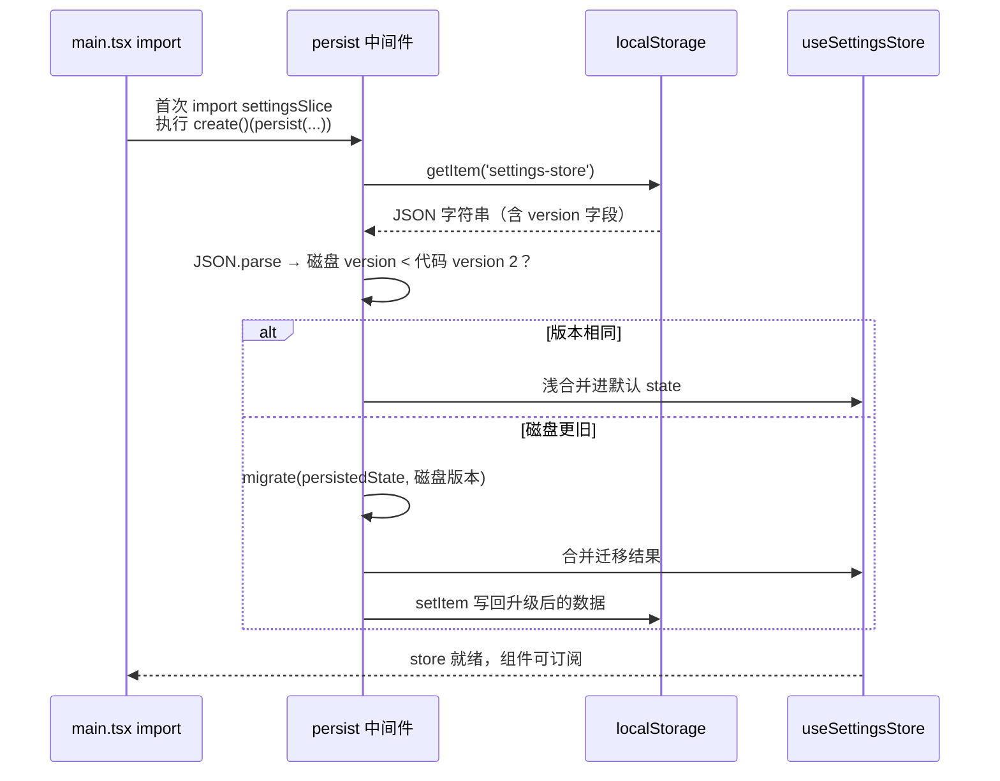
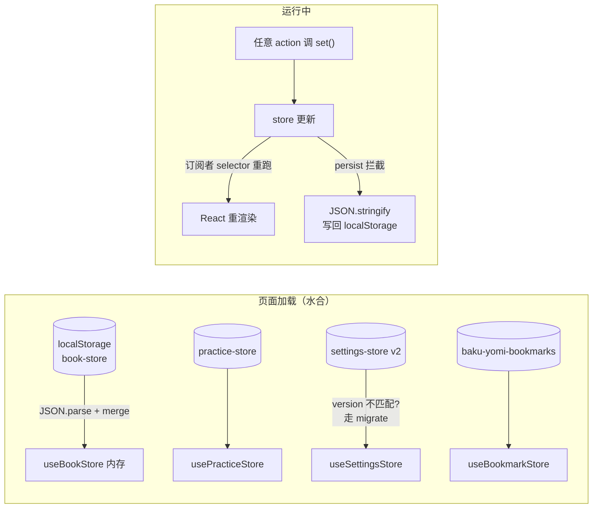

# 第 7 课 · slice 模式与 persist：五个 store 与 localStorage

> 所属阶段 1 · 预计时长 90 分钟 · 难度★★★☆☆

## 学习目标

- 能按「数据生命周期归属」说出五个 slice（book / bookmark / practice / settings / ui）各自的职责边界。
- 精读 `bookSlice` 全部 action，能复述每个 action 改了哪些字段、为什么那样改。
- 能解释 `persist` 中间件的原理：序列化整个 state → `localStorage[key]`，启动时水合回内存。
- 能读懂 `settingsSlice` 的 `version: 2` + `migrate` 迁移逻辑，并说清版本迁移思路。
- 完成实操作业：用 DevTools 查看 localStorage 里各 store 的实际存储结构。

## 前置检查

- 已完成第 6 课：会写 `create<T>()(...)`、会用 selector 订阅、知道 `getState()` 的存在。
- 第 6 课作业留下的疑问「哪些状态该持久化」——本课给出系统性答案。

## 关键文件

| 文件 | persist key | 职责 |
|---|---|---|
| `src/stores/bookSlice.ts` | `book-store` | 书库、当前阅读位置、进度、回译改写 |
| `src/stores/bookmarkSlice.ts` | `baku-yomi-bookmarks` | 文本书签与滚动定位 |
| `src/stores/practiceSlice.ts` | `practice-store` | 每句的回译草稿/分析结果/笔记/提示 |
| `src/stores/settingsSlice.ts` | `settings-store`（version 2） | AI 供应商档案、TTS 与界面偏好 |
| `src/stores/uiSlice.ts` | （无） | 会话性 UI 开关 |
| `src/theme/themeStore.ts` | `baku-yomi-theme` | 主题模式 |

## 正文

### 概念讲解

**slice 模式**指不把全部状态塞进一个大 store，而是按领域拆成多个独立的小 store。本项目五个业务 slice + 一个主题 store 的划分依据是**生命周期与变更频率**：

- **内容资产**（books）：导入一次、长期不变 → `bookSlice`
- **学习痕迹**（translations/analyses/notes/bookmarks）：随练习持续增长 → `practiceSlice` / `bookmarkSlice`
- **用户偏好**（API Key、字号、TTS 参数）：低频修改、跨会话保留 → `settingsSlice`
- **会话 UI**（弹窗开关、侧栏开合）：刷新即复位 → `uiSlice`

拆开的收益：selector 天然更细粒度；persist 范围可控（UI 态不进 localStorage）；避免一个巨型 reducer 对象难以维护。

#### 五个 store 的「体检表」：先看形状再读代码

读每个 slice 前先扫一眼它的字段类型，store 的职责边界就写在类型签名里。以本课精读的三个为例：

| store | 典型字段 | 类型特征 | persist |
|---|---|---|---|
| `useBookStore` | `books` / `currentBookId` / `readingProgress` / `lastReadAt` / `lastChapterIndexByBook` / `scrollToPairId` | 数组 + 多个 `Record<id, …>` 字典 + 一个信箱字段 | `book-store`，全量 |
| `useSettingsStore` | `aiProviders` / `ttsProvider` / `blindMode` / `fontZoom` / `voicevox*` 系列 | 档案数组 + 一批带范围约束的标量偏好 | `settings-store`，version 2 |
| `useUIStore` | `settingsOpen` / `sidebarOpen` / `currentView` | 纯布尔与二元枚举 | 无 |

对照第 6 课结尾的预言验证一下：uiSlice 果然全是开关；bookSlice 果然以字典和数组为主（数据在积累）；settingsSlice 是「低频修改的标量集合」。**先预测后阅读**是高效读代码的通用方法——猜对了说明心智模型正确，猜错了则恰好暴露认知盲区。

`settingsSlice` 还有一类字段值得单独指出：`voicevoxSpeed/Pitch/Volume/PrefetchWindow/CacheLimitMB` 这五个都带着范围约束（如 speed 限定 0.5-2）。约束写在 setter 里而不是组件里，意味着任何入口（设置面板、控制台、未来的快捷键）都无法写入越界值——**把业务不变量收拢进 action**，这是多入口状态下保证数据合法性的唯一办法。

**persist 中间件原理**：包住你的 store 后做三件事——(1) 每次任何 `set` 之后，把 state 序列化为 JSON 写入 `localStorage[name]`；(2) 应用启动时读回该 key，合并进初始 state（水合）；(3) 提供钩子处理旧版本数据。注意它持久化的是**整个 state 默认全量**（含 action 函数会被 JSON.stringify 自动丢弃，恢复时用的是代码里现定义的 action），所以「函数不入库、数据全量入库」。


#### 不可变更新原理：为什么每个 action 都在「造新对象」

翻遍 `bookSlice` 你会发现一个铁律：**没有任何一行代码直接修改旧对象**——数组用 `filter/map/[...展开]`，对象用 `{ ...old, key: newValue }`。这不是风格洁癖，而是整条更新链路的物理前提：

1. **变更检测靠引用比较**。Zustand 判断「state 变没变」、React 判断「props 变没变」、`useMemo` 判断「依赖变没变」，用的全是 `Object.is(a, b)`——它只比较两个引用是否指向同一个对象，**不比较内容**。
2. **原地修改不产生新引用**。`state.books.push(book)` 之后 `state.books` 还是原来那个数组，比较结果永远是「没变」，订阅者全部被跳过，界面纹丝不动——而且没有任何报错，是纯静默失效。
3. **造新引用必须逐层进行**。嵌套结构里只造外层新引用不够：`{ ...state }` 只克隆了第一层，里面的 `books` 数组还是旧的；改某本书的书名要 `map` 到那一层再 `{ ...b, title }`，让「从根到被改叶子」路径上的每一层都是新引用，兄弟分支保持旧引用。

拿 `renameBook` 做逐层拆解：

```ts
set((state) => ({
  books: state.books.map((b) =>            // 第 1 层：新 books 数组（引用变了）
    b.id === id ? { ...b, title: ... } : b // 第 2 层：被改的那本是新对象，
  ),                                       //   其余书沿用旧引用（省内存且不误伤）
}))
// 注意：没动的书的 chapters/pairs 全部原引用共享——
// 这就是「不可变 ≠ 深拷贝」，代价只有 O(改动路径)，不是 O(整棵树)
```

最后一条推论值得单独记：**未变化的分支共享旧引用，恰好是 React.memo / 依赖比较能工作的原因**。如果有人图省事做了深拷贝再 set，所有子树都会因为拿到全新引用而被迫重渲染。「逐层浅拷贝」是在「正确通知」与「最小开销」之间的精确平衡点。

### 代码走读

**1. `bookSlice.ts` —— 本项目最核心的状态容器**

先看字段设计（第 5-17 行），每个都对应一个真实需求：

```ts
interface BookState {
  books: Book[];
  currentBookId: string | null;
  currentChapterIndex: number;
  readingProgress: Record<string, number>;      // chapterId -> 最后可见句对下标
  lastReadAt: Record<string, number>;           // chapterId -> 时间戳
  lastChapterIndexByBook: Record<string, number>; // bookId -> 上次章节号
  scrollToPairId: string | null;                // 书签跳转的信箱字段
  ...
}
```

三个 Record 都以 id 为键而非数组——O(1) 查找且不怕顺序漂移；`scrollToPairId` 是典型的「命令式意图」状态：书签列表只负责 set 它，`ReadingView` 监听它执行 `scrollIntoView` 后再 set 回 null。

逐个精读 action：

**addBook —— 导入后立即进入新书**

```ts
addBook: (book) =>
  set((state) => ({
    books: [...state.books, book],
    currentBookId: book.id,
    currentChapterIndex: 0,
  })),
```

一次 set 同时做三件事：追加书目、切换当前书、归零章号。数组用展开造新引用（不可变更新铁律）。

**removeBook —— 删除时清理指针**

```ts
removeBook: (id) =>
  set((state) => ({
    books: state.books.filter((b) => b.id !== id),
    currentBookId: state.currentBookId === id ? null : state.currentBookId,
  })),
```

删的是当前书才把 `currentBookId` 置空，否则保持——细节决定体验。思考题：被删书的 `readingProgress` 条目没清，属于无害垃圾（键再也查不到），这是可接受的取舍。

**renameBook —— trim 兜底**

```ts
renameBook: (id, title) =>
  set((state) => ({
    books: state.books.map((b) => (b.id === id ? { ...b, title: title.trim() || b.title } : b)),
  })),
```

`title.trim() || b.title`：输入纯空格则保留原名，一行防御。

**setCurrentBook / setCurrentChapter —— 恢复阅读位置的双层记忆**

```ts
setCurrentBook: (id) =>
  set((state) => ({
    currentBookId: id,
    currentChapterIndex: Math.max(0, state.lastChapterIndexByBook[id] ?? 0),
  })),

setCurrentChapter: (index) =>
  set((state) => {
    const currentBook = state.books.find((b) => b.id === state.currentBookId);
    if (!currentBook) return { currentChapterIndex: index };
    return {
      currentChapterIndex: index,
      lastChapterIndexByBook: { ...state.lastChapterIndexByBook, [currentBook.id]: index },
    };
  }),
```

合起来构成「换书自动跳到上次读到的章；换章同时记进 per-book 字典」。`Math.max(0, …)` 防御 undefined 参与 UI 计算。

**getCurrentBook / getCurrentChapter —— 派生值放 store 内部**

```ts
getCurrentBook: () => {
  const { books, currentBookId } = get();
  return books.find((b) => b.id === currentBookId) ?? null;
},
getCurrentChapter: () => {
  const book = get().getCurrentBook();
  if (!book) return null;
  return book.chapters[get().currentChapterIndex] ?? null;
},
```

用第二个参数 `get()` 读最新快照做派生计算，供 `TopBar`、`ReadingView` 复用——派生逻辑集中一处，组件不重复实现 find。

**updatePairChinese —— 全库深映射**

```ts
updatePairChinese: (pairId, chinese) =>
  set((state) => ({
    books: state.books.map((book) => ({
      ...book,
      chapters: book.chapters.map((ch) => ({
        ...ch,
        pairs: ch.pairs.map((p) => p.id === pairId ? { ...p, chinese } : p),
      })),
    })),
  })),
```

pairId 只在句对层唯一，不知道属于哪本书哪章，于是三层 map 全库扫描替换。代价 O(总句对数)，收益是调用方零心智——用户改译某句中文后，这个改动随 books 持久化进 localStorage。

**action 全景分类表：12 个成员各司其职**

`BookState` 接口里声明了 12 个成员。按「写入还是读取」分成两组，先给全景再逐个精读，读代码时就不会迷路：

| # | 成员 | 类别 | 一句话职责 |
|---|---|---|---|
| 1 | `addBook(book)` | 写 | 追加书目并切为当前书 |
| 2 | `removeBook(id)` | 写 | 删书并清理当前书指针 |
| 3 | `renameBook(id, title)` | 写 | 改名（trim 兜底） |
| 4 | `setCurrentBook(id)` | 写 | 换书 + 恢复该书上次章节 |
| 5 | `setCurrentChapter(index)` | 写 | 换章 + 记入 per-book 字典 |
| 6 | `updatePairChinese(pairId, chinese)` | 写 | 全库定位句对改译文 |
| 7 | `setReadingProgress(chapterId, idx)` | 写 | 进度与时间戳原子绑定 |
| 8 | `setScrollToPairId(pairId)` | 写 | 书签跳转信箱 |
| 9 | `getCurrentBook()` | 读 | 当前书对象或 null |
| 10 | `getCurrentChapter()` | 读 | 当前章对象或 null |
| 11 | `getLastChapterIndexForBook(bookId)` | 读 | 该书记住的章节号（兜底 0） |
| 12 | `getReadingProgress(chapterId)` | 读 | 该章已读句下标（兜底 0） |

两个观察：(1) **写方法全走 `set`，读方法全走 `get`**——接口形状就暴露了语义；(2) 四个读方法是「带兜底的取数器」，把 `?? 0 / ?? null` 这类防御收拢在 store 内部，组件拿到的永远是干净可用的值。

**setReadingProgress —— 进度与时间戳原子绑定**

```ts
setReadingProgress: (chapterId, pairIndex) =>
  set((state) => ({
    readingProgress: { ...state.readingProgress, [chapterId]: pairIndex },
    lastReadAt: { ...state.lastReadAt, [chapterId]: Date.now() },
  })),
```

一次 set 更新两个字典：读到哪儿 + 何时读的。第 9 课作业的「按最近阅读时间排序」正要消费这里的 `lastReadAt`。

**getLastChapterIndexForBook / getReadingProgress —— 带兜底的读取器**

```ts
getLastChapterIndexForBook: (bookId) =>
  Math.max(0, get().lastChapterIndexByBook[bookId] ?? 0),

getReadingProgress: (chapterId) =>
  get().readingProgress[chapterId] ?? 0,
```

两行同构：字典取值 → `?? 0` 兜底未读书/未读章 → `Math.max(0, …)` 再挡一层负数脏数据。注意它们是 `get()` 的消费者而不是 `set`——纯读取不触发任何通知，组件里通过 selector 订阅它们时（如 TopBar 的 `useBookStore((s) => s.getReadingProgress)`），订阅的是**函数引用本身**（恒定不变），真正的响应性来自对 `readingProgress` 字典的依赖由调用方另行订阅。这个微妙差别在第 9 课 TopBar 精读时还会遇到。

**setScrollToPairId —— 最小 action 与「信箱模式」**

```ts
setScrollToPairId: (pairId) =>
  set({ scrollToPairId: pairId }),
```

全 store 最简单的一个 set，却代表一种重要模式：**用状态传递命令**。书签列表组件与阅读器组件相距甚远且互不 import，「跳转到某句」这条消息就通过 store 里这个字段中转——书签列表写、ReadingView 读后执行 `scrollIntoView` 并把它清回 null。信箱字段的约定是「一次性消费」，读完即清，避免下次水合时旧消息误触发。

最后看包装：

```ts
export const useBookStore = create<BookState>()(
  persist(
    (set, get) => ({ ...上面所有内容 }),
    { name: 'book-store' }
  )
);
```

**persist options 解剖：本项目的选择与留白**

persist options 远不止 `name` 一个键，完整的可配置面（本项目只用到了前三个）：

| option | 作用 | 本项目使用情况 |
|---|---|---|
| `name` | localStorage 键名 | 六个 store 各自指定 |
| `version` | 结构版本号，存进 JSON | 仅 settings-store 设了 2 |
| `migrate` | 版本迁移函数 | 仅 settings-store 需要 |
| `partialize` | 挑选要持久化的字段 | 未用（全量持久化） |
| `storage` | 自定义存储引擎（默认 localStorage） | 未用 |
| `onRehydrateStorage` | 水合完成回调 | 未用 |

两个最值得记住的未用项：`partialize(state)` 返回一个子集对象，只持久化你点名的字段——若未来 book-store 太大导致写入卡顿，第一刀就是把 `scrollToPairId` 这类瞬时字段和体积最大的原文文本摘出去；`onRehydrateStorage` 在异步 storage 场景用于标记「水合完成」，避免首帧闪烁默认值。

**2. `settingsSlice.ts` 的版本迁移：v1 单配置 → v2 多档案**

先看完整真实代码（`settingsSlice.ts` 第 163-195 行的 persist options）：

```ts
{
  name: 'settings-store',
  version: 2,
  migrate: (persistedState: unknown) => {
    const state = persistedState as {
      aiProvider?: AIProviderConfig;        // 旧版字段：单个供应商
      aiProviders?: AIProviderProfile[];    // 新版字段：多供应商档案
      activeAIProviderId?: string;
      [k: string]: unknown;
    };
    if (state.aiProviders && state.aiProviders.length > 0) {
      return state;                          // 已是新形状，原样放行
    }
    const legacy = state.aiProvider;         // 取出旧版单配置
    const migratedProvider: AIProviderProfile = {
      id: DEFAULT_PROVIDER_ID,
      name: '默认供应商',
      type: legacy?.type ?? 'openai',
      apiKey: legacy?.apiKey ?? '',
      model: legacy?.model ?? 'gpt-4o',
      baseUrl: legacy?.baseUrl,
      enabled: true,
    };

    return {
      ...state,
      aiProviders: [migratedProvider],
      activeAIProviderId: state.activeAIProviderId ?? DEFAULT_PROVIDER_ID,
    };
}
```

再把启动时的水合与迁移按时序展开（以 settings-store 为例，它是唯一带 migrate 的）：



**迁移在什么时候发生？** persist 的水合流程是：读 `localStorage['settings-store']` → `JSON.parse` → 比较磁盘上的 `version` 字段与代码里的 `version: 2` → **磁盘值更旧就调用 `migrate(persistedState, persistedVersion)`**，用返回值替换水合数据；相同则直接合并。注意两个易错点：

- `version` 会作为 `"version": 2` 一并存进 JSON（作业第 3 步让你找的就是它）；没写过 version 的老数据按 0 处理。
- `migrate` 的第二个参数是被持久化的版本号，本项目没用它——而是用**形状检测**（「有没有非空 aiProviders」）代替版本号判断。这其实更健壮：无论用户从 v0 还是 v1 升上来、甚至手工改坏了数据，只要形状对得上就能走对分支。

**转换本身做了什么？** 老用户的单份 `aiProvider` 被无损升级成 `aiProviders[0]`：type/apiKey/model/baseUrl 全部搬进去并补上多档案体系必需的 `id/name/enabled`，缺省值用 `??` 兜底。返回 `{ ...state, ... }` 保证**其余未提及的字段原样保留**——migrate 必须返回完整新 state，只返回改动部分会把其他设置全部冲掉。

**如果没有 migrate 会怎样？** 新代码期待 `aiProviders` 数组，磁盘上却只有 `aiProvider` 对象；浅合并后 `aiProviders` 回落默认值（一个空 Key 的默认供应商），用户的 API Key **静默蒸发**且无任何报错。这就是「动持久化结构必须 bump version 并写 migrate」这条规矩的由来。

#### persist 版本迁移策略：把规矩变成清单

`settingsSlice` 的这次迁移示范了一套可复用的策略，以后每次改持久化结构都照单执行：

1. **能加字段就不破坏字段**。新增字段靠「浅合并保留默认值」天然兼容，不需要迁移。优先把结构演进设计成只增不改。
2. **必须改变结构时，bump `version` + 写 `migrate`**，一次提交里同时完成，缺一不可。
3. **migrate 要幂等且宽容**：输入可能是任意历史版本的脏数据（用户半年没打开应用连跳多个版本），所以每个字段的读取都要 `?.` / `??` 兜底，转换结果必须满足新版 interface。
4. **跨多版本时「接力链」与「直达最新」二选一**：接力链（v1→v2→v3 逐级转换）逻辑清晰但代码多；本项目选择「形状检测直达最新」，牺牲一点可追溯性，换取一份永远不用维护历史分支的 migrate 函数。小项目推荐后者。
5. **迁移后立刻验证**：作业实验二手工构造旧格式数据触发 migrate，就是这一条的实操版。

还有一个工程判断值得记：**什么时候干脆不迁移**。如果旧数据只是缓存类内容（如 practiceSlice 的分析草稿），丢掉的代价远低于维护迁移逻辑的成本，可以直接 bump version 让旧数据被丢弃。区分「用户资产」（API Key、书库、进度——必须迁）与「可再生数据」（草稿、缓存——可以弃）是迁移设计的第一个决策点。

### 图示



### 边学边练

以下检查点请**边读边做**，每个不超过 5 分钟，做完再继续往下读。

**练习 1：亲眼看到 persist 写入的时机**

打开 DevTools → Application → Local Storage，选中 `book-store` 一行盯着看。然后回页面随便滚动一句（触发 `setReadingProgress`）。切回 DevTools——值已经变了。结论：**每次 `set` 之后同步写盘**，不是定时批量、也不是卸载时才写。

**练习 2：验证「函数不入库」**

在 Console 执行 `JSON.parse(localStorage['settings-store'])`，展开结果。里面找不到任何 `getActiveAIProvider`、`setBlindMode` 等 action——`JSON.stringify` 遇到函数直接跳过。水合时 store 用的是代码里现定义的 action，磁盘上只有数据。

**练习 3：手工制造一次字段丢失**

把 `localStorage['baku-yomi-theme']` 的值改成 `'{"state":{"mode":"rain"},"version":0}'` 刷新——主题变成 rain。再把它删掉刷新——回到默认 `'snow'`。两个现象合起来说明：**水合是「磁盘有就用磁盘」、磁盘缺失才用代码默认值**，persist key 就是事实来源。

**练习 4：感受浅合并的水合语义**

把 `settings-store` 值里的 `"fontZoom":1` 键整个删除后刷新，进阅读页按 A+/A- 观察行为正常——缺的字段回落到代码默认值 1。再把一个不存在的键 `"foo":123` 加进去刷新，Console 里打印 `useSettingsStore.getState().foo`——123 被原样并入成为僵尸字段。合并机制对多字段和少字段都不报错，这正是必须靠 version+migrate 处理结构性变化的原因。

**练习 5：亲手触发 migrate 并观察 version 变化**

执行作业实验二之前，先记下当前 `settings-store` 的完整值。构造旧格式（含 `aiProvider`、无 `aiProviders`、`"version":0`）刷新，设置面板出现带 Key 的「默认供应商」后再看 localStorage——**version 字段已经被写回 2**。migrate 只在水合那一刻跑一次，跑完磁盘立即升级到最新版。

## 实操作业

大纲作业：**用 DevTools 查看 localStorage 里各 store 的实际存储结构，并亲手完成一次版本迁移**。按基础 / 进阶 / 挑战三层完成：

**基础层（必做）**

1. 导入一本 EPUB、随便读几句、提交一次回译分析、加一个书签——确保每个 store 都有真实数据。
2. 打开 DevTools → Application（应用）→ Local Storage → `http://localhost:5174`，找到五个键：`book-store`、`practice-store`、`baku-yomi-bookmarks`、`settings-store`、`baku-yomi-theme`。
3. 对每个键记录三件事：
   - 顶层有哪些字段？（对照源码 interface，确认 action 函数确实不在里面）
   - 哪个字段最大？估算一下整本书的句子文本占了多少 KB；
   - `settings-store` 里有没有 `"version": 2` 字样？
4. 动手实验一（验证水合）：在 Console 执行 `localStorage.removeItem('baku-yomi-theme')` 后刷新，主题应回到默认 `'snow'`。

**进阶层（推荐）**

5. 动手实验二（验证迁移路径）：把 `settings-store` 的值手工改成含 `"aiProvider":{"type":"openai","apiKey":"test-key","model":"gpt-4o"}` 且无 `aiProviders` 的旧格式对象（同时把 version 改为 1），刷新后在设置面板确认出现「默认供应商」且 apiKey 已带入——你刚刚亲手触发了一次 `migrate`。
6. 把观察结果整理成一张五行的表格存进笔记，作为本课产出。步骤 4 的水合实验与本题的迁移实验是理解 persist 的两个决定性动手环节，强烈建议完成。

**挑战层（选做）**

7. 给 `uiSlice` 加上 `persist(…, { name: 'ui-store' })`，观察副作用：弹窗开合、侧栏状态跨会话残留。体验完成后**回滚代码**，并写三句话总结「哪些 slice 不该持久化、为什么」。
8. 为 `bookSlice` 写一个假想的 v2 迁移方案（不必合入）：假设要把 `readingProgress` 从 `Record<chapterId, pairIndex>` 改成 `Record<chapterId, { index: number; updatedAt: number }>`，写出 version bump + migrate 完整代码，并用实验二的手法构造旧数据自测通过。

验收标准：

- [ ] 笔记含五个 store 的顶层字段清单，且能指出每个 key 与源码 `{ name: ... }` 的对应关系；
- [ ] 能解释为何 localStorage 里看不到任何 action 函数；
- [ ] 实验二中迁移成功：旧 `aiProvider.apiKey` 出现在新 `aiProviders[0].apiKey`；
- [ ] 能口头回答：「如果给 uiSlice 也加 persist，会有什么副作用？」（答案方向：弹窗/侧栏开合跨会话残留，通常不是期望行为）。

## 本课与面试

**Q1：Zustand 与 Redux 的核心差异是什么？什么场景该选谁？**
答题要点：(1) 模型差异——Redux 要求 action/reducer/dispatch 分离、单一 store、reducer 纯函数；Zustand 把 state 与 action 合为一个对象，`set` 直接浅合并；(2) 订阅机制相通——都依赖不可变更新 + selector 做精准更新；(3) 选型——需要严格时间旅行/中间件生态/大团队统一纪律选 Redux Toolkit；中小项目追求低样板与组件外访问能力选 Zustand。能说出「两者心智模型相通，迁移成本低」是加分项。

**Q2：为什么状态管理库普遍要求不可变更新？直接改不行吗？**
答题要点：(1) 变更检测靠 `Object.is` 引用比较，原地修改不产生新引用，订阅者全部漏更新且无报错；(2) 不可变快照让「前后对比」「时间旅行」「memo 化」成为可能；(3) 正确姿势是逐层浅拷贝——只让改动路径上的层产生新引用，兄弟分支共享旧引用，开销是 O(改动路径) 而非深拷贝的 O(全树)。可举 `updatePairChinese` 的三层 map 为例。

**Q3：persist 中间件的工作原理？localStorage 的局限有哪些？**
答题要点：原理三件事——每次 set 后同步序列化写盘；启动时读回并浅合并（水合）；version+migrate 处理旧版本。局限：(1) 同步阻塞主线程，大数据量写入卡顿（本项目 book-store 可达 MB 级）；(2) 容量上限约 5MB/域；(3) 仅字符串，非序列化类型丢失；(4) 明文存储，API Key 这类敏感信息有泄露面（本项目 settings-store 就明文存着 apiKey，生产产品应考虑加密或服务端保管）。

**Q4：如何设计一个安全的持久化数据版本迁移方案？**
答题要点：(1) 优先「只增不改」，靠合并默认值天然兼容；(2) 破坏性变更必须 bump version + migrate 同提交；(3) migrate 幂等宽容，输入按任意历史脏数据对待，字段读取全部兜底；(4) 区分用户资产（必迁）与可再生数据（可弃）；(5) 迁移要有验证手段（构造旧数据自测）。本项目 settingsSlice 用形状检测代替版本号判断，是「直达最新」策略的实例。

**Q5：store 应该怎么拆？拆太细或太粗各有什么问题？**
答题要点：按「生命周期 + 变更频率 + 消费拓扑」拆（本课四分类）。太粗：selector 粒度变粗、persist 范围失控、巨型对象难维护；太细：跨 store 编排增多（如 Sidebar 的 openReader 要同时调两个 store）、订阅关系碎片化。经验法则是一个领域一个 slice，跨域操作允许在组件层编排或提供组合 action。

**Q6：「派生值放在 store 内（如 getCurrentBook）还是组件内 useMemo？」怎么权衡？**
答题要点：放 store 内——多处复用零成本、防御逻辑（?? null）收拢一处、语义即文档；代价是它不参与缓存，每次调用现算，所以适合 O(小) 的查找。放组件 useMemo——带缓存、依赖明确，但多组件重复实现。判据：**被两个以上消费方使用且计算廉价 → store 内；单点使用且计算昂贵 → 组件内 memo**。

**Q7：React 组件外如何消费全局状态？举出真实场景。**
答题要点：Zustand store 的 `getState/setState/subscribe` 三件套。场景：定时器与媒体事件回调（voicevox.ts 读 TTS 配置）、模块级工具函数、测试种子、浏览器控制台调试。核心优势是即时快照规避闭包过期。追问「为什么不把配置当参数层层传」：回调链路深且注册时机早，传参会把配置变化冻结在注册时刻。

**Q8：localStorage 里存了用户的 API Key，你怎么评估和改进这个安全状况？**
答题要点：先如实评估风险面——XSS 可读取、同机其他本地用户/插件可能访问、明文可见；再给分级方案：(1) 低危场景接受现状但绝不更高权限化；(2) 改进一：sessionStorage 或内存持有 + 启动注入；(3) 改进二：服务端代理持有 Key，前端只持会话 token；(4) 兜底：至少在文档与设置界面明示「Key 存于本地」。展示「识别-分级-缓解」的思路比背答案重要。

## 常见坑

1. **往已持久化的大数组里塞高频小更新**：`setReadingProgress` 在阅读时频繁触发，每次都全量重写 `book-store`（可能数 MB）。若未来发现打字卡顿，方向是 partialize 只挑必要字段或节流写入。
2. **改了持久化结构却忘了 bump version/migrate**：老用户升级后数据被静默清空。规矩：动 persisted 字段 = 必加迁移。
3. **不可变更新漏层**：三层嵌套的 `updatePairChinese` 若中间某一层直接 mutate（如 `ch.pairs.push(...)`），React/Zustand 引用比较失效，界面不更新还难排查。
4. **在 persist state 里混入非序列化内容**：Map/Set/函数/DOMRect 存进去要么丢失要么变 `{}`。需要时先转普通对象/字符串。

## 自测题

<details>
<summary>1. 为什么 <code>scrollToPairId</code> 这类瞬时字段也被持久化了？有什么副作用？</summary>

因为 persist 默认全量持久化，作者未用 partialize 排除。副作用很小：下次启动带着上次的 scrollToPairId，但消费方 ReadingView 通常只在特定交互链路读取并随即清空，不会误滚动。更严谨的做法是在 options 里加 partialize 把它排除。
</details>

<details>
<summary>2. <code>updatePairChinese</code> 为什么选择全库扫描而不是先定位书和章节？</summary>

调用方只有 pairId，没有 book/chapter 上下文；要定位就得额外维护 pairId→位置的索引，复杂度转移到了数据结构上。全库 map 虽然 O(N)，但只在用户手动改译时触发一次，频率极低，简单正确优先。
</details>

<details>
<summary>3. <code>removeBook</code> 删除当前书后，<code>currentChapterIndex</code> 为什么不用清零？</summary>

它是与 currentBookId 配对的游标：currentBookId 为 null 时 getCurrentBook/getCurrentChapter 都返回 null，index 成为悬空值无人消费；下次 addBook/setCurrentBook 都会显式重设它。理解「悬空但无害」能避免过度清理。
</details>

<details>
<summary>4. persist 中间件在什么时候把 localStorage 数据合并进来？如果磁盘上的数据比代码里的默认 state 多了字段怎么办？少了呢？</summary>

在 store 创建（首次 getState 前）同步读取并浅合并。多出的字段会原样并入（可能成为僵尸数据）；少的字段保留代码默认值。因此结构性破坏必须靠 version+migrate 显式处理，而不能指望合并机制自愈。</details>

<details>
<summary>5. <code>renameBook</code> 里 <code>title.trim() || b.title</code> 防御了什么？如果用户就是想把书名改成纯空格呢？</summary>

防御误操作：重命名输入框被清空/只敲了空格就回车时，保留原名而不是把书名变成空串。若产品确实需要「空标题」语义，应该由调用方（UI 层）显式校验并给出确认提示，而不是放松 store 层的兜底——store 的 action 默认保守是合理默认。
</details>

<details>
<summary>6. 为什么说 <code>setCurrentChapter</code> 是「写路径里最复杂的 action」？它复杂在哪？</summary>

它不是无条件更新：先 find 当前书，找不到（currentBookId 为 null）退化为单字段更新；找得到才额外维护 lastChapterIndexByBook 字典——两层新对象引用（字典展开 + 章号写入）。它同时承担「移动游标」与「记录记忆」两个职责，且对异常状态（无当前书）有明确降级路径。
</details>

<details>
<summary>7. migrate 函数为什么必须返回<strong>完整</strong> state？返回只包含转换结果的 partial 会发生什么？</summary>

migrate 的返回值会整体替换水合数据而不是与之合并。返回 partial 会让未提及的字段全部消失（回落代码默认值），等于每次迁移顺手清空了其他所有设置——而且因为迁移只在升级时跑一次，这个 bug 极难在开发期发现，往往要到真实老用户升级后才暴露。
</details>

<details>
<summary>8. 假如要把 book-store 从 localStorage 迁到 IndexedDB（容量更大、可异步），persist 中间件层面要改什么？业务代码要改吗？</summary>

persist 支持自定义 storage 适配器（实现 getItem/setItem/removeItem 的异步版本），换 storage 只需在 options 里传入新适配器，业务代码对 action/selector 的使用完全不变——这是中间件封装的价值：持久化细节与状态逻辑解耦。但要评估异步水合的影响：首帧可能拿不到数据，需要 onRehydrateStorage 或水合完成标记来避免「闪烁回默认态」。
</details>
