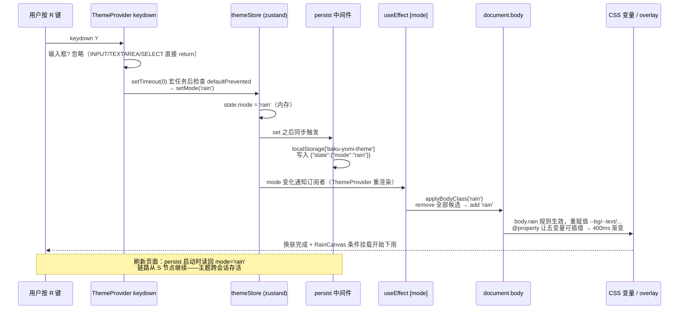

# 第 8 课 · Tailwind 4 与 CSS 变量主题体系

> 所属阶段 1 · 预计时长 90 分钟 · 难度★★★☆☆

## 学习目标

- 能说出 Tailwind 4 相对 3 的接入变化：`@tailwindcss/vite` 插件 + 一行 `@import "tailwindcss"`，告别 `tailwind.config.js` 三件套。
- 能解释本项目「CSS 变量 + body class」的主题机制，以及 `@property` 声明让变量可过渡的原因。
- 精读 `themeStore.applyBodyClass`：mode → body class 的映射表（注意 `day → light` 的错位）。
- 能说清 `ThemeProvider` 中 Canvas 特效组件的条件挂载策略与快捷键 `setTimeout(defer)` 技巧。
- 完成实操作业：新增一个「樱花」主题（配色 + body class + 简单特效）。

## 前置检查

- 已完成第 6、7 课：理解 Zustand store 与 persist（主题模式正是持久化的）。
- 第 4 课见过 `style={{ color: 'var(--text)' }}`——本课解释这行代码背后的体系。

## 关键文件

| 文件 | 职责 |
|---|---|
| `vite.config.ts` | 注册 `@tailwindcss/vite` 插件 |
| `src/index.css` | `@import "tailwindcss"` + 五个核心 CSS 变量 + 六套 `body.xxx` 变量覆盖 + 特效样式 |
| `src/theme/themeStore.ts` | `ThemeMode` 类型、`MODES/MODE_LABELS/MODE_SHORTCUTS/KEY_MAP` 四张表、`applyBodyClass` |
| `src/theme/ThemeProvider.tsx` | mode 变化时调 `applyBodyClass`；全局快捷键分发 |
| `src/theme/ThemeOverlays.tsx` | 按需挂载 MoonCanvas/RainCanvas/SnowCanvas/StarsCanvas |

## 正文

### 概念讲解

**Tailwind 4 的接入方式**。v3 需要 `tailwind.config.js` + PostCSS 配置 + 三条 `@tailwind` 指令；v4 把这些全部收编进一个 Vite 插件。看本项目的全部配置：

```ts
// vite.config.ts
import tailwindcss from "@tailwindcss/vite";
export default defineConfig({
  plugins: [react(), tailwindcss()],
  ...
});
```

```css
/* src/index.css 第一行 */
@import "tailwindcss";
```

没有 config 文件——主题定制直接写在 CSS 里。项目实际用法是「双轨制」：**原子类做布局与间距**（Sidebar 里的 `flex items-center`、`truncate flex-1 text-sm`），**语义化 CSS 类做皮肤**（`.app-sidebar-link`、`.bookshelf-card` 等，颜色全部引用 CSS 变量）。纯原子类写主题会导致每个暗色变体都要 `dark:` 前缀地狱；纯手写 CSS 又丢掉布局效率，混合是务实解。

#### 从 v3 到 v4：CSS-first 的范式转移

v4 不只是「配置变少」，而是把 Tailwind 的重心从 **JS 配置文件** 搬回了 **CSS 本身**——官方称之为 CSS-first。逐项对比：

| 关注点 | Tailwind v3 | Tailwind v4（本项目） |
|---|---|---|
| 接入 | `tailwind.config.js` + `postcss.config.js` + 三条 `@tailwind` 指令 | `@tailwindcss/vite` 插件 + 一行 `@import "tailwindcss"` |
| 内容发现 | config 里手写 `content: ['./src/**/*.{ts,tsx}']` glob 数组 | 插件挂在 Vite 模块图上自动发现，零维护 |
| 主题定制 | `theme.extend` 里写 JS 对象，再由工具链注入 CSS 变量 | 直接在 CSS 里用 `@theme` 定义变量，CSS 即配置 |
| 引擎 | PostCSS 管线多走一层 | 新引擎（Oxide）直接产出，构建更快 |

**插件机制**值得单独看一眼。`vite.config.ts` 里 `plugins: [react(), tailwindcss()]` 把插件挂进 Vite 的转换管线：当浏览器请求某个 CSS 模块时，插件拦截这段源码，把 `@import "tailwindcss"` 展开成 theme（变量）/ base（预置重置）/ utilities（工具类）三层，并**只生成源码里实际出现的类名**对应的规则。因为发现过程建立在 Vite 模块图上而非全仓库文本扫描，你删掉一个类名，下一次 CSS 请求里那条规则就不再出现——没有中间产物、没有缓存失效问题。这也解释了为什么项目里连 `postcss.config.js` 都不存在（可以 `glob` 验证一下）：整条样式链路被一个 Vite 插件收编了。

对本项目的实际影响是：**主题体系完全活在 CSS 里**（`@property`、`:root`、`body.xxx` 全是原生 CSS 语法），Tailwind 只负责布局原子类。两套系统零耦合——这也是为什么新增樱花主题的作业完全不用碰任何 Tailwind 配置。

**CSS 变量驱动的多主题**。原理一句话：把颜色抽成五个变量 `--bg/--text/--mid/--line/--accent`，全站样式只引用变量；切主题 = 给 `<body>` 换一个 class，class 里重新赋值变量，浏览器自动重绘所有引用处。零 React 重渲染、零 JS 遍历 DOM。

**为什么用 `@property`？** 普通 CSS 变量对浏览器是「不透明字符串」，无法插值，所以 `transition` 对它们无效。`@property --bg { syntax: '<color>'; inherits: true; initial-value: #0b0d10; }` 把变量注册成有类型、可继承的自定义属性，于是 `body { transition: --bg 400ms ease, ... }` 让换肤呈现 400ms 平滑渐变——这是 index.css 第 3-7 行 + 第 89 行的组合拳。

#### CSS 变量的级联与继承：主题体系的地基

理解这套机制前要钉死两个 CSS 基础概念：

- **继承**：定义在 `body` 上的 `--bg`，其后代元素全部能读到——因为自定义属性默认可继承。全站样式只写一次 `var(--bg)`，值顺着 DOM 树流下去。
- **级联**：同一变量可以在多个选择器里赋值，最终生效的是「对当前元素特异性最高、顺序最靠后」的那条。`body.snow` 的特异性和 `:root` 不同层，但 body 是 :root 的子元素——body 上声明的值覆盖继承来的初值。

于是六套主题的实现被压缩成「一份变量声明 × 六次赋值」：`:root`（即 night 默认）给五个变量的初值，其余五套各用一个 `body.xxx { --bg: …; … }` 覆盖。**新增第六套主题 = 新增一段五行代码**，这就是变量化换肤的复利。

再看派生层。`index.css` 第 76-87 行在 body 上用 `color-mix()` 从五个核心变量现算出一批语义变量：

```css
--bg-secondary: color-mix(in srgb, var(--bg) 92%, white 8%);   /* 背景混白提亮 */
--accent-subtle: color-mix(in srgb, var(--accent) 12%, transparent); /* 强调色的淡背景 */
--ink-muted: color-mix(in srgb, var(--mid) 78%, var(--bg) 22%);      /* 弱化文字 */
```

`color-mix(in srgb, A x%, B y%)` 把两种颜色按比例混合。妙处在于：派生变量的**来源仍是核心变量**，所以换主题时它们自动跟着变，无需逐套手调；而浅色主题（light/sunny/snow）在第 94-99 行专门把 `--bg-secondary` 改成混黑——白色背景上再混白会失去层次，这是对比度的细节修正。数一数账：五个手工维护的核心变量，换来十几个自动正确的衍生色。

最后是 `@property` 这块新拼图。普通 CSS 变量在浏览器眼里只是「不透明字符串」——`--bg: #fff` 和 `--bg: red` 无法比较大小、无法插值，所以 `transition` 对它们无效（过渡需要起止值之间的连续插值空间）。`@property` 规则：

```css
@property --bg {
  syntax: '<color>';     /* 声明类型：浏览器从此知道它是颜色 */
  inherits: true;        /* 可继承 */
  initial-value: #0b0d10; /* 初值（night 主色） */
}
```

注册之后，`--bg` 变成有类型、有初值的正式公民，`transition: --bg 400ms ease` 才有了插值的合法性——换肤时所有引用处平滑渐变 400ms，而不是生硬跳变。注意代价：每个要参与过渡的变量都必须单独注册，本项目恰好只注册了这五个。

### 代码走读

按「配置 → 变量定义 → JS 切换 → 组件消费」的顺序走一遍完整链路。

**1. 变量定义层（index.css）**

```css
@property --bg { syntax: '<color>'; inherits: true; initial-value: #0b0d10; }
@property --text { ... } @property --mid { ... }
@property --line { ... } @property --accent { ... }

body.midnight {
  --bg: #090909; --text: #b7b7b0; --mid: #555b62; --line: #17191c; --accent: #7a8fa6;
}
body.light   { --bg: #f1eee8; --text: #1c1b19; ... --accent: #867056; }
body.sunny   { --bg: #f6f0e3; ... --accent: #b28b52; }
body.rain    { --bg: #4e565c; ... --accent: #b4c0cb; }
body.snow    { --bg: #dfe7ef; ... --accent: #496076; }

body {
  background: var(--bg);
  color: var(--text);
  --bg-secondary: color-mix(in srgb, var(--bg) 92%, white 8%);
  --accent-subtle: color-mix(in srgb, var(--accent) 12%, transparent);
  transition: --bg 400ms ease, --text 400ms ease, --mid 400ms ease,
              --line 400ms ease, --accent 400ms ease;
}
```

把六套主题的变量组并排放在一起，能直观看到「一套骨架、六种皮肤」的设计。night 不占 class，它的五个值就是 `@property` 的 `initial-value`：

| 主题 | body class | `--bg` | `--text` | `--mid` | `--line` | `--accent` |
|---|---|---|---|---|---|---|
| night（默认） | 无（`:root` 初值） | `#0b0d10` | `#b9b9b3` | `#6d706f` | `#1f2224` | `#7f8872` |
| midnight（月光） | `body.midnight` | `#090909` | `#b7b7b0` | `#555b62` | `#17191c` | `#7a8fa6` |
| day（日间） | `body.light` ⚠️ | `#f1eee8` | `#1c1b19` | `#7f786d` | `#d6d1c8` | `#867056` |
| sunny | `body.sunny` | `#f6f0e3` | `#26211c` | `#8a7761` | `#ddd2c1` | `#b28b52` |
| rain | `body.rain` | `#4e565c` | `#d7dce0` | `#99a1aa` | `#667079` | `#b4c0cb` |
| snow | `body.snow` | `#dfe7ef` | `#253241` | `#6b7a8c` | `#c1cedb` | `#496076` |

读表有三个观察点：① 五个变量各司其职——`--bg` 底色、`--text` 正文、`--mid` 次要文字、`--line` 边框分割线、`--accent` 强调色，任何主题都必须五值齐全才算可用；② 三套浅色主题（day/sunny/snow）的 `--line` 都明显比暗色主题亮——暗色主题靠「比背景更亮的边」做分割，浅色主题相反；③ rain 是唯一的中等明度主题，文字用浅色而非深色，它验证了这套体系不预设「非黑即白」。

注意两点：`:root` 上 `--bg` 等的初值就是默认 night 主题色（night 不需要 body class）；`body` 层再用 `color-mix()` 派生次级变量（`--bg-secondary`、`--accent-light`…），浅色主题还专门覆写为混黑以保证对比度（第 94-99 行）。派生意味着新增主题只需给五个值，十几个衍生色自动正确。

**2. 切换层：`themeStore.applyBodyClass`**

```ts
export type ThemeMode = 'night' | 'midnight' | 'day' | 'sunny' | 'rain' | 'snow';

export const useThemeStore = create<ThemeState>()(
  persist((set) => ({ mode: 'snow', setMode: (mode) => set({ mode }) }),
          { name: 'baku-yomi-theme' })
);

export function applyBodyClass(mode: ThemeMode) {
  const body = document.body;
  body.classList.remove('midnight', 'light', 'sunny', 'rain', 'snow');
  switch (mode) {
    case 'night': break;                 // 默认 :root 色，无需 class
    case 'day':   body.classList.add('light'); break;   // 注意！
    case 'snow':  body.classList.add('snow'); break;
    ...
  }
}
```


对着真实源码（`src/theme/themeStore.ts` 第 59-81 行）逐行过一遍：

```ts
export function applyBodyClass(mode: ThemeMode) {
  const body = document.body;
  // 第 1 步：无条件清场。注意 remove 的是 class 名（light），不是 mode 名（day）
  body.classList.remove('midnight', 'light', 'sunny', 'rain', 'snow');

  switch (mode) {
    case 'night':
      break;                                // 默认主题 = :root 初值，什么都不加
    case 'midnight':
      body.classList.add('midnight');
      break;
    case 'day':
      body.classList.add('light');          // ⚠️ 历史命名错位：mode 叫 day，class 叫 light
      break;
    case 'sunny':
      body.classList.add('sunny');
      break;
    case 'rain':
      body.classList.add('rain');
      break;
    case 'snow':
      body.classList.add('snow');
      break;
  }
}
```

**`day → light` 的历史命名问题**值得单独讲透。产品语义上这个主题叫 day（与 sunny、rain 等天气意象并列），但 CSS 类名停留在早期版本的 `light`（与 dark 对立的光暗命名）。为什么不顺手改掉？因为类名不止 `applyBodyClass` 一处引用——`index.css` 里 `body.light { … }` 和浅色组选择器 `body.light, body.sunny, body.snow { … }` 都依赖它，改名是跨文件机械替换，收益却只是「名字好看」。项目选择了更工程化的方案：**把不一致隔离在 switch 这一个映射点**，其他所有代码只跟 mode 名打交道。代价是每个读这段代码的人都要停下来问一次「为什么」——你现在就是那个人。

**remove 列表的遗漏隐患**是这个函数最值得警惕的维护陷阱。remove 清单和 switch 分支是**两份手工同步的清单**：新增主题时你几乎不会忘记加 switch 分支（TypeScript 的字面量联合类型会逼着你补全），但 remove 列表是裸字符串数组，编译器完全不管——忘了往里加 `'sakura'` 会发生什么？从樱花切回 night 时 `sakura` class 残留在 body 上，之后任何模式都叠加着樱花的五个变量值；又因为 `body.sakura` 与 `body.light` 特异性相同，最终颜色取决于规则在文件里的先后顺序——一个随文件布局变化的隐性 bug。防御手段有二：作业里要求亲手踩一遍加深印象；工程化做法是把「class 名清单」抽成单一常量（如 `const THEME_CLASSES = ['midnight', 'light', ...]`），remove 用展开传入、switch 分支从中取值，让两份清单物理上变成一份。

三个细节：

- 先 remove 全部候选 class 再 add，保证幂等——重复调用不残留。
- **mode 名 ≠ class 名**：`day` 映射到 class `light`。这是历史命名遗留，改 CSS 类名成本高就保留了映射层——映射表集中在一个 switch 里正是为了隔离这类不一致。
- store 只存一个 `mode` 字符串并 persist；DOM 操作被刻意排除在 store 外，保持状态纯净。

**3. 副作用层：`ThemeProvider.tsx`**

```tsx
export function ThemeProvider({ children }: { children: ReactNode }) {
  const mode = useThemeStore((state) => state.mode);
  const setMode = useThemeStore((state) => state.setMode);

  useEffect(() => { applyBodyClass(mode); }, [mode]);   // state → DOM 同步

  useEffect(() => {
    function handleKey(event: KeyboardEvent) {
      const target = event.target as HTMLElement;
      const tag = target.tagName;
      if (tag === 'INPUT' || tag === 'TEXTAREA' || tag === 'SELECT') return;
      const nextMode = KEY_MAP[event.key.toLowerCase()];
      if (nextMode) {
        // Defer so other handlers (e.g. ReadingView's auto-read on 'r')
        // can call preventDefault first
        setTimeout(() => {
          if (!event.defaultPrevented) setMode(nextMode);
        }, 0);
      }
    }
    document.addEventListener('keydown', handleKey);
    return () => document.removeEventListener('keydown', handleKey);
  }, [setMode]);

  return (
    <ThemeContext.Provider value={{ mode, setMode }}>
      <ThemeOverlays />
      {children}
    </ThemeContext.Provider>
  );
}
```

数据流：persist 恢复/用户按键 → store.mode 变化 → effect 调 `applyBodyClass` → CSS 变量切换。快捷键部分有两个高阶技巧：输入框焦点守卫（第 5 课作业同款）；以及 **setTimeout(0) 延迟裁决**——同一个 `r` 键在 ReadingView 里是「自动朗读」，两个监听器都会收到事件，把主题切换推迟到下一个宏任务，先让阅读器的 handler 有机会 `preventDefault`，这里检查 `event.defaultPrevented` 后再决定是否换肤。单一按键的多方竞争就这样优雅仲裁。

**4. 特效层：`ThemeOverlays.tsx` 条件挂载**

```tsx
export function ThemeOverlays() {
  const { mode } = useTheme();
  return (
    <>
      <div className="theme-overlay-layer moon-overlay" aria-hidden="true">
        <div className="moon-light-beam" />
        <div className="stars-container">{mode === 'midnight' ? <StarsCanvas /> : null}</div>
        <div className="moon-canvas-wrap"><MoonCanvas /></div>
      </div>
      <div className="theme-overlay-layer rain-overlay" aria-hidden="true">
        <div className="rain-fog" />
        {mode === 'rain' ? <RainCanvas /> : null}
      </div>
      <div className="theme-overlay-layer snow-overlay" aria-hidden="true">
        <div className="snow-glow" />
        {mode === 'snow' ? <SnowCanvas /> : null}
      </div>
    </>
  );
}
```

三层固定 overlay 容器常驻（透明度由 CSS 控制：`body.midnight .moon-overlay { opacity: 1 }`），但**requestAnimationFrame 密集型的 `<canvas>` 动画只在对应模式下挂载**——离开 midnight，StarsCanvas 卸载，动画循环随之停止，CPU/GPU 归零。静态氛围（光束、雾、辉光 div）便宜到可以常驻，动态粒子昂贵必须按需。`aria-hidden="true"` 向读屏器隐藏纯装饰层。Canvas 内部实现（SnowCanvas 的雪花粒子等）留待兴趣驱动自读，接口上它们都是零 props 自治组件。

**5. 氛围层 CSS：静态特效为什么便宜（index.css 第 106-212 行）**

三层 overlay 的容器样式是同一套模板：

```css
.theme-overlay-layer {
  position: fixed;
  inset: 0;              /* 铺满视口 */
  pointer-events: none;  /* 关键！装饰层绝不拦截点击 */
  z-index: 0;            /* 压在内容层之下 */
  opacity: 0;
  transition: opacity 700ms cubic-bezier(0.23, 1, 0.32, 1);
}

body.midnight .moon-overlay { opacity: 1; }   /* 对应主题下淡入 */
body.rain .rain-overlay    { opacity: 1; }
body.snow .snow-overlay    { opacity: 1; }
```

四个属性各司其职，缺一不可：`position: fixed + inset: 0` 让氛围脱离文档流铺满全屏；`pointer-events: none` 保证再华丽的特效也不挡住任何按钮——这是装饰层的铁律；`z-index: 0` 把它压在正文之下；`opacity` 过渡负责 700ms 的电影感淡入淡出。

静态特效全部由 CSS 渐变与动画承担，零 JavaScript 参与：

```css
.moon-canvas-wrap::before {          /* 月亮光晕：径向渐变 + 14s 脉动 */
  background: radial-gradient(circle, rgba(180,200,230,.08) 25%, transparent 70%);
  animation: haloPulse 14s ease-in-out infinite;
}
.rain-fog {
  background:
    radial-gradient(ellipse at 50% 100%, rgba(70,80,95,.15) 0%, transparent 45%),
    /* ...三组渐变叠加成雾气... */
  animation: fogDrift 25s ease-in-out infinite alternate;
}
.snow-glow {
  background:
    linear-gradient(180deg, rgba(53,67,82,.22) 0%, transparent),
    radial-gradient(ellipse at 18% 18%, rgba(255,255,255,.34) 0%, transparent 38%);
  animation: snowGlowPulse 8s ease-in-out infinite alternate;
}
```

读这段 CSS 能提炼一条性能分级原则：**CSS 渐变绘制一次、合成器动画（opacity/transform）不重排不重绘**——所以光束、雾、辉光可以常驻甚至无限循环脉动，成本几乎为零；而 canvas 粒子每帧都要跑 JS、清画布、重绘，属于持续开销。把「贵」的留给条件挂载，把「便宜」的交给纯 CSS，两层配合才有既好看又不烫手的特效系统。


**6. 粒子系统概览：RainCanvas 与 SnowCanvas 的 Canvas 动效原理**

前五节都在讲「怎么省」，这一节看「贵的那部分」内部长什么样。两个粒子组件（`src/theme/overlays/RainCanvas.tsx`、`SnowCanvas.tsx`）共享同一套骨架，理解一个等于理解两个：

```
挂载 → useEffect 启动：
  1. resize()      按 devicePixelRatio 缩放画布物理像素
  2. spawn 粒子    按分层参数表批量生成，一次性填数组
  3. rAF 循环 tick  每帧：clearRect → 逐粒子更新位置 → 逐粒子绘制
卸载 → cleanup：active = false + cancelAnimationFrame + 移除 resize 监听
```

**RainCanvas：三层雨幕 + 水花**。340 颗雨滴按远中近三层生成——远层 120 颗又细又慢又透明（宽 0.4、速度 9、alpha ≤0.15），近层 70 颗粗快浓（宽 1.0、速度 20），模拟景深。每滴是一个带 `drift` 斜率的线段，每帧 `y += speed; x += drift`；落出底边时按 `splashChance` 概率生成一个 Splash 椭圆扩散水花（life/maxLife 控制淡出），然后雨滴回到顶部随机 x 重生——**粒子池固定，只循环复用不增删**，这是粒子系统的经典内存策略。

**SnowCanvas：风场 + 摆动 + 分形雪花**。比雨复杂一档：每片雪花除了位置速度，还带 `wobblePhase/wobbleSpeed`（正弦自摆）、`windWeight`（受风权重）、`rotation/detail/branchScale`（绘制六枝分形时的姿态与细节度）。全局风场由 `getWind(tick)` 用三个不同频率的正弦叠加出「微风 + 阵风」：阵风项 `Math.pow((Math.sin(...)+1)*0.5, 4) * 2.85` 让大风稀疏而猛烈。雪花飘出底部后不是简单重置，而是以自身参数 ±10% 的抖动重生（`createFlake(layer, false)`）——避免整屏雪花同步「归位」的假感。

性能上两处细节是通用功课：① `resize()` 里 `canvas.width = innerWidth * dpr` 并 `context.setTransform(dpr,0,0,dpr,0,0)`——高分屏上不做这个，画布会被拉伸成模糊的一团；② cleanup 里 `active = false` 与 `cancelAnimationFrame(raf)` 双保险——前者防已入队尚未执行的回调在卸载后再跑一帧，后者取消排队中的回调，两者配合才保证「组件卸载 = 动画彻底停止」，这正是 ThemeOverlays 敢于条件挂载的前提。

### 图示



### 边学边练

以下检查点请**边读边做**，每个不超过 5 分钟，做完再继续往下读。

> 🎯 **练习 1：亲眼看 body class 的切换**

打开 DevTools → Elements，选中 `<body>` 标签盯着。按 W（snow）、R（rain）、D（day）几个键。观察 class 属性实时增删——`applyBodyClass` 的工作现场。再按 N 切回 night：class 全部消失，因为 night 用 `:root` 默认值。

<details><summary>参考答案与观察要点</summary>

正常序列是 `class="snow"` → `class="rain"` → `class="light"` → `class=""`（或回到原有其他 class）。两个关键观察：① 任意时刻 body 上**最多只有一个**主题 class——这就是「先 remove 后 add」的现场证据；② D 键后出现的是 `light` 而不是 `day`——历史命名错位的直接目击。若看到两个主题 class 并存，说明你（或某个改动）破坏了清场逻辑。
</details>

> 🎯 **练习 2：在 Computed 面板追踪变量取值**

保持任意元素选中状态，DevTools → Computed 面板搜 `--bg`。切换主题时观察它的值随 body class 变化。再点开 Styles 面板找到 `body.snow { … }` 规则块，直观看到「变量赋值层」与「变量消费层」是两回事。

<details><summary>参考答案与观察要点</summary>

Computed 面板里 `--bg` 的值应随按键在六组色值间跳变（如 `#dfe7ef` ↔ `#4e565c`）。要点：Computed 显示的是**该元素最终继承到的取值**，而 Styles 里 `body.snow` 规则块才是**赋值来源**——级联把两者连起来。顺带确认派生变量：搜 `--bg-secondary` 会看到它不是任何 body.xxx 直接赋的，而是由 `color-mix()` 现算。
</details>

> 🎯 **练习 3：验证 React 与换肤无关**

给 `ThemeProvider.tsx` 加 `console.log('ThemeProvider render', mode);`，然后狂按快捷键切主题。日志每次都打（mode 变了组件确实重渲染），但页面颜色变化是 CSS 完成的——重渲染只负责调 `applyBodyClass` 这个副作用。测完删除日志。

<details><summary>参考答案与观察要点</summary>

每次按键打一条日志，证明 store 订阅 → 重渲染链路活着；但页面其余组件（书架、阅读器）**不会**重渲染——它们没订阅 themeStore。这正是「CSS 变量主题」相对「React context 全树下发主题对象」的核心优势：换肤的渲染成本被压缩到唯一订阅者 ThemeProvider 的一个 effect 调用。
</details>

> 🎯 **练习 4：绕过 React 直接换肤**

在 Console 执行 `document.body.classList.add('midnight')`。界面立即变成月光主题且带渐变动画——React 全程无感知。这证明「皮肤」完全由 CSS 状态决定；store 只是「谁应该被点亮」的记录员。刷新后恢复原状。

<details><summary>参考答案与观察要点</summary>

界面变月光、有 400ms 渐变、月亮 overlay 淡入——React 零参与。这个实验钉死了架构分工：**视觉真身在 CSS class，store 只负责持久化与分发**。反过来推：只要任何代码能改 body class（比如以后写 E2E 测试），就能直接驱动皮肤；而 React 内部 state 方案做不到这种「旁路控制」。
</details>

> 🎯 **练习 5：用 Performance 面板验证条件挂载的收益**

DevTools → Performance 录制 3 秒：先在 snow 模式下录（能看到 SnowCanvas 的 rAF 帧任务），再切到 day 录 3 秒（帧任务消失）。两张火焰图的差异就是「canvas 条件挂载」省下的持续开销。

<details><summary>参考答案与观察要点</summary>

snow 段每 16.7ms 一帧，帧内有 Script（tick 函数）+ Painting 任务；day 段帧间几乎空白。量化估算：340 雨滴/上百雪花的场景每帧要执行几百次 beginPath/stroke，乘以 60 帧/秒就是每秒数万次绘制调用——这还只是装饰层。结论固化成规则：rAF 动画组件必须随消费它的模式卸载，而不是隐藏（`display:none` 的 canvas 仍会跑 JS 循环）。
</details>


## 实操作业

大纲作业：**新增一个「樱花」主题：配色 + body class + 简单特效**。按基础 / 进阶 / 挑战三层完成：

**基础层（必做）：配色与切换链路**

1. **配色**：在 `index.css` 加一段
   ```css
   body.sakura {
     --bg: #fdf1f4; --text: #40222c; --mid: #a87c8a;
     --line: #eccdd6; --accent: #c25e78;
   }
   ```
   同时把 `body.sakura` 追加进第 95-98 行的浅色组选择器列表（`body.light, body.sunny, body.snow` 处），让 `--bg-secondary` 走混黑分支。
2. **类型与表**：`themeStore.ts` 里四处同步——`ThemeMode` 联合类型加 `'sakura'`、`MODES` 数组加元素、`MODE_LABELS` 加 `sakura: 'Sakura'`、`KEY_MAP` 选一个未占用字母如 `k: 'sakura'`（记得同步 `MODE_SHORTCUTS`，TopBar 会展示）。
3. **body class**：`applyBodyClass` 的 remove 列表加 `'sakura'`，switch 加 `case 'sakura': body.classList.add('sakura'); break;`

**进阶层（推荐）：飘落特效与全链路验证**

4. **简单特效**：仿照 snow-overlay 的结构，在 `ThemeOverlays.tsx` 加一层
   ```tsx
   <div className="theme-overlay-layer sakura-overlay" aria-hidden="true">
     {mode === 'sakura' ? <SakuraCanvas /> : null}
   </div>
   ```
   新建 `src/theme/overlays/SakuraCanvas.tsx`：不必复刻 SnowCanvas 全部物理，最小可用版 = 一个全屏 canvas + `useEffect` 里的 rAF 循环画 30 片粉色小椭圆缓慢下落即可；卸载时 `cancelAnimationFrame`（对照 RainCanvas 的 cleanup 三件套）。
   CSS 补两行：`.sakura-overlay { opacity: 0 } body.sakura .sakura-overlay { opacity: 1 }`。
5. **手动验证链路**：按 K 键 → body 出现 `sakura` class → 配色渐变 → 花瓣开始飘落；切回 day → 花瓣消失且 rAF 停止（DevTools Performance 录 3 秒确认无 canvas 绘帧）。
6. **刷新页面确认主题持久化生效**：persist key `baku-yomi-theme` 自动带上新模式——这正是第 7 课「store 只存 mode、DOM 由 effect 同步」架构的红利：持久化的字段没有因为加主题而多出一个。

**挑战层（选做）**

7. 给樱花模式补一个可访问性检查：用 DevTools 的 Rendering → Contrast 或对比度工具抽查 `--text` 在 `--bg` 上、`--mid` 辅助文字两组对比度是否达到 WCAG AA（正文 4.5:1）。不达标就回调色值，并把「为什么浅色主题要专门覆写混黑分支」的答案写全。
8. 让樱花主题出现在 ThemeIndicator 的循环里并验证快捷键提示文案自动更新——思考：TopBar 里那行硬编码的 `THEME N / M / D / S / R / W` 需要改吗？如果要消除这个硬编码，数据应该从哪张表来？

验收标准：

- [ ] 按 K 键或点击 ThemeIndicator 圆点可进入樱花主题，配色为粉系且正文对比度清晰可读；
- [ ] 从樱花切到任意其他主题（含 night）后 body 上不再残留 `sakura` class——remove 列表遗漏的直接检验；
- [ ] 樱花模式下有可见下落动画，离开该模式动画停止（无持续 CPU 占用）；
- [ ] 刷新后仍停留在樱花主题；
- [ ] `tsc` 无类型错误：`ThemeMode` 相关四张表全部更新，无遗漏键。

## 本课与面试

**Q1：实现多主题切换有哪些技术方案？CSS 变量方案的优劣是什么？**
答题要点：常见四类——(1) 每主题一套独立样式表，切 `link` 的 href（切换闪烁、无法平滑过渡、重复加载）；(2) 全 class 切换，每套主题为每个组件写一份选择器（规则数 = 组件 × 主题，膨胀快）；(3) CSS-in-JS 运行时下发主题对象（依赖 JS 重渲染，首屏与运行时都有成本）；(4) **CSS 变量**——样式只引用变量，切主题只改变量赋值入口（本项目 body class）。优点：零 React 重渲染、可过渡（配合 @property）、新增主题 O(变量数) 而非 O(组件数)；缺点：老浏览器（IE）不支持、动态类型弱（变量是无类型字符串，需 @property 补）、调试链路比直接写色值多一跳。本项目是方案 4 + body class 入口的典型实现。

**Q2：为什么 Canvas 动画用 requestAnimationFrame 而不是 setInterval？rAF 有哪些特性？**
答题要点：(1) rAF 与浏览器绘制帧对齐（通常 60Hz/120Hz），回调恰好在下一帧渲染前执行，不产生中间浪费帧；setInterval 与刷新率无关，频率高了丢帧、低了掉流畅度。(2) 标签页不可见时 rAF 自动暂停——后台标签不会白烧 CPU；setInterval 照跑（还被节流到 ≥1s，回来时可能堆积一批过期回调）。(3) 回调合并：同一帧内多次 rAF 注册只排一次队列语义清晰。(4) 工程要点：rAF 返回句柄必须保存并在卸载时 cancelAnimationFrame，否则动画循环泄漏（对照 RainCanvas cleanup）。追问「动画循环放 useEffect 里要注意什么」——依赖数组应为空 + cleanup 完整。

**Q3：普通 CSS 变量为什么不能 transition？@property 做了什么？**
答题要点：transition 的本质是浏览器在起止值之间做连续插值。自定义属性默认是「不透明 token」，`--x: red` 和 `--x: #f00` 在解析层没有类型信息，插值器不知道如何在两者间生成中间值，只能跳变。`@property`（CSS Houdini 的 Properties & Values API）把自定义属性注册为有 syntax 类型、initial-value、继承行为的正式属性，浏览器从此能用颜色插值器在两个合法 color 之间渐变。代价：每个要过渡的变量都要单独注册且必须给 initial-value（否则 invalid at computed-value time）。延伸：数值 `<length>`/`<number>` 同理可注册——纯 CSS 数字滚动动画就是这么做出来的。

**Q4：装饰性动效层怎么避免拖慢主业务？给出你的分层策略。**
答题要点：按「每帧成本」分级——静态元素（渐变、光晕 div）：一次绘制、常驻无妨；合成器动画（opacity/transform 过渡）：走 compositor 不占主线程，可以无限循环；脚本动画（canvas/rAF）：每帧执行 JS + 重绘，必须条件挂载、离开视口或所属模式即销毁。再加三条纪律：装饰层容器 `pointer-events: none` 且 `aria-hidden`，绝不干扰交互与读屏；canvas 尺寸处理 devicePixelRatio 防高分屏模糊；用 Performance 面板量化验证而不是「感觉还行」。本项目 ThemeOverlays 的「三层常驻容器 + canvas 条件挂载」就是这套策略的落地样板。

**Q5：用户在输入框里打字时按了主题快捷键字母，会发生什么？这类全局快捷键要注意什么？**
答题要点：ThemeProvider 的 handler 先查 `event.target.tagName`，INPUT/TEXTAREA/SELECT 一律 return——否则在搜索框输入含 n/m/d/s/r/w 的词会随机换肤，这是全局快捷键最经典的事故。其余注意点：用 `event.key.toLowerCase()` 兼容大写锁定；多个监听者竞争同一按键时用 setTimeout(0) + defaultPrevented 仲裁（见正文）；考虑修饰键组合（Ctrl+R 是刷新，不能拦）——本项目按键都是单字母所以天然规避，但通用方案要检查 `!event.ctrlKey && !event.metaKey`。

## 常见坑

1. **忘了 remove 旧 class 就 add 新 class**：出现 `class="light sakura"` 双主题叠加，颜色取决于选择器顺序而非预期。照抄 `applyBodyClass` 的「先全删再单加」。
2. **只加 CSS 忘了 TS**：`ThemeMode` 是字面量联合类型，漏一处 `MODE_LABELS` 直接编译报错——这其实是保护，跟着报错清单逐个补齐即可。
3. **Canvas 组件无条件渲染**：把 SnowCanvas 写在 overlay 外面常驻，六个主题下都有 60fps 绘帧循环，笔记本风扇起飞。记住「容器常驻、canvas 按需」。
4. **transition 写成 `transition: all 400ms`**：会连 layout 属性一起过渡造成卡顿掉帧。项目里精确列出五个颜色变量，配合 `@property` 才既流畅又高效；新变量若要参与渐变也须单独 `@property` 注册。
5. **新增主题忘了同步 remove 清单**：switch 分支有 TypeScript 逼你补全，remove 列表是裸字符串没有保护——漏掉 `'sakura'` 后从樱花切走会永久残留 class，之后所有主题都被樱花变量污染，且颜色表现随选择器顺序漂移。检验法：切到 night（class 应为空）看 Elements 面板。
6. **canvas 不处理 devicePixelRatio**：直接 `canvas.width = innerWidth` 在高分屏（dpr=2）上会把物理像素拉伸两倍，雨丝雪花全部发虚。照抄 `resize()` 的 `width * dpr` + `setTransform(dpr,0,0,dpr,0,0)` 组合；另外别忘监听 window resize——用户拖窗口后粒子池要按新尺寸重生。

## 自测题

<details>
<summary>1. 为什么切主题时组件不需要重渲染就能变色？</summary>

因为颜色全部通过 CSS 变量间接引用，React 树和 DOM 结构完全没动；applyBodyClass 只改了 body 的 class，浏览器级联样式重算后所有 var() 引用处自动取新值。加上 @property 注册的类型化变量支持 transition，整个过程发生在合成/绘制层面，与 React 无关。
</details>

<details>
<summary>2. <code>applyBodyClass</code> 里 <code>'day'</code> 为什么映射到 class <code>'light'</code>？如果要消除这个不一致该动哪里？</summary>

历史命名遗留：早期 CSS 用 light 命名日间主题，后来产品语义改成 day 但 CSS 类名未迁移。消除方式是把 index.css 的 body.light 选择器重命名为 body.day 并同步 applyBodyClass 与任何硬编码引用——纯机械替换，但要全局搜索确认无遗漏。
</details>

<details>
<summary>3. 快捷键处理里 <code>setTimeout(..., 0)</code> 解决什么问题？如果去掉会怎样？</summary>

解决多个 document 级 keydown 监听器对同一按键的优先权问题：ReadingView 的 r 键（自动朗读）需要机会 preventDefault。同步执行时两个监听器按注册顺序跑完，ThemeProvider 无法知道别人是否拦截了事件。延迟到宏任务后再查 event.defaultPrevented，就让先注册的处理器赢得裁决权。去掉则按 r 既触发朗读又切雨主题。</details>

<details>
<summary>4. <code>StarsCanvas</code> 外层的 stars-container 和 moon-overlay 为什么常驻而 canvas 条件挂载？两种策略各省什么钱？</summary>

常驻的 div 容器只是 opacity 过渡的载体，静态元素渲染一次几乎零成本，保留它换来 CSS 过渡的平滑显隐；rAF 驱动的 canvas 每帧都要执行脚本+重绘，是持续性开销，必须条件挂载使动画循环随卸载终止。前者省的是「显隐瞬间的重排」，后者省的是「常态下的每帧计算」。</details>

<details>
<summary>5. 如果 <code>applyBodyClass</code> 的 remove 清单漏掉了 <code>'light'</code>，会出现什么现象？怎么在开发期发现？</summary>

从 day 切到其他任何主题时 `light` class 残留，body 上出现双主题 class。颜色表现取决于 `body.light` 与新主题规则在 index.css 中的先后顺序——后声明者赢，所以可能「切到 snow 却还是日间配色」或「看起来正常但某几个变量是 light 的」，非常隐蔽。开发期发现手段：切到 night（唯一不加 class 的模式）断言 `document.body.className === ''`；写成单元测试或 Storybook 断言都能把它拦住。
</details>

<details>
<summary>6. RainCanvas 卸载清理里 <code>active = false</code> 和 <code>cancelAnimationFrame(raf)</code> 各防什么？只留一个行不行？</summary>

rAF 只是「下一帧前调我一次」，tick 内部再自我续约形成循环。cancelAnimationFrame 取消**已入队未执行**的那次回调；`active` 标志让即使有一次漏网的 tick 跑起来也会立即 return 且不再续约。理论上 cancel 掉当前句柄就够了，但竞态下（如 cleanup 与 rAF 入队的交错、StrictMode 双挂载）多一道标志位是廉价保险——防御性成对出现是动画组件的成熟写法。
</details>

<details>
<summary>7. 为什么主题 mode 存 Zustand + persist，而不是直接把 body class 名记在 localStorage 里、启动时读出来加上？</summary>

功能上可行，但会丢三层价值：① 类型安全——ThemeMode 字面量联合让非法值编译期报错，裸字符串 class 无保护且与 switch 映射脱节；② 响应式——store 是可订阅的单一事实来源，ThemeIndicator 圆点、TopBar 提示都靠订阅 mode 实时高亮，手写 localStorage 没有通知机制；③ 架构一致——本项目所有跨会话状态统一走 persist 中间件（水合、迁移、key 管理），主题没有理由特殊化。DOM class 是「投影」而非「状态」，存投影等于把派生物当源。
</details>

<details>
<summary>8. Tailwind 4 没有 tailwind.config.js，如果团队想加一个全局设计令牌（如品牌色）供工具类使用，应该写在哪？和本项目的 CSS 变量主题是什么关系？</summary>

v4 的做法是在 CSS 里用 <code>@theme { --color-brand: #xxx; }</code> 定义，插件自动生成 <code>bg-brand/text-brand</code> 等工具类并暴露为 CSS 变量。它与本项目的五变量体系是两个层次：@theme 服务「静态设计令牌 → 工具类」，项目体系服务「运行时可切换的动态皮肤」。两者不冲突但别混用——若把六个主题色都塞进 @theme，生成的只是六套静态类名，切换仍要靠 body class 重赋值；理解各自边界才不会写出「用 Tailwind 配置文件思维做主题」的倒退方案。
</details>
