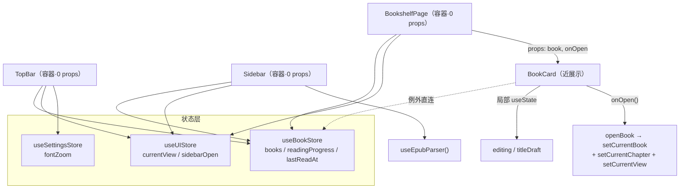

# 第 9 课 · 组件分层实践：布局层与列表渲染

> 所属阶段 1 · 预计时长 90 分钟 · 难度★★★☆☆

## 学习目标

- 能画出本项目的组件分层图：布局层（MainLayout/Sidebar/TopBar）→ 页面层（BookshelfPage）→ 卡片层（BookCard），并说清每层的连接方式（props / store 订阅 / children 插槽）。
- 精读 `MainLayout` 组合根：TopBar、Sidebar 与页面容器如何拼成一个应用骨架。
- 能分析 `Sidebar` / `TopBar` 的 props 流转——为什么它们几乎没有 props，数据从哪来。
- 掌握列表渲染三要素：`key` 的选法、派生计算（进度百分比）放哪、空态条件渲染。
- 精读 `BookshelfPage.filteredBooks` 的 useMemo 派生链：filter → sort 三种策略。
- 完成实操作业：给侧栏书架加「按最近阅读时间排序」。

## 前置检查

- 已完成第 4-8 课：受控组件、自定义 Hook、Zustand selector、CSS 变量主题全部就位。
- 第 7 课精读过 `bookSlice` 的 `lastReadAt: Record<chapterId, number>`——本课作业要消费它。

## 关键文件

| 文件 | 职责 |
|---|---|
| `src/components/layout/MainLayout.tsx` | 组合根：TopBar + Sidebar + 页面容器的骨架 |
| `src/components/layout/Sidebar.tsx` | 侧栏：导入入口、书列表、章节列表（带进度%） |
| `src/components/layout/TopBar.tsx` | 顶栏：品牌区、主题指示器、阅读进度、字号控制 |
| `src/components/bookshelf/BookshelfPage.tsx` | 书架页：搜索 + 排序 + 网格布局 |
| `src/components/bookshelf/BookCard.tsx` | 单本书卡片：封面渐变、进度条、重命名、删除 |

## 正文

### 概念讲解

**容器/展示分层**是 React 最耐用的组织模式：

- **容器组件**直接连 store，负责取数、组装行为（Sidebar、TopBar、BookshelfPage）；
- **展示组件**只收 props 渲染，不含业务依赖，因此可复用可测试（BookCard 只接 `{ book, onOpen }`）。

判断一个组件属于哪层的试金石：把它的 import 里所有 `stores/` 删掉还能编译吗？能 → 展示层；不能 → 容器层。本项目刻意让 BookCard 例外地保留了两条 store 连接（订阅 `readingProgress` 计算进度、直接调 `renameBook/removeBook`），这是务实取舍——纯展示化需要上提大量回调 props，收益有限。理解惯例的同时要知道它何时被打破。

**props 流转的两种形态**在本项目都有实例：显式 props（`App → MainLayout` 的 children、`BookshelfPage → BookCard` 的 `book/onOpen`）与隐式连接（容器组件经 Zustand selector 自取数据）。后者让 Sidebar 不必层层传递 books 列表，代价是组件与 store 耦合——所以只对「应用级单例」组件（布局、页面）使用。

先把本课五个组件的分层归属与连接方式列成速查表，读完正文回头对照：

| 组件 | 层级 | 显式 props | store 连接 | 局部 state |
|---|---|---|---|---|
| `MainLayout` | 布局·组合根 | `children` | uiSlice（currentView） | 无 |
| `TopBar` | 布局·容器 | 0 个 | 三店五路订阅 | 无 |
| `Sidebar` | 布局·容器 | 0 个 | book + ui 两店十路订阅 | fileInputRef |
| `BookshelfPage` | 页面·容器 | 0 个 | book + ui 两店订阅 | query、sortBy |
| `BookCard` | 卡片·近展示 | `book`、`onOpen` | bookSlice 直连（例外） | editing、titleDraft |

注意「store 连接」一列的梯度：从布局层的多路直连到卡片的例外直连，**越往下越收敛**——这个梯度就是容器/展示分层的可视化。

### 代码走读

按数据流自顶向下读五个组件——先看骨架怎么搭，再看器官怎么长。

**1. `MainLayout.tsx` —— 组合根：TopBar 与页面容器的组合关系**

```tsx
export function MainLayout({ children }: { children: React.ReactNode }) {
  const currentView = useUIStore((s) => s.currentView);

  return (
    <div className="app-shell min-h-screen" style={{ color: 'var(--text)' }}>
      <div className="app-frame">
        <TopBar />
        <div className={`app-workspace ${currentView === 'reader' ? 'app-workspace-reader' : ''}`}>
          <Sidebar />
          <main className={`app-main ${currentView === 'reader' ? 'app-main-reader' : ''}`}>
            {children}
          </main>
        </div>
      </div>
    </div>
  );
}
```

整个应用的视觉骨架只有 20 行，却示范了三个组织原则。**其一：布局组件不关心页面内容**——`children` 是 React 的插槽机制，MainLayout 只提供「上顶栏 + 侧栏 + 主区」的框架，书架页、阅读器、上传页都从 `{children}` 这个口子灌进来（App.tsx 里按 `currentView` 条件切换 children），布局与页面彻底解耦。**其二：兄弟协作靠共同父级的 store 订阅**——TopBar 和 Sidebar 是兄弟节点，互相不引用、不传 props；「侧栏开合」「当前视图」这类共享状态放在 uiSlice 里，两者各自订阅。这是 Zustand 项目里兄弟通信的标准答案：不提升 props、不用事件总线，状态上收到 store。**其三：条件类名做视图级样式开关**——`currentView === 'reader' ? 'app-workspace-reader' : ''` 让阅读模式可以收窄/加宽主区（CSS 里定义），一行模板字符串替代了整套「布局配置对象」。

还注意 `style={{ color: 'var(--text)' }}`：第 8 课埋的伏笔在这里兑现——根容器把正文颜色锚在 CSS 变量上，全部后代继承，主题切换时这行代码纹丝不动。

**2. `TopBar.tsx` —— 无 props 的容器**


```tsx
export function TopBar() {
  const { changeFontZoom } = useSettingsStore();
  const { toggleSidebar, openSettings, currentView } = useUIStore();
  const currentBook = useBookStore((s) => s.getCurrentBook());
  const currentChapter = useBookStore((s) => s.getCurrentChapter());
  const getReadingProgress = useBookStore((s) => s.getReadingProgress);

  const progressPct =
    currentChapter && currentChapter.pairs.length > 0
      ? Math.round((getReadingProgress(currentChapter.id) / currentChapter.pairs.length) * 100)
      : 0;
```

零 props、五路订阅。注意两个层次：action 类订阅（`toggleSidebar/openSettings/changeFontZoom`）引用恒定不引起重渲染问题；数据类订阅里 `getCurrentBook()/getCurrentChapter()` 是**在 selector 内调用 store 方法**——每次 store 变化都会重新执行 find，但返回的是数组里的既有对象，引用稳定所以安全。进度条公式展示了「原始数据 → 展示值」的最小派生：`已读句数 / 总句数` 取整。

**3. `Sidebar.tsx` —— 三段式结构与隐藏 file input**

```tsx
const { parseFile, parsing } = useEpubParser();          // 第5课的 Hook
const fileInputRef = useRef<HTMLInputElement>(null);

const openReader = (bookId: string, chapterIndex?: number) => {
  setCurrentBook(bookId);
  const target = chapterIndex ?? getLastChapterIndexForBook(bookId);
  setCurrentChapter(target);
  setCurrentView('reader');
};

if (!sidebarOpen) return null;
```

`openReader` 是「跨 store 编排」的缩影：三次 set 分属两个 store（bookSlice 两下 + uiSlice 一下），顺序保证阅读视图打开时书和章已就位。可选参数实现两种语义：点书 = 续读上次章（`getLastChapterIndexForBook` 兜底），点具体章 = 定向跳转。`handleImport` 借隐藏 `<input type="file" accept=".epub">` 触发系统选择框，用完 `e.target.value = ''` 复位以便重复选择同名文件。

列表渲染部分（第 85-115 行）是本课核心教材：

```tsx
{books.length === 0 ? (
  <p className="app-sidebar-empty">点击 + 导入书籍</p>
) : (
  <ul className="app-sidebar-list">
    {books.map((book) => (
      <li key={book.id} className="group flex items-center">
        <button onClick={() => openReader(book.id)}
          className={`app-sidebar-link ${currentBookId === book.id ? 'active' : ''}`}>
          <span className="truncate flex-1 text-sm">{book.title}</span>
        </button>
        <button onClick={() => removeBook(book.id)} className="app-inline-danger">
          <FiTrash2 size={14} />
        </button>
      </li>
    ))}
  </ul>
)}
```

三要素齐活：key 用稳定业务 id `book.id`（不是下标）；激活态由数据比较派生；空态与列表互斥三元。章节列表（119-155 行）更进一步，每行内联派生进度：`readingProgress[chapter.id] ?? 0` → 与 `pairs.length` 相除取整 → 大于 0 才显示 `%` 徽标。**派生值就地计算而不入库**——存百分比会引入同步负担，永远从源头字段现算才不会腐烂。

**「当前书高亮」的完整机制**值得单独拆开。侧栏书列表每行：

```tsx
<li key={book.id} className="group flex items-center">
  <button onClick={() => openReader(book.id)}
    className={`app-sidebar-link ${currentBookId === book.id ? 'active' : ''}`}>
    <FiBookOpen size={16} className="flex-shrink-0" />
    <span className="truncate flex-1 text-sm">{book.title}</span>
  </button>
  <button onClick={() => removeBook(book.id)} className="app-inline-danger" title="删除">
    <FiTrash2 size={14} />
  </button>
</li>
```

高亮的本质是**派生 UI**：`currentBookId` 是 store 里的数据，`active` class 只是它投在 DOM 上的影子——没有任何 `setActive` 类的命令式调用。点击书名 → `setCurrentBook(bookId)` → store 更新 → 订阅了 `currentBookId` 的 Sidebar 重渲染 → 新的 class 字符串生效。章节列表的高亮同理但键不同：书的身份用 id 比较（稳定），章的身份用**下标**比较（`currentChapterIndex === idx`）——因为章节在书内有序且不重排，下标在这里是合法身份；一旦需求变成可拖拽排序章节，就必须换成 chapterId，这是「key 用下标」争议在激活态上的同构问题。

另一个细节是每行的双按钮结构：主按钮占满整行使点击区域最大化，删除按钮独立在外——如果嵌进主按钮内部就是非法 HTML（button 嵌 button）。`truncate flex-1 text-sm` 这组 Tailwind 原子类负责长书名的省略号截断，正是第 8 课说的「原子类管布局、语义类管皮肤」分工。

**4. `BookCard.tsx` —— 近展示组件与局部 state**

```tsx
interface Props {
  book: Book;
  onOpen: () => void;
}

export function BookCard({ book, onOpen }: Props) {
  const readingProgress = useBookStore((s) => s.readingProgress);
  const removeBook = useBookStore((s) => s.removeBook);
  const renameBook = useBookStore((s) => s.renameBook);
  const [editing, setEditing] = useState(false);
  const [titleDraft, setTitleDraft] = useState(book.title);

  const progressPct = useMemo(() => calcProgressPct(book, readingProgress), [book, readingProgress]);
```

模块级纯函数 `calcProgressPct(book, readingProgress)` 把全书各章 `Math.min(Math.max(idx,0), pairs.length)` 截断求和再算比例（截断防越界脏数据）。`useMemo` 缓存是因为该卡片会在搜索输入时频繁重渲。封面兜底很巧：无封面时 `coverGradient(title)` 对标题做字符串哈希取色相，每本书获得稳定且不同的渐变色。重命名是第 4 课受控组件理论的落地：`titleDraft` 受控 input + Enter 提交 `renameBook(book.id, titleDraft)` + Esc 还原 `setTitleDraft(book.title)`。

**封面的双轨显示**是「数据优先、算法兜底」的小范例：

```tsx
<div className="bookshelf-cover"
  style={{ background: book.coverUrl ? undefined : coverGradient(book.title) }}
  onClick={onOpen}>
  {book.coverUrl ? (
    
  ) : (
    <div className="bookshelf-cover-fallback">
      <FiBook size={28} style={{ opacity: 0.5 }} />
      <span className="bookshelf-cover-title">{book.title}</span>
    </div>
  )}
```

有 `coverUrl` 用真实封面（hover 时 CSS 放大 1.03 倍），没有就用 `coverGradient(title)` 生成渐变兜底。哈希算法只有四行：`hash = (hash << 5) - hash + title.charCodeAt(i)`（即经典的 `hash * 31 + c`）逐字符累积，最后 `hash |= 0` 强转 32 位整数防溢出成浮点，`Math.abs(hash) % 360` 得到色相。两个性质使它适合当兜底：**确定性**（同一本书永远同色，刷新不变）与**均匀性**（书名微小差异导致色相大幅散开，相邻书不易撞色）。注意 style 上 `background: coverUrl ? undefined : ...` 的写法——React 对 undefined 样式直接跳过，比三元拼两个完整 style 对象干净。

**进度条的数据来源**要追到 `bookSlice` 才算读完。卡片上的百分比来自 `calcProgressPct(book, readingProgress)`，其中 `readingProgress` 是 `Record<chapterId, pairIndex>`——记录每章「读到的句对下标」。写入方在阅读器：滚动触发 `setReadingProgress(chapterId, pairIndex)`，这个 action 每次同时干两件事：

```ts
setReadingProgress: (chapterId, pairIndex) =>
  set((state) => ({
    readingProgress: { ...state.readingProgress, [chapterId]: pairIndex },
    lastReadAt:      { ...state.lastReadAt,      [chapterId]: Date.now() },
  })),
```

`readingProgress` 回答「读到哪」，`lastReadAt` 回答「什么时候读的」——本课作业的排序功能正是消费后者。读取侧的 `calcProgressPct` 把全书各章已读数截断求和（`Math.min(Math.max(idx,0), pairs.length)` 防脏数据越界），除以总句对再取整。封面底部的进度条 `width: ${progressPct}%` 只是把这个数字再投一次影——**同一份 store 数据，三处消费**（侧栏徽标、卡片统计行、封面进度条），全部现算、零冗余存储。


**5. `BookshelfPage.tsx` —— useMemo 派生链**

```tsx
type SortBy = 'lastImported' | 'title' | 'progress';
const [query, setQuery] = useState('');
const [sortBy, setSortBy] = useState<SortBy>('lastImported');

const filteredBooks = useMemo(() => {
  const lowerQuery = query.trim().toLowerCase();
  const list = books.filter((b) =>
    !lowerQuery ||
    b.title.toLowerCase().includes(lowerQuery) ||
    (b.author ?? '').toLowerCase().includes(lowerQuery));

  if (sortBy === 'title')
    return [...list].sort((a, b) => a.title.localeCompare(b.title, 'zh-Hans'));
  if (sortBy === 'progress') {
    const progressOf = (bookId: string) => { /* 全书已读/总句对 */ };
    return [...list].sort((a, b) => progressOf(b.id) - progressOf(a.id));
  }
  return [...list].sort((a, b) => (b.importedAt ?? 0) - (a.importedAt ?? 0));
}, [books, query, sortBy, readingProgress]);
```

教科书式派生链：**filter 先缩小集合，再按三种策略 sort**；`[...list].sort` 先拷贝避免原地排序副作用；中文排序用 `localeCompare(…, 'zh-Hans')` 才符合拼音序。依赖数组 `[books, query, sortBy, readingProgress]` 覆盖了闭包内读取的全部响应式数据（progress 策略用到 readingProgress，即使当前没选中也要列全）。最后网格渲染：

派生链的上游是两个**受控表单元素**，它们驱动这条链重算：搜索框 `value={query} onChange={...}`、排序下拉 `value={sortBy} onChange={(e) => setSortBy(e.target.value as SortBy)}`。下拉的 `as SortBy` 断言值得停一下：`e.target.value` 的类型是 string，而 state 的类型是三值联合——这里信任「option 的 value 都来自我们手写的枚举」所以断言安全；如果 option 是动态生成（比如后端下发排序策略），断言就会变成谎言，届时应校验后再入 state。工具栏右侧还有第三个隐藏受控者：导入按钮 `<label>` 里包着的 `type="file"` input——label 的 htmlFor 转发点击让按钮和文件选择解耦，这是非受控 file input 的惯用包装。

另外注意 progress 策略里的 `progressOf`：它在比较函数内部对每对元素重复计算全书进度——严格说是 O(N²) 的小浪费。教科书做法是先 `list.map(b => ({ b, p: progressOf(b.id) }))` 算一次再排序。当前书架规模下两种写法无感差异，但你要能识别这个模式：**装饰在 sort 比较器里的重复派生**，是列表规模上涨后第一个变热点的地方。


```tsx
<div className="bookshelf-grid">
  {filteredBooks.map((book) => (
    <BookCard key={book.id} book={book} onOpen={() => openBook(book.id)} />
  ))}
</div>
```

回调 props `onOpen` 闭包捕获 `book.id`——每个卡片的点击天然携带身份，无需再传 id 参数。

### 图示

把五个组件的连接方式画成一张图，分层与数据流一目了然。实线是显式 props，虚线是「例外直连」的 store 订阅：



读图三句话：① **布局层零 props、多路订阅**——TopBar/Sidebar/MainLayout 都直接挂在三个 store 上，这是「应用级单例」的特权；② **数据只跨一层 props**——BookshelfPage → BookCard 是全图唯一的显式 props 通道（`book` + `onOpen`），再往下就没有更深的组件树了，最浅的 props 链意味着最少的透传噪音；③ **BookCard 的虚线是刻意保留的例外**——它直连 bookSlice 取进度和 action，破坏了纯展示性但省掉 4-6 个回调 props。图上还有一个隐藏角色：MainLayout 没出现在 store 边里却订阅着 `currentView`（切换 reader 布局类名）——画组件关系图时别忘了 children 插槽的持有者。

顺带把 BookshelfPage 的**空态双分支**补进走读。它不是简单「没数据显示一句提示」，而是区分了两种空：

```tsx
{filteredBooks.length === 0 ? (
  <div className="bookshelf-empty">
    <p>{books.length === 0 ? '你的书架还是空的，先导入第一本 EPUB 吧。' : '没有匹配的书，换个关键词试试。'}</p>
    {books.length === 0 && (
      <label className="btn btn-primary cursor-pointer">
        {parsing ? '导入中...' : '导入 EPUB'}
        <input type="file" accept=".epub" onChange={handleImport} style={{ display: 'none' }} />
      </label>
    )}
  </div>
) : ( ...网格... )}
```

`books.length === 0` 是**真空态**（用户还没导入过），给出行动入口——内嵌一个带隐藏 file input 的导入按钮；只有搜索/排序过滤导致空时才是**伪空态**，提示换个关键词即可、绝不该出现导入按钮。区分「数据空」与「结果空」是空态设计的基本功：前者要引导，后者要解释。

### 边学边练

以下检查点请**边读边做**，每个不超过 5 分钟，做完再继续往下读。

> 🎯 **练习 1：数一数 Sidebar 的订阅清单**

打开 `Sidebar.tsx` 前 20 行，列出它从 `useBookStore` / `useUIStore` 各取了什么。回答：哪几个是数据、哪几个是 action？如果把 `readingProgress` 的订阅删掉，页面会报错吗，还是只是某个功能悄悄失灵？

<details><summary>参考答案</summary>

bookStore 七项：books、currentBookId、currentChapterIndex、readingProgress（数据）+ setCurrentBook、setCurrentChapter、getLastChapterIndexForBook、removeBook（action）；uiStore 三项：sidebarOpen、currentView（数据）+ setCurrentView（action）。删掉 readingProgress 订阅不会报错——但章节列表的 `%` 徽标全部消失（`progress` 恒为 0），且作业的排序功能无从谈起。这类「静默降级」正是 review 容器组件时要逐个核对订阅的原因。
</details>

> 🎯 **练习 2：亲手触发一次高亮迁移**

在书架页点击 A 书进入阅读器，观察侧栏 A 书的 `active` 高亮；再点章节列表第 3 章。用 DevTools Elements 分别确认：书列表高亮由哪个字段决定？章节高亮又由哪个字段决定？两者为什么用不同的比较值（id vs 下标）？

<details><summary>参考答案</summary>

书高亮：`currentBookId === book.id`（字符串 id 比较）；章高亮：`currentChapterIndex === idx`（数字下标比较）。章节用下标是因为 `currentChapterIndex` 本身就是 store 里的一等公民状态，而章节顺序固定不重排，下标身份稳定；书列表则随时可能增删排序，必须用持久 id。判据一句话：**数据源里存的是什么身份，就用什么身份比较**。
</details>

> 🎯 **练习 3：追踪进度条的完整数据旅程**

从「阅读器滚动一句」出发，写出百分比徽标更新的全链路（提示：ReadingView 调用什么 action → bookSlice 哪两个字段变化 → 哪些组件订阅了它们）。然后在 BookCard 的 `calcProgressPct` 里临时把 `Math.round` 改成 `Math.floor`，观察哪个 UI 变化。

<details><summary>参考答案</summary>

链路：滚动 → `setReadingProgress(chapterId, pairIndex)` → `readingProgress` 与 `lastReadAt` 同时更新（新对象引用）→ 订阅者重渲染：TopBar 的 progressPct、Sidebar 章节徽标、BookshelfPage（因 filteredBooks 依赖 readingProgress）、BookCard 的封面进度条。改 Math.floor 后最直观的是 TopBar 徽标与卡片统计行：99.4% 这类值从四舍五入的 99% 变成 99%（floor 同值），但 0.9% 会从 1% 变成 0%——读了一句却显示 0%，体验倒退。这个实验说明「取整策略」也是可观察契约。
</details>

> 🎯 **练习 4：给 key 做一次破坏性实验**

把 BookshelfPage 网格渲染的 `key={book.id}` 临时改成 `key={index}`（map 的第二个参数），再配合作业里的排序功能或搜索过滤：展开某张卡的重命名输入框后切换排序方式。观察发生了什么？改回 `book.id` 再试一次。

<details><summary>参考答案</summary>

下标 key 下，排序变化时 React 认为「位置 0 还是位置 0」，就地复用 DOM 与组件实例：你展开的重命名草稿会「跳」到另一本书的卡片上（state 按位置留存，props 换了内容）。id key 下 React 识别出同一本书移动了位置，带着它的 state 一起搬走。实验结束务必还原——这是本课最重要的一条纪律的具象化。
</details>

> 🎯 **练习 5：给 MainLayout 做「减法」实验**

临时把 MainLayout 里的 `<TopBar />` 或 `<Sidebar />` 注释掉，观察界面缺了什么、哪些功能跟着失效（如侧栏没了 → 导入入口只剩书架页那颗按钮）。做完还原，然后回答：为什么 TopBar 和 Sidebar 互相删除都不报错？

<details><summary>参考答案</summary>

因为它们之间零引用——都只跟 store 和 MainLayout 打交道，编译期互不相识。这既是优点（任意替换/删除布局器官不影响其余部分，主题 overlay、弹窗同理可插拔），也是容器直连 store 的代价面：组件间的真实数据依赖被隐藏在共享的 store 里，读代码时必须顺着「谁订阅了什么」重建依赖图，而不是顺着 props 链就能读完。
</details>


## 实操作业

大纲作业：**在侧栏书架加排序功能（按最近阅读时间）**。侧栏书籍目前按导入顺序排列，要让最近读过的书排前面。按基础 / 进阶 / 挑战三层完成：

**基础层（必做）：侧栏按最近阅读排序**

1. **想清数据源**：`lastReadAt` 以 chapterId 为键，没有 bookId 维度。需要在派生处为每本书聚合：遍历该书 `chapters`，取 `lastReadAt[ch.id]` 的最大值作为书的最近阅读时间（没读过则为 0）。先在纸上写出这个映射函数。
2. **在 `Sidebar.tsx` 订阅数据并写派生**：
   ```tsx
   const lastReadAt = useBookStore((s) => s.lastReadAt);

   const sortedBooks = useMemo(() =>
     [...books].sort((a, b) => lastReadOf(b.id) - lastReadOf(a.id)),
     [books, lastReadAt]);
   ```
   其中 `lastReadOf(bookId)` 用 `Math.max(...book.chapters.map(ch => lastReadAt[ch.id] ?? 0))` 实现（注意空 chapters 数组时 Math.max() 返回 -Infinity，需 `|| 0` 兜底）。
3. **替换渲染数据源**：把 `books.map(...)` 改为 `sortedBooks.map(...)`。key 仍是 `book.id`——排序变化时 React 凭 key 移动既有 DOM 而非重建，这正是稳定 key 的价值。
4. **验证联动**：读 A 书几句 → 回书架 → A 应排在首位；再去读 B 书 → B 升到第一、A 第二。原理自查：`setReadingProgress` 同时更新 `lastReadAt`，selector 感知变化 → Sidebar 重渲染 → useMemo 重算。

**进阶层（推荐）：能力上移到书架页与共享抽取**

5. 把同样的能力搬进 `BookshelfPage`——在 `SortBy` 类型加 `'recentlyRead'`，`filteredBooks` 加一个分支复用 `lastReadOf` 思路，下拉框加选项「按最近阅读」。
6. 体会同一份派生逻辑出现在两个容器时是否该抽成共享工具函数（如 `src/lib/bookStats.ts`）：把 `lastReadOf(bookId, lastReadAt)` 抽出去，两个容器各自 import——判断依据是「第三处需要它的概率」与「函数签名是否足够通用」，而不是 DRY 条件反射。

**挑战层（选做）**

7. 给排序加稳定性与可解释性：两本书最近阅读时间完全相同（或都从未读过）时，当前实现顺序取决于 sort 的底层实现。让平局回落到导入时间倒序（`importedAt ?? 0`），并用三本手工构造同时间戳的书验证。
8. 写一个 10 行以内的自定义 Hook `useRecentReading()` 封装「订阅 lastReadAt + 提供 lastReadOf」——对比直接在两个容器里重复订阅的写法，写下它何时值得抽象、何时是过度设计。

验收标准：

- [ ] 侧栏书籍列表按最近阅读时间倒序，从未读过的书沉底；
- [ ] 切换当前阅读的书后无需刷新，侧栏顺序立即更新；
- [ ] 书架页下拉可选「按最近阅读」且行为与侧栏一致（进阶层完成后）；
- [ ] key 保持 `book.id`，排序切换时 DevTools Elements 中观察到的是节点移动而非重建；
- [ ] 空 `lastReadAt`、空 `chapters` 等边界不出 NaN/-Infinity（用一本刚导入未读的书验证）。

## 本课与面试

**Q1：React 列表为什么需要 key？key 在 diff 过程中到底起什么作用？**
答题要点：React 跨子节点 diff 时默认按位置逐一比较（同位置同类型 → 复用实例只更新 props）；列表重排时逐位比较会产生大量「内容错位」的低效更新。key 把「位置身份」升级为「稳定身份」：diff 时按 key 匹配新旧子节点，能识别移动（复用 DOM 与组件 state，只改顺序）、新增、删除。两个铁律：(1) key 必须在同一次渲染的兄弟间唯一且跨渲染稳定——用业务 id，不用随机数/下标（下标在插入删除与排序时身份漂移）；(2) key 不传给组件本体，它是 React 的内部指令而非 props。可结合 BookCard 重命名草稿串门实验作答。

**Q2：受控组件与非受控组件怎么选？本项目各有哪些实例？**
答题要点：受控 = 表单值由 React state 驱动（value + onChange），每次输入都走一遍状态循环，好处是值即时可用（搜索过滤、校验、联动）；非受控 = DOM 自己持有值，需要时用 ref 读取。本项目对照鲜明：BookCard 重命名的 `titleDraft` 是受控——Enter 提交/Esc 还原都要读改这个 state；而 Sidebar 导入的 `<input type="file">` 是非受控——文件选择框无法用 value 受控，只能 `ref.current?.click()` 触发、onChange 里读 `files[0]`，且读完 `e.target.value = ''` 手动复位以便重复选同一文件。选型口诀：**需要程序读写值的用受控，只需要「取一次结果」的用非受控**；file/富文本等天生不可控的别硬掰。

**Q3：容器/展示组件模式在 Hooks 时代还成立吗？组件拆分粒度怎么把握？**
答题要点：原始二分法（class 时代 HOC 取数 + 纯函数渲染）已被自定义 Hook 消解——现在的主流是「Hook 承担与状态的连接，组件专注渲染」，连接逻辑从包装层级变成了函数内一行调用。但分层的**思想**没过时：叶子组件尽量少依赖全局（可复用可测试），容器组件允许直连 store 但应保持薄。粒度判据三条：按「变化原因」拆（一个组件只因一个理由被修改）；按「重渲范围」拆（把昂贵/易变的子树隔离进独立组件配 memo）；按「复用次数」拆——出现第二个消费场景再抽，不为假想复用预付成本。本项目 BookCard 保留 store 直连就是「不教条」的注脚。

**Q4：列表项里做派生计算（如每本书的进度），放 render 内联、useMemo 还是模块级纯函数？**
答题要点：三层递进。(1) 内联计算：最简单，O(小) 且每次渲染必然发生时可接受；(2) useMemo：依赖明确的重计算缓存，适合列表会频繁重渲的场景（如 BookCard 在搜索输入时反复执行）；(3) 模块级纯函数 + useMemo 组合（`calcProgressPct`）：纯函数便于单测与复用，memo 只管「何时跳过」。反模式是把派生结果存进 store 或 localStorage——引入同步负担且必然腐烂。另一个易漏点：列表页级别的过滤排序用**一个** useMemo 统一派生（filteredBooks），而不是每张卡片各自判断「我该不该显示」。

**Q5：如果书架要支持一万本书，当前实现哪里先崩？怎么改？**
答题要点：按瓶颈顺序答。(1) 渲染层先崩——一万个 BookCard 全量挂载，DOM 节点爆炸；方案是虚拟化列表（react-window 等）或分页/无限滚动。(2) 派生层次之——filteredBooks 每次按键都全量 filter+sort 一万条；方案是 debounce 搜索词、把 progressOf 从 O(N²) 的 find 改为预构建 Map 索引。(3) 订阅层——readingProgress 高频更新会让整个书架页反复重算；方案是 selector 细化到单卡所需切片或用带记忆化的 selector。答题姿态很重要：先给量化依据（当前几十本书全部不是问题），再谈优化——面试官考察的是「知道何时不必优化」。

## 常见坑

1. **用数组下标当 key 再做排序**：排序后下标错位，React 会把 A 书的状态复用到 B 书的节点上（展开的重命名草稿串门、动画错乱）。业务 id 是唯一正解——本作业正是此坑的免疫训练。
2. **原地 sort 污染 store**：`books.sort(...)` 直接改 store 数组引用内的顺序却不产生新引用，selector 可能不触发更新，还违反不可变约定。必须 `[...books].sort(...)`。
3. **useMemo 依赖漏项**：忘了 `lastReadAt` 则读完书回来顺序不变，且这种 bug 只在特定操作序列出现。规则：闭包里读到的每个 store 字段都进依赖数组。
4. **派生数据入库**：常见诱惑是把「最近阅读时间」也存到 Book 上——一旦忘记在 setReadingProgress 里同步就会双份数据互相矛盾。原则：能从现有字段算出的东西绝不存储。
5. **受控输入的初值陷阱**：`useState(book.title)` 只在组件**首次挂载**时取值。若 A 卡片的重命名框展开着，此时书在别处被改名（如另一标签页同步），`titleDraft` 不会跟着变——这是受控初值与 props 的经典时序差。当前单用户场景无碍，但要识别它：需要「外部值变化即跟随」时应加 `useEffect` 同步或用 key 重挂载。
6. **把 onOpen 写成立即调用**：`onOpen={() => openBook(book.id)}` 与 `onOpen={openBook(book.id)}` 一字之差，后者在渲染期直接执行打开逻辑——每渲染一张卡就跳一次阅读器。箭头函数包裹的本质是「延迟到事件发生再求值」。

## 自测题

<details>
<summary>1. Sidebar 和 TopBar 都没有任何 props，这算违反「数据通过 props 向下流动」吗？</summary>

不算违反，而是流动通道换成了 store。props 单向流解决的是父子通信；Zustand 提供的是全局可达的第三通道。容器组件作为应用级单例直接订阅是惯用法，真正的纪律在于：越接近叶子（如 BookCard）越应回到 props 传参，保持可复用性。
</details>

<details>
<summary>2. <code>getCurrentBook()</code> 在 selector 里每次执行 find，性能上可接受吗？什么时候会成为问题？</summary>

find 是 O(书数)，书数量级是个位到几十，完全可接受。若换成上千节点的列表逐项调用这类派生 selector，每次任意 store 更新都重跑才会成为热点；届时应缓存（useMemo 化的自定义 hook 或 reselect 式记忆化），而不是现在过早优化。
</details>

<details>
<summary>3. 为什么 <code>filteredBooks</code> 的 useMemo 依赖里要有 <code>readingProgress</code>，尽管默认排序策略用不到它？</summary>

因为当 sortBy === 'progress' 时闭包读取了 readingProgress。依赖数组描述的是「这段计算的完整输入清单」，不是「本次执行的输入」。漏掉它会出现切到进度排序后数据陈旧的隐性 bug。
</details>

<details>
<summary>4. BookCard 保留了 renameBook/removeBook 的直连，如果强制纯展示化，接口会变成什么样？值得吗？</summary>

Props 需增加 onRename/onRemove/onToggleEdit 等 4-6 个回调，BookshelfPage 要逐一透传。收益仅是 BookCard 可脱离 store 复用——但它本来就只服务书架场景。项目选择打破纯度换取简洁；若未来出现第二个消费场景（比如弹窗式快速切换书单），再重构上提也不迟。</details>

<details>
<summary>5. 章节列表的高亮用 <code>currentChapterIndex === idx</code>（下标比较），书列表却用 id 比较。什么时候下标比较会出 bug？</summary>

当列表可能**重排或局部增删**时：下标从「稳定身份」退化为「当前位置」，高亮会跟着位置走而不是跟着内容走。本项目章节在导入后顺序固定、不删除中间章，下标安全；但假如未来加「收藏章节置顶」或「删除章节」，就必须把比较键换成 chapterId，并让 store 记录 currentChapterId 而非仅 index。判断依据是数据的变化方式，不是个人洁癖。
</details>

<details>
<summary>6. BookCard 的重命名输入框为什么初始值用 <code>useState(book.title)</code> 而不直接 <code>defaultValue={book.title}</code>？两者各丢掉了什么？</summary>

defaultValue 是非受控写法：DOM 持有初值后 React 不再干预，Esc「还原为原书名」就得命令式操作 ref；而且 book.title 变化（如另一端改名）不会反映到输入框。受控的 titleDraft 让提交/取消都是普通的 setState——第 4 课的结论在这里兑现：需要程序读写输入值的场景选受控。代价是每次击键一次 re-render，对单卡片输入框完全无感。
</details>

<details>
<summary>7. Sidebar 的 openReader 连续调了三个 set（两个 store）。React 18 自动批处理下这三次更新会触发几次重渲染？如果换成三次独立的 setTimeout 呢？</summary>

同一事件处理器内 React 18 自动批处理，三次 set 合并为一次重渲染——这也是「先设书、再设章、最后切视图」顺序执行却不闪屏的原因。放进独立 setTimeout（宏任务）后批处理边界被切开，可能产生最多三次渲染与一帧的中间态（视图已切换但章节未就位）。跨异步边界的批量需求要用 flushSync 之外的思路：合并成单个 action 或接受多次渲染。
</details>

<details>
<summary>8. 如果要把书架页改成路由式（/bookshelf、/reader），MainLayout 和 currentView 状态会怎么演化？</summary>

currentView 的职责会被 URL 取代：App 里的条件 children 变成 Routes 配置，「当前视图」从 store 字段升级为可分享、可前进后退的一等公民。MainLayout 几乎不用改——children 插槽天然适配 Outlet；uiSlice 里 sidebarOpen 等纯 UI 状态仍留 store，因为它们不该进 URL。这个思想实验说明：**「视图身份」这类状态优先考虑让给路由，store 只留真正私有的 UI 偏好**——判断字段归属的又一把尺子。
</details>
