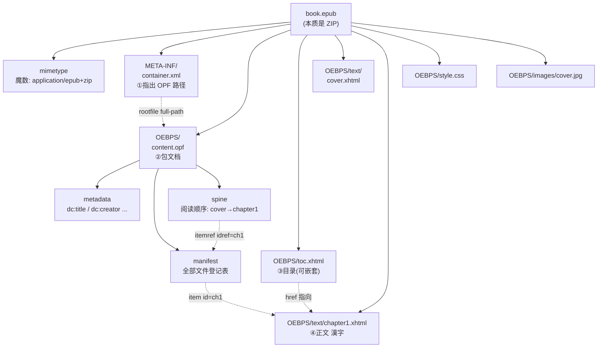
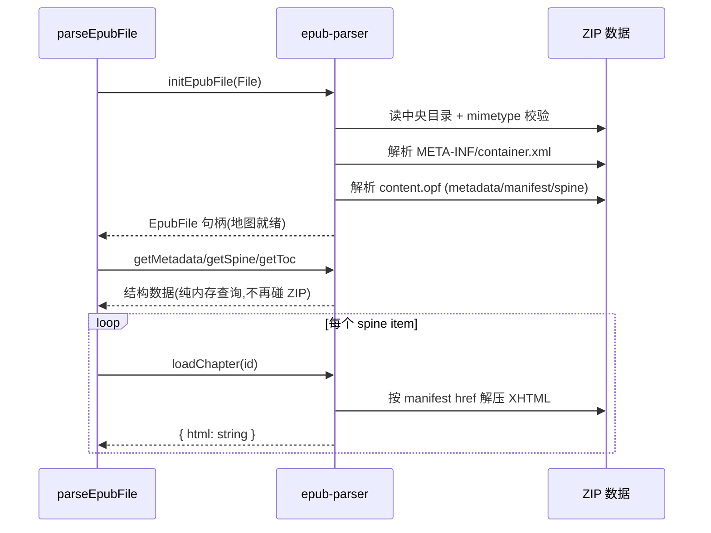
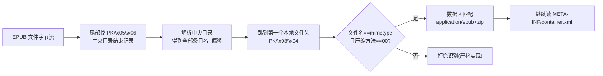

# 第 10 课 · EPUB 格式原理

> 所属阶段 2（EPUB 解析管线 ⭐核心）· 预计时长 60 分钟 · 难度★★☆☆☆

## 学习目标

- 不借助工具，白板画出 EPUB 的三层结构：ZIP 容器 → `container.xml` → OPF 包文档。
- 说清 `mimetype` 文件、`META-INF/container.xml`、`.opf`、spine、manifest、TOC 各自的作用与相互关系。
- 解释「为什么 EPUB 要设计成 ZIP + XML 描述文件，而不是单个大 HTML」。
- 能对照解压后的目录树，指出本项目 `parser.ts` 中 `getSpine()` / `getToc()` / `loadChapter(id)` 分别对应 EPUB 规范里的哪个部件。
- 【新增】说出 ZIP 层面的三个规范细节：mimetype 必须第一个条目、必须 STORED 未压缩存储、不能有 extra field——以及它们为什么是「魔数识别」的工程前提。
- 【新增】区分 EPUB 2 与 EPUB 3 在包文档（OPF 2.0 vs 3.0）和目录（NCX vs nav）上的具体差异点。
- 【新增】理解「manifest 登记表 + spine 阅读顺序」的分离设计如何支撑本项目「先建地图、按需加载」的解析策略。

## 前置检查

- 已完成第 3 课：知道项目是 Vite + TS + ESM 结构，能跑起 `pnpm dev`。
- 已完成第 1 课：体验过「导入 EPUB → 阅读句对」的完整流程，对最终产物有直觉。
- 手头有一本任意 `.epub` 文件（日语小说最佳，后面几课都要用它）。
- 【边学边练】热身三连：不看下文回答——
  1. `.epub` 改后缀为 `.zip` 后能直接解压吗？
  2. 解压出来的第一层里**必然**存在的文件/目录叫什么？
  3. 「第几章跟在第几章后面」这件事由 OPF 里的哪个元素决定？

## 关键文件

| 文件 | 职责 |
|---|---|
| `src/lib/epub/parser.ts` | 解析入口，本课只看它调用了 `@lingo-reader/epub-parser` 的哪些 API，不深入内部 |
| `src/types/book.ts` | 解析产物的类型定义（`Book`/`Chapter`/`SentencePair`），理解「EPUB 原始结构 → 项目数据模型」的映射终点 |
| `package.json` | 确认依赖 `@lingo-reader/epub-parser` 的版本 |

> 本课是纯格式原理课，不写代码；`node_modules/@lingo-reader/epub-parser` 的源码可以当参考资料翻，但不要求读懂。

## 正文

### 概念讲解

**EPUB 是什么？** 一句话：EPUB = 一个改了后缀的 ZIP 压缩包 + 一堆约定位置的 XML/XHTML 文件。EPUB 3 基于 OCF（Open Container Format）规范，整个格式只有三个层次：

```
第 1 层：ZIP 容器      —— 所有资源打包成一个 zip
第 2 层：container.xml —— 指出「包文档(.opf)在哪」
第 3 层：OPF 包文档    —— 书的身份证：元数据 + manifest + spine
```

**1. ZIP 容器层。** 把 `.epub` 改名为 `.zip` 就能解压——这不是 hack，是规范本身的要求。规范还规定 ZIP 里第一个条目必须是未压缩存储的 `mimetype` 文件，内容固定为 `application/epub+zip`，作用类似 PNG 文件头的魔数，让系统一眼认出这是 EPUB。

【加深】ZIP 格式的条目有两种压缩方法：STORED（原样存储）和 DEFLATED（压缩）。OCF 规范对 `mimetype` 有三个硬性要求：

| 要求 | 内容 | 为什么 |
|---|---|---|
| 位置 | 必须是 ZIP 的**第一个**条目 | 识别程序只需读文件头部极小的窗口就能判定格式 |
| 压缩方式 | 必须 STORED（method=0），即未压缩 | 压缩过的字节流开头不是明文 `application/epub+zip`，无法直接字符串匹配 |
| 无额外字段 | 该条目不允许 encryption/extra field | 保证 `application/epub+zip` 这 20 个字节出现在文件内的可预测偏移处 |

这就是「文件头魔数」思想的完整版：PNG 的 `\x89PNG\r\n\x1a\n`、PDF 的 `%PDF-`、Java class 的 `0xCAFEBABE` 都在干同一件事——让格式识别从 O(全文件解析) 降为 O(常数)。EPUB 只是把魔数放在了 ZIP 条目结构里，而不是裸文件的字节 0 处。顺带一提：很多打包工具默认把第一个条目也压缩掉，这正是「某些工具打的 EPUB 打不开」的经典事故来源。

**2. `META-INF/container.xml`。** ZIP 里唯一有固定路径的描述文件。它非常短，核心就是一句 `<rootfile full-path="..." media-type="application/oebps-package+xml"/>`，告诉解析器「真正的书描述文件在哪个路径」。为什么要多这一层间接？因为不同出版商可能把 OPF 放在不同目录，有了 container.xml，解析器永远只需要先找一个固定位置的文件。

【加深】这一层间接在软件工程里叫 **bootstrapping pointer**（引导指针）：任何自描述容器格式都需要一个「入口不变量」。对比几个同类设计：

- Java JAR：`META-INF/MANIFEST.MF`；
- Office OOXML（`.docx`）：同样是 `[Content_Types].xml` + `_rels/.rels` 双层定位，思路和 EPUB 几乎同源（两者都源自 OASIS/ECMA 系规范）；
- npm 包：`package.json` 的 `main`/`exports` 字段。

共同点是：**解析器代码只需要 hardcode 一个路径**（这里是 `META-INF/container.xml`），其余全部动态发现。这使出版商可以随意组织内部目录而不破坏兼容性。

**3. OPF（`.opf` 包文档）。** 书的大脑，包含三块：

- **metadata**：Dublin Core 词表的元数据，如 `dc:title`、`dc:creator`、`dc:language`、`dc:description`、`dc:publisher`。
- **manifest**：声明书里**所有**文件的清单，每个文件一个 `<item id="..." href="..." media-type="..."/>`。注意 manifest 只是「登记」，不代表阅读顺序。
- **spine**：声明**阅读顺序**，一个有序的 `<itemref idref="..."/>` 列表，idref 指回 manifest 的 id。spine 才决定「第几章跟在第几章后面」。

【加深】metadata 里还有几个对本项目后续有用的字段值得认识：

- `dc:identifier`：书的唯一标识（ISBN 或 UUID），本项目没有采用它做 Book.id（见 `parser.ts` 用的是 `` `book-${Date.now()}` ``），因为真实书源里这个字段经常缺失或重复；
- `dc:language`：形如 `ja` / `zh-CN` 的语言标记。你可能会问「为什么不直接用它做第 14 课的语言检测？」——因为大量网文 EPUB 的 metadata 是模板批量生成的，`dc:language` 写着 `en` 而正文全是日语的书并不罕见；而且双语书本身就没有单一的 language。这是「元数据不可信，内容才可信」的经验教训，第 14 课会展开；
- `<meta name="cover" content="..."/>`（EPUB 2 惯例）与 manifest item 的 `properties="cover-image"`（EPUB 3 标准做法）：两种封面声明方式并存，`parser.ts` 的封面探测只信任后者。

**4. TOC（目录）。** EPUB 2 用 `.ncx` 文件，EPUB 3 统一为 XHTML 格式的 nav 文档（`<nav epub:type="toc">`）。TOC 可以嵌套（卷 → 章），且允许指向 spine 中的某个锚点。

【加深】NCX 和 nav 的结构差异大到值得并排看：

```xml
<!-- EPUB 2: toc.ncx —— 纯 XML，专用于导航 -->
<navMap>
  <navPoint id="np-1" playOrder="1">
    <navLabel><text>第一卷</text></navLabel>
    <content src="text/chapter1.xhtml"/>
    <navPoint id="np-2" playOrder="2">…嵌套子条目…</navPoint>
  </navPoint>
</navMap>

<!-- EPUB 3: nav.xhtml —— 目录本身就是一篇 HTML -->
<nav epub:type="toc">
  <ol>
    <li><a href="text/chapter1.xhtml">第一章</a>
      <ol><li><a href="text/chapter1.xhtml#s2">第二节</a></li></ol>
    </li>
  </ol>
</nav>
```

注意两个细节：其一，EPUB 3 的 nav 允许 href 带 `#锚点`，意味着 TOC 粒度可以细于 spine 文件；其二，`@lingo-reader/epub-parser` 的 `getToc()` 把两种格式归一化成统一的 `TocEntry[] { label, href, id, children }`，本项目因此不用关心书的 EPUB 版本——「归一化适配层」是处理多版本格式的标准手法。

**5. XHTML 内容文档。** 真正的正文，每个 spine item 对应一份 XHTML。日语小说里大量出现 `<ruby>漢字<rt>かんじ</rt></ruby>` 注音标记——这正是第 13 课的主角。

【加深】内容文档还有两个影响解析管线的特性：

- **命名空间严格**：根元素是 `<html xmlns="http://www.w3.org/1999/xhtml" xmlns:epub="http://www.idpf.org/2007/ops">`。本项目用 `DOMParser.parseFromString(html, 'text/html')` 以宽松 HTML 模式解析，规避了 XHTML 严格模式「一个未闭合标签整篇报错」的坑——真实书源几乎不可能完全合规；
- **资源引用是相对路径**：`` 相对于该 XHTML 自身位置解析。本项目提取封面 URL 时拿到的就是这种相对路径或 blob/data URL（见第 11 课），如果要做通用图片加载就必须结合 spine item 的 base path 重写——当前产品范围只处理封面且多数书源封面已是绝对/blob 引用，所以没做重写，这是明确的裁剪而非疏忽。

**为什么这样设计？** 分离了三种关注点：资源打包（ZIP）、书的结构描述（OPF）、阅读呈现（XHTML）。解析器因此可以先读两个小 XML 建立「地图」，再按需加载章节内容，而不是一次性吞掉整本书。

【加深】这个「地图先行」策略正是本项目 `parseEpubFile` 的执行蓝本：

1. 先读 container.xml + OPF（几 KB 的 XML）→ 得到 spine/manifest/TOC 全局视图；
2. 再逐个 `loadChapter(id)` 拉 XHTML 正文（每章几十 KB）；
3. 结构信息（章节数、标题）在加载任何正文之前就已确定。

对照单一大 HTML 方案：一本书 5 MB 全部进内存、无法按章懒加载、目录和正文混在一起需要启发式切分。ZIP+OPF 的间接层次看似繁琐，实则是「用两层小文件换全局随机访问能力」的经典空间换时间/结构换灵活。

### 边学边练（检查点）

**检查点 ①（概念层）**：不翻上文，写出 EPUB 三层结构的名字，并在每层旁边标注「解析器在这一层做什么」。

<details><summary>参考答案</summary>

第 1 层 ZIP 容器——解压得到文件表；第 2 层 `META-INF/container.xml`——读固定路径文件拿到 OPF 位置；第 3 层 OPF 包文档——解析 metadata/manifest/spine 建立全书地图。之后才是按需读第 4 类部件（TOC 与各章 XHTML）。
</details>

**检查点 ②（规范细节）**：某打包工具把 `mimetype` 用 DEFLATED 压缩放在第一个条目。这本书在严格的阅读器里会发生什么？为什么？

<details><summary>参考答案</summary>

会被拒识。魔数识别依赖「第一个条目 + 未压缩存储」两个条件同时成立：DEFLATED 压缩后条目数据不再是明文 `application/epub+zip`，阅读器在预期偏移处匹配不到魔数字节串，按规范应拒绝打开（宽松实现可能靠 container.xml 兜底成功，但这属于容错而非合规）。
</details>

**检查点 ③（映射能力）**：打开 `src/lib/epub/parser.ts`，找到 `epub.getSpine?.()`、`epub.getToc?.()`、`epub.loadChapter(item.id)` 三处调用，分别说出它们消费的是本课讲的哪个部件。

<details><summary>参考答案</summary>

`getSpine()` → OPF 的 `<spine>` 有序列表；`getToc()` → EPUB 3 nav / EPUB 2 NCX 归一化后的目录树；`loadChapter(id)` → 按 manifest id 定位并返回对应 XHTML 内容文档的字符串。
</details>

**检查点 ④（设计权衡）**：如果让你把 EPUB 改成「单个大 HTML + front matter 注释」的格式，列出至少两个会立刻恶化的工程问题。

<details><summary>参考答案</summary>

任选其二：(1) 无法按章懒加载/随机访问，只能整体解析；(2) 目录、正文、样式混在一棵 DOM 树里，章节边界退化为启发式猜测；(3) 图片等二进制资源要么 base64 内联膨胀 33%，要么丢失容器化打包能力；(4) 元数据失去标准 schema（Dublin Core），下游工具无法可靠读取作者/标题。
</details>

### 代码走读

本项目不手写 ZIP/XML 解析，而是交给 `@lingo-reader/epub-parser`。但你要知道它替你做了什么。打开 `src/lib/epub/parser.ts`：

```ts
import { initEpubFile } from '@lingo-reader/epub-parser';
// ...
const epub: EpubFile = await initEpubFile(file);
const metadata = epub.getMetadata?.() ?? epub.metadata ?? {};
const spine: { id: string; href: string }[] =
  epub.getSpine?.() ?? epub.spine ?? [];
const toc: TocEntry[] = epub.getToc?.() ?? epub.navMap ?? [];
```

逐行对应 EPUB 规范：

| 代码 | 对应 EPUB 部件 |
|---|---|
| `initEpubFile(file)` | 解压 ZIP + 定位并解析 container.xml + 解析 OPF，一步到位 |
| `epub.getMetadata()` | OPF 的 `<metadata>`（`dc:title` 等） |
| `epub.getSpine()` | OPF 的 `<spine>` 有序列表，元素是 `{ id, href }` |
| `epub.getToc()` | EPUB 3 的 nav / EPUB 2 的 NCX，嵌套结构 |
| `epub.loadChapter(item.id)` | 按 manifest id 加载对应 XHTML 内容，返回含 `html` 字段的对象 |

再看解析产物的终点 `src/types/book.ts`：

```ts
export interface Book {
  id: string;
  title: string;        // ← metadata dc:title
  author: string;       // ← metadata dc:creator
  chapters: Chapter[];  // ← 由 TOC × spine 共同切出
  coverUrl?: string;
  // ...
}
export interface Chapter {
  id: string;
  title: string;        // ← TOC 条目的 label
  index: number;
  pairs: SentencePair[];
}
```

可以看到映射关系：**OPF metadata → Book 头部字段；TOC 标题 + spine 顺序 → Chapter 列表；XHTML 正文 → pairs**。这个映射的中间过程就是第 11 课的内容。

【加深】把这张映射表再往前推一层——每个 API 调用在库内部触发的 OCF 动作：

| 项目调用 | 库内部动作链 | 对应规范章节 |
|---|---|---|
| `initEpubFile(file)` | 读 ZIP 中央目录 → 校验 mimetype → 解析 `META-INF/container.xml` → 按 `full-path` 加载 OPF 并建 DOM | OCF 3.0 §2-§3 |
| `getMetadata()` | 从 OPF DOM 查询 `metadata` 元素下的 `dc:*` 子元素，反序列化为 JS 对象 | OPF 3.0 §3.4 |
| `getManifest()` | 同上，收集全部 `<item>`（本项目封面探测用到，见 parser.ts L67） | OPF 3.0 §3.5 |
| `getSpine()` | 收集 `<itemref>` 序列并把 idref 解引用为 `{id, href}` 对 | OPF 3.0 §3.6 |
| `getToc()` | 探测 nav（EPUB 3）优先、NCX（EPUB 2）兜底，输出统一 `TocEntry[]` | EPUB 3 §5 / OPF 2 §2.4 |
| `loadChapter(id)` | 经 manifest href 找到 ZIP 条目 → 解压 → 返回原始 HTML 字符串 | OCF §3.4 |

读这张表的收获是：`parser.ts` 里每一个 `epub.xxx` 调用都不是黑盒魔法，而是「沿引用链走一段」。你在实操作业里亲手走过的引用链（container.xml → OPF → 实际文件），就是这个库替所有用户走的路。

### 图示

一本典型日文小说解压后的目录树（树中标注了各部件的角色）：



三条虚线就是 EPUB 的「引用链」：container.xml → OPF；spine → manifest → 实际文件；TOC → 实际文件。解析器的全部工作就是沿着这条链走一遍。

【加深】再补一张「解析器视角」的时序图，展示引用链是如何被逐步消费的：



关键观察：`initEpubFile` 是唯一一次「重」操作（碰 ZIP 二进制），之后 `getMetadata/getSpine/getToc` 都是内存查询，只有 `loadChapter` 循环回到 ZIP。理解这一点才能解释第 11 课为什么敢对每一章单独 try/catch——失败只损失一章的数据，地图仍然完好。

## 实操作业

### 第一层（基础）：开膛破肚

把一本 `.epub` 当场「开膛破肚」，对照本课知识逐一确认。

1. 复制一本 `.epub`，把副本改名为 `.zip`，用系统解压工具解压到一个空目录。
2. 打开解压结果，画出它的完整目录树（手画或文本均可），标注：mimetype 在不在第一位、container.xml 在哪、OPF 叫什么、有几个 XHTML。
3. 用文本编辑器依次打开：
   - `META-INF/container.xml`：找到 `<rootfile full-path="...">`，确认它指向你刚找到的 OPF；
   - OPF 文件：找出 `dc:title`、`dc:creator` 的值，再数一下 manifest 里有多少个 `<item>`、spine 里有多少个 `<itemref>`；
   - 目录文件（`.ncx` 或 `nav.xhtml`）：观察它是否嵌套、href 指向哪里。
4. 打开一份正文 XHTML，搜索 `<ruby>`，看看这本书的注音长什么样（没有就换一本日语书）。
5. 对照检查：随便挑 spine 中的一个 `itemref idref`，在 manifest 里找到同 id 的 `<item>`，再在磁盘上找到 `href` 对应的实际文件——亲手走完一次完整引用链。

### 第二层（验证）：魔数实证

6. 用十六进制查看器（或 `Format-Hex mimetype` / VS Code 的 Hex Editor 插件）打开解压出的 `mimetype` 文件，确认 20 字节内容 `application/epub+zip` 逐字符吻合。
7. 再用十六进制查看器看原始 `.epub` 文件的前 128 字节，找出本地文件头签名 `PK\x03\x04`（`50 4B 03 04`），并尝试在其中定位 `mimetype` 条目的文件名长度、压缩方法字段——压缩方法为 `00` 即 STORED。这一步让你亲眼确认「魔数在 ZIP 条目里」这句话的含义。
8. 反向实验：把 `mimetype` 从 ZIP 里删掉重新打一个包（保持 `.epub` 后缀），丢给本项目导入。记录现象：多数情况下依然导入成功——思考为什么（提示：浏览器端 `initEpubFile` 是否真的校验 mimetype？宽松实现的代价是什么）。

### 第三层（综合）：双版本对照与规范走查

9. 找到（或手工构造）一本 EPUB 2 的书，与本课用的 EPUB 3 书并列对比：OPF 根元素的 `version` 属性值、目录文件形态（`.ncx` vs `nav.xhtml`）、封面声明方式（`<meta name="cover">` vs `properties="cover-image"`）。整理成一张三列对照表。
10. 通读本项目的 `parser.ts`（先不求甚解，第 11 课精读），标出其中每一处隐含的「EPUB 规范知识」：哪里假设了 spine 存在？哪里兼容了 TOC 缺失？哪里体现了「manifest 只是登记表」？（答案线索：`spineIndex` Map、`flatToc.length > 0` 分支、`Object.values(manifest)` 封面扫描。）

**验收标准**

- [ ] 你的目录树覆盖了解压出的全部顶层目录和文件类型。
- [ ] 能口头回答：「为什么删掉 mimetype 文件有些阅读器就不认这本书？」
- [ ] 能指着 OPF 回答：「manifest 和 spine 都引用了同一批文件，它们的区别是什么？」（登记 vs 顺序）
- [ ] 引用链三步（container.xml → OPF → 实际文件）每步都能指出具体的文件名和行号。
- [ ] 十六进制层面亲眼确认过 `PK\x03\x04` 与 `application/epub+zip` 两级魔数。
- [ ] 双版本对照表完成，且能指出本项目代码在哪一行体现「不关心 EPUB 版本」（归一化的 `getToc()` 调用处）。

## 本课与面试

- **复杂度视角**：「为什么 EPUB 解析可以做到 O(n) 且支持懒加载？」——ZIP 中央目录是索引结构，定位任意条目 O(条目数)；OPF 是 O(spine 长度) 的线性清单。建立地图的成本与书的大小无关（只与章节数线性相关），正文成本按需支付。面试中可以把这与「数据库先读 B+ 树索引再取行」类比，展示你对分层索引设计的直觉。
- **魔数与格式识别**：经典题「给你一个未知文件，怎么判断它的类型？」的标准答案分层：扩展名（不可信）→ 魔数（可信、O(1)）→ 结构校验（最可信、最贵）。EPUB 是「魔数藏在容器条目里」的变体，能主动举出这个例子会让回答脱颖而出。
- **防御式设计**：「第三方输入的结构不可信，你的解析器怎么活下来？」本课给出的素材：container.xml 缺失时的行为、OPF 放非标准路径、TOC 整体缺失（`flatToc.length === 0` 时 parser 有 spine-per-chapter 兜底）。核心话术：**入口不变量越少越好，每个约定都准备降级路径**。
- **XML/HTML 双栈知识**：「XHTML 和 HTML 解析有什么区别？」素材就在本课：EPUB 内容文档名义上是 XHTML（严格 XML），但浏览器端用 `DOMParser(html 模式)` 宽松解析以容忍脏数据。能讲清「规范要求 vs 现实数据」的张力，是资深候选人的信号。
- **自描述容器格式的通用模式**：JAR/OOXML/EPUB/npm 四例并置（见概念讲解的 bootstrapping pointer 一节）。面试官问「设计一个插件系统的包格式」时，这套「固定入口指针 + 动态发现的清单 + 清单驱动的加载」可以直接复用。

## 常见坑

- **以为 spine 就是文件顺序**：manifest 里 `<item>` 的书写顺序毫无意义，只有 spine 的 `<itemref>` 顺序才是阅读顺序。有的书的 spine 顺序和文件名字母序完全不同。
- **找不到 OPF 就慌**：OPF 的路径完全由 container.xml 决定，可能在根目录、`OEBPS/`、`EPUB/` 任何地方，不要靠猜文件名去找。
- **混淆 TOC 与 spine**：TOC 决定「目录里显示什么」，spine 决定「下一页翻到哪」。两者通常一致但不必须——本书第 11 课会看到代码里专门处理「TOC 条目按 spine 位置重新排序」的情况。
- **EPUB 2 与 EPUB 3 的目录文件不同**：`.ncx`（EPUB 2）和 `nav.xhtml`（EPUB 3）结构差别很大，好的解析库会把两者都归一化成统一的 toc 结构，这正是 `getToc()` 返回统一 `TocEntry[]` 的原因。
- **【新增】以为解压失败 = 书坏了**：Windows 上某些解压工具对 ZIP 内 UTF-8 文件名处理不佳，日文书名条目解出来乱码。先用本项目实际使用的 `@lingo-reader/epub-parser`（JSZip 系实现，按 UTF-8 flag 解码）验证，再怀疑书本身。
- **【新增】把 `dc:language` 当真相**：见概念讲解加深段。批量生成的网文 EPUB 元数据经常错误，任何「信元数据不信内容」的设计都会在这类书源上翻车——这也是第 14 课选择字符集指纹而非读元数据的根本原因。

## 自测题

1. EPUB 文件的本质是什么？`mimetype` 文件的作用是什么？

   <details><summary>答案</summary>

   本质是一个 ZIP 压缩包。`mimetype` 是 ZIP 中第一个条目、以未压缩方式存储，内容固定为 `application/epub+zip`，相当于文件格式的魔数，供系统和阅读器快速识别。
   </details>

2. `container.xml` 解决了什么问题？如果把它删除，解析器还能工作吗？

   <details><summary>答案</summary>

   它解决了「OPF 包文档路径不固定」的问题，是解析器进入书的唯一可靠入口。删除后符合规范的解析器无法定位 OPF，无法工作（除非暴力扫描全包猜测）。
   </details>

3. manifest 和 spine 各自的作用是什么？一本书可以有「在 manifest 中登记但不在 spine 中」的文件吗？

   <details><summary>答案</summary>

   manifest 登记所有资源的 id/href/media-type；spine 只声明正文的阅读顺序。可以——CSS、图片、字体、NCX 等都在 manifest 中但不在 spine 中；反过来不行（spine 必须引用 manifest 中已登记的 id）。
   </details>

4. EPUB 2 和 EPUB 3 的目录机制有什么区别？

   <details><summary>答案</summary>

   EPUB 2 使用独立的 NCX 文件（`toc.ncx`，navMap 结构）；EPUB 3 用 XHTML 的 `<nav epub:type="toc">`，目录本身也是一篇 HTML。两者都支持嵌套层级。
   </details>

5. 本项目的 `Book.chapters` 数据主要来自 EPUB 的哪两个部件？各自贡献了什么信息？

   <details><summary>答案</summary>

   来自 TOC 和 spine 的结合：TOC 提供 chapter 的标题（`entry.label`），spine 提供章与章之间的边界和顺序（通过把 TOC 条目映射到 spine 位置、取相邻两条目之间的 spine 区间作为一章的正文范围）。详见第 11 课 `parseEpubFile`。
   </details>

6. 【新增】OCF 规范对 `mimetype` 条目的三个硬性要求是什么？违反哪一个会导致「阅读器读文件头识别不出 EPUB」？

   <details><summary>答案</summary>

   三个要求：必须是 ZIP 第一个条目；必须 STORED（未压缩）存储；不得带 extra field。违反「未压缩」最致命——压缩后的字节流开头不是明文 `application/epub+zip`，按偏移匹配魔数必然失败；违反「第一个条目」则魔数不在可预测的早期位置，同样破坏识别。
   </details>

7. 【新增】为什么说 `META-INF/container.xml` 是一种「bootstrapping pointer」？请再举一个其他软件生态里的同类设计并指出对应的固定入口。

   <details><summary>答案</summary>

   因为它是整个容器里唯一的固定路径约定，解析器只需 hardcode 这一个路径即可动态发现其余一切结构（包括 OPF 自己的位置）。同构设计：JAR 的 `META-INF/MANIFEST.MF`、OOXML 的 `_rels/.rels`、npm 包的 `package.json`（main/exports 字段）。共同思想是用一个不变量锚定全部可变性。
   </details>

8. 【新增】本项目 `parseEpubFile` 的执行顺序体现了「先建地图、再按需加载」。如果把 `loadChapter` 循环提到 `getSpine()/getToc()` 之前，会有什么坏处？（开放题，答出两点即可）

   <details><summary>答案</summary>

   其一，丧失短路机会：无法在加载正文前发现「TOC 为空/书损坏」而提前止损；其二，内存峰值上升：地图信息（章节数、边界）尚未确定时正文已全部堆积；其三，语义混乱：后续切章逻辑依赖 spineIndex 与 spineHtml 两个 Map 并行建立的顺序关系，先拉正文会让错误处理（单章 try/catch 跳过）与结构构建纠缠在一起。
   </details>

### 【新增】OPF 全景解剖：一份带注释的真实样例

把概念落到字节上。下面是一份典型的日文小说 `content.opf`（EPUB 3），每行右侧标注它的角色——建议拿你自己的书逐字段对号入座：

```xml
<?xml version="1.0" encoding="UTF-8"?>
<package xmlns="http://www.idpf.org/2007/opf"      <!-- 根元素,version 属性区分 EPUB 2(2.0)/3(3.0) -->
         version="3.0"
         unique-identifier="bookid">                <!-- 指向下面 dc:identifier 的 id -->

  <metadata xmlns:dc="http://purl.org/dc/elements/1.1/">
    <dc:identifier id="bookid">urn:uuid:9a1b...</dc:identifier>  <!-- 唯一标识,本项目未采用 -->
    <dc:title>吾輩は猫である</dc:title>              <!-- → Book.title (经 extractText) -->
    <dc:creator>夏目漱石</dc:creator>                <!-- → Book.author (经 extractCreator) -->
    <dc:language>ja</dc:language>                    <!-- 元数据,不可信(见第14课) -->
    <dc:publisher>青空文庫</dc:publisher>            <!-- → Book.publisher -->
    <dc:description>日本近代文学の…</dc:description>  <!-- → Book.description -->
    <meta property="dcterms:modified">2023-01-01T00:00:00Z</meta>  <!-- EPUB 3 必填 -->
  </metadata>

  <manifest>
    <item id="nav"    href="toc.xhtml"        media-type="application/xhtml+xml"
          properties="nav"/>                         <!-- EPUB 3 目录声明 -->
    <item id="css"    href="style.css"       media-type="text/css"/>       <!-- 只登记不阅读 -->
    <item id="cover-img" href="images/cover.jpg" media-type="image/jpeg"
          properties="cover-image"/>                 <!-- 封面图(parser.ts 扫描的就是它) -->
    <item id="cover"  href="text/cover.xhtml" media-type="application/xhtml+xml"/>
    <item id="ch1"    href="text/chapter1.xhtml" media-type="application/xhtml+xml"/>
    <item id="ch2"    href="text/chapter2.xhtml" media-type="application/xhtml+xml"/>
  </manifest>

  <spine>
    <itemref idref="cover"/>                         <!-- 阅读顺序第 1 -->
    <itemref idref="ch1"/>                           <!-- 第 2 -->
    <itemref idref="ch2"/>                           <!-- 第 3 -->
  </spine>
</package>
```

三个值得咀嚼的观察：

1. **css 和 cover-img 在 manifest 里但不在 spine 里**——这就是「登记表 vs 阅读顺序」分离的直观证据。spine 是 manifest 的子集（就内容文档而言）。
2. **`properties="cover-image"` 与 `<meta name="cover">`**：前者是 EPUB 3 标准，后者是 EPUB 2 事实惯例。`parser.ts` 的封面探测只认前者（见 `item.properties?.includes('cover-image')` 一行），EPUB 2 老书若没有这个属性，探测会退化为「只看 spine 第一项」。
3. **`unique-identifier` 指向的 `dc:identifier`** 在真实书源里质量参差：有的重复、有的是空 UUID、有的干脆缺失。这解释了为什么项目改用 `` `book-${Date.now()}` `` 做 Book.id——同一本书导入两次会得到两个不同 id，这在单机工具里反而是期望行为（允许同书多副本并存）。

### 【新增】EPUB 2 / EPUB 3 关键差异总表

| 维度 | EPUB 2 (2007) | EPUB 3 (2011) | 对本项目的影响 |
|---|---|---|---|
| 包文档规范 | OPF 2.0 | OPF 3.0 | 无——库归一化 |
| 目录 | 独立 `.ncx`（NCX DTD） | XHTML 内 `<nav epub:type="toc">`（NCX 仍兼容保留） | `getToc()` 统一为 `TocEntry[]` |
| 封面声明 | `<meta name="cover" content="id">`（非标准惯例） | manifest item `properties="cover-image"` | 只认后者；EPUB 2 书走「spine 第一项」保守探测 |
| 内容文档 | XHTML 1.1（严格 XML 校验） | XHTML5 + HTML5 语义扩展 | 宽松 DOMParser 解析通吃 |
| 字体嵌入 | 可选、格式受限 | WOFF/OTF 全面支持 | 不涉及（本项目不渲染原书样式） |
| 多媒体 | 基本无 | audio/video/embed | 本项目忽略非文本内容 |
| 元数据必填项 | title/identifier/language/language | + `dcterms:modified` | 缺失时 extractText 返回 null 走默认值 |

结论：**解析管线的健壮性预算应该花在「数据脏」而不是「版本差异」上**。版本差异被库的适配层吃掉了；数据脏（畸形 metadata、坏章、TOC 缺失）才是 parser.ts 里每个 `??` 和 try/catch 的真正服务对象。

### 【新增】术语速查表（阶段 2 全程回查用）

| 术语 | 全称/出处 | 一句话定义 |
|---|---|---|
| OCF | Open Container Format | EPUB 的容器规范：ZIP 布局 + mimetype + container.xml |
| OPF | Open Packaging Format | 包文档 `.opf`：metadata + manifest + spine |
| NCX | Navigation Control Center for XML | EPUB 2 的目录文件格式 |
| nav document | EPUB 3 §5 | EPUB 3 中承担目录职责的 XHTML 文档 |
| Dublin Core | DCMI 元数据词表 | `dc:title` 等 15 个核心元素组成的元数据标准 |
| spine | OPF `<spine>` | 有序 itemref 列表 = 阅读顺序 |
| manifest | OPF `<manifest>` | 全资源登记表（无顺序语义） |
| ruby / rt / rp | HTML Ruby Annotation | 注音三件套：整体/读音/括号回退（第 13 课主角） |
| spine item / TOC entry | — | 「下一页翻到哪」与「目录里显示什么」的两个正交概念 |

### 【新增】ZIP 内部结构一瞥：魔数到底住在哪

解压工具把 ZIP 抽象成「文件袋」，但十六进制层面它是一串带长度的记录。与格式识别相关的只有两处：

```
本地文件头 #1   PK\x03\x04 (50 4B 03 04)
                压缩方法 (2 字节): 00=STORED / 08=DEFLATED
                文件名长度 n → 紧跟 n 字节文件名, 如 "mimetype"
                文件数据 ... ← mimetype 的明文内容就在这里
本地文件头 #2   PK\x03\x04 ...
本地文件头 #N   ...
中央目录        PK\x01\x02 × N 条 ← 每个条目的元信息汇总(偏移/大小/名字)
目录结束记录    PK\x05\x06        ← 解析器实际从这里开始读
```

两个反直觉的事实：

1. **解压器/解析器是「从后往前」读的**：先定位末尾的 `PK\x05\x06`（End of Central Directory），再经中央目录索引跳到任意条目的本地文件头。ZIP 天生支持随机访问，这就是第 11 课「地图先行」策略能成立的底层原因——不需要顺序流式解包。
2. **`mimetype` 的魔数校验发生在本地文件头之后的数据区**：识别程序读第一个条目的文件名（应为 `mimetype`）、压缩方法（应为 `00`）、然后直接在其数据区匹配 `application/epub+zip` 这 20 字节。「未压缩」要求的本质就是让这 20 字节**不经解码、按可计算偏移直接可读**。



**检查点 ⑤（底层结构）**：为什么 ZIP 能做到「不解压前面章节就能直接读最后一章」，而 gzip 单流压缩做不到？

<details><summary>答案</summary>

gzip 是单一流式 DEFLATE 流，解码第 N 个字节必须先解出前 N-1 个字节（压缩状态依赖前文）。ZIP 是多个独立压缩条目的容器，中央目录记录了每个条目的独立偏移，任意条目可以单独 seek 后解压。EPUB 选择 ZIP 正是为了这种随机访问能力——阅读器翻到任何一章都是 O(该章大小) 而非 O(全书已翻过部分之和)。
</details>

## 【新增】本课小结与下一课接口

本课建立的是「书的物理结构」心智模型：ZIP（容器）→ container.xml（入口指针）→ OPF（地图）→ XHTML（正文）。记住三句话：

1. **mimetype 是藏在 ZIP 条目里的魔数**，第一个条目 + 未压缩存储是识别的前提。
2. **manifest 是登记表，spine 是顺序表**，TOC 是展示层——三者语义正交，缺一不可混谈。
3. **解析器只信任一条引用链**：container.xml → OPF → manifest href → 文件字节；链上任何一环缺失都要有降级路径。

第 11 课将进入 `parser.ts` 的 212 行源码，逐段讲透 `parseEpubFile` 如何把这张「物理地图」折叠成项目自己的 `Book` 模型——包括元数据安全取值、TOC 扁平化重排、封面 blob→data URL 固化、以及最精妙的「TOC × spine 切章」算法。你在本课亲手走过的引用链，会在那里以代码形式再走一遍。

### 【新增】一个贯穿全阶段的思考练习

假设产品需求变更：「支持导入 EPUB 时只解析目录和第一章，其余章节翻到时再解析」。对照本课的三层结构，回答：

1. 这个需求在架构上可行吗？瓶颈在哪一层？（可行——ZIP 随机访问 + OPF 地图让懒加载天然成立；瓶颈在 persist：localStorage 存不下「半本书」的中间态，需要改存储模型或改用 IndexedDB。）
2. `parseEpubFile` 的哪些代码段必须重写？（`spineHtml` 全量预载循环、封面 blob→data URL 的时机、以及 Book 对象「一次成型」的整体假设。）
3. 这解释了当前实现的哪个设计决策？（一次性全量解析 + 整体持久化是单机 BYOK 工具在书源规模 ≤ 数 MB 时的最简正确解；复杂度只有在存储层撑不住时才值得引入。）

把答案写进笔记。等读完第 11、27 课（解析与缓存）后再回看，你会对「什么时候该为扩展性付复杂度」有更成熟的判断。
