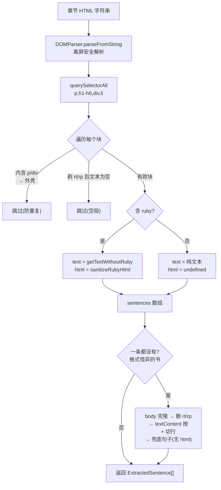
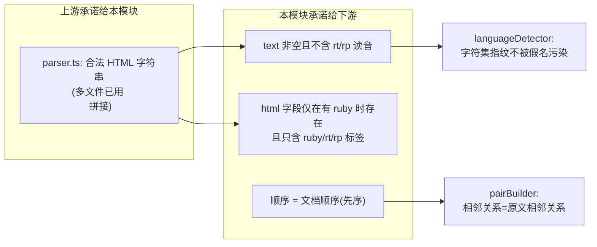

# 第 12 课 · 句段提取 sentenceSplitter

> 所属阶段 2（EPUB 解析管线 ⭐核心）· 预计时长 75 分钟 · 难度★★★☆☆

## 学习目标

- 用 `DOMParser` 把任意 HTML 字符串解析成可查询的文档，并说清它和 `innerHTML` 赋值的安全差异。
- 解释块级选择器 `'p, h1, h2, h3, h4, h5, h6, div, li'` 命中嵌套结构时为什么必须跳过外层容器。
- 完整复述 `extractSentences` 的三个分支：正常块提取、空行过滤、纯文本换行兜底。
- 说明 `ExtractedSentence` 为什么设计成 `{ text, html? }` 双轨结构。
- 【新增】逐行讲透全文 60 行源码，包括每个过滤条件的反例（删掉它会漏进什么脏数据）。
- 【新增】掌握「外壳让位」去重算法的适用条件与已知盲区，并能手工推演嵌套 DOM 的遍历过程。
- 【新增】理解本模块与上下游（parser / languageDetector / pairBuilder）的隐式契约。

- 【新增】能为本模块编写黄金样本测试，并说清「先锁边界与兜底、再锁正常路径」的行为锁定优先级。

## 前置检查

- 已完成第 11 课：知道 `parseEpubFile` 在哪个位置调用 `extractPairsFromHtml` → `extractSentences`。
- 已完成第 10 课：见过正文 XHTML 中 `<ruby>漢字<rt>かんじ</rt></ruby>` 的真实样子。
- 熟悉浏览器 DevTools Elements 面板（作业要对照真实书的 DOM）。
- 【边学边练】热身：在控制台执行 `new DOMParser().parseFromString('<p>a<script>alert(1)<\/script></p>', 'text/html')`，观察返回的 doc 里 script 节点存在吗？页面弹窗了吗？（节点存在但**不会执行**——这就是离屏解析的安全含义，正文会展开。）

- 【新增】知道 `trim()` 会吃掉全角空格 U+3000——空段过滤的判定边界与它直接相关。
## 关键文件

| 文件 | 职责 |
|---|---|
| `src/lib/epub/sentenceSplitter.ts` | 本课主角：`extractSentences` 及两个私有辅助函数 |
| `src/lib/epub/pairBuilder.ts` | 消费 `ExtractedSentence[]`（第 15 课），本课只关心它的输入形状 |
| `src/lib/epub/immersiveTranslate.ts` | 内含一份重复的 `getTextWithoutRuby` / `sanitizeRubyHtml`，对比阅读加深理解 |

`sentenceSplitter.ts` 全文只有 60 行，是整个项目「小而准」的典范，本课逐行走读。

## 正文

### 概念讲解

**DOMParser 是什么？** 浏览器内置的 HTML/XML 解析器：`new DOMParser().parseFromString(html, 'text/html')` 把字符串解析成一份**离屏文档**。它与把字符串塞进 `element.innerHTML` 有本质区别：

- 解析结果不进入当前页面 DOM 树，**不会触发脚本执行、不会发起图片请求、不影响现有布局**——是处理不可信 HTML 的安全起点。
- 得到完整的 `Document`，可以用 `querySelectorAll` 精确检索。
- Node.js 里没有这个 API（这正是本项目选择「纯浏览器端解析」的技术前提之一）。

【加深】关于「不执行」的精确边界要背下来：

| 行为 | innerHTML 赋值 | DOMParser 离屏 |
|---|---|---|
| `<script>` 内容被解析为节点 | 是（但不执行——HTML5 规范规定经 innerHTML 插入的 script 不运行） | 是，同样不执行 |
| `` 发起网络请求 | **是**（插入活文档即加载） | 否 |
| 内联事件 `onclick` 绑定 | 属性保留，用户点击时触发 | 属性保留在字符串里，无交互故无触发 |
| `<iframe src>` 加载子页面 | 是 | 否 |

所以准确的说法不是「DOMParser 更安全」这么笼统，而是：**它消除了「被动资源加载」和「用户交互触发」两类风险面；剩下的恶意标签内容仍需第 13 课的净化器处理**。安全分析要精确到行为粒度，这是面试里区分背诵者和理解者的地方。

**为什么按「块级元素」切句而不是按标点切？** 日语小说的断句远比英文复杂（「……」「――」、独词行、体言止め），基于正则的句子边界判定错误率很高。而 EPUB 出版物有一个天然优势：排版工具几乎总是把每个自然段放进 `<p>` 或 `<div>`。**信任出版物的段落结构，一个段落 = 一个句段单元**，既简单又符合阅读粒度。代价是长段落不会被再细分——这是工程上用准确性换简洁的典型取舍。

【加深】「信任结构」这个决策还可以从数据来源论证：EPUB 正文由排版软件（InDesign、青空文库转换器、网文平台导出器）批量生成，段落标签是机器写入的、高度规整；而句子边界是语言现象、千变万化。**机器写的结构可信，人类写的语言不可信**——凡是解析出版物，先问「哪些字段是工具生成的」，那里就是可靠的锚点。

【加深】四种候选切分策略横向对比，看清为什么选了最朴素的一种：

| 策略 | 思路 | 出版物上的正确率 | 成本 | 结论 |
|---|---|---|---|---|
| 正则断句 | 按「。！？」等终止符切分 | 低——直角引号内的小句、省略号「……」、独词感叹行全会切错 | O(n) 但分支极多、难维护 | 弃 |
| NLP 分词/断句模型 | 语言学规则或统计模型找边界 | 最高 | 引入词典或数 MB 依赖，跨环境行为不一 | 杀鸡用牛刀 |
| 定长切分 | 每 N 字一句 | 极低，必然切断语义 | O(n) | 弃 |
| 块级结构切分（本实现） | 一个段落标签 = 一个句段 | 接近 100% | O(n) 单遍、零依赖 | ✓ 采用 |

表格背后的决策原则：**正确率的瓶颈往往不在算法而在输入的规整度**。EPUB 的段落结构是排版软件批量生成的近乎完美的先验信息；放着免费的可靠锚点不用，去追「更聪明」的语言学算法，是用巨大的工程成本购买不需要的通用性。反过来也要看到方案的边界：如果哪天要处理纯 txt 小说（无任何结构），这套方案整体失效——技术选型永远绑着输入分布谈，没有脱离数据的「最优算法」。

**嵌套去重问题。** 选择器 `'p, h1..h6, div, li'` 会同时命中嵌套结构：`<div><p>文本</p></div>` 里 div 和 p 都匹配。若两者都收，同一段文字会出现两遍。通用解法是：**如果一个块的后代里还有更高优先级的块元素，就放弃这个外层块**。

**兜底思维。** 再规整的假设都有反例：有的书正文是裸文本节点直接躺在 body 里、或者全包在无语义的 `<span>` 中。此时块级查询一无所获，需要一个「按换行符切纯文本」的最后防线。

【加深】补一块前置拼图：`parseFromString` 对畸形输入的态度。EPUB 里偶尔能遇到未闭合标签、属性没加引号、大小写混乱的文件——HTML 规范定义了一整套**容错解析规则**：自动补全闭合标签、纠正违规嵌套（如 `<p><div>…</div></p>` 中 p 会在 div 前被强制闭合）、忽略多余的结束标签。对本模块的三点含义：

- 不要试图在字符串层面「先修好 HTML 再解析」——那等于重写一遍解析器，直接交给内置容错即可；
- 但要意识到容错会改变树形：上面那个例子里 p 不再是 div 的父节点，过滤①看到的将是两个平级块而非一层外壳；
- XHTML 的 XML 自闭合习惯对普通元素是陷阱（`<span/>` 在 text/html 模式下被当作打开标签吞掉后续内容）；void element 如 `<br/>` 无碍。真实出版物极少这么写，审计怪书时要想到这一层。

### 【新增】逐行走读前的输入输出总览

先把整个函数当黑盒看清楚，再拆白盒。三组代表性输入与输出：

| 输入 HTML | 产出 ExtractedSentence[] |
|---|---|
| `<div><p>甲。</p><p>乙。</p></div>` | `[{text:'甲。'}, {text:'乙。'}]`（div 让位） |
| `<p><ruby>私<rt>わたし</rt></ruby>は猫。</p>` | `[{text:'私は猫。', html:'<ruby>私<rt>わたし</rt></ruby>は猫。'}]`（双轨） |
| `body 直书:\n一行目\n\n二行目` | `[{text:'一行目'}, {text:'二行目'}]`（兜底，永无 html） |
| `<p></p><p>　</p>`（全空段） | `[]`（全被空过滤） |
| `<h3><span>标题</span></h3>` | `[{text:'标题'}]`（span 不是块，h3 是叶子块） |

记住这张表，下面每个分支都能对号入座。

【加深】这张表还隐含了一条容易被忽视的保证：**输出顺序 = 文档先序，且是确定性的**。同样的输入永远产出同样顺序的数组——下游的 pairBuilder 敢用「相邻下标」表达「相邻段落」，前提就是这条确定性。如果哪天有人把主循环改成并行处理（比如分块 Promise.all 再拼接），顺序契约立刻碎裂，配对算法全面错乱。并发化之前必须先问：这个数组的顺序有没有人在消费？

### 代码走读

`src/lib/epub/sentenceSplitter.ts` 按执行顺序走读。

#### 【逐行级】① 输出类型与主入口（L1-16）

```ts
export interface ExtractedSentence {
  text: string;
  html?: string; // HTML with ruby tags preserved, only set when ruby exists
}

export function extractSentences(html: string): ExtractedSentence[] {
  const parser = new DOMParser();
  const doc = parser.parseFromString(html, 'text/html');

  const sentences: ExtractedSentence[] = [];

  const blocks = doc.querySelectorAll('p, h1, h2, h3, h4, h5, h6, div, li');
```

注意 `html?: string` 是可选字段且注释写明「只在有 ruby 时才设置」。下游 `SentencePair.japaneseHtml` 同样可选——没有注音的句子不背 HTML 字符串的存储成本（这些数据全部要 persist 进 localStorage，体积敏感）。

选择器逐项盘点：覆盖了出版物正文最常见的六类块级容器；`section/article/figure` 等语义容器故意不在列表里——它们通常是包裹层，正是要去重掉的那种外层。反过来想每一类为什么必须在场：

| 选择器项 | 缺了它会丢什么 |
|---|---|
| `p` | 主力，几乎所有段落；缺失 = 大部分正文丢失 |
| `div` | 网文/自出版平台爱用 div 排版；缺失 = 整站书源失效 |
| `h1-h6` | 章节标题句（如「第一章 咒语」）；缺失 = 标题进不了练习 |
| `li` | 目录页、角色表、歌词列表；缺失 = 这些内容整块消失 |

#### 【逐行级】② 主循环：三层过滤（L18-29）

```ts
  for (const block of blocks) {
    if (block.querySelector('p, div')) continue;   // 过滤①：内层还有 p/div → 我是外壳，跳过

    const text = getTextWithoutRuby(block);        // 过滤②：剥掉注音后的纯文本
    if (text.length === 0) continue;               // 过滤③：空段落丢弃

    const rubyHtml = block.querySelector('ruby')
      ? sanitizeRubyHtml(block.innerHTML)          // 双轨：只有含 <ruby> 才生成展示 HTML
      : undefined;

    sentences.push({ text, html: rubyHtml });
  }
```

逐条看：

- **过滤①是本课的核心技巧**。`querySelectorAll` 返回的是**文档顺序**的列表，外层 div 排在它内部的 p 之前；遇到 div 就问一句「你肚子里有没有更小的块？」有则说明真正的段落在里面，自己让位。注意只查 `p, div` 不查标题和 li——`<li>` 里嵌 `<p>` 时 li 会正确让位（p 被查到），但 `<h2>` 即使内部有 span 也仍是叶子块，不该被误杀。
- 【加深】手工推演一个三层嵌套，确认遍历顺序的正确性：

  ```
  <div class="chapter">            ← blocks[0]：querySelector('p,div') 命中内部 p → 跳过
    <div class="para">             ← blocks[1]：内部命中 p → 跳过
      <p>第一段。</p>               ← blocks[2]：内部无 p/div → 收入 ✓
      <p>第二段。</p>               ← blocks[3]：收入 ✓
    </div>
  </div>
  ```
  关键不变量：**文档顺序保证外壳永远先于内壳被访问**，所以「遇壳让位」只需一次前瞻查询，不需要后向标记或两遍扫描。
- 【加深】已知盲区：`<li><ul><li>嵌套列表</li></ul></li>` ——外层 li 的后代里有 ul 但 ul 不在 `'p, div'` 查询范围内，两个 li 都被收入，嵌套项重复。真实书源中嵌套列表几乎只出现在目录页（而目录页通常不在正文 spine 区间内），所以盲区被场景性规避。若要修复，把过滤①的选择器扩成 `'p, div, li'` 即可——但会让「合法叶子 li」（含纯文本+span 的）误判风险上升吗？不会，因为查询的是后代而非自身。这是个可以动手改进的点。
- **过滤②③**合起来保证产出非空：`getTextWithoutRuby` 先克隆再删 `rt/rp` 后取 `textContent.trim()`，空串直接 continue。「空」的定义是剥掉注音后为空——一个只含注音的 `<p><ruby><rt>…</rt></ruby></p>`（畸形但存在）也会被正确丢弃。
- **双轨生成**：纯文本轨永远有；HTML 轨仅当块内有 `<ruby>` 时才由 `sanitizeRubyHtml(block.innerHTML)` 净化生成（净化算法本身是第 13 课主角，本课只需知道它「只留 ruby/rt/rp、其余标签全剥」）。注意 `block.innerHTML` 取的是**原始树**（未克隆删除 rt/rp 的版本），因为展示 HTML 恰恰需要 rt 存活——两条轨道在同一棵树上取的是互补的部分，互不干扰。

#### 【逐行级】③ getTextWithoutRuby（L44-50）

```ts
function getTextWithoutRuby(el: Element): string {
  const clone = el.cloneNode(true) as HTMLElement;
  for (const rt of clone.querySelectorAll('rt, rp')) {
    rt.remove();
  }
  return clone.textContent?.trim() ?? '';
}
```

为什么要先 `cloneNode(true)` 再删？因为 `rt/rp` 是**注音读音**，如果留在文本里，「漢字」会变成「漢字かんじ」——语言检测（第 14 课）会被假名干扰、配对（第 15 课）会把注音算进原文长度。在克隆体上操作避免污染原树（虽然此处原树随后即弃，但克隆习惯保证了函数无副作用）。`rp` 是不支持 ruby 的浏览器的括号回退标记，同样不属于正文。

【加深】三个实现层面的细节：

1. **`cloneNode(true)` 是深拷贝**，子孙全量复制。对本函数而言克隆后原树确实不再使用，克隆看似浪费；但 `immersiveTranslate.ts` 里同名函数的调用方（`getHtmlWithRuby(clone)` 与 `getTextWithoutRuby(clone)` 共用同一个 clone）需要原树完好。两处保持同一签名同一行为，是刻意的接口一致性——复用代码时连「防御的成本」一起复用。
2. **`textContent?.trim()` 的可选链防的是什么？** Element 的 textContent 类型上是 `string | null`（Document/Attr 上可空），TS 要求防 null。trim 还顺带吃掉段首段尾空白——出版 XHTML 里 `<p>\n    文字\n  </p>` 的缩进换行极常见。
3. **性能账**：每块一次深克隆 + N 次 remove + 一次 textContent 拼接，单块 O(子树大小)。一章几百块总计 O(B)，与输入同阶，无热点。若追求极限可以改为 TreeWalker 跳过 rt/rp 子树拼接文本，免克隆——但代码复杂度翻倍，收益在小章节上不可测量。不做。

#### 【逐行级】④ 纯文本换行兜底（L31-39）

```ts
  if (sentences.length === 0) {
    const clone = doc.body.cloneNode(true) as HTMLElement;
    for (const rt of clone.querySelectorAll('rt, rp')) rt.remove();
    const body = clone.textContent ?? '';
    const lines = body.split(/\n+/).map((l) => l.trim()).filter(Boolean);
    for (const line of lines) {
      sentences.push({ text: line });
    }
  }

  return sentences;
```

触发条件极严格：块级提取一无所获才启用。做法是把整个 body 摊平成纯文本（顺手也删了 rt/rp），按一个或多个换行切分、trim、滤空行，每行算一句。注意此分支产出的句子**永远没有 html 字段**——纯文本轨道里不存在需要保留的 ruby 结构。日文小说常见的「一行一句」排版恰好被 `\n+` 完美接住。

【加深】兜底分支的四个设计细节：

1. **`\n+` 而非 `\n`**：连续空行合并成一个分隔符，且 `.filter(Boolean)` 吃掉 trim 后的空行——双保险，任何数量的空行都只产生零个或一个句子边界。
2. **克隆整个 body 再删 rt/rp**：与主路径同一净化纪律，兜底路径产出的文本同样干净，下游无需区分两种来源（除了 html 字段的有无）。
3. **触发即「全有或全无」**：只要主路径收到哪怕 1 个块级句子，兜底就完全不跑。不存在「混合模式」。这避免了两来源交错产生的顺序混乱——代价是「99% 块级 + 1% 裸文本」的书会丢失那 1%。已知的、被接受的裁剪。
4. **`return sentences` 在兜底之后**：无论走哪条路都返回同一个数组变量，两条产出路径汇于一点，类型始终是 `ExtractedSentence[]`。

#### 【新增】⑤ 与 immersiveTranslate.ts 的同名函数对照

打开 `src/lib/epub/immersiveTranslate.ts`（L7-38），会发现 `getTextWithoutRuby` 与 `sanitizeRubyHtml` 各有一份**逐字相同**的拷贝，外加一个包装版 `getHtmlWithRuby`（多一道「无 ruby 返回空串」的短路，供沉浸式翻译通道把空串归一成 undefined）。为什么不抽公共模块？两份拷贝分别服务两条互不依赖的通道：sentenceSplitter 走通用管线，immersiveTranslate 走结构识别捷径。在「两份小函数、各自稳定、合计不到 30 行」的现状下，作者选择了复制而非抽象——**DRY 针对的是知识的变更点，不是文本相似度**。代价也明说：将来若给净化器加属性白名单（第 13 课的改进方向），必须同步改两处，漏一处就留下两通道安全口径不一致的暗坑。这是「重复 vs 抽象」权衡的活教材，两种选择都成立，关键是能说清自己付的是哪种成本。

### 【新增】⑥ 复杂度账本

面试被问「这段代码性能如何」时的标准答题姿势——把成本摊开成表：

| 步骤 | 单次成本 | 执行次数 | 说明 |
|---|---|---|---|
| `parseFromString` | O(H)，H = 章节 HTML 大小 | 1 | 浏览器 C++ 实现，常数极小 |
| `querySelectorAll` | O(H) | 1 | 全树一次快照 |
| 过滤① `querySelector('p, div')` | O(子树) | 每块一次 | Σ ≤ O(H×平均深度)，实际远小于此 |
| `getTextWithoutRuby` | O(子树) | 每个存活块一次 | 深克隆 + 删除 + 拼接 |
| `sanitizeRubyHtml` | O(html 长度) × 5 次 replace | 仅含 ruby 的块 | 产生五个中间字符串 |
| 兜底分支 | O(body) | 至多 1 次 | 与主路径互斥 |

总计 O(H) 上下、单遍为主；空间上克隆体即用即弃无累积。一本 500 KB 的章节在现代浏览器上整条管线毫秒级完成；整个导入流程的性能大头从来不在本地解析，而在后续的 AI 分析网络请求。

两个值得记住的推论：

1. **理论上唯一可能超线性的点是过滤①**：恶意构造千层嵌套时每层都做一次后代查询，退化到 O(H·d)。但输入来自出版物、DOM 深度普遍 ≤ 5，不为理论最坏情况设防是合理的——防御措施要对着真实威胁模型定价。
2. **五次 replace 的中间字符串**只有在把净化器误用到超大字符串时才可见（比如错拿整章 HTML 当单块 innerHTML 用）。接口契约（传入单个块的 innerHTML）本身就编码了性能假设——违反契约的性能问题不该靠优化函数体来解决。

### 【新增】⑦ 端到端演练：一段混合排版的完整命运

把一段贴近真实书源的片段喂进函数，逐节点追踪。输入：

```html
<body>
  <h2>第二章　嵐の夜</h2>
  <div class="scene">
    <p>雨が降っていた。<ruby>傘<rt>かさ</rt></ruby>を忘れた。</p>
    <p>　</p>
    <p><span class="em">ずぶ濡れ</span>のまま帰った。</p>
  </div>
  <ul><li>翌朝、熱を出した。</li></ul>
</body>
```

querySelectorAll 按文档先序命中 h2 → div.scene → p×3 → li，逐个判定：

| # | 节点 | 过滤①（后代有 p/div？） | 过滤②③（剥注音后文本） | 判定 | 产出 |
|---|---|---|---|---|---|
| 1 | h2 | 否 | 「第二章　嵐の夜」非空 | 收入 | `{text:'第二章　嵐の夜'}` |
| 2 | div.scene | 是（内部两个 p） | ——（短路跳过） | 外壳让位 | —— |
| 3 | p① | 否 | 含假名非空 | 收入 | `{text:'雨が…忘れた。', html:'<ruby>傘<rt>かさ</rt></ruby>を忘れた。'}` |
| 4 | p② | 否 | U+3000 全角空格 trim 后为空 | 丢弃 | —— |
| 5 | p③ | 否 | span 文字并入 textContent，非空 | 收入 | `{text:'ずぶ濡れのまま帰った。'}` |
| 6 | li | 否 | 非空 | 收入 | `{text:'翌朝、熱を出した。'}` |

三个最容易看错的细节：

1. **html 字段里没有外层 `<p>`**——`block.innerHTML` 取的是块的*内部*标记。展示轨拿到的是裸的 ruby 片段，阅读组件要自己提供段落容器与样式（对照 `SentencePairCard.tsx` 里用 `<span dangerouslySetInnerHTML>` 包裹的做法）。同理，若块内有多个 ruby，html 里全部保留且顺序不变。
2. **p② 死因是「清洗后为空」而非「无文本节点」**——空段过滤发生在文本轨计算之后；哪怕它带 ruby 注音也一样死（先算 text 再谈双轨）。
3. **span.em 完全透明**——不在块级选择器中、不参与过滤①、其文字自然并入 textContent。行内元素在本模块的世界里不存在；这也解释了为什么老书的 `<span>` 包裹病不会在这里出错，只会触发兜底分支。

### 【新增】⑧ 给切分器写黄金样本测试

第 12-15 课的模块都值得配一组「黄金样本」：固定的输入字符串 + 固定的期望输出快照。`extractSentences` 的最小集：

```ts
// 示意：真实项目可在引入 vitest 后落地（见第 15 课作业的完整流程）
const cases: Array<[string, ExtractedSentence[]]> = [
  // 外壳让位
  ['<div><p>甲。</p><p>乙。</p></div>', [{ text: '甲。' }, { text: '乙。' }]],
  // 双轨：含 ruby 才有 html 字段
  ['<p><ruby>私<rt>わたし</rt></ruby>は猫。</p>',
   [{ text: '私は猫。', html: '<ruby>私<rt>わたし</rt></ruby>は猫。' }]],
  // 无块级结构 → 兜底按行切
  ['一行目\n\n二行目', [{ text: '一行目' }, { text: '二行目' }]],
  // 完全空输入
  ['', []],
];
```

黄金样本的价值在重构时兑现：无论是把过滤①扩成 `'p, div, li'`、还是给净化器加属性白名单，跑一遍就知道切分语义有没有漂移。特别注意第三个 case 锁定的是兜底行为——静默路径最容易在「顺手优化」中被无声改变（比如有人加了「空输入直接 return []」的短路，看似无害却改变了 `''` 与 `'<html></html>'` 的可观察行为吗？不会——但若短路条件写错成「无 p 就跳过主循环」，兜底就被误杀了）。**行为锁定优先级：先锁边界与兜底，再锁正常路径**——正常路径坏了肉眼可见，静默路径坏了只有测试知道。

### 图示



与大纲管线图中 `sentenceSplitter.ts` 节点一致：上游吃 parser 给的 HTML，下游吐出 `ExtractedSentence[]` 交给语言检测 + 配对（或沉浸式翻译直通道旁路）。

【加深】补一张「契约视角」图——本模块对上下游的三条承诺：



第 14 课的检测正确性依赖承诺 S1；第 15 课配对算法的正确性依赖承诺 S3（i+=2 扫描假设原文相邻的两行就是一对）。**跨模块读代码时先找这种隐式契约**——它们不出现在类型签名里，却是正确性的地基。

### 边学边练（检查点）

**检查点 ①**：`<div><h2>章标题</h2><p>正文</p></div>` 进入函数，逐块写出每个 block 的命运（收入/跳过及原因）。

<details><summary>参考答案</summary>

文档顺序三个块：div → querySelector('p, div') 命中内部 p，跳过（外壳）；h2 → 后代无 p/div，是叶子块，收入 `{text:'章标题'}`；p → 收入 `{text:'正文'}`。共 2 句，顺序为标题在前——与文档一致。
</details>

**检查点 ②**：为什么过滤①的查询范围是 `'p, div'` 而把 `li` 排除在外？构造一个「排除 li 导致 bug」和「包含 li 反而破坏正常逻辑」的例子各一个。

<details><summary>参考答案</summary>

bug 例：`<li><ul><li>子项</li></ul></li>` 两层 li 都被收入（嵌套列表重复）——因为外层 li 的后代里没有 p/div。破坏例：若把 li 加入查询范围，`<div><li>…</li></div>` 中 div 会因后代有 li 而让位——这本身合理；真正的风险是某些畸形书把整个段落包在 `<li>` 里再包一层 `<div class="body">`，此时 div 让位是对的。所以「包含 li」总体更正确，作者选择了保守版本并把盲区留给罕见场景——权衡而非疏忽，面试能讲出这层即可。
</details>

**检查点 ③**：`block.querySelector('ruby')` 和 `sanitizeRubyHtml(block.innerHTML)` 之间有什么微妙的不对称？（提示：前者查的是活的树，后者序列化的也是同一棵原始树。）

<details><summary>参考答案</summary>

不对称在于：判断「有没有 ruby」用的是未修改的原树，生成展示 HTML 用的也是原树的 innerHTML——rt/rp 都还在。如果有人「优化」为先调 getTextWithoutRuby 克隆删注音、再用克隆体的 innerHTML，rt 就丢了，注音显示功能直接报废。双轨设计的要点恰恰是：**文本轨要删的东西，展示轨要留**，两者必须各自从未被污染的源头取材。
</details>

**检查点 ④**：兜底分支为什么放在主循环之后而不是之前？放在前面会发生什么？

<details><summary>参考答案</summary>

它是「主策略失败后的最后防线」，必须以 sentences.length === 0 为前提。放前面则所有书都走按行切分——块级结构信息（段落边界、ruby HTML）全部丢失，功能退化到纯文本水平。防线的位置编码了优先级：结构优先，纯文本垫底。
</details>

**检查点 ⑤**：【新增】主路径产出的 `{ text, html: undefined }` 和兜底路径产出的 `{ text }` 有什么可观察的差异？什么时候会咬人？

<details><summary>参考答案</summary>

运行时读取 `.html` 两者都是 undefined，行为一致；差异在键的存在性——主路径的对象字面量显式写了 `html: rubyHtml`，`Object.keys` 能看到 'html' 键；兜底路径 push 的对象根本没有这个键。当前项目没有任何 `'html' in obj` 或 Object.keys 遍历逻辑，所以无影响。但要注意：`JSON.stringify` 会同时省略两种「不存在」（undefined 值字段与缺失字段序列化结果相同），而 Object.entries 不会——未来若加「按字段存在性决定行为」的逻辑，两条路径就会分叉。教训：类型上可选的字段，「键缺失」与「键值为 undefined」是两种状态，统一产出口径是好习惯。
</details>

**检查点 ⑥**：【新增】结合第 11 课：parser 把多个 XHTML 文件的字符串用 `\n` 拼接后一次性交给本函数。跨文件的段落会被错误合并吗？拼接分隔符换成空串会怎样？

<details><summary>参考答案</summary>

不会合并。每个文件的段落自带完整的块级标记（`<p>…</p>`），HTML 解析按标签配对组织树，相邻文件的 p 各自成块，文档先序 = 文件拼接顺序 = spine 阅读顺序。分隔符换成空串时，若上一文件末尾以未闭合的 `<p>` 或裸文本收尾，下一文件开头的内容会被解析器续接进同一个块，产生跨章粘连句——`\n` 是廉价的结构保险。另一个连带知识点：拼接后的字符串中途出现 `</body></html>`，容错解析会把后续内容继续纳入文档而不是截断，这正是「多文件拼接解析」能工作的前提。
</details>

## 实操作业

### 第一层（基础）：切分质量审计

找一本「格式怪异」的书，做一次切分质量审计。

1. 在浏览器控制台临时给 `extractSentences` 加日志，或直接在 Sources 面板对该函数打断点。
2. 导入一本排版特殊的书（候选：每句一行的网文、表格排版的剧本、大量 `<span>` 包裹的老书）。
3. 对比原书 DOM 和切分结果，回答：
   - 有没有句子被重复收录？（若有，检查是不是某个块的子元素里有 `h1-h6/li` 而不是 `p/div`——这是过滤①的已知盲区）
   - 有没有整章走了兜底分支？（观察所有句子是否都没有 html 字段、是否按行号整齐排列）
   - 注音汉字的 text 是否干净（不含假名）？
4. 手工构造三个测试字符串，粘贴到控制台跑 `extractSentences` 并记录输出：
   - `'<div><p>外层</p><p>内层二</p></div>'` —— 验证外壳被跳过；
   - `'<p><ruby>私<rt>わたし</rt></ruby>は猫である。</p>'` —— 验证双轨输出；
   - `'<body>\n一行目\n\n二行目\n</body>'` —— 验证兜底分支。
5. 思考题写进笔记：如果把过滤①改成「只要内层有任何块元素就跳过」，`<h3><p>…</p></h3>` 这种畸形书会发生什么？

### 第二层（验证）：边界用例矩阵

6. 构造下表 8 个边界输入逐一预测→验证（建议做成自己的对照表）：
   - `'<p><ruby><rt>だけ</rt></ruby></p>'`（只有注音没有正文的畸形块）
   - `'<p>　　</p>'`（仅全角空格）
   - `'<div><div><div>深三层直书文字</div></div></div>'`（多层 div 只有一层有字）
   - `'<li><p>列表内段落</p></li><li>裸列表项</li>'`
   - `'<h3><span>带行内的标题</span></h3>'`
   - `'<p>第一段</p>\n裸文本第二段'`（混合形态——验证「全有或全无」）
   - `''` 与 `'<html></html>'`（完全空输入）
   - `'<P>大写标签名</P>'`（HTML 解析大小写不敏感的实证）
7. 对每个意外结果定位到具体代码行解释原因，标注是「过滤①盲区 / 空定义 / 兜底语义」中的哪一种。
8. 性能小实验：把同一章 HTML 循环调用 `extractSentences` 1000 次计时，估算单次耗时；再对比「去掉克隆直接在原树上删 rt/rp」的变异版——量化克隆的真实开销，然后回答：这笔保险买得值吗？

### 第三层（综合）：改进设计与回归验证

9. 动手修复检查点②发现的嵌套列表盲区：把过滤①改为 `if (block.querySelector('p, div, li')) continue;`，重跑第 6 步全部用例 + 你审计书籍的全部章节，确认：(a) 嵌套 li 不再重复；(b) 原有正常书的切分结果零变化。写一段话记录「改动 → 回归范围 → 结论」。
10. （选做挑战）实现一个「混合模式」变体：主循环结束后，把未被任何块覆盖的顶层裸文本节点也按 `\n+` 切分追加（而不是整体走兜底）。列出这个变体会引入的两个新问题（提示：文本节点的顺序如何与块顺序交织？兜底的「全有或全无」语义被破坏后，哪些下游假设受影响？）

**验收标准**

- [ ] 能指出所测书籍中至少一处切分不符合预期的地方，并定位到具体代码行解释原因。
- [ ] 三个手工用例的实际输出与你预测一致（尤其第二个：`text` 为「私は猫である。」、`html` 含 `<ruby>`）。
- [ ] 能说清兜底分支的两个特征：触发条件（块提取为空）与产物差异（永无 html 字段）。
- [ ] 8 个边界用例全部有预测与实测两列记录。
- [ ] 若做了第 9 步改进：有改动前后的对比证据（至少证明零回归）。
- [ ] 能复述「输出顺序 = 文档先序且确定性」这条隐式保证，并举出一个会破坏它的重构反例（如并行化主循环后再拼接）。

## 本课与面试

- **复杂度与遍历语义**：「querySelectorAll 返回什么顺序的列表？」——文档先序（depth-first pre-order）。本模块的去重技巧完全建立在这一点上。延伸考点：`querySelectorAll` 返回静态 NodeList（快照），`getElementsByClassName` 返回动态 HTMLCollection（活集合）——在遍历中增删节点时行为天差地别。本函数遍历期间不修改树，两者等价；但养成「默认静态快照」的习惯能避开一整类经典 bug。
- **字符串处理**：`split(/\n+/).map(trim).filter(Boolean)` 三连是文本清洗的标准范式，等价的单遍写法是 `match(/[^\n]+/g)` 再逐个 trim——面试可能要求手写并比较两者的空行处理差异（split 版在开头/结尾空行上产生空串靠 filter 清理；match 版天然不产生）。顺带：`textContent.trim()` 处理的是 Unicode 空白（含全角空格 U+3000 吗？——不！JS 的 trim 只去 ASCII 空白与部分 Unicode 空白，U+3000 属于被 trim 的集合，可现场验证 `'\u3000'.trim() === ''`）。
- **DOM 安全分层**：本课素材对应面试题「前端如何安全渲染第三方 HTML」的标准答案链：DOMParser 解析（消解被动加载）→ 白名单净化（约束标签面，第 13 课）→ 受控渲染口（dangerouslySetInnerHTML 或 sandbox iframe）。能说出「每一层分别消除哪一类攻击向量」就是完整答案。
- **防御式 API 设计**：`{ text, html? }` 双轨结构是「同一实体的逻辑视图与展示视图分离」的案例，可与「缓存 JSON 与渲染 HTML 分离」「API DTO 与 ViewModel 分离」互证。面试题「为什么不存一份完整 HTML 然后运行时提取 text？」——答：提取是每次渲染的重复成本 + 提取结果不可控（依赖运行时 DOM 行为）+ 存储 HTML 未净化有安全隐患；预计算 + 净化 + 存储最小面才是正解。
- **测试思维**：第 6 步的边界矩阵本身就是一份「等价类划分」练习：空输入类、畸形嵌套类、混合形态类、大小写类。面试被要求「给这个函数设计测试用例」时，直接展示这套分类方法论。
- 【新增】**手写去重变体**：面试官常追问「不用文档序性质，如何解决嵌套去重？」——备选方案一：收集所有叶子块引用后向上爬 parentElement 标记已覆盖祖先；方案二：只收 parent 不在已收集合中的块。对比本实现的「一次前瞻」，能讲清三者在时间、代码量、可读性上的取舍就是加分项。
- 【新增】**HTML 实体陷阱**：`textContent` 返回解码后的文本（`&amp;` 已还原为 `&`），而 `innerHTML` 是再序列化的结果（`&` 又变回 `&amp;`）。同一句话两条轨道的字符数可能不同——若有人拿 text.length 校验从 html 提取出的文本长度，会在含实体的句子上翻车。这是「双轨数据一致性校验」类问题的经典埋雷点。
- 【新增】**「为什么不用正则解析 HTML？」**——标准答案素材：HTML 不是正则语言（嵌套结构超出正则的表达能力），任何试图用 `<tag>...</tag>` 配对的方案都会败给嵌套与畸形输入；本项目中唯一的正则用法是净化器的标签剥离，而它能成立恰恰因为 DOMParser 已在前面保证了输入是合法解析后的序列化产物。层次分明的工具选择，比「到处上正则」和「谈正则色变」都高明。

## 常见坑

- **以为 `querySelectorAll` 只返回顶层匹配**：它是全文档深度匹配，所以必须有过滤①；反过来又因为返回文档顺序，外层一定先于内层被访问，「遇壳让位」逻辑才能成立。
- **忘记删 `rp`**：只删 `rt` 的话，部分老书会留下「かんじ」两侧的括号字符，污染文本和语言检测。
- **在原始 DOM 上直接 remove**：`getTextWithoutRuby` 若不克隆就删 rt/rp，同一棵树被二次使用时（如 immersiveTranslate.ts 里对同一 block 的多次处理）信息已丢失；克隆是廉价保险。
- **【新增】混淆「块级」与「句子」导致对产品行为的错误预期**：排查「朗读一句读了半分钟」时，答案往往不是 TTS 的锅，而是这本书的段落本来就长——切分粒度由本模块决定，先看 pairs 的句子长度分布再下结论。
- **误以为该函数做「句子级」切分**：它做的是「段落级」切分。一个 300 字的长段落就是一个句段，不会拆成多句——分析 AI 与 TTS 都按这个粒度消费，理解这一点才能解释某些朗读偏长的现象。
- **【新增】拿 `innerText` 当 `textContent` 用**：`innerText` 是渲染感知的（考虑 CSS display:none、会插入布局换行），离屏文档上它的行为不一致且强制样式计算；处理离屏树一律用 `textContent`。两者在「隐藏文本是否计入」上的差异足以让切分结果漂移。
- **【新增】以为兜底分支是「质量差」的标志而试图消灭它**：某些合法书源（纯文本导出的 EPUB）本来就没有块级结构，兜底是它们的**主路径**。正确的健康度度量不是「走了几次兜底」而是「兜底产出的切分是否符合该书的一行一句节奏」。
- **【新增】把净化器用在错误粒度上**：`sanitizeRubyHtml` 的契约输入是「单个块的 innerHTML」。图省事对整章 HTML 先跑一遍净化再 parse，所有非 ruby 标签提前被杀光，块级选择器从此一无所获，整本书静默跌进纯文本兜底——功能劣化但不报错，最难排查的一类回归。
- **【新增】在遍历 blocks 时修改树**：静态 NodeList 快照本身安全，但如果循环体内顺手在原树上 remove 了什么（想复用克隆逻辑却忘了 clone），后续块的后代查询面对的已是被动过手脚的树——过滤①可能突然查到或查不到节点。纪律：查询阶段零变异，变异只发生在克隆体上。
- **【新增】把「文档顺序」当成理所当然**：依赖 querySelectorAll 先序的去重技巧，在换成 `getElementsByClassName`（动态集合）或某些库的选择器引擎时未必保持；换工具前先确认返回集合的顺序契约，否则外壳让位逻辑会静默失效。

## 自测题

先自己作答再展开答案；带【新增】标记的题目对应本课扩写内容，也是面试深水区。

1. 为什么用 `DOMParser` 而不是创建一个 `div` 然后 `div.innerHTML = html`？

   <details><summary>答案</summary>

   DOMParser 生成的是完全离屏、未连接到当前文档的 Document，解析过程不会执行脚本、加载资源或影响页面；而 innerHTML 赋值发生在活文档上下文中，`` 会立刻发请求、内联事件有机会触发，处理不可信的第三方书源时风险更大。
   </details>

2. 过滤① `if (block.querySelector('p, div')) continue;` 为什么只检查 `p, div` 而不包括 `h1-h6` 和 `li`？

   <details><summary>答案</summary>

   目的是消除「容器包裹真段落」造成的重复。真实出版物中嵌套关系基本是 div/p 相互包裹；标题和 li 出现在另一个块的内部属于畸形标记，把它们也加入判断会让合法结构（如 li 直接作为叶子块）被误判为外壳的概率上升，收益却很小——这是针对真实数据分布做的窄化。
   </details>

3. `ExtractedSentence.html` 为什么是可选的、且只在含 `<ruby>` 时才填充？

   <details><summary>答案</summary>

   该字段用于阅读界面还原注音显示，只有 ruby 结构才有保存价值；绝大多数句子没有注音，省略字段能显著降低存入 localStorage 的数据体积。这也形成了「text 走逻辑、html 走展示」的双轨约定。
   </details>

4. 描述兜底分支的完整触发链路和行为。

   <details><summary>答案</summary>

   当块级循环结束后 `sentences.length === 0`（说明文档里没有任何可提取的有效块，如正文全是裸文本或 span）时触发：克隆 body → 删除全部 rt/rp → 取 textContent → 按 `/\n+/` 切分 → trim 并过滤空行 → 每行生成一个 `{ text }`（无 html 字段）。
   </details>

5. 如果不删除 `rt` 内容就直接取 textContent，会对后续管线造成哪两个具体问题？

   <details><summary>答案</summary>

   其一，「漢字かんじ」这样的文本会让第 14 课的语言检测因出现假名而把中文句子误判为日语；其二，句段文本变长且混入读音，AI 分析的 prompt 与 TTS 朗读都会读到多余的假名注音。
   </details>

6. 【新增】`<div class="a"><div class="b"><p>唯一段落</p></div></div>` 会产出几个句子？写出 a、b、p 三个块各自的判定过程。

   <details><summary>答案</summary>

   1 个。a：后代有 div/p → 外壳跳过；b：后代有 p → 外壳跳过；p：后代无 p/div，剥注音后文本「唯一段落」非空 → 收入。多层包裹无论多深，最终只有最内层的真段落存活——「遇壳让位」天然支持任意深度。
   </details>

7. 【新增】为什么说本模块与 languageDetector 之间存在「隐式契约」？契约的具体内容是什么？如果违反会在哪个下游环节以什么形式暴露？

   <details><summary>答案</summary>

   契约：本模块产出的 text 必须已剥离 rt/rp 读音假名。它不出现在任何类型签名里，纯靠调用约定维持。违反后果：中文句子若混入注音假名会被 isJapanese 判为 ja，在第 15 课配对时抢占 JA 位、产生错误句对或错误降级——问题在两三个模块之外爆发，排查时极易误判为检测算法的错。教训：跨模块的清洗职责要么写成显式前置校验，要么在文档/命名中标明（如函数名里的 WithoutRuby 就是自我声明）。
   </details>

8. 【新增】`split(/\n+/).map(l => l.trim()).filter(Boolean)` 若简化成 `split('\n').filter(Boolean)` 会漏掉哪些情况？

   <details><summary>答案</summary>

   至少三类：(1) 连续多个换行会产生多个空串以外的「只有空白」的行，filter(Boolean) 拦不住 '   ' 这种非空字符串；(2) 行尾的 \r（Windows CRLF 书源）会残留在行内容里污染句尾；(3) 行首缩进空白直接入库，影响显示与检测。原实现的 map(trim) 正是同时解决这三个问题的最小补丁。
   </details>
