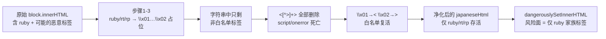
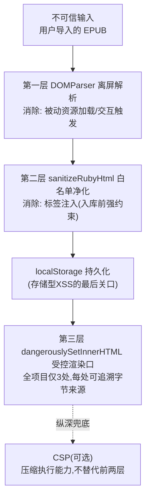

# 第 13 课 · ruby 注音与 HTML 净化（安全专题）

> 所属阶段 2（EPUB 解析管线 ⭐核心）· 预计时长 75 分钟 · 难度★★★★☆

## 学习目标

- 说清 `<ruby>/<rt>/<rp>` 三件套的结构语义，并能手写一个标准注音片段。
- 解释「文本轨 / 展示 HTML 轨」双轨设计的动机与各自的消费方。
- 逐行讲清 `sanitizeRubyHtml` 的「占位符替换法」，说明 `\x01/\x02` 为什么必须是不可见控制字符。
- 描述 `dangerouslySetInnerHTML` 的 XSS 风险边界，以及本项目把风险压缩到最小面的具体手段。
- 【新增】画出「解析 → 净化 → 受控渲染」三层防线图，并说明每一层各自消除哪一类攻击向量。
- 【新增】横向对比三种净化替代方案（白名单重建 / DOMPurify / CSP 兜底）的取舍与适用条件。
- 【新增】用攻击向量清单（脚本标签 / 事件属性 / 伪协议 / 实体变形 / CSS 注入）系统检验任意一个净化器的覆盖面。

## 前置检查

- 已完成第 12 课：理解 `ExtractedSentence { text, html? }` 双轨结构的来源。
- 已完成第 11 课：知道 `japaneseHtml` 最终随 Book 持久化进 localStorage 并被阅读组件渲染。
- 具备基础 HTML/JS 知识（属性、字符串 replace、正则捕获组）。

- 听说过 CSP（Content-Security-Policy）这个词即可，正文会从零讲清它与净化器的分工——很多人把两者混为一谈。
## 关键文件

| 文件 | 职责 |
|---|---|
| `src/lib/epub/sentenceSplitter.ts` | `sanitizeRubyHtml` 第一份实现 + 双轨数据的产生地 |
| `src/lib/epub/immersiveTranslate.ts` | `getHtmlWithRuby` / `sanitizeRubyHtml` 第二份实现（沉浸式翻译通道的净化） |
| `src/types/book.ts` | `SentencePair.japaneseHtml?: string` —— 净化结果的最终去处 |
| 渲染侧组件 | 用 `dangerouslySetInnerHTML` 渲染 `japaneseHtml` 的地方（本课讨论风险边界） |
| `src/components/reader/SentencePairCard.tsx` | 渲染口之一：`japaneseHtml` 经 `dangerouslySetInnerHTML` 上屏（L49/L53 两处） |
| `src/components/analysis/AnalysisPanel.tsx` | 渲染口之二：AI 分析结果 HTML 的渲染点（L108），威胁面与本课主线互补 |

阅读顺序建议：先通读正文建立「三层防线」的全景，再逐行拆净化函数，最后用攻击样本亲手验证——安全专题必须动手打一遍才算学过。

完成本课后，你应当能独立回答：「这个项目的 XSS 面有多大？每一层防线各自挡住了什么？剩下的缺口为什么可以被接受？」——这三问就是安全专题的全部主线。

## 正文

### 概念讲解

**ruby 注音三件套。** HTML 的 ruby 标注体系由三个标签构成：

```html
<ruby>漢字<rp>（</rp><rt>かんじ</rt><rp>）</rp></ruby>
```

- `<ruby>`：包裹整体，被注音的正文和注音本身都在里面；
- `<rt>`：ruby text，注音读音——**它不是正文**；
- `<rp>`：ruby parenthesis，不支持 ruby 的环境下的括号回退——**它也不是正文**。

**【加深】ruby 在浏览器里到底怎么显示？** 理解了渲染机制，才知道「保留 rt」保的是什么：浏览器对 `<ruby>` 有专门的注音排版引擎——rt 会被自动放到基线上方（或右侧，取决于 `ruby-position` 与书写模式），字号缩小、不占正文宽度；`<rp>` 则在支持 ruby 的环境下**完全不显示**（它只服务于不支持 ruby 的老环境，用括号把读音包起来降级为「漢字（かんじ）」）。所以净化后的 japaneseHtml 渲染效果是：正文正常排版 + 注音悬浮其上。顺带认识两个真实书源里可能遇到的变体：个别 EPUB 用 `<rb>`（ruby base，HTML 规范已废弃但解析器仍接受）包裹被注音的汉字——注意它不在本净化器的白名单里，标签会被剥掉但内容存活，显示不受影响；CSS 方案 `ruby-align`/`font-size` 对逐字注音的微调则完全在样式层，与净化无关。

**【加深】为什么 rt 不能简单地 display:none？** 有人会想：文本轨要删注音，展示轨要留注音，那干脆留着 rt 再用 CSS 藏起来不行吗？不行——两条轨道的消费场景不同：text 参与语言检测、配对、AI prompt、TTS 朗读，这些场景拿到的都是字符串而非 DOM，「CSS 隐藏」对它们毫无意义；而且持久化的是字符串，落盘前必须做出取舍。双轨设计的本质是**在存储时刻就把逻辑视图和展示视图分离**，而不是指望消费端各自处理。

对「取文本」的代码来说，rt/rp 必须剔除；但对「还原显示」的代码来说，rt 又必须保留（否则注音消失）。这个矛盾催生了双轨设计。

**双轨保存。** 第 12 课已见：每句产出 `text`（剥净注音的纯文本，供语言检测、配对、AI prompt、TTS 使用）和可选的 `html`（只保留 ruby 结构的展示 HTML，供阅读界面带注音渲染）。两条轨道各司其职，互不污染。

【新增】顺带算一笔双轨的存储账。localStorage 按 UTF-16 计费、通常只有约 5 MB 配额，而 `japaneseHtml` 是三轨里最长的字符串（含标签语法开销）。假设一本书 5000 句、其中 30% 带注音、平均每句 html 120 字符：仅 html 轨就占 5000×0.3×120×2 字节 ≈ 360 KB。这就是「只在有 ruby 时才生成 html」这条纪律的价值——若无条件的全量保存，配额将被无意义的重复数据吃掉近一半。**存储格式的每一字节都要问一句「谁消费它」**，没有消费方的字段就是负债。

**XSS 与 dangerouslySetInnerHTML。** React 出于安全默认转义一切文本插值 `{userContent}`；但当你确实要渲染一段 HTML 时必须用 `dangerouslySetInnerHTML={{ __html: html }}`，React 从此**完全信任这段字符串**。如果这段 HTML 来自不可信输入且未经净化，攻击者可以注入 `<script>`（或更隐蔽的 ``、`<a href="javascript:...">`）实现存储型 XSS——书源文件就是典型的不可信输入。原则：**凡进 dangerouslySetInnerHTML 的内容必先过白名单净化器**。

【新增】先辨析一组易混概念：**净化（sanitize）与转义（escape）不是一回事**。转义是把特殊字符变成无害形式（`<` → `&lt;`），内容原样显示；净化是删除/保留结构性标签，内容按语义渲染。注音场景必须用净化而非转义——因为 `<ruby>` 必须真的成为元素。反过来，纯文本渲染场景（如书名）用转义即可且更安全。React 插值默认转义、dangerouslySetInnerHTML 跳过转义但需要上游净化，两套机制各管一段，混着理解就会出事故。

**占位符替换法。** 常见的错误净化思路是「黑名单删除」：把 `<script>...</script>` 删掉。黑名单永远列不全（大小写、属性注入、嵌套变形……）。本项目采用白名单思路的反向实现：先把**允许保留**的标签临时换成不含 `<` `>` 的占位符形式 → 此时字符串里剩下的所有尖括号标签都是非法的，一刀全删 → 再把占位符换回真标签。这样「允许清单之外的一切」默认死亡，无需枚举攻击面。

### 【新增】XSS 与 dangerouslySetInnerHTML 完整风险分析

先把威胁摆全。XSS（跨站脚本）的本质一句话：**数据被当成了代码执行**。书源 HTML 是数据，一旦其中的字节被浏览器执行成脚本，攻击者的代码就以用户身份在页面里运行。在本项目的具体场景里它能做什么？读 localStorage 里的全部书籍与学习记录、发起任意伪造请求、篡改页面伪装出「请重新输入 API Key」的钓鱼表单——BYOK 架构下 Key 就保存在前端，这是真实的高价值资产。经典攻击向量清单，以及本净化器对每个向量的实际拦截情况：

| 向量 | 示例载荷 | 本净化器 |
|---|---|---|
| 脚本标签 | `<script>alert(1)</script>` | ✓ 第四步清除 |
| 事件属性附着在非白名单标签 | `` | ✓ 标签整体死亡 |
| 事件属性附着在白名单标签 | `<ruby onclick="alert(1)">` | ✗ 属性随 `$2` 透传存活 |
| 伪协议链接 | `<a href="javascript:alert(1)">` | ✓（a 不在白名单，整标签删除） |
| iframe/object 加载外部内容 | `<iframe src="//evil.com">` | ✓ 清除 |
| 样式表注入 | `<style>@import url(...)</style>` | ✓ 清除 |
| 内联样式隐蔽通道 | `<ruby style="background:url(//evil/log)">` | ✗ 属性透传，理论上可发探测请求 |
| 实体编码变形 | `&#60;script&#62;alert(1)&#60;/script&#62;` | ✓——见下方「为什么实体编码救不了攻击者」 |
| SVG 载体 | `<svg onload="alert(1)">` | ✓ svg 不在白名单 |
| 大小写/空白变形 | `<ScRiPt >`、`` | ✓ 白名单法天然免疫变形（不在名单就删） |

**为什么实体编码救不了攻击者？** 这是最容易被问倒的细节。净化器的输入不是原始字符串，而是 **DOMParser 解析后某块的 innerHTML**——序列化产物。解析阶段浏览器已按 HTML 规范把 `&#60;` 还原成真正的 `<` 字符并构建了 script 元素；innerHTML 再把它序列化回 `<script>` 字面形式。也就是说，**一切依赖「编码绕过字符串匹配」的手法在进入净化器之前就已经被解析器拆穿了**。这再次印证第 12 课的架构判断：先离屏解析、再做净化，两步的顺序本身就是防御的一部分。

**React 为什么需要 dangerouslySetInnerHTML？** JSX 的文本插值默认全部转义：`{text}` 中的 `<` 会变成 `&lt;` 被显示出来而不是成为标签。这是安全的默认值。但注音显示需要真正的 HTML 结构（`<ruby>` 必须成为元素才能触发浏览器的注音排版），于是只能走逃生舱口：

```tsx
// src/components/reader/SentencePairCard.tsx L52-53（真实渲染点）
if (showFurigana && pair.japaneseHtml) {
  return <span dangerouslySetInnerHTML={{ __html: pair.japaneseHtml }} />;
}
```

这个名字里的 dangerous 是 React 作者的刻意警告：**从这个口子进去的字符串，React 一字节不改地交给浏览器解析**，此前的一切转义保护全部失效。安全责任因此完全转移到「进入口子之前的净化」环节——这正是本课存在的理由。同一文件还有第二个使用点值得对照：L37-49 的书签高亮路径，把纯文本 `pair.japanese` 用 `<mark>` 标签包裹后也走了 dangerouslySetInnerHTML——它安全的前提是 japanese 已经是纯文本（上游切分器保证），且插入的颜色值来自代码内常量表而非用户输入。**每一个 dangerouslySetInnerHTML 都要能回答「这段 HTML 的每个字节从哪来」**，本项目三处渲染口（SentencePairCard 两处 + AnalysisPanel 一处）都能回答，这就是纪律。

**持久化放大效应。** 更隐蔽的风险在于 `japaneseHtml` 会 persist 进 localStorage 并随每次打开书重新渲染：一个恶意载荷若混过净化，不是触发一次，而是**每次渲染该书都执行**，重启应用后依然存活。存储型 XSS 的杀伤力 = 触发频率 × 存活时长，两者在本项目里都被拉满。这决定了净化必须定位为「入库前的强约束」，而不是「出库时的尽力而为」——等发现污染再补救，恶意字节已经扩散进用户的持久化存储。

**威胁模型的诚实界定。** 安全设计的第一问永远是「防谁」：本项目是本地单机 BYOK 工具，书由用户自己导入——用户攻击自己没有收益，现实风险主要是「网上下载的盗版 EPUB 被人动过手脚」这类间接场景。所以项目接受属性透传（见代码走读末尾的边界讨论），把净化强度定在标签级白名单。但如果产品演进为「书架分享」「在线书城」，威胁模型立刻升级为对抗性的，届时属性白名单和 CSP 都不再是可选项。

### 代码走读

两份实现的净化函数逐字相同，以 `src/lib/epub/sentenceSplitter.ts:52-60` 为准：

```ts
function sanitizeRubyHtml(html: string): string {
  return html
    .replace(/<(\/?)ruby([^>]*)>/gi, '\x01$1ruby$2\x02')
    .replace(/<(\/?)rt([^>]*)>/gi,   '\x01$1rt$2\x02')
    .replace(/<(\/?)rp([^>]*)>/gi,   '\x01$1rp$2\x02')
    .replace(/<[^>]+>/g, '')
    .replace(/\x01/g, '<')
    .replace(/\x02/g, '>');
}
```

六步拆解：

1. **三个白名单替换**：`<(\/?)` 捕获开闭斜杠（`$1`），`([^>]*)` 捕获标签内部其余字符到第一个 `>` 为止（`$2`），`gi` 保证大小写不敏感、全局替换。匹配到的合法标签整体改写成 `\x01/ruby...\x02` 形式——注意 `$2` 原样保留，意味着 **ruby 标签上的属性也被保留**（如 EPUB 里常见的 `<ruby class="furigana">`）。
2. **`\x01` / `\x02` 是关键**：它们是 ASCII 控制字符 SOH/STX，正常书籍文本中出现的概率为零。若用普通字符如 `[RUBY]` 做占位符，正文里恰好写着 `[RUBY]` 一词就会被第二步误杀或在最后一步被误还原成假标签——控制字符从根上杜绝了这种碰撞。
3. **一刀清剿**：`/<[^>]+>/g` 删除剩余全部标签——此时能匹配到的必然是白名单之外的：`<script>`、``、`<iframe>` 全部阵亡。
4. **还原**：`\x01→<`、`\x02→>`，白名单标签满血归来。

调用侧（sentenceSplitter.ts L24-26）：

```ts
const rubyHtml = block.querySelector('ruby')
  ? sanitizeRubyHtml(block.innerHTML)
  : undefined;
```

只有块内真的存在 `<ruby>` 才付出净化的成本并生成展示 HTML。

immersiveTranslate.ts 里的对应版本多一层判断：

```ts
function getHtmlWithRuby(el: Element | HTMLElement): string {
  const clone = el.cloneNode(true) as HTMLElement;
  if (!clone.querySelector('ruby')) return '';
  return sanitizeRubyHtml(clone.innerHTML);
}
```

逻辑一致，返回空串由调用方 `|| undefined` 归一。

**一个值得诚实指出的边界**：由于 `$2` 原样保留属性，理论上 `<ruby onclick="...">` 的 `onclick` 会存活下来。EPUB 内容经 DOMParser 解析后再取 innerHTML 时，事件处理属性会原样保留在序列化结果中。当前项目是本地 BYOK 工具、数据源是用户自己导入的书，威胁模型下可接受；但如果要做「导入他人分享的书」的多用户场景，这里应当进一步做属性级白名单。这正是「安全没有银弹、只有与威胁模型匹配的边界」的活教材。

### 【新增】净化过程逐步追踪

拿一个混合了恶意内容的样本，完整走一遍六步，记录每步之后的字符串状态。输入（某个含攻击载荷的块 innerHTML）：

```html
<p class="x"><ruby>危<rt>あぶ</rt></ruby>注意</p>
```

| 步骤 | 操作 | 此刻字符串 |
|---|---|---|
| 输入 | —— | `<p class="x"><ruby>危<rt>あぶ</rt></ruby>注意</p>` |
| 1a | ruby 开/闭 → 占位 | `<p class="x">␁ruby␂危<rt>あぶ</rt>␁/ruby␂注意</p>` |
| 1b | rt 开/闭 → 占位 | `…␁ruby␂危␁rt␂あぶ␁/rt␂␁/ruby␂注意</p>`（␁␂ 代表 \x01\x02） |
| 1c | rp 开/闭 → 占位 | 无 rp，原样 |
| 2 | `/<[^>]+>/g` 清剿 | `␁ruby␂危␁rt␂あぶ␁/rt␂␁/ruby␂注意`——`<p class="x">` 与整个 `` 蒸发 |
| 3 | `\x01→<` `\x02→>` | `<ruby>危<rt>あぶ</rt></ruby>注意` |

最终产物只有 ruby 家族存活，img 连同它的 onerror 整体消失。三个值得咀嚼的细节：

1. **死的是标签壳，不是文本内容**——img 消失了，但「注意」两个字完好。净化器剥标签不剥内容，与「把危险内容连坐删除」的黑名单思路有本质区别。
2. **闭标签的 `/` 靠捕获组回家**——`<(\/?)` 把斜杠捕进 `$1`，还原时 `␁/rt␂` 变回 `</rt>`。若正则漏了这个组，所有闭标签都会变成开标签，产出畸形 HTML。
3. **清剿正则的 `+` 有意为之**——`[^>]+` 要求尖括号内至少一个字符，`<>` 或 `a < b` 这类正文中的孤立尖括号不会被误删；换成 `*` 会开始吞 `<>` 空对，虽然无害但语义变脏。


### 【新增】占位符选型的字节级档案

`\x01`（SOH，Start of Heading）与 `\x02`（STX，Start of Text）是 ASCII 表最前端的两个控制字符。为什么它们是「零成本的正确选择」？把候选哨兵值摆在一起看：

| 候选哨兵 | 碰撞风险 | 序列化/日志友好度 | 结论 |
|---|---|---|---|
| `\x01` / `\x02` 控制字符 | 出版物正文出现概率为零（EPUB 规范层面就不允许） | 控制台显示为乱码符号，但不影响正确性 | ✓ 采用 |
| `[RUBY]`、`{{r}}` 可见字符串 | 正文完全可能字面出现 | 友好 | ✗ 有碰撞即错 |
| 零宽字符 `U+200B` 等 | 正文几乎不出现，但复制粘贴的文本可能夹带 | 不可见，调试极困难 | △ 勉强 |
| Unicode 私有区 `U+E000` 段 | 字体相关场景偶有使用 | 显示为豆腐块 | △ 可用但不如控制字符干净 |
| 双向哨兵（如 `\u0000` + 计数器） | 无碰撞 | 复杂化实现 | 过度设计 |

一个延伸常识：控制字符在 JSON 里必须转义（`\u0001`）、在 HTML 文本节点中合法但不显示——这意味着即使净化产物被序列化进 localStorage 再读回来，哨兵也早已还原消失，不会残留在最终数据里。**哨兵只活在函数执行的瞬间**，这是这个技巧能安全存在的前提。

### 【新增】三种替代方案对比：白名单重建 / DOMPurify / CSP 兜底

占位符替换法是手写净化的巧解，但它不是唯一的路线。工程上共有三条主流替代路线：

**方案 A：白名单重建（parse → 只挑允许的节点 → 重新序列化）。** 不做字符串手术：DOMParser 解析后用 TreeWalker 遍历，只把 ruby/rt/rp 元素及其文本节点克隆进一棵新树，再取新树的 innerHTML。优点：属性可以精确控制——重建时只复制明确放行的属性，天然堵死 onclick/style 透传缺口；基于真解析器工作，字符串层面的变形攻击全部失效。缺点：代码量约是现在的三倍，且要小心序列化行为。**如果要修本项目的属性透传缺口，这是首选方向**——本课挑战作业就是它。

**方案 B：DOMPurify（业界标准库）。** `DOMPurify.sanitize(html, { ALLOWED_TAGS: ['ruby','rt','rp'] })` 一行搞定，背后是经过大规模实战检验的解析+净化管线，覆盖了几百种已知绕过手法（mXSS、命名空间混淆、突变 XSS 等）。优点：安全强度远超任何手写实现、维护成本近零。缺点：约 20 KB 的运行时依赖；本项目刻意维持「解析管线零依赖」，为一个 60 行的需求引库属于过度武装；且它的默认配置面向「放行大部分安全 HTML」，收紧到只剩 ruby 反而需要仔细核对 ALLOWED_TAGS / ALLOWED_ATTR。**如果是多人协作、输入不可控的中大型项目，无条件选 B**——手写净化器的维护者必须持续跟进绕过手法与 CVE，那是一份没人想要的全职工作。

**方案 C：CSP 兜底（Content-Security-Policy）。** 先纠正最常见的误解：**CSP 不是净化器，而是损害控制器**。通过 HTTP 响应头或 meta 标签声明策略（如 `script-src 'self'; object-src 'none'`），即使恶意脚本草毛过关，浏览器也拒绝执行内联脚本、拒绝加载外部资源。它一网打尽内联 script 与外链脚本，但管不住不需要 JS 的攻击——注入一个覆盖全屏的钓鱼 `<div>` 就能骗走 API Key，全程零脚本。落地方式：Electron 打包版可在主进程经 webRequest 给所有响应注入 CSP 头；纯 Web 版若无服务器控制权，只能在 index.html 塞 meta（优先级和覆盖面都弱一些）。**正确站位：CSP 是纵深防御的最后一层，永远不能替代入库前的净化**——它压缩爆炸半径，不拆除炸弹。

落地提示：Electron 版可监听 `webRequest.onHeadersReceived` 给所有响应追加 `Content-Security-Policy: default-src 'self'; script-src 'self'; object-src 'none'`；Web 版退而求其次在 index.html 加 `<meta http-equiv="Content-Security-Policy">`。另有一个更激进的渲染口方案值得一提——**sandbox iframe**：把不可信 HTML 塞进带 `sandbox` 属性的 iframe 渲染，即使有漏网脚本也没有同源权限（不能读 localStorage、不能碰父页面 DOM）。代价是样式隔离与通信复杂度，本项目句子级注音不值得，但若未来要渲染 AI 生成的整页 HTML，这就是现成答案。
四案横向对比（含现实现）：

| 维度 | 占位符替换（现实现） | 白名单重建 | DOMPurify | CSP 兜底 |
|---|---|---|---|---|
| 本质 | 字符串手术 | DOM 级过滤 | DOM 级过滤（库） | 执行期策略 |
| 防标签注入 | ✓ | ✓ | ✓ | 部分（限制执行而非删除） |
| 防属性注入（onclick/style） | ✗ | ✓ | ✓ | 部分 |
| 防 mXSS 类高级绕过 | 一般 | 较好 | 最佳 | 不适用 |
| 依赖/体积 | 零 | 零（约 20 行自研） | 约 20 KB | 若干行配置 |
| 维护心智 | 低但要懂技巧 | 低 | 近乎零 | 低 |
| 适用场景 | 小工具、输入高度可控 | 小中型、需精确控属性 | 中大型、不可信输入 | 所有项目的最后一层 |

结论呼应第 12 课的选型观：**安全方案的强度应与威胁模型匹配、与维护成本挂钩**。本项目当前的占位符方案在其威胁模型下够用；一旦走向多用户，升级路径已经在这张表里铺好。

#### 【新增】方案 A 的参考实现：白名单重建长什么样

把方案 A 落成代码，大约 20 行，作为本课挑战作业的起点：

```ts
const RUBY_TAGS = new Set(['RUBY', 'RT', 'RP']);

function rebuildRubyHtml(el: Element): string {
  const clone = el.cloneNode(true) as HTMLElement;
  const out = document.createElement('div');

  const walk = (node: Node, parent: Node | null): void => {
    if (node.nodeType === Node.TEXT_NODE) {
      parent?.appendChild(node.cloneNode());
      return;
    }
    if (node.nodeType !== Node.ELEMENT_NODE) return;
    const el = node as Element;
    if (RUBY_TAGS.has(el.tagName)) {
      // 只重建白名单标签；属性一律不带——onclick/style 从根上无法透传
      const copy = document.createElement(el.tagName.toLowerCase());
      parent?.appendChild(copy);
      el.childNodes.forEach((child) => walk(child, copy));
    } else {
      // 非白名单元素：壳死掉，孩子（文本）继续走
      el.childNodes.forEach((child) => walk(child, parent));
    }
  };

  walk(clone, out);
  return out.innerHTML;
}
```

与占位符法的三点对照：(1) 属性问题**从结构上不可能发生**——新元素是我们亲手 create 的，攻击者的属性没有任何路径进入输出；(2) 文本中的 `<`、`&` 由 innerHTML 序列化自动转义，产出永远良构；(3) 成本是递归遍历 + 每节点一次克隆，比五次 replace 慢一个常数因子，但仍在 O(子树)。读懂这份实现再回头看占位符法，能体会「字符串手术」与「DOM 手术」的哲学差异：前者在编码层面周旋，后者直接操纵结构。

### 【新增】净化器的黄金样本测试

安全函数最怕「重构后悄悄变弱」。给 `sanitizeRubyHtml` 配一组固定断言，任何改动跑一遍即知防御力有没有退化：

```ts
// 示意：可在引入 vitest 后落地（流程见第 15 课）
const cases: Array<[string, string]> = [
  // 纯净输入原样通过
  ['<ruby>私<rt>わたし</rt></ruby>', '<ruby>私<rt>わたし</rt></ruby>'],
  // 带属性的合法 ruby 属性保留（当前实现的已知边界）
  ['<ruby class="f">字<rt>じ</rt></ruby>', '<ruby class="f">字<rt>じ</rt></ruby>'],
  // 脚本标签死亡、内容存活
  ['a<script>alert(1)</script>b', 'ab'],
  // 事件属性随宿主标签整体死亡
  ['危', '危'],
  // 大小写变形无效
  ['<SCRipt>x</SCRIPT>', 'x'],
  // 实体编码已被上游解析拆穿
  ['&#60;script&#62;x&#60;/script&#62;', 'x'],
];

```

注意第二个 case 锁定的是**当前实现的有意行为**（属性透传）而非理想行为——黄金样本记录的是「现在是什么」，升级到白名单重建后这条断言要同步改写。把「安全行为的变更」显式化在测试文件里，比让它藏在代码 diff 里可靠得多。
### 【新增】三个高频追问

**问：既然第四步会删掉一切非白名单标签，前三个白名单替换能不能省掉？**

不能——省掉的话 ruby/rt/rp 自己也会被第四步一并删除，注音功能整体消失。前三次替换的本质是「开打之前把要保护的人撤离战场」，这是整个算法的第一因。

**问：净化器能处理 `` 这种属性没加引号的畸形写法吗？**

能，而且这正是「先解析、后净化」的红利。DOMParser 解析时已经按规范把畸形语法规范化（属性补全、标签闭合），`innerHTML` 的序列化产物永远是良构 HTML；清剿正则面对的是规范形式，不存在解析歧义。纯字符串层面手写净化最怕的恰恰是各家浏览器的容错差异——同一份怪输入在不同环境序列化结果不同。本项目把解析交给标准 API，等于把这个不确定性整个外包给了浏览器实现。

**问：用 encodeURIComponent 或 base64 先编码再渲染行不行？**

不行。编码解决的是「传输与存储过程中不被破坏」，不是「不可信内容的安全化」——base64 解码之后该是脚本的还是脚本，渲染前仍然需要净化。把编码当成防御是安全评审里的一票否决项。

**问：`\x01` 已经完美了，为什么还要知道零宽字符、私有区这些替代品？**

因为换语言、换存储层时前提会失效：某些数据库/日志管道会剥离控制字符，那时 `\x01` 哨兵就会在中间环节消失、还原步骤拿到空串。候选清单的意义在于让你手里始终有下一个选择，而不是背死一个答案。

### 图示



数据流全景（衔接第 12 课的双轨图）：同一句子的 `text` 走逻辑链（检测→配对→prompt→TTS），`html` 走展示链（净化→persist→dangerouslySetInnerHTML）；两链只在源头分叉，互不交叉。

【新增】再补一张三层防线全景图——本课的安全架构一图流：



读图要点：三层各杀一类向量、顺序不可调换（净化必须在持久化之前——污染一旦落盘就晚了）；CSP 用虚线表示它是可选的纵深层而非管线的一环。面试里能把这张图讲清楚，「前端如何安全渲染第三方 HTML」就是送分题。

### 边学边练（检查点）

**检查点 ①**：不查资料，写出净化器处理 `'<ruby>漢<rt>かん</rt></ruby><b>太字</b>'` 的最终输出，并说出 b 死于第几步。

<details><summary>参考答案</summary>

输出 `'<ruby>漢<rt>かん</rt></ruby>太字'`。b 不在三个白名单替换之列，原样保留到第四步死于清剿正则——但注意死的只是标签壳，文本「太字」完好存活。剥标签不剥内容是白名单净化的基本行为，也是它能保住正文的根本原因。
</details>

**检查点 ②**：把第一步的正则改成 `/<(\/?)ruby>/`（去掉 `([^>]*)`）会发生什么？连带评估丢掉 `g` 或 `i` 标志的后果。

<details><summary>参考答案</summary>

带属性的 ruby（如真实书源里的 `<ruby class="furigana">`）不再匹配第一步，逃过占位保护，第四步被整体删除——注音静默消失，显示从「带注音」退化成「裸汉字」。这是典型的「测试没盖住属性变体」回归：净化器对不认识的输入的策略是删除而非报错，故障表现为无声的功能缺失。丢 `i` 则大写 `<RUBY>` 阵亡；丢 `g` 则一章只有第一个标签幸存——三个组成部分各自承担不可缺的职责。
</details>

**检查点 ③**：为什么占位符还原必须严格排在清剿之后？如果先还原再清剿，结果如何？

<details><summary>参考答案</summary>

先还原的话 `\x01ruby\x02` 立刻变回 `<ruby>`，紧随其后的清剿正则会把它连同 rt/rp 一起杀光——白名单全军覆没，所有句子丢失注音。「转移 → 清剿 → 还原」三段的顺序本身就是算法，可用一句话记忆：先把好人护送出场，再关门打坏人，最后把好人请回来。
</details>

**检查点 ④**：`getHtmlWithRuby` 为什么先判 `clone.querySelector('ruby')` 再净化，而不是直接返回净化结果让调用方判断？

<details><summary>参考答案</summary>

其一，语义集中：包装函数承诺「要么返回值得保留的 ruby HTML，要么返回明确的空串信号」，把「有没有 ruby」这个领域判断收进函数内，调用方只需处理二值结果（调用点正是 `getHtmlWithRuby(clone) || undefined`）。其二，省掉无意义开销：没有 ruby 时跳过五次 replace 的字符串手术。对照 sentenceSplitter 侧，同样的判断写在调用点（`block.querySelector('ruby') ? … : undefined`）——同一关注点落在不同位置，阅读时别被不一致迷惑。
</details>

**检查点 ⑤**：【新增】如果把净化器的输入换成 `doc.body.innerHTML`（整章一次净化），输出会有什么不同？为什么这个「优化」是错的？

<details><summary>参考答案</summary>

输出层面：所有非 ruby 标签被剥掉后，正文会塌缩成一整段无结构文本——块级边界（p/div 的分段信息）被销毁。流程层面：sentenceSplitter 需要在净化后的树上做块级查询，标签已死查询就一无所获，整本书静默跌进纯文本兜底分支，ruby 双轨也全部失效。净化的正确粒度是「每个存活块的 innerHTML」，这是接口契约的一部分，不是可以自由挪动的实现细节。
</details>

**检查点 ⑥**：【新增】AI 分析面板（AnalysisPanel.tsx L108）直接用 dangerouslySetInnerHTML 渲染 LLM 返回的 `formatted` HTML，没有任何净化。请用本课的方法论评估：威胁模型是什么？有哪些现实攻击面？如果要修，选哪条路线？

<details><summary>参考答案</summary>

威胁模型：LLM 输出不可信度中等——模型本身不会主动攻击，但其输入（书籍内容）若含注入指令，可能诱导输出带脚本的 HTML（间接提示注入）；此外 BYOK 场景下 API Key 就在 localStorage，是真实资产。攻击面：prompt 里注入的书籍内容 + 恶意或被劫持的 LLM 端点返回。修复路线：优先 DOMPurify（允许有限的白名单标签如 p/em/ruby，配置成只读展示所需的最小集），因为 LLM 输出的结构完全不可预测，手写白名单维护成本高；同时给 CSP 加上 script-src 兜底。这道题的完整价值在于：同一个项目里两个渲染口，答案可以完全不同——安全决策跟着威胁模型走，不跟着惯性走。
</details>

## 实操作业

亲手验证净化器的攻防。

### 第一层（基础）：攻击样本实测

1. 打开浏览器控制台，粘贴一份从源码复制的 `sanitizeRubyHtml` 实现（保持原样，不要简化）。
2. 依次喂入以下攻击样本，记录每个输出：
   - `'<p>こんにちは<script>alert(1)</script></p>'`
   - `'<ruby>危<rt>あぶ</rt></ruby>'`
   - `'<div><ruby>大丈夫<rt>だいじょうぶ</rt></ruby><a href="javascript:alert(1)">点我</a></div>'`
   - `'<SCRipt>x</SCRIPT>'`（测大小写绕过）
   - `'<ruby>正常<rt>せいじょう</rt></ruby>'`（对照组）
   - `'<ruby><ruby>嵌套<rt>套娃</rt></ruby>外层</ruby>'` —— 白名单标签自己嵌套自己，观察两层是否都完整存活；
3. 构造一个「占位符碰撞」反例证明 `\x01` 的必要性：写一个假设用 `[P]` 做占位符的版本，喂入正文含字面 `[P]` 的句子，观察输出如何被破坏。
4. 手工构造一个含 `<script>` 的完整测试段落，走一遍真实链路验证：把它包进一个 `<p>`，在控制台调用 `extractSentences`（Sources 面板断点处执行），确认产出的 `text` 干净、`html` 中无 script。
5. 思考题记入笔记：如果把第三步的 `/<[^>]+>/g` 改成同时删除 `<[^>]*>` 有什么区别？`+` 改 `*` 后 `< >` 这种纯文本会被误伤吗？

### 【新增】第二层（验证）：属性透传的实证

8. 构造并实测「白名单标签 + 恶意属性」样本，确认边界讨论不是纸上谈兵：
   - `'<ruby onclick="alert(1)" style="color:red">漢字<rt>かんじ</rt></ruby>'` —— 预测输出；把结果塞进一个真实 DOM 的 innerHTML，点击验证 onclick 是否真的活着；
   - `'<rt title="读音">かんじ</rt>'`（脱离 ruby 的孤立 rt）—— 观察它是否被保留（在！白名单只看标签名不看上下文）；
9. 用 `document.createElement('div')` + innerHTML 的方式复现同一净化流程，与 DOMParser 路径对比：两者的序列化产物有差异吗？（提示：单元素上下文与完整文档上下文的解析容错规则略有不同，`<td>` 这类表格元素的表现差异最大——这也是「方案 A 必须用完整 parse 再遍历」的原因之一。）
10. 把方案 A 的参考实现抄进控制台跑通，用第 2 步的全部攻击样本回归一遍，对比两种方案的输出差异（重点看属性是否绝迹）。

### 【新增】第三层（综合）：给项目升级净化器

11. 动手改造：以 `rebuildRubyHtml` 为基础替换 sentenceSplitter.ts 与 immersiveTranslate.ts 中的占位符实现，注意两处要同步改（第 12 课讲过的双拷贝代价）。回归验证：导入一本带注音的书，确认阅读界面的注音显示完好、无任何视觉退化。

12. 写一份 5 行以内的决策记录（ADR 风格）：背景（属性透传缺口）→ 方案（白名单重建）→ 放弃 DOMPurify 的理由 → 回归范围。练习把安全决策写成团队可评审的文字。
13. （选做）给 AnalysisPanel.tsx 的 LLM 输出渲染口接入 DOMPurify 并写一条黄金样本断言——这是把本课方法论迁移到第二个渲染口的完整练习。
**验收标准**

- [ ] 五个样本的输出你都能逐字符解释（尤其 img/a/script 三者的不同死法）。
- [ ] 能说清占位符为什么必须是控制字符，并举出一个普通字符占位符被破解的具体例子。
- [ ] 能画出「白名单占位 → 清剿 → 还原」三段式流程，不看笔记。
- [ ] 能说出本项目三处 dangerouslySetInnerHTML 渲染口各自的字节来源（japaneseHtml 净化产物 ×2、书签高亮拼接 ×1），以及每一处为什么可信。


## 本课与面试

- 【新增】**XSS 分类学**：能把本题素材归位到「存储型 XSS」（恶意 HTML 经 localStorage 持久化、反复触发）并对比反射型（经 URL 参数一次触发）与 DOM 型（纯前端字符串操作引入），说明三者的注入点、存储位置、触发时机差异——本项目的风险面属于其中杀伤力最大的一类，所以才值得用整节课对待。
- **字符串处理的经典考题**：「如何在一段 HTML 中只保留指定标签？」是字符串算法题的高频原型。考点拆解：(1) 为什么不能上正则配对——HTML 是非正则语言，嵌套结构超出正则表达能力；(2) 占位符法的碰撞规避——选不可能出现在语料中的哨兵值，控制字符、零宽字符、Unicode 私有区码点都是候选；(3) 复杂度 O(n × replace 次数)，每次 replace 全串扫描。能手写六行版本并主动指出属性透传缺口，就是满分答案。
- **DOM 安全分层**：标准面试题「前端如何安全渲染富文本/第三方 HTML」的完整答案链——DOMParser 离屏解析（消除被动资源加载与交互触发）→ 白名单净化（约束标签与属性面）→ 受控渲染口（dangerouslySetInnerHTML 收敛到唯一入口、必要时 sandbox iframe 隔离交互）→ CSP 兜底（限制执行能力）。每一层消除的攻击向量不同，缺任何一层都要能说清为什么可接受。
- **React 特有考点**：`dangerouslySetInnerHTML` 与 Vue 的 `v-html`、原生的 `innerHTML` 是同一件事的三种拼写。追问「React 还有哪些安全默认值」可答：插值自动转义；对 `javascript:` URL 的渲染阻止（16.9+ 会告警并阻止）。反向考点：哪些操作会绕过转义？dangerouslySetInnerHTML、原生 setAttribute、iframe 的 srcdoc、以及把用户输入拼进 `<a href>`。
- **威胁模型思维**：资深岗位爱问「你这个净化够安全吗」——考察的不是背 CVE 而是对话能力：先反问部署形态（本地工具还是多用户服务？）、数据来源（自己的书还是别人分享的书？）、资产价值（API Key、个人书库），再给出与模型匹配的方案和升级路径。能把「属性透传在单机工具下可接受」讲成一段有前提、有条件、有升级路径的论证，比声称「绝对安全」高两个段位。
- 【新增】**复杂度账**：净化器是 O(n×k)（n 为输入长度、k 为 replace 次数），白名单重建是 O(子树) 的递归遍历；两者都无嵌套循环。追问「如果输入 10 MB 会怎样」——占位符法会产生 k 个 10 MB 级中间字符串（峰值内存约 k 倍），重建法则恒定一份输出缓冲。大输入场景下 DOM 手术反而更省内存，这是「字符串手术 vs DOM 手术」对比里少有人提的一面。
- **测试视角**：净化器是最适合性质测试（property-based testing）的对象——随机生成各种标签组合的输入，断言不变量「输出中出现的标签 ∈ {ruby, rt, rp}」。一条不变量覆盖的攻击面远大于枚举样本，fast-check 等库可直接落地。
- 【新增】**与同源策略的关系**：追问「XSS 和 CSRF 的区别」时可用本项目素材作答——XSS 利用的是「站点信任用户输入的代码」，防御靠净化与转义；CSRF 利用的是「服务器信任用户浏览器的请求」，防御靠 token 与 SameSite cookie。本项目纯本地无 cookie 会话，CSRF 面为零，但 XSS 面真实存在——威胁模型不同，防线完全不同。

## 常见坑

- **黑名单思维**：试图列举「该删什么」（删 script、删 iframe……）永远追不完变形；正确方向是「只留什么」，清单之外默认删除。
- **占位符选了可见字符**：`[R]`、`{{ruby}}` 这类占位符会与正文真实内容碰撞，造成误删或伪造标签；必须选正文中不可能出现的字节（控制字符 `\x01/\x02` 是零成本选择）。
- **以为净化后就可以高枕无忧**：属性仍会透传（见代码走读的边界讨论），`onclick`/`onerror` 属性级攻击不在本净化器的防御范围；安全边界要跟着威胁模型走，而不是跟着一次实现走。
- **【新增】把「净化」和「校验」混为一谈**：校验（validation）判断输入合不合格并拒绝不合格者；净化（sanitization）改造输入使其安全。书源 HTML 不能「拒绝」——用户就是要读这本书——所以这里只能净化；而表单类场景（如导入 API Key）应该校验。两者选型取决于业务语义，不是技术偏好。
- **忘记 rt/rp 在文本轨也要删**：净化函数管的是展示 HTML 轨；如果只做了本课而漏掉第 12 课的 `getTextWithoutRuby`，文本轨里会混入读音假名，连锁破坏语言检测和配对。
- **【新增】以为「净化过 = 永远干净」**：净化器的结论只对当次输入成立。若上游某天改成先拼接多章再净化、或新增渲染口忘记走净化的 japaneseHtml，防线就出现旁路。安全不变量要在代码评审里反复核对，而不是一次建成终身免疫。
- **【新增】对 `\x01` 做转义处理时误伤**：如果有人给日志系统加「过滤控制字符」的逻辑，净化后的字符串不受影响，但净化**中间态**的调试日志会把占位符打出来，看起来像乱码/丢数据。知道中间态长什么样，排查时才不会误判。
- **【新增】把 AnalysisPanel 的渲染口当成同类问题**：它渲染的是 AI 返回的分析 HTML，威胁模型完全不同（LLM 输出而非书源），且当前没有任何净化。本课的方法论（列向量清单、定威胁模型、选方案）同样适用——这是绝佳的迁移练习素材。
- **【新增】只背结论不练攻击**：本课的所有判断（「控制字符零碰撞」「白名单免疫变形」）都值得亲手用样本验证一遍——安全知识的保质期取决于你能否在代码评审现场复现论证过程。
## 自测题

先自己作答再展开答案；带【新增】标记的题目对应本课扩写内容。题目覆盖三档：概念复述（1-5）、边界推理（6-7）、方案迁移（8）。答题时先在脑中过一遍六步流程图。

1. `<rt>` 和 `<rp>` 分别是什么？为什么两者都必须从纯文本中移除？

   <details><summary>答案</summary>

   `<rt>` 是注音读音文本（如「かんじ」），`<rp>` 是不支持 ruby 的环境下包裹读音的括号回退标记。两者都不是正文内容：rt 混入会让文本变长且引入假名（干扰语言检测/TTS），rp 混入会留下多余括号字符。
   </details>

2. 复述 `sanitizeRubyHtml` 的五次 replace 各自的作用，并解释顺序为什么不可打乱。

   <details><summary>答案</summary>

   前三次把 ruby/rt/rp（含闭合与属性）替换为 `\x01…\x02` 占位形式；第四次 `/<[^>]+>/g` 删除所有残余标签（此刻全是非白名单）；第五六次把占位符还原为尖括号。顺序不可乱：必须先转移白名单再清剿，否则白名单也会被第四步杀死；还原因子必须在清剿之后，否则还原出的真标签又会被清掉。
   </details>

3. 如果正文里本来就有字符 `\x01`，会发生什么？

   <details><summary>答案</summary>

   最后一步 `.replace(/\x01/g, '<')` 会把它变成 `<`，可能制造孤立尖括号甚至拼接出意外标签。但 `\x01` 是 ASCII 控制字符 SOH，正常出版物的正文不可能包含它，所以工程上视为零概率；这也是选择控制字符而非可打印字符做占位符的原因。
   </details>

4. 本项目的净化器能防住哪些攻击？防不住哪些？分别举一例。

   <details><summary>答案</summary>

   防得住：任何标签形态的注入——`<script>alert(1)</script>`、``、`<iframe>`、大小写变体 `<ScRiPt>` 都会在第四步被无差别清除。防不住：白名单标签上的属性注入，如 `<ruby onclick="alert(1)">` 的 onclick 属性会随 `$2` 一起存活；以及 javascript: 伪协议（若出现在保留属性上）。需要属性级白名单才能覆盖后者。
   </details>

5. 为什么说「DOMParser 解析 + 白名单净化 + dangerouslySetInnerHTML」三者合在一起才是完整的安全方案？

   <details><summary>答案</summary>

   DOMParser 让解析阶段离屏、不执行脚本不发请求，消解了「解析即触发」的风险；白名单净化保证进入持久化数据的 HTML 只剩无害结构；dangerouslySetInnerHTML 则是唯一绕过 React 转义的口子——前两层确保流经它的内容已被约束到最小面。缺任何一层都会重新打开缺口（例如跳过净化直接 persist 原始 innerHTML，XSS 载荷就潜伏进 localStorage，每次渲染都执行）。
   </details>

6. 【新增】`<ruby onclick="alert(1)">漢字<rt>かんじ</rt></ruby>` 经过净化器的输出是什么？这个结果在什么条件下会变成真实的 XSS？

   <details><summary>答案</summary>

   输出原样——onclick 属性随 `$2` 透传存活。变成真实 XSS 的条件链：这段 HTML 被插入活文档（本项目确实用 dangerouslySetInnerHTML 渲染 japaneseHtml）且用户点击该 ruby 元素。之所以当前被接受，是因为书源自用户本人导入，攻击者需先诱使用户导入恶意书；一旦做分享/书城功能，此处就是必修漏洞。
   </details>

7. 【新增】为什么说「有了 CSP 就可以不做净化」是错误认知？举一个 CSP 完全管不住的攻击。

   <details><summary>答案</summary>

   CSP 限制的是脚本执行与资源加载，不是 DOM 结构的正确性。注入 `<div style="position:fixed;inset:0;background:#fff;z-index:9999">系统升级，请重新输入 API Key：<input></div>` 这样的钓鱼浮层不需要任何 JavaScript，script-src 管不住纯 HTML/CSS 的界面伪装。净化的职责是约束入库结构，CSP 的职责是压缩执行能力，两者互补不可替代。
   </details>

8. 【新增】如果把净化器改成黑名单实现：先删 script 对、再删所有 on* 属性、再封 javascript: 协议……列出至少三种能击穿它的输入形态。

   <details><summary>答案</summary>

   经典击穿手法：(1) 变形绕过——`<ScRiPt>`、`<script/x>`、属性间插斜杠或制表符；(2) 嵌套重组——`<scr<script>ipt>` 在删除内层后残余字符重新拼出 script 标签；(3) 编码打断——`jav&#x09;ascript:` 用实体制表符切断关键字匹配；(4) 冷门载体遗漏——`<svg><animate onbegin=...>`、MathML 元素等清单外标签。黑名单的本质缺陷：攻击面是开放集而清单是封闭集；白名单把这个关系倒了过来，才成为唯一可持续的方向。
   </details>
