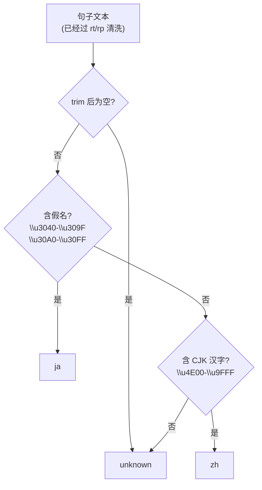
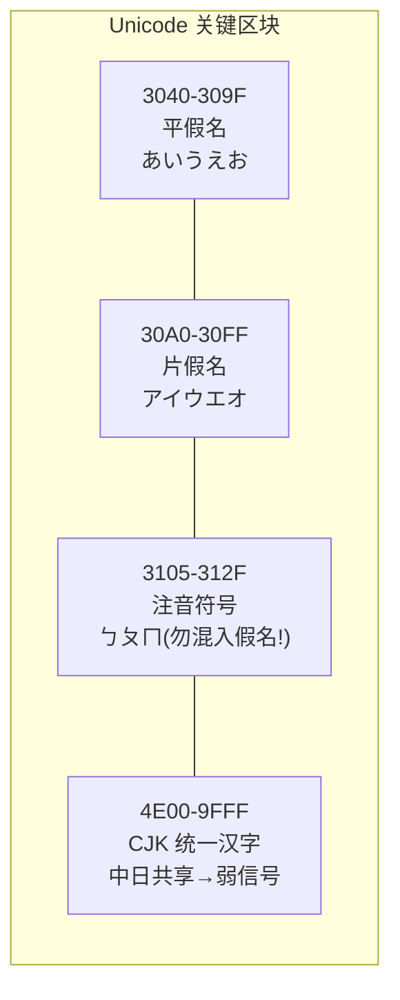
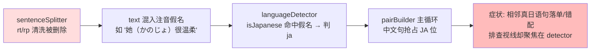

# 第 14 课 · 语言检测 languageDetector

> 所属阶段 2（EPUB 解析管线 ⭐核心）· 预计时长 60 分钟 · 难度★★★☆☆

## 学习目标

- 解释中日文语言检测的核心难点：两国共享同一套 CJK 统一表意文字（汉字）。
- 说清本项目 `isJapanese` / `isChinese` / `detectLanguage` 的判定顺序与短路逻辑。
- 讲述假名（平假名/片假名）与注音符号的 Unicode 码点范围，理解「字符集指纹」这一通用启发式思路。
- 列举该启发式至少三种失效场景，并能解释项目为什么接受这些局限。
- 【新增】背出与本检测相关的东亚 Unicode 区块地图（平假名/片假名/片假名音标扩展/注音符号/CJK 基本区/扩展 A 区/半角片假名），并指出哪些被本项目正则覆盖、哪些故意不管、哪个是意外盲区。
- 【新增】论证「为什么不能依赖 EPUB 的 lang 属性做检测」，说清元数据层、内联标注层、证据可信度三层各自不可信的原因。
- 【新增】识别启发式的典型失效模式（纯汉字日语古文体、半角片假名、扩展区生僻字），并解释 JS 正则在增补平面（代理对）上的经典陷阱。


## 前置检查

- 已完成第 12 课：知道进入本函数的文本已经过 `getTextWithoutRuby` 清洗（不含注音假名——这点对本课至关重要）。
- 已完成第 15 课前置知识预览不必要；但建议先浏览一眼 `pairBuilder.ts`，看 `detectLanguage` 的返回值如何决定配对走向。

- 准备好一个可以随手跑 `/\u3040-\u309F/.test('あ')` 的控制台——本课作业全程要在控制台里跟码点打交道。

【前置知识速览】Unicode 里「区块」（block）指一段连续码点区间，如 U+3040–U+309F 整段划给平假名。JS 字符串是 UTF-16 编码：BMP 内字符占一个码元，正则用 `\uXXXX` 四位十六进制表示；超出 BMP 的字符（如 CJK 扩展 B 区）占两个码元（代理对），`\uXXXX` 语法无法直接表示——这个差异会在本课埋一个著名的坑。

## 关键文件

| 文件 | 职责 |
|---|---|
| `src/lib/epub/languageDetector.ts` | 本课主角：全文仅 26 行的检测模块 |
| `src/lib/epub/pairBuilder.ts` | 消费方：`tagged = sentences.map(s => ({...s, lang: detectLanguage(s.text)}))` |
| `src/lib/epub/sentenceSplitter.ts` | 上游保证：rt/rp 已删，假名污染在源头被控制 |

## 正文

### 概念讲解

**【新增】假名在日语书写系统里的角色——理解信号为什么可靠。** 平假名源自汉字草书，承担语法功能：助词（は、が、を、に）、助动词（です、ます）、用言的活用词尾（食べ**て**、行**か**ない）。这意味着只要句子有正常的语法结构，就*必然*出现平假名——它是日语连续文本的骨架。片假名源自汉字楷书的偏旁部首，承担三类词汇：外来语（テーブル、アルバイト）、拟声拟态词（ざあざあ、きらきら）、生物名与强调。两类假名分工不同但同属「日语独占」证据，所以检测器把它们合并成一个强信号区间。反过来看中文：中文书写系统里没有任何一个区块是「中文独占」的——汉字被日语共享，标点被共享，注音符号只在台湾地区用且本项目的书源不涉及。这就是「ja 可确证、zh 只能倾向」的不对称根源。

【新增】字节级走一遍两个代表性字符，把抽象的码点落到具体：

```text
'の'  U+306E  → UTF-16 码元 [0x306E]           → length 1，\u306E 可直接匹配
'𠮷'  U+20BB7 → UTF-16 码元 [0xD842, 0xDFB7]   → length 2（代理对），\uXXXX 无法表示
```

前者的正则 `/[\u3040-\u309F]/` 一发命中；后者任何 BMP 区间都碰不到它，`'\u{20BB7}'` 配 `u` 标志才行。本项目全部处理逻辑停留在 BMP 内，是「够用就好」的有意选择。

**难点根源：共享汉字。** 日语书写系统 = 汉字 + 平假名 + 片假名。而中文 = 汉字（+ 少量标点）。Unicode 把中日共用的汉字统一收进 **CJK Unified Ideographs** 区块（基本区 `U+4E00–U+9FFF`），一个码点只有一份字形数据，不分「中文版汉字」和「日文版汉字」。所以：

- 一句话里全是汉字时，**无法从字符集判断它是日语还是中文**。「今日」既是中文词也是日语词；「彼女」是纯日语写法但也全由汉字构成。
- 唯一可靠的字符集信号是**假名**：平假名 Hiragana `U+3040–U+309F`、片假名 Katakana `U+30A0–U+30FF` 只用于日语。出现任何一个假名字符，句子几乎必是日语。
- 反之，「没有假名但有汉字」只能**倾向于是中文**，不能确证。

这就是「字符集指纹」启发式：不看词义、不看语法，只看字符属于哪个 Unicode 区块。它的优点是 O(n)、零依赖、无需词典和模型；缺点是天生有盲区。

【新增】完整 Unicode 区块地图。把与本检测相关的东亚区块一次列全——这是写任何中日文本处理代码的必备参照：

| 区块名 | 码点范围 | 内容举例 | 本项目使用 |
|---|---|---|---|
| CJK 符号与标点 | `U+3000–U+303F` | 。、「」『』〜　 | 否（中日共用，零区分力） |
| 平假名 | `U+3040–U+309F` | あいうえお、ゝゞ | ✓ ja 强信号 |
| 片假名 | `U+30A0–U+30FF` | アイウエオ、ー、ヴ | ✓ ja 强信号 |
| 注音符号 | `U+3105–U+312F` | ㄅㄆㄇㄈ | 否（绝不能并入假名区间！） |
| 片假名音标扩展 | `U+31F0–U+31FF` | ㇰㇱㇲ（阿伊努语小假名） | 否（且注意：不在 30A0-30FF 内） |
| CJK 扩展 A 区 | `U+3400–U+4DBF` | 㐀㐁等生僻字 | 否（已知裁剪） |
| CJK 统一表意（基本区） | `U+4E00–U+9FFF` | 今日彼女学校 | ✓ zh 弱信号 |
| 半角/全角形式 | `U+FF00–U+FFEF` | ｱｲｳ（半角片假名）、ＡＢＣ | **否——潜在盲区** |
| CJK 扩展 B 区起 | `U+20000` 起（增补平面） | 𠮷𡈁等极生僻字 | 否（代理对问题，见下文） |

这张表直接暴露了实现的两个「故意不管」和一个「意外盲区」：

- 故意不管注音符号（3105）：并进假名区间会把注音中文误判成日语——宁可不认识，不能认错。区块相邻是 Unicode 编排的历史巧合，不是语义连续。
- 故意不管扩展 A/B 区与片假名音标扩展：双语小说正文几乎不出现这些字符，覆盖它们的收益趋近于零。
- **意外盲区是半角片假名 `ｱｲｳ`（U+FF66–U+FF9D）**：老式排版和某些网文的对话框用半角片假名压缩版面，它们落在 FF 区块而不被 `30A0-30FF` 匹配——通篇「ｶﾞﾝﾊﾞﾚ」式文本会被漏判。真实日文书占比趋近于零故接受；你写通用检测器时应把 `\uFF66-\uFF9D` 补进 kana 正则。

**一个容易混淆的旁支：注音符号。** 台湾国语用 Bopomofo（ㄅㄆㄇㄈ，`U+3105–U+312F`）标注读音，它位于平假名区块紧邻处。做语言检测时若把「非拉丁即东亚」一锅烩，很容易把注音符号误当假名——两者码点相邻，正则范围手滑一格就会串台。（本项目处理的 EPUB 不含注音正文，所以实现中未涉及此范围，但你写通用检测器必须知道这个坑。）

**判定策略：先问「是不是日语」，再问「是不是中文」。** 因为日语的证据（假名）是强信号且独占，而中文的证据（汉字）与日语共享、是弱信号，所以强信号优先短路。这是处理不对称证据的经典排序。

**【新增】为什么不能依赖 lang 属性？** EPUB 规范其实提供了语言标注：OPF 包元数据有 `<dc:language>`，XHTML 元素可带 `xml:lang`/`lang`。看似权威，实际上三层都不可信：

1. **元数据层**：dc:language 描述的是*整本书*的主语言。双语对照书恰恰是最需要逐句区分的场景，而全书元数据只有一个值——填 ja 还是 zh 都注定错一半。更常见的是导出工具一律默认填 en 或 zh，与正文毫无关系。
2. **内联标注层**：理想世界里译文段落应标 `lang="zh"`。现实是沉浸式翻译插件导出的 HTML 通常不带任何 lang 属性；人工排版的电子稿十有八九忘了标注；还有不少工具给**所有**段落统一盖上「书的主语言」戳——日语书里的中文段落也标着 lang="ja"。
3. **证据可信度不对称**：lang 说「我是日语」是声明性元数据，写错了没有任何后果，无法验证；字符集指纹说「我含有假名」是物理事实——文本内容本身不会撒谎。检测系统的铁律：**能用内容证据就不用声明证据**。

lang 属性并非一无是处：当指纹检测判出 unknown 时，它可以作为低优先级的 tie-breaker。本项目连这一层都没做——unknown 的下游语义（不参与配对）已经足够安全，多一条路径就多一类 bug。

### 代码走读

`src/lib/epub/languageDetector.ts` 全文走读：

```ts
export function isJapanese(text: string): boolean {
  // Match hiragana (3040-309F) or katakana (30A0-30FF)
  const kanaRegex = /[\u3040-\u309F\u30A0-\u30FF]/;
  return kanaRegex.test(text);
}
```

只要文本中出现**任意一个**假名字符（平或片）就判为日语。注意 `.test` 是「存在性」判断而非占比判断：一句中文里夹一个「の」（如网络流行语「夜の生活」）就会被判成日语——这是刻意的宽松，因为下游配对算法需要的是整本书层面的结构信号，单句误判可被第 15 课的降级分支吸收。

```ts
export function isChinese(text: string): boolean {
  if (isJapanese(text)) return false;
  const cjkRegex = /[\u4E00-\u9FFF]/;
  return cjkRegex.test(text);
}
```

第一行是关键防御：先排除日语，再谈中文——否则「私の本」（纯汉字+假名）会因含 `\u4E00-\u9FFF` 区间的汉字被误判为中文。CJK 正则只覆盖基本区 `4E00-9FFF`，不含扩展 A/B 区（`3400-4DBF`、`20000+`）；扩展区的生僻汉字在本项目的双语小说场景中极罕见，属于已知的可接受裁剪。

【新增】两个实现变体的对比，帮你确认对「存在性」语义的掌握：

```ts
// 变体A(项目现状): 存在即判,不看占比
const isJapanese = (t: string) => /[\u3040-\u309F\u30A0-\u30FF]/.test(t);

// 变体B: 假名占比阈值
function isJapaneseStrict(text: string): boolean {
  const chars = [...text];
  const kana = chars.filter((c) => /[\u3040-\u309F\u30A0-\u30FF]/.test(c)).length;
  return kana / chars.length > 0.2;
}
```

变体B看似更严谨，实际引入三个新问题：(1) 空串除零；(2) 阈值 0.2 对短句完全武断（「だ！」100%、「私」0%）；(3) spread 展开按码点迭代，比正则扫描慢一个数量级。**当输入分布极端（超短句）时，简单规则反而更稳**——这是本项目选 A 的完整论证链。

```ts
export type Language = 'ja' | 'zh' | 'unknown';

export function detectLanguage(text: string): Language {
  const trimmed = text.trim();
  if (!trimmed) return 'unknown';
  if (isJapanese(trimmed)) return 'ja';
  if (isChinese(trimmed)) return 'zh';
  return 'unknown';
}
```

三分支出口：空串 → `unknown`；含假名 → `ja`；无假名但含基本区汉字 → `zh`；其余（纯英文、数字、标点）→ `unknown`。返回值类型是三值枚举而不是 boolean，把「说不准」显式建模出来——下游 pairBuilder 对 unknown 的处理方式（既不算 ja 也不算 zh，配不上对就丢弃）因此成为可能。

【新增】「unknown 是一等公民」的设计哲学。很多检测 API 的返回类型是 boolean（isJapanese），把「不是日语」和「说不准」压扁成同一个值——这是信息丢失。本项目的三值枚举保留了第三种状态，并让下游按自己的语义消费它：配对阶段 unknown 句不参与任何分支（既不当 JA 也不当 ZH）；单语降级阶段 unknown 被整体豁免照收。同一个值在两个阶段有不同待遇，恰恰说明它是被认真建模的领域概念，而不是偷懒的 null。面试里被问「如何设计检测 API 的返回值」，这就是标准答案的雏形：**宁可让调用方多处理一个状态，也不要让错误信息在类型层面消失**。

**上游契约**：这些函数能工作，前提是输入文本干净。第 12 课的 `getTextWithoutRuby` 删掉了 rt/rp——如果不删，日语原文里的注音假名会泄漏进 text，导致**中文译文侧不受影响、但所有含注音的日语短句都正确、反而暴露不出问题**；真正的破坏出现在中文句子里混入 ruby 注音时会被误判为 ja。管线各环节的清洗职责环环相扣。

【新增】检测结果的下游消费全景——同一个三值结果，五种消费方式：

| 消费方 | 拿到什么 | 怎么用 ja | 怎么用 zh | 怎么用 unknown |
|---|---|---|---|---|
| pairBuilder 全局探测 | 相邻句的 lang 序列 | 与相邻 zh 构成双语证据 | 同左（反向） | 不构成任何证据 |
| pairBuilder 主循环 JA→ZH 分支 | current/next 的 lang | 当 japanese | 当 chinese | 落单丢弃 |
| pairBuilder 单语降级 | 全章 lang 序列 | ——（整章无差别照收） | ——（同左） | ——（同左） |
| AI 分析 prompt（后续课程） | japanese 文本 | —— | —— | —— |
| TTS 朗读引擎选择 | japanese 文本 | —— | —— | —— |

注意后两行：它们根本不消费 lang——只消费配对产物的 japanese 字段。**检测结果在管线中段就完成使命**，这正是「局部允许错、全局靠结构」架构的红利：检测误差不会穿透配对层继续传播。

### 【新增】启发式局限与边界 case 清单

把失效模式整理成「症状 → 根源 → 下游后果」三列清单，这是评估任何启发式系统的标准动作：

| # | 输入样例 | 判定 | 根源 | 下游后果（pairBuilder 视角） |
|---|---|---|---|---|
| 1 | 「彼 昨日 学校 行」（纯汉字文言体日文） | zh | 无假名的日语古文体在字符层面不可判定 | 可能与相邻中文句假配对；被全局探测当局部噪声吸收 |
| 2 | ｶﾞﾝﾊﾞﾚ！（半角片假名） | zh/unknown | FF 区块不被假名正则覆盖 | 日语句可能落单被丢——罕见书源的已知盲区 |
| 3 | 这个方案很おしゃれ（夹假名的中文） | ja | 存在性判断不看来历 | 中文句抢占 JA 位，可能与真日语句错排 |
| 4 | Chapter 1 / 123456 | unknown | 无假名无基本区汉字 | 主循环丢弃、单语降级照收——两种模式都安全 |
| 5 | 𠮷野家（扩展 B 区生僻字） | unknown | 4E00-9FFF 之外 + 代理对问题 | 同上；技术根源见下方正则陷阱 |
| 6 | （仅标点或空白） | unknown | trim 后空串被显式建模 | 正确丢弃 |
| 7 | ヴァイオリン（片假名外来语长句） | ja ✓ | 片假名也是假名 | 正确——「片假名多=外语感」是人的直觉，检测器不看直觉 |

**JS 正则的增补平面陷阱**（case 5 的技术根源）：`\u4E00` 这种四位转义只能表示 BMP 内码点。扩展 B 区的 `𠮷`（U+20BB7）在 JS 字符串里是**代理对**（`\uD842\uDFB7`），任何 `[\uXXXX-\uXXXX]` 范围都不会按真实码点匹配它；想覆盖必须用 `u` 标志加花括号语法 `/[\u{20000}-\u{2A6DF}]/u`，或直接比较 `codePointAt(0)`。本项目不需要，但写国际化代码迟早遇到：**先问自己处理的是 UTF-16 码元还是 Unicode 码点**——ES2015 之前这两者完全混为一谈，length、`[]` 索引按码元计数，for...of 与 spread 按码点迭代。

**比例阈值为什么不行**：假名占比看似更精细，实则对短句全面失效——标题「序」零假名；「だ！」两个字假名占比 100%。双语小说的最小判定单元经常只有 2-10 个字符，统计方法在这个尺度上退化为噪声。存在性判断 + 全局结构探测（第 15 课的两阶段开关）才是这个数据尺度下的正确架构：**单句层面允许粗糙，全局层面靠结构纠偏**。

### 【新增】三个常见追问：为什么不用现成方案

**问：为什么不用 `navigator.language`（浏览器界面语言）？**

它反映的是「用户浏览器装了什么语言包」，与「这段文本是什么语言」毫无因果——中文用户完全可以读日文小说。用户环境是*读者*的属性，文本语言是*内容*的属性，两者永远不能互相替代。

**问：为什么不用 `Intl.Segmenter` 或 ICU？**

ICU 是词级/句级切分的标准库，但它做的是「给定语言，怎么分词」，不是「这是什么语言」；Intl 家族里也没有按字符集判语言的 API。工具边界要认清楚：Segmenter 解决的是本课没有的问题。

**问：为什么不上机器学习分类器（fastText / langdetect 等）？**

它们对短文本的准确率优势要在 50+ 字符后才显现，且引入数 MB 模型或网络请求。本项目单句常短于 10 字符、离线运行、只有两个目标语言+unknown——指纹法的准确率瓶颈被「输入规整 + 全局探测」补掉了。方案选型永远是问题规模先行。

### 【新增】进阶视野：从三行正则到通用语言指纹检测器

把本模块的思路泛化到任意语言集合，核心结构不变：一张「区块 → 语言」的证据表 + 一次遍历统计。示意实现：

```ts
type Lang = string;
// 区块证据表:每个区块给若干候选语言投"独占票"
const BLOCK_EVIDENCE: Array<{ re: RegExp; lang: Lang; weight: number }> = [
  { re: /[\u3040-\u309F]/, lang: 'ja', weight: 3 },   // 平假名:日语独占
  { re: /[\u30A0-\u30FF]/, lang: 'ja', weight: 3 },   // 片假名:日语独占
  { re: /[\uAC00-\uD7AF]/, lang: 'ko', weight: 3 },   // 谚文:韩语独占
  { re: /[\u0400-\u04FF]/, lang: 'ru', weight: 2 },   // 西里尔:多语共享,权重降
  { re: /[A-Za-z]/,        lang: 'en', weight: 1 },   // 拉丁:几乎人人共享
];

function detect(text: string): Lang | 'unknown' {
  const scores = new Map<Lang, number>();
  for (const ch of text) {                    // for...of 按码点迭代,防代理对漏算
    for (const { re, lang, weight } of BLOCK_EVIDENCE) {
      if (re.test(ch)) scores.set(lang, (scores.get(lang) ?? 0) + weight);
    }
  }
  if (scores.size === 0) return 'unknown';
  return [...scores.entries()].sort((a, b) => b[1] - a[1])[0][0];
}
```

与项目实现的对照：项目版是「二值存在性 + 硬编码优先级」；通用版是「加权计票 + 取最大」。前者胜在零分配、可预测；后者胜在可扩展、能处理西里尔这类共享文字。两者共享同一个灵魂——**只看字符属于哪个区块，不看字符是什么意思**。理解了这一点，读 franc、cld3 这类成熟库的文档就不再是黑盒。

最后留一个自检问题：通用版为什么用 `for...of` 而不是 `for (let i = 0; i < text.length; i++)`？——因为增补平面字符在 length 里占两个码元，按索引遍历会把代理对拆成两个无效半字符，区块匹配全部落空。三行项目代码与 20 行通用代码共享同一个隐藏前提：**迭代粒度必须是 Unicode 码点**。这个细节在面试里值一道加分题。

**问：那 franc / cld3 这类成熟库内部是什么原理？**

franc 用的是 n-gram 频次指纹（把文本切成 trigram 与各语言的统计模型比对），cld3 是神经网络。它们都建立在「每种语言有独特的字符/字节序列统计特征」这一假设上——与本模块的「区块指纹」同宗，只是特征更细、模型更重。理解了最朴素的版本，这些库对你来说就只是「换了特征的同类方案」。

### 图示




码点地图（记忆锚点：三个东亚区块从左到右恰好按 Unicode 排布）：



【新增】误判传播链图——上游清洗被破坏时，错误如何跨三个模块传播：



这张图是第 12-14 课三课联动的总结：清洗、检测、配对各自正确时整条链才正确；而链条断裂时，**症状总是出现在离病因最远的地方**——这是阅读多模块管线代码最重要的心智模型。

### 边学边练（检查点）

**检查点 ①**：`detectLanguage('　')`（单个全角空格 U+3000）返回什么？走的是哪个分支？

<details><summary>参考答案</summary>

'unknown'。trim() 会吃掉 U+3000（JS 的 trim 覆盖 Unicode 空白集，全角空格在内），于是 trimmed 为空串，走第一个显式分支。注意即使没有 trim，空格本身既不含假名也不含汉字，最终也会落到 unknown——但显式空串分支让语义更清晰，还省掉两次正则。
</details>

**检查点 ②**：把 isJapanese 的正则合并成 `/[\u3040-\u30FF]/` 行为完全一样吗？该不该合并？

<details><summary>参考答案</summary>

行为完全一样——两个区间相邻，合并不改变任何字符的去留。但不该随手合并：分开写是文档，它向读者声明「平假名、片假名是两个不同的 Unicode 区块」，并且未来要单独处理某一边（比如把片假名音标扩展 31F0 并进来）时有清晰的挂载点。等价的表达式不等价的沟通价值。

</details>

**检查点 ③**：绝大多数日语句子同时含假名和汉字，isChinese 为什么对它们返回 false？

<details><summary>参考答案</summary>

isChinese 第一行的 if (isJapanese(text)) return false 是显式排他——日语句子无论含多少汉字都不是中文。这是它作为独立导出函数的自洽性保障：detectLanguage 的调用顺序已保证主入口不误判，但 isChinese 是公共 API，任何代码都可能单独 import；没有内部防御，「私の本」就会被判成中文。防御写在被调方，让正确的用法成为唯一可能的用法。
</details>


**检查点 ④**：一本汉化组 EPUB，正文是中文、每页底部有日文原文小字。检测器会怎么标注？这对配对是好事还是坏事？

<details><summary>参考答案</summary>

日文小字含假名判 ja，中文正文判 zh。若排版上「中文段落 → 日文小字」相邻，恰好构成 zh→ja 对，触发全局探测并走 reverse 分支——japanese 取日文、chinese 取中文，歪打正着正确配对。启发式的价值不在单句完美而在**结构与真实双语布局共振**。反例：若小字是与正文无关的注释，噪声会被探测开关放大成模式——少数「探测成功反而是坏事」的场景。
</details>

**检查点 ⑤**：【新增】`'\u30A0'`（ー，长音符号）单独一个字符，detectLanguage 判什么？它在日语里的角色说明了什么设计问题？

<details><summary>参考答案</summary>

U+30A0 落在片假名区块（30A0-30FF）内，判 'ja'。长音符号本身没有词汇信息（「ラーメン」「エーネコ」里只是拉长元音），但把它划进片假名区块是合理的——因为它几乎只出现在片假名词中。这个 case 提示：区块边界是按「文字系统归属」划分的，个别字符语义模糊（如长音记号、ゝゞ）时，归属决策优先服务最常见的使用场景。
</details>

**检查点 ⑥**：【新增】`'ｶﾞﾝﾊﾞﾚ'`（全半角混排：半角片假名+浊点组合）里，浊点 `ﾞ` 是 U+309A，落在什么区块？整句会被判成什么？

<details><summary>参考答案</summary>

U+3099–U+309A（浊音/半浊音组合记号）落在**平假名区块** 3040-309F 的尾部！所以这个看似「半角片假名」的句子反而会因浊点命中假名正则被判 ja——盲区出现戏剧性反转：纯 `ｶﾝﾊﾟｲ`（无浊点组合）漏判，带浊点的却判对。这提示我们：区块归属是按字符的*规范身份*而非视觉形态决定的；也再次说明为什么真实书源的审计不能靠猜。
</details>

**检查点 ⑦**：【新增】如果要把本项目检测器扩展到韩日中三语，判定顺序应该怎么排？

<details><summary>参考答案</summary>

先谚文（AC00-D7AF）后假名最后汉字。理由与现有实现同构：每个语言的「独占文字」优先于「共享文字」，独占程度越高的信号越先短路。谚文是朝鲜语独占且现代文本几乎必含；假名次之；汉字最后作为「都匹配不上时的倾向判断」。若扩展到更多语言（如越南语），拉丁字母加声调符号的组合证据需要更细的子区间区分——复杂度随语言数超线性增长，这正是通用库存在的理由。
</details>

## 实操作业

写 5 个边界 case 手测检测函数，建立对启发式边界的体感。

### 第一层（基础）：边界 case 手测

**步骤**

1. 在控制台粘贴源码中的 `isJapanese` / `isChinese` / `detectLanguage` 三件套（保持原样）。
2. 依次测试并预测→验证以下 case，记录每个的真实返回：
   - `'今日は良い天気です'`（典型日语：汉字+假名混合）
   - `'東京タワーへ行く'`（含片假名外来语）
   - `'今天天气真好'`（纯汉字中文）
   - `'私は中国語を勉強する'` 与 `'学习日语'`（对照组）
3. 五个自选边界 case（作业核心）：
   - **纯汉字日文句**：如 `'彼は昨日学校へ行った'` 去掉假名后写作 `'彼 昨日 学校 行'`——观察被判成什么；
   - **夹假名的中文句**：`'这个方案很おしゃれ'`；
   - **纯英文/数字**：`'Chapter 1'`；
   - **只有标点/空白**：`'　'`（全角空格）；
   - **扩展区生僻汉字**：从 IME 找一个 `U+3400` 以上的字（如𠀋），单独测。
4. 对每个意外结果回答：这个误判流到 pairBuilder 会发生什么？（提示：查 `buildPairs` 里 `lang === 'ja'` / `=== 'zh'` 的比较，unknown 既不配对也不保留。）
5. 进阶（选做）：把 `isChinese` 的正则加上扩展 A 区 `3400-4DBF`，重跑扩展区生僻字的 case，思考为什么原实现不加。

### 【新增】第二层（验证）：误判传播实验

6. 构造一个「被污染」的句子模拟上游清洗失效：手动把注音拼进中文句 `'她（かのじょ）很温柔'`，跑 detectLanguage 记录结果；
7. 把这个被误判的句子与真日语句 `'今日は晴れ'`、真中文句 `'今天天气好'` 组成数组，手写三行代码模拟 buildPairs 的相邻扫描，观察错位配对如何发生；
8. 修复实验：把句子里的假名删掉再重跑——确认「症状消失」，并写下结论：**修检测器不如修清洗**。

### 【新增】第三层（综合）：扩展通用检测器

9. 以上文「通用语言指纹检测器」示意代码为底座，加入韩语谚文（AC00-D7AF 已在表中）与俄语西里尔（0400-04FF）测试样本（如 '안녕하세요'、'Привет'），验证计票逻辑；
10. 给 detect 增加「置信度出口」：当最高分与次高分之比小于 1.5 时返回 'unknown'，构造一个中日混合文本让它在 ja/zh 间摇摆，观察 unknown 兜底的价值；
11. 思考题记入笔记：如果把 for...of 改成 `text[i]` 索引遍历，含增补平面字符的输入会怎样？（答案方向：码元遍历会把代理对拆成两个无效半字符，区块匹配全部落空。）

**验收标准**


- [ ] 10 个 case（3 个演示 + 5 个自选 + 2 个对照）全部有实测记录，不是凭想象填答案。
- [ ] 能不看资料默写平假名/片假名/注音符号/CJK 基本区四个码点范围。
- [ ] 能解释为什么 `for...of` 与 `text[i]` 在处理增补平面字符时结果不同。
- [ ] 能说清「纯汉字日文句」为何在字符集层面不可判定，以及本项目靠什么机制让这种句子不至于毁掉整章配对（答案在第 15 课的降级逻辑，可先写下猜想）。
- [ ] 能指出假名区间与注音符号区间在码点上的位置关系，并说明为什么不加注音区间反而是对的。
- [ ] 能说出 unknown 在配对、降级、阅读界面三个环节的不同待遇。

## 本课与面试
- 【新增】**与正则面试题的联动**：「写一个函数统计字符串中中日英字符各自的个数」是本模块的直接变体——把 .test 换成逐字符分类计数即可。追问大文件场景时引出流式处理与 Buffer 级 UTF-8 判断（假名的 UTF-8 首字节为 E3），展示从 JS 字符串到字节层的视野下探。
- 【新增】**unknown 的产品语义**：检测 API 的消费方不止代码，还有产品决策——unknown 句在阅读界面上不显示译文徽标、不参与练习计分。技术三值枚举映射到三条用户可见行为，这种「状态到 UX 的完整映射表」是资深工程师做设计评审时的检查清单。

- **复杂度**：三个函数全是单次正则扫描，O(n)、常数极小、无分配热点（.test 不产生子串）。面试延伸：「如何检测一段文本的主要语言（多语言通用）？」标准答案是按 Unicode 区块统计字符频次取 argmax——一次遍历 + 一张区块映射表，本质就是本课指纹法的推广版。能从这三行代码推广到通用方案，体现方法论迁移能力。
- **字符串处理考点**：(1) `.test()` 与 `.exec()`/`match()` 的区别——test 只回答存在性、不构建捕获结果，存在性场景最省；(2) 正则字面量在解析期编译，循环体内反复 `new RegExp` 是经典反模式；(3) trim 的 Unicode 语义——U+3000 属于 WhiteSpace 集合，`'\u3000'.trim() === ''` 可现场验证；(4) `\uXXXX` 与 `\u{...}` 两种转义风格不可混用（后者需 u 标志），混用是国际化的高频翻车点。
- **Unicode 素养**：「UTF-16 码元 vs 码点」几乎是前端国际化必考题：length 统计码元、`[]` 按码元索引、for...of 与 spread 按码点迭代。emoji 和扩展区汉字都会让 length 撒谎。本模块只在 BMP 内工作是有意识的裁剪而非无知——能讲出这层裁剪理由就是加分项。
- **启发式系统设计题**：「设计一个语言检测方案」的回答框架：先分层（字符集指纹 → n-gram 统计 → 词典/模型），说清每层的准确率/成本/依赖；强调置信度分级出口（本项目用 'unknown' 显式建模「说不准」，比强行二选一的 boolean 高明）；最后谈上游数据质量对下游检测的影响（rt/rp 清洗契约）。这一整套话术就藏在这 26 行代码里。

【本课小结】26 行的 languageDetector.ts 教了四件事：中日共享汉字决定了「假名独占信号」的检测思路；Unicode 区块地图是所有东亚文本处理的底图；三值返回把「说不准」显式交给下游；启发式的局限要整理成清单并给出每个盲区的接受理由。带着这四条进入第 15 课——配对算法的全部正确性都建立在本课的输出之上。

## 常见坑

- **以为汉字能区分中日**：CJK 统一表意文字只有一份码点，字形差异（如「骨」「直」的中日写法）存在于字体渲染层，字符串层面完全相同——任何「按字形判断语言」的想法在文本处理中都不可行。
- **判定顺序颠倒**：先测中文再测日语会让含假名的日语句子被抢判为 zh（因为日语几乎必然含汉字）；必须强信号（假名）先行。
- **忽略上游清洗的耦合**：直接拿原始 HTML 的 textContent 来测会撞上 rt 注音假名；本模块的正确性依赖 sentenceSplitter 先剥 rt/rp 这一隐式契约，跨文件读代码时要看到这层依赖。
- **【新增】把「区块相邻」当「语义相关」**：注音符号紧挨着片假名区块纯粹是码点编排的历史巧合；同理，平假名区块里的 `ゝゞ`（叠字符号）与假名字母性质不同。写区间正则时永远对照区块表，不要凭记忆手写边界数字。
- **【新增】把 length 当字符数用**：含 emoji 或扩展区汉字的句子，length 与实际字符数不等；本模块只用 .test 不计数所以无恙——但你在它之上写任何统计逻辑时必须用 [...text] 或 codePointAt。这是「在正确地基上盖房」与「在错误假设上补丁」的分界线。
- **【新增】把「判对」当成「判准」**：抽查十句全对就放心上线是危险的自欺。启发式的准确率必须按「错误类型 × 下游容错能力」评估，而不是抽样正确率——本项目能接受单句误判，靠的是 pairBuilder 的全局开关兜底，这个前提换一个消费方就不成立。
- **【新增】拿「测试通过」当「逻辑正确」**：本模块的三行实现极易写出永远通过的弱断言（比如只测 'ja' 分支）。黄金样本必须覆盖全部三个出口 + 边界输入，否则测试给的是虚假信心。

## 自测题

先自己作答再展开答案；带【新增】标记的题目对应本课扩写深水区。

1. 为什么中日语言检测不能依靠汉字本身？Unicode 层面的原因是什么？

   <details><summary>答案</summary>

   中日共用 CJK Unified Ideographs（`U+4E00–U+9FFF` 等）区块，每个汉字只有一个码点，不携带「这是中文用法还是日语用法」的信息。字形差异由字体提供，字符串层面无从分辨，所以汉字是弱信号，必须依赖日语独有的假名做强信号。
   </details>

2. 写出 `detectLanguage('私の本')` 和 `detectLanguage('学习')` 的返回值，并解释判定路径。

   <details><summary>答案</summary>

   `'私の本'` 含平假名「の」（`\u306E`，落在 3040-309F）→ isJapanese 为 true → 返回 `'ja'`，根本不会走到汉字检查。`'学习'` 无假名、两字均在 `4E00-9FFF` → 返回 `'zh'`。
   </details>

3. 如果某书用台湾注音符号（ㄅㄆㄇ）给中文标音，本项目的检测器会把含注音的句子判成什么？为什么？

   <details><summary>答案</summary>

   判成 `'zh'` 或视上下文而定——注音符号区块是 `U+3105–U+312F`，既不在假名正则也不在 CJK 正则内，所以注音字符本身不触发任何判定；最终结果取决于句子其余部分是否含基本区汉字。这正是实现里不把 3105-312F 并入假名区间的意义：并进去就会把注音中文误判为日语。
   </details>

4. `isChinese` 开头的 `if (isJapanese(text)) return false;` 删掉会发生什么？

   <details><summary>答案</summary>

   含假名的日语句子（几乎必然同时含 `4E00-9FFF` 区间的汉字）会在 isChinese 中命中 CJK 正则而被误判为中文。虽然 detectLanguage 的调用顺序（先 ja 后 zh）在主入口挡住了这种情况，但 isChinese 作为独立导出的函数会被其他代码直接使用，内部自洽才不会埋雷。
   </details>

5. 一个纯汉字的日语句子（如歌词「花見」式的极短句）被 detectLanguage 判为 `'zh'` 或 `'unknown'`，这对整本书的配对是灾难吗？

   <details><summary>答案</summary>

   通常不是。单句误判只影响局部：若全书有大量正常的 JA→ZH 结构，pairBuilder 的 `hasExplicitBilingualPairs` 整体开关仍会打开，个别错标句子要么配上错误的邻居、要么作为未匹配项被丢弃；若是单语书，整体开关关闭后走单语降级，全部按日语原文处理，误差被系统性吸收。启发式检测的设计前提就是「允许局部错，追求全局结构正确」。

   </details>

6. 【新增】默写与本检测相关的东亚 Unicode 区块（至少 5 个：名称 + 码点范围），并标注哪些被本项目正则使用。

   <details><summary>答案</summary>

   CJK 符号与标点 3000-303F（未用）；平假名 3040-309F（✓ ja 判定）；片假名 30A0-30FF（✓ ja 判定）；注音符号 3105-312F（未用，绝不能并入假名）；片假名音标扩展 31F0-31FF（未用，注意在假名正则之外）；CJK 扩展 A 区 3400-4DBF（未用）；CJK 统一表意基本区 4E00-9FFF（✓ zh 判定）；半角片假名 FF66-FF9D（未用——已知盲区）。
   </details>

7. 【新增】`/\u{4E00}-\u{9FFF}/u` 和 `/[\u4E00-\u9FFF]/` 有什么区别？前者错在哪里？

   <details><summary>答案</summary>


   两处错误：其一少了字符类方括号——没有 [] 时它匹配的是「字符 U+4E00、横线、字符 U+9FFF」这个三字符序列，而不是一个范围；其二 \u{...} 花括号转义必须配 u 标志。正确写法是 /[\u{4E00}-\u{9FFF}]/u 或直接用 BMP 内的 [\u4E00-\u9FFF]。本质：u 标志改变了转义解析规则，两种风格混用必翻车。
   </details>

8. 【新增】如果上游 sentenceSplitter 有人删掉了 rt/rp 清洗逻辑，本模块会出现什么具体误判？给出最小复现用例并推演后果链。

   <details><summary>答案</summary>

   最小用例：中文译文句带 ruby 注音残留，如 text = '她（かのじょ）很温柔'——「かのじょ」的假名使命中 isJapanese，中文句被判 ja。后果链：配对时它抢占 JA 位 → 相邻真日语句被挤成落单或错配 → 整章 pair 结构错乱。排查时症状出现在最远下游，极易误判为检测算法的 bug 而非上游清洗被删。教训：跨模块清洗契约要么有显式校验，要么在函数命名里自我声明（WithoutRuby 就是）。
   </details>

---

**延伸阅读**：Unicode 官方 Scripts.txt 与 Blocks.txt（区块权威数据）；MDN「Intl.Segmenter」与「正则表达式 u 标志」条目；下一课（第 15 课）将消费本模块的输出构建句对，unknown 的处理策略将在那里兑现。
**记忆口诀**：「假名定日语，汉字倾向中，说不准就 unknown，清洗没做全盘空」——四句话覆盖本课全部判定逻辑与最大风险点。


**下一课预告**：第 15 课的 buildPairs 完全信任本模块输出的 lang 标签——两阶段开关、i+=2 贪心扫描、落单保留策略，全部围绕 ja/zh/unknown 三个值展开。带着「检测误差如何被结构吸收」的问题进入下一课。
