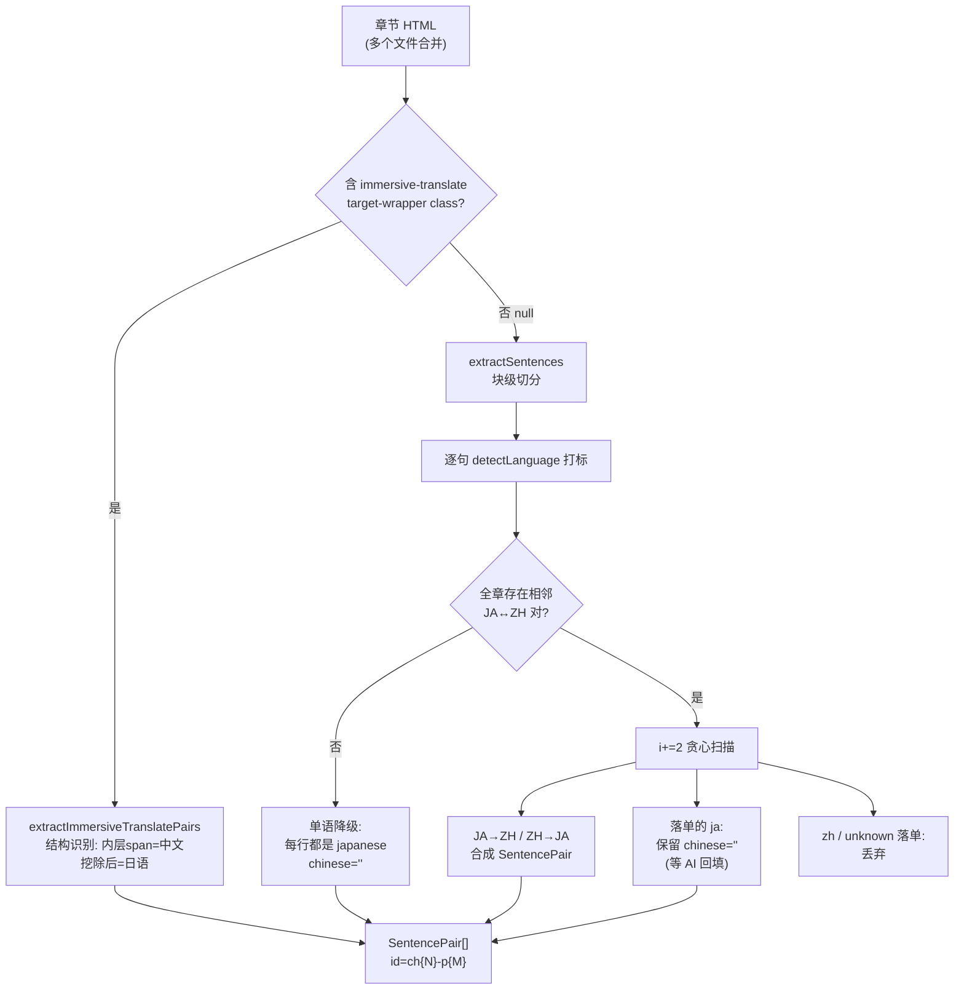

# 第 15 课 · 配对算法 pairBuilder + 沉浸式翻译兼容

> 所属阶段 2（EPUB 解析管线 ⭐核心）· 预计时长 90 分钟 · 难度★★★★☆

## 学习目标

- 讲清 `buildPairs` 的两阶段设计：先探测「全书是否存在显式双语结构」，再决定走配对扫描还是单语降级。
- 手动模拟相邻扫描 `i += 2` 的游标推进，解释为什么 JA↔ZH 配对成功后要一次跳两句。
- 解释「未配对的日语句子保留、非日语丢弃」的不对称处理背后的产品逻辑（为 AI 回译回填留位）。
- 描述 `extractImmersiveTranslatePairs` 的 span class 结构识别原理，以及它为什么排在普通管线**之前**。
- 独立写出并跑通 `buildPairs` 的 Vitest 单元测试（JA→ZH / ZH→JA / 混合 / 单语四个 case）。
- 【新增】为三个扫描分支各准备一张「输入序列 → 游标轨迹 → 产出」推演表，并能手工模拟 ZH ZH JA 开头等错排场景。
- 【新增】拿一段沉浸式翻译插件的真实导出 HTML，逐节点演示 `extractImmersiveTranslatePairs` 的解析过程。


## 前置检查

- 已完成第 12 课：熟悉 `ExtractedSentence { text, html? }` 输入形状。
- 已完成第 14 课：知道 `detectLanguage` 返回 `'ja' | 'zh' | 'unknown'` 三值。
- 已完成第 3 课：会用 `pnpm` 安装依赖；本课作业需要 `vitest`（若 devDependencies 中没有则临时安装）。

- 【新增】读过第 14 课的「误判传播链」图——本课的配对算法正是那张图的最后一环，也是误差被结构性吸收的地方。

## 关键文件

| 文件 | 职责 |
|---|---|
| `src/lib/epub/pairBuilder.ts` | 本课主角：`buildPairs` 相邻配对算法 |
| `src/lib/epub/immersiveTranslate.ts` | 副主角：沉浸式翻译格式的直通道 |
| `src/lib/epub/parser.ts` | 调度者：`extractPairsFromHtml` 决定两条通道的优先级 |
| `src/types/book.ts` | 产物类型 `SentencePair`，id 规则 `ch${chapterIndex}-p${pairIndex}` |

## 正文

### 概念讲解

**双语小说的两种形态。** 项目要处理的输入其实有两类：

1. **机器/人工翻译版 EPUB**：常见于用「沉浸式翻译」浏览器插件导出的 HTML——原文段落后面紧跟一个译文 `<span>`，有明确的 class 标记可循；
2. **裸双语排版**：原文一行、译文一行交替排列，没有任何标记——只能靠语言检测猜。

pairBuilder 解决第二类；immersiveTranslate.ts 解决第一类。前者是兜底主力，后者是高精度捷径。

**两阶段策略。** 如果直接开始逐句配对，「单语书」（整本纯日语）会发生什么？每句都判 ja，永远配不上 zh，最后全部走未配对分支——结果碰巧正确但绕了远路，且中间状态语义混乱。更糟的是纯日语书里偶有一句被判 zh（第 14 课的误判），会错误地触发一次假配对。所以 `buildPairs` 先做一次**全局探测**：「整章里存在至少一对相邻 ja+zh 吗？」不存在就整体切换单语模式，把每行都当日语原文——局部噪声被结构性开关挡在门外。

【新增】两阶段策略的代价也要说清楚：全局探测是一次 O(n) 的预扫描，且它的判断是「存在即双语」——一章里哪怕只有一对相邻 ja/zh（比如引言里夹了一句原文），整章就会进入配对模式，其余句子全部按「落单规则」处理。这个设计赌的是「双语结构是章节级属性，不会只出现一次」。真实书源上这个假设基本成立；反例是日语小说中偶尔出现的中文引文——此时探测被误触发，中文引文会抢占 ZH 位。理解一个开关的误触发成本，和理解它挡住的风险，是同一枚硬币的两面。

**`i += 2` 游标。** 一旦确认配对 `sentences[i]` 和 `sentences[i+1]` 成为一对，两者都被消费，下一个候选从 `i+2` 开始。这是贪心线性扫描：O(n) 时间，一遍过。代价是无法回头修正（比如 ZH ZH JA 开头会先把第一个 ZH 与第二个 ZH 尝试配对失败……实际是 zh 后面跟 zh 不匹配任何分支，i++ 走到第二个 zh 与 ja 配上），但对真实书源足够可靠。

【新增】把这段含糊的描述换成精确的游标轨迹。输入 `['中文甲','中文乙','日本語']`（lang 序列 zh, zh, ja）：

| i | current | next | 分支判定 | 动作 |
|---|---|---|---|---|
| 0 | 中文甲 (zh) | 中文乙 (zh) | 两个配对分支都不匹配；zh 非 ja → 不保留 | 丢弃，i++ |
| 1 | 中文乙 (zh) | 日本語 (ja) | reverse 分支命中（zh→ja） | 配对产出，i += 2 |
| 3 | ——（越界） | —— | while 条件失败 | 结束 |

产出 1 个 pair：`{ japanese: '日本語', chinese: '中文乙' }`。「中文甲」被贪心策略牺牲——它没有回头机制，这正是 O(n) 单遍的代价。

**不对称保留策略。** 扫描中没配上对的句子：lang 为 `'ja'` → 保留为一个 chinese 为空串的句对；lang 为 `'zh'` 或 `'unknown'` → 直接丢弃。为什么？这个产品的闭环是「读日语原文 → 让 AI 补译文 → 回译练习」。孤立的中文句没有学习价值（用户本来就读得懂中文），而孤立日语句正是后续 AI 分析要**回填**的对象——`chinese: ''` 就是留给回译结果的空位。

### 代码走读

**① 入口与打标签（pairBuilder.ts L11-18）**

```ts
export function buildPairs(
  sentences: ExtractedSentence[],
  chapterIndex: number
): SentencePair[] {
  const tagged = sentences.map((s) => ({
    ...s,
    lang: detectLanguage(s.text),
  }));
```

展开运算符保留了原对象的 `html` 字段——注音 HTML 会一路透传进最终的 `japaneseHtml`。每个句子获得三值语言标签。

**② 全局探测开关（L20-38）**

```ts
const hasExplicitBilingualPairs = tagged.some((sentence, index) => {
  const next = tagged[index + 1];
  if (!next) return false;
  return (
    (sentence.lang === 'ja' && next.lang === 'zh') ||
    (sentence.lang === 'zh' && next.lang === 'ja')
  );
});

if (!hasExplicitBilingualPairs) {
  return tagged.map((sentence, pairIndex) => ({
    id: `ch${chapterIndex}-p${pairIndex}`,
    japanese: sentence.text,
    japaneseHtml: sentence.html,
    chinese: '',
    chapterIndex,
    pairIndex,
  }));
}
```

`some` 只要找到一处相邻异语对即短路返回 true。降级分支把**每一句**（包括被判 zh/unknown 的！）都塞进 japanese 字段——注意这个细节：单语模式下不做语言过滤，因为「这本书没有双语结构」本身就是最强的整体证据，个别句子检测错了也照收，宁可宽容不丢内容。

**③ 主扫描循环（L40-96）**

```ts
while (i < tagged.length) {
  const current = tagged[i];
  const next = tagged[i + 1];

  // Look for JA followed by ZH
  if (current.lang === 'ja' && next?.lang === 'zh') {
    pairs.push({ id: `ch${chapterIndex}-p${pairIndex}`,
      japanese: current.text, japaneseHtml: current.html,
      chinese: next.text, chapterIndex, pairIndex });
    pairIndex++; i += 2; continue;
  }

  // Look for ZH followed by JA (reverse order)
  if (current.lang === 'zh' && next?.lang === 'ja') {
    pairs.push({ id: ..., japanese: next.text, japaneseHtml: next.html,
      chinese: current.text, chapterIndex, pairIndex });
    pairIndex++; i += 2; continue;
  }
```

两个对称分支覆盖 JA→ZH 和 ZH→JA 两种排版习惯。注意 reverse 分支的字段交换：`japanese` 取的是 **next**（后面的日语），`chinese` 取 current。`next?.lang` 的可选链优雅处理了数组末尾。

```ts
  // Keep unmatched Japanese lines so partially bilingual / monolingual
  // chapters still remain readable and can be backfilled later.
  if (current.lang === 'ja') {
    pairs.push({ ..., japanese: current.text, chinese: '', ... });
    pairIndex++;
  }
  i++;
}
```

未匹配时：ja 保留（空译文占位）、zh/unknown 静默丢弃，然后无论哪种情况都只前进 1 步——因为 current 没被消费掉的话，它可能和**下下个**句子有关系吗？不会：它已经和 next 试过且失败，直接放走。这就是贪心的简单性。

### 【新增】三个分支的输入输出推演表

主循环只有三条出路。每条配一张「lang 序列 → 游标轨迹 → 最终产出」的完整推演——面试手推算法时就画这个。

**分支一：JA→ZH 正向配对（`current.lang === 'ja' && next?.lang === 'zh'`）**

输入 lang 序列：`ja, zh, ja, zh`

| i | current | next | 判定 | 产出 | 游标 |
|---|---|---|---|---|---|
| 0 | ja | zh | 正向命中 | pair0 = { ja文, zh文 } | i += 2 |
| 2 | ja | zh | 正向命中 | pair1 = { ja文, zh文 } | i += 2 |
| 4 | —— | —— | 越界结束 | —— | —— |

产出 2 对，id 为 ch{N}-p0、ch{N}-p1。**两句都被消费**，所以跳 2 不会漏内容。

**分支二：ZH→JA 反向配对（字段交换）**

输入 lang 序列：`zh, ja, zh, ja`

| i | current | next | 判定 | 产出 | 游标 |
|---|---|---|---|---|---|
| 0 | zh | ja | 反向命中 | pair0 = { japanese: next.ja文, chinese: current.zh文 } | i += 2 |
| 2 | zh | ja | 反向命中 | pair1 同构 | i += 2 |

关键细节再强调一次：产出里 `japanese` 取的是 **next**（后出现的日语），`japaneseHtml` 同样取 `next.html`——写测试时最容易在这里断言反。

**分支三：落单处理（ja 保留 / 其余丢弃）**

输入 lang 序列：`ja, unknown, zh, ja, ja`

| i | current | next | 判定 | 动作 | 游标 |
|---|---|---|---|---|---|
| 0 | ja | unknown | 不构成对；ja → 保留 | pair0 = { japanese: ja文, chinese: '' } | i++ |
| 1 | unknown | zh | 不构成对；unknown → 丢弃 | —— | i++ |
| 2 | zh | ja | 反向命中 | pair1 = { japanese: ja文, chinese: zh文 } | i += 2 |
| 4 | ja | ——(undefined) | next 可选链安全返回 undefined；ja → 保留 | pair2 = { chinese: '' } | i++ |
| 5 | —— | —— | 越界结束 | —— | —— |

这张表覆盖了三个最微妙的点：unknown 落单被静默丢弃（不占 pairIndex 号）；末尾 `next?.lang` 的可选链避免越界崩溃；i += 2 之后恰好落在数组末尾也能正常退出。

**④ 沉浸式翻译直通道（immersiveTranslate.ts L48-104）**


```ts
const translateSpans = doc.querySelectorAll(
  '[class*="immersive-translate-target-wrapper"]'
);
if (translateSpans.length === 0) return null;
```

选择器用 `[class*=...]` 子串匹配而非精确 class——插件的 class 常带哈希后缀（如 `immersive-translate-target-wrapper-abc123`）。零命中立刻返回 `null`，这个 null 是**协议信号**：「这不是我的格式」，调用方据此切换到普通管线。

```ts
const blocks = doc.querySelectorAll('p, h1, h2, h3, h4, h5, h6, li');
for (const block of blocks) {
  const wrapper = block.querySelector('[class*="immersive-translate-target-wrapper"]');
  if (!wrapper) continue;
  const innerSpan = wrapper.querySelector('[class*="immersive-translate-target-inner"]');
  const chinese = innerSpan?.textContent?.trim();
  // 日语原文 = 克隆块 → 移除 wrapper → getTextWithoutRuby
  const clone = block.cloneNode(true);
  clone.querySelector('[class*="...wrapper"]')?.remove();
  const japanese = getTextWithoutRuby(clone);
  const japaneseHtml = getHtmlWithRuby(clone) || undefined;
```

目标结构是 `<p>日本語<span class="...target-wrapper..."><span class="...target-inner...">中文</span></span></p>`。提取方向恰好与 pairBuilder 相反：**中文从内层 span 里拿，日语是块里挖掉译文后的剩余**。克隆后移除 wrapper 再取文本，保证原文干净。注意此通道完全不需要语言检测——class 结构就是权威标注，精度高于启发式。

### 【新增】沉浸式翻译格式：完整 DOM 示例逐步演示

拿一段贴近插件真实导出的 HTML（含哈希后缀 class、多段落、一个无译文的段落），完整走一遍解析：

```html
<body>
  <p>今日は良い天気です。<span class="immersive-translate-target-wrapper-7f3a2"><span class="immersive-translate-target-inner">今天天气真好。</span></span></p>
  <p>私は猫が好きだ。<span class="immersive-translate-target-wrapper-9b1c8"><span class="immersive-translate-target-inner">我喜欢猫。</span></span></p>
  <p>翻訳されていない段落。</p>
</body>
```

逐节点追踪 `extractImmersiveTranslatePairs` 的执行：

| 步骤 | 操作 | 结果 |
|---|---|---|
| 1 | `querySelectorAll('[class*="immersive-translate-target-wrapper"]')` | 命中 2 个（哈希后缀被子串匹配吃掉）→ 非 null，进入正式解析 |
| 2 | `querySelectorAll('p, h1..h6, li')` 遍历块 | 三个 p 依次访问 |
| 3 | p① 内查 wrapper | 找到 → 继续；内层查 target-inner → 取 textContent.trim() = 「今天天气真好。」非空 |
| 4 | p① 克隆 → 移除克隆体中的 wrapper | 克隆剩余 `<p>今日は良い天気です。</p>` |
| 5 | getTextWithoutRuby(克隆) | 无 ruby，得「今日は良い天気です。」非空 |
| 6 | getHtmlWithRuby(克隆) | 无 ruby 返回 '' → `\|\| undefined` 归一 |
| 7 | push pair0 | `{ id: 'chN-p0', japanese: '今日は良い天気です。', chinese: '今天天气真好。' }` |
| 8-9 | p② 同流程 | pair1 = { 我喜欢猫 ← 私は猫が好きだ } |
| 10 | p③ 内查 wrapper | 找不到 → `continue` 跳过（未翻译段不产出 pair） |
| 11 | 循环结束，pairs.length = 2 > 0 | 返回 2 个 pair |

四个容易忽略的行为细节：

1. **未翻译的 p③ 被静默跳过**——它不会出现在任何 pair 里，也不会像 buildPairs 的单语降级那样兜底保留。直通道信任「有 wrapper 的才有完整原文译文对」。
2. **克隆上删、原树不碰**——第 5 步若直接在原 p 上 remove wrapper，下一轮循环再查原树时译文已经没了。克隆纪律在第 12/13 课反复出现，这里是第三个应用场景。
3. **chinese 为空的块同样 continue**（源码 `if (!chinese) continue;`）——只有壳没有译文的半成品不会产出残缺 pair。
4. **返回值的三态**：非该格式返回 null（协议信号）；是该格式但零产出也返回 null（`pairs.length > 0 ? pairs : null`）——后者会让调用方跌回通用管线重跑一遍，是刻意的容错而非疏漏。

**⑤ 调度优先级（parser.ts L54-60）**

```ts
function extractPairsFromHtml(htmlParts: string[], chapterIndex: number) {
  const combined = htmlParts.join('\n');
  return (
    extractImmersiveTranslatePairs(combined, chapterIndex) ??
    buildPairs(extractSentences(combined), chapterIndex)
  );
}
```

`??` 实现优先级：结构识别（高置信）命中就用它的结果；返回 null（非该格式）才落入 DOM 切分 + 语言检测的通用管线。一行代码表达了一条完整的 fallback 链。

### 图示



### 边学边练（检查点）

**检查点 ①**：`buildPairs([], 0)` 返回什么？走哪条路？

<details><summary>参考答案</summary>

返回 `[]`。tagged 为空数组，`some` 对空数组恒为 false → 探测开关关闭 → 走单语降级分支的 map（对空数组 map 还是空数组）。两条路径殊途同归，不需要特判——但你能说清「为什么不需要」才算真懂。
</details>

**检查点 ②**：输入 lang 序列 `unknown, unknown, unknown`（比如一章纯英文），产出什么？

<details><summary>参考答案</summary>

探测找不到任何相邻 ja/zh 对 → 单语降级：三句全部进入 japanese 字段、chinese 为空串。注意这不是错误——「全 unknown 的书按日语处理」是单语降级的既定语义，后续 AI 回译会填上中文。若这批句子实际是英文，AI 照样能翻译，产品无损。

</details>

**检查点 ③**：lang 序列 `zh, zh, ja` 开头（第 14 课的经典误排）的游标轨迹？

<details><summary>参考答案</summary>

i=0：zh 后跟 zh，不匹配且非 ja → 丢弃，i++；i=1：zh 后跟 ja → 反向配对，japanese 取第三句，chinese 取第二句；i=3 越界结束。共 1 对。第一句「中文甲」被牺牲——贪心不回头。若要救回它需要更复杂的区间匹配算法，收益配不上复杂度。
</details>

**检查点 ④**：为什么落单 ja 分支之后是 `i++` 而不是 `continue` 掉 i 不动？写反了会怎样？

<details><summary>参考答案</summary>

源码里落单分支处理后统一执行末尾的 i++。如果忘写 i++ 且用 continue 跳过，current 永远停在原地——死循环，浏览器标签页直接卡死。这是 while 循环手写游标的头号事故源，也是变异测试必查的一项。
</details>

**检查点 ⑤**：pairIndex 和 chapterIndex 分别从哪来？为什么被丢弃的句子不占 pairIndex 号？

<details><summary>参考答案</summary>

chapterIndex 来自函数参数（调用方传入的书内章节序号），pairIndex 是本函数内部的输出计数器，只在 push 时自增。丢弃的句子若占号会产生 id 空洞（ch2-p0, ch2-p2...），破坏「id 连续可枚举」的约定——下游 UI 按 id 排序和定位时，空洞虽不至于出错，却让调试时的对账变复杂。
</details>

## 实操作业

给 `buildPairs` 写第一批单元测试——这也是大纲第 30 课毕业项目要求补齐的测试的前半部分。

**步骤**

1. 安装测试运行器（项目尚未配置则执行 `pnpm add -D vitest`），在 package.json 加 `"test": "vitest run"`。
2. 新建 `src/lib/epub/__tests__/pairBuilder.test.ts`，写入下面的完整测试：

```ts
import { describe, it, expect } from 'vitest';
import { buildPairs } from '../pairBuilder';

// 构造 ExtractedSentence 的快捷工厂（text 必填，html 可选）
const s = (text: string, html?: string) => ({ text, html });

describe('buildPairs', () => {
  it('JA→ZH 相邻配对：合并成一对且 i+=2', () => {
    const pairs = buildPairs(
      [s('今日は良い天気です'), s('今天天气真好')],
      0
    );
    expect(pairs).toHaveLength(1);
    expect(pairs[0]).toMatchObject({
      id: 'ch0-p0',
      japanese: '今日は良い天気です',
      chinese: '今天天气真好',
      chapterIndex: 0,
      pairIndex: 0,
    });
  });

  it('ZH→JA 反向配对：字段交换，japanese 取后面的日语', () => {
    const pairs = buildPairs(
      [s('这是一句中文。'), s('これは日本語です。')],
      1
    );
    expect(pairs).toHaveLength(1);
    expect(pairs[0].id).toBe('ch1-p0');
    expect(pairs[0].japanese).toBe('これは日本語です。');
    expect(pairs[0].chinese).toBe('这是一句中文。');
    expect(pairs[0].chapterIndex).toBe(1);
  });

  it('混合章节：JA/ZH 配对 + 落单日语保留(chinese 空) + 中文落单丢弃', () => {
    const pairs = buildPairs(
      [
        s('一、冒頭の文'),          // ja
        s('开头的句子'),            // zh  → 与上一句配对
        s('落単した日本語の文'),     // ja 落单 → 保留
        s('This is English'),       // unknown 落单 → 丢弃
        s('孤立した文'),            // ja 落单 → 保留
      ],
      2
    );
    // 配对 1 + 保留 2 = 共 3 个
    expect(pairs).toHaveLength(3);
    expect(pairs[0]).toMatchObject({
      japanese: '一、冒頭の文', chinese: '开头的句子',
    });
    expect(pairs[1].japanese).toBe('落単した日本語の文');
    expect(pairs[1].chinese).toBe('');
    expect(pairs[2].japanese).toBe('孤立した文');
    // id 连续递增：ch2-p0 / ch2-p1 / ch2-p2
    expect(pairs.map((p) => p.id)).toEqual([
      'ch2-p0', 'ch2-p1', 'ch2-p2',
    ]);
  });

  it('单语降级：无任何相邻 JA↔ZH 结构时每行都成为日语原文', () => {
    const pairs = buildPairs(
      [s('吾輩は猫である。'), s('名前はまだ無い。'), s('どこで生れたか。')],
      3
    );
    expect(pairs).toHaveLength(3);
    for (let i = 0; i < 3; i++) {
      expect(pairs[i].id).toBe(`ch3-p${i}`);
      expect(pairs[i].chinese).toBe('');
      expect(pairs[i].japaneseHtml).toBeUndefined();
    }
    expect(pairs[0].japanese).toBe('吾輩は猫である。');
  });

  it('ruby html 字段透传到 japaneseHtml', () => {
    const rubyHtml =
      '<ruby>私<rt>わたし</rt></ruby>は猫である。';
    const pairs = buildPairs([s('私は猫である。', rubyHtml)], 4);
    expect(pairs[0].japaneseHtml).toBe(rubyHtml);
  });

  // ---- 以下为扩写新增边界用例 ----
  it('空数组输入返回空数组（不崩溃、无特判）', () => {
    expect(buildPairs([], 0)).toEqual([]);
  });

  it('全 unknown：探测失败走单语降级，unknown 句照收进 japanese', () => {
    const pairs = buildPairs(
      [s('Chapter 1'), s('Hello world.'), s('12345')],
      5
    );
    expect(pairs).toHaveLength(3);
    pairs.forEach((p, idx) => {
      expect(p.japanese).toBe(['Chapter 1', 'Hello world.', '12345'][idx]);
      expect(p.chinese).toBe('');
    });
  });

  it('全 zh：同样走单语降级而非丢弃（信任整体判断）', () => {
    const pairs = buildPairs([s('第一句'), s('第二句')], 6);
    expect(pairs).toHaveLength(2);
    expect(pairs[0].japanese).toBe('第一句');
  });

  it('ZH ZH JA 开头：贪心牺牲第一个 ZH，第二个 ZH 与 JA 配对', () => {
    const pairs = buildPairs(
      [s('中文甲'), s('中文乙'), s('日本語')],
      7
    );
    expect(pairs).toHaveLength(1);
    expect(pairs[0].japanese).toBe('日本語');
    expect(pairs[0].chinese).toBe('中文乙');
  });

  it('JA JA ZH：第二个 JA 与 ZH 正向配对，首个 JA 落单保留', () => {
    const pairs = buildPairs(
      [s('日本語一'), s('日本語二'), s('中文一')],
      8
    );
    expect(pairs).toHaveLength(2);
    expect(pairs[0]).toMatchObject({ japanese: '日本語一', chinese: '' });
    expect(pairs[1]).toMatchObject({ japanese: '日本語二', chinese: '中文一' });
  });

  it('被丢弃的句子不占 pairIndex 号：id 连续无空洞', () => {
    const pairs = buildPairs(
      [s('落単した文'), s('English filler'), s('今日は雨'), s('今天下雨')],
      9
    );
    // 落单 ja 保留 + English 丢弃 + ja/zh 配对 = 2 个 pair
    expect(pairs.map((p) => p.id)).toEqual(['ch9-p0', 'ch9-p1']);
  });
});
```

3. 运行 `pnpm test`，九个测试应全部通过。
4. 变异测试（理解算法的关键一步）：依次做以下修改并预测哪个 case 会红：
   - 把主循环里两处 `i += 2` 改成 `i += 1` → 观察 ZH→JA case 是否出现重复消费；
   - 删掉 `hasExplicitBilingualPairs` 探测，直接进入主循环 → 单语 case 行为是否不变？为什么？（答案：不变——这正是降级分支与主循环未匹配分支行为一致的体现）
   - 把 reverse 分支的 `japanese: next.text` 改成 `current.text` → ZH→JA case 应当红。
5. 把选做升级为正式第 10 个用例：给 `extractImmersiveTranslatePairs` 写正反两个测试——正向输入 `'<p>こんにちは<span class="immersive-translate-target-wrapper"><span class="immersive-translate-target-inner">你好</span></span></p>'` 断言产出 `{ japanese: 'こんにちは', chinese: '你好' }` 且非 null；反向输入 `'<p>没有标记的普通段落</p>'` 断言返回 null。这一对用例锁定了「协议信号」的两侧。
6. 补充一个「格式命中但零产出」的用例：输入只含 wrapper 壳而内层无文本（`chinese` 为空被 continue），断言最终仍返回 null——验证三态返回中的第三态。

**验收标准**

- [ ] `pnpm test` 全绿，且你亲手做过至少一次变异实验让某个测试变红后再还原。
- [ ] 能不看代码说出：混合 case 里 5 句输入为何产出恰好 3 个 pair。
- [ ] 能解释测试中 `chapterIndex` 参数如何影响所有 id 前缀（`ch1-p0` vs `ch2-p0`）。
- [ ] 九个测试用例中，能分别说出每个用例锁定的是哪个分支/哪条边界（正向配对、反向配对、落单保留、落单丢弃、降级开关、空输入、错排牺牲、id 连续性）。
- [ ] 能画出沉浸式翻译示例 HTML 的解析步骤表（11 步），并说出未翻译段落与空译文块的不同死法。

## 常见坑

- **以为 `i += 2` 会跳过内容**：配对成功的两句都已消费完毕，跳 2 是正确的；真正的风险场景是 ZH-ZH-JA 这类错排——第一个 ZH 落单被丢弃，第二个 ZH 与 JA 配上，结果少了一个中文句但不产生错配。
- **混淆降级分支与未匹配分支的语义差异**：单语降级把 zh/unknown 也收进 japanese（信任整体判断）；主循环里的未匹配 ja 保留、zh/unknown 丢弃（信任单句判断）。两者长得像但哲学不同。
- **测试里手写错 id**：id 是 `ch{chapterIndex}-p{pairIndex}`，chapterIndex 来自函数参数而非数组位置，pairIndex 只在产出 pair 时自增（被丢弃的句子不占号）——变异测试时最容易在这翻车。
- **沉浸式翻译选择器写成精确等于**：`class="immersive-translate-target-wrapper"` 精确匹配会在带版本/哈希后缀的真实导出文件上全军覆没；必须 `[class*=...]` 子串匹配。
- **【新增】把直通道的 null 当成「没有结果」**：`extractImmersiveTranslatePairs` 返回 null 有两种含义（非该格式 / 该格式但零产出）。调用方 `??` 链对两者一视同仁是设计使然，但你在自己写的新调用点里若把 null 打上「格式不支持」的日志，就会误导排查方向。
- **【新增】在变异测试里一次改多处**：一次只改一处、跑一遍、还原，才能归因。同时把 i+=2 改 i++ 又删掉探测开关，红了也不知道该怪谁——归因能力比改代码本身更值钱。

## 本课与面试

- **算法复杂度**：全局探测 O(n) 一次 some 短路；主扫描 while 每轮 i 至少 +1，最多 +2 → 总步数 ≤ 2n，仍是 O(n)。空间 O(n)（tagged 副本 + pairs 输出）。面试追问「能否原地打标省掉 tagged」——可以（给 ExtractedSentence 扩展可选 lang 字段或平行数组），但会污染上游类型定义，O(n) 副本换来接口干净是划算的。
- **字符串处理视角**：detectLanguage 对每句跑两次正则；n 句的配对总成本 = O(总字符数) + O(n) 扫描。若书有十万句，正则开销可观测但依然毫秒级——性能账要算到「用户可感知」粒度为止，过度优化到此为止。
- **DOM 安全衔接**：直通道产出的 japaneseHtml 同样经过 sanitizeRubyHtml 净化后才进 japaneseHtml 字段——第 13 课的三层防线在两条通道上都成立。面试讲管线时把「安全不变量跨通道一致」点出来，是加分的系统思维。
- **状态机思维**：主循环本质是一个两态状态机（「上一句待配」/「无欠账」），i+=2 与 i++ 是两个状态的转移边。能把贪心扫描讲成状态机，是从「会写」到「会设计」的分水岭。

## 自测题

1. `hasExplicitBilingualPairs` 探测失败时，一个被判为 `'zh'` 的句子会进入输出的哪个字段？

   <details><summary>答案</summary>

   进入 `japanese` 字段。单语降级分支对全部句子不加语言过滤地映射，`chinese` 一律置空串。这与主循环中「落单 zh 被丢弃」形成对比——降级模式信任的是「整章无双语结构」这一整体证据。
   </details>

2. 输入序列为 `['中文甲', '中文乙', '日本語']`（前两句判 zh、第三句判 ja）且全章因此判定存在双语结构，最终产出几个 pair？各是什么？

   <details><summary>答案</summary>

   1 个。扫描过程：i=0 时 zh 后面跟 zh，两个分支都不匹配且 lang 非 ja → 丢弃，i++；i=1 时 zh 后面是 ja，reverse 分支命中 → 产出 { japanese: '日本語', chinese: '中文乙' }，i += 2 结束。『中文甲』被贪心策略牺牲掉了。
   </details>

3. 为什么 `extractImmersiveTranslatePairs` 返回 `null` 而不是空数组来表示「格式不符」？

   <details><summary>答案</summary>

   因为「识别了该格式但这一章碰巧没有句对」和「根本不是这种格式」是两种不同情况：前者应产出空的合法结果，后者必须让调用方切换到备选管线。`null` 与 `??` 组合恰好表达了这层协议——parser.ts 里 `extractImmersiveTranslatePairs(...) ?? buildPairs(...)` 只有 null 才触发右侧。
   </details>

4. 沉浸式翻译通道提取日语原文时，为什么先克隆块、移除 wrapper，而不是直接取 wrapper 的前一个兄弟节点？

   <details><summary>答案</summary>

   因为原文可能由多个文本节点和内联元素组成，还可能包含 ruby 注音；「移除译文后的块级剩余」才是可靠的原文定义。克隆再删避免污染原树，随后统一走 getTextWithoutRuby/getHtmlWithRuby 复用双轨提取逻辑，与 sentenceSplitter 保持一致的行为契约。
   </details>

5. 若把 `buildPairs` 主循环中落单 ja 分支改为「丢弃」，对产品的哪个后续环节破坏最大？

   <details><summary>答案</summary>

   破坏 AI 回译回填链路。落单保留的日语句子以 `chinese: ''` 占位，阅读界面和分析流程据此把它标记为「待翻译」，AI 分析产出的译文会回填到这个空位；一旦丢弃，这些句子彻底消失，部分双语书的未翻译段落将不可见，也无法再参与练习。
   </details>

6. 【新增】`buildPairs([s('今日は晴れ'), s('今天下雨'), s('いい天気'), s('好天气')], 3)` 产出几个 pair？写出每个 pair 的 japanese/chinese 与 id。

   <details><summary>答案</summary>

   lang 序列 ja, zh, ja, zh。i=0 正向配对 → ch3-p0 { 今日は晴れ, 今天下雨 }，i+=2；i=2 正向配对 → ch3-p1 { いい天気, 好天气 }，i+=2 越界。共 2 对，id 连续。这个用例验证「连续配对时 i+=2 的推进节奏」。
   </details>

7. 【新增】如果把直通道的选择器从 `[class*="immersive-translate-target-wrapper"]` 改成精确 class 匹配，且插件某版本把 wrapper 换成 div 标签——两条防线各自怎么表现？这说明了什么？

   <details><summary>答案</summary>

   精确匹配对哈希后缀失效；即使改成 [class*=]，标签换成 div 后 `[class*=...]` 属性选择器依然命中（它不看标签名只看 class），所以属性子串匹配比「标签+class 全等」多一层鲁棒性。但若插件改掉 class 命名本身，直通道整体返回 null，调度层 `??` 让通用管线接管——结构识别失败不致命的原因是**始终有兜底通道**。教训：为外部格式写识别器时，脆弱性是常态，架构要保证单点失效可降级。
   </details>

8. 【新增】一章 100 句：99 句纯日语 + 第 50 句被判 zh（误判）。若第 50 句恰与第 51 句（ja）相邻，全局探测会怎样？最终产出相对「全对」的理想输出差多少？

   <details><summary>答案</summary>

   第 49-50 句构成 ja→zh 相邻 → 探测为 true，整章进入配对模式。扫描中第 50 句与 51 句反向配对（japanese=51 句、chinese=误判句），产生 1 个错配；其余日语句大多落单保留（chinese=''）。相对理想输出：多 1 个错误 pair + 若干本可相邻配对的句子因游标错位落单——损失被限制在误判点附近 ±2 句的局部。这正是第 14 课「单句允许粗糙」能成立的结构性原因。
   </details>
