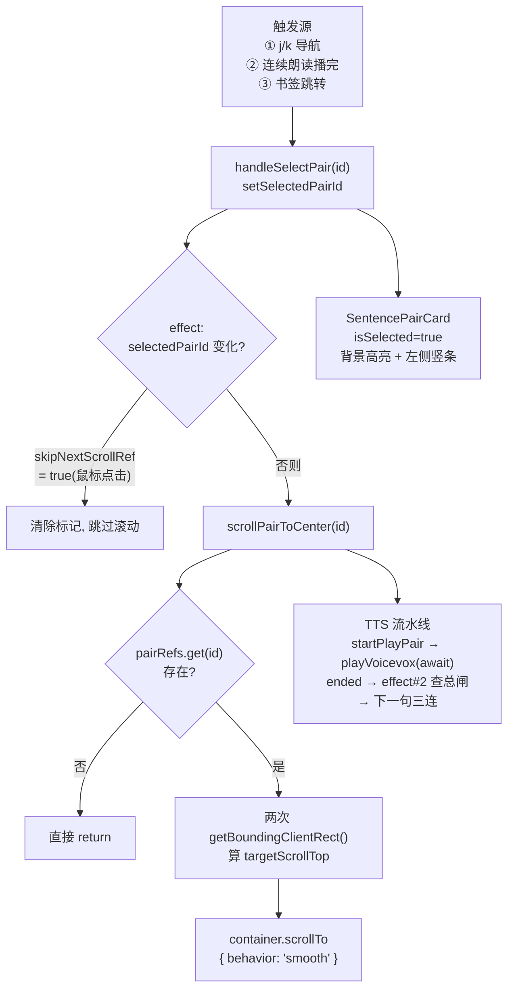

# 第 16 课 · 阅读主界面 ReadingView 精读

> 所属阶段 3 · 预计时长 120 分钟 · 难度★★★★☆

## 学习目标

1. 不看源码说出 `ReadingView` 中 6 个以上 `useState`/`useRef` 各自的职责；
2. 白板画出「pairRefs Map + scrollPairToCenter」实现滚动定位的完整流程；
3. 解释 `SentencePairCard` 为什么用 `forwardRef`，以及 `japaneseHtml` 是如何被安全地渲染成注音的；
4. 说清 `skipNextScrollRef` 存在的原因（鼠标点击选中与滚动的冲突）；
5. 逐条讲出 `ReadingView` 里全部 `useEffect` 的职责、依赖数组与清理函数；
6. 分析当前实现的阅读进度估算（`scrollTop / 100`）的缺陷并提出改进方案；
7. 论证「当前为什么不做虚拟化」并给出何时必须做、用 react-window 大概怎么做的方案概要。

## 前置检查

- 已完成第 15 课：`pairBuilder` 有你自己的测试覆盖，清楚 `SentencePair` 的字段结构（`id` / `japanese` / `japaneseHtml` / `chinese` / `chapterIndex` / `pairIndex`）；
- 已完成第 6、7 课：会用 Zustand 选择器订阅 store 片段；
- 项目能跑起来：`pnpm dev` 后导入任意一本 EPUB 并进入阅读页。

## 关键文件

| 文件 | 职责 |
|---|---|
| `src/components/reader/ReadingView.tsx` | 阅读主容器：卡片列表渲染、滚动定位、j/k 导航、连续朗读编排 |
| `src/components/reader/SentencePairCard.tsx` | 单个句对卡片：日文（含注音）+ 中文译文展示、迷你音频控件 |
| `src/stores/bookSlice.ts` | 提供 `getCurrentBook` / `getCurrentChapter` / `setReadingProgress` |
| `src/stores/settingsSlice.ts` | 字号缩放 `fontZoom` 与 VOICEVOX 参数 |
| `src/lib/tts/voicevox.ts` | `playVoicevox` / `prefetchVoicevox` / `subscribeVoicevoxEnded` 等 TTS 门面 |
| `src/hooks/useTextSelection.ts` | 文字选区检测（本课只需知道它返回 `{ selection, clearSelection, hasJustSelected }`，第 18 课精读） |

## 正文

### 概念讲解

**受控列表与 DOM 引用登记。** React 的声明式模型里，父组件通常不直接碰子组件的 DOM。但「滚动到第 N 张卡片」这类命令式需求绕不开 DOM 节点。常见做法有两种：

1. 给每个子组件发一个 ref 回调，把节点登记进父组件的 `Map<id, HTMLElement>`；
2. 渲染后用 `document.querySelector('[data-pair-id="…"]')` 全局查询。

方案 1 更快也更可控——本项目用的是方案 1：`SentencePairCard` 通过 `forwardRef` 把最外层 `<article>` 的引用交回给 `ReadingView`，后者统一存进 `pairRefs`。整条设计主线可以概括为一句话：*渲染归 React（数据驱动），动作归 ref/effect（命令式）*——「哪张卡高亮」是纯数据，「滚到哪里」「播下一句」全部收口在稳定引用的回调里。看懂这条主线，546 行代码就不再是一盘散沙。

**滚动定位数学。** 要把元素滚到滚动容器垂直居中位置，只需要：

```
targetScrollTop = container.scrollTop
                + (elementRect.top - containerRect.top)   // 元素相对容器可视区顶部的偏移
                - containerRect.height / 2                 // 减去半个容器高
                + elementRect.height / 2                   // 加上半个元素高
```

用两次 `getBoundingClientRect()` 相减，天然免疫「页面整体被滚动过多少」的问题，因为两个 rect 在同一坐标系下。

**虚拟化思考（本课专题，详见正文末尾）。** 长章节可能有几百个句对。当前项目**没有做虚拟化**（所有卡片全量渲染），因为单张卡片的 DOM 很轻（两段文字 + 一个按钮），几百张卡在现代浏览器上仍可接受。虚拟化（如 react-window）只渲染视口附近的行，代价是滚动定位逻辑要改造成按估算高度跳转——本课新增的专题会完整展开这笔账。

### 代码走读

#### 0. 全景地图：先把家底数清楚

动手逐行走读之前，先把 `ReadingView` 内部的「资产清单」列出来，后面每一节都会对应其中一行：

| 类别 | 成员 | 职责一句话 |
|---|---|---|
| `useState` ×6 | `selectedPairId` / `showHelp` / `inputMode` / `showBookmarkList` / `isAutoReadOn` / `isAutoReadBusy` | 选中句、帮助面板、输入模式、书签浮层、连续朗读开关与忙碌态 |
| `useRef` ×8 | `scrollHostRef` / `stageRef` / `restoredRef` / `pairRefs` / `inputRef` / `lastSelectedPairId` / `autoReadRequestedRef` / `skipNextScrollRef` | 滚动容器、舞台容器、已恢复章节、节点登记表、回译输入框、上次选中、朗读请求标记、豁免滚动标记 |
| `useCallback` ×6 | `scrollPairToCenter` / `prefetchAhead` / `startPlayPair` / `toggleAutoRead` / `focusInput` / `blurInput` | 居中滚动、向前预取音频、播放某句、连续朗读开关、聚焦/失焦输入框 |
| 普通函数 ×3 | `handleSelectPair` / `handleClosePanel` / `handleReadingAreaClick` | 选中（同步写 ref）、关面板（只退输入模式）、空白点击取消选中 |

effect 的完整名单（按源码出现顺序），这是本课的主索引：

| # | 依赖数组 | 有无清理 | 职责 |
|---|---|---|---|
| 1 | `[]` | 无 | 挂载后把 `stageRef.current` 抄给 `scrollHostRef.current` |
| 2 | `[currentChapter, scrollPairToCenter, startPlayPair]` | `unsubscribe` | 订阅 `subscribeVoicevoxEnded`，驱动连续朗读播下一句 |
| 3 | `[CACHE_MAX_MB]` | 无 | 设置项变化时调 `setVoicevoxCacheLimit(CACHE_MAX_MB * 1024 * 1024)` |
| 4 | `[currentChapter?.id]` | 无 | 换章时打印 TTS 缓存用量 `console.debug` |
| 5 | `[currentChapter, selectedPairId, focusInput, blurInput, clearSelection, toggleAutoRead]` | `removeEventListener` | window 级键盘路由（j/k/gi/Esc/r/?，第 19 课精读） |
| 6 | `[selectedPairId, scrollPairToCenter]` | 无 | 选中变化时居中滚动，鼠标点击经 `skipNextScrollRef` 豁免 |
| 7 | `[scrollToBookmarkId, getBookmarkById, setScrollToBookmarkId, scrollPairToCenter]` | 无 | 消费书签跳转「命令」（第 18 课精读） |
| 8a/b/c | `[currentChapter, …]` / `[]` / `[currentChapter, setReadingProgress]` | 8b/c 有 | 换章恢复滚动位置（8a）；卸载时停朗读并复位总闸 ref（8b）；挂 `{ passive: true }` scroll 监听写入阅读进度（8c） |

#### 1. 容器状态全景

`ReadingView` 组件顶部的状态分两类——UI 态用 `useState`，跨渲染持久的「记忆」用 `useRef`：

```tsx
const [selectedPairId, setSelectedPairId] = useState<string | null>(null);
const [showHelp, setShowHelp] = useState(false);
const [inputMode, setInputMode] = useState(false);
const [showBookmarkList, setShowBookmarkList] = useState(false);
const [isAutoReadOn, setIsAutoReadOn] = useState(false);
const [isAutoReadBusy, setIsAutoReadBusy] = useState(false);

const scrollHostRef = useRef<HTMLDivElement | null>(null);
const stageRef = useRef<HTMLDivElement>(null);
const restoredRef = useRef<string | null>(null);
const pairRefs = useRef<Map<string, HTMLElement>>(new Map());
const inputRef = useRef<HTMLTextAreaElement>(null);

const lastSelectedPairId = useRef<string | null>(null);
const autoReadRequestedRef = useRef(false);
const skipNextScrollRef = useRef(false);
```

注意四个容易忽略的点：

- `lastSelectedPairId` 与 `selectedPairId` 并存：j/k 导航需要「上一个位置」做基准，即使用户取消了选中（`selectedPairId === null`），按 `j` 也应从上次的位置继续往下走，所以这个值放在 ref 里不触发重渲染；
- `restoredRef` 记录「哪个章节已经恢复过滚动位置」，防止章节切换 effect 重复执行恢复；
- `scrollHostRef` 在挂载后由 `stageRef` 赋值而来（effect #1：`scrollHostRef.current = stageRef.current`），两者最终指向同一个滚动容器 div。为什么要两个 ref？JSX 上绑定的必须是 `stageRef`，而其他逻辑希望拿到一个全生命周期稳定的可读引用；
- `autoReadRequestedRef` 是连续朗读的「总闸记忆」：`subscribeVoicevoxEnded` 的订阅回调是注册时的闭包，它读不到最新的 `isAutoReadOn` state（state 会变、闭包不会），所以「用户还想不想继续连读」必须放在 ref 里——**effect 闭包内需要读取的最新布尔量 → 用 ref 存** 的教科书案例。

派生数据直接在渲染期计算，不进 state：

```tsx
const selectedPair = currentChapter?.pairs.find((p) => p.id === selectedPairId) ?? null;
const chapterBookmarkCount = currentChapter
  ? allBookmarks.filter((b) => b.chapterId === currentChapter.id).length
  : 0;
```

`selectedPair` 会传给 `<PracticePanel>`，这就是「点中一句 → 右侧练习面板打开」的数据来源；`chapterBookmarkCount` 只喂给浮动书签按钮上的角标数字。

#### 2. 列表渲染与 ref 登记

```tsx
<div ref={stageRef} className="reader-stage"
     style={{ fontSize: `${17 * fontZoom}px` }}
     onClick={handleReadingAreaClick} tabIndex={-1}>
  <div className="reader-stage-inner">
    {currentChapter.pairs.map((pair) => (
      <SentencePairCard
        key={pair.id}
        pair={pair}
        isSelected={selectedPairId === pair.id}
        onSelect={() => {
          if (hasJustSelected()) return;
          skipNextScrollRef.current = true;
          handleSelectPair(pair.id === selectedPairId ? null : pair.id);
        }}
        ref={(el) => {
          if (el) { pairRefs.current.set(pair.id, el); }
          else   { pairRefs.current.delete(pair.id); }
        }}
      />
    ))}
  </div>
</div>
```

逐条拆解：

- **字号缩放**只作用在容器上，靠 CSS `em`/继承传导到每句话，不需要逐卡传 props；
- **ref 回调登记**：React 在卡片挂载时以节点调用回调、卸载时以 `null` 调用回调，正好对应 Map 的 set/delete；
- **点击切换选中**是 toggle 语义（再点一次取消）；`hasJustSelected()` 为 true 说明用户刚划选了文字（第 18 课的选区交互），此时不应触发卡片选中；
- **`skipNextScrollRef.current = true`**：鼠标点击时卡片已在视口里，再平滑滚动反而打扰，于是立标记让下面的滚动 effect 豁免一次。

`handleSelectPair` 是唯一合法的选中入口，保证 ref 与 state 成对更新：

```tsx
const handleSelectPair = (pairId: string | null) => {
  if (pairId) {
    lastSelectedPairId.current = pairId;
  }
  setSelectedPairId(pairId);
};
```

> **✎ 边学边练 · 检查点 ①**
> Esc 分支和空白点击都是直接 `setSelectedPairId(null)` 而不走 `handleSelectPair`，为什么这样是安全的？什么情况下绕过入口函数会出 bug？
>
> <details><summary>核对答案</summary>
> 安全是因为两处都传 null——<code>handleSelectPair</code> 只在 pairId 为真值时写 <code>lastSelectedPairId</code>，传 null 时行为等价于直接 setState。会出 bug 的场景：将来有人直接 <code>setSelectedPairId(someId)</code> 选中某句，ref 基准没更新，按 j 会从旧基准跳，出现「跳回」。教训：<b>成对更新的状态要收口到一个入口函数</b>。
> </details>

#### 3. SentencePairCard：forwardRef 与 ruby 渲染

卡片签名：

```tsx
export const SentencePairCard = forwardRef<HTMLElement, Props>(function SentencePairCard(
  { pair, isSelected, onSelect }, ref
) { ... });
```

最外层 `<article ref={ref} data-pair-id={pair.id}>` —— `data-pair-id` 是给 `useTextSelection` 做 `closest('[data-pair-id]')` 定位用的（第 18 课）。选中态的视觉反馈有两处：背景换成 `var(--accent-subtle)`，以及左侧一根绝对定位的高亮竖条：

```tsx
{isSelected && (
  <div className="absolute left-0 top-0 bottom-0 w-0.5 rounded-l"
       style={{ backgroundColor: 'var(--accent-primary)' }} />
)}
```

日文文本由内部组件 `JapaneseText` 渲染，这是本课的安全重点：

```tsx
const renderedContent = useMemo(() => {
  if (bookmarks.length > 0) {
    // 从后往前切片, 保证未处理区域的 offset 不因插入 <mark> 而失效
    const sorted = [...bookmarks].sort((a, b) => b.endOffset - a.endOffset);
    let text = pair.japanese;
    for (const bm of sorted) {
      const color = BOOKMARK_COLORS.find((c) => c.id === bm.colorId);
      const marked = text.slice(bm.startOffset, bm.endOffset);
      text = `${text.slice(0, bm.startOffset)}<mark style="...">${marked}</mark>${text.slice(bm.endOffset)}`;
    }
    return <span dangerouslySetInnerHTML={{ __html: text }} />;
  }
  if (showFurigana && pair.japaneseHtml) {
    return <span dangerouslySetInnerHTML={{ __html: pair.japaneseHtml }} />;
  }
  return pair.japanese;
}, [pair.japanese, pair.japaneseHtml, showFurigana, bookmarks]);
```

三档优先级：**有书签 > 开启注音且有 `japaneseHtml` > 纯文本**。`dangerouslySetInnerHTML` 敢用在这里，是因为第 13 课讲过的 `sanitizeRubyHtml` 已经在解析管线里把 HTML 净化成只含 `<ruby>/<rt>/<rp>` 等白名单标签的字符串——**净化在前端入口做一次，消费端就可以放心多次使用**。书签分支里的 `pair.japanese` 是纯文本切片拼 `<mark>`，同样没有注入面。

卡片其余部分逐块过一遍（这些是本课作业和第 26 课的地基）：

- **「已完成」小勾**：`const hasWork = translation.trim() || analysis || note.trim();`——每张卡都订阅 practiceStore 的三个 Record，该句有回译/分析/笔记任一非空就在右上角显示半透明 `FiCheck`（仅未选中时显示，避免和高亮条打架）。这也是第 17 课「练习数据必须进全局 store」的原因之一；
- **播放状态订阅 effect**：卡内 `subscribeVoicevoxPlayback` 回调先算 `isMine = state.pairId === pair.id`，再把 `isActiveAudio / isPlaying / isLoadingAudio / currentTime / duration` 五个局部 state 一口气更新，不是自己则全部归零——全局同时只有一张卡持有真实进度，其余卡都是零值。用订阅广播替代父组件轮询分发，代价是每张卡常驻一个订阅；
- **迷你音频控件**：右侧绝对定位一层 `onClick={(e) => e.stopPropagation()}` 的容器防止误触发卡片 onSelect；`handlePlayToggle` 里若已是当前音频则 `toggleVoicevoxPause()`，否则 `playVoicevox(...)`；进度条是 `type="range"` 的 input，`max={Math.max(duration, 0.1)}` 防除零，拖动调 `seekVoicevox(next)`。

#### 4. 滚动定位机制

核心函数只有十几行：

```tsx
const scrollPairToCenter = useCallback((pairId: string) => {
  const container = scrollHostRef.current;
  const element = pairRefs.current.get(pairId);
  if (!container || !element) return;

  const containerRect = container.getBoundingClientRect();
  const elementRect = element.getBoundingClientRect();
  const targetScrollTop =
    container.scrollTop +
    (elementRect.top - containerRect.top) -
    containerRect.height / 2 +
    elementRect.height / 2;

  container.scrollTo({ top: targetScrollTop, behavior: 'smooth' });
}, []);
```

依赖数组为空，说明它是纯计算函数——所有输入都来自参数和 DOM。调用它的有三处：

```tsx
// a) effect #6: 选中变化时滚动（鼠标点击除外）
if (skipNextScrollRef.current) { skipNextScrollRef.current = false; return; }
scrollPairToCenter(selectedPairId);

// b) 连读播完一句（effect #2 内直接调用，不经豁免通道）
handleSelectPair(nextPair.id);
scrollPairToCenter(nextPair.id);

// c) 书签跳转（effect #7，rAF 等 DOM 就绪）
requestAnimationFrame(() => { scrollPairToCenter(bookmark.pairId); });
```

a 处就是「程序化导航要跟手滚动、鼠标操作不要」的经典冲突解法：**用一个一次性 ref 标记豁免下一次 effect**。注意 b 处绕过了豁免通道而直接调用——连读时我们*想要*滚动跟随，且此时 effect #6 也会再滚同一个位置，两次平滑滚动目标一致视觉无感，属于可接受的冗余。

#### 5. TTS 编排三件套：prefetchAhead / startPlayPair / toggleAutoRead

这三个 `useCallback` 构成阅读页的语音编排层。

**prefetchAhead——向前预取 N 句音频**：

```tsx
const prefetchAhead = useCallback(
  (fromPairId: string, count = PREFETCH_WINDOW) => {
    if (!currentChapter) return;
    const startIndex = currentChapter.pairs.findIndex((p) => p.id === fromPairId);
    if (startIndex < 0) return;
    for (const pair of currentChapter.pairs.slice(startIndex + 1, startIndex + 1 + count)) {
      void prefetchVoicevox(pair.japanese, voicevoxSpeakerId, { /* speed/pitch/volume */ })
        .catch((error) => console.warn('Prefetch failed:', error));
    }
  },
  [currentChapter, voicevoxPitch, voicevoxSpeakerId, voicevoxSpeed, voicevoxVolume, PREFETCH_WINDOW]
);
```

要点：窗口大小 `PREFETCH_WINDOW` 直接来自设置项 `voicevoxPrefetchWindow`（所以进了依赖数组）；每个预取独立 `.catch` 兜底成 warn——一句失败不能拖垮整批；`void` 前缀表明刻意不等待的 fire-and-forget。

**startPlayPair——播放单句并置忙碌态**：

```tsx
const startPlayPair = useCallback(
  async (pairId: string) => {
    if (!currentChapter) return;
    const pair = currentChapter.pairs.find((p) => p.id === pairId);
    if (!pair) return;

    setIsAutoReadBusy(true);
    try {
      prefetchAhead(pair.id);
      await playVoicevox(pair.japanese, voicevoxSpeakerId, pair.id, { /* speed/pitch/volume */ });
    } catch (error) {
      console.error('Auto read failed:', error);
      autoReadRequestedRef.current = false;   // 失败也必须关闸, 防「总闸开着但没人说话」的僵尸续播
      setIsAutoReadOn(false);
    } finally {
      setIsAutoReadBusy(false);
    }
  },
  [currentChapter, prefetchAhead, voicevoxPitch, voicevoxSpeakerId, voicevoxSpeed, voicevoxVolume]
);
```

注意失败路径的完整性：错误提示之外还要复位总闸 ref 和开关 state。`playVoicevox` 返回的 Promise 在整段音频播完才 resolve——这是 effect #2 能串起队列的前提。

**toggleAutoRead——总开关**：

```tsx
const toggleAutoRead = useCallback(() => {
  const pairs = currentChapter?.pairs ?? [];

  if (isAutoReadOn) {                          // ---- 停止分支
    autoReadRequestedRef.current = false;      // 先关闸, 订阅回调任何时刻读到的都是「已停」
    setIsAutoReadOn(false);
    stopVoicevoxPlayback();
    return;
  }

  if (pairs.length === 0) return;
  // 起点决策链: 当前选中 > 上次停留(lastSelectedPairId) > 第一句
  const fallbackId = lastSelectedPairId.current ?? pairs[0]?.id ?? null;
  const startId = selectedPairId ?? fallbackId;
  if (!startId) return;

  autoReadRequestedRef.current = true;
  setIsAutoReadOn(true);
  if (selectedPairId !== startId) handleSelectPair(startId);
  scrollPairToCenter(startId);
  void prefetchVoicevox(/* 起始句, 同上参数 */).catch(() => undefined);
  prefetchAhead(startId);
  void startPlayPair(startId);
}, [/* currentChapter, isAutoReadOn, selectedPairId, scrollPairToCenter,
      startPlayPair, 各 voicevox 参数, prefetchAhead */]);
```

起始句单独预取一次再整体 `prefetchAhead`，是为了让第一句尽快出声（缓存命中后正式播放几乎零等待）。

> **✎ 边学边练 · 检查点 ③**
> 为什么 `toggleAutoRead` 里判断「是否开着」用 state `isAutoReadOn`，而 effect #2 里判断「要不要继续」用 ref `autoReadRequestedRef`？
>
> <details><summary>核对答案</summary>
> <code>toggleAutoRead</code> 是事件处理器，每次点击拿到最新渲染的闭包，state 新鲜，用它驱动按钮图标和分支正确。effect #2 的订阅回调注册后长期存活，闭包里的 state 冻结在注册那一刻（依赖数组不含它），读它等于读陈旧值；ref 是跨闭包共享的可变盒子，读写即时生效。<b>「渲染驱动用 state，跨闭包记忆用 ref」</b>。
> </details>

#### 6. 连续朗读的心跳：subscribeVoicevoxEnded effect（#2）

```tsx
useEffect(() => {
  if (!currentChapter) {
    autoReadRequestedRef.current = false;   // 无章节即全面复位
    setIsAutoReadOn(false);
    setIsAutoReadBusy(false);
    return;
  }

  const unsubscribe = subscribeVoicevoxEnded((endedPairId) => {
    if (!autoReadRequestedRef.current) return;   // 总闸关着: 单句手动播放到此为止
    const endedIndex = endedPairId
      ? currentChapter.pairs.findIndex((p) => p.id === endedPairId)
      : -1;
    if (endedIndex < 0 || endedIndex >= currentChapter.pairs.length - 1) {
      autoReadRequestedRef.current = false;      // 播到最后一句/找不到: 自然收尾关闸
      setIsAutoReadOn(false);
      return;
    }

    const nextPair = currentChapter.pairs[endedIndex + 1];
    handleSelectPair(nextPair.id);    // 高亮 + 打开练习面板
    scrollPairToCenter(nextPair.id);  // 视口跟随
    void startPlayPair(nextPair.id);  // 内部又会 prefetchAhead(next)
  });

  return unsubscribe;
}, [currentChapter, scrollPairToCenter, startPlayPair]);
```

这是整个阅读页最有编排味道的一段：

- **单句手动播放不会续播**：卡片上的 `handlePlayToggle` 也走 `playVoicevox`，播完同样触发 ended 事件——但此时总闸是 false，回调第一行就返回。ref 在这里兼任「模式区分器」；
- **推进三连顺序固定**：选中、居中滚动、播下一句，配合 `startPlayPair` 内部的预取形成「播一句、备 N 句」的流水线；
- 依赖数组里有 `startPlayPair`，而后者依赖六个 voicevox 设置项——用户播放中改语速会导致订阅重挂，好在退订函数接住了旧订阅，不泄漏。

#### 7. 缓存治理与调试 effect ×2（#3、#4）

```tsx
useEffect(() => { setVoicevoxCacheLimit(CACHE_MAX_MB * 1024 * 1024); }, [CACHE_MAX_MB]);

useEffect(() => {
  if (!currentChapter) { clearVoicevoxCache(); return; }   // 书合上了没必要占内存
  const stats = getVoicevoxCacheStats();
  console.debug(`[TTS cache] ${stats.totalBytes}B / max=${stats.maxBytes}, items=${stats.items}`);
}, [currentChapter?.id]);
```

#3 把设置里的 MB 数字换算成字节同步给 TTS 缓存模块（LRU 上限）；#4 换章时打印一行缓存诊断日志。#4 的依赖只有 `currentChapter?.id` 标量而不是 `currentChapter` 对象——同一章节对象因进度写入等更新引用变化时不重跑，这是「依赖收敛到标量」的小技巧。

#### 8. 键盘路由 effect（#5）与焦点双向门

键位路由本体（j/k/gi/Esc/r/?）在第 19 课逐行精读，本课记住结构即可：window 级 `keydown` 监听、`isInput` 守卫区分输入焦点、消费分支各自 `preventDefault()`。两个落点是空依赖回调 `focusInput`（`inputRef.current.focus()` + `setInputMode(true)`）和 `blurInput`（`blur()` + `setInputMode(false)`）：gi 命中后物理焦点交给 PracticePanel 的回译 `<textarea>`，Esc 反向交还控制权。`inputRef` 正是从这里通过 props 一路传进 PracticePanel 的（见第 17 课）。

#### 9. 书签跳转 effect（#7）与选区弹层挂载

bookmarkSlice 用「命令通道」模式跨组件协作：列表组件只往 store 写一个 `scrollToBookmarkId`，本 effect 读出命令、执行、立刻置 null（否则第二次点击同一条书签时 store 值没变、effect 不触发）。三层防御依次是：命令为空直接退；书签可能已被删（`getBookmarkById` 返回 undefined → 清命令退出）；目标卡片可能未挂载（跨章节场景，包一层 `requestAnimationFrame` 等一帧再 `scrollPairToCenter`），命中后还会顺手 `handleSelectPair(bookmark.pairId)` 打开练习面板。完整代码走读在第 18 课展开。选区弹层则在 JSX 尾部按 `{selection && currentChapter && <SelectionPopover … onClose={clearSelection} />}` 条件挂载——划选文字 → `selection` state 更新 → 弹层出现，纯数据驱动。

#### 10. 章节恢复、卸载清理与滚动追踪 effect（#8a/b/c）

```tsx
// 8a: 恢复滚动位置
useEffect(() => {
  if (!currentChapter || restoredRef.current === currentChapter.id) return;
  restoredRef.current = currentChapter.id;                 // 同章节只恢复一次

  const savedIndex = getReadingProgress(currentChapter.id);
  if (savedIndex > 0) {
    requestAnimationFrame(() => {                          // 等新卡片布局完成再滚
      scrollHostRef.current?.scrollTo({ top: savedIndex * 100, behavior: 'instant' });
    });
  }
}, [currentChapter, getReadingProgress]);

// 8b: 卸载清理
useEffect(() => {
  return () => { autoReadRequestedRef.current = false; stopVoicevoxPlayback(); };
}, []);

// 8c: 滚动追踪
useEffect(() => {
  if (!currentChapter || !scrollHostRef.current) return;
  const container = scrollHostRef.current;

  const handleScroll = () => {
    const currentIndex = Math.floor(container.scrollTop / 100);
    if (currentIndex >= 0 && currentIndex < currentChapter.pairs.length) {
      setReadingProgress(currentChapter.id, currentIndex);
    }
  };
  container.addEventListener('scroll', handleScroll, { passive: true });
  return () => container.removeEventListener('scroll', handleScroll);
}, [currentChapter, setReadingProgress]);
```

- **8a 的双重守卫**：`!currentChapter` 拦空态；`restoredRef` 拦同章节重复恢复（StrictMode 双跑、依赖抖动）。`savedIndex > 0` 意味着第一章开头不触发滚动。rAF 包裹是刚换章时新卡片还没布局完，同步滚会滚个寂寞；`behavior: 'instant'` 保证恢复是瞬移不是倒带动画；
- **8b 是阅读页唯一的卸载钩子**：离开阅读视图（切去书架）时停掉一切朗读。cleanup 里写 ref 安全——闭包捕获的 ref 对象本身恒定；
- **8c 就是那个「诚实近似」的现场**（下一节细说）。`{ passive: true }` 告诉浏览器回调绝不 `preventDefault()`，滚动合成线程不必等 JS——移动端长列表流畅度的基础优化。

#### 11. 底部 JSX：进度条、浮动按钮与浮层

渲染期派生的展示量：`savedProgress = getReadingProgress(currentChapter.id)`、`progressPct`（句数百分比）、`floatingButtonRight`（选中时 `'calc(24rem + 1.5rem)'` 否则 `'1.5rem'`）。

- **顶部进度条**：`style={{ width: `${progressPct}%` }}` 的 div，分子分母都来自 100px 近似算法，误差会在这里显形；
- **`floatingButtonRight`** 是个小而妙的响应式细节：练习面板宽 24rem，面板打开时连续朗读/书签两个 fixed 浮动按钮要用 CSS calc 右移让位，不需要引入额外状态；
- **书签按钮的角标**：`chapterBookmarkCount > 0` 时渲染绝对定位的小圆片显示数量；
- **浮层三兄弟**：`showBookmarkList &&` 的书签列表（`animate-slide-up` 入场）、`showHelp &&` 的 ShortcutHelp 模态、选择弹层。三者互斥性都不强，可以同时存在——「帮助面板打开时 Esc 应先关帮助而不是取消选中」就是一个现成的改进点（第 19 课作业会真的修它）。

### 专题：长章节性能——虚拟化的取舍账

**当前实现为什么不做虚拟化？** 把账摊开算：

1. **DOM 成本**：一张卡片约 15~25 个 DOM 节点，500 句一章 ≈ 一万出头节点——现代浏览器处理十万级节点才明显吃力；
2. **React 协调成本**：开销主要在首次挂载；之后 j/k 移动选中时绝大多数卡片 `isSelected === false` 且 props 引用稳定，diff 很浅。真正贵的是打字时 practiceStore 更新波及所有订阅卡片，但每张卡的计算只是字符串判空；
3. **功能成本**：`scrollPairToCenter`、书签跳转、「精确进度」改进方案全都建立在「任意 pairId 都能拿到真实 DOM 节点和真实高度」之上，虚拟化后视口外的卡片根本不在 DOM 里，这套基础设施要整体重构。

结论：**几百句量级 + 轻卡片 + 重滚动定位**，不虚拟化是正确的工程判断，不是偷懒。

**什么时候必须做？** 出现任一信号就该动手：章节数千句以上（如整本书不分章导入）；进入章节的可交互时间肉眼变慢（Performance 面板里 Scripting + Rendering 占数秒）；滚动规律性掉帧且 Profile 显示大量 Recalculate Style/Layout（卡片复杂化之后）；内存成为约束（移动端 WebView）。判定不要靠猜：录一段「进章节 + 快速滚动到底」，看三段耗时占比和 Long Task 分布。

**react-window 方案概要**（面试常考，能画出来即可）：
- 核心参数：`height`（视口高度）、`itemCount`（pairs.length）、`itemSize`（定高，或 VariableSizeList 的估算高度）、`itemData`（透传给每行的 pairs + 回调）、`overscan`（视口外多渲染几行吸收白屏）；

- 渲染结构：外层 div 固定高度 + `overflow: auto`，内层撑杆 div 高度 `itemCount × itemSize` 制造真实滚动条，可视窗内的行用 `transform: translateY(...)` 定位。滚动只更新 startIndex 一个 state，重渲染范围 O(overscan×2) 而非 O(n)；
- 行组件必须 `React.memo` + 稳定回调引用（itemData 打包传递就是为了这个），否则每次滚动整窗重渲染，虚拟化白做；
- 本项目迁移要动的四处：
  1. `pairRefs` 登记机制不变（行挂载/卸载照样触发 ref 回调），但 `scrollPairToCenter` 要换成 `listRef.current.scrollToItem(index, 'center')`——拿不到未挂载行的 rect 了；
  2. 句子长短不一 → `VariableSizeList` + `estimatedItemSize`，render 后把实测高度回报进 sizeMap 并 `resetAfterIndex` 防脏缓存；
  3. 进度恢复改为按 index `scrollToItem`，反而比 100px 启发式更准；但「遍历全表算精确进度」失效（视口外行不在 DOM），只能维护 index 映射或用 list 内部 API；
  4. `useTextSelection`：行卸载会带走浏览器选区，快速滚动中划选会断裂，需要加大 overscan 或禁止滚动中创建书签；
- CSS 平替也值得一知：`content-visibility: auto` + `contain-intrinsic-size` 让浏览器跳过视口外子树渲染，改动只有两行 CSS，代价是滚动定位仍需自己解决——适合作为虚拟化之前的低成本止血。

> **✎ 边学边练 · 检查点 ④**
> 迁移到 FixedSizeList 后，「点击卡片选中但不滚动」（skipNextScrollRef 那套）还需要吗？scrollToItem 本身会不会带来新的打扰？
>
> <details><summary>核对答案</summary>
> 需要，甚至更重要：被点的行虽在视口内，<code>scrollToItem(index,'center')</code> 仍会把该行挪到窗口中央，原本「不打扰」的行为消失了。要把 effect #6 的滚动统一改成 scrollToItem，豁免标记照旧生效。另外 center 对齐在列表头尾会被 clamp，与现有数学公式的边界行为略有差异，验收时首尾各测一次。
> </details>

### 图示



## 实操作业

分三层难度，基础层必做，进阶层强烈建议，挑战层量力而行。

### 基础层：朗读中的句子自动高亮（大纲作业）

其实 `SentencePairCard` 内部已经有 `isActiveAudio` 状态（订阅 `subscribeVoicevoxPlayback` 得来），但它只在卡片右侧的小按钮上有微弱反馈。你的任务是把「正在播放」提升为一个显眼的阅读体验：

1. **步骤一（观察）**：开启连续朗读，确认目前播放中的卡片除了按钮图标外无任何高亮。
2. **步骤二（最小改动）**：在 `SentencePairCard` 的 `<article>` style 里加一条规则——当 `isActiveAudio && isPlaying` 时给背景叠加 `var(--accent-subtle)`（注意不要覆盖 `isSelected` 的语义，可以用两层背景或调整透明度区分）。
3. **步骤三（进阶）**：让连续朗读时自动滚动跟随——`subscribeVoicevoxEnded` 回调里其实已经调用了 `scrollPairToCenter(nextPair.id)`，验证手动点某句播放（非连续模式）时不应该滚动。若想手动播放也跟随，需要在 `startPlayPair` 或卡片 `handlePlayToggle` 里补一次居中滚动，并想清楚要不要豁免 `skipNextScrollRef`。
4. **验收标准**：
   - 连续朗读时，视觉上能一眼认出当前句（背景或边框变化），且视口自动跟随；
   - 手动点击播放单句时有高亮但不强制滚动（或滚动行为符合你在步骤三的设计并写进了注释）；
   - 暂停/停止后高亮消失，`isActiveAudio` 归零；
   - 不引入新的全局状态——一切仍来自已有的 `subscribeVoicevoxPlayback` 订阅。

### 进阶层：精确阅读进度替换 100px 启发式

1. **测量现状**：字号缩放到 1.5 倍，翻到某章中间记录进度条位置，刷新观察续读偏差，量化失真。
2. **精确算法**：改造 8c 的 `handleScroll`——遍历 `pairRefs.current`，找最后一个 `getBoundingClientRect().top <= containerRect.top + 容器半高` 的 pairId，以其 index 写入 `setReadingProgress`；加 150ms 左右节流。
3. **对称改造恢复**：8a 不再 `savedIndex * 100`，按 index 找 pairId 后用 `scrollPairToCenter` 数学定位（behavior 改 `'instant'`）。
4. **验收标准**：
   - 大字号、长段落场景下进度条与实际阅读位置一致，刷新续读误差 ≤ 半屏；
   - 快速滚动不掉帧（Performance 面板验证没有每帧一次的全表遍历）；
   - 第一章开头（savedIndex 为 0）仍不触发任何滚动。

### 挑战层：react-window 原型对比

1. 安装 react-window，落实专题里的四处迁移清单：`VariableSizeList` + 行组件 `memo` + `itemData` 打包回调 + 实测高度回报（`resetAfterIndex`）。
2. 用 Performance 面板对比改造前后「进入 300+ 句章节」的 Scripting 耗时与滚动帧率，两组数据写进 PR 描述。
3. **思考题（写在代码注释里）**：书签跳转、精确进度、划选书签三个功能在虚拟化后分别踩到什么新边界？哪个最适合作为「暂不上虚拟化」的反证？

## 常见坑

1. **忘记 `forwardRef`**：直接把 `ref` 传给函数组件会在控制台报警告且 `pairRefs` 永远是空的，`scrollPairToCenter` 因拿不到 element 而静默失效——它失败时什么都不发生不报错，排查要先确认 Map 里有东西。
2. **在 `scrollPairToCenter` 里读 `offsetTop`**：`offsetTop` 相对最近定位祖先，卡片链上有绝对定位层时会算错；两个 rect 相减才可靠。
3. **书签跳转/进度恢复不加 `requestAnimationFrame`**：跨章节时目标卡片可能还没挂载，同步取 `pairRefs.get()` 得 `undefined`；等一帧让渲染提交后再滚。
4. **把 `selectedPairId` 放进 store**：选中态是纯 UI 态，放 Zustand 会让 TopBar 等无关组件跟着重渲染；局部 `useState` + ref 才是对的分层。
5. **在订阅回调里读 state 判断连读开关**：闭包里的 state 冻结在注册那一刻；跨闭包最新布尔量必须走 ref。
6. **effect #4 把依赖写成 `currentChapter` 对象**：章节对象任何字段更新都会重触发；收敛到 `currentChapter?.id` 标量才是意图。

## 本课与面试

这一课的素材几乎覆盖前端性能面试的半壁江山：

- **「长列表渲染怎么优化？」**——标准答题框架正好对应本课三层：① 减少数量：虚拟化，原理是「定高估算 → 只渲染可视窗 + overscan → transform 定位 → 总高撑杆保滚动条」，动态高度用估算 + 实测回报 + resetAfterIndex；② 减少渲染开销：行组件 memo、key 稳定（本项目用 pair.id 而非 index——index 做 key 时插入删除会错位复用）、回调引用稳定（useCallback / itemData 打包）；③ 减少布局绘制：`content-visibility: auto`、`contain`；④ 交互层：passive scroll 监听 + 节流、rAF 对齐渲染帧。加分项：主动说「先测量再优化」——本项目正是先证明 500 句不卡才决定不虚拟化，能讲出反方向的决策更可信。
- **「为什么不 querySelector 而用 ref 登记？」**——querySelector 是全局字符串查找，id 冲突时会拿错节点；ref 回调的生命周期绑定 React 提交阶段，挂载/卸载自动 set/delete，Map 与真实 DOM 永远同步。顺带引出 forwardRef 与 React 19 中 ref 作为普通 prop 的演进（本项目仍是 forwardRef 写法）。
- **「事件委托了解吗？」**——两层答案：应用层面，`handleReadingAreaClick` 挂在 stage 容器上靠冒泡接收几百张卡的点击，一处守卫 `e.target === e.currentTarget` 判断空白点击；卡片内部控件层用 `stopPropagation` 圈出委托禁区。框架层面，React 17+ 的合成事件本身就统一委托到 root 容器，能说出这点是加分项。
- **「哪些数据该用 useRef 而不是 useState？滚动定位怎么让元素居中？」**——前者背出本课四个案例：不驱动渲染的位置记忆（`lastSelectedPairId`）、一次性豁免标记（`skipNextScrollRef`）、跨闭包最新值（`autoReadRequestedRef`）、DOM 引用表（`pairRefs`），共同点是**值会变但 UI 不依赖它的每一次中间变化**；后者答两次 `getBoundingClientRect()` 相减的坐标系论证 + smooth/instant 场景选择 + rAF 等 DOM 就绪，追问 offsetTop 为什么不行就答定位祖先陷阱。

## 自测题

<details><summary>1. 为什么 j/k 导航需要一个独立的 lastSelectedPairId ref？只用 selectedPairId 行不行？</summary>

不行。用户按 Esc 或点击空白会把 `selectedPairId` 置为 null（取消选中），但此时按 `j` 应该从"上次停留的位置"继续向下。如果只依赖 `selectedPairId`，取消选中后导航基准就丢了，只能从头开始。ref 不触发重渲染，正适合存这种"记忆但无需驱动 UI"的值。
</details>

<details><summary>2. scrollPairToCenter 的依赖数组为什么是空的？这样安全吗？</summary>

安全。它不读取任何闭包变量：pairId 来自参数，容器和元素都来自 ref（ref 对象本身跨渲染稳定）。空依赖使它成为稳定引用，可以放心作为其他 useCallback/effect 的依赖而不会引发重执行。
</details>

<details><summary>3. JapaneseText 里三档渲染优先级是什么？为什么有书签时反而不用净化过的 japaneseHtml？</summary>

优先级：书签高亮 &gt; 注音 HTML &gt; 纯文本。书签的实现是对 `pair.japanese`（纯文本）按 startOffset/endOffset 切片再包 `&lt;mark&gt;`，注入的内容全是自己生成的固定标签，没有 XSS 面；而且 offset 是基于纯文本计算的（见 useTextSelection），如果基于含 ruby 标签的 HTML 计算偏移会完全对不上。
</details>

<details><summary>4. 鼠标点击卡片选中时为什么不滚动？代码里是怎么豁免的？</summary>

点击时卡片必然已在视口内，平滑滚动反而打断阅读节奏。`onSelect` 回调先设 `skipNextScrollRef.current = true`，随后 selectedPairId 变化触发的滚动 effect 检查到该标记就清掉它并 return——一次性的"豁免下一轮"模式。键盘 j/k 导航不设标记，所以照常滚动。
</details>

<details><summary>5. 当前的阅读进度算法有什么问题？给出一种基于现有设施的精确方案。</summary>

它用 `Math.floor(scrollTop / 100)` 估算句索引，隐含"每张卡恰好 100px 高"的假设；字号缩放、长句换行都会破坏该假设，导致进度条和续读位置漂移。精确方案：滚动时遍历 `pairRefs.current`，找出最后一个 `getBoundingClientRect().top <= containerRect.top + 容器半高` 的 pairId，以其在 `pairs` 中的 index 写入 `setReadingProgress`；恢复时改为对该 pairId 调 `scrollPairToCenter`（behavior 用 instant）。卡片数量几百级，每次 scroll 遍历 Map 的开销可接受，必要时可节流。
</details>

<details><summary>6. ReadingView 的 effect 里哪几个必须有清理函数？漏掉的后果分别是什么？</summary>

三个：#2 的 unsubscribe（漏掉则换章后旧订阅还在，ended 事件会用旧章节闭包找下一句，跨章乱播或静默失效）；#5 的 removeEventListener（键盘监听泄漏，卸载后按键仍触发死闭包里的 setState）；#8c 的 removeEventListener（滚动监听泄漏越积越多）。#8b 的 cleanup 本身就是它存在的目的。#1/#3/#4/#6/#7/#8a 无外部资源或监听器，无需清理。
</details>

<details><summary>7. autoReadRequestedRef 为什么必须存在？能不能用 isAutoReadOn state 替代？</summary>

不能。effect #2 订阅回调的依赖数组不含 isAutoReadOn，回调里读到的永远是注册那次渲染的值——用户后来按 r 关掉连读，订阅回调毫无感知，播完一句还会继续播下一句。ref 是跨闭包共享的同一块内存，读写即时生效。这是 React 「latest ref」模式的经典应用场景。
</details>

<details><summary>8. 若迁移到 react-window 的 VariableSizeList，本课哪些机制要重新设计？各自的坑是什么？</summary>

① scrollPairToCenter → scrollToItem(index,'center')：视口外行无 DOM 只能按索引跳；动态高度下远距离跳转靠估算高度可能不准，需跳转后二次校正。② 进度恢复改 scrollToItem 更准，但要处理 estimatedItemSize 与真实高度的累计误差。③ 「遍历 pairRefs 算精确进度」失效——视口外行不在 DOM，只能维护 index 映射或用 list 内部 API。④ useTextSelection：行卸载带走选区，快速滚动中划选断裂，需要加大 overscan 或禁止滚动中创建书签。
</details>
