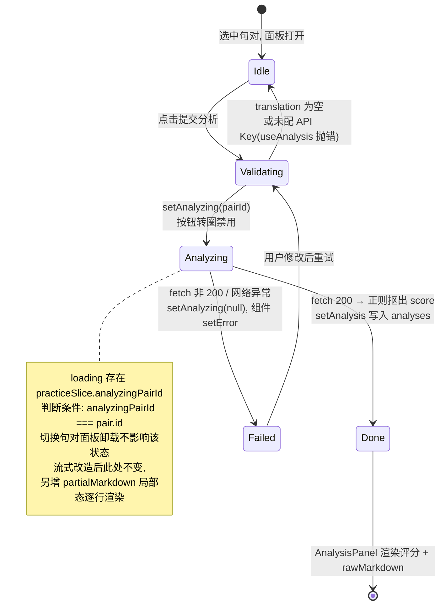

# 第 17 课 · 练习面板 PracticePanel 与分析结果展示

> 所属阶段 3 · 预计时长 120 分钟 · 难度★★★★☆

## 学习目标

1. 画出 `PracticePanel` 中「全局持久态（practiceSlice）+ 局部瞬态（useState）」的双层状态划分图；
2. 跟踪一次提交从 `handleSubmit` 到 `AnalysisPanel` 渲染的完整数据流，说出每个环节的函数名；
3. 解释 `analyzingPairId` 为什么存成「pairId 而不是布尔值」；
4. 说清 `analyzeTranslation` 如何用正则从 AI 返回的 Markdown 里抠出【综合评分】；
5. 逐区块走读 PracticePanel 的 409 行 JSX，说清每个 `useState`/`useRef`/`useEffect` 的职责与生命周期；
6. 论证「当前一次性等待 AI 全文」与「流式输出」的体验差异，给出流式改造的状态设计与迁移要点；
7. 独立完成提交按钮防重复点击的禁用态改造。

## 前置检查

- 已完成第 16 课：知道 `selectedPair` 如何传进 `<PracticePanel pair={selectedPair} …>`，以及 `inputRef`/`inputMode` 这对 props 的来历；
- 已完成第 7 课：理解 Zustand persist 与 localStorage 的关系，能在 DevTools 里找到 `practice-store` 这个 key；
- 已在设置弹窗里配好任意一个 AI Provider 的 API Key（BYOK），能真实跑通一次分析。

## 关键文件

| 文件 | 职责 |
|---|---|
| `src/components/reader/PracticePanel.tsx` | 练习侧栏：原文/译文展示、回译输入、优化译文、获取提示、笔记、提交分析 |
| `src/components/analysis/AnalysisPanel.tsx` | 分析结果渲染：五点评分条 + 手写 Markdown 行级解析器 `MarkdownContent` |
| `src/hooks/useAnalysis.ts` | 封装 analyze 动作与 `analyzingPairId` loading 态 |
| `src/stores/practiceSlice.ts` | translations / analyses / notes / hints 四个 Record + analyzingPairId |
| `src/lib/ai/client.ts` | `analyzeTranslation` / `optimizeTranslationForBacktranslation` / `generateBacktranslateHints` 三个 fetch 封装 |
| `server/routes/ai.ts` | `/api/analyze` 后端路由：限流 + `generateText` 一次性返回全文 |

## 正文

### 概念讲解

**表单状态的两层划分。** 复杂表单组件的状态设计第一问永远是：刷新页面后哪些要还在？本项目把答案直接编码进了位置——

- **要持久的**进 Zustand store（persist → localStorage）：用户输入的回译译文、AI 分析结果、笔记、提示语。这样切走再切回来，甚至关掉浏览器，练习进度都还在；
- **不要持久的**留在组件 `useState`：错误信息（error/optimizeError/hintError）、编辑模式开关、loading 布尔量。它们是「这一次交互」的过程态，持久化反而会造成陈旧错误残留。

**loading 态放哪？** 本项目有个值得学习的细节：提交分析的 loading 不在组件里，而是 `analyzingPairId: string | null` 存进 practiceSlice。好处是任何组件都能问「现在正在分析的是哪一句」——比如卡片列表将来想给正在分析的句子转圈圈，不需要层层传 props。

**手写 Markdown 渲染 vs 引库。** `AnalysisPanel` 没用 react-markdown，而是写了约 60 行的行级解析器。理由：AI 输出格式是自己 prompt 约束的（`【标题】`、`#### 小节`、`- 列表`），只需支持这个子集；引一个 markdown 库要增加包体和 XSS 审计面。这是「按需造轮子」的正确场景——但要意识到局限：不支持嵌套列表、表格、代码块，prompt 一改格式就得同步改解析器。顺带一提，这个行级解析器还有个隐藏优点：它以「行」为最小渲染单元，天然适配将来的流式输出（见本章末尾专题）——每次到达的新文本只需按 `\n` 切出增量行追加进列表即可。

### 代码走读

#### 0. 全景地图

PracticePanel 共 409 行，资产清单如下：

| 类别 | 成员 | 职责 |
|---|---|---|
| props ×4 | `pair` / `onClose` / `inputRef` / `inputMode` | 当前句对、关面板回调、父级持有的输入框 ref、输入模式标记 |
| store 选择器 ×9 | `translation` / `analysis` / `note` / `hint` / `setTranslation` / `setNote` / `setHint` / `updatePairChinese` / `aiProvider` | 四读四写一配置 |
| `useAnalysis` | `{ analyze, analyzingPairId }` | 提交动作 + 全局 loading |
| `useState` ×8 | `error` / `editing` / `editText` / `showNote` / `loadingOptimize` / `loadingHint` / `optimizeError` / `hintError` | 全部瞬态 |
| `useRef` ×1 | `noteRef` | 笔记 textarea 引用（声明了但当前仅占位） |
| `useEffect` ×2 | 重置残留 / inputMode 聚焦 | 见 §1 |
| 异步 handler ×3 | `handleSubmit` / `handleOptimizeTranslation` / `handleGetHint` | 见 §2、§5 |
| JSX 六大区 | Header / 原文 / 译文 / 回译辅助 / 笔记 / Composer | 见 §6 |

#### 1. 从 store 取数：一切以 pair?.id 为键

```tsx
export function PracticePanel({ pair, onClose, inputRef, inputMode }: Props) {
  const hasChinese = pair ? pair.chinese.trim().length > 0 : false;
  const translation = usePracticeStore((s) => pair ? s.translations[pair.id] ?? '' : '');
  const analysis    = usePracticeStore((s) => pair ? s.analyses[pair.id] : null);
  const note        = usePracticeStore((s) => pair ? s.notes[pair.id] ?? '' : '');
  const hint        = usePracticeStore((s) => pair ? s.hints[pair.id + '_hint'] : '');
  const setTranslation = usePracticeStore((s) => s.setTranslation);
  const setNote        = usePracticeStore((s) => s.setNote);
  const setHint        = usePracticeStore((s) => s.setHint);
  const updatePairChinese = useBookStore((s) => s.updatePairChinese);
  const { analyze, analyzingPairId } = useAnalysis();
  const aiProvider = useSettingsStore((s) => s.getActiveAIProvider());
```

四个数据选择器都以 `pair.id` 为键从对应 Record 里取值。注意 `hint` 的键是手工拼出来的 `pair.id + '_hint'`——practiceSlice 里 `hints` 是独立 Record，本可以不拼后缀，这是一个历史痕迹。`pair === null` 时所有选择器安全降级为空值，配合中段的 `if (!pair) return null;` 保证无选中时整个面板不渲染（但 hooks 已经全部执行——hooks 必须在早退之前调用，这是规则）。另外注意 `updatePairChinese` 来自 **bookSlice** 而非 practiceSlice：「优化译文」改的是书库里的译文本体，这个跨 slice 写入是本面板唯一一处越界操作。

局部瞬态一口气声明了 8 个：

```tsx
const [error, setError] = useState<string | null>(null);          // 提交分析错误
const [editing, setEditing] = useState(false);                    // 译文编辑模式
const [editText, setEditText] = useState('');                     // 编辑中的草稿
const [showNote, setShowNote] = useState(false);                  // 笔记展开
const [loadingOptimize, setLoadingOptimize] = useState(false);    // 优化译文 loading
const [loadingHint, setLoadingHint] = useState(false);            // 获取提示 loading
const [optimizeError, setOptimizeError] = useState<string | null>(null);
const [hintError, setHintError] = useState<string | null>(null);
const noteRef = useRef<HTMLTextAreaElement>(null);
```

`editing`/`editText` 这对值得单独说：编辑译文时组件维护一份草稿 `editText`（初值来自 `pair.chinese`），点「保存」才通过 `updatePairChinese` 写回 store，「取消」直接丢弃草稿。草稿与正式值分离，避免打字过程污染书库数据。

两个 effect 构成面板的「生命周期守卫」：

```tsx
// #1: 切换句对时清掉上一句的交互残留
useEffect(() => {
  if (pair?.id) {
    setEditing(false);
    setShowNote(false);
    setError(null);
    setOptimizeError(null);
    setHintError(null);
  }
}, [pair?.id]);

// #2: inputMode 变化时控制 focus（gi 快捷键的落点）
useEffect(() => {
  if (inputMode && pair?.id && inputRef.current) {
    inputRef.current.focus();
  }
}, [inputMode, inputRef, pair?.id]);
```

#1 依赖数组只有 `pair?.id` 标量——同一句话的其他字段变化（比如优化译文改写了 chinese）不会误清用户正开着的状态。#2 是第 19 课 `focusInput()` 的另一半：快捷键层只负责置 `inputMode=true` 并调 `focus()`，这里再兜底一次聚焦（应对面板刚挂载、ref 还没就绪的时序），依赖里的 `pair?.id` 保证「gi 之后切句子再 gi 回来」也能重新聚焦。

> **✎ 边学边练 · 检查点 ①**
> 如果删掉 effect #1，用户在 A 句遇到「请先配置 API Key」的报错后切到 B 句继续练习，界面会发生什么？
>
> <details><summary>核对答案</summary>
> B 句面板底部会凭空挂着 A 句留下的 <code>error</code>「请先在设置中配置AI API Key」——这些 useState 不在 persist 里也不随 pair 切换自动重置，组件实例一直是同一个。<code>editing</code>/<code>showNote</code> 同理会跨句泄漏。这就是「瞬态也要有明确的生命周期终点」的意义：pair?.id 就是本组件所有瞬态的代际边界。
> </details>

#### 2. 提交主链路：handleSubmit → useAnalysis → client

```tsx
const isAnalyzing = analyzingPairId === pair?.id;

const handleSubmit = async () => {
  if (!pair || !translation.trim()) return;
  setError(null);
  try {
    await analyze(pair.id, pair.japanese, pair.chinese, translation);
  } catch (e) {
    setError(e instanceof Error ? e.message : '分析失败');
  }
};
```

`useAnalysis` 内部先做两道前置校验（没配 Key、译文为空都直接 throw），然后：

```tsx
setAnalyzing(pairId);
try {
  const result = await analyzeTranslation(aiProvider, original, chinese, userTranslation, pairId);
  setAnalysis(pairId, result);   // 成功：写入结果，同时把 analyzingPairId 归 null
  return result;
} catch (e) {
  setAnalyzing(null);            // 失败：只清 loading，错误抛回组件层展示
  throw e;
}
```

看 practiceSlice 里这两个 action 就明白状态机是怎么闭合的：

```tsx
setAnalysis: (pairId, result) =>
  set((state) => ({
    analyses: { ...state.analyses, [pairId]: result },
    analyzingPairId: null,
  })),
setAnalyzing: (pairId) => set({ analyzingPairId: pairId }),
```

`analyzingPairId` 存 string 而非 boolean 的价值在这里兑现：连续快速切换两句时，面板用 `analyzingPairId === pair?.id` 判断，**只有自己这句在分析才显示转圈**，不会因为别的句子在分析而误伤。还有一个隐蔽细节：A 句分析进行中切到 B 句再提交，`setAnalyzing(B)` 会覆盖 A 的标记——A 的转圈消失但请求仍在飞，完成后 `setAnalysis(A)` 才把 loading 归 null。当前 UI 上无感（B 自己的 isAnalyzing 为 true 正常转圈），但这是多句并发时该重构为 Set 的信号。

#### 3. analyzeTranslation：请求与评分抽取

三个函数都打同一个端点 `/api/analyze`，只是 prompt 不同：

```tsx
const response = await fetch('/api/analyze', {
  method: 'POST',
  headers: { 'Content-Type': 'application/json' },
  body: JSON.stringify({
    provider: config.type,
    apiKey: config.apiKey,
    model: config.model,
    baseUrl: config.baseUrl,
    prompt,
  }),
});

if (!response.ok) {
  const err = await response.text();
  throw new Error(`AI analysis failed: ${err}`);
}

const data = await response.json();
const rawMarkdown: string = data.text;

// Extract score
const scoreMatch = rawMarkdown.match(/【综合评分】\s*(\d+)/);
const score = scoreMatch ? parseInt(scoreMatch[1], 10) : 0;

return {
  pairId,
  userTranslation,
  originalJapanese: original,
  score,
  errors: [],
  strengths: [],
  suggestions: [],
  rawMarkdown,
  analyzedAt: Date.now(),
};
```

两个要点：① API Key 随请求体发给自建后端（BYOK 模式，Key 只经过你自己的服务器）；② `errors/strengths/suggestions` 目前恒为空数组——结构化输出是第 30 课毕业项目的改造目标，现在的"结构"只有 score 和 rawMarkdown 两样是真数据。正则抠分失败时 score 为 0，而 `AnalysisPanel` 用 `result.score > 0` 做了渲染守卫，两者是配套约定。服务端（`server/routes/ai.ts`）做三件事：按 IP 的每分钟 30 次内存限流（超限返 429）、校验必填字段、调 AI SDK 的 `generateText({ model, prompt })` 后 `c.json({ text: result.text })` 整包返回——注意 `await generateText` 会等模型生成完所有 token 才返回，这正是后面专题要改造的地方。

#### 4. AnalysisPanel：评分点阵 + 行级 Markdown

评分条把百分制换算成 5 个圆点：

```tsx
{result.score > 0 && (
  ...
  {[...Array(5)].map((_, i) => (
    <div key={i} className="w-2 h-2 rounded-full transition-colors"
         style={{ backgroundColor: i < Math.round(result.score / 20)
             ? 'var(--accent-primary)' : 'var(--border-color)' }} />
  ))}
  <span ...>{result.score}/100</span>
)}
```

`Math.round(score / 20)` 完成 0-100 → 0-5 的映射；外层 `result.score > 0` 守卫保证抠分失败时整块不渲染而不是显示 0 分误导用户。

`MarkdownContent` 对每一行做一次分类判断，按优先级从上到下：

```tsx
if (line.startsWith('【') && line.includes('】'))      // → <h3> 强调色标题
else if (line.startsWith('####'))                      // → <h4>（剥掉 #### 前缀）
else if (line.startsWith('- **')) {                    // → 含加粗的列表项
  const formatted = line.replace(/\*\*(.*?)\*\*/g, '<strong>$1</strong>');
  elements.push(<p ... dangerouslySetInnerHTML={{ __html: formatted }} />);
}
else if (line.startsWith('- '))                        // → 普通列表项
else if (line.trim())                                  // → 普通段落
```

注意顺序敏感：`- **` 必须在 `- ` 之前判断，否则加粗列表项会退化成普通列表项丢掉加粗；`####` 在段落之前同理。唯一一处 `dangerouslySetInnerHTML` 只用于把 `**…**` 替换成 `<strong>`——替换发生在整行文本上，若 AI 返回里混入 HTML 标签会原样注入。这里的风险评估是：内容来自你付费调用的 AI 服务而非不可信第三方，属于可接受的信任边界，但你要能说清楚这条边界在哪（prompt 注入可以让 AI「替用户」输出任意 HTML，防御手段是在 replace 时一并转义其余字符）。

#### 5. 另外两条异步支线：优化译文与获取提示

同构的小状态机，各自独立三件套（loading/error/result）：

```tsx
const handleOptimizeTranslation = async () => {
  if (!pair || !aiProvider.apiKey) {
    setOptimizeError('请先在设置中配置 AI API Key');
    return;
  }
  setLoadingOptimize(true);
  setOptimizeError(null);
  try {
    const optimized = await optimizeTranslationForBacktranslation(aiProvider, pair.japanese, pair.chinese);
    updatePairChinese(pair.id, optimized);   // 直接改写书库里的译文（bookSlice）
  } catch (e) {
    setOptimizeError(e instanceof Error ? e.message : '优化译文失败');
  } finally {
    setLoadingOptimize(false);
  }
};
```

`handleGetHint` 结构完全一样，差异只在成功分支：`setHint(pair.id + '_hint', text)` 写进 practiceSlice 的 hints Record。「获取提示」结果的展示块也自带一个迷你行解析器：

```tsx
{hint.split('\n').filter(Boolean).map((line, i) => {
  if (line.startsWith('【') && line.includes('】')) {
    const match = line.match(/^(【[^】]+】)(.*)$/);
    if (match) {
      return (
        <p key={i}>
          <strong style={{ color: 'var(--accent-primary)' }}>{match[1]}</strong>
          {match[2]}
        </p>
      );
    }
  }
  return <p key={i}>{line}</p>;
})}
```

和 AnalysisPanel 不同，这里用正则捕获组把 `【标题】` 拆出来塞进 `<strong>` 文本节点——纯 React 元素、零 innerHTML，是同一需求的更安全写法，两种风格并存本身就是很好的对照教材。对比之下 `handleSubmit` 没有 `finally` 收尾是因为 loading 由 store 的 action 负责（成功在 `setAnalysis` 里清，失败在 `useAnalysis` 的 catch 里清），两种收尾风格并存——作业会让你统一其中一处。

#### 6. JSX 六大区块走读

- **Header**：左侧「练习」小标签 + 右侧关闭按钮。注意 `onClose` 是 ReadingView 传入的 `handleClosePanel`，它只做 `setInputMode(false)` 而不取消选中——点 ✕ 关掉的是输入焦点模式，面板本身随选中态存在；
- **原文区**：`{pair.japanese}` 直接渲染纯文本（不带注音——注音是阅读卡片的事，练习面板刻意保持素文本，避免 ruby 干扰逐字对照）；
- **译文区**：右上角「编辑」按钮进入 editing 态 → 渲染 `<textarea value={editText} autoFocus rows={3}>` + 保存/取消按钮对；非编辑态则根据 `hasChinese` 显示译文或斜体半透明的「暂无译文」占位；
- **回译辅助区**：「优化译文」「获取提示」两个小按钮，loading 时把图标换成 `animate-spin` 的圆环 div 且 `opacity: 0.5`；下方依次是 `optimizeError`、`hintError` 的红色小字错误行和 hint 结果块；
- **笔记区**：条件渲染双层门 `{(note.trim() || showNote) && …}`——已有内容或用户主动展开才出现；内部 `<textarea ref={noteRef} value={note} onChange={(e) => setNote(pair.id, e.target.value)}>` 是**直接受控于 store** 的输入框（和 translation 一样），每个字符都写进 persist store；折叠态下若笔记为空则显示一个低透明度的「添加笔记」入口按钮；
- **Composer**：底部固定区，`<textarea ref={inputRef} value={translation} onChange={…setTranslation(pair.id, …)}>` 就是全项目键盘系统的焦点枢纽（第 16/19 课的 inputRef 都指向它）；右下角提交按钮：

```tsx
<button
  onClick={handleSubmit}
  disabled={isAnalyzing || !translation.trim()}
  className="btn btn-primary flex items-center gap-2"
  style={{ opacity: isAnalyzing || !translation.trim() ? 0.4 : 1 }}
>
  {isAnalyzing ? (
    <><div className="w-4 h-4 border-2 border-current border-t-transparent rounded-full animate-spin" />分析中</>
  ) : (
    <><FiSend size={14} />提交分析</>
  )}
</button>
```

disabled 条件两半语义不同：`!translation.trim()` 是业务前置（没内容不让交），`isAnalyzing` 是并发防护（但存在窗口期漏洞，见作业）。左下角 `{error}` 红字与分析结果 `{analysis && <AnalysisPanel result={analysis} />}` 分别挂在 composer 和内容区末尾。

> **✎ 边学边练 · 检查点 ②**
> `note` 输入框每敲一个字就 `setNote` → persist 序列化整个 practiceSlice 写 localStorage。为什么 translation 也这么做却没人觉得卡？什么情况下会成为问题？
>
> <details><summary>核对答案</summary>
> 单字段量级小（一句话译文），现代设备上 JSON.stringify 几 KB 是微秒级，感知不到。会成为问题的场景：练习积累了几百句后 analyses/rawMarkdown 让 store 膨胀到 MB 级，每次按键的全量序列化 + localStorage 同步写开始吃主线程——届时应改成 debounce 持久化、或 partialize 排除大对象、或输入期只留组件态失焦时落库。这是「受控输入直连持久 store」模式的固有代价。
> </details>

### 专题：AI 流式输出方案探讨——一次等待 vs streaming

**现状的体验账。** 当前链路 `generateText` → 整包 JSON → 一次性 setState，用户视角是：点击提交 → 转圈 5~20 秒（取决于模型与网络）→ 内容整块砸出来。心理学上这叫「空白等待」：没有进度感、无法预判、不能中途反悔，是最差的等待形态。而且分析结果是典型的「阅读型内容」——用户其实想边生成边看前几条建议，根本不需要等全文。

**流式方案长什么样？**

```
服务端（Hono + AI SDK）：
  const result = streamText({ model: llm, prompt });
  return result.toTextStreamResponse();
  // 底层是 chunked HTTP 响应, 每个 token 片段到达即 flush

客户端：
  const response = await fetch('/api/analyze', { method: 'POST', body, signal });
  const reader = response.body!.getReader();
  const decoder = new TextDecoder();
  let acc = '';
  while (true) {
    const { done, value } = await reader.read();
    if (done) break;
    acc += decoder.decode(value, { stream: true });
    onPartial(pairId, acc);          // 增量回调
  }
```

**体验对比：**

| 维度 | 当前一次等待 | 流式 |
|---|---|---|
| 首条内容可见时间 | = 总生成时间（秒级） | 首 token 到达即显示（百毫秒级） |
| 总耗时 | 相同 | 相同（甚至因无缓冲略快） |
| 中途取消 | 无法（fetch 已发出只能弃结果） | `AbortController` 随时断流，服务端停止生成省 token 钱 |
| 感知质量 | 「卡住了？」 | 打字机效果，进度自然可见 |
| 错误处理 | 一个 try/catch 干净利落 | 半截输出 + 断流错误的复合状态 |
| 实现成本 | 已完成 | 双端改造 + 增量渲染 + 竞态处理 |

**本项目落地时的状态设计（关键决策）：**

1. `analyzingPairId` 保持不变——「哪句在生成中」仍是全局互斥信息，现有判定 `analyzingPairId === pair?.id` 原样工作；
2. 增量文本放**组件局部 state 或模块级 Map，绝不进 persist**：半截 AI 输出刷新后毫无价值，持久化只会制造垃圾。推荐 `useState<string>` 存 `partialMarkdown`，完成时才 `setAnalysis(pairId, finalResult)` 落库；
3. 渲染节流：token 事件频率可达每秒几十次，直接 setState 会打爆 React——用 ref 攒文本 + rAF（或 50ms 定时器）批量刷 state；
4. `MarkdownContent` 的行级解析正好增量友好：每次把新增文本按 `\n` 切片，已完成的行直接渲染，最后一行（可能不完整）作为临时段落渲染并在下次更新时替换——现有解析器的分类逻辑一行都不用改；
5. score 抠取必须等流结束：【综合评分】通常在输出尾部，流式中途正则会拿到 0 分，所以评分条的出现时机从「提交后」变为「流结束后」，恰好形成「正文渐现 → 最后评分点亮」的自然节奏；
6. 限流不变：`bucket.count += 1` 仍按请求数计，流式不改变请求语义；但要意识到断流重试会放大请求数。

**那为什么不现在就做？** 诚实评估当前实现的合理性：单次分析文本只有几百字，总等待可控；一次等待的实现只有一个 async 函数，错误路径完备；BYOK 用户自己付费、慢主要慢在所选模型。流式是把「感知延迟」从十几秒压到几百毫秒的体验升级，不是正确性修复——所以它排在第 30 课毕业项目的候选清单里，而你现在已经有能力把它当挑战作业做掉。

> **✎ 边学边练 · 检查点 ③**
> 流式改造后，用户在 A 句生成中途切到 B 句又发起生成，`analyzingPairId` 和两条并行流会发生什么？怎么修？
>
> <details><summary>核对答案</summary>
> setAnalyzing(B) 覆盖 A，A 流仍在后台写入 partialA——若 partial 用「单一 state」存就会 A/B 文本互相覆盖串台。修法：partial 按 pairId 分桶（Map&lt;pairId, string&gt; 或组件内按 pair 缓存），且新提交前 abort 旧流的 AbortController；或者干脆限制「同一时间只允许一句在生成」（analyzingPairId 非 null 时禁用提交按钮），把并发问题挡在外面。
> </details>

### 图示



## 实操作业

分三层难度，基础层必做，进阶层强烈建议，挑战层量力而行。

### 基础层：给提交按钮加防重复点击的禁用态（大纲作业）

当前按钮其实已有半套防护：`disabled={isAnalyzing || !translation.trim()}`。但存在窗口期漏洞——`isAnalyzing` 依赖 `analyzingPairId`，它要等 `useAnalysis` 内部执行到 `setAnalyzing(pairId)` 才变 true；而 `handleSubmit` 开头只有一个非阻塞检查，理论上双击够快仍可能发出两个并发请求。

1. **步骤一（复现风险）**：在 `handleSubmit` 开头加 `console.count('submit')`，DevTools 里对着按钮快速双击，观察 count 是否到 2（网络慢时更明显）。
2. **步骤二（组件层守卫）**：引入一个局部 ref 作同步锁（ref 写入是同步的，state 是异步批处理的，挡不住同一事件循环内的第二次点击）：
   ```tsx
   const submittingRef = useRef(false);
   // handleSubmit 开头:
   if (submittingRef.current) return;
   submittingRef.current = true;
   // try/catch/finally, finally 里 submittingRef.current = false
   ```
3. **步骤三（视觉反馈）**：保持现有 `isAnalyzing ? 转圈+「分析中」 : FiSend+「提交分析」` 结构不变，确认 disabled 时 opacity 0.4 已由 style 表达式覆盖。
4. **验收标准**：
   - 双击按钮只产生一次 `/api/analyze` 请求（Network 面板验证）；
   - 请求期间按钮禁用且显示旋转 spinner；失败后按钮恢复可点，错误文案出现在按钮左侧的 `{error}` 区域；
   - 切换到另一句再切回来，没有遗留的禁用或错误状态；
   - `submittingRef` 在组件卸载时不会造成任何泄漏（它是普通 ref，无需清理，但要能解释为什么）。

### 进阶层：统一收尾风格 + 可取消的分析

1. **统一收尾**：把三条支线（handleSubmit/handleOptimizeTranslation/handleGetHint）的 loading/error 收尾整理成同一风格——要么全走 store action 收尾，要么全走组件 `finally`，并把选择理由写成注释。
2. **AbortController**：给 `analyzeTranslation` 增加 `signal` 参数透传给 fetch；切换句对（effect #1 的 cleanup）时 abort 进行中的请求，catch 里区分 `AbortError` 静默处理、其他错误照常展示。
3. **验收标准**：
   - 三条支线的 loading 归零路径在代码里一眼可查且行为一致；
   - A 句分析中切到 B 句，Network 面板里 A 的请求变为 canceled，无报错残留；
   - 手动 abort 不弹「分析失败」错误文案。

### 挑战层：流式分析原型（对应本章专题）

1. 服务端：在 `server/routes/ai.ts` 新增 `/analyze/stream` 路由，用 AI SDK 的 `streamText` + `toTextStreamResponse()` 返回 chunked 流（保留同样的限流逻辑）。
2. 客户端：client.ts 新增 `streamAnalysis(...)`，用 `response.body.getReader()` + `TextDecoder` 循环读取，通过 `onChunk(acc)` 回调吐增量。
3. UI：PracticePanel 增加 `partialMarkdown` 局部态（rAF 节流刷新），生成中用它实时渲染行级 Markdown，结束时照旧 `setAnalysis` 落库；提交按钮旁加「停止」按钮调 `abort()`。
4. **验收标准**：
   - 提交后首行内容在 1 秒内可见（对比改造前录屏）；
   - 生成中滚动/打字不掉帧（验证 rAF 节流生效）；
   - 中途停止后半截文本不写入 analyses、刷新后无残留；
   - 写一段 200 字对比笔记：流式在你的网络与模型下的真实体感差异。

## 常见坑

1. **用 useState 当防抖锁**：`setSubmitting(true)` 后立刻读 state 读到的还是旧值（批量更新），同一 tick 内的第二次点击拦不住；同步互斥必须用 ref。
2. **忘记 pair 切换时清 error**：`error` 等 useState 不在 persist 里，但也不在 effect 清理名单里的话，上一句的报错会一直挂在新句子的面板底部。
3. **以为 score 抠取失败会崩**：正则匹配不到返回 0，`AnalysisPanel` 用 `result.score > 0` 整块跳过评分条，页面不报错但评分消失——遇到「AI 有回复但没有分数」先去 Network 面板看原始 text 里有没有【综合评分】字样。
4. **改 prompt 输出格式忘了 MarkdownContent**：解析器按行首字符串匹配（`【`、`####`、`- **`），把 prompt 改成 `## 标题` 或 `* 列表` 后结果会退化成一堆普通段落；且 `- **` 分支必须排在 `- ` 之前。
5. **editText 草稿与 store 双份真相混淆**：编辑态里把 `<textarea>` 直接绑到 `pair.chinese` 会让每次击键写穿书库；必须经草稿态、确认才落库。
6. **hooks 与早退的顺序**：`if (!pair) return null;` 必须放在所有 hook 调用之后——把提前返回提到前面会触发 React 的 hooks 顺序告警，pair 从 null ↔ 有值切换时直接崩溃。

## 本课与面试

- **「React 表单状态怎么管理？受控与非受控怎么选？」**——本面板就是活教材：translation/note 直连 store 是受控 + 持久；editText 是「受控 + 草稿缓冲」——正式值与编辑值分离，确认时合并；`autoFocus` 的 textarea 则是非受控焦点的典型。能说出「受控程度是一个光谱而非二选一」并各举一例即是高分。
- **「loading 状态应该放组件还是全局 store？」**——答题框架：看消费范围。只影响本组件 UI 的（loadingOptimize）留组件；跨组件关心的（analyzingPairId，卡片列表也想用）进 store，且用实体键（pairId）而非布尔值以支持并发区分。追问「多句并发怎么办」就答升级为 `Set<pairId>` 或 Record，并说明当前单互斥锁是有意简化。
- **「怎么防止按钮重复提交？」**——三层防线：① HTML disabled（视觉+事件层）；② 组件内 useRef 同步锁（同一事件循环内的连点，state 批处理挡不住）；③ 服务端幂等/限流（本项目 `/api/analyze` 的 per-IP 限流兜底）。能讲清「为什么 state 不行而 ref 行」（批处理与事件循环时序）是核心考点。
- **「dangerouslySetInnerHTML 的风险与替代？」**——先说注入面：内容含未转义 HTML 即 XSS；再说本项目的两处用法与各自信任边界（净化过的 ruby HTML / 自产 `<mark>` 拼接 / AI 返回的 `<strong>` 替换）；最后给替代方案：React 元素切片、正则捕获组 + 文本节点（hint 块的写法）、成熟的 sanitize 库。能主动提到 prompt 注入会让「可信 AI」变不可信是加分项。
- **「LLM 应用为什么要流式输出？前端怎么接？」**——产品角度：首 token 时间决定感知延迟，打字机效应 + 可中断显著降低流失；技术角度：SSE 或 chunked transfer + `ReadableStream.getReader()` + `TextDecoder({stream:true})` 处理多字节截断，前端用 ref 攒批 + rAF 节流渲染，行级 Markdown 解析天然支持增量。能画出「token 事件 → 缓冲 → 批量 setState」的数据通路即可。

## 自测题

<details><summary>1. translations/analyses 存在 store，而 error/loadingOptimize 存在组件 state，划分依据是什么？</summary>

是否需要跨会话持久与跨组件共享。用户的译文和分析结果是劳动成果，刷新丢失代价高，且 SentencePairCard 还要读 translations/analyses/note 来显示"已完成"小勾（hasWork），所以必须进 store；错误信息和进行中标志只在本次交互内有意义，持久化反而导致陈旧残留，放 useState 即可。
</details>

<details><summary>2. analyzingPairId 为什么设计成 string | null 而不是 boolean？</summary>

多句并存的场景下需要区分"哪一句正在被分析"。PracticePanel 用 analyzingPairId === pair?.id 判断是否显示自己的 loading，切换句对时不会互相污染；未来卡片列表也能据此给对应句子加动画。boolean 只能表达全局一个互斥锁。
</details>

<details><summary>3. handleSubmit 的 try/catch 里没有 finally，loading 最终靠谁清除？两条路径分别是什么？</summary>

靠 practiceSlice。成功路径：analyzeTranslation resolve 后 useAnalysis 调 setAnalysis，该 action 在写 analyses 的同一笔 set 里把 analyzingPairId 置 null；失败路径：useAnalysis 的 catch 里显式 setAnalyzing(null) 再把错误 rethrow 给组件的 catch 显示。
</details>

<details><summary>4. MarkdownContent 里唯一使用 dangerouslySetInnerHTML 的分支是哪个？为什么其余分支不用？</summary>

只有 `- **` 开头的列表项分支，因为它要把 `**text**` 正则替换成 &lt;strong&gt; 标签，无法用纯文本节点表达，只能注入 HTML。其余分支（【】标题、#### 、普通列表、段落）渲染的都是原始字符串，React 会自动转义，没有注入面。
</details>

<details><summary>5. 「获取提示」的结果为什么要以 pair.id + '_hint' 为键存进 hints？直接存组件 state 有什么问题？</summary>

提示是花钱换来的 AI 输出，应随练习记录持久化，否则切换句对就丢。存组件 state 还有作用域问题：PracticePanel 在 pair 变 null 时整体卸载（return null 但组件实例还在父组件树中，不过 hint 选择器已按 pair.id 切换了读取键），只有以 pairId 为键的全局 Record 才能保证每句话的提示各归其位、回来还在。
</details>

<details><summary>6. editing/editText 为什么不合并成一个「直接读写 store」的受控框？它们的保存/取消分别做什么？</summary>

编辑是高风险操作：打字的中间态不该写穿书库（bookSlice.updatePairChinese 还会影响阅读页卡片的译文显示）。所以进入编辑时用 pair.chinese 初始化草稿 editText，textarea 只绑草稿；「保存」执行 updatePairChinese(pair.id, editText) 落库并退出编辑态，「取消」直接 setEditing(false) 丢弃草稿。草稿态保证了取消的无损性和保存的原子性。
</details>

<details><summary>7. 流式改造中，partialMarkdown 应该存在哪里？analyzingPairId 又要不要动？各自的理由？</summary>

partialMarkdown 放组件局部 state（或按 pairId 分桶的模块级缓存），绝不进 persist——半截 AI 输出刷新后无价值，持久化徒增垃圾；且要用 ref 攒文本 + rAF 节流再刷 state，否则每秒几十次的 token 事件会打爆渲染。analyzingPairId 保持原样不动：它表达「哪句在生成中」的全局事实，现有 analyzingPairId === pair?.id 判定、按钮禁用、卡片联动全部继续成立，流式只是改变了 Done 之前的中间呈现方式。
</details>
