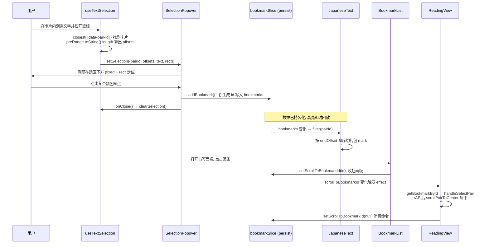

# 第 18 课 · 书签系统：从划选文字到跳转回读

> 所属阶段 3 · 预计时长 120 分钟 · 难度★★★★☆

## 学习目标

1. 默写 `TextBookmark` 接口的 8 个字段，并解释 `startOffset/endOffset` 为什么相对纯文本而非 DOM；
2. 系统掌握 Selection/Range API 的核心概念：anchor/focus、boundary point、collapsed、`commonAncestorContainer`，以及文本节点偏移与元素节点偏移的本质区别；
3. 走读 `useTextSelection`，说清如何用 `data-pair-id` + Range 反推选区在句对内的偏移；
4. 描述书签高亮在 `JapaneseText` 里"从后往前切片包裹 `<mark>`"的算法及其顺序要求；
5. 画出「BookmarkList 点击 → store 标记 → ReadingView effect 滚动」的跨组件联动链路；
6. 独立给书签加上备注文字功能。

## 前置检查

- 已完成第 16 课：理解 `pairRefs` Map、`scrollPairToCenter` 与卡片上的 `data-pair-id` 属性——它们是本课跳转联动的基础设施；
- 已完成第 13 课：知道 `pair.japanese` 是净化过的纯文本、`japaneseHtml` 是含 ruby 的展示 HTML，两者内容不同但同源；
- 已完成第 7 课：能在 localStorage DevTools 里找到 key 为 `baku-yomi-bookmarks` 的持久化数据。

## 关键文件

| 文件 | 职责 |
|---|---|
| `src/stores/bookmarkSlice.ts` | 书签数据模型与 CRUD：`TextBookmark`、`BOOKMARK_COLORS` 六色板、persist 存储 |
| `src/hooks/useTextSelection.ts` | 监听 mouseup/touchend，把浏览器选区换算成 `{ pairId, startOffset, endOffset, text, rect }` |
| `src/components/reader/SelectionPopover.tsx` | 选区下方浮出的六色圆点弹窗，点击即创建书签 |
| `src/components/reader/BookmarkList.tsx` | 当前章节的书签列表，点击条目触发跳转 |
| `src/components/reader/SentencePairCard.tsx` | `JapaneseText` 内消费书签数据渲染 `<mark>` 高亮（第 16 课已见过） |

## 正文

### 教程：Range 与 Selection API 完全入门

在读源码之前，先把浏览器给的两套底层 API 摸透——本项目所有划选魔法都建立在它们之上。

**Selection：用户当前选了什么。** `window.getSelection()` 返回 `Selection` 对象，描述文档中用户高亮的区域：

```ts
const sel = window.getSelection();
sel.anchorNode;        // 选区「起点」所在节点（按下鼠标处）
sel.anchorOffset;      // 起点在节点内的边界偏移
sel.focusNode;         // 选区「终点」所在节点（松开鼠标处）
sel.focusOffset;       // 终点边界偏移
sel.isCollapsed;       // true = 起点终点重合 = 没有实际选中（单击）
sel.rangeCount;        // 包含的 Range 数量（Firefox 允许 Ctrl 多选 > 1）
sel.getRangeAt(0);     // 取第一个 Range
sel.toString();        // 选中文本的纯字符串（拼接所有内部文本节点）
sel.removeAllRanges(); // 清空选区 —— clearSelection 的核心调用
```

两个反直觉的点：① **anchor 不一定在 focus 前面**——从右往左拖选时 anchor 在后；要拿「逻辑上的先后」得比较 Range 的 start/end，而不是直接用 anchor/focus；② **Selection 是「活」的视图层对象**，DOM 一变它可能自动收缩或消失，不能拿来长期保存状态——这正是书签必须换算成字符偏移存库的根本原因。

**Range：文档中的一段区间。** Range 是比 Selection 更底层的区间表示，与用户选中与否无关：

```ts
const range = document.createRange();
range.setStart(node, offset);   // 设起点边界点 (boundary point)
range.setEnd(node, offset);     // 设终点边界点
range.selectNodeContents(el);   // 一口气圈住 el 的全部内容
range.collapsed;                // 起终重合？
range.commonAncestorContainer;  // 同时包含起终节点的最深公共祖先
range.toString();               // 区间内所有文本节点拼成的纯字符串
range.getBoundingClientRect();  // 选区的包围盒（弹窗定位用）
range.compareBoundaryPoints(Range.START_TO_START, other); // 区间比较
```

**boundary point 的偏移语义是本主题最大的坑。** `(node, offset)` 里的 offset 含义取决于 node 类型：

- node 是**文本节点**（`nodeType === 3`）→ offset 是**第几个字符**；
- node 是**元素节点** → offset 是**第几个子节点**（childNodes 下标），跟字数毫无关系！

同一个数字 `2`，落在文本节点上是「第 2 个字」，落在 `<p>` 上是「第 2 个子元素」。这就是为什么跨节点的选区不能直接拿某个 offset 用，而要做坐标换算。

**辅助 Range 技巧：把任意选区换算成字符数。** 想知道「从容器开头到选区起点有多少个字」，构造一个辅助 Range 圈住这段前缀，再 `toString().length`：

```ts
const preRange = document.createRange();
preRange.selectNodeContents(containerEl);          // 圈住整个容器内容
preRange.setEnd(range.startContainer, range.startOffset); // 终点改到选区起点
const charCount = preRange.toString().length;      // 前缀纯文本长度
```

`Range.prototype.toString()` 会深度遍历区间内所有文本节点并拼接——ruby 注音的 `<rt>` 里如果藏了文本会被一起数进去，这是本项目选择「以不含注音的纯文本为坐标系」的直接原因（下文详述）。此外还有两个实用成员：`getClientRects()` 返回按行拆分的矩形列表（跨行选区的高亮就靠它），以及注意**折叠 Range 的 `getBoundingClientRect()` 可能返回全零矩形**（行尾空选区的经典 bug 源）。

**概念对照表（本项目 ↔ API）：**

| 项目里的用法 | 对应 API |
|---|---|
| 「用户刚划选了吗」 | `!sel \|\| sel.isCollapsed \|\| !sel.rangeCount` 三连守卫 |
| 「选区在哪张卡片里」 | `range.commonAncestorContainer` → `closest('[data-pair-id]')` |
| 「选区相对卡片的字符位置」 | 辅助 Range + `toString().length` |
| 「弹窗贴着选区放」 | `range.getBoundingClientRect()` |
| 「点击空白清除划选」 | `selection.removeAllRanges()` |

### 概念讲解

**富文本标注的坐标问题。** 在网页里做"划线笔记"，本质是把一段视觉选区固化成可持久化的数据。浏览器 Selection API 给的是 DOM 节点 + 偏移（`Range.startContainer/startOffset`），这种坐标**依赖文档结构**——段落一重排（比如切换注音开关导致 ruby 标签增删）就全部失效。工程上通用的解法是降维：把选区换算成**相对于某个稳定锚点的字符偏移**。本项目选择的锚点是 `pair.japanese` 这段纯文本：它来自解析管线、永不变化、且正是高亮时被切片的原料，于是「存 offset → 读时切片」闭环在同一坐标系内。

**offset 的计算技巧。** 要把 Range 坐标转成"相对卡片全文的第几个字"，标准做法就是上文教程里的辅助 Range：

```ts
const preRange = document.createRange();
preRange.selectNodeContents(pairCard);
preRange.setEnd(range.startContainer, range.startOffset);
const startOffset = preRange.toString().length;
```

Range 的 `toString()` 会把内部所有文本节点拼成纯字符串——ruby 的 `<rt>` 注音也在文本节点里吗？不在的话这个计算才是对的；这正是为什么高亮切片用的是不含注音的 `japanese` 字段，两套坐标系保持一致。

**store 里的"命令通道"模式。** 书签跳转是两个互不相识的组件（列表在右下角浮层、滚动逻辑在阅读容器）之间的协作。项目没有引入事件总线，而是让 bookmarkSlice 多存一个瞬态字段 `scrollToBookmarkId: string | null`：列表写入它，ReadingView 用 effect 订阅它，消费完立刻置回 null。这是 Zustand 架构里常见的轻量命令模式。

### 代码走读

#### 1. 数据模型：bookmarkSlice

```ts
export interface TextBookmark {
  id: string;
  pairId: string;        // 定位到哪张卡片
  chapterId: string;     // 定位到哪个章节（列表按章节过滤）
  startOffset: number;   // 相对 pair.japanese 的起始字符下标
  endOffset: number;
  text: string;          // 划选的原文快照（列表直接展示用）
  colorId: string;       // BOOKMARK_COLORS 里的 id
  createdAt: number;
}
```

六色板把颜色三元组集中定义，组件层永远只引用 `colorId`：

```ts
export const BOOKMARK_COLORS = [
  { id: 'red',    label: '红色', bg: 'rgba(220, 38, 38, 0.25)', border: 'rgba(220, 38, 38, 0.5)', textColor: 'rgb(220, 38, 38)' },
  { id: 'orange', label: '橙色', ... },
  // yellow / green / blue / purple 共六种
];
```

注意 `bg/border` 都带透明度——它们要叠在纸张色背景上，半透明才能和主题融合。CRUD 中最有意思的是 id 生成：

```ts
addBookmark: (bookmark) => {
  const id = `bm-${Date.now()}-${Math.random().toString(36).slice(2, 9)}`;
  set((state) => ({
    bookmarks: [...state.bookmarks, { ...bookmark, id, createdAt: Date.now() }],
  }));
  return id;
},
```

时间戳 + 随机后缀，避免同一毫秒内连画两条书签撞 id。**返回值 `id` 不是摆设**——作业二会靠它在创建后立刻定位刚建的书签。其余 action 都是直白的不可变更新：`removeBookmark` 用 filter、`updateBookmarkColor` 用 map 替换命中项；三个 getter（byPair/byChapter/byId）都是即席 filter/find，数据量小不值得建索引。整个 slice 用 `persist(..., { name: 'baku-yomi-bookmarks' })` 包裹，`bookmarks` 数组会进 localStorage，而 `scrollToBookmarkId` 这个瞬态字段也会被一起序列化——无害但不优雅，你可以想想怎么用 persist 的 `partialize` 把它排除掉。

#### 2. useTextSelection：选区的捕获与换算

现在用教程里的知识逐行走读这个 88 行的 hook：

```ts
export function useTextSelection() {
  const [selection, setSelection] = useState<SelectionInfo | null>(null);
  const justSelectedRef = useRef(false);

  const handleMouseUp = useCallback(() => {
    const sel = window.getSelection();
    if (!sel || sel.isCollapsed || !sel.rangeCount) { setSelection(null); return; }
    const text = sel.toString().trim();
    if (!text) { setSelection(null); return; }

    const range = sel.getRangeAt(0);
    // 检查是否在 SentencePairCard 内
    const container = range.commonAncestorContainer;
    const pairCard = (container instanceof Element ? container : container.parentElement)
      ?.closest('[data-pair-id]');
    if (!pairCard) { setSelection(null); return; }

    const pairId = pairCard.getAttribute('data-pair-id');
    if (!pairId) { setSelection(null); return; }

    const rect = range.getBoundingClientRect();

    // 计算相对于文本内容的偏移
    const preRange = document.createRange();
    preRange.selectNodeContents(pairCard);
    preRange.setEnd(range.startContainer, range.startOffset);
    const startOffset = preRange.toString().length;
    const endOffset = startOffset + text.length;

    justSelectedRef.current = true;
    setSelection({ pairId, startOffset, endOffset, text, rect });

    // 500ms 后重置标记
    setTimeout(() => { justSelectedRef.current = false; }, 500);
  }, []);

  useEffect(() => {
    document.addEventListener('mouseup', handleMouseUp);
    document.addEventListener('touchend', handleMouseUp);
    return () => { document.removeEventListener('mouseup', handleMouseUp);
                   document.removeEventListener('touchend', handleMouseUp); };
  }, [handleMouseUp]);

  const clearSelection = useCallback(() => {
    window.getSelection()?.removeAllRanges();
    setSelection(null);
  }, []);

  const hasJustSelected = () => justSelectedRef.current;

  return { selection, clearSelection, hasJustSelected };
}
```

对照教程逐段解读：

- **四个防御分支**依次过滤：折叠选区（`isCollapsed`，普通单击）、空白选区（`toString().trim()` 为空）、不在卡片内的选区（`closest('[data-pair-id]')` 返回 null，比如选中侧栏文字）、拿不到 pairId 属性。任何一个分支失败都 `setSelection(null)` 收场——弹层的显隐完全由这个 state 驱动，清 state 就是关弹窗；
- **`container instanceof Element ? container : container.parentElement`** 是教程知识的直接应用：`commonAncestorContainer` 可能是文本节点（大多数情况），要先升位到元素节点才能调 `closest()`；
- **坐标换算**正是「辅助 Range 圈前缀数 length」技巧的原样落地；`endOffset = startOffset + text.length` 有个隐含假设：`sel.toString()` 与卡片内切片用的是同一套文本——两者都基于 DOM 文本节点拼接，成立；
- **`justSelectedRef` + setTimeout 500ms**：mouseup 之后浏览器还会补发一次 click 事件，这个标记让 click 处理器能识别「这是划选的收尾动作，别当成取消选中」。用 ref 而非 state 是因为该标记不需要驱动渲染，且必须在同步代码里立即可读。

一个值得咀嚼的边界：如果用户从第一张卡片拖选到第二张卡片，`commonAncestorContainer` 可能是它们的共同父级 `.reader-stage-inner`，`closest('[data-pair-id]')` 返回 null，整次选区被静默丢弃——**跨卡片的划选不被支持**，这是一个已知取舍。

> **✎ 边学边练 · 检查点 ①**
> 用户在卡片内从右往左拖选了一段文字（anchor 在右、focus 在左），startOffset 的计算还正确吗？为什么？
>
> <details><summary>核对答案</summary>
> 正确。换算只用了 <code>range.startContainer/startOffset</code>——Range 的 start/end 是<b>规范化后的逻辑边界</b>（start 恒为靠前者），与鼠标拖动方向产生的 anchor/focus 无关。这正是教程里「别用 anchor/focus 判断先后，要看 Range 的 start/end」的实际回报。
> </details>

#### 3. SelectionPopover：定位与创建

```tsx
export function SelectionPopover({ selection, chapterId, onClose }: Props) {
  const addBookmark = useBookmarkStore((s) => s.addBookmark);

  const handleSelectColor = (colorId: string) => {
    addBookmark({
      pairId: selection.pairId,
      chapterId,
      startOffset: selection.startOffset,
      endOffset: selection.endOffset,
      text: selection.text,
      colorId,
    });
    onClose();
  };

  return (
    <div className="fixed z-50 animate-fade-in"
         style={{
           left: selection.rect.left + selection.rect.width / 2,
           top: selection.rect.bottom + 8,
           transform: 'translateX(-50%)',
         }}>
      ...{BOOKMARK_COLORS.map((color) => (
        <button key={color.id} onClick={() => handleSelectColor(color.id)}
                style={{ backgroundColor: color.bg, border: `2px solid ${color.border}` }}
                title={color.label} />
      ))}
    </div>
  );
}
```

组件小到只有一件事：把 `useTextSelection` 给的 `rect`（选区包围盒，来自 `range.getBoundingClientRect()`）换算成 fixed 定位——水平居中于选区（left + width/2 配合 `translateX(-50%)` 回拉自身宽度的一半）、垂直贴着选区底部加 8px。点色块 → `addBookmark` → `onClose()`（也就是 ReadingView 传入的 `clearSelection`）一气呵成。它在 ReadingView 中的挂载条件是 `{selection && currentChapter && <SelectionPopover …/>}`。

值得注意的定位缺陷（也是面试谈资）：`rect` 是**视口坐标系**，fixed 也是视口坐标系，所以弹窗位置当场正确；但页面滚动后选区动了弹窗不会跟着走（state 里的 rect 是快照）。好在划选后用户通常立刻点颜色，且任何 mouseup 都会重新计算——滚动导致弹窗漂移是个已知但影响小的瑕疵，修复思路是把定位改为监听 scroll 重算或改用 anchor 元素方案（CSS Anchor Positioning 是这一问题的标准化未来）。

#### 4. 高亮回放：JapaneseText 的逆切片

第 16 课贴过这段，现在从书签视角精读：

```tsx
if (bookmarks.length > 0) {
  const sorted = [...bookmarks].sort((a, b) => b.endOffset - a.endOffset);  // 从后往前!
  let text = pair.japanese;
  for (const bm of sorted) {
    const before = text.slice(0, bm.startOffset);
    const marked = text.slice(bm.startOffset, bm.endOffset);
    const after  = text.slice(bm.endOffset);
    const color = BOOKMARK_COLORS.find((c) => c.id === bm.colorId);
    text = `${before}<mark style="background-color: ${color?.bg || 'transparent'}; border-bottom: 2px solid ${color?.border || 'transparent'};">${marked}</mark>${after}`;
  }
  return <span dangerouslySetInnerHTML={{ __html: text }} />;
}
```

**为什么必须按 endOffset 降序处理？** 如果先处理靠前的书签，插入 `<mark>` 标签后字符串变长，后面书签的数值 offset 就指错了地方。从最靠后的开始改，前面未处理区域的偏移不受影响——和"从后往前删除数组元素"是同一个不变量思维。（顺带一提：两个重叠书签仍会有瑕疵，这是简化实现的已知边界。）`bookmarks` 来自 `allBookmarks.filter((b) => b.pairId === pair.id)` 并被 `useMemo` 缓存，键是 `[allBookmarks, pair.id]`——意味着任何一次书签增删改都会让**每一张有书签的卡片**重算这个 useMemo 并重新注入 innerHTML，数据量大时这里是第一个该优化的点。

还要能回答一个安全性追问：`bm.text` 存的是用户当初划选的原文快照，但高亮时切出来的 `marked` 片段取自 `pair.japanese` 而非 `text` 快照——即便 localStorage 被人篡改塞进 `<script>`，也只会污染 `text` 在书签列表里的展示（React 文本节点自动转义），高亮路径无注入面。

> **✎ 边学边练 · 检查点 ②**
> 如果把排序键从 `b.endOffset - a.endOffset` 改成 `b.startOffset - a.startOffset`，「不重叠的多条书签」还会全部正确吗？构造一个反例或证明其等价。
>
> <details><summary>核对答案</summary>
> 不重叠时二者等价：endOffset 降序 ⇔ startOffset 降序（因为每条的 end 都随 start 单调，且互不重叠保证了顺序一致）。但存在<b>嵌套/重叠</b>书签时两者不同：例如 A=[0,10]、B=[2,5]，按 end 降序先处理 A 再处理 B——B 的 [2,5] 落在已被 &lt;mark&gt; 包裹的纯文本范围内吗?不,A 处理后 [0,10] 变成了带标签的串,B 的数值 offset 已失准。所以真正的结论是:<b>两种排序都只保证不重叠场景正确,重叠场景需要区间树或分段合并算法</b>,当前实现选择了声明不支持重叠。
> </details>

#### 5. BookmarkList 与跳转闭环

```tsx
const bookmarks = currentChapterId
  ? allBookmarks.filter((b) => b.chapterId === currentChapterId)
  : [];

// 条目渲染: 色条左边框 + text 快照 + 所在句前 30 字预览
onClick={() => {
  setScrollToBookmarkId(bookmark.id);   // 只写一个 id 进 store
  onClose();                            // 收起列表浮层
}}
```

ReadingView 那头的消费端（第 16 课 §9 见过概貌）：

```tsx
useEffect(() => {
  if (!scrollToBookmarkId || !scrollHostRef.current) return;

  const bookmark = getBookmarkById(scrollToBookmarkId);
  if (!bookmark) { setScrollToBookmarkId(null); return; }

  const element = pairRefs.current.get(bookmark.pairId);
  if (element) {
    handleSelectPair(bookmark.pairId);          // 打开练习面板并高亮该卡
    requestAnimationFrame(() => {
      scrollPairToCenter(bookmark.pairId);      // 下一帧再滚动
    });
  }
  setScrollToBookmarkId(null);                  // 无论成败都消费掉命令
}, [scrollToBookmarkId, getBookmarkById, setScrollToBookmarkId, scrollPairToCenter]);
```

三个细节构成完整防御：书签可能已被删除（getBookmarkById undefined）→ 清命令退出；目标卡片可能尚未挂载（跨章节场景）→ rAF 等一帧；命令必须置 null 否则下次 effect 依赖比较不触发，第二次点击同一条书签会失灵。还有一个隐蔽问题值得指出：**跨章节跳转其实滚不动**——element 未挂载时 rAF 分支根本没执行滚动，只打开了选中（而选中句还不属于当前章）。完整的跨章实现应先 `setCurrentChapter` 到书签所在章、等新章渲染后再滚，这是挑战层作业的内容。

> **✎ 边学边练 · 检查点 ③**
> 为什么跳转 effect 的依赖数组里必须有 `setScrollToBookmarkId` 和 `getBookmarkById` 这两个 action？漏掉它们会怎样？
>
> <details><summary>核对答案</summary>
> Zustand 的 action 引用虽然实际恒定（create 时生成一次），但组件每次渲染从 selector 拿到的是同一引用，写进依赖数组只是满足 exhaustive-deps 的诚实声明，不会引发多余重跑。<b>漏掉的真正风险是语义性的</b>：effect 内部调用了它们却没声明，属于「闭包读取外部值未入依赖」的坏味道——一旦将来 store 改为按需创建/缓存 action（或换用其他状态库），陈旧闭包就会静默调用失效引用。lint 强制的依赖完整性是为将来的重构上保险。
> </details>

### 图示



## 实操作业

分三层难度，基础层必做，进阶层强烈建议，挑战层量力而行。

### 基础层：给书签加备注文字功能（大纲作业）

1. **步骤一（扩展数据模型）**：`TextBookmark` 加可选字段 `note?: string`。Zustand persist 存的是旧数据结构，可选字段保证旧 localStorage 记录反序列化后只是 note 为 undefined，不需要写版本迁移——验证这一点。
2. **步骤二（录入入口）**：改造 `SelectionPopover`——点色块创建书签后不再直接关闭，而是进入一个小输入框态（局部 useState），确认时调一个新的 store action `updateBookmarkNote(id, note)` 再 `onClose()`；Esc 或点外部取消。注意 `addBookmark` 有返回值 `id`，正好用它定位刚建的书签。
3. **步骤三（展示）**：`BookmarkList` 条目里，有 note 的在 `bookmark.text` 下方追加一行小字（参考现有 `pair.japanese.slice(0, 30)` 预览行的样式写法）。
4. **验收标准**：
   - 划选 → 选色 → 输入备注 → 确认，刷新页面后书签和高亮都还在，备注也还在；
   - 不输备注直接确认的行为与原来完全一致（note 为 undefined）；
   - 高亮渲染（JapaneseText 分支）不受新字段影响；
   - localStorage 里能看到 note 字段，且旧格式数据加载无报错。

### 进阶层：点击已有高亮改颜色 + partialize 清理

1. **改色入口**：给 JapaneseText 的高亮分支做升级——把「字符串拼接 + dangerouslySetInnerHTML」改成 React 片段数组方案：切片产出 `{ text, bookmarkId | null }` 列表映射成 `<span>`/`<mark>` 组件，片段上挂 `data-bookmark-id`；在卡片层级做事件委托，点击带该属性的片段时弹出复用 SelectionPopover 色板的编辑气泡，确认调已有的 `updateBookmarkColor(id, colorId)`。
2. **persist 清理**：给 bookmarkSlice 的 persist 配 `partialize: (s) => ({ bookmarks: s.bookmarks })`，把瞬态 `scrollToBookmarkId` 排除出 localStorage，验证跳转功能不受影响。
3. **验收标准**：
   - 点击任一已有高亮可改六色，改色即时生效且刷新后保持；
   - 高亮不再经过 dangerouslySetInnerHTML（全局搜索确认 JapaneseText 书签分支零 innerHTML）；
   - localStorage 中 baku-yomi-bookmarks 只含 bookmarks 一个字段；
   - 嵌套/重叠书签场景下新渲染方案不崩溃（允许视觉瑕疵，但不允许白屏）。

### 挑战层：跨章节书签跳转 + 删除确认

1. **跨章跳转**：改造 ReadingView 的书签 effect——目标 pairId 不属于当前章时，先经 bookSlice 的章节切换 action 跳到 `bookmark.chapterId` 对应章，再在新章渲染提交后（可用两段式 effect 或 `setTimeout`/rAF 链）执行 `handleSelectPair + scrollPairToCenter`。注意与 `restoredRef` 进度恢复逻辑的相互作用（跳转后不要被恢复逻辑覆盖滚动位置）。
2. **删除防误触**：`removeBookmark` 目前点了立即删。在 BookmarkList 条目上加二次确认（内联展开确认按钮而非 confirm()），删除后若 `scrollToBookmarkId` 正指向它，验证消费端防御分支真的兜得住。
3. **验收标准**：
   - 从第三章点击一条第一章的书签：正确换章、滚动居中、练习面板打开，且进度条显示符合目标章位置；
   - 连续两次点击同一条书签都能触发跳转（命令消费机制未坏）；
   - 删除书签的三条路径（列表删除、删的是待跳转目标、删除后马上新建同句书签）均无异常。

## 常见坑

1. **offset 坐标系混用**：如果你基于 `japaneseHtml`（含 ruby 标签）去数偏移，和 useTextSelection 基于 `preRange.toString()` 算出的纯文本偏移对不上，高亮会错位甚至切进标签中间。全程只用 `pair.japanese` 一个坐标系。
2. **升序处理多个书签**：先插前面的 `<mark>` 会让后续所有 offset 失准，表现为只有第一条高亮正确、其余错乱或抛错。牢记降序不变量。
3. **忘记消费 scrollToBookmarkId**：effect 结束时不把它置回 null，第二次点击同一个书签时 store 值没变、effect 不触发，看起来像"按钮坏了"。
4. **在 mouseup 里同步读 state**：handleMouseUp 被 useCallback([]) 固定为首帧闭包，内部不能依赖任何会变的 state——这也是为什么"刚选过"标记用 ref 而不是 state。
5. **混淆 boundary point 的两种 offset 语义**：元素节点上的 offset 数的是 childNodes 下标不是字符，调试选区时先把 `startContainer.nodeType` 打出来再看数字，否则会得出「offset 全乱了」的错误结论。
6. **折叠 Range 的 getBoundingClientRect 返回全零矩形**：任何「根据选区定位浮层」的功能都要对空 rect 做兜底（本项目的防御是 isCollapsed 早退，但如果将来支持点击光标弹菜单就会踩到）。

## 本课与面试

- **「如何在网页里实现划线批注（如微信读书）？」**——本题项目就是最小可行实现，答题框架：① 坐标系选择是第一决策——DOM 路径（XPath）/ 字符偏移 / 视觉锚点各有失效场景，核心原则是**锚定到最稳定的数据源**（本项目锚定解析产出的纯文本）；② 捕获：Selection/Range → 归一化偏移（辅助 Range 数长度是通用技巧）；③ 渲染：持久化数据 → 切片包裹高亮标签（或 Web Annotation 协议的 TextQuoteSelector/TextPositionSelector 思路）；④ 鲁棒性：文本变更后的重定位（模糊匹配原文快照）、重叠标注的处理策略。能主动对比工业方案（如 hypothes.is 的 annotation anchoring）更佳。
- **「说说 Range/Selection API 你实际踩过的坑。」**——准备三个真实案例：① 元素节点与文本节点的 offset 语义不同；② anchor/focus 与 start/end 的方向差异；③ Selection 是活的、DOM 变更会让它塌缩，所以必须立即换算成自有坐标。每个坑都能落到本项目的具体守卫代码上是满分答法。
- **「dangerouslySetInnerHTML 什么时候可以用？」**——给出审计框架：内容来源是否可信（净化管线产出/自产拼接 vs 用户输入）、能否用 React 元素替代（本课进阶作业就是把拼接改成片段数组）、替换操作是否会连带注入其他字符。结合 JapaneseText 书签分支与 hint 块的正则捕获组两种写法对比，展示「知道风险且有替代手段」。
- **「跨组件通信你有哪些方案？什么时候不该用事件总线？」**——本项目答案是 store 命令通道：写入一个瞬态字段、消费方 effect 订阅、消费后复位。对比事件总线（无持久痕迹、难调试、易内存泄漏）与 props 层层传递（耦合上游），命令通道的优势是单一数据源 + DevTools 可追踪。要点是说出「命令必须消费后复位，否则幂等性被破坏」这类实战细节。
- **「localStorage 持久化的版本迁移怎么做？」**——基础答案：新增可选字段天然向后兼容（旧数据缺字段 → undefined）；进阶答案：破坏性变更要用 persist 的 `version` + `migrate`，或读取时做 schema 校验归一化。结合本课 note 字段与 scrollToBookmarkId 的 partialize 排除两个具体改动来谈。

## 自测题

<details><summary>1. 为什么书签存 startOffset/endOffset 而不是 XPath 或 DOM 引用？</summary>

DOM 引用无法 JSON 序列化、刷新即失效；XPath 依赖文档结构，切换注音开关或字号都会改变 DOM 形态导致失效。字符偏移锚定在永不变的 pair.japanese 纯文本上，可序列化进 localStorage、可在任意 DOM 形态下重新切片回放，是最稳的坐标系。
</details>

<details><summary>2. preRange.toString().length 为什么能等于"选区起点之前有多少个字"？有没有失效场景？</summary>

preRange 从卡片内容起点到选区起点，toString() 把区间内所有文本节点拼成纯字符串，长度即前置字符数。失效场景：若选区起点的文本节点不在该卡片子树内（跨卡拖选），setEnd 语义就乱了；另外若卡片内有 display:none 但存在于 DOM 的文本，toString 会计入而用户看不到。本项目的卡片结构简单，前者由 closest 守卫挡住，后者不存在。
</details>

<details><summary>3. hasJustSelected 解决什么问题？为什么用 ref + setTimeout 而不是 state？</summary>

mouseup 触发 setSelection 后，浏览器还会派发一次 click 事件；ReadingView 的空白点击处理和卡片 onSelect 若不区分，会把"划选收尾"误判为"取消选中"。ref 写入读取都是同步的，能跨事件保留 500ms；若用 state，异步更新时机和重渲染开销都不合适，而且这个标记不需要驱动任何 UI。
</details>

<details><summary>4. BookmarkList 如何做到只显示当前章节的书签？跳转为什么能打开练习面板？</summary>

列表用 useBookStore 的 getCurrentChapter()?.id 过滤 allBookmarks。跳转时 BookmarkList 只写 scrollToBookmarkId；ReadingView 的订阅 effect 读出书签后调用 handleSelectPair(bookmark.pairId)，它 setSelectedPairId → selectedPair 派生值传给 PracticePanel → 面板随 isSelected 卡片一起出现。跨组件协作全靠 store 中转，两组件零直接引用。
</details>

<details><summary>5. 如果想支持"点击正文里的已有高亮修改颜色"，需要动哪些文件？说出改动链路。</summary>

① SentencePairCard/JapaneseText：目前 mark 是 dangerouslySetInnerHTML 生成的纯 HTML，无法挂 onClick——需要改成 React 元素数组方案（切片产出 {text, colorId|null} 片段列表映射成 &lt;span&gt;），顺便消除那处 innerHTML；② 新增卡片级事件：通过 data-bookmark-id + 事件委托或片段组件回调拿到 bookmarkId；③ bookmarkSlice 已有 updateBookmarkColor 直接可用，也可复用 SelectionPopover 的色板做一个编辑弹窗。核心难点在①，它是把"字符串拼接渲染"升级为"声明式片段渲染"。
</details>

<details><summary>6. Range 的 startOffset 在「起始边界落在文本节点」和「落在元素节点」时含义有何不同？各举一个本项目会踩到的假想场景。</summary>

文本节点：第 N 个字符（本项目正常划选都落在这类）；元素节点：第 N 个 childNodes 子节点下标。假想场景：用户从卡片段落前的图标元素开始拖选，startContainer 是 article 元素、startOffset 是「第几个子元素」，此时 preRange.toString().length 会把该元素之前的所有文本都算进去，得到的 startOffset 完全不是用户感知的位置。防御手段就是现在的 closest 守卫 + 只在纯文本结构内信任该算法，或换算前把边界「下钻」到文本节点。
</details>

<details><summary>7. scrollToBookmarkId 为什么设计成「写入→消费→复位」而不是让 BookmarkList 直接调用某个全局 jump 函数？这种命令通道有什么固有缺陷？</summary>

因为 BookmarkList 和 ReadingView 互不引用且生命周期不同步（列表浮层随时卸载），直接函数调用要求持有对方引用或注册回调，耦合高；store 命令通道让双方只认识 bookmarkSlice，DevTools 里能看到每次命令的写入与复位，调试友好。固有缺陷：① 忘记复位会导致同一命令第二次不生效（幂等性陷阱）；② 命令无队列语义——快速连点两条书签只有最后一条存活；③ 它本质是隐藏在持久化 store 里的瞬态字段，需要 partialize 手工排除，容易被遗忘。
</details>

<details><summary>8. 若产品要求「切换注音开关后书签高亮仍准确」「支持同句内重叠书签」，分别需要做什么改造？</summary>

注音切换：当前坐标系锚定 pair.japanese 纯文本，与 DOM 形态无关，理论上已兼容——需要验证的是 japaneseHtml 分支被切换后高亮走的是哪条渲染路径（有书签时恒走书签分支，注音消失是现状行为），若要求「书签与注音共存」需把切片算法作用到净化 HTML 上并按文本内容对齐 offset，复杂度大增。重叠书签：放弃「字符串整体重拼」模型，改成分段合并算法——把所有书签区间投影到字符轴上，扫描生成 {char, topBookmarkId[]} 的片段序列，再映射成嵌套或分层着色的 React 元素；数据层不变，纯渲染层重构。
</details>
