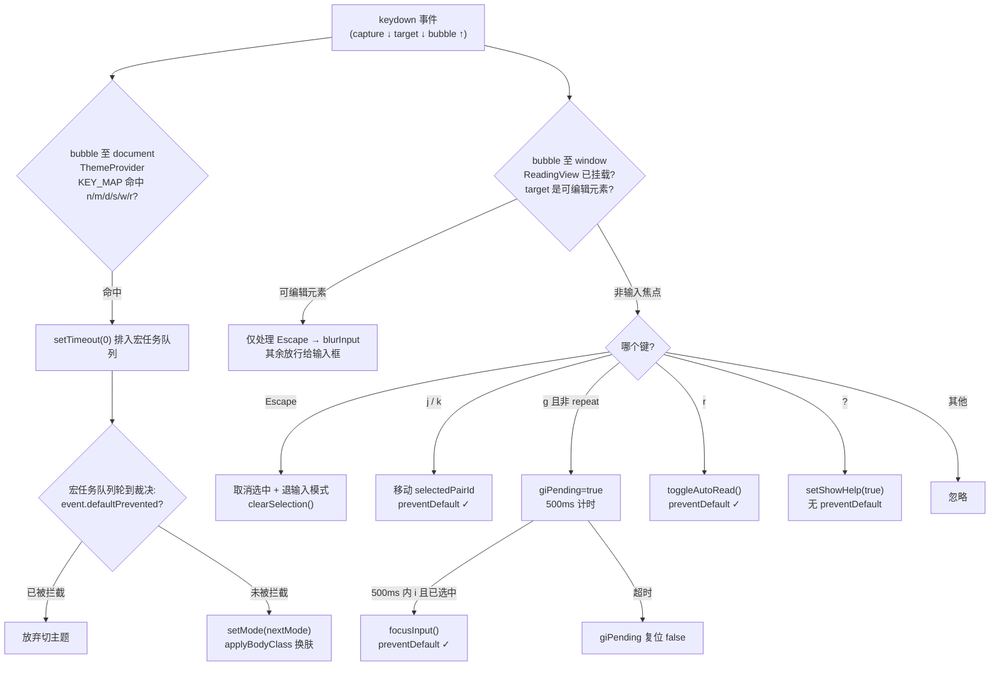

# 第 19 课 · 键盘交互体系与主题快捷键

> 所属阶段 3 · 预计时长 100 分钟 · 难度★★★★☆

## 学习目标

1. 画出本项目两套 keydown 监听（ReadingView 的 window 级、ThemeProvider 的 document 级）的路由关系图，并用事件传播模型解释 `r` 键为什么不会误切主题；
2. 逐条说出 j/k/gi/Esc/? 各自的守卫条件，特别是「输入焦点时静默放行」的实现；
3. 解释 `gi` 双键序列用 500ms 超时的闭包变量实现的原理与局限；
4. 用事件循环（event loop）的 task/microtask 模型说清 ThemeProvider 里 `setTimeout + defaultPrevented` 延迟裁决机制解决了什么竞态；
5. 独立新增 `,` / `.` 上一章/下一章快捷键并更新 ShortcutHelp。

## 前置检查

- 已完成第 16 课：精读过 ReadingView 的快捷键 effect 与 `focusInput`/`blurInput`；
- 已完成第 18 课：知道 Esc 会调用 `clearSelection()` 清除文字选区；
- 已完成第 8 课：了解六主题与 `applyBodyClass`；本课补齐它们的键盘入口。

## 关键文件

| 文件 | 职责 |
|---|---|
| `src/components/reader/ReadingView.tsx` | 阅读器主快捷键路由：j/k/gi/Esc/r/? 挂在 window 上 |
| `src/theme/ThemeProvider.tsx` | 全局主题快捷键 N/M/D/S/W/R 挂在 document 上，带延迟裁决 |
| `src/theme/themeStore.ts` | `KEY_MAP`（键→主题）、`MODE_SHORTCUTS`、`MODES`、`applyBodyClass` |
| `src/components/reader/ShortcutHelp.tsx` | 按 `?` 弹出的纯展示帮助面板，`shortcuts` 数组是唯一数据源 |
| `src/components/layout/TopBar.tsx` | 静态文案 `THEME N / M / D / S / R / W` 提示条 |

## 正文

### 教程：键盘事件的浏览器机制与事件循环

在拆源码之前，先把浏览器处理一次按键的完整链路讲透——本项目两套监听的协作协议全靠这些机制支撑。

**一次按键的一生。** 物理键按下后：操作系统把扫描码交给浏览器 → 浏览器合成 `keydown` 事件 → 沿 DOM 树三阶段传播（capture 窗口→目标，target，bubble 目标→窗口）→ 各监听器同步执行完毕 → 若未取消则产生默认行为（输入字符、滚动页面等）→ 松开时补发 `keyup`。要点：

1. **keydown 与输入字符不是一回事**。keydown 表达「物理键动作」，真正的文字录入发生在后续的 `beforeinput`/`input` 事件；长按会以 `e.repeat === true` 连发 keydown 但只输入一个字符（IME 场景更特殊，见下）；
2. **preventDefault 只在派发期间有效**。它拦截的是「默认行为」，不是传播——想让别的监听器也收不到得用 `stopPropagation()`。事件对象的 `defaultPrevented` 属性在任何时刻都可读，这是本项目跨监听器传递「我消费了此键」信号的载体；
3. **IME 合成**：中日文输入法下按键会先走 `compositionstart/update/end` 序列，期间的 keydown 带有 `e.isComposing === true`（keyCode 常为 229）。本项目靠 isInput 守卫天然避开了输入框内的 IME 问题，但如果将来给非输入区域加快捷键，必须补 `isComposing` 判断；
4. **同一传播阶段内、同一节点上的多个监听器按注册顺序同步执行**；不同节点之间则严格按 capture/bubble 方向，与注册先后无关。

**事件循环与 setTimeout(0)。** 浏览器主线程跑一个循环：取一个宏任务（task）执行 → 清空全部微任务（microtask，Promise.then 等）→ 视情况进入渲染步骤（rAF 回调 → style → layout → paint）→ 下一个宏任务。由此推出三个结论：

1. 事件监听器本身运行在「输入事件」这个宏任务里；期间调用的 `setTimeout(fn, 0)` 把 fn 排到**下一个宏任务**——当前任务和所有微任务都跑完之后才轮到它（0ms 也有约 4ms 的嵌套钳制，但不影响相对顺序）；
2. 因此 `setTimeout` 内读到的世界是「当前事件完全处理完之后」的世界——包括所有监听器对事件对象做过的修改（如 `preventDefault()`），这就是延迟裁决能工作的根本原因；
3. `requestAnimationFrame` 的回调排在渲染步骤之前、下一个宏任务之前——比 setTimeout 更早但语义是「下一帧渲染前」，两者不能混用。

**window 与 document 谁先收到 keydown？** keydown 在 bubble 阶段从深层目标一路冒上来，路径末尾依次是 `document` → `window`。所以 **ThemeProvider（document 监听）其实先于 ReadingView（window 监听）执行**——注意这与直觉相反，也和「谁先注册谁先赢」无关。这个事实让本项目的延迟裁决显得更加必要而非锦上添花，下文走读时会回到这一点。

**键盘事件对象速查。** 本课源码只用到了少数几个属性，但完整掌握它们才能读懂任何快捷键代码：

| 属性 | 含义 | 本项目用法 |
|---|---|---|
| `e.key` | 按键产生的字符/命名键，受 Shift 影响（Shift+/ 是 `'?'` 而非 `'/'`） | 所有分支的匹配依据 |
| `e.code` | 物理键位（`'KeyJ'`），与键盘布局无关 | 未使用；做位置型键位（WASD）时更稳 |
| `e.repeat` | 长按连发标志，按住不放时每秒数十次 keydown | gi 的 g 分支用它防止 pending 反复重挂 |
| `e.isComposing` | 是否处于输入法合成中 | 未检查——当前被 isInput 守卫间接覆盖，属潜在缺口 |
| `e.defaultPrevented` | 是否已被某个监听器 preventDefault | 两层监听之间延迟裁决的信号载体 |
| `ctrlKey/metaKey/altKey/shiftKey` | 修饰键状态 | 未使用；将来加组合键时的第一件事是把这些纳入匹配与守卫 |

### 概念讲解

**全局快捷键的三难。** 给 Web 应用做键盘交互，绕不开三个经典问题：

1. **冲突**：多个组件都想监听 keydown。浏览器按传播模型同步派发，谁先 preventDefault 谁占住语义——但如果两个监听器都是"先执行逻辑再决定"，就需要一套仲裁协议；
2. **焦点**：用户在输入框里打字，按 `j` 是想输入字母不是跳句子。必须识别 `e.target` 是否为可编辑元素；
3. **发现性**：没有可见提示的快捷键等于不存在。常见解法是 `?` 呼出速查表（GitHub、Gmail 都这么做），本项目照搬了这个惯例。

**双键序列（chord）。** Vim 的 `gi` 这类序列需要维护"上一个键是什么、多久前按的"这个小状态机：按下 `g` 进入 pending 态并启动计时器，500ms 内按 `i` 才算命中，超时或按了别的键则复位。

**两套监听的分层。** 本项目把快捷键拆成两层：阅读器业务键（j/k/gi/Esc/r/?）挂在 `window` 上、由 ReadingView 注册，随阅读页卸载而消失；主题键（n/m/d/s/w/r）挂在 `document` 上、由最外层 ThemeProvider 注册、全应用生效。两层监听同一事件，靠一套"延迟裁决"协议避免打架——这是本课最精彩的部分。

### 代码走读

#### 1. 主路由：ReadingView 的 keydown effect

```tsx
useEffect(() => {
  const pairs = currentChapter?.pairs ?? [];
  let giPending = false;

  const handleKeyDown = (e: KeyboardEvent) => {
    const target = e.target as HTMLElement;
    const isInput = target.tagName === 'TEXTAREA' || target.tagName === 'INPUT'
                    || target.isContentEditable;

    if (e.key === 'Escape') {
      if (isInput) {
        blurInput();
      } else if (selectedPairId) {
        setSelectedPairId(null);
        setInputMode(false);
      }
      clearSelection();
      return;
    }

    if (isInput) return;   // 输入焦点时, Esc 之外的一切按键放行

    const currentId = selectedPairId ?? lastSelectedPairId.current;

    if (e.key === 'j') {
      e.preventDefault();
      const currentIndex = currentId ? pairs.findIndex(p => p.id === currentId) : -1;
      if (currentIndex < pairs.length - 1) {
        const newId = pairs[currentIndex + 1].id;
        lastSelectedPairId.current = newId;
        setSelectedPairId(newId);
      } else if (currentIndex === -1 && pairs.length > 0) {   // 从未选中过 → 选第一句
        const newId = pairs[0].id;
        lastSelectedPairId.current = newId;
        setSelectedPairId(newId);
      }
    } else if (e.key === 'k') {
      e.preventDefault();
      // 对称: 只在 currentIndex > 0 时上移, 到顶不动
    } else if (e.key === 'g' && !e.repeat) {
      giPending = true;
      setTimeout(() => { giPending = false; }, 500);
    } else if (e.key === 'i' && giPending && selectedPairId) {
      e.preventDefault();
      focusInput();          // inputRef.current.focus() + setInputMode(true)
      giPending = false;
    } else if (e.key === 'r') {
      e.preventDefault();
      toggleAutoRead();
    } else if (e.key === '?') {
      setShowHelp(true);
    }
  };

  window.addEventListener('keydown', handleKeyDown);
  return () => window.removeEventListener('keydown', handleKeyDown);
}, [currentChapter, selectedPairId, focusInput, blurInput, clearSelection, toggleAutoRead]);
```

要点归纳：

- **Esc 特殊**：它在 isInput 分支内也要响应（退出输入框），且永远顺带清选区，然后 return；
- **isInput 守卫的位置**：放在 Esc 之后、其余按键之前，形成"输入框里只认 Esc"的语义；
- **`e.preventDefault()` 只在实际消费的分支里调用**——这是和 ThemeProvider 协作的关键信号；
- **`!e.repeat`**：长按 g 会连发 keydown（教程里说的 `e.repeat` 标志），不挡的话计时器被反复重置倒还好，但 pending 态会一直挂着；
- **边界差异**：`j` 在从未选中时能从第一句开始，`k` 在未选中时什么都不做——不对称但符合直觉（向上没有"第一句之前"）；
- **gi 要求 `selectedPairId` 存在**：没选中句子就没有练习面板，自然无处聚焦；
- **IME 缺口**：守卫没有检查 `e.isComposing`。当前唯一可聚焦的可编辑元素是回译 textarea（被 isInput 拦截），所以无实害；将来若在正文区支持 contenteditable 就必须补上，否则输入法确认候选词的那次 Enter/字母键会被误当快捷键。

依赖数组里有 `selectedPairId` 和 `currentChapter`，意味着每按一次 j/k 整个监听器都会重新注册一次。功能正确，但这是可优化点（作业里会讨论用 ref 收敛依赖）。

> **✎ 边学边练 · 检查点 ①**
> `let giPending` 为什么声明在 useEffect 体内而不是组件体内？声明在 handleKeyDown 函数体内又会怎样？
>
> <details><summary>核对答案</summary>
> 放 effect 体内：每次 effect 重注册会重建闭包，pending 随之重置——语义正确且生命周期清晰。放组件体（useRef 或普通变量）：值跨重注册存活，理论上也没问题（effect 重注册恰好整体替换闭包），但要理解为什么没出 bug；若用普通变量而非 ref，重渲染还会把它重置回 false。放 handleKeyDown 体内：每次按键都重新初始化为 false，g 之后 i 到来时 pending 永远是 false，序列永远匹配不上。<b>状态的生命周期要与其消费者（闭包）对齐</b>。
> </details>

**Esc 的三义性与优先级设计。** 同一个 Esc 在 ReadingView 里承担多层语义：输入焦点中 → `blurInput()` 退出输入；帮助面板/浮层开着 → 理应先关面板（现状缺失，基础层作业会修）；有选中句 → 取消选中并退输入模式。代码用 if/else 链隐式表达了优先级（输入焦点 > 选中态），但漏了 showHelp 一层。这个案例的通用教训是：**多义按键必须显式设计优先级序列并写成注释/常量，而不是靠分支顺序偶然形成语义**。

#### 2. 第二层：ThemeProvider 的主题键与延迟裁决

```tsx
useEffect(() => {
  function handleKey(event: KeyboardEvent) {
    const target = event.target as HTMLElement;
    const tag = target.tagName;
    if (tag === 'INPUT' || tag === 'TEXTAREA' || tag === 'SELECT') return;

    const nextMode = KEY_MAP[event.key.toLowerCase()];
    if (nextMode) {
      // Defer so other handlers (e.g. ReadingView's auto-read on 'r')
      // can call preventDefault first
      setTimeout(() => {
        if (!event.defaultPrevented) setMode(nextMode);
      }, 0);
    }
  }

  document.addEventListener('keydown', handleKey);
  return () => document.removeEventListener('keydown', handleKey);
}, [setMode]);
```

`KEY_MAP` 定义在 themeStore.ts：

```ts
export const KEY_MAP: Record<string, ThemeMode> = {
  n: 'night', m: 'midnight', d: 'day',
  s: 'sunny', r: 'rain', w: 'snow',
};
```

冲突键 `r` 的完整仲裁过程值得用教程里的机制逐帧回放（假设焦点在阅读页某张卡片上，target 是 `<article>`）：

1. keydown 在 target 上产生，bubble 阶段逐层上行；
2. **document 监听器（ThemeProvider）先执行**（bubble 路径 document 在 window 之前）。它看到 `KEY_MAP['r'] = 'rain'` 命中，于是把 `setMode('rain')` 打包进 `setTimeout(…, 0)` ——此刻它**还没有放弃也没有执行**，只是挂起了一个宏任务；
3. **window 监听器（ReadingView）后执行**。它的 r 分支同步调用 `e.preventDefault()`——同一个事件对象的 `defaultPrevented` 从此变为 true；
4. 当前宏任务（含所有微任务）结束，浏览器调度刚排队的 timeout 宏任务；
5. timeout 回调读取 `event.defaultPrevented` —— true，于是放弃切主题。判定权通过事件对象上的标准字段完成传递，两个组件零耦合。

反过来，书架视图里 ReadingView 未挂载、第 3 步无人 preventDefault，timeout 里 `defaultPrevented` 为 false，`setMode('rain')` 执行、`applyBodyClass` 换肤。**同一个物理键在不同上下文被路由到不同处理器。**

现在可以评价这个设计的精妙之处了：因为 document 先于 window 执行，如果 ThemeProvider 直接同步 `setMode`，ReadingView 将**永远没有机会**拦下 r 键——`setTimeout(0)` 不是防御性冗余，而是协议成立的前提。注释里 "Defer so other handlers can call preventDefault first" 说的就是这个。同时也要看到它的脆弱面：任何第三方脚本若在 bubble 更早的阶段（capture 阶段或 document 之前的节点）同步 setMode，协议就失效；更系统的解法是统一的 KeymapService（自测题 8）。

还有一处细节差异值得对照批判：ThemeProvider 的输入守卫多了 `SELECT` 但少了 `isContentEditable`，也没管 `?` 帮助键是否开着、更没查 `e.isComposing`——两套监听器的守卫口径不完全一致，阅读源码时要保持这种挑剔的眼光。

> **✎ 边学边练 · 检查点 ②**
> 如果把 ThemeProvider 的 `setTimeout(..., 0)` 换成 `Promise.resolve().then(...)`（微任务），裁决还能成立吗？为什么？
>
> <details><summary>核对答案</summary>
> 不能。微任务在<b>当前宏任务的结尾、下一个监听器运行之前</b>就会清空——具体地说，document 监听器函数返回后微任务立即执行，此时 window 监听器还没跑、preventDefault 还没发生，defaultPrevented 必然为 false，setMode('rain') 会错误执行。<b>「等其他宏任务代码做完」只能靠宏任务队列（setTimeout/messageChannel），微任务做不到。</b>
> </details>

#### 3. 帮助面板：ShortcutHelp

数据即数组，渲染即映射，没有任何状态：

```tsx
const shortcuts = [
  { keys: ['j'], desc: '选择下一句（Vim 模式）' },
  { keys: ['k'], desc: '选择上一句（Vim 模式）' },
  { keys: ['r'], desc: '开启 / 停止连续朗读' },
  { keys: ['gi'], desc: '进入输入框' },
  { keys: ['Esc'], desc: '退出输入 / 关闭面板' },
  { keys: ['?'], desc: '显示帮助' },
];
```

键位的渲染部分（`keys` 数组支持序列，多键时插 `+` 连接符）：

```tsx
<div className="space-y-3">
  {shortcuts.map(({ keys, desc }) => (
    <div key={desc} className="flex items-center justify-between">
      <div className="flex items-center gap-1.5">
        {keys.map((key, i) => (
          <span key={i}>
            <kbd className="px-2 py-1 text-xs" style={{ fontFamily: 'monospace',
                border: '1px solid var(--border-color)', borderRadius: '3px',
                backgroundColor: 'var(--bg-secondary)', color: 'var(--ink-secondary)' }}>
              {key}
            </kbd>
            {i < keys.length - 1 && <span className="text-xs mx-0.5 opacity-40">+</span>}
          </span>
        ))}
      </div>
      <span className="text-sm" style={{ color: 'var(--ink-muted)' }}>{desc}</span>
    </div>
  ))}
</div>
```

结构上是标准的模态三明治：全屏遮罩 `onClick={onClose}` 点空白关闭，内容卡片 `onClick={(e) => e.stopPropagation()}` 阻止冒泡穿透。每个键渲染成 `<kbd>` 元素，`keys` 数组长度大于 1 时中间插一个 `+` 连接符（为组合键预留，目前只有单键和 gi 序列）。注意它的清单**不含主题键 N/M/D/S/W/R**——那组键的"文档"是 TopBar 里的静态文本 `THEME N / M / D / S / R / W`，两处信息源互不知道对方。关闭方式有三种：点遮罩、按 Esc（走 ReadingView 的 Esc 分支？不——showHelp 时 Esc 只会清 selectedPairId……实际上面板文案写着"按 ? 或 Esc 关闭"，但代码里 Esc 分支并没有处理 showHelp，这是一个真实的待改进点，作业可以顺手修掉）。

#### 4. focusInput / blurInput：焦点的双向门

```tsx
const focusInput = useCallback(() => {
  if (inputRef.current) {
    inputRef.current.focus();
    setInputMode(true);
  }
}, []);

const blurInput = useCallback(() => {
  if (inputRef.current) {
    inputRef.current.blur();
  }
  setInputMode(false);
}, []);
```

`inputRef` 是传给 PracticePanel 里回译 `<textarea>` 的 ref（第 16、17 课都见过它的传递链），`inputMode` 则控制 PracticePanel 内部的自动聚焦 effect。gi 命中后 `focus()` 把焦点移进 textarea，此后所有按键都被 isInput 守卫放行给输入框本身；Esc 触发 `blur()` + `setInputMode(false)` 把控制权交还路由层。这就是"输入焦点冲突处理"的全貌：**不是阻止输入框获得焦点，而是在焦点进出时同步切换快捷键系统的开关态**。另外注意浏览器行为兜底：用户点击 textarea 本身也会物理聚焦——此时 inputMode 还是 false，但 keydown 的 `e.target` 已经是 TEXTAREA，isInput 守卫照样生效。这说明**守卫真正依赖的是事件目标的实时状态，inputMode 只是给 UI（面板聚焦样式）用的伴随状态**，两者解耦才不会有「焦点在但快捷键也响应」的裂缝。

#### 4.5 底座速览：themeStore 与 applyBodyClass

主题键命中后的落地动作全在 `src/theme/themeStore.ts`：

```ts
export const MODES: ThemeMode[] = ['night', 'midnight', 'day', 'sunny', 'rain', 'snow'];

export const MODE_SHORTCUTS: Record<ThemeMode, string> = {
  night: 'N', midnight: 'M', day: 'D', sunny: 'S', rain: 'R', snow: 'W',
};
```

`KEY_MAP`（运行时路由）、`MODE_SHORTCUTS`（TopBar 提示文案的数据源）、`MODES`（循环切换类 UI 用）三者互为镜像——新增主题要同时改三处，这是和 ShortcutHelp 数组同款的「多份真相源」问题。store 本体极简：`mode` 初始值为 `'snow'`，persist 名 `baku-yomi-theme`。

换肤的副作用不在 store 里，而在 ThemeProvider 的另一个 effect：`applyBodyClass(mode)` 直接操作 `document.body` 的 classList——

```ts
export function applyBodyClass(mode: ThemeMode) {
  const body = document.body;
  body.classList.remove('midnight', 'light', 'sunny', 'rain', 'snow');

  switch (mode) {
    case 'midnight': body.classList.add('midnight'); break;
    case 'day':      body.classList.add('light');    break;
    // sunny / rain / snow 同理...
    case 'night':    break;   // 默认皮肤就是 night, 无需任何 class
  }
}
```

两个值得咀嚼的细节：① `day` 主题挂的 class 叫 `light` 而不是 day——历史命名痕迹，翻主题 CSS 时别迷路；② remove 列表是**手工枚举**的全部非默认 class，将来新增主题若忘了同步这一行，旧的 body class 会残留，出现「切了主题但样式半新半旧」的诡异现象。用 `[...MODES].filter(m => m !== mode)` 动态生成 remove 列表即可根除该隐患。另外注意这套机制完全绕开了 React 状态驱动样式的路线（没有把 mode 注入每个组件的 className 计算）——body 单例 + CSS 变量级联是全局换肤的最省力方案，代价是主题状态游离在 React 树之外，组件想感知主题只能走 useTheme/useThemeStore 订阅。

> **✎ 边学边练 · 检查点 ③**
> `?` 分支既没有 preventDefault 也没有任何额外守卫就 `setShowHelp(true)`，它能安全"裸奔"的原因是什么？什么情况下这种裸奔会出事？
>
> <details><summary>核对答案</summary>
> <code>e.key === '?'</code> 只在 Shift+/ 且无其他修饰键时成立；而 '?' 没有任何浏览器默认行为可阻止（对比空格滚页、' 快速查找），不 preventDefault 无副作用；KEY_MAP 也不含 '?'，两层监听天然无冲突。会出事的场景：将来定义 Ctrl/? 组合键却不判修饰键、或在富文本区允许输入 ? 却没走 isInput 守卫——届时裸奔分支会抢走本应属于输入的行为。<b>"不需要守卫"是当下事实的结论，不是永远成立的假设。</b>
> </details>

#### 5. 专题：把裁决机制放到事件循环坐标系里复盘

把本课出现过的异步原语放在同一条时间轴上，是理解这类全局交互系统的最好方式：

```
keydown 宏任务开始
 ├─ document 监听器: 命中 KEY_MAP → setTimeout(裁决) 入队   [宏任务队列 +1]
 └─ window 监听器: preventDefault() 同步生效
宏任务结束 → 微任务清空（此处若有 Promise 裁决就会出错）
渲染机会（rAF → style → layout → paint）
setTimeout 裁决宏任务开始
 └─ 读 event.defaultPrevented → 决定 setMode 与否
```

三个工程启示：

1. **跨监听器通信优先用事件对象自带字段**（defaultPrevented 是 W3C 标准、DevTools 可视、无需自定义协议），自定义信号（全局变量、EventEmitter）都要自己管生命周期；
2. **「延后决策」必须想清楚延到哪个队列**：微任务是「本任务收尾前」，宏任务是「所有任务完成后」，rAF 是「下一帧绘制前」——三者相差的可能不止一帧。本项目选宏任务是因为它要等的正是「其他监听器跑完」，即同一个宏任务的剩余部分；
3. **setTimeout 计时器不可取消是这个实现的已知弱点**：gi 序列的 500ms timer 和主题裁决的 0ms timer 都没有保存 id，无法 clearTimeout。前者影响手感（自测题 3），后者影响极小（回调幂等），但要知道「存下 timer id 以便清理」是这类代码的标准收尾动作。

### 图示



## 实操作业

分三层难度，基础层必做，进阶层强烈建议，挑战层量力而行。

### 基础层：新增 `,` / `.` 跳章快捷键并统一帮助面板（大纲作业）

1. **步骤一（确认能力来源）**：bookSlice 已提供 `setCurrentChapter(index)`（配合 `currentChapterIndex` 与 `lastChapterIndexByBook` 记忆每本书读到的章），章节侧栏就在用它。先打开 `src/stores/bookSlice.ts` 通读该 action，注意它不越界校验——越界判断要由你的快捷键分支自己做（可用 `currentBook.chapters.length`）。
2. **步骤二（接入路由）**：在 ReadingView 的 handleKeyDown 里追加两个分支：
   - 守卫沿用现有 isInput 逻辑（放在 `if (isInput) return;` 之后即可）;
   - `.` 调下一章、`,` 调上一章，各自 `e.preventDefault()`；到达第一章/最后一章时不循环也不报错；
   - 切章后建议 `handleSelectPair(null)` 清掉选中态，避免跨章残留一个已不属于本章的 pairId。
3. **步骤三（发现性）**：往 `ShortcutHelp.tsx` 的 `shortcuts` 数组头部加两条 `{ keys: [','], desc: '上一章' }` / `{ keys: ['.'], desc: '下一章' }`。
4. **步骤四（修复 Esc 关帮助）**：让 Esc 在 `showHelp` 为 true 时优先 `setShowHelp(false)` 并 return，兑现面板底部文案承诺的"按 Esc 关闭"。注意判断顺序要放在 isInput 分支之后、j/k 之前。
5. **验收标准**：
   - 阅读页按 `.` / `,` 能正确换章，首尾章不越界；换章后滚动位置恢复逻辑（restoredRef 那套）仍正常；
   - 在回译输入框里按 `,` `.` `j` `k` 都是正常打字；
   - `?` 打开的帮助面板能看到新快捷键，Esc 能关闭它；
   - 按 `r` 仍是连续朗读优先、书架页按 `r` 切雨主题的行为不变。

### 进阶层：修 gi 序列的状态机 + 收敛 effect 依赖

1. **严谨化 chord**：把 `giPending` 布尔量升级为 `{ key: string; timerId: number } | null` 形态——任意非匹配键按下时 clearTimeout 并复位；记录 pendingKey 使 `g x i` 不再误触发；超时用保存的 timerId 精确清理。
2. **收敛依赖**：用 `latestRef` 模式（一个 `useEffect` 同步 ref 到最新值的通用小工具）把 `selectedPairId`、`currentChapter` 移出依赖数组，让 keydown 监听器整个阅读期只注册一次。验证 gi/j/k/r 行为与改造前完全一致。
3. **验收标准**：
   - 快速连打 `g g i`、`g x i` 都不再误触发 gi；`g` 后 600ms 再 `i` 无效；
   - Performance 面板确认按 20 次 j 后监听器 add/removeEventListener 计数为 0 次（React DevTools profiler 或 Performance 日志佐证）；
   - 长按 `g` 一秒（repeat 连发）不产生 pending 泄漏。

### 挑战层：统一 KeymapService 原型

1. 设计单一注册表（结构建议见自测题 8）：条目含 `keys`（支持序列）、`description`、`when` 守卫、`handler`、`scope: 'reader' | 'global'`。
2. 一个总监听器挂在 window 上按序遍历注册表：when 通过且未被更高优先级条目消费才执行并 preventDefault；主题键与阅读键全部迁入，ThemeProvider/ReadingView 的两处原生监听删除。
3. ShortcutHelp 直接从注册表的 description 渲染，消灭双份真相源。
4. **验收标准**：
   - 现有全部快捷键行为回归通过（含 r 键的双上下文路由、输入框放行、Esc 三义性）；
   - 新增一个快捷键只需改注册表一处（对比改造前后 diff 行数写进提交说明）；
   - 注册表条目的 when 守卫能表达「showHelp 开着时只允许 Esc/?」这类互斥规则。

## 常见坑

1. **忘了 preventDefault**：`j/k` 不 preventDefault 的话多数浏览器无感，但空格类键会滚动页面、`'`（Firefox 快速查找）会弹搜索框。养成"消费了就 preventDefault"的习惯，这也是 ThemeProvider 裁决机制的信号源。
2. **gi 的 pending 变量放错位置**：`let giPending` 必须声明在 useEffect 体内、handleKeyDown 之外——放进 handler 里每次按键都重新初始化，序列永远匹配不上；放到组件体里又会在重注册间丢失（虽然 effect 重注册会重建整个闭包，恰好没问题，但要理解为什么）。
3. **新快捷键在输入框里生效**：把分支加在 `if (isInput) return;` 之前，用户在 textarea 里打逗号句号就会莫名跳章——守卫顺序就是正确性。
4. **帮助清单与实现漂移**：ShortcutHelp 数组和 handleKeyDown 分支是两份手工同步的真相源，加键只改一边就会说谎；更彻底的做法是把清单抽成共享常量（含 handler 映射），作业完成后可作为进阶重构思考。
5. **以为「window 先于 document」**：凭直觉认为 window 层级更高会先收到事件，实际 bubble 阶段恰好相反——如果据此调整代码（例如去掉 setTimeout 想当然认为 window 先执行），裁决协议立刻失效。传播顺序要以规范为准而不是层级直觉。
6. **用微任务替代 setTimeout 做「延后裁决」**：Promise.then 在同一宏任务内就清空，等不到其他监听器执行完；「等别的 handler 做完」只能靠宏任务队列（setTimeout / MessageChannel）。

## 本课与面试

- **「浏览器事件机制讲一下。」**——以 r 键为例完整叙述：keydown 合成与 IME/repeat 语义、三阶段传播路径（本项目两个监听器分别在 document 与 window 的 bubble 阶段）、同节点多监听器的注册顺序、preventDefault/stopPropagation/defaultPrevented 三者的区别与本项目用法。能纠正「window 先触发」的直觉误区是亮点。
- **「说说事件循环，宏任务微任务区别。」**——背模板之外给出应用级实例：本项目「setTimeout(0) 延迟裁决」就是宏任务语义的直接运用；再对比「为什么换成 Promise.then 会失败」说明微任务在同一宏任务内清空的特性。面试官追问「rAF 在哪一步」就答渲染步骤之前、两次宏任务之间。
- **「如何设计大型应用的快捷键系统？」**——答题框架对应挑战层：单一注册表 + when 守卫 + scope 分层 + 总监听器顺序仲裁 + 帮助文档自动生成（消灭双份真相源）；再谈输入焦点作为全局前置过滤、chord 状态机的 key/timer 建模、以及与 IME 的兼容（isComposing）。能提到 React 生态方案（react-hotkeys-hook 等）及其守卫抽象是加分项。
- **「焦点管理怎么做？focus/blur 有哪些坑？」**——本项目答案：焦点是浏览器维护的真状态，快捷键守卫应读 `e.target` 实况而非自己的镜像变量；`focus()/blur()` 与 state 双向同步（focusInput/blurInput）；`tabIndex={-1}` 让容器可编程聚焦不进 Tab 序；进阶话题：focus-visible 与键盘可达性、roving tabindex 列表导航（j/k 本质上是它的自定义变体）、modal 打开时的焦点陷阱（ShortcutHelp 目前没有做 focus trap，可作为改进点提出）。
- **「如何调试事件没有响应的问题？」**——方法论题：断点/日志确认监听器是否被调用（没被调 → 查挂载与清理时机）；被调但行为错 → 检查 e.key 大小写、isComposing、target 是否预期；行为对了又被覆盖 → 查 defaultPrevented 与其他监听器（Chrome DevTools 的 getEventListeners(window) 可列出全部监听器）。结合本项目「r 键在阅读页失灵」的排查路径演示一遍。

- **「快捷键系统怎么测试？」**——分层作答：纯路由逻辑（key → handler 的分发、chord 状态机）抽成纯函数/类后用单测覆盖（vitest + 模拟 KeyboardEvent 对象）；React 集成层用 testing-library 的 `fireEvent.keyDown(window, { key: 'g' })` 验证 effect 装卸与守卫；真实浏览器行为（默认行为拦截、IME、focus 移动）只能靠 Playwright/E2E 或手工清单。能指出「dispatchEvent 合成事件不触发浏览器默认行为，所以 preventDefault 相关断言要查 defaultPrevented 属性而非行为」是实战细节加分项。

## 自测题

<details><summary>1. 为什么按 r 在阅读页是连续朗读、在书架页却切换雨天主题？描述完整判定链。</summary>

两页共用 ThemeProvider 的 document 监听，命中 KEY_MAP['r'] 后都把 setMode('rain') 挂进 setTimeout(0)。差别在宏任务执行时的 event.defaultPrevented：阅读页有 ReadingView 的 window 监听器，它在 bubble 末段对 r 调用了 preventDefault，宏任务里读到 true 于是放弃；书架页 ReadingView 未挂载，无人拦截，setMode 正常执行。判定权通过事件对象的标准字段传递，两组件零耦合。（注意 document 监听先于 window 监听执行，所以延迟是必要条件而非保险措施。）
</details>

<details><summary>2. isInput 守卫为什么检查三个条件：TEXTAREA、INPUT、isContentEditable？少一个会怎样？</summary>

TEXTAREA 覆盖回译输入框和笔记框，INPUT 覆盖各类表单控件，isContentEditable 覆盖富文本编辑场景（当前项目暂无但属防御性）。漏掉 TEXTAREA 会在回译时按 j 跳句导致丢字；漏掉 isContentEditable 则未来加任何 contenteditable 组件都要重新排查快捷键系统。ThemeProvider 的版本还多拦 SELECT，因为 select 聚焦时按键用于选项导航。
</details>

<details><summary>3. gi 序列的 500ms 超时实现有什么局限？举一个会误触发的场景。</summary>

局限一：giPending 是普通布尔量，按 g 后再按 x 再按 i 仍会触发（中间键不复位 pending）；局限二：长按 g 被 !e.repeat 挡住但快速连按两次 g 再按 i 也会触发；局限三：计时器无法取消，g 与 i 间隔 499ms 依然算命中，与 Vim 的手感相比偏宽松。更严谨的做法是记录 pendingKey 和时间戳并在任意其他按键时复位。
</details>

<details><summary>4. ShortcutHelp 的遮罩是如何做到"点空白关、点内容不关"的？</summary>

外层 fixed 遮罩 div onClick={onClose}；内层内容卡片 onClick={(e) => e.stopPropagation()}。点击内容时事件仍会冒泡到遮罩，但 stopPropagation 在卡片层掐断了传播链，onClose 不会被调用；点遮罩本身（目标是遮罩 div）则直接触发 onClose。
</details>

<details><summary>5. 如果要把所有快捷键收敛成一个统一的 KeymapService，你会怎么设计注册表结构？说出至少三个设计要点。</summary>

① 单一注册表：数组或 Map，每项含 keys（支持序列如 ['g','i']）、description、when 守卫（如 () => !isInputFocused && !!selectedPairId）、handler、scope（reader/global）；② 一个总监听器按注册顺序遍历，when 通过且未被更高优先级消费才执行并 preventDefault，替代现在的 defaultPrevented 延迟裁决；③ ShortcutHelp 直接从注册表的 description 渲染，消灭双份真相源；④ 输入焦点守卫做成全局前置过滤器而非各 handler 自查。这能把三层散落逻辑（ReadingView effect、ThemeProvider effect、ShortcutHelp 数组）收拢到一处。
</details>

<details><summary>6. keydown、keypress、beforeinput/input 各在什么时机触发？本项目为什么只用 keydown 就够了？什么时候必须补 listening input 事件？</summary>

keydown：物理键按下即发（含 repeat），拿得到 key/modifier/isComposing，适合命令型交互；keypress 已废弃且只对可打印字符触发，不要再用；beforeinput/input 在编辑行为真正发生时触发，携带 insertText/deleteContent 等输入类型，是「文本内容变化」的唯一可靠信号。本项目全是命令型语义（移动选中、切主题、开关朗读），keydown 足够。必须补 input 的场景：需要感知真实录入结果（如即时保存草稿、字数统计）、或需要在 IME 合成结束后再做处理（compositionend/input）——keydown 在 IME 期间的 key 值不可信。
</details>

<details><summary>7. ThemeProvider 延迟裁决若改用 requestAnimationFrame 替代 setTimeout(0)，行为会有什么变化？</summary>

大体仍能工作但语义漂移：rAF 回调在下一个渲染机会的渲染步骤前执行，而 setTimeout 尽快排下一个宏任务。多数情况下两者都在「当前任务后不久」运行，裁决结果相同；但在标签页后台（rAF 被暂停、timeout 也被节流至 ≥1s）或高频连按时，rAF 版本的裁决会被推迟到下一次真实渲染，极端场景下用户会在换肤前看到不一致的中间态。此外 rAF 每帧都要重新判断，语义上是「绑定渲染周期」，与本需求「等待同任务内其他监听器」不符——正确工具仍是宏任务队列。
</details>

<details><summary>8. 为什么说「document 监听先于 window 监听执行」这一事实反而证明 setTimeout 延迟是必要的？如果两者都挂在 window 上，协议还需要吗？</summary>

bubble 阶段路径是 target → … → document → window，ThemeProvider（document）先执行。若它同步 setMode，ReadingView（window）随后才 preventDefault 时主题已经切完，裁决永远失效——所以必须把决策推迟到所有监听器都跑完之后的宏任务。若两者都挂 window：同一节点同一阶段的监听器按注册顺序执行，谁先注册谁先跑，顺序由模块加载/挂载时序决定，同样不可靠（StrictMode 双挂载、懒加载都会改变次序），因此仍需要显式的仲裁机制——要么保留延迟裁决，要么升级为带优先级的统一注册表。教训：<b>不要让正确性依赖监听器的执行次序，要用协议显式表达优先级</b>。
</details>
