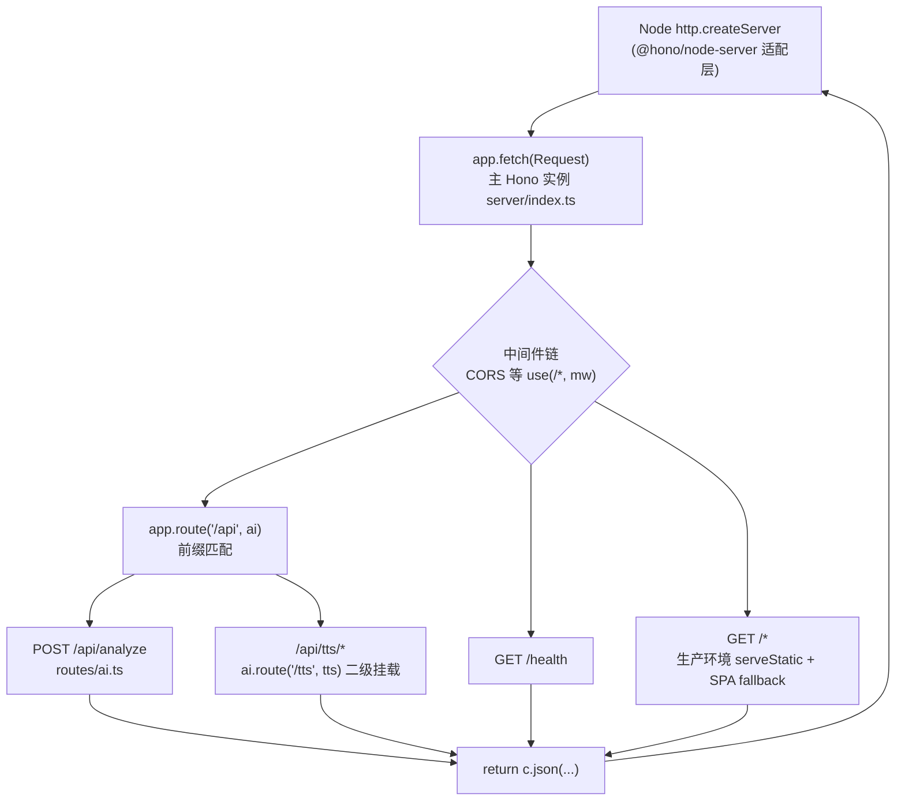
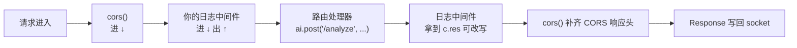

# 第 20 课 · Hono 框架入门

> 所属阶段 4 · 预计时长 75 分钟 · 难度★★★☆☆

## 学习目标

- 不查资料说清 Hono 的核心卖点：Web 标准 Request/Response、多运行时可移植、极小体积。
- 独立写出一个带路径参数和 JSON 响应的 Hono 路由。
- 用 `app.route()` 把子应用挂载到主应用的任意前缀下，并解释本项目中两次挂载分别发生在哪。
- 说清中间件的执行顺序（洋葱模型），并指出 `server/index.ts` 里哪个调用注册了中间件。
- 能画出 Hono 与 Express/Koa/Fastify 在「请求对象模型、执行模型、生态定位」三个维度上的对比表，并说明本项目选型的理由。

## 前置检查

- 已完成第 3 课：知道 `pnpm dev` 会同时启动 Vite（前端，5173）与 `tsx server/index.ts`（后端，3003）。
- 已完成第 2 课：知道 `server/` 目录是后端的家。
- 本机 Node ≥ 22、依赖已安装（`pnpm install`）。
- （可选）用过 Express 或 Koa 写过 hello-world——本课会反复拿它们对照，有旧印象反而要小心"想当然"。

## 关键文件

| 文件 | 职责 |
|---|---|
| `server/index.ts` | 服务入口：创建 Hono 应用、挂 CORS、挂 `/api` 子路由、启动 HTTP 监听 |
| `server/routes/ai.ts` | AI 子路由：`POST /analyze` 接口 + 内存限流；自身还嵌套挂了 TTS 路由 |
| `server/tts/index.ts` | TTS 子路由（第 26-28 课主角），本课只需知道它也是一个 `Hono` 实例 |
| `package.json` | 确认两个关键依赖：`hono@^4.12` 与 `@hono/node-server@^1.19` |

## 正文

### 概念讲解

**为什么是 Hono 而不是 Express？**

Express 诞生于 Node 的 `http` 模块之上：它的 `req`/`res` 是 Node 私有对象。而 Hono 的路由处理函数签名是：

```ts
(c: Context) => Response | Promise<Response>
```

`Request` 和 `Response` 是 **Fetch API 标准类型**——浏览器和 Node（≥18）都原生实现了它们。这带来三个直接好处：

1. **同一份代码跑在多个运行时**：Node、Deno、Bun、Cloudflare Workers、Vercel Edge 全都认识 Web 标准 Request/Response，Hono 只需为每个运行时配一个极薄的适配器。
2. **心智模型与前端一致**：你在前端写 `fetch('/api/analyze', {...})` 收到 `Response`，在服务端你"生产"的就是同一个东西。
3. **零依赖内核**：Hono 核心不依赖任何包，Tree-shaking 后只有十几 KB。

**适配器 `@hono/node-server`**

Web 标准 `Request`/`Response` 不会自己变成一个监听端口的 HTTP 服务——Node 的 `http.createServer` 回调给的是 Node 风格的 req/res。`@hono/node-server` 就是这个翻译层：

```ts
serve({ fetch: app.fetch, port });
```

它把 Node 收到的原始请求转成标准 `Request`，喂给 `app.fetch`，再把返回的 `Response` 写回 socket。`app.fetch` 这个名字不是巧合——你的整个 Hono 应用本质上就是一个「超大号的 fetch 函数」。

**中间件**

中间件是 `(c, next) => ...` 形式的函数，在路由处理器之前/之后执行横切逻辑（日志、CORS、鉴权、限流）。执行顺序像洋葱：请求穿过每一层进入处理器，响应再原路穿出。`app.use('/*', mw)` 表示对匹配 `/*` 的所有请求注册中间件。

用一段最小代码把洋葱模型钉死：

```ts
app.use('*', async (c, next) => {
  console.log('A: 进入');
  await next();
  console.log('A: 离开');
});
app.use('*', async (c, next) => {
  console.log('B: 进入');
  await next();
  console.log('B: 离开');
});
app.get('/x', (c) => c.text('handler'));

// GET /x 的输出顺序：
// A: 进入 → B: 进入 → (handler 执行) → B: 离开 → A: 离开
```

两个关键细节：

- **`await next()` 之前是"进"阶段，之后是"出"阶段**。计时日志、响应头追加这类"事后逻辑"必须写在 `await next()` 之后——此时 `c.res` 已经生成，可以直接改写。
- **不调用 `next()` 就等于拦截**。中间件直接 `return c.json(...)` 时请求不会到达路由处理器，这就是 CORS 预检应答、限流短路（第 25 课的 429）的实现原理。

**子路由挂载**

Hono 应用可以嵌套：`app.route(prefix, subApp)` 把另一个 `Hono` 实例的全部路由挂到某个前缀下。这是组织大型 API 的标准手法——每个资源域一个文件、一个实例，入口只做组装。

**Hono vs Express / Koa / Fastify：横向对比**

四个框架都做"路由 + 中间件"，但设计哲学差异很大。先看表，再讲为什么这张表决定了本项目的选择：

| 维度 | Express | Koa | Fastify | Hono |
|---|---|---|---|---|
| 诞生背景 | 2010，Node 生态最早的框架之一 | 2013，Express 原班人马重做 | 2016，主打性能 | 2021，主打 Web 标准与多运行时 |
| 请求/响应模型 | Node 原生 `req`/`res`（可变、流式、Node 私有） | 封装成 `ctx`（仍包着 Node req/res） | Node req/res + 大量内置优化 | Web 标准 `Request`/`Response`（不可变值语义） |
| 中间件签名 | `(req, res, next)` 回调 | `async (ctx, next)` 洋葱模型的提出者 | async/await 钩子系统（preHandler/onRequest…） | `async (c, next)` 洋葱模型 |
| 处理器返回响应？ | 否——必须手动 `res.send()`，忘写就悬挂 | 否——同上 | 否——同上 | 是——`return c.json(...)` 即响应 |
| 内置路由 | 有（老式字符串匹配） | 无（官方 router 另装） | 有 + JSON Schema 校验 | 有，基于 Trie 树，类型推断强 |
| TypeScript 体验 | 类型是后补的，泛型穿透弱 | 一般 | 好（schema 驱动） | 极好——路径参数自动推导类型 |
| 运行时支持 | 仅 Node | 仅 Node | 仅 Node（另有轻量变体） | Node/Deno/Bun/Workers/Edge 全平台 |
| 体积/启动开销 | 中 | 小 | 中 | 极小（零依赖内核） |
| 生态成熟度 | 最成熟，中间件海量 | 成熟但萎缩中 | 快速增长，企业采用多 | 年轻但增长极快 |

从表里提炼三条对本项目最有分量的理由：

1. **处理器返回值即响应**。Express 里 `async (req, res) => { ... }` 忘了调 `res.json()` 会静默悬挂直到超时；Hono 里 `return c.json(...)` 是唯一正确姿势，函数式的心智让错误无处藏身。对教学项目来说，"API 形状本身防止犯错"比"文档里提醒你别犯错"有价值得多。
2. **Request/Response 与前端 fetch 同构**。本项目核心卖点之一是浏览器端 EPUB 解析管线（`src/lib/epub/`），前后端共享同一套 Web 类型词汇（`Request`/`Response`/`Headers`/`URL`），阅读和调试成本显著降低。
3. **部署形态自由**。BYOK 应用最常见的自托管方式是一台小 VPS 或免费容器；如果明天想把它丢上 Cloudflare Workers 白嫖边缘节点，`server/index.ts` 里除了换掉 `serve()` 这一行适配器调用，其余代码原样可用——这正是第 29 课 Docker 部署之外预留的另一条路。

也要诚实说出代价：Hono 生态年轻，Express 那种"任何需求都有现成中间件"的存量优势不存在；`@hono/node-server` 相比 Fastify 深度调优的 HTTP 层，极限吞吐不是对手。但对"单用户/小团队自托管、流量以人类节奏到来"的回译练习工具而言，这些差距完全不在决策关键路径上——**选型匹配场景，而不是无脑追参数榜首**。

### 代码走读

按「启动 → 组装 → 进请求」的顺序看真实代码。`server/index.ts` 全文 36 行，本节走完它的每一行。

**① 导入区**（`server/index.ts:1-5`）

```ts
import { serve } from '@hono/node-server';
import { serveStatic } from '@hono/node-server/serve-static';
import { Hono } from 'hono';
import { cors } from 'hono/cors';
import ai from './routes/ai';
```

五个导入对应五件事：`serve` 是启动监听的适配器入口；`serveStatic` 从子路径导入——静态托管不属于内核，被拆在 node-server 包的另一个模块里；`Hono` 是类本体；`cors` 是官方中间件，注意它是 `hono/cors` 这种子路径导出而非顶层包导出（Hono 的中间件全部按需子路径引入，天然 tree-shaking）；最后一行导入的是我们自己的 AI 子应用——默认导出，下一课会看到它内部长什么样。

**② 创建应用与生产/开发判断**（`server/index.ts:7-9`）

```ts
const isProd = process.env.NODE_ENV === 'production';

const app = new Hono();
```

`new Hono()` 得到的 `app` 同时具备三种能力：注册中间件（`.use`）、注册路由（`.get/.post`）、作为子应用被别人挂载（被 `.route` 引用）。第 21 课会精读 `isProd` 的分支。

**③ 开发态的 CORS 中间件**（`server/index.ts:11-20`）

```ts
// CORS: restrict to known origin in production, allow all in dev
if (isProd) {
  const allowedOrigin = process.env.CORS_ORIGIN;
  if (allowedOrigin) {
    app.use('/*', cors({ origin: allowedOrigin }));
  }
  // No CORS middleware in prod without explicit origin = same-origin only
} else {
  app.use('/*', cors());
}
```

这就是两次标准的中间件注册：模式 `/*` 匹配所有路径。开发时前端跑在 5173、后端跑在 3003，属于跨源请求，必须放行——完整原因在第 21 课展开。这里只需注意结构事实：**中间件注册发生在所有路由注册之前**，顺序即行为。

**④ 挂载 AI 子路由**（`server/index.ts:22`）

```ts
app.route('/api', ai);
```

`ai` 来自 `./routes/ai` 文件顶部的 `export default ai`，它本身是一个 `Hono` 实例。这一行之后，子应用里的 `ai.post('/analyze', ...)` 就可以通过 `/api/analyze` 访问了。**注意前缀拼接规则**：`/api` + `/analyze`，子应用内部写的路径不带 `/api`。

**⑤ 一个最简单的路由**（`server/index.ts:24`）

```ts
app.get('/health', (c) => c.json({ status: 'ok' }));
```

`c` 是 Hono 的 `Context`：封装了请求（`c.req.header(...)`、`await c.req.json()`）和构造响应的快捷方法（`c.json()`、`c.text()`、`c.body()`）。`c.json({ status: 'ok' })` 一行完成「序列化 JSON + 设置 Content-Type + 返回 200 Response」三件事。

Context 还有一组本课值得认识、后续课程会反复用到的成员：

| Context 成员 | 用途 | 项目中的实际使用位置 |
|---|---|---|
| `c.req.header(name)` | 读请求头 | `routes/ai.ts:29` 读 `x-forwarded-for` 取 IP |
| `await c.req.json()` | 解析 JSON body | `routes/ai.ts:43` 解析 analyze 请求体 |
| `c.req.param(name)` | 读路径参数 | TTS 路由（第 26 课展开） |
| `c.json(data, status?)` | 构造 JSON 响应 | 全部接口的返回通道 |
| `c.notFound()` / `c.text()` | 其他快捷响应 | SPA fallback 场景（第 21 课） |

**⑥ 生产态静态托管**（`server/index.ts:26-31`）

```ts
// Production: serve built frontend from dist/
if (isProd) {
  app.use('/*', serveStatic({ root: './dist' }));
  // SPA fallback: serve index.html for any unmatched route
  app.get('/*', serveStatic({ root: './dist', path: 'index.html' }));
}
```

开发环境这两个注册根本不存在。它们是什么、为什么这样排顺序，是第 21 课的主题；本课记住一点：`use + get` 两连发说明 serveStatic 既当过中间件又当过路由处理器——再次印证两者本质都是 `(c, next) => ...` 或返回 `Response` 的函数。

**⑦ 启动服务**（`server/index.ts:33-36`）

```ts
const port = Number(process.env.PORT ?? 3003);
console.log(`Server running on http://localhost:${port}`);

serve({ fetch: app.fetch, port });
```

`process.env.PORT ?? 3003` 与 `.env.example` 中 `PORT=3003` 对应；`pnpm dev:server` 里的 `--env-file-if-exists=.env` 负责把这个文件加载进环境变量。

至此 36 行全部走完。整个文件的结构可以概括为一句口诀：**判环境 → 挂中间件 → 挂子路由 → 兜底路由 → 起 serve**。

**⑧ 子应用内部还能继续嵌套**（`server/routes/ai.ts:1-9`）

```ts
import { Hono } from 'hono';
import { generateText } from 'ai';
import { createProvider } from '../providers';
import tts from '../tts/index';

const ai = new Hono();

// Mount TTS sub-routes
ai.route('/tts', tts);
```

本项目有两层挂载：主应用把 `ai` 挂在 `/api` 下，`ai` 又把 `tts` 挂在自己的 `/tts` 下，最终 TTS 接口的完整路径形如 `/api/tts/...`。嵌套深度没有限制，每层只关心自己的相对路径。同时注意 `ai` 自己也是一个完整的应用：它可以有自己的业务路由（`:27` 的 `/analyze`）、自己的模块级状态（限流 Map，第 25 课主角）——子应用与主应用的唯一区别只是"有没有人 `.route()` 它"。

**⑨ 真正的业务路由与异步**（`server/routes/ai.ts:27-28`）

```ts
ai.post('/analyze', async (c) => {
  // Rate limit check
```

处理函数可以直接 `async`——Hono 会自动等待 Promise 并把异常交给错误处理。`c.req.json()` 返回 Promise，解析失败会抛错（这正是第 25 课「错误透传」要讨论的场景之一）。

### 边学边练

不写代码，用三个即时检查点验证你是否真的读懂了上面的走读。

> **边学边练 ①**：`GET /health` 请求进来时，会经过 `cors()` 中间件吗？`GET /api/analyze` 呢？
>
> <details><summary>参考答案</summary>
>
> 都会。`app.use('/*', cors())` 的匹配模式是根通配，对所有路径生效——包括 `/health` 和 `/api/*`。中间件按注册顺序在路由分发**之前**执行，所以无论最终命中哪个路由，都要先穿过已注册的中间件洋葱。反过来，若某条路由注册在 `use` 之前（本项目没有这种情况），Hono 会先命中路由并结束本轮，后面的中间件就不再介入。
> </details>

> **边学边练 ②**：如果把 `ai.post('/analyze')` 改成挂在主应用上（`app.post('/analyze')`），URL 变成什么？反过来，想让 analyze 出现在 `/openai/analyze` 该怎么改？
>
> <details><summary>参考答案</summary>
>
> 改挂主应用后 URL 是 `/analyze`（不再有 `/api` 前缀，因为前缀来自 `.route('/api', ai)` 这一挂载动作本身）。想要 `/openai/analyze` 只需把 `server/index.ts:22` 改成 `app.route('/openai', ai)`，子应用内部一行不用动——这就是前缀与实现解耦的价值：路由的组织方式可以在组装层随时重排。
> </details>

> **边学边练 ③**：`server/tts/index.ts` 也是 `export default` 一个 Hono 实例吗？打开确认一下，并数数它内部有几条路由（只数 `tts.get/.post` 行数，不用读懂实现）。
>
> <details><summary>参考答案</summary>
>
> 是。`server/tts/index.ts` 顶部同样是 `new Hono()` 并默认导出，末尾被 `routes/ai.ts:9` 以 `ai.route('/tts', tts)` 挂载。具体路由条数以你打开文件时看到的为准（voices/speak 等，第 26 课逐条精读）；这个练习的意义在于亲手确认"每个资源域一个实例"的模式在本项目里贯彻到了第三层目录。
> </details>

> **边学边练 ④**：写出一段中间件，打印每个请求的方法、路径和处理耗时（毫秒）。提示：耗时计算的两行分别该放在 `await next()` 的哪一侧？
>
> <details><summary>参考答案</summary>
>
> ```ts
> app.use('*', async (c, next) => {
>   const start = Date.now();                    // 进阶段：开始计时
>   await next();                                // 让后面的中间件/路由跑完
>   const ms = Date.now() - start;               // 出阶段：此刻响应已生成
>   console.log(`${c.req.method} ${c.req.path} -> ${ms}ms`);
> });
> ```
>
> 开始计时的取时间戳必须在 `next()` 之前（否则量不到处理耗时），打印必须在 `next()` 之后（否则处理器还没跑完）。这段代码就是第 26 课后作业和几乎所有生产 APM 中间件的雏形。
> </details>

### 图示

一张总览图：一次请求从 socket 到响应的完整旅程。



再一张洋葱模型剖面图：中间件与路由的进出次序。



## 实操作业

作业分三层：**基础层**对应大纲必做，**进阶层**巩固本课概念，**挑战层**为下一课铺垫。三层相互独立，量力领取。

### 第 1 层 · 基础（必做）：给 `/health` 加版本号和运行时长字段

分步指导：

1. 在 `server/index.ts` 顶部、`const app = new Hono();` 之后记录启动时间：
   ```ts
   const startedAt = Date.now();
   ```
2. 从 `package.json` 读版本号有两种方式，选其一：
   - 直接硬编码字符串（最简单）；
   - Node 方式：`createRequire(import.meta.url)('./package.json').version`（注意项目是 `"type": "module"`，不能用 `require`）。
3. 改写路由：
   ```ts
   app.get('/health', (c) =>
     c.json({
       status: 'ok',
       version: '0.1.0',
       uptimeSec: Math.floor((Date.now() - startedAt) / 1000),
     })
   );
   ```
4. 启动 `pnpm dev`，等后端打印 `Server running on http://localhost:3003` 后验证。

验收标准：

- [ ] 浏览器访问 `http://localhost:3003/health` 返回 JSON，含 `status/version/uptimeSec` 三个字段；
- [ ] 等 60 秒以上刷新页面，`uptimeSec` 数值随之增长；
- [ ] `curl -s http://localhost:3003/health | jq` 输出合法 JSON（Windows 可用 `node -e "fetch('http://localhost:3003/health').then(r=>r.json()).then(console.log)"` 代替 jq）；
- [ ] 前端 `pnpm dev` 不受影响，说明改动没有破坏其他路由。

### 第 2 层 · 进阶：写一个带路径参数的新路由 + 自定义 404

1. 在 `server/index.ts` 的 `/health` 下面加一条回显路由，练习路径参数与查询参数两种取值方式：
   ```ts
   app.get('/echo/:word', (c) =>
     c.json({
       word: c.req.param('word'),
       loud: c.req.query('loud') === '1',
     })
   );
   ```
2. 再加全局 404 处理器，观察它与 fallback 路由的区别：
   ```ts
   app.notFound((c) => c.json({ error: 'No such route', path: c.req.path }, 404));
   ```
3. 分别请求存在的和不存在的路径，对比响应。

验收标准：

- [ ] `GET /echo/hello` 返回 `{"word":"hello","loud":false}`；`GET /echo/hello?loud=1` 返回 `{"word":"hello","loud":true}`；
- [ ] `GET /nope` 返回 404 且 body 是你自定义的 JSON（而不是默认的 `404 Not Found` 纯文本）；
- [ ] 能口头回答：`c.req.param` 与 `c.req.query` 分别从 URL 的哪一段取值？

### 第 3 层 · 挑战：手写请求日志中间件并验证洋葱顺序

1. 在 `app.use('/*', cors())` 之后注册你自己的日志中间件（参考边学边练④的代码）。
2. 在日志中间件里再打一行"离开"，并在 `/health` 处理器内也加一行 console.log，然后请求一次，核对输出是否严格满足：
   `中间件进入 → 处理器 → 中间件离开`。
3. 把日志中间件挪到 `app.route('/api', ai)` **之后**注册，重复请求 `/api/tts/voices`，观察它还打不打日志，用一句话解释原因。
4. （可选）在"离开"分支里尝试修改响应头：`c.header('X-Process-Time', String(ms))`，用 curl -i 验证头确实出现了。

验收标准：

- [ ] 终端输出顺序符合洋葱模型预期；
- [ ] 能解释第 3 步的现象（注册晚于路由命中的中间件不参与本轮）；
- [ ] （做了可选项）curl -i 能看到 `X-Process-Time` 头，且数值随负载波动。

## 常见坑

- **路径前缀拼重**：在子路由里写 `ai.post('/api/analyze')`，挂载后变成 `/api/api/analyze`，404 且没有任何报错提示。规则记住一条：`.route(prefix, sub)` 之后实际路径 = prefix + 子内路径。
- **忘记 `export default`**：`server/index.ts` 导入的是模块默认导出，写成具名导出 `export const ai` 会让 `ai` 变成 `undefined`，报 `Cannot read properties of undefined (reading 'post')` 之类的错。
- **`c.req.json()` 只能消费一次**：Body 是流，读两次第二次会抛错或得到空对象。需要多处使用就先存变量（`ai.ts` 里就是解构一次用到底）。
- **改了 `server/` 代码没生效**：确认你用的是 `pnpm dev`（带 `--watch`）；手动 `tsx server/index.ts` 启动的进程不会热重载。
- **中间件写了却不 `await next()` 也不返回响应**：请求会悬挂直到客户端超时。要么放行（`await next()`），要么接管（`return c.json(...)`），二选一必须做。
- **把 `app.use('*')` 写成 `app.use('/')`**：前者匹配全部路径，后者只匹配根路径本身，中间件会"看起来没生效"。Hono 里 `'*'` 与 `'/*'` 都表示全匹配，唯独 `'/​'` 不是。

## 本课与面试

这一节把本课知识点翻译成面试语言。每条都是真实高频问题的答题骨架。

**Q：讲讲中间件洋葱模型。为什么需要它？**

答题骨架：① 定义——中间件按注册顺序嵌套成洋葱，请求依次穿入，`await next()` 处处理器后再原路穿出，所以每个中间件天然拥有"前置逻辑 + 后置逻辑"两个时机；② 对比——Express 的 `(req, res, next)` 只有"进"没有规范的"出"（要在 next 回调后写代码且容易踩 res 已发送的坑），Koa 首创 async/await 洋葱，Hono 继承之；③ 落地——举例：计时日志（前进时间戳、后出打印）、CORS（进阶段应答预检/出阶段补响应头）、限流（进阶段短路 return 429 不调 next）。能落到自己项目的一行真实代码（如 `index.ts:19` 的 `app.use('/*', cors())`）是加分项。

**Q：Express、Koa、Fastify、Hono 你怎么选型？**

答题骨架：先说共同点（都是路由 + 中间件），再按两轴比较——运行时绑定（前三者绑死 Node，Hono 基于 Web 标准 Request/Response 全平台）与编程模型（Express 回调 + 手动 res、Koa/Hono 洋葱 + 返回值即响应、Fastify schema 驱动 + 插件封装）。然后**回到场景**：重生态老系统迁移选 Express，极致吞吐 + 校验选 Fastify，多端部署/边缘/全栈同构选 Hono。最后主动给出本项目的选择理由（Web 标准同构、部署自由、教学心智负担小），展示"选型 = 约束求解"的思维而非背参数。

**Q：HTTP 状态码 400/401/403/404/429/500 分别什么时候用？**

答题骨架：400 客户端请求体/参数非法（本项目缺字段即 400）；401 未认证、403 已认证但无权限——两者区别是面试最爱追问的点；404 资源不存在；429 触发限流，规范做法附带 `Retry-After` 头（本项目第 25 课会指出当前缺失这是一个改进点）；500 服务端异常兜底。加分项：说出 2xx 里 201（创建成功）/204（无内容）的适用场景，以及"5xx 一律不该暴露堆栈细节"的安全意识。

**Q：为什么说"你的整个应用就是一个 fetch 函数"？这种设计的工程价值是什么？**

答题骨架：Hono 应用的类型是 `(request: Request) => Promise<Response>`，与 Fetch API 的 handler 签名同构；价值有三——运行时可移植（换个适配器就能上 Workers/Bun/Deno）、可测试性爆炸式提升（单元测试不需要起端口，直接 `app.request('/health')` 构造 Request 断言 Response）、心智模型与浏览器一致。若能现场写出 `const res = await app.request('/health'); assert(res.status === 200)` 这样的测试片段，说服力拉满。

**Q：Node 服务处理并发请求的模型是什么？单个请求里 `await generateText(...)` 卡住会不会阻塞其他请求？**

答题骨架：Node 是单线程事件循环 + 非阻塞 I/O；请求处理函数遇到 `await` 时让出线程，事件循环转去处理其他连接，I/O 完成后回调/续体排队回来。所以上游厂商 API 慢不会卡住别的请求——真正阻塞事件循环的是同步 CPU 密集代码（大 JSON 同步 stringify、正则灾难性回溯）。延伸：CPU 密集任务应拆到 worker_threads 或改为队列化后台任务。这条与第 25 课"限流保护的是什么"直接呼应。

## 自测题

<details>
<summary>1. Hono 处理函数的第二个参数为什么不需要 res 对象？它靠什么机制返回响应？</summary>

因为 Hono 基于 Web 标准：处理函数直接 `return` 一个 `Response` 对象（常用 `c.json()`/`c.text()` 构造）。没有独立的 res 参数，响应就是函数返回值，这使得函数天然支持 Promise/async，也使代码可以在任何实现 Fetch 标准的运行时中复用。
</details>

<details>
<summary>2. 本项目的 TTS 接口最终 URL 是 <code>/api/tts/...</code>，请指出这两段前缀分别在哪两行代码里产生。</summary>

`/api` 来自 `server/index.ts:22` 的 `app.route('/api', ai)`；`/tts` 来自 `server/routes/ai.ts:9` 的 `ai.route('/tts', tts)`。TTS 子应用内部的路由只写剩余部分。
</details>

<details>
<summary>3. <code>@hono/node-server</code> 解决什么问题？删掉它 <code>hono</code> 包还能编译通过吗？程序能跑吗？</summary>

它是 Node 运行时适配器：把 Node 原生 req/res 与 Web 标准 Request/Response 互转，并提供 `serve()` 监听端口。删掉后编译可能仍通过（类型来自 hono 核心），但 `serve` 未定义，进程无法监听端口，服务起不来。
</details>

<details>
<summary>4. 如果把 <code>app.use('/*', cors())</code> 放到 <code>app.route('/api', ai)</code> 之后，开发环境的跨源请求会发生什么？为什么？</summary>

跨源请求会被浏览器的预检（OPTIONS）拦住。中间件按注册顺序执行，放在后面的 CORS 中间件对已匹配前面路由的请求不再生效（Hono 中先匹配到的 handler 结束本轮就不会再走到后续中间件补响应头）。所以中间件必须在路由之前注册——这也是 `index.ts` 先 use 再 route 的原因。
</details>

<details>
<summary>5. <code>c.json({ status: 'ok' })</code> 替你做了哪三件事？</summary>

① 用 JSON.stringify 序列化对象；② 设置响应头 Content-Type: application/json; charset=UTF-8；③ 构造并返回状态码 200 的标准 Response 对象。
</details>

<details>
<summary>6. 洋葱模型下，想在响应已经生成之后统一追加一个响应头（如 X-Request-Id），中间件代码应该怎么写？关键的分界线是哪一行？</summary>

```ts
app.use('*', async (c, next) => {
  await next();
  c.header('X-Request-Id', crypto.randomUUID());
});
```

分界线就是 `await next()`：之前的代码在路由处理器执行前运行，之后的代码在其返回后运行——那时 `c.res` 已就绪，可以用 `c.header()` 修改。这体现洋葱"出阶段"的核心用途：响应后处理。
</details>

<details>
<summary>7. 对比表里 Express 与 Hono 在「处理器如何产生响应」上的根本差异是什么？各举一个由此导致的典型 bug。</summary>

Express：处理器不返回响应，必须显式调用 `res.send()/res.json()`，响应与控制流脱钩——典型 bug 是 async 分支漏调 send 导致请求永久悬挂，或重复 send 报 ERR_HTTP_HEADERS_SENT。Hono：响应即返回值，函数不返回就没有响应且类型系统会提示——典型 bug 反而是"忘了 return"，比如写了 `c.json(x)` 却没写 `return`，请求同样悬挂但 TS 能在多数情况下标红提醒。
</details>

<details>
<summary>8. 为什么 Hono 的路由处理函数天然适合做无端口单元测试？写出测试 <code>GET /health</code> 返回 200 的核心一行。</summary>

因为应用本体就是 `(Request) => Promise<Response>` 的纯函数，不需要监听端口、不需要真实网络栈。核心一行：`const res = await app.request('/health');`，随后断言 `res.status === 200`（并可 `await res.json()` 校验 body）。相比之下 Express 要么起真端口发请求，要么 mock 掉 req/res 两个大对象，测试成本高得多。
</details>
