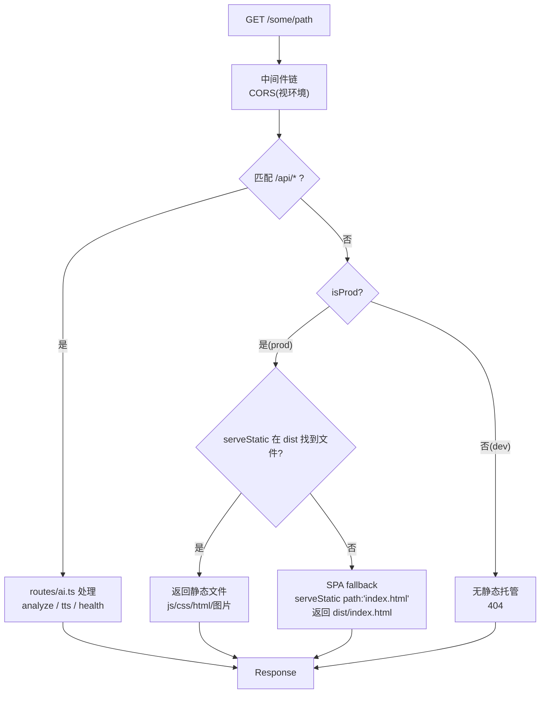
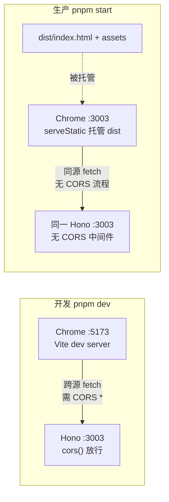

# 第 21 课 · 服务入口精读 server/index.ts

> 所属阶段 4 · 预计时长 80 分钟 · 难度★★★☆☆

## 学习目标

- 逐行解释 `server/index.ts` 全部 36 行代码，说清每个 `if (isProd)` 分支存在的理由。
- 讲清 CORS 同源策略：浏览器什么时候发预检、缺什么响应头会失败。
- 解释 `serveStatic` 与 `app.get('/*', serveStatic({ root: './dist', path: 'index.html' }))` 各自的角色，以及为什么后者叫 SPA fallback。
- 论证「生产环境不配 CORS_ORIGIN 反而最安全」这一同源部署结论。
- 能独立复述"一个文件同时托管 API 与前端构建产物"的完整请求分发规则表，并预判任意 URL 在开发/生产两种环境下各自的命运。

## 前置检查

- 已完成第 20 课：理解 `app.use` / `app.route` / 中间件顺序，`/health` 已加上版本与运行时长。
- 已跑通 `pnpm dev`，知道前端在 5173、后端在 3003。
- 本机已有一次成功的 `pnpm build` 产物（没有也没关系，作业第 1 步就是它）。

## 关键文件

| 文件 | 职责 |
|---|---|
| `server/index.ts` | 本课主角：36 行完成 CORS 策略、API 挂载、静态托管、SPA fallback、启动监听 |
| `.env.example` | 声明 `PORT=3003` 与注释掉的 `CORS_ORIGIN`（含「omit to allow same-origin only」提示） |
| `package.json` | `start` 脚本 `NODE_ENV=production node --import tsx server/index.ts` 是生产模式的开关来源 |
| `server/routes/ai.ts` | 被挂载到 `/api` 的子路由，用于验证请求分发 |
| `vite.config.*` | 构建产物输出目录的来源（默认 `dist/`，与 serveStatic 的 root 对应） |

## 正文

### 概念讲解

**CORS 到底是谁在拦你？**

同源策略是浏览器的安全机制：脚本发起的跨源请求（协议/域名/端口任一不同），浏览器要求服务端显式授权。授权方式是响应头——服务端返回 `Access-Control-Allow-Origin` 等 CORS 头，浏览器检查通过才把响应交给页面 JS。对带自定义头或非简单方法的请求，浏览器还会先发一个 OPTIONS 预检请求。

关键推论：**CORS 只约束浏览器**。curl、Node 脚本、服务器之间的调用完全不受它管。这直接决定了本项目的策略选择。

**开发 vs 生产：两个世界**

- 开发时：Vite dev server 在 5173，Hono 在 3003。页面从 5173 发起的 `/api/analyze` 是跨源 → 后端必须开 CORS（`cors()` 无参 = 允许所有源）。
- 生产时：Vite 把前端构建进 `dist/`，由 Hono 自己托管，页面和 API 同源同端口 → 浏览器根本不触发 CORS 检查，后端不需要任何 CORS 头。

把两种环境的差异整理成一张速查表，后面走读和排障都会反复用到：

| | 开发（`pnpm dev`） | 生产（`pnpm start`） |
|---|---|---|
| 前端由谁服务 | Vite dev server :5173 | Hono serveStatic :3003 |
| 页面调 `/api/*` | 跨源（5173→3003），需要 CORS | 同源，CORS 流程完全不触发 |
| 后端注册的中间件 | `cors()` 放行一切源 | 默认不注册任何 CORS 中间件 |
| 静态文件 | 不存在 dist 托管（dev 由 Vite 即时编译） | `serveStatic({ root: './dist' })` |
| 未匹配路由的命运 | 后端 404（前端页面根本不在后端上） | SPA fallback 回 `index.html` |
| `NODE_ENV` | 未设置 | `start` 脚本显式设为 production |

**SPA fallback 是什么？**

React SPA 只有一个真实的 HTML 文件 `dist/index.html`。用户直接访问 `/reader/abc` 或刷新页面时，服务器上并不存在这个路径的文件；如果不管就会 404。fallback 的做法是：凡是没匹配到静态文件、也没匹配到 API 的 GET 请求，一律返回 `index.html`，让前端路由接管。`serveStatic` 的 `path: 'index.html'` 参数正是干这个的——忽略请求路径，固定回这个文件。

**静态资源为什么带哈希文件名？**

走读⑤里出现了 `GET /assets/index-a1b2.js` 这样的路径——`index-a1b2` 是 Vite 构建时按文件内容算出的哈希指纹。它与 fallback 组成一套完整的缓存策略：

- **带哈希的 assets**：内容一变，文件名就变，所以可以放心让浏览器"永久缓存"（内容寻址，永不冲突）；
- **不带哈希的 index.html**：是唯一指向这些 assets 的入口，必须每次都拿到最新版，否则用户会拿着旧 HTML 去请求已被删除的旧哈希文件，白屏。

这套"HTML 短缓存 + 资产长缓存"的组合是 SPA 部署的行业标准。本项目的 `serveStatic` 默认行为已够用；若将来接入 CDN，只需对 `index.html` 设置 `no-cache`、对 `/assets/*` 设置一年强缓存即可，路由结构无需任何改动。

**开发环境的判决表长什么样？**

同一张表换到 `pnpm dev` 下会大幅简化——因为静态托管与 fallback 两站根本不存在：

| 请求 | 第一站 | 结局 |
|---|---|---|
| `POST /api/analyze` | ai 子应用命中 | 业务处理（同生产） |
| `GET /assets/index-xxx.js` | 无匹配（dist 不被托管） | **404**——前端资源由 Vite 在 5173 提供 |
| `GET /reader/abc` | 无匹配 | **404**——前端路由只在 5173 的页面上存在 |
| 其他未知路径 | 无匹配 | 404 |

换句话说：3003 在开发期是纯 API 服务器。如果你在浏览器直接访问 `localhost:3003/` 看到的是 404，这不是 bug，而是两个世界差异最直观的体现。

**为什么"环境判定"要写成一个布尔常量？**

`const isProd = process.env.NODE_ENV === 'production'` 把"当前是什么环境"收敛成唯一事实源，文件里两处分支都引用它。反面教材是散落的 `process.env.NODE_ENV === 'production'` 字符串比较——拼写错误（如写成 `prod`）会让判断静默失真且极难发现。小项目里的一行抽象，换来的是环境逻辑永远只有一处可错。

### 代码走读

`server/index.ts` 全文只有 36 行，逐段过——本节覆盖全部行号，不留死角。

**① 导入区**（`server/index.ts:1-5`）

```ts
import { serve } from '@hono/node-server';
import { serveStatic } from '@hono/node-server/serve-static';
import { Hono } from 'hono';
import { cors } from 'hono/cors';
import ai from './routes/ai';
```

第 20 课已逐条讲过五个导入的身份。本课补一个视角：这份导入清单就是整张架构图的目录——适配器（serve）、静态层（serveStatic）、框架内核（Hono）、横切关注（cors）、业务域（ai）。36 行的服务能长什么样，导入区已经剧透完毕。

**② 生产判定**（`server/index.ts:7`）

```ts
const isProd = process.env.NODE_ENV === 'production';
```

谁设置了这个值？看 `package.json:11`：

```json
"start": "NODE_ENV=production node --env-file-if-exists=.env --import tsx server/index.ts"
```

`pnpm start` 显式注入 `NODE_ENV=production`；`pnpm dev` 不设，走开发分支。（Windows PowerShell 下若该语法报错，可用 `cross-env` 或手动 `$env:NODE_ENV='production'`。）

注意 `--env-file-if-exists=.env` 与 `--import tsx` 两个 Node 标志：前者让 `.env` 成为可选配置通道（文件不存在也不报错，容器里尤其方便）；后者让 Node 原生加载 tsx 来执行 TypeScript，不需要单独的编译步骤。

**③ CORS 双策略**（`server/index.ts:11-20`）

```ts
// CORS: restrict to known origin in production, allow all in dev
if (isProd) {
  const allowedOrigin = process.env.CORS_ORIGIN;
  if (allowedOrigin) {
    app.use('/*', cors({ origin: allowedOrigin }));
  }
  // No CORS middleware in prod without explicit origin = same-origin only
} else {
  app.use('/*', cors());
}
```

三种状态，逐一分析：

1. **开发**：`cors()` 不带参数 → `Access-Control-Allow-Origin: *`，5173 的页面可以随便调 3003。方便优先，且本地无攻击面。
2. **生产 + 配了 `CORS_ORIGIN`**：只允许指定源。适用于「前端和后端分开部署在不同域名」的场景，此时跨源是真实需求，必须精确白名单而不是 `*`。
3. **生产 + 没配（默认）**：完全不注册 CORS 中间件。响应里没有任何 `Access-Control-Allow-Origin` 头 → 其他源的浏览器页面调用本站 API 一律被浏览器拦截；而本站自己因为是同源请求，压根不经过 CORS 流程，一切正常。**这就是"不配反而最安全"的原因**：默认状态恰好是最严格的白名单（只有自己）。

`.env.example:9-10` 的注释印证了这一点：

```
# CORS (production only — omit to allow same-origin only)
# CORS_ORIGIN=https://your-domain.example.com
```

再补一层理解：第 2 种状态里 `cors({ origin: allowedOrigin })` 生效时，中间件会校验请求头里的 `Origin` 是否等于配置值——相等才回 `Access-Control-Allow-Origin: <该origin>` 并放行预检；不等则不带授权头，浏览器侧照旧拦截。"白名单匹配发生在服务端代码里，拦截发生在浏览器里"——记住这个分工，你就明白为什么服务端日志里看不到"被 CORS 拦截"的记录。

**④ API 挂载与健康检查**（`server/index.ts:22-24`）

```ts
app.route('/api', ai);
app.get('/health', (c) => c.json({ status: 'ok' }));
```

第 20 课已讲。注意顺序：这两个注册发生在静态托管**之前**，保证 API 路由优先于兜底路由。

这里值得停下来想一个问题：如果生产环境有人请求 `GET /api/not-exist` 会发生什么？`ai` 子应用里没有这条路由，Hono 的匹配会继续向下找其他处理器——于是请求落进 `serveStatic`（找不到文件，放行），最终被 SPA fallback 接住返回 `index.html`，状态码 200。对人类用户无感，但对调试是个陷阱：**拼错的 API 路径不会报 404，而是悄悄拿到一份 HTML**。fetch 这份"HTML"再调 `.json()` 就会抛解析异常。这是同进程托管 SPA + API 的固有代价，识别它的办法是看到"JSON 解析失败但 Network 显示 200"就先怀疑路径打错了。

**⑤ 静态托管与 SPA fallback**（`server/index.ts:26-31`）

```ts
// Production: serve built frontend from dist/
if (isProd) {
  app.use('/*', serveStatic({ root: './dist' }));
  // SPA fallback: serve index.html for any unmatched route
  app.get('/*', serveStatic({ root: './dist', path: 'index.html' }));
}
```

两行长得像，角色完全不同：

- 第一行按请求路径在 `./dist` 里找真实文件：`GET /assets/index-a1b2.js` → 返回 `dist/assets/index-a1b2.js`。找不到文件时它**不结束请求**，放行给下一个处理器（这是 `@hono/node-server` 版 `serveStatic` 的行为）。
- 第二行是普通 GET 路由 + `path: 'index.html'`：只要前面没人处理（API 没匹配、静态文件不存在），就把 `index.html` 的内容作为响应返回，浏览器地址栏保持原样，React Router/Vue 式前端路由随后接管。

执行顺序即安全边界：`/api/*` 先注册所以永远先命中，不会被 fallback 吞掉；这也是第 20 课强调「中间件与路由先于静态托管注册」的实战原因。

把完整分发规则写成一张判决表（生产环境），建议背下来：

| 请求 | 第一站 | 结局 |
|---|---|---|
| `POST /api/analyze` | `ai` 子应用命中 analyze 路由 | 业务处理，200/400/429/500 |
| `GET /api/tts/voices` | `ai` → `tts` 二级子应用 | TTS 处理（第 26 课） |
| `GET /api/not-exist` | `ai` 内无匹配，继续下找 | **fallback 返回 index.html（200！）** |
| `GET /assets/index-xxx.js` | serveStatic 命中真实文件 | 返回 JS 文件 |
| `GET /health` | 主应用 health 路由 | JSON |
| `GET /reader/abc`（前端深路径） | 静态找不到 → fallback | index.html（200），前端路由接管 |
| `POST /anything-else` | 无匹配 POST | 404 |

最后一条是隐藏考点：fallback 只注册了 `app.get`，所以**非 GET 的未知路径不会被兜底**，老老实实 404——这恰好是对的，HTML 兜底只该服务于文档导航类请求。

**⑥ 启动**（`server/index.ts:33-36`）

```ts
const port = Number(process.env.PORT ?? 3003);
console.log(`Server running on http://localhost:${port}`);
serve({ fetch: app.fetch, port });
```

生产镜像中 `PORT` 来自 `.env`（见 `.env.example:2`）。整个应用对外的形态就是一个 `fetch` 函数——为第 29 课把它搬进任意容器/平台埋下伏笔。


**⑦ 全文件结构复盘**

36 行走完，把骨架抽出来再看一眼，行号即顺序，顺序即行为：

```text
server/index.ts
├─ 1-5   导入：适配器 serve / serveStatic、内核 Hono、中间件 cors、子应用 ai
├─ 7     isProd = NODE_ENV === 'production'      ← 全文唯一的分支开关
├─ 9    app = new Hono()
├─ 11-20 CORS 三态（prod 白名单 / prod 缺省无 / dev 全放行）
├─ 22    app.route('/api', ai)                   ← API 先注册
├─ 24    app.get('/health', ...)
├─ 26-31 if (isProd): serveStatic + SPA fallback ← 兜底最后注册
└─ 33-36 读 PORT、打日志、serve({ fetch: app.fetch, port })
```

面试或 review 时能凭这张骨架图讲清整个入口，比背任何八股都有说服力。

建议先自己默写一遍再对照——能独立画出这张骨架，本课就通关了。

### 边学边练

> **边学边练 ①**：不启动服务，先纸面推演——开发环境下 `curl -i http://localhost:3003/health` 的响应里会有哪些 CORS 相关的头？换成生产环境（未配 CORS_ORIGIN）呢？
>
> <details><summary>参考答案</summary>
>
> 开发环境：`cors()` 中间件对所有响应追加 `Access-Control-Allow-Origin: *`（curl 直连不发 Origin 头时部分实现仍会带 `*`，带 Origin 时回显许可）。生产未配 CORS：没有任何 `Access-Control-Allow-*` 头。验证方式：两种模式下分别 curl -i 看 headers 差异——这也是作业里"观察响应头"一步的理论预期。
> </details>

> **边学边练 ②**：生产环境下用户在阅读页 `/reader/some-book-id` 按 F5 刷新。写出这个文档请求在后端的完整旅程（经过哪几站、每站的判定、最终谁响应）。
>
> <details><summary>参考答案</summary>
>
> ① CORS 层：生产默认无 CORS 中间件，直接过；② `app.route('/api', ai)`：前缀不匹配，跳过；③ `/health`：路径不匹配，跳过；④ `use('/*', serveStatic({root:'./dist'}))`：在 dist 里找 `reader/some-book-id` 文件，不存在 → 放行；⑤ `get('/*', serveStatic({...path:'index.html'}))`：GET 命中，固定返回 `dist/index.html`，200；⑥ React 应用启动后由前端路由渲染阅读页。地址栏 URL 全程未变——这就是 SPA fallback 名字的由来。
> </details>

> **边学边练 ③**：`.env.example` 里 `CORS_ORIGIN` 的注释说 "production only"。如果有人在**开发环境**的 .env 里配上它并重启，会生效吗？翻一遍 `index.ts` 再回答。
>
> <details><summary>参考答案</summary>
>
> 不生效。读取 `process.env.CORS_ORIGIN` 的代码在 `if (isProd)` 分支内（index.ts:13），开发模式 `NODE_ENV` 未设置，`isProd === false`，这段代码根本不会执行；开发环境走的是 else 分支的无参 `cors()`（允许所有源）。配置项是否生效取决于代码路径，而不只是文件里有没有写——读配置必须连着消费它的控制流一起读。
> </details>

> **边学边练 ④**：假设你把 `app.get('/health', ...)` 移到生产态 `serveStatic` 注册之后（仍在 `app.route` 之后），`GET /health` 还正常吗？那 `GET /assets/index.js` 呢？
>
> <details><summary>参考答案</summary>
>
> `/health` 大概率不再返回你的 JSON——生产态第一行 `use('/*', serveStatic)` 会先尝试在 dist 里找名为 `health` 的文件，找不到虽然会放行，但第二行 `get('/*', serveStatic({path:'index.html'}))` 作为 GET 通配路由可能先于 health 命中，返回 index.html。`/assets/index.js` 则不受影响，因为 serveStatic 按路径能直接找到文件。结论：通配注册（`/*`）之后的任何具名 GET 路由都是死路由——顺序敏感不是风格问题而是正确性问题。
> </details>

> **边学边练 ⑤**：生产环境里 `index.html` 与 `assets/index-a1b2.js` 的缓存策略应该分别怎么定？如果反过来（HTML 长缓存、assets 短缓存），用户会遇到什么现象？
>
> <details><summary>参考答案</summary>
>
> 正确做法：`index.html` 用 no-cache（每次协商确认），带哈希的 assets 用一年强缓存。反过来会出现经典的"发布事故"：新版本把旧哈希文件删掉，而老用户的浏览器还拿着缓存的旧 HTML，按文件名去请求 `index-a1b2.js` → 404 → 白屏，且强缓存让用户连刷新都救不回来。这就是"入口必须新鲜、内容寻址资产可以永久"的原因。
> </details>

### 图示



一张部署形态对比图，帮助记忆两个世界的差异：



## 实操作业

三层结构：基础层验证理论，进阶层动手改造，挑战层模拟真实事故。

### 第 1 层 · 基础（必做）：本地模拟生产模式构建启动，验证刷新任意路径不 404

分步指导：

1. 构建前端：
   ```bash
   pnpm build   # tsc -b && vite build，产物在 dist/
   ```
2. 以生产模式启动（不要用 `pnpm dev`，那会走开发分支）：
   ```bash
   # Linux/macOS/Git Bash
   pnpm start
   # Windows PowerShell 手动等价：
   # $env:NODE_ENV='production'; node --env-file-if-exists=.env --import tsx server/index.ts
   ```
3. 确认日志输出 `Server running on http://localhost:3003`，然后：
   - 打开 `http://localhost:3003/` —— 应看到完整前端界面；
   - 打开 DevTools Network，确认页面资源都来自 3003 而不是 5173；
   - 直接访问一个前端路由深路径（如阅读页 URL），或在页面上按 F5 刷新 —— 页面应正常加载而非 404；
   - 另开终端 `node -e "fetch('http://localhost:3003/health').then(r=>r.json()).then(console.log)"` 确认 API 正常；
   - 观察响应头：同源请求下 Network 面板里不应出现任何 `Access-Control-Allow-*` 头。

验收标准：

- [ ] `dist/index.html` 存在，`pnpm start` 后首页可访问；
- [ ] 刷新任意前端深路径均不出现 404（Network 中该文档请求返回 200 且内容为 index.html）;
- [ ] `/api/tts/voices` 或 `/health` 仍正常响应（证明 API 未被 fallback 吞掉）;
- [ ] 能口头回答：为什么此时不需要配 `CORS_ORIGIN`？

### 第 2 层 · 进阶：亲手制造并修复"fallback 吞掉 API"问题

1. 保持生产模式运行，请求一条不存在的 API 路径：
   ```bash
   node -e "fetch('http://localhost:3003/api/nope').then(r=>{console.log(r.status, r.headers.get('content-type'));return r.text()}).then(t=>console.log(t.slice(0,80)))"
   ```
   记录现象：状态码是多少？Content-Type 是什么？（预期印证正文说的"悄悄拿到 HTML"。）
2. 修复方案：给未知 API 路径加一条显式 404。在 `server/routes/ai.ts` 末尾（`export default ai` 之前）加：
   ```ts
   ai.notFound((c) => c.json({ error: 'Unknown API endpoint' }, 404));
   ```
3. 重新构建不需要（只改了后端），重启 `pnpm start`，重发第 1 步的请求，确认现在返回 JSON 404。
4. 思考题写在实验笔记里：为什么这个修复放在 `ai` 子应用内部比放在主应用更精准？（提示：主应用层面无法区分"未知 API 路径"和"待 fallback 的前端路径"。）

验收标准：

- [ ] 修复前能复现"API 404 变 HTML 200"；修复后 `/api/nope` 返回 `{"error":"Unknown API endpoint"}` 且状态码 404；
- [ ] 前端深路径刷新仍然正常（证明修复没有误伤 fallback）；
- [ ] 笔记里有对思考题的回答。

### 第 3 层 · 挑战：模拟"前后端分域部署"

1. 设想部署形态改为：前端在 `https://app.example.com`（CDN 托管 dist），后端在 `https://api.example.com`。修改本地实验来模拟：以生产模式起后端，并在 .env 写 `CORS_ORIGIN=http://localhost:5173`。
2. 用 `pnpm dev` 同时跑 Vite（此时 Vite 直接打 3003 需要代理或改 baseURL——最简单的做法是用 Node 脚本模拟跨源页面）：
   ```bash
   node -e "
     // 模拟来自 http://localhost:5173 的跨源页面
     fetch('http://localhost:3003/health', { headers: { Origin: 'http://localhost:5173' } })
       .then(r => console.log('allow-origin:', r.headers.get('access-control-allow-origin')));
     // 模拟陌生站点
     fetch('http://localhost:3003/health', { headers: { Origin: 'http://evil.example' } })
       .then(r => console.log('evil allow-origin:', r.headers.get('access-control-allow-origin')));
   "
   ```
3. 观察两条输出：合法源应得到回显的 origin，陌生源应得到 null。
4. 删掉 .env 里的 CORS_ORIGIN 重启再跑一次，体会"默认即最严"的含义。

验收标准：

- [ ] 配置白名单时：合法 Origin 得到 `access-control-allow-origin: http://localhost:5173`，陌生 Origin 得到 null；
- [ ] 取消配置后两者都为 null；
- [ ] 能画出这次实验对应的部署拓扑图（两个域名、哪个环节引入了 CORS）。

## 常见坑

- **先 build 后改代码**：`dist/` 是构建快照，改了前端源码必须重新 `pnpm build`，否则一直看到旧页面，误以为程序坏了。
- **404 了才想起顺序**：如果把 `serveStatic` 注册移到 `app.route('/api', ai)` 之前，某些情况下静态兜底会抢在 API 前面处理请求。记住铁律：API 路由 → 静态托管 → fallback，顺序不能倒。
- **PowerShell 下 `NODE_ENV=production node ...` 报错**：这是 POSIX 语法，Windows 需用 `$env:NODE_ENV='production'` 或 Git Bash 执行。
- **以为生产没配 CORS 是漏洞**：恰恰相反。没有 `Access-Control-Allow-Origin` 头时浏览器会拒绝其他源的读取，等于隐式「仅同源」白名单；真正危险的是开发式思维把 `cors()` 无参带到公网生产。
- **拼错的 API 路径在生产返回 200 HTML**：见走读④的分析。症状是前端 `.json()` 抛 "Unexpected token '<'"——看到尖括号开头就说明拿到的是 HTML 文档，先检查请求路径。
- **`pnpm start` 用了旧的 dist**：CI 或同事机器上拉代码直接 start，若 dist 是陈旧产物会出现"界面行为对不上代码"的灵异现象。生产启动脚本应保证 build 先于 start。
- **把 .env 提交进 git**：`.env.example` 才是入库的模板，真实 `.env` 里迟早会出现 Key 或内网地址。确认 `.gitignore` 覆盖了 `.env`，新克隆仓库的人按 example 自行复制。
- **在 Windows 终端里复制 POSIX 启动命令连等号一起丢**：`$env:NODE_ENV='production'` 是 PowerShell 专属语法，cmd 要用 `set NODE_ENV=production`；三种 shell 三种写法，报"不是内部或外部命令"先检查这一步。

## 本课与面试

**Q：什么是 CORS？预检请求什么时候触发？如何响应？**

答题骨架：① 定义——浏览器同源策略下的跨源授权机制，服务端通过 `Access-Control-Allow-Origin` 等响应头声明允许的源；② 触发预检的条件——非简单请求：方法 beyond GET/HEAD/POST，或携带自定义头（如 Authorization），或 Content-Type 非 form/text/plain（本项目 `application/json` 正中此条件）；③ 预检流程——OPTIONS 请求带 `Access-Control-Request-Method/-Headers`，服务端以 `Allow-Origin/Allow-Methods/Allow-Headers` 应答，通过后才发真实请求；④ 加分——指出"CORS 只管浏览器，curl 不受限"，并落到自己项目的三态 CORS 策略（dev 全放行 / prod 白名单 / prod 缺省即仅同源），展示从规范到工程决策的完整链路。

**Q：SPA 为什么需要 history fallback？没有它会出什么问题？**

答题骨架：SPA 路由靠 History API 改 URL，服务器磁盘上并没有对应文件；用户收藏/分享/刷新深路径时浏览器向服务器请求该路径，没有 fallback 就是 404。实现要点三条：只对 GET 生效（文档导航语义）、排在 API 与真实静态文件之后（不能吞掉它们）、返回统一入口 index.html 让前端路由接管。可以主动对比 hash 路由方案（URL 带 `#/path`，天然不触发服务器请求，但 SEO 与美观差）体现权衡意识。

**Q：前后端分离项目，开发期跨域有哪些解法？各有什么代价？**

答题骨架：① 后端开 CORS（本项目做法）——最贴近生产语义，但要区分 dev/prod 配置；② 开发代理（Vite `server.proxy`）——前端开发者零后端改动，cookie 场景还能绕开 credentials 限制，但掩盖了真实的跨域问题，容易到生产才暴露；③ 浏览器关安全策略——仅限本机临时调试，严禁形成习惯。加分点：说出"跨域是浏览器的限制，不是 HTTP 的限制"，并解释为什么生产同源部署可以让 CORS 配置整体消失（本项目 `index.ts` 的默认分支就是证据）。

**Q：`NODE_ENV=production` 到底影响什么？为什么很多工具看到它就切换行为？**

答题骨架：它只是个约定俗成的环境变量，Node 本身几乎不为它改变行为；真正响应的是库与应用代码——React/Vue 切到生产构建（去掉 dev 警告）、Express 关闭详细错误页、缓存层放开优化。工程纪律：环境相关分支必须集中（如本项目的单一 `isProd` 常量）、生产判定不要依赖它的变体拼写、CI 中显式设置而不是依赖默认值。能举出本项目两处 `if (isProd)` 分支的具体行为差异（CORS 策略 + 静态托管）即可落地。

**Q：单进程 Node 同时服务静态资源和 API 有什么优劣？什么规模下应该拆开？**

答题骨架：优势——部署单元只有一个进程/端口，运维最简；同源免 CORS；冷启动快，适合自托管与小流量（BYOK 工具正是此类）。劣势——静态大文件占用事件循环 I/O 与带宽，与 API 抢资源；无法独立扩缩容与独立缓存策略（CDN 边缘节点用不上）。拆分信号：静态流量占比高、需要全球加速、团队需要独立发布节奏。回答时给出"当前规模不值得拆"的量化直觉（日活千级、静态资产几 MB）比背诵教条更有说服力。

**Q：反向代理（Nginx/CDN）加进来之后，请求链路多了什么？哪些本课结论会失效？**

答题骨架：链路变为 浏览器 → 代理 → Node。变化有三：① 代理可能终结 TLS、改写路径、注入 `x-forwarded-for` 等头（第 25 课取 IP 就依赖它）；② 静态资源可前移到代理层直接命中，Node 只收 API 流量——此时 serveStatic 退化为兜底；③ 缓存与压缩在代理层做更高效。失效的结论主要是"CORS 同源默认"：若前端仍由同一代理域名服务则依然成立；一旦前后端分域，就要回到 `CORS_ORIGIN` 白名单分支。

## 自测题

<details>
<summary>1. 为什么生产环境不配置 <code>CORS_ORIGIN</code> 反而是最安全的默认值？</summary>

因为前后端同源部署（同一进程的同一端口托管 dist 和 API）。同源请求不触发 CORS 检查，功能完全不受影响；而其他任何源的页面调用 API 时，因响应缺少 <code>Access-Control-Allow-Origin</code> 头会被浏览器拒绝。也就是说"什么都不配"自动实现了"仅允许自己"的最严格白名单，攻击面最小。
</details>

<details>
<summary>2. <code>app.get('/*', serveStatic({ root: './dist', path: 'index.html' }))</code> 中 <code>path: 'index.html'</code> 起什么作用？去掉会怎样？</summary>

它让 serveStatic 忽略请求的实际路径，固定返回 dist/index.html。去掉后它会尝试按请求路径找文件（如 /reader/abc → dist/reader/abc），找不到就继续放行，最终无人处理返回 404，刷新前端路由页面就会白屏/404。
</details>

<details>
<summary>3. 用户在浏览器里直接 curl 你的 API（不经浏览器），生产未配 CORS 时能成功吗？这说明 CORS 保护的是什么？</summary>

能成功。CORS 完全是浏览器执行的策略，curl/Node 脚本/服务器间调用不带 Origin 语义也不检查响应头。CORS 保护的是"用户浏览器中的恶意页面读取受信站点数据"，不是服务端本身的访问控制——后者要靠鉴权与限流（第 25 课）。
</details>

<details>
<summary>4. 开发环境下前端 5173 调后端 3003，第一个到达后端的 HTTP 请求往往是什么方法？谁发出的？</summary>

OPTIONS 预检请求，由浏览器自动发出（POST + Content-Type: application/json 属于非简单请求）。它询问服务端是否允许该跨源请求，<code>cors()</code> 中间件负责应答并带上 Allow-Origin/Allow-Methods/Allow-Headers。
</details>

<details>
<summary>5. 如果有人把 <code>app.use('/*', cors())</code> 留在生产分支且不传 origin，配合 BYOK 会发生什么风险升级？</summary>

任何网站的页面都能让访客浏览器携带其 localStorage 里的 apiKey 语义向你的 API 发请求并读取响应（虽然 key 存在用户自己的浏览器，但开放 CORS 使钓鱼页面可以借你的服务器做跳板、消耗用户配额、探测接口行为）。这正是代码注释 "same-origin only" 想避免的暴露面。
</details>

<details>
<summary>6. 生产环境中 <code>GET /api/not-exist</code> 返回什么？为什么？这会带来哪种典型的前端报错症状？</summary>

返回状态码 200 和 index.html 内容。因为 <code>ai</code> 子应用内无匹配路由后请求继续向下匹配，serveStatic 找不到文件放行，最终被 SPA fallback 接住。前端症状：<code>response.json()</code> 抛 "Unexpected token '&lt;'"——拿到的其实是 HTML 尖括号开头。防御手段是在子应用内加 <code>notFound</code> 返回 JSON 404。
</details>

<details>
<summary>7. <code>--env-file-if-exists=.env</code> 里的 "if-exists" 解决什么问题？如果换成强制的 <code>--env-file=.env</code>，哪个部署场景会最先炸掉？</summary>

解决"配置文件可选"的问题：没有 .env 时进程照常启动，全部回落到代码内默认值（如 PORT ?? 3003）。换强制版后，最小化部署场景（如容器镜像里不打包 .env、完全靠环境变量注入的 CI/平台托管）会因找不到文件直接启动失败——配置通道的容错性决定部署形态的自由度。
</details>

<details>
<summary>8. 判决表里"非 GET 的未知路径返回 404 而不是 index.html"，这条行为是哪一行代码决定的？它为什么恰好是正确的？</summary>

由 <code>app.get('/*', serveStatic({ root: './dist', path: 'index.html' }))</code> 的方法限定决定——fallback 只注册给 GET。正确性在于：SPA fallback 服务的是"浏览器地址栏导航"这种文档语义，天然只有 GET；POST/PUT/DELETE 打到未知路径必然是客户端 bug 或探测攻击，返回诚实的 404 比返回一份无意义的 HTML 更利于排障，也不会误导自动化调用方。
</details>
