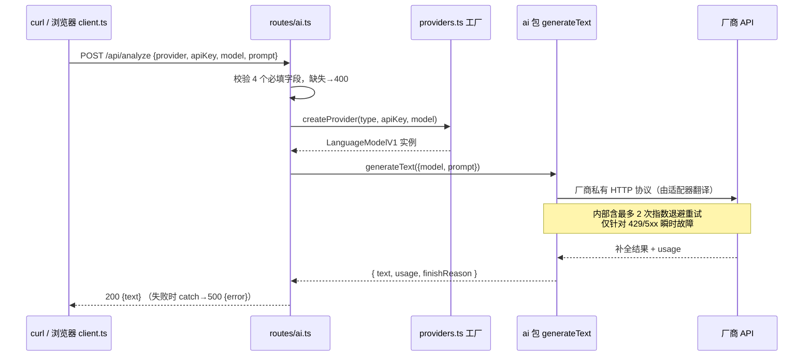
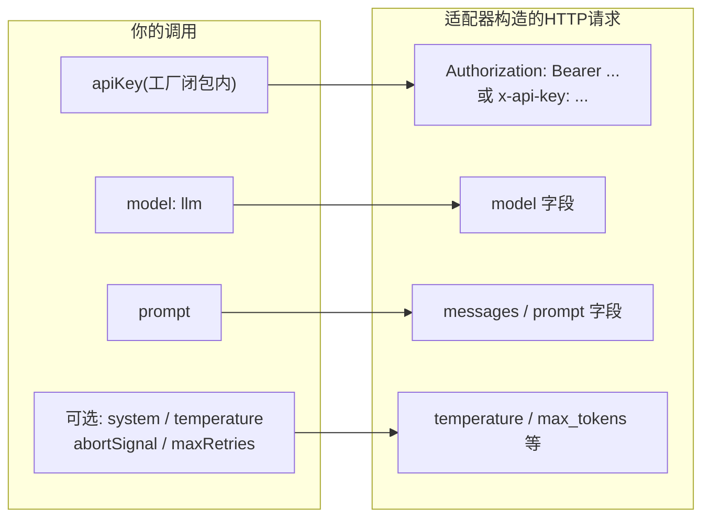

# 第 22 课 · Vercel AI SDK

> 所属阶段 4 · 预计时长 90 分钟 · 难度★★★☆☆

## 学习目标

- 说清 Vercel AI SDK 的分层：统一入口 `generateText` 与厂商包 `@ai-sdk/openai` 等，以及 `LanguageModelV1` 在中间扮演的角色。
- 用自己的话解释「为什么换模型厂商只需改一行工厂代码」。
- 用 curl 直接调用 `/api/analyze` 走通一次真实 AI 请求，并能复现缺字段的 400 响应。
- 指出本项目"多模型切换"的真实成本在哪里（提示：不在服务端）。
- 描述 `generateText` 从入参到 HTTP 报文的内部构造过程，说出请求里至少四个关键部分（鉴权头、模型字段、消息体、采样参数）。
- 理解 input/output token 的计费模型，能估算一次调用的成本量级并指出代码里控制成本的抓手。
- 说明 AI SDK 的默认超时与重试策略，并能用 `abortSignal`、`maxRetries` 定制它们。

## 前置检查

- 已完成第 21 课：理解 `server/index.ts` 的请求分发，服务能以 `pnpm dev` 启动。
- 已完成第 20 课：知道 `/api/analyze` 由 `ai.post('/analyze')` 注册。
- 准备好任一厂商的有效 API Key（OpenAI / Anthropic / Google 任一即可），或留到第 23 课用本地兼容端点。

## 关键文件

| 文件 | 职责 |
|---|---|
| `server/routes/ai.ts` | `POST /analyze` 处理器：校验字段 → 工厂造模型 → `generateText` → 返回 `{text}` |
| `server/providers.ts` | 把 `(type, apiKey, model, baseUrl)` 变成统一的 `LanguageModelV1`（本课只看接口形态，细节在第 23 课） |
| `src/lib/ai/client.ts` | 前端如何组装同样的请求体——curl 示例就是它的手工版；全文 107 行，本课走完 |
| `src/types/settings.ts` | `AIProviderType` 四个合法取值的来源 |
| `package.json` | 确认依赖：`ai@^6`、`@ai-sdk/openai`、`@ai-sdk/anthropic`、`@ai-sdk/google` |

## 正文

### 概念讲解

**问题：N 家厂商 = N 套 HTTP 协议**

OpenAI、Anthropic、Google 的补全 API 各有不同的端点、鉴权头、请求体和流式格式。如果手写 fetch，每接一家就要写一遍重试、错误解析、token 统计。

**Vercel AI SDK 的解法：两层抽象**

```
你的代码 ──> generateText({ model, prompt })      ← ai 包，统一入口
                    │
                    ▼
             LanguageModelV1 接口                 ← 标准插头形状
                    │
        ┌──────────┼──────────┐
        ▼          ▼          ▼
 @ai-sdk/openai  @ai-sdk/anthropic  @ai-sdk/google   ← 厂商适配器
        ▼          ▼          ▼
    OpenAI API  Anthropic API  Gemini API
```

- **厂商包（provider package）**：`createOpenAI({ apiKey })` 返回一个工厂，再传模型名得到一个实现了 **LanguageModelV1** 规范的对象。它知道怎么把标准化的调用翻译成该厂商的 HTTP 协议。
- **核心包（`ai`）**：`generateText({ model, prompt })` 只依赖 LanguageModelV1 接口，不关心背后是哪家。同一行代码换个 model 对象就切换了厂商；`generateText` 的兄弟 API 还有 `streamText`、`generateObject`（第 30 课毕业项目的主角）等。

这个模式叫**适配器 + 面向接口编程**：高层逻辑依赖稳定接口，易变的厂商协议被隔离在薄薄的适配层里。第 23 课的工厂函数就是把这套东西再包一层业务语义。

**`generateText` 内部：一次调用被翻译成了什么？**

你在路由里写的只有三行，但 SDK 在背后替你完成了一整条流水线。以 OpenAI 分支为例：

```ts
const result = await generateText({ model: llm, prompt });
// ↓ 内部大致发生：
// 1. 参数规范化：prompt 被包装成 messages: [{ role:'user', content: prompt }]
// 2. 交给 llm.doGenerate(...)——LanguageModelV1 规定的底层方法
// 3. 适配器构造 HTTP 请求：
//    POST https://api.openai.com/v1/chat/completions
//    Headers:
//      Authorization: Bearer <apiKey>          ← 工厂传入的 key
//      Content-Type: application/json
//    Body:
//      { "model": "gpt-4o",                   ← openai.chat(model) 里的名字
//        "messages": [{ "role":"user", "content": "<你的prompt>" }],
//        ...采样参数（temperature 等，未传则用服务端默认） }
// 4. 收到响应后解析出 choices/delta 文本与 usage，
//    组装成统一的 { text, usage, finishReason, ... } 返回
```

换一家厂商，第 3 步整个换掉——Anthropic 是 `POST /v1/messages` + `x-api-key` 头 + `system` 独立字段；Gemini 又是另一套——但第 1、2、4 步完全不变。这就是"面向接口"在数据平面上的样子。

除了必填的 `model` 和 `prompt`，`generateText` 还有一组常用可选参数，按用途分三类记：

| 类别 | 参数 | 作用 |
|---|---|---|
| 内容控制 | `system` | 独立的系统提示，SDK 会按各厂商的正确位置放置（OpenAI 进 messages、Anthropic 进顶层 system 字段） |
| | `temperature` / `maxOutputTokens` | 采样温度与输出长度上限（旧版 SDK 里后者叫 `maxTokens`） |
| 可靠性控制 | `abortSignal` | 传入 `AbortController.signal` 即可为整次调用设超时，超时抛 `AbortError` |
| | `maxRetries` | 失败自动重试次数（默认 2），配合指数退避 |

**Token 计费：AI 应用的"电费单"**

LLM 按 token 计费，token 约等于 0.75 个英文单词或 1~2 个汉字（不同 tokenizer 有差异）。每次调用产生两段计费：

- **input tokens（输入）**：你的全部 prompt——包括系统提示、few-shot 示例、输入插值，一个字都不少；
- **output tokens（输出）**：模型生成的文本。

两个对工程决策影响最大的事实：

1. **输入通常比输出便宜数倍，但总量往往更大**。像本项目 `buildAnalysisPrompt` 这种带完整格式模板的中文 prompt，一次轻松上千 input tokens，而输出可能只有几百。批量化产品里，prompt 瘦身直接等于省钱。
2. **`usage` 数据就在返回值里，只是本项目没透传**。`generateText` 的返回结果除了 `text` 还携带本次消耗的 token 数与结束原因（finish reason）。`routes/ai.ts:58` 只挑了 `text` 一个字段塞进响应——BYOK 架构下用户自己付钱，把用量展示给用户是天然的改进方向（作业会做）。

**超时与重试：网络调用的默认姿势**

`generateText` 是一次可能持续数十秒的公网 HTTPS 调用，必须问两个问题：

- **多久算失败？** SDK 默认不设总时长上限，但支持 `abortSignal`。生产代码的标准写法：
  ```ts
  const controller = new AbortController();
  const timer = setTimeout(() => controller.abort(), 60_000);
  try {
    const result = await generateText({ model: llm, prompt, abortSignal: controller.signal });
  } finally {
    clearTimeout(timer);
  }
  ```
  本项目的 `routes/ai.ts` **没有**设超时——客户端浏览器 fetch 自己有平台级超时兜底，但服务器侧连接会被白白占用，这是可改进点之一。
- **失败了重试吗？** SDK 默认 `maxRetries: 2`，且只对"值得重试"的错误退避重试（限流 429、上游 5xx 这类瞬时故障），鉴权失败（401）这类确定性错误不会浪费重试次数。理解这一点很重要：**重试发生在 SDK 内部，你的 catch 只能看到最终结局**——连续三次都 429 时，你收到的是最后一次的异常。

### 代码走读

按一次真实请求的执行顺序走。前端 `client.ts` 全文 107 行、后端 `ai.ts` 全文 65 行，两条线都走完。

**① 前端组装请求体**（`src/lib/ai/client.ts:11-21`）

```ts
const response = await fetch('/api/analyze', {
  method: 'POST',
  headers: { 'Content-Type': 'application/json' },
  body: JSON.stringify({
    provider: config.type,
    apiKey: config.apiKey,
    model: config.model,
    baseUrl: config.baseUrl,
    prompt,
  }),
});
```

注意两个设计事实：

- **apiKey 从浏览器发往服务器**——这是 BYOK 模式的标志（威胁模型在第 23 课专门分析）。
- 服务端不拼 prompt：`prompt` 是前端用 `buildAnalysisPrompt` 等函数拼好的完整字符串（第 24 课）。后端是纯粹的"文本进文本出"代理。

**② 前端错误检查的三胞胎**（`client.ts:23-26` 及另外两处同构）

```ts
if (!response.ok) {
  const err = await response.text();
  throw new Error(`AI hint generation failed: ${err}`);
}
```

三个函数（hint / optimize / analyze）各自带一份一模一样的检查：非 2xx 就把 body 原文塞进 Error 抛出去。值得注意的细节：这里用的是 `response.text()` 而不是 `.json()`——因为错误 body 可能是网关返回的 HTML 或纯文本，先当文本拿到手再说是最稳的策略。三份重复是刻意的教学冗余，挑战层作业会让你把它抽成一个共享函数。

**③ 后端字段校验**（`server/routes/ai.ts:43-48`）

```ts
const body = await c.req.json();
const { provider, apiKey, model, baseUrl, prompt } = body;

if (!provider || !apiKey || !model || !prompt) {
  return c.json({ error: 'Missing required fields' }, 400);
}
```

四个必填字段 `provider/apiKey/model/prompt` 缺一即 400。`baseUrl` 是可选的（只有 `openai-compatible` 用得到）。这是最朴素的手工校验——没有 zod，没有 schema，直接真值判断。

**④ 工厂造出统一模型对象**（`server/routes/ai.ts:51`）

```ts
const llm = createProvider(provider, apiKey, model, baseUrl);
```

返回值类型是 `LanguageModelV1`（见 `server/providers.ts:12`）。从这行往下，代码对"背后是 GPT 还是 Claude"完全无感。

**⑤ 统一调用**（`server/routes/ai.ts:53-58`）

```ts
const result = await generateText({
  model: llm,
  prompt,
});

return c.json({ text: result.text });
```

`generateText` 发起真实的网络调用并等待补全完成，`result.text` 是纯文本响应体。整个接口最终只有一个形状：请求 `{...五字段}`，成功返回 `{text: string}`。前端正则从这段 Markdown 里抠【综合评分】（`client.ts:93`），那是第 24 课的故事。

再强调一遍概念讲解里的结论：这一行里 `result` 其实还带着 usage 和 finishReason，只是被丢弃了。想看一眼它们的真容，最简单的办法是在 `return` 之前加一行 `console.log(JSON.stringify(result.usage))`——作业进阶层会正式做这件事。

**⑥ 错误路径预览**（`server/routes/ai.ts:59-62`）

```ts
} catch (e) {
  const message = e instanceof Error ? e.message : 'Unknown error';
  return c.json({ error: message }, 500);
}
```

Key 无效、余额不足、模型名打错，都会以厂商 SDK 异常的形式落在这里，消息原文透传给前端（策略利弊在第 25 课展开）。结合上一节的超时重试知识补一句：**catch 到的不一定是第一次错误**——SDK 内部已经默默重试过最多 2 次，你看到的是退避耗尽后的最后一条异常。

**⑦ 前端消费端全景**（`client.ts:63-106`）

`analyzeTranslation` 是三个函数中最长的一个，它串起了"发请求 → 抠分数 → 组装结果"的完整链路：

```ts
export async function analyzeTranslation(
  config: AIProviderConfig,
  original: string,
  chinese: string,
  userTranslation: string,
  pairId: string
): Promise<AnalysisResult> {
  const prompt = buildAnalysisPrompt(original, chinese, userTranslation);
  // ...fetch 同①，!response.ok 同②...
  const data = await response.json();
  const rawMarkdown: string = data.text;
```

随后是解析与组装（`client.ts:92-106`）：正则抠出 score、连同 rawMarkdown 与 pairId 打包成 `AnalysisResult` 返回给调用方（练习面板组件，第 17 课）。至此 `client.ts` 三个函数全部看完——它们共享同一个端点、同一种错误处理骨架，唯一的差异是 build*Prompt 的选择和返回值的加工方式。这种"一个接口服务多个语义动作"的设计之所以成立，靠的就是 prompt 承载了全部业务语义。

**多模型切换的成本在哪？**

看 `src/types/settings.ts:15-20` 的 `DEFAULT_MODELS` 和 `AIProviderType` 联合类型：服务端四家厂商各只有 3~5 行适配代码，切换零成本；真正的成本在前端体验层——每个 provider 的 Key 申请流程、计费方式、可用模型列表都不同，UI 要为用户把这些讲清楚。这正是"架构上消灭复杂度、把剩余复杂度放到产品层"的典型取舍。

### 边学边练

> **边学边练 ①**：把第 24 课将精读的 `buildAnalysisPrompt` 先粗看一眼——它输出的 prompt 大约多少个字符？按"1 汉字 ≈ 1~2 token"粗估这次调用的 input tokens 量级。
>
> <details><summary>参考答案</summary>
>
> 该模板含角色设定、输入区、分析指示、分段格式说明和注意事项，正文约 600~900 个汉字/字符（不含插值的句子内容），加上三段输入插值后普遍在 1000~2000 token 量级。这意味着即使学习者只回译了一句话，每次评分也要支付千级 input tokens 的费用——prompt 模板是固定开销，句子内容才是变量开销。这也是第 24 课要讲"token 效率"的现实动机。
> </details>

> **边学边练 ②**：`generateText` 内部重试 2 次都遇到上游 429，最终 `routes/ai.ts` 的 catch 会捕获几次异常？前端用户感知到的延迟大概是什么形状？
>
> <details><summary>参考答案</summary>
>
> 只捕获 1 次——SDK 重试对外透明，throw 出来的是最后一次失败的异常。延迟形状：三次尝试 + 两次指数退避间隔叠加，用户会感觉"转了很久然后报错"，总时长可达十几秒甚至更久。排查线上"偶发慢查询"时，记得把 SDK 内部重试时间也算进链路，否则时间账对不上。
> </details>

> **边学边练 ③**：如果把 `routes/ai.ts:58` 改成 `return c.json(result)`，会发生什么？从"接口设计"角度评价这个改动。
>
> <details><summary>参考答案</summary>
>
> 功能上大概率能跑——前端拿到的对象多了 text 之外的字段（usage、finishReason、steps 等）。但这是糟糕的接口决策：① 响应形状由第三方库的内部结构决定，SDK 升级一改字段前端就炸；② 可能泄露内部实现细节；③ 响应体积膨胀。正确方向是想清楚契约再显式挑选字段：`{ text, usage: { totalTokens } }` 这样的白名单式投影。"接口应该暴露决策，而不是暴露实现"——这句可以原样搬进面试。
> </details>

> **边学边练 ④**：`client.ts` 三个函数的 fetch 配置完全相同，只有 URL 以外的什么都没有变过？如果要抽公共函数，签名该怎么设计？
>
> <details><summary>参考答案</summary>
>
> 三个函数重复的是「POST /api/analyze + 五字段 body + !ok 抛错 + 取 data.text」这四步；变化的只有 prompt 的来源和后续加工。公共函数可以是：
>
> ```ts
> async function callAnalyze(config: AIProviderConfig, prompt: string): Promise<string> {
>   // fetch + 错误检查，失败 throw，成功 return data.text
> }
> ```
>
> 三个业务函数瘦身成「buildXxxPrompt → callAnalyze → 加工」。这是"提取函数消除重复"的最小案例，也是挑战层作业的内容。
> </details>

### 图示



一张"参数如何流向 HTTP 报文"的映射图：



## 实操作业

### 第 1 层 · 基础（必做）：用 curl 直接调 `/api/analyze` 走通一次真实 AI 调用

分步指导：

1. 启动开发服务：
   ```bash
   pnpm dev
   ```
2. 先验证校验逻辑——故意缺字段，应看到 400：
   ```bash
   curl -i -X POST http://localhost:3003/api/analyze ^
     -H "Content-Type: application/json" ^
     -d "{\"prompt\":\"hi\"}"
   # macOS/Linux 把 ^ 换成 \
   ```
   预期：`HTTP/1.1 400 Bad Request`，body 为 `{"error":"Missing required fields"}`。
3. 真实调用（以 OpenAI 为例，Key 换成你自己的）：
   ```bash
   curl -i -X POST http://localhost:3003/api/analyze \
     -H "Content-Type: application/json" \
     -d '{
       "provider": "openai",
       "apiKey": "sk-...",
       "model": "gpt-4o",
       "prompt": "请用一句话介绍回译练习法。"
     }'
   ```
   Anthropic 用户把字段换成 `"provider": "anthropic"`、`"model": "claude-sonnet-4-20250514"`；Google 用 `"google"` + `"gemini-2.0-flash"`（默认模型名均来自 `DEFAULT_MODELS`）。
4. 观察响应：200 + `{"text":"..."}`；然后故意把 model 改成 `"gpt-not-exist"` 重发，观察 500 与透传的错误消息。
5. 连续快速发 31 次请求，观察第 31 次返回什么（剧透：429，第 25 课详解）。

验收标准：

- [ ] 缺任意一个必填字段都能复现 400 `{"error":"Missing required fields"}`；
- [ ] 至少一家真实厂商返回过 200 且 `{text}` 内容合理；
- [ ] 能说出请求体五个字段中哪个可选、为谁可选；
- [ ] 能不看代码画出这次调用的 sequenceDiagram（对照上文图示自检）。

### 第 2 层 · 进阶：让 usage 现形，亲手验证计费模型

1. 在 `server/routes/ai.ts` 的 `return c.json(...)` 之前插入观测代码：
   ```ts
   console.log('usage:', JSON.stringify(result.usage));
   console.log('finishReason:', result.finishReason);
   ```
2. 分别发送三种 prompt 并记录 usage：极短（10 字）、中等（复述一段 200 字文章）、要求长输出（"写一篇 500 字短文介绍 X"）。观察 input/output 两列数字随什么变化。
3. 把响应升级为白名单投影（呼应边学边练③）：
   ```ts
   return c.json({
     text: result.text,
     usage: { totalTokens: result.usage.totalTokens },
   });
   ```
   注意保持前端兼容——`client.ts` 读的是 `data.text`，新增字段不影响老逻辑。
4. （可选）查一下所用模型的官方单价表，把某次调用的 usage 换算成真实成本，感受"一次回译分析值几分钱"。

验收标准：

- [ ] 控制台能看到三种 prompt 的 usage 差异，且 input 随 prompt 变长显著增长；
- [ ] 升级后的接口同时返回 text 与 usage.totalTokens，原有前端功能不受影响；
- [ ] 笔记里有一条"input 与 output 哪个占大头"的实测结论。

### 第 3 层 · 挑战：给 generateText 加超时，并抽取消除 client.ts 的三处重复

1. 超时改造：仿照概念讲解的模板，给 `generateText` 传入 60 秒的 `abortSignal`（`setTimeout` + `AbortController` + `finally clearTimeout` 三件套）。验证方式：临时把超时改成 1ms 再发请求，应在 500 里看到 abort 相关错误消息。
2. 重试实验：利用第 23 课的本地 Ollama 思路或直接用一个必然 401 的假 Key，分别在代码里设置 `maxRetries: 0` 和默认值，对比"从发出请求到 catch 生效"的耗时差（可用 console.time）。体会"确定性错误不配重试"这句话的分量。
3. 前端重构：按边学边练④的签名提取 `callAnalyze(config, prompt)` 私有函数，三个导出函数改为组合它。逐个功能点验证 UI 上三条链路（提示/改写/评分）仍然工作。

验收标准：

- [ ] 1ms 超时实验复现 abort 错误；恢复 60s 后一切正常；
- [ ] `maxRetries: 0` 时假 Key 报错明显更快（无退避等待）；
- [ ] 重构后 `client.ts` 中 fetch 调用只剩一处，三条功能链路手工回归通过；
- [ ] 能口头说明：为什么超时要放 `finally` 里清 timer？

## 常见坑

- **JSON 引号转义**：Windows cmd 的 curl 对单引号支持差，body 里要用转义双引号；更省心的办法是把 JSON 存成文件再 `-d @body.json`。
- **忘了 Content-Type**：不带 `Content-Type: application/json` 时 `c.req.json()` 解析会抛错，你可能得到的是 500 而不是预期的业务错误。
- **Key 泄漏进 shell 历史**：curl 命令里的 apiKey 会留在命令历史与终端滚动缓冲里。练习完记得清理，正式项目里应改用环境变量注入。
- **混淆 `result.text` 与整个 result**：`generateText` 返回的对象还包含 finishReason、usage 等；接口只挑了 `text` 一个字段返回给前端，不要假设前端拿得到 usage 信息。
- **以为 catch 到的是第一次错误**：SDK 默认重试 2 次才放弃，日志里的报错是最后一次的。想看全过程要在适配器层抓包或在 dev 环境把 `maxRetries` 设为 0。
- **超时不清理 timer**：只在成功路径 `clearTimeout` 而忘了异常路径，定时器会在进程里滞留到触发为止——高频调用下堆积大量无用 timer。`finally` 是唯一正确的收尾位置。

## 本课与面试

**Q：设计一个转发第三方 LLM API 的 HTTP 代理接口，你要考虑哪些点？**

答题骨架：按请求生命周期组织答案——① 入口：字段校验与限流（防滥用，参考本项目 400/429）；② 转发：鉴权信息传递方式（BYOK vs 平台托管 Key 的取舍）、超时控制（abortSignal）、重试策略及其幂等性考量；③ 出口：状态码语义映射（上游 401/429/5xx 不该一律 500 透传）、响应白名单投影避免泄露内部结构；④ 观测：usage 记录、慢日志、错误分类埋点。最后落到本项目作为最小可行实现的对照："校验→限流→转发→透传"四步都有，缺的是超时与状态码细分——主动说出缺陷比假装完美更显工程成熟度。

**Q：API 设计中，什么时候返回 400、422、500？上游服务出错时你的 API 该返回什么？**

答题骨架：400 请求语法/字段缺失等客户端低级错误（本项目缺字段场景）；422 语法合法但语义不通过（如 prompt 超长）；500 自己的服务器内部错误。上游故障的处理原则：**不要无脑透传也不要无脑吞掉**——若上游错误对用户有意义（BYOK 下 Key 无效），映射为 502 Bad Gateway 或保留业务语义并脱敏；若是瞬时故障且已重试仍失败，503 + Retry-After 更诚实。核心观点：状态码是你与调用方的契约语言，一刀切 500 等于把契约降级为字符串。

**Q：讲讲重试的艺术：哪些错误该重试？怎么重试？有什么坑？**

答题骨架：① 分类——瞬时故障（网络抖动、429、503）值得重试；确定性错误（401 鉴权、400 参数）重试只会放大故障；② 手法——指数退避 + 抖动（jitter）防止惊群，设最大重试次数与总时限；③ 坑——非幂等操作重试可能造成重复副作用（扣款、发帖），GET 幂等可放心重试而 POST 要配幂等键；重试叠加超时导致总延迟失控。加分项：提到 AI SDK 默认 maxRetries=2 且只重试可重试类错误，说明"框架已经做了对的事，你要知道它在做"。

**Q：LLM 应用怎么做成本控制？**

答题骨架：① 计费模型先行——input/output 分开计价，input 通常占大头且与 prompt 模板强相关；② 手段分层——prompt 瘦身（删冗余指令、示例精选）、缓存（相同 prompt 前缀的部分厂商有缓存折扣）、模型分级（简单任务用小模型）、用量观测（把 usage 从 SDK 返回值里拿出来做面板，正是本课作业做的事）；③ 架构手段——BYOK 让成本天然转移给用户（本项目方案），或平台侧配额+限流（第 25 课）。能给出"一次调用 ≈ 多少 token × 单价"的心算能力是实操型加分的信号。

**Q：适配器模式和策略模式的区别？AI SDK 的架构用了哪个？**

答题骨架：适配器解决"既有接口不匹配"——把厂商私有协议转换成统一的 LanguageModelV1；策略解决"同一行为多种可替换实现"——运行时选择哪家模型。AI SDK 两者兼有：每个 @ai-sdk/* 包是适配器（协议翻译），createProvider 的 switch 是策略选择器（第 23 课）。追问"为什么不直接 if-else"时答开闭原则：新厂商=新包，核心零改动；以及依赖倒置——generateText 依赖抽象接口而非具体实现。

## 自测题

<details>
<summary>1. <code>LanguageModelV1</code> 在 AI SDK 架构里扮演什么角色？如果没有它会怎样？</summary>

它是核心包与厂商适配器之间的统一接口（规范了补全/流式/输入输出类型的"插头形状"）。没有它，<code>generateText</code> 就得为每家厂商写一套 if/else 分支，新增厂商要改核心包；有了它，新厂商只需实现接口的新适配器包，核心代码一行不动——开闭原则的落地。
</details>

<details>
<summary>2. 本项目服务端的 prompt 是谁拼好的？这种"前端拼 prompt、后端只转发"的设计有什么优缺点？</summary>

前端 <code>src/lib/ai/prompts.ts</code> 的 build*Prompt 函数拼好。优点：迭代 prompt 不用动后端、后端保持通用代理、BYOK 下服务器无需理解业务。缺点：prompt 逻辑暴露在浏览器 bundle 中可被查看复制；恶意用户可以借你的服务器发送任意 prompt（靠限流兜底）；无法做服务端集中审计/AB 实验。
</details>

<details>
<summary>3. 写出 /api/analyze 必填的四个字段，以及哪一个字段只在哪种 provider 下才有意义。</summary>

必填：provider、apiKey、model、prompt（缺一返回 400 Missing required fields）。baseUrl 可选，仅 openai-compatible 分支使用（providers.ts:26-28 把它作为 createOpenAI 的 baseURL）。
</details>

<details>
<summary>4. 为什么说"多模型切换的成本不在服务端"？成本实际落在哪？</summary>

服务端有 LanguageModelV1 抽象 + 工厂函数，每家厂商只有几行创建代码，切换是 O(1) 改配置。成本在产品层：用户的 Key 获取、计费理解、模型选择 UI（DEFAULT_MODELS 只是兜底）、以及不同厂商行为差异带来的效果调优。
</details>

<details>
<summary>5. curl 时故意填错 model 名，返回的状态码是多少？错误消息来自哪里？</summary>

500。<code>catch (e)</code> 里取 <code>e.message</code>（厂商 SDK 抛出的 Error，通常是 404/400 模型不存在之类）原样放进 <code>{error}</code> 返回——这就是"错误透传"，其安全代价在第 25 课讨论。
</details>

<details>
<summary>6. <code>generateText</code> 的返回值里除了 <code>text</code> 还有哪些对工程有用的字段？本项目丢掉了它们中的哪些？</summary>

还有 usage（本次调用的 input/output token 数）与 finishReason（结束原因：stop/length/content-filter 等）。<code>routes/ai.ts:58</code> 只取了 text，usage 与 finishReason 都被丢弃。前者可用于成本观测（进阶作业已让它现形），后者能区分"自然说完"与"被 maxOutputTokens 截断"——截断场景下 text 可能不完整，下游解析（如抠分数）会莫名失败。
</details>

<details>
<summary>7. 为什么 SDK 对 401 不重试、对 429 却重试？如果让你给"是否重试"写一条判定规则，你会怎么写？</summary>

401 是确定性错误：Key 无效不会因为再试一次变得有效，重试纯粹浪费延迟与配额。429/5xx 是瞬时的：限流窗口过去、上游抖动平息后成功率恢复。判定规则可写成："依据错误的类别而非数值决定重试——凡属'同样输入再次执行可能成功'的瞬时类错误才进入退避重试，且重试必须与幂等性和总时限绑定。"这条规则对所有网络调用（不止 LLM）通用。
</details>

<details>
<summary>8. BYOK 模式下把 usage 展示给用户，除了体验好还有什么架构上的好处？如果不展示，用户如何自助发现"我的 prompt 太贵了"？</summary>

好处：成本责任与可见性对齐——用户付钱、用户看见消耗，平台免去计费争议；usage 也是滥用检测的信号源（单用户 token 消耗异常即预警）。不展示的话，用户只能靠对比厂商控制台的账单数字与本站操作次数来反推，既粗糙又滞后；开发者则要用厂商后台的 usage 页面手动核对——这正是"观测能力应该内建在产品里"的反面教材。
</details>
