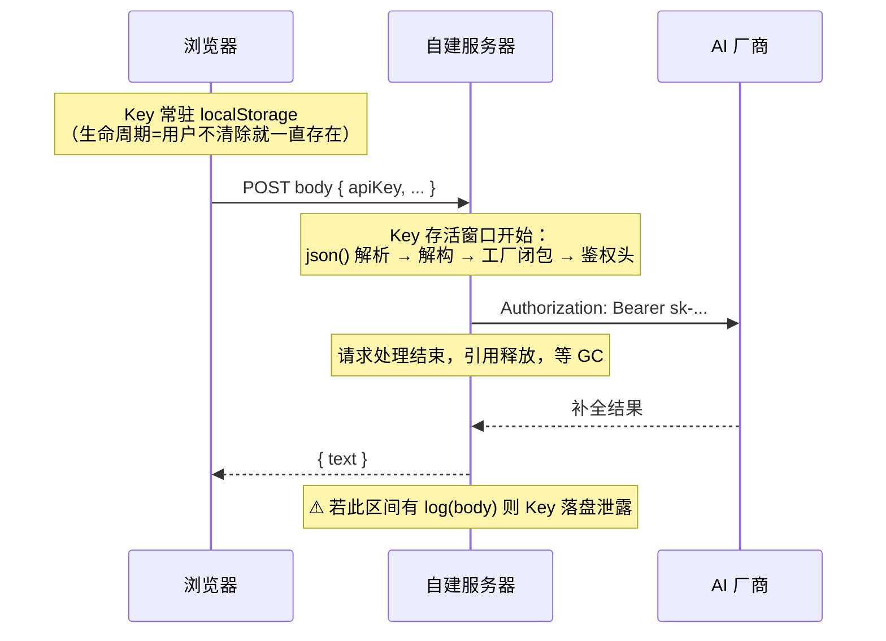
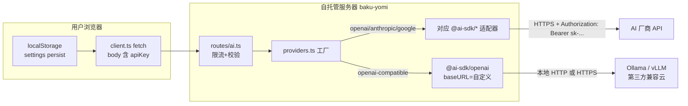
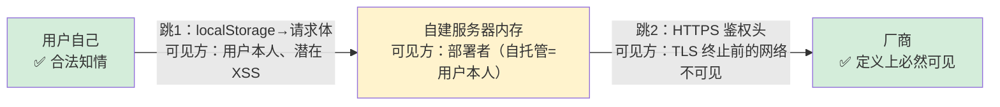

# 第 23 课 · 工厂模式与 BYOK

> 所属阶段 4 · 预计时长 90 分钟 · 难度★★★☆☆

## 学习目标

- 逐分支讲解 `createProvider` 的 switch 工厂，说清每个分支的输入输出与默认分支抛错的用途。
- 解释 `openai-compatible` 兼容层为什么能"白嫖"整个 OpenAI 生态（含本地模型），并实际接入一个兼容端点。
- 完整陈述 BYOK 威胁模型：Key 从浏览器 → 自建服务器 → 厂商，每一跳谁看得到、风险如何。
- 论证「自托管场景下 BYOK 成立」的前提条件，并说出公网共享实例下这一前提如何被破坏。
- 用 mermaid 画出 BYOK 数据流图，并在图上标出每一跳的明文可见方与信任边界。

## 前置检查

- 已完成第 22 课：理解 `generateText` 与 `LanguageModelV1`，用 curl 走通过一次 `/api/analyze`。
- 已完成第 21 课：知道服务是同源部署、`server/index.ts` 不持有任何 AI Key。
- 可选：本地装好任一 OpenAI 兼容端点（Ollama / LM Studio / vLLM 任一）。

## 关键文件

| 文件 | 职责 |
|---|---|
| `server/providers.ts` | 本课主角：33 行的工厂函数，四种 provider 分支 + default 抛错 |
| `src/types/settings.ts` | `AIProviderType` 联合类型是工厂 switch 的"合法输入清单"；`AIProviderConfig.baseUrl` 为兼容层而生 |
| `src/stores/` 下 settings 相关 slice | Key 存在用户浏览器 localStorage（persist），服务器零存储 |
| `.env.example` | 注释里的 AI keys 全部被注释——证明官方部署形态不依赖服务端 Key |

## 正文

### 概念讲解

**工厂模式：把"创建哪一种对象"收敛到一个入口**

当调用方需要根据运行时参数创建不同类别的对象时，如果让每个调用点自己 if/else 判断，创建逻辑会散落各处。工厂模式把它收进一个函数：调用方只描述"我要什么类型"，工厂负责返回统一接口的对象。本项目的版本：

- 输入：`type: AIProviderType` + 凭据；
- 输出：`LanguageModelV1`（第 22 课讲的统一插头）；
- 效果：`routes/ai.ts` 对厂商数量增长完全无感，新增 DeepSeek 时只改 providers.ts 一处。

**switch 还是注册表 Map？**

工厂有两种常见写法：switch/case，或 `Map<type, (args) => LanguageModelV1>` 注册表。本项目选了 switch——总共四个分支、每个三行，注册表那种"新增 provider 零改动 switch"的开闭优雅在这里换不来任何收益，反而多了一层间接和初始化顺序问题。判断标准很简单：**分支数量少且由仓库自己维护时选 switch（一眼读完）；分支预期被外部插件式扩展时才值得上注册表**。这也是一条通用的反过度设计直觉：先让代码 boring，等变化真的来了再升级结构。

**openai-compatible：事实标准的力量**

OpenAI 的 `/v1/chat/completions` 协议成了行业事实标准——Ollama、LM Studio、vLLM、DeepSeek、Moonshot 等几乎所有新玩家都提供 OpenAI 兼容端点。于是适配它们不需要写新适配器：拿 `createOpenAI` 换一个 `baseURL` 即可。这就是 `openai-compatible` 分支的全部原理，也是你能用本地模型零成本跑通本项目的钥匙。

**BYOK（Bring Your Own Key）**

传统 SaaS 的做法：平台用自己的厂商 Key 调 AI，向用户收费赚差价，同时承担 Key 成本与滥用风险。BYOK 反转了它：**用户填自己的 Key，存自己的浏览器，经自己的服务器转发给厂商**。平台方零 AI 成本、无计费系统；用户为效果和隐私买单的是信任——所以必须讲清威胁模型。

两种模式放在一起看，差异一目了然：

| 维度 | 传统托管（平台 Key） | BYOK（用户 Key，本项目） |
|---|---|---|
| AI 成本承担方 | 平台（需计费系统回收） | 用户直付厂商 |
| 平台能看到 Key 吗 | 能（平台自己的 Key） | 技术上能，但自托管时平台=用户 |
| 滥用防护动机 | 强（烧的是平台的钱） | 弱（限流只护服务器不护账单） |
| 用户隐私 | prompt 全文经过并可能留存于平台 | 自托管时数据不出本机 |
| 产品复杂度 | 计费/配额/风控一整套 | 一个设置弹窗 |

### 代码走读

`server/providers.ts` 全文 33 行，逐分支精读。

**① 类型来源与返回值约定**（`server/providers.ts:1-12`）

```ts
import type { AIProviderType } from '../src/types/settings';
import { createOpenAI } from '@ai-sdk/openai';
import { createAnthropic } from '@ai-sdk/anthropic';
import { createGoogleGenerativeAI } from '@ai-sdk/google';
import type { LanguageModelV1 } from 'ai';

export function createProvider(
  type: AIProviderType,
  apiKey: string,
  model: string,
  baseUrl?: string
): LanguageModelV1 {
```

四个细节值得咀嚼：

- **跨层引用类型但仅限类型**：`AIProviderType` 定义在前端 `src/types/settings.ts:1`（`'openai' | 'anthropic' | 'google' | 'openai-compatible'`）。前后端共享同一份联合类型，意味着前端 UI 的下拉选项与服务端 switch 分支永远对得上——这是全栈同仓库（monorepo 式共享 types 目录）的红利。
- 返回类型钉死为 `LanguageModelV1`：无论哪个分支，调用方拿到的都是同一个形状。这是"面向接口编程"的最小落地——`routes/ai.ts:51` 拿到返回值后直接喂给 `generateText({ model: llm, prompt })`，全程不知道也不关心背后是哪家。
- **四个参数恰好是 `AIProviderConfig` 的展开**：对照 `src/types/settings.ts:3-8` 的接口定义（type/apiKey/model/baseUrl），工厂签名就是持久化配置的一比一投影。前端存什么，后端就收什么——没有第二个真相来源。
- `baseUrl?` 是唯一为兼容层准备的可选参数，其余三家直连厂商根本不看它。

还有一个容易忽略的性质：**`createProvider` 是同步函数**。它只做对象构造（厂商 SDK 的 `createXxx` 内部只是闭包打包配置，不发任何网络请求），真正的 HTTP 调用发生在后面 `await generateText(...)`。同步性是对调用方的承诺："调我不会有副作用、不会挂起"，这让它在路由里可以被随意调用而无需 try 之外的错误处理仪式。

**② openai / anthropic / google 三个直连分支**（`server/providers.ts:13-25`）

```ts
switch (type) {
  case 'openai': {
    const openai = createOpenAI({ apiKey });
    return openai.chat(model);
  }
  case 'anthropic': {
    const anthropic = createAnthropic({ apiKey });
    return anthropic(model);
  }
  case 'google': {
    const google = createGoogleGenerativeAI({ apiKey });
    return google(model);
  }
```

结构完全一致：厂商包的 `createXxx({ apiKey })` 得到一个**客户端实例**，再传模型名产出 LanguageModelV1。两步各有含义：

- 第一步 `createXxx({ apiKey })` 返回的不是模型，而是携带凭据的"厂商连接器"。apiKey 从此活在闭包里——之后每次用它产出的模型发起请求，适配器都会把 key 写进 HTTP 鉴权头（OpenAI 用 `Authorization: Bearer`，Anthropic/Google 各有自家头）。Key 在整个服务端的驻留形态就是：请求体字符串 → 函数参数 → 闭包变量 → 鉴权头，全程只在内存，不落盘。
- 第二步传模型名。OpenAI 分支写作 `openai.chat(model)` 而 Anthropic/Google 写作 `anthropic(model)` / `google(model)`，是因为 OpenAI 协议下同时存在 chat completions 与老式 completions 两套端点，SDK 用 `.chat()` / `.completion()` / `.responses()` 区分；Anthropic 与 Google 的 SDK 只有一条主路径，干脆把实例做成了可直接调用的形式。

注意三家 API 形态的差异全部被封装在各自的 SDK 里，工厂内部消化，不外泄——调用方拿到的三个返回值类型完全相同。这正是第 22 课说的"适配器吃掉协议差异"在工厂层的延续。

**③ openai-compatible 分支**（`server/providers.ts:26-29`）

```ts
case 'openai-compatible': {
  const openai = createOpenAI({ apiKey, baseURL: baseUrl });
  return openai.chat(model);
}
```

与 `openai` 分支唯一的代码差异是多传了 `baseURL: baseUrl`。SDK 会把所有请求打到这个自定义地址而不是默认的 `api.openai.com`——协议翻译层原封不动复用，只有"往哪发"变了。接 Ollama 示例：`baseUrl: 'http://localhost:11434/v1'`，`apiKey` 随便填个非空字符串（Ollama 不校验，但路由校验 `!apiKey` 会拦空值，见 `routes/ai.ts:46`），`model` 填 Ollama 里的模型名如 `qwen2.5:7b`。

有人会问：openai 分支不传 baseURL 时 SDK 用默认地址，那 compatible 分支是不是多余的？不是——两者语义不同：`openai` 表示"我就是 OpenAI 官方用户"，`openai-compatible` 表示"我在用一个实现了 OpenAI 协议的其他服务"。分开的好处是显式：设置 UI 可以针对后者展示 baseUrl 输入框、给出不同提示文案，排查问题时也能立刻分清流量去向。

**④ default 抛错**（`server/providers.ts:30-32`）

```ts
default:
  throw new Error(`Unknown provider type: ${type}`);
```

虽然 TS 的联合类型在编译期保证了穷尽性，但请求体来自网络——恶意或过期的客户端可以发任意字符串。default 分支是**运行时的最后一道防线**，异常会被 `routes/ai.ts:59-62` 的 catch 接住变成 500。这体现了一个原则：类型安全管编译期，边界校验管运行期。

顺带从 API 设计角度审视一下：严格说 `provider: "hack"` 属于"客户端传了非法值"，更语义化的响应是 400/422 而非 500。当前实现把工厂异常一股脑交给通用 catch，是"够用但不精确"的取舍——第 25 课讨论错误透传策略时会再次回到这个问题。

**⑤ Key 在前端的存在方式**

`src/types/settings.ts:3-8` 的 `AIProviderConfig` 就是持久化到 localStorage 的设置对象；`.env.example:12-14` 中三行 AI key 注释全部处于关闭状态。两者共同指向一个架构事实：**服务器代码里没有任何地方读取 OPENAI_API_KEY 这类环境变量来调 AI**——Key 只活在用户的浏览器里，随每次请求体路过服务器。

打开浏览器 DevTools → Application → Local Storage，找到 zustand persist 写入的 settings 条目，你能直接看到明文 apiKey。这不是 bug，而是 BYOK 架构的自然结果——它的安全含义在下面的威胁模型一节展开。

### 边学边练（检查点）

不写业务代码，用四个即时检查点验证你是否真的读懂了上面的走读。

> **边学边练 ①**：如果把 `openai-compatible` 分支的 `baseURL: baseUrl` 删掉，用户配置的 baseUrl 会发生什么？这个 bug 在 UI 上会以什么现象暴露？
>
> <details><summary>参考答案</summary>
>
> baseUrl 参数被静默忽略，`createOpenAI` 回落到默认地址 `api.openai.com`——所有"本地模型"请求实际打到了 OpenAI 官方。UI 现象：报错是 401（官方不认你随便填的 key），而不是连接拒绝，极具迷惑性。教训：可选参数被下游忽略时不会报错，只会悄悄改变行为。
>
> </details>

> **边学边练 ②**：发送 `{"provider":"OpenAI","apiKey":"x","model":"m","prompt":"p"}`（大写 O）会走到哪个分支？TS 编译器拦得住吗？
>
> <details><summary>参考答案</summary>
>
> 走 default 分支，抛 `Unknown provider type: OpenAI`，最终 500。编译器拦不住——body 经 `c.req.json()` 出来是 any/运行时数据，类型断言骗得过 tsc 骗不过网络。字符串比较是大小写敏感的精确匹配，联合类型只是编译期清单。
>
> </details>

> **边学边练 ③**：`createProvider` 里没有一个 `await`。如果某个未来分支需要在创建模型前先调一次厂商的"查询可用模型"接口，工厂签名要怎么改？牵连哪些调用点？
>
> <details><summary>参考答案</summary>
>
> 返回类型改为 `Promise&lt;LanguageModelV1&gt;`，唯一调用点 `routes/ai.ts:51` 加 await（它本来就在 async 处理器里，成本极低）。这个练习让你体会"同步工厂"是一种设计承诺：保持构造无 IO，把所有网络交互推迟到 generateText 阶段，调用方心智负担最小。
>
> </details>

> **边学边练 ④**：不翻上文，默写 `AIProviderConfig` 的四个字段及哪个可选。然后回答：前端 settings slice 持久化的是整个 AppSettings 还是只有 AIProviderConfig？
>
> <details><summary>参考答案</summary>
>
> type/apiKey/model/baseUrl?，仅 baseUrl 可选（`src/types/settings.ts:3-8`）。持久化的是整个 `AppSettings`（含 `aiProvider` 与 `blindMode` 两个字段，见 `settings.ts:10-13`）。记住 blindMode 也在里面——它是第 24 课"盲测模式防剧透"的产品化开关。
>
> </details>

> **边学边练 ⑤**：如果部署者在反向代理上开启了"记录完整请求体"的 access log，自托管 BYOK 还成立吗？共享实例呢？
>
> <details><summary>参考答案</summary>
>
> 自托管：仍然成立——日志写在你自己的磁盘上，可见方还是你自己，威胁模型没有新增主体（但要注意日志文件本身的备份/同步服务会成为新的外泄通道）。共享实例：彻底破裂——每个用户的 Key 都被持久化到运营者可控的日志里，等于把"瞬时内存窗口"退化成"无限期落盘"，这是比 console.log 更常见的现实事故（Nginx 默认配置不当就会发生）。
>
> </details>

### openai-compatible 接本地模型实操

正文里把实操的关键决策先讲透，动手步骤放在实操作业。

**端点怎么选**

| 端点 | 地址 | 适合场景 | 备注 |
|---|---|---|---|
| Ollama | `http://localhost:11434/v1` | 最省事的本地方案 | `ollama pull` 拉模型，自动起服务 |
| LM Studio | `http://localhost:1234/v1` | 想用图形界面管理模型 | 记得手动点 Start Server |
| vLLM | `http://localhost:8000/v1` | 有 GPU、追求吞吐 | 启动参数指定 `--model` |
| 云端兼容（SiliconFlow / DeepSeek 等） | 各家文档提供 base_url | 本地没 GPU | Key 是真实的，注意计费 |

**三要素映射口诀**：baseUrl = 端点地址（**必须带 `/v1`**）；model = 该端点里的确切模型名（Ollama 用 `ollama list` 查，如 `qwen2.5:7b`）；apiKey = 随便一个非空串（本地端点不校验，但不能空——`routes/ai.ts:46` 的真值守卫在前）。

**本地与云端兼容怎么选**：本地端点（Ollama/LM Studio）零成本、数据不出机，但小模型的日语语法分析质量明显弱于云端旗舰模型——适合跑通链路与开发调试；云端兼容服务质量接近官方、按量计费便宜，但 Key 是真实的，练习时记得用最小额度账号。建议路径：先本地走通全链路 → 再换云端对比同一句子的分析质量差异——这个对比本身就是对"模型能力边界"的一次实测。

**故障速查表**（三个最常见报错的现象→根因）：

| 现象（透传的 error message） | 根因 |
|---|---|
| `fetch failed` / connect ECONNREFUSED | 端口没起：服务没启动或端口写错 |
| 404 / model not found | 模型名不对（`qwen2.5` vs `qwen2.5:7b`），或 baseUrl 漏了 `/v1` |
| 401 / invalid api key | 你以为连的是本地，实际打到了真厂商——八成是 baseUrl 没生效（见边学边练①） |

### BYOK 威胁模型完整分析

**什么是威胁模型**：把"我们要保护什么资产、谁能攻击它、信任边界在哪"写成一张明确的账。BYOK 场景下的资产只有一个：用户的 API Key（以及用它产生的余额）。信任边界有三个，对应 Key 旅程的三跳。

**第一跳：用户浏览器**

- Key 以明文存于 localStorage（zustand persist）。任何能在该源执行 JS 的代码都能读到它——典型即 **XSS**。恶意浏览器扩展同样能读 localStorage。
- 用户自己当然看得到（DevTools 两分钟就能翻出来）——这不算威胁，因为 Key 本来就是他自己的。
- 结论：浏览器跳的防线 = 同源策略 + 不引入能执行外部脚本的漏洞。localStorage 没有 httpOnly 那样的隔离机制可用，这是前端存储 Key 的固有上限。

**第二跳：自建服务器（baku-yomi 后端）**

- Key 随每次请求体进入服务器内存：`routes/ai.ts:44` 解构出来 → `providers.ts` 传入 SDK → 变成 HTTP 鉴权头发往厂商。存活时间是一次请求的处理时长，处理完即被 GC，不落盘、不进缓存。
- 但**部署者在技术上完全可见**：他可以在路由里加一行 `console.log(body.apiKey)` 就完成收割，也可以把整份请求体记进日志文件。HTTPS 只保护传输中的报文，TLS 在反向代理处终止后，服务器看到的就是明文。
- 结论：第二跳的安全性完全取决于"服务器是谁的"。

**第三跳：AI 厂商**

- 厂商必然看到明文 Key——它是鉴权凭据，这是定义使然，不构成额外威胁（厂商本来就是签发者）。
- 值得注意的是计费归属：Key 是谁的，费用就记谁的。BYOK 下每一次调用的账都落在用户自己的账单上，平台无法"赚差价"，也没有动机去优化别人的成本。

**为什么自托管场景下 BYOK 成立**

自托管时，第二跳的那台服务器就跑在**用户自己的机器**上：部署者=使用者，第二跳与第一跳合并为同一个信任域。"谁能看到我的 Key"这个问题的答案是"只有我自己"——威胁模型闭合，BYOK 无需任何补偿机制就成立。再加上同源部署（前端产物由同一个 Node 进程托管，第 21 课），也不存在把 Key 发往第三方域名的意外路径。这套架构用零成本换来了完整的隐私故事，是个人工具类项目的漂亮取舍。

**公网共享实例下，前提如何被破坏**

一旦官方把同一个代码库部署到公网给陌生人用（SaaS 化），上述前提逐一断裂：

1. **运营者成了可信第三方之外的角色**：所有用户的 Key 都经过他的服务器，技术上他可以记录、导出、盗刷任何人的 Key。哪怕运营者人品可靠，"服务器被入侵后日志泄露"也是现实风险——海量 Key 集中经过一处，本身就是高价值攻击目标。
2. **滥用与配额**：恶意用户可以把你的服务器当免费匿名代理打厂商 API（自带假 Key 试探、或者消耗他人真 Key 的并发额度），限流（第 25 课）只能缓解不能根除。
3. **责任归属**：某用户的 Key 被盗刷，责任算平台的还是用户的？BYOK 在 SaaS 形态下会产生传统托管模式不存在的法务灰区。

补偿手段存在但都有代价：TEE（可信执行环境）隔离转发层、客户端直连厂商（受 CORS 与 Key 暴露面更大的双重限制）、定期轮换提醒、审计日志——每一项都在侵蚀 BYOK"零成本零信任"的初衷。结论：**BYOK 不是普适架构，它是"部署者可信"这个前提下的最优解**；脱离前提套用就是把安全建立在希望之上。

**补偿机制的真实成本**

| 补偿手段 | 防住什么 | 代价 |
|---|---|---|
| TEE（可信执行环境）隔离转发层 | 运营者/主机入侵读取内存中的 Key | 需要 SGX/SEV 等硬件，部署复杂度陡增 |
| 客户端直连厂商（不经服务器） | 服务器侧一切窥探 | 浏览器 CORS 常被厂商拒绝；Key 暴露面反而扩大到前端 bundle |
| 审计日志 + 异常检测 | 事后追责与预警 | 日志本身就是 Key 泄露的新风险点（记录了 Key 的日志=新的保护对象）|
| 定期轮换提醒 | 缩短已泄露 Key 的可用窗口 | 只能减损不能防漏，用户体验受损 |

注意每一行的代价都在侵蚀 BYOK"零成本、零信任依赖"的初衷——这就是为什么结论是"前提不成立时不如换架构"，而不是"堆补偿硬撑"。

**一次请求中 Key 的完整生命周期**：把三跳压缩到时间轴上看更直观——



服务端的存活窗口只有一次请求的处理时长（本地模型毫秒级、云端数秒到数十秒），这是 BYOK 服务端侧最核心的安全性质——它把"持续防护"问题降级成了"瞬时窗口"问题。

### 图示

BYOK 全链路数据流（含每一跳的明文可见方）：



再叠一层信任边界视角——同一张图，标注每段链路上"谁看得到明文 Key"：



黄色节点是唯一的信任敏感点：自托管时它与你同机器（安全），共享实例时它属于陌生人（危险）。一张图记住整个威胁模型。

## 实操作业

### 第 1 层 · 基础（必做）：接入本地 Ollama，curl 直打后端走通

分步指导：

1. 选一个端点：
   - 本地方案 A：安装 [Ollama](https://ollama.com)，`ollama pull qwen2.5:7b && ollama serve`，兼容端点为 `http://localhost:11434/v1`；
   - 本地方案 B：LM Studio 启动 Local Server（默认 `http://localhost:1234/v1`）；
   - 云端免费方案：注册一家提供 OpenAI 兼容接口的服务商（如 SiliconFlow / DeepSeek 官方），拿到 base_url 和 key。
2. 用第 22 课的 curl 手法直接打后端（先绕过前端排除 UI 变量）：
   ```bash
   curl -i -X POST http://localhost:3003/api/analyze \
     -H "Content-Type: application/json" \
     -d '{
       "provider": "openai-compatible",
       "apiKey": "ollama",
       "model": "qwen2.5:7b",
       "baseUrl": "http://localhost:11434/v1",
       "prompt": "请用一句话解释什么是回译练习。"
     }'
   ```

验收标准：

- [ ] curl 得到 200 且 `{text}` 为中文回复；
- [ ] 能不看资料说出四个 provider 分支各自调用了哪个 `@ai-sdk/*` 包。

### 第 2 层 · 进阶：UI 全链路 + 故障注入三连

1. 打开应用前端 → 设置弹窗 → provider 选 openai-compatible，填与基础层相同的 baseUrl/model/key，在练习面板发起一次真实分析，确认全链路走通。
2. 故障注入实验（每次改完恢复原配置再试下一个）：
   - 把 baseUrl 改成 `http://localhost:9999/v1`（无服务端口）重试，观察错误透传内容（应为连接拒绝类的 message）；
   - 把 baseUrl 改成 `http://localhost:11434`（漏掉 `/v1`），观察 404 类错误，验证常见坑第一条；
   - 把 model 改成不存在的名字，观察本地端点的"model not found"消息长什么样。
3. 对照正文故障速查表，把你实际看到的 message 归类到对应根因行；如有出入，补充你自己的速查表。

验收标准：

- [ ] 前端 UI 配置方式完成过至少一次完整回译分析；
- [ ] 三种故障注入的错误现象都被归类到正确根因，并能回答：为什么 apiKey 字段不能留空，即使 Ollama 根本不看它？（提示：`ai.ts:46`）
- [ ] 能口头复述 BYOK 三跳各自的明文可见方。

### 第 3 层 · 挑战：给工厂新增一个一等 provider 分支

任务背景：DeepSeek 官方 API 本身就是 OpenAI 兼容的，理论上用 openai-compatible 就能接。但假设产品决定给它一等公民地位（专属图标、默认模型推荐），你需要扩展工厂。

1. `pnpm add @ai-sdk/deepseek`（AI SDK 官方维护的 DeepSeek 适配器），在 `providers.ts` 仿照 anthropic 分支新增 case；
2. 在 `src/types/settings.ts` 的 `AIProviderType` 联合类型中追加 `'deepseek'`，并给 `DEFAULT_MODELS` 补上对应条目；
3. 启动前端确认设置面板下拉框自动出现新选项（体会类型驱动 UI），走通一次真实调用；
4. 写一段 100 字以内的笔记：新分支与继续用 openai-compatible 各自的优劣。

验收标准：

- [ ] 四处改动（装包/import/case/类型+默认模型）全部落地，`tsc` 无新错误；
- [ ] UI 下拉框出现 deepseek 且能完成一次真实调用；
- [ ] 笔记里至少说出一条"不值得单独建分支"的反方理由（提示：协议相同时，一等分支带来的只有品牌语义与默认值便利）。

## 本课与面试

这一节把工厂模式与 BYOK 的知识点翻译成面试语言。

**Q：「简单工厂、工厂方法、抽象工厂有什么区别？你的项目用的是哪种？」**

答题骨架：先定位——三者递进复杂度：简单工厂是一个函数按参数 switch（本项目 `createProvider`）；工厂方法是把"创建哪类对象"下放给子类/回调，每种产品一个创建者；抽象工厂是创建一族相关产品。然后主动说取舍：本项目四种 provider 共享同一接口且创建逻辑各三行，简单工厂是最诚实的选择；硬上工厂方法是为模式而模式。加分项：指出真正的扩展点是底层的 LanguageModelV1 适配器体系（@ai-sdk/* 包），它们才是"新增产品不改核心"的开闭原则载体——模式的重量应该放在变化最频繁的那一层。

**Q：「用户的 API Key 应该存在哪里？localStorage、Cookie、内存各有什么问题？」**

答题骨架：先列威胁——XSS 能读一切 JS 可达的存储。localStorage：持久、跨标签页、XSS 一读即中，但没有 CSRF 问题（不会自动附带）；httpOnly Cookie：XSS 读不到，但引入 CSRF 面（需 SameSite/CSRF token），且需要后端会话设施——与 BYOK"服务器零存储"矛盾；内存（React state）：刷新即失，用户体验差。结论框架：没有银弹，选型取决于威胁排序——本项目选 localStorage 是因为 BYOK 下 Key 本就随请求体明文传输，httpOnly 化保护不了传输跳，反而破坏零后端架构；真正要做的是压低 XSS 面（CSP、依赖审计）。能主动说"我清楚我选的方案的失效条件"远好于背标准答案。

**Q：「设计一个公开的多厂商 LLM 代理接口，用户自带 Key，你会怎么保证安全？」**

答题骨架：分层作答——传输层强制 HTTPS；入口层限流（按 IP + 按用户，第 25 课）、字段白名单校验（provider 只接受枚举值而非任意字符串）；处理层 Key 只在内存单次请求生命周期内存在，严禁日志/缓存/错误消息回显完整 Key（脱敏为 sk-***last4）；出口层错误分类映射避免内部细节泄露；产品层明确告知用户"Key 经过本服务器"的隐私边界。最后升华：BYOK 代理的安全性上限就是部署者的可信度，超出时要靠架构（TEE/客户端直连）而非代码补位。

**Q：「客户端传了一个非法的枚举值，API 应该返回 400 还是 500？为什么很多项目返回了 500？」**

答题骨架：语义上 400（Bad Request，客户端错误）甚至 422（语义校验失败）更准确——500 声明"这是服务器的问题"，会误导监控告警、触发不该有的客户端重试。很多项目返回 500 的原因：运行时防御（如本项目的 default throw）被通用 catch 一把捞走，没有区分"预期内的非法输入"与"真正的内部错误"。改进路径：入口处显式校验枚举并提前 return 400，把工厂的 default 降级为"理论上不可达"的最后保险。这个题考的是你对 HTTP 状态码作为"机器可读契约"的理解深度。

## 常见坑

- **baseURL 忘了 `/v1` 后缀**：多数兼容端点要求完整前缀（如 `http://localhost:11434/v1`），漏掉 `/v1` 会得到 404 且错误消息容易让人误以为模型不存在。
- **以为服务端能兜底重试 Key 失效**：Key 是用户逐请求带来的，服务端无法缓存也无法刷新；Key 错误只能透传给用户自己处理——这是 BYOK 的固有代价。
- **把 Key 提交进 git**：练习 curl 时 Key 出现在命令行历史没问题，但千万别写死在任何提交的代码/脚本里。前端用户则应知道 localStorage 中的 Key 对同源 XSS 无防护能力。
- **default 分支不是死代码**：有人觉得 TS 联合类型已穷尽就可以删 default——不行，`c.req.json()` 解析出的 body 是运行时数据，类型断言骗得过编译器骗不过攻击者。
- **以为 baseUrl 不传会报错**：compatible 分支若漏传 baseUrl，`createOpenAI` 会静默回落官方地址，得到的是 401 而非配置错误提示。遇到"明明填了本地地址却报 Key 无效"，第一个查这里。
- **模型名带标签后缀**：Ollama 的模型名形如 `qwen2.5:7b`，冒号后的标签是名字的一部分；只填 `qwen2.5` 会得到 404 model not found。用 `ollama list` 的输出原样复制最保险。
- **以为本地端点不需要 apiKey 字段**：Ollama 确实不校验鉴权，但请求先经过本项目路由的真值检查（`routes/ai.ts:46`），空字符串会直接 400 Missing required fields——错误发生在你的服务器而不是 Ollama，报错位置容易让人找错方向。
- **把兼容端点的 `/v1` 和具体路由拼混**：baseUrl 只到 `/v1` 为止，`/chat/completions` 由 SDK 自己拼。手贱写成 `http://localhost:11434/v1/chat/completions` 会得到双重拼接的 404。

## 自测题

<details>
<summary>1. <code>createProvider</code> 的返回类型是什么？这个选择如何让 routes/ai.ts 与厂商解耦？</summary>

<code>LanguageModelV1</code>。routes/ai.ts 拿到后直接喂给 generateText，全程只依赖该接口；新增/替换厂商只需在工厂内加分支，路由代码零改动。
</details>

<details>
<summary>2. openai-compatible 分支与 openai 分支的唯一代码差异是什么？它为何足以覆盖大量第三方模型？</summary>

多了 <code>baseURL: baseUrl</code>。因为 OpenAI 协议已成事实标准，Ollama/vLLM/LM Studio 及多数国产模型云都实现了兼容端点，改一个 base URL 就等于复用了整套成熟适配器。
</details>

<details>
<summary>3. 画出/描述 BYOK 下 apiKey 的完整旅程，并指出每一跳上谁能看到明文 Key。</summary>

localStorage(用户自己可见) → HTTPS 请求体 → 自托管服务器内存(routes/ai.ts 解析 body、providers.ts 传入 SDK，部署者技术上可见) → 厂商 API(必然可见)。若部署方不可信或传输非 HTTPS，中间一跳即泄漏点；自托管时服务器就是用户自己的机器，故威胁模型闭合。
</details>

<details>
<summary>4. 为什么说 BYOK 模式在「官方托管给陌生人用」的场景下会变脆弱？</summary>

因为那时"自建服务器"运营者成了可信第三方之外的角色：他可以在服务层记录、盗用经过的 Key，也可以滥用限流内的配额。BYOK 的安全性建立在用户信任部署者或亲自部署之上，SaaS 化后这一前提消失，需要TEE/代理隔离等更强机制补偿。
</details>

<details>
<summary>5. 发送 <code>{"provider":"hack","apiKey":"x","model":"m","prompt":"p"}</code> 会发生什么？请精确到代码行。</summary>

<code>providers.ts:30-32</code> default 分支 throw <code>Unknown provider type: hack</code>；异常被 <code>routes/ai.ts:59-62</code> 捕获，返回 500 与该消息。字段校验(46 行)只查真值不查合法性，所以能活到工厂阶段。
</details>

<details>
<summary>6. <code>createProvider</code> 为什么是同步函数？这个性质给了调用方什么承诺？如果某天必须变成 async，波及面有多大？</summary>

因为它只做对象构造（createXxx 仅闭包打包配置，无 IO）。同步性承诺"调用无副作用、不会挂起"，调用方可随意使用无需 await 仪式。若改 async，返回类型变 Promise&lt;LanguageModelV1&gt;，唯一调用点 routes/ai.ts:51 加 await 即可——但它已身处 async 处理器内，波及面极小；这也反过来说明把工厂收敛到单一入口的价值：签名变更只碰一处。
</details>

<details>
<summary>7. XSS 攻击者通过 localStorage 偷到用户的 Key 之后，能造成的最大伤害是什么？与偷到会话 Cookie 相比有何质的不同？</summary>

最大伤害：以受害者身份无限调用其付费厂商账户，直至额度耗尽或用户手动吊销 Key——且平台侧（baku-yomi）毫无感知与拦截手段，因为 Key 根本不经过平台的任何持久层。与会话 Cookie 的本质区别：Cookie 可由服务端吊销/轮换（改 session 即全员下线），Key 的控制权完全在用户与厂商手里，站点运营者既看不到也无法替用户重置。
</details>

<details>
<summary>8. 如果要把「用户在同一浏览器保存多套 provider 配置并快速切换」做成功能，需要动哪些类型与存储结构？工厂函数要不要改？</summary>

AppSettings.aiProvider 从单对象变为 <code>Record&lt;string, AIProviderConfig&gt;</code> + 一个 activeId 字段（settings.ts:10-13），UI 增加配置列表与切换控件。<code>createProvider</code> 本身零改动——它接收的是展开后的四参数，根本不知道"多配置"的存在。这个思考题演示了良好分层的好处：存储形态的变化被挡在调用方，纯函数工厂对上游需求天然免疫。
</details>

---

下一课（第 24 课）进入 prompt 本身：工厂解决了"发给谁"，prompt 决定"发什么"。
