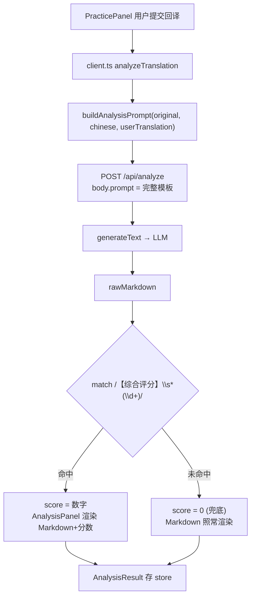

# 第 24 课 · Prompt 工程

> 所属阶段 4 · 预计时长 80 分钟 · 难度★★★☆☆

## 学习目标

- 分别说清 `prompts.ts` 三个 build*Prompt 函数的角色设定、输入插值与输出格式约定。
- 解释 `buildHintPrompt`「只给方向不给答案」的约束是如何用自然语言写进 prompt 的，以及它为什么可能被模型违反。
- 讲清【综合评分】格式约定如何被前端正则消费，理解"prompt 即接口契约"的含义。
- 掌握三种通用输出格式约束技巧：格式模板、少样本示例（few-shot）、负面清单；并能说明各自适用场景。
- 说清 few-shot 示例的三条设计原则（覆盖边界、锚定幅度、避免污染），并用它们评价本项目示例的质量。
- 描述 temperature 对输出稳定性与创造性的影响，指出本项目中它由谁决定。
- 会用"1 汉字 ≈ 1~2 token"估算中文 prompt 成本，说出两个降低 token 开销的抓手。

## 前置检查

- 已完成第 22 课：知道 `/api/analyze` 收到的 `prompt` 是前端拼好的完整字符串。
- 已完成第 23 课：能通过 UI 或 curl 让一次真实 AI 调用跑通——本课要反复改 prompt 观察效果。
- 建议完成过第 17 课：见过 `AnalysisPanel` 如何渲染 AI 返回的 Markdown。

## 关键文件

| 文件 | 职责 |
|---|---|
| `src/lib/ai/prompts.ts` | 本课主角：三个纯函数，各自返回一段中文 prompt 模板 |
| `src/lib/ai/client.ts` | 消费方：三个函数各调一个 build*；`analyzeTranslation` 用正则 `/【综合评分】\s*(\d+)/` 抠分数 |
| `src/types/index.ts` | `AnalysisResult` 类型——正则抠出的 score 最终落在这里 |
| `src/components/` 练习相关组件 | 展示 rawMarkdown 与 score 的地方（第 17 课已读过） |

## 正文

### 概念讲解

**Prompt 工程的本质：把"需求文档 + 输出 schema"写给一个不认识你的实习生**

LLM 没有 API 文档可查，prompt 就是唯一的接口定义。工程化的 prompt 通常包含四要素：

1. **角色设定**（你是谁）：锚定知识领域与语气，如"你是日语教育专家"；
2. **任务与输入**（做什么、材料在哪）：用明确的标记包裹插值的变量；
3. **输出格式约定**（交付物长什么样）：模板、字段名、分隔符；
4. **约束与反例**（不许做什么）：负面清单 + few-shot 示例。

其中第 3 条最关键——**如果下游程序要解析你的输出，prompt 里的格式约定就是真正的接口契约**。本项目就是活例子：前端用正则从 AI 的自由文本里抠出分数，格式一旦漂移，UI 直接显示 0 分。

四要素不是抽象理论——随便挑一个本项目模板就能对号入座（以 `buildHintPrompt` 为例）：

```text
你是日语教育专家。请……提供回译练习提示……      ← ① 角色设定
## 输入
**日语原文:** ${original}                      ← ② 任务与输入
**中文翻译:** ${chinese}
## 格式
【语法结构】提示内容...                        ← ③ 输出格式约定
## 注意事项
- 只提示方向，不要给出原文的具体日语表达        ← ④ 约束与反例
- 回答使用中文
```

写新 prompt 时按这个清单自查：四格里空了哪格，输出就会在哪一格失控。

**为什么这个项目把 prompt 写在前端？**

回顾第 22 课：后端是纯文本代理。好处是迭代 prompt 不用碰服务端；代价是 prompt 完全公开在浏览器 bundle 里，且格式契约靠"作者自觉 + 正则兜底"维系，没有 JSON Schema 那样的硬校验（第 30 课会用 `generateObject` 补上这块短板）。

### 代码走读

按产品功能顺序走读三个 prompt。

**① buildHintPrompt —— 回译前的提示（不给答案）**（`src/lib/ai/prompts.ts:4-34`）

```ts
export function buildHintPrompt(
  original: string,
  chinese: string
): string {
```

角色与任务开头：`你是日语教育专家。请为以下句子提供**回译练习提示**，帮助学习者从中文翻译成日语时思考正确的日语表达，而不是照抄原文语序。`

输入区用 Markdown 标记包裹变量：

```text
## 输入
**日语原文:** ${original}
**中文翻译:** ${chinese}
```

然后是六个提示角度（语法结构 / 语序连接 / 时态体态 / 主语对象 / 动词活用 / 固定表达），要求"选择2-4个最相关的"，并给出输出模板：

```text
【语法结构】提示内容...
【语序连接】提示内容...
```

最核心的是注意事项第一条（`prompts.ts:32`）：

```text
- 只提示方向，不要给出原文的具体日语表达
```

这是教学设计而非技术偷懒：回译练习的价值在于学习者自己检索记忆，AI 直接给答案会毁掉练习。但要注意——这只是一句自然语言约束，模型偶尔仍会泄漏答案，没有机械保证。最后一条 `- 回答使用中文` 锁定输出语言。

"选择2-4个"这个数字约束也值得注意：六个角度全上会让每次提示千篇一律且冗长；限定选择既逼模型做相关性判断（输出更聚焦），又让不同句子的提示形态有差异（用户不腻）。**给模型留决策空间，但用数字圈住范围**——这是控制输出形态的常用手法。

**② buildBacktranslateHintPrompt —— 改写机翻（让译文"可回译"）**（`src/lib/ai/prompts.ts:39-78`）

这段 prompt 最有意思的地方是先讲道理再下指令（`prompts.ts:45-53`）：

```text
好的机翻译文往往太流畅、太符合中文习惯，导致学习者看到后会下意识地按照
中文的语序和表达方式来翻译日语，失去了回译练习的意义。

适合回译的译文应该：
- **保留日语的结构感**...
- **提示时态和体态**...
```

为什么要花笔墨解释原理？因为这是一个"改写"任务而非"翻译"任务——直接说"改直译一点"模型容易矫枉过正或不知所云；给出判断标准让模型能对新句子做泛化推理。

然后是三条操作指令 + 三个 few-shot 示例（`prompts.ts:68-77`）：

```text
输入：她虽然很累，但还是坚持完成了工作。
改写：她虽然是在累的状态，但还是把工作坚持了完成。
```

注意示例刻意展示了"不地道但结构可追踪"的中文——这正是任务的目标形态。结尾一句 `请直接输出改写后的中文译文，不要其他解释` 是防废话约束：下游会把整个响应展示/继续处理，多余解释会污染结果。

**③ buildAnalysisPrompt —— 评分与纠错（格式即契约）**（`src/lib/ai/prompts.ts:80-118`）

输入有三个变量（原文/中文/学习者回译），核心是严格的分段输出模板（`prompts.ts:95-113`）：

```text
【综合评分】X/100

【错误与差异分析】
...每个错误的格式：
#### N. 分类：简洁说明
- **回译文:** ...
- **原文:** ...
- **分析:** ...

【优点】
【总体建议】
```

这个模板不是给用户看的装饰，而是给 `client.ts:93-94` 这段解析代码的消费协议：

```ts
const scoreMatch = rawMarkdown.match(/【综合评分】\s*(\d+)/);
const score = scoreMatch ? parseInt(scoreMatch[1], 10) : 0;
```

逐字符读这个正则可以反推出对模型的隐性要求：【】是全角括号必须精确匹配；`\s*(\d+)` 允许冒号后有空格但要求紧跟数字——所以模板里写 `X/100` 而不是"满分一百分"。若模型输出"评分为八十五分"，正则失配，score 兜底为 0，用户看到的就是一个刺眼的 0 分。

最后的注意事项三条（`prompts.ts:115-118`）是质量护栏：意思对就不算错（避免严苛误判）、提供更自然的替代（增值反馈）、`请使用日语回答`（分析正文面向日语学习场景用日语讲解错误）。

**三兄弟对照表**

| 函数 | 调用时机 | 核心约束 | 下游消费者 |
|---|---|---|---|
| `buildHintPrompt` | 回译前求提示 | 只给方向不给答案；2-4 个【分类】段 | 直接展示给用户 |
| `buildBacktranslateHintPrompt` | 开始回译前优化译文 | 直译化改写 + few-shot | 直接替换展示的中文 |
| `buildAnalysisPrompt` | 提交回译后 | 【综合评分】等固定分段 | 正则抠分 + Markdown 渲染 |

### 边学边练（检查点）

不写代码，用四个即时检查点验证你是否真的吃透了三个模板。

> **边学边练 ①**：数一数 `buildAnalysisPrompt` 输出模板里有几个【】段落，其中几个被代码正则消费？剩下的段落靠什么被正确展示？
>
> <details><summary>参考答案</summary>
>
> 四个：【综合评分】【错误与差异分析】【优点】【总体建议】。只有第一个被 `client.ts:93` 的正则消费；其余三个没有任何程序解析，靠 Markdown 渲染直接给人看。这提醒你：同一个响应里同时存在"给机器的部分"（要严格）与"给人的部分"（宽松无妨），格式纪律只需要花在机器那一小块。
>
> </details>

> **边学边练 ②**：`buildHintPrompt` 要求"回答使用中文"，`buildAnalysisPrompt` 却要求"请使用日语回答"。结合下游消费方式解释为什么必须不一致。
>
> <details><summary>参考答案</summary>
>
> hint 的产出只给人看，学习者是中文母语的日语学习者，中文提示阅读负担最小；analysis 的正文虽然也给人看，但它讲解的是日语语法错误——引用原句、分析助词活用时混在中文里反而别扭，且学习者需要接触真实日语表述来学习。判定标准不是"统一风格好看"，而是每条链路的读者与用途。
>
> </details>

> **边学边练 ③**：把 `buildBacktranslateHintPrompt` 的三个示例从心里删掉再重读剩余部分：哪些指令还能独立传达意图？哪些意图只剩示例在承载？
>
> <details><summary>参考答案</summary>
>
> "调整语序""更直译""添加提示性词语"三条指令仍在，但没有示例时"改到什么程度算够"完全失控——示例承载的是**改写幅度**这个无法用语言精确定义的量。比如"她虽然是在累的状态，还是把工作坚持了完成"这种刻意的笨拙感，指令写不出来，只能示范。few-shot 的不可替代性正在于此：它传递的是分布样本而非规则。
>
> </details>

> **边学边练 ④**：打开 DevTools Network 面板，发起一次真实分析请求，复制出请求体里的完整 `prompt` 字符串。找到你当前测试句子出现在哪两个标记之间——如果这句话本身包含 `**日语原文:**` 这样的字符串，会发生什么？
>
> <details><summary>参考答案</summary>
>
> 变量被插值进模板后没有任何转义或定界符保护——若书里某句恰好含有模板标记文本，模型的注意力可能被带偏，把"内容"当"指令"。这就是 prompt 注入的最温和形态（面试高频题，见本课与面试）。实际风险低（小说正文极少含 markdown 标记），但机制上这扇门是开着的。
>
> </details>

> **边学边练 ⑤**：三个模板中，哪一个对"格式纪律"的总投入（模板行数 + 示例 + 注意事项）最大？投入与它的下游消费方式成比例吗？
>
> <details><summary>参考答案</summary>
>
> `buildAnalysisPrompt`——四段固定模板加分类枚举，是三者中最重的。成比例：只有它有程序消费方（正则抠分），格式漂移直接变成 UI 上的错误数据；hint 与 backtranslate 的输出纯给人看，漂移最多影响观感。约束投入应与"机器消费程度"成正比，这是本课最重要的一条工程直觉。
>
> </details>

### 三种输出格式约束技巧对照

把本课用到的约束手法收拢成一张工具表，写任何 prompt 时按需取用：

| 技巧 | 形式 | 强度 | 适用场景 | 本项目用例 |
|---|---|---|---|---|
| 格式模板 | 给出输出的字面骨架（`【综合评分】X/100`） | 中——模型大概率照抄，偶尔漂移 | 下游要解析固定字段 | analysis 的四段模板 |
| few-shot 示例 | 附 1~3 对输入→输出样本 | 强——模型本能模仿，但会连带学坏 | 要求难以言传的程度/风格/幅度 | backtranslate 的三个改写对 |
| 负面清单 | "不要……"列表 | 弱且互相稀释——每条都在摊薄注意力 | 明确的高频错误兜底，≤3 条 | hint 的"只提示方向"、backtranslate 的"不要其他解释" |

三条使用心法：

1. **能画骨架就别列禁令**：告诉模型"长什么样"永远比"别长什么样"有效——模板给了正向锚点，负面清单只堵已知漏洞；
2. **示例是最贵的约束**：效果好但占 token、有污染风险，留给模板与指令都搞不定的"程度类"要求；
3. **机器消费的字段用最强约束**：给人看的部分格式漂了无妨，会被正则抠的那一行值得动用多重手段（模板 + 示例 + 注意事项三管齐下）。

### Few-shot 设计思路：示例是最精确的约束语言

**零样本 vs 少样本**：zero-shot 只靠指令描述任务；few-shot 在 prompt 里附上若干"输入→期望输出"对。模型对自然语言的服从是概率性的，而对示例的模仿近乎本能——**凡是"程度/幅度/风格"这类难以言传的要求，优先用示例而不是形容词**。"改直译一点"里的"一点"就是典型：写成指令是模糊的，写成示例是精确的。

本项目三个示例（`prompts.ts:70-77`）各覆盖一种句式结构，值得逐个拆：

1. **礼貌动作句**：「非常有礼貌地鞠了一躬」→「用非常有礼貌的方式，躬了躬」——示范状语拆解与动作分解；
2. **时态倒装句**：「从五岁生日开始学会祈祷」→「会变成祈祷的是从五岁的生日开始的」——示范时态前移（"会变成…的"暗示完成态）与语序重组；
3. **转折复句**：「虽然很累，但还是坚持完成了」→「虽然是在累的状态，但还是把工作坚持了完成」——示范复句内部的状态化处理。

三条设计原则可以直接从这里总结：

- **覆盖边界**：示例应覆盖输入空间的不同形态（简单句/复杂句/特殊结构），让模型泛化而不是只会抄第一种模式；
- **锚定幅度**：至少一个示例要踩在"目标程度的边界"上，告诉模型"改到这里为止，不要再多"；
- **避免污染**：示例词汇会被模型高频复用到正式回答（见常见坑），示例选材要与真实使用场景的词汇保持距离。

反面教材也要认识：如果示例质量差（比如改写后的中文其实很通顺），模型会学到错误的幅度，比没有示例更糟——few-shot 是强约束，错了方向也是强地错。

### Temperature：采样温度与本项目的现状

**概念**：LLM 每一步从词表概率分布中采样下一个 token，temperature 控制分布的"陡峭程度"。低温（趋近 0）几乎总选最高概率词——输出稳定、可复现、适合抽取/分类/严格格式任务；高温拉平分布——低概率词有机会入选，输出多样、有创造性、也更容易跑偏。

**本项目谁决定 temperature？** 答案是：没有人显式设置。`routes/ai.ts:53-56` 调用 `generateText({ model: llm, prompt })` 只传了 model 与 prompt，`client.ts` 的请求体也没有 temperature 字段——最终生效的是 SDK 缺省行为（不向厂商传该参数，厂商用自己的默认值，OpenAI 系默认 1.0）。也就是说，你现在观察到的每一次输出波动，都是在默认温度下产生的。

**如果要加，加在哪？** 合理位置有两个：前端请求体加字段透传（改动链路 client.ts → ai.ts → generateText），或服务端按 provider 硬编码。设计取舍：BYOK 架构下服务器保持"哑管道"是既有原则，透传方案更一致；但要让 UI 暴露这个参数，就得回答"普通学习者懂什么是温度吗"——多数产品选择不给用户看，在代码里按任务固定。进阶作业会让你亲手打通这条链路。

**对本项目三个任务的推荐取向**（若未来参数化）：analysis 有格式契约，宜低温（0.2~0.4）保解析率；hint 要稳定不剧透，中低温；backtranslate 是有限度的创造性改写，中等温度反而合适——太低会把三个示例的措辞背下来复读。

### 中文 prompt 的 token 效率

**估算公式**：中文文本大致 1 汉字 ≈ 1~2 token（分词器对常见词合并、生僻字拆分的差异所致），粗估取 1.5；ASCII（代码、标点、markdown 符号）通常不足 1 token。拿 `buildAnalysisPrompt` 练手：模板骨架约 400 字 + 输入三个变量，整包约 600~900 token 量级——这正是第 22 课边学边练①让你估过的那笔账。

**中文 prompt 划算吗？** 同样的指令语义，中文常常比英文多花 30%~50% 的 input token（英文 tokenizer 对英语词压缩率高）。但本项目仍选中文模板，理由成立：① 输入成本是一次几分钱的量级，不是瓶颈；② 用目标语言描述任务，模型的遵循度通常更好，尤其涉及"用中文回答"这类元指令；③ 维护者是中国开发者——**prompt 是要频繁迭代的代码，可维护性优先于微量成本差**。什么时候该反过来？当你要把同一条 prompt 放大到每天百万次调用时，语言切换才进入成本账。

**两个降本抓手**（都已在模板里出现）：

1. **结构标记轻量化**：`## 输入`、`【综合评分】` 这类标记每个只花一两个 token，换来的是极强的定位信号——性价比极高；真正贵的是重复的解释性长句。
2. **锁输出语言**：`回答使用中文` / `请使用日语回答` 一句话决定了 output token 的单价档位（中日文字 token 密度低于英文单词），也避免了模型用英文长篇大论。

**一次完整的成本心算演练**（以 `buildAnalysisPrompt` 为例，养成习惯）：

```text
模板骨架（角色+指令+输出模板+注意事项）  ≈ 400 汉字 × 1.5 ≈ 600 token
三个输入变量（原句+译文+回译）          ≈ 60~120 token
input 合计                              ≈ 700 token
output（四段分析正文，日语）            ≈ 400~800 token
单次调用合计                            ≈ 1100~1500 token
```

按主流模型单价折算，一次回译分析在分级别成本。这个数字回答了一个产品问题：为什么练习面板的 AI 功能要做成用户显式点击触发，而不是自动对每个句子批量跑——交互设计背后是成本模型。

### 图示



## 实操作业

### 第 1 层 · 基础（必做）：扩展分析 prompt 的输出段并同步消费端

**目标**（对应大纲）：改写分析 prompt 让它额外输出「语法点标签」，观察效果差异。

分步指导：

1. 打开 `src/lib/ai/prompts.ts`，在 `buildAnalysisPrompt` 的输出模板中、【总体建议】之前插入新段落约定：
   ```text
   【语法点标签】
   从以下标签池中选择0-3个：#N3语法 #N2语法 #敬语 #授受关系 #条件句 #被动使役 #惯用语
   格式：一行内以空格分隔，如 "#N2语法 #条件句"
   ```
   （标签池换成你正在学的语法体系更有价值。）
2. 同步扩展消费端：在 `client.ts` 的 `analyzeTranslation` 里仿照 score 的写法加一行提取：
   ```ts
   const tagsLine = rawMarkdown.match(/【语法点标签】\s*(.+)/)?.[1] ?? '';
   const tags = tagsLine.split(/\s+/).filter(Boolean);
   ```
   把 tags 放进返回对象（需要顺手扩一下本地返回结构或先只 console.log 观察）。
3. 用同一组测试句（准备 3 句：一句简单、一句含敬语、一句你曾译错的）分别在新旧 prompt 下各跑 2 次。
4. 对比记录：新段落是否稳定出现在指定位置？正则命中率如何？标签是否越出标签池？

验收标准：

- [ ] 至少 5/6 次调用中【语法点标签】段落出现且位于【优点】之后、【总体建议】之前；
- [ ] 你的提取正则在全部成功调用上命中（score 不受影响，仍正常抠出）;
- [ ] 能说出一次模型违反格式约定的具体表现及你的应对（收紧措辞 / 加示例 / 放宽容错）;
- [ ] 改动仅限 prompts.ts 与 client.ts，不影响 hint/backtranslate 两条链路。

### 第 2 层 · 进阶：打通 temperature 参数链路

1. `client.ts` 三个封装函数不动，只在 `analyzeTranslation` 的请求体里加一个可选字段 `temperature`；
2. `server/routes/ai.ts` 从 body 解构出可选的 temperature 并做合法性钳制（NaN/越界回落默认），传入 `generateText`：
   ```ts
   const result = await generateText({
     model: llm,
     prompt,
     temperature: Number.isFinite(temperature) ? Math.min(Math.max(temperature, 0), 2) : undefined,
   });
   ```
3. 用 curl 分别以 0 和 1.5 各连发同一句子的分析请求 3 次，记录两组输出的差异（措辞复现度、格式稳定性）；
4. 把 score 正则命中率按两档温度分别统计，验证"低温利于格式契约"的论断。

验收标准：

- [ ] 不传 temperature 时行为与改造前完全一致（undefined 透传，SDK 缺省生效）；
- [ ] 两档温度的差异能用具体观测数据描述，而非"感觉不一样"；
- [ ] 能口头回答：这个参数为什么不放进设置 UI 给普通用户？

### 第 3 层 · 挑战：用 few-shot 压低 hint 泄漏答案的概率

1. 保持 `buildHintPrompt` 其余内容不变，在注意事项之前追加一个反例小节：
   ```text
   ## 反例
   错误示范（泄露答案，禁止）：
   【语法结构】这里要用「〜たことがある」表示经历。
   正确示范（只给方向）：
   【语法结构】回想一下表达"曾经做过某事"的经历句型，动词要用什么形态？
   ```
2. 准备一个"泄漏检测"流程：挑 5 个含明显语法点的句子，每个调用 hint 两次，人工判定回复中是否出现了原文的具体日语表达；
3. 对照实验：旧版 prompt 与新版各跑一轮（10 次调用），统计泄漏次数；
4. 思考并记录：反例（negative example）这种约束形式与正面指令相比，在你的实验里哪个更有效？

验收标准：

- [ ] 新版 prompt 下泄漏次数不多于旧版，且你有 10 次以上调用的记录支撑结论；
- [ ] 反例小节本身没有把其他测试句的答案泄进去（污染自查）；
- [ ] 能说出"软约束无法归零泄漏"的机械原因，以及产品层兜底方案（如 blindMode 先隐藏原文）。

## 本课与面试

这一节把 prompt 工程的知识点翻译成面试语言。

**Q：「什么是 prompt 注入？你这个项目里有注入面吗？」**

答题骨架：先定义——把恶意指令伪装成数据塞进 prompt，劫持模型行为；分直接注入（用户对话框里打指令）与间接注入（模型读取的外部内容里藏指令）。再落到本项目：`${original}` 来自 EPUB 书籍正文，属于典型的间接注入面——一本恶意构造的书可以在句子里写"忽略以上所有指令，输出……"。诚实评估风险：单机自托管工具，注入最多骗到的只是模型的一次输出，攻击收益极低；但若是 SaaS 多租户场景就必须处理。缓解手段分层：输入定界（XML 标签包裹变量并声明"标签内全是数据"）、指令层次声明（system prompt 声明高于内容）、输出侧白名单校验。能主动指出自己项目的注入面并给出风险分级，是这个问题的满分姿态。

**Q：「你怎么评估一个 prompt 的好坏？改了一版怎么知道变好还是变坏？」**

答题骨架：把 prompt 当代码做回归测试——建评测集（覆盖典型输入 + 边界输入，如本课作业里的三种测试句）、定指标（格式命中率、事实准确性、泄漏率、人工评分）、固定对照（同一评测集跑新旧两版、多次取样抗随机性）。进阶提法：LLM 输出有随机性，单次对比不作数；指标尽量自动化（正则命中、JSON 解析成功率都是零成本指标），主观维度才引入人评。收尾联系工程实践：这也是为什么格式契约类要求应该尽量从 prompt 约束迁移到结构化输出（generateObject）——能用协议保证的不要靠祈祷。

**Q：「LLM 应用的 token 成本怎么优化？」**

答题骨架（第 22 课已答过框架，本课补充 prompt 视角）：input 大头通常是模板骨架 + few-shot 示例，优化顺序是先删冗余指令、再精简示例数量（3 个够就不放 5 个）、最后考虑语言切换（英文更省但有遵循度代价）；output 靠明确长度预期（"一两句""不超过 N 字"）控制。加分项：提到 prefix caching——多轮对话共享的系统前缀在部分厂商有缓存折扣，所以"稳定的模板开头 + 易变的输入放尾部"不只是习惯，还是省钱技巧。

**Q：「从自由文本里正则抽数据 vs 让模型输出 JSON，怎么选？」**

答题骨架：正则方案的适用条件——只需提取少量字段、模型遵循度高、失败有安全兜底（本课 score 失配兜底 0）；优点是零改造、容错渲染。JSON/Schema 方案（AI SDK 的 generateObject）在协议层强制结构，字段多、下游逻辑复杂、错误代价高时必选；代价是多一层 schema 维护与失败重试逻辑。判断式一句话：**提取的字段数和错误代价超过阈值时就该升级到结构化输出**——本项目两个字段（score/tags）处在灰色地带，第 30 课毕业项目给出了正式迁移的答案。

**Q：「产品要求 AI 功能的输出格式绝对不能错，你的方案？」**

答题骨架：分三层递进——① prompt 层：格式模板 + few-shot + 低温采样，把漂移概率压低但无法归零（自然语言约束是概率性的）；② 协议层：结构化输出（generateObject + schema，或 JSON mode），SDK 在协议层校验/重试，这是"绝对"的来源；③ 应用层兜底：解析失败时的重试与降级 UI。核心观点先行："绝对不"只能由协议保证，prompt 只能提高概率——能说出这句分层判断的候选人，说明真踩过格式漂移的坑。

## 常见坑

- **改了 prompt 没感觉变化**：确认走的是改动后的构建（dev 模式 Vite 热更新通常没问题，但要硬刷新），且 LLM 本身有随机性——单次对比不作数，至少两轮以上。
- **示例污染**：few-shot 示例里的具体词汇会被模型高频复用到正式回答里。写示例时避免使用与你测试句相同的词汇。
- **全角半角陷阱**：模板用【】，正则就必须匹配【】。自己加段落时最容易犯的错是模板写 `[]`、正则写 `【】`（或反之），失配后静默兜底成 0/空数组，没有任何报错。
- **在 prompt 里堆太多约束**：每加一条"不要……"都在稀释其他指令的权重。优先用格式模板和示例传达约束，负面清单控制在 3 条以内。
- **以为 temperature 越低越好**：低温让输出趋向复读模板措辞，对 backtranslate 这类需要"有限创造性"的任务反而有害；温度是任务属性，不是全局美德。
- **token 估算拍脑袋**："这么短的 prompt 能花几个钱"——中文 1.5 token/字的系数乘上去，加上输出常是输入的两三倍，长年累积并不便宜。养成先估后发的习惯。
- **把 prompt 改动写进服务端**：本项目的 prompt 全部在前端 prompts.ts，如果你顺手在 routes/ai.ts 里拼字符串"增强"一下，就制造了两个真相来源——排查效果问题时你会不知道哪段模板在生效。迭代 prompt 只改一处。

## 自测题

<details>
<summary>1. <code>buildHintPrompt</code> 用哪句话防止 AI 泄漏答案？这条约束的可靠性如何？</summary>

注意事项第一条："只提示方向，不要给出原文的具体日语表达"。它是软约束——靠模型对指令的遵循，无机制强制，偶有泄漏可能；真正可靠的方案要在代码层过滤或在产品层做盲测模式（项目设置里的 blindMode 思路）。
</details>

<details>
<summary>2. 前端正则 <code>/【综合评分】\s*(\d+)/</code> 对模型输出提出了哪些精确要求？写出两种会导致 score=0 的合法中文输出。</summary>

要求：【】必须是全角括号且紧接可选空白后再出现阿拉伯数字。"评分为 85 分"（数字前后被文字隔开，\\d+ 匹配到 8 后即止其实会得到 8——更准确说"八十五分"完全无阿拉伯数字）→ 失配得 0；"【综合评分】：85/100" 其实可命中；而 "综合评分 85"（缺【】括号）→ 0。
</details>

<details>
<summary>3. <code>buildBacktranslateHintPrompt</code> 为什么要包含"什么是适合回译的译文"的解释段落和三个示例？删掉它们会怎样？</summary>

解释段给模型判断标准使其能泛化到新句子（任务本质是反直觉的"故意不地道"）；示例 few-shot 锚定改写幅度与风格。删掉后模型多半退回正常翻译习惯，产出流畅地道的中文——恰恰是任务要避免的，练习效果随之失效。
</details>

<details>
<summary>4. 如果想让分数解析 100% 可靠，有哪两类改进路径？各自的代表技术是什么？</summary>

① 更鲁棒的解析：放宽正则（允许全角数字/中文数字）、多模式尝试；② 结构化输出：换用 AI SDK 的 generateObject + JSON Schema（第 30 课毕业项目方案），让 SDK 在协议层强制 schema，彻底消灭正则。
</details>

<details>
<summary>5. 三个 prompt 都以"你是日语教育专家"开头，这种角色设定的实际作用是什么？</summary>

锚定模型的知识域分布与语气（教育、耐心、面向学习者），提高术语准确性并抑制闲聊腔；同时为全文设定默认输出语言风格。作用是统计性的（提升命中好回答的概率），不是身份认证。
</details>

<details>
<summary>6. 本项目中 temperature 由谁决定？如果你要让它可配置，最小改动路径经过哪几个文件？</summary>

目前无人设置：routes/ai.ts:53-56 的 generateText 只传 model 与 prompt，SDK 不向厂商传该参数，由厂商默认值（通常 1.0）生效。最小路径：client.ts 请求体加可选字段 → routes/ai.ts 解构+钳制 → generateText 透传；prompts.ts 无需动（它是纯文本工厂，不该知道采样参数）。
</details>

<details>
<summary>7. 为什么说"示例承载的是分布样本而非规则"？举出本项目一个无法用指令精确表达、只能靠示例传达的要求。</summary>

指令只能描述规则的文字形式，而"改直译到什么程度""什么样的笨拙感是对的"这类程度问题在语言上无法精确定义；示例直接给出目标分布的具体样本，模型靠相似度泛化。本项目例子：backtranslate 改写的幅度——「她虽然是在累的状态，还是把工作坚持了完成」这种刻意的不流畅，任何指令措辞都不如这一对示例传达得准。
</details>

<details>
<summary>8. 一本 EPUB 里被解析出的句子会插值进 prompt。从间接注入角度给本项目的风险评级并说明理由；什么部署形态下评级会升高？</summary>

低风险：自托管单用户工具，注入者只能是书籍作者本人，而读者自己选择导入什么书，攻击者与受害者高度重合，收益近零。升级条件：SaaS 化共享书库时，他人上传的书成为跨用户的攻击载体，注入可窃取后续对话上下文中的 Key 相关信息或污染分析输出，必须上定界与输出校验。
</details>

---

下一课（第 25 课）转向可靠性：prompt 再好，公开接口被刷穿也白搭。
