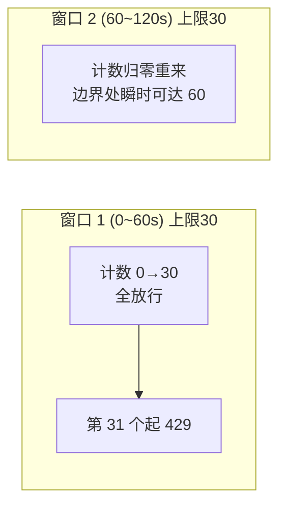
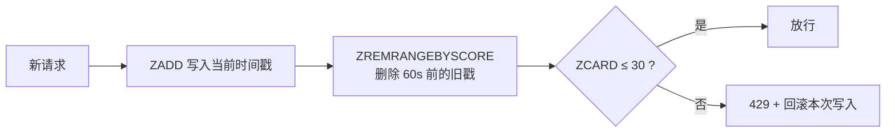
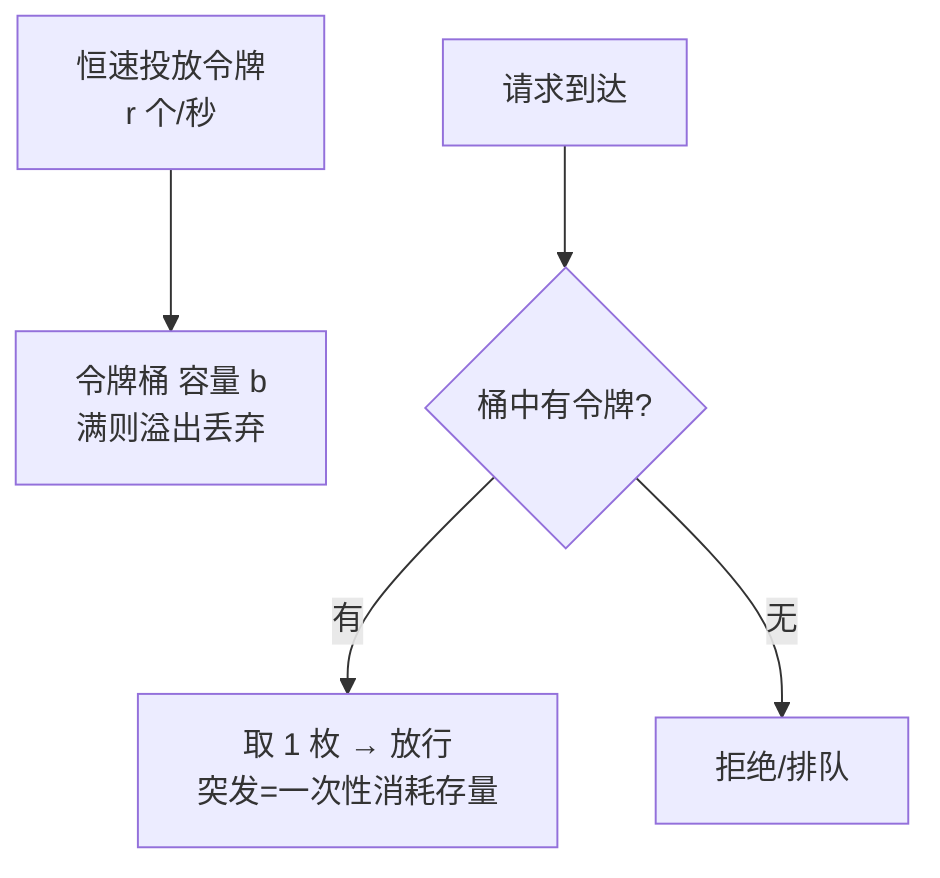
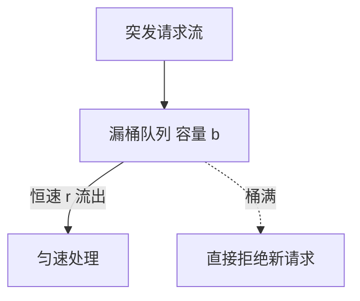
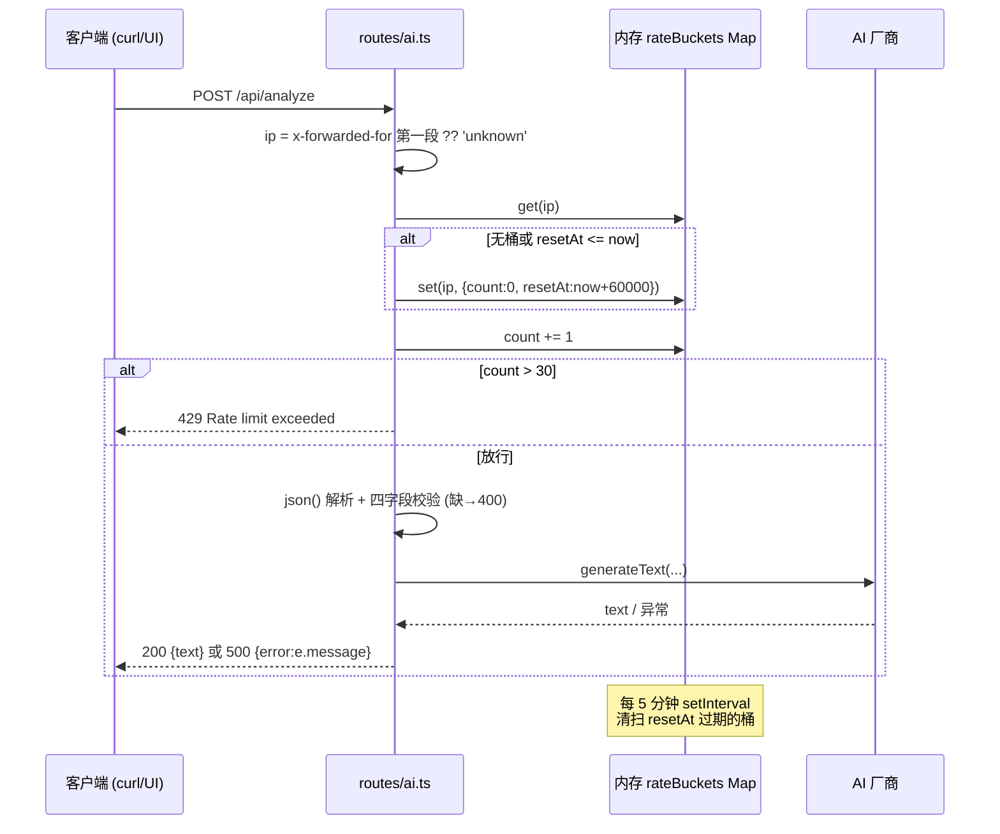
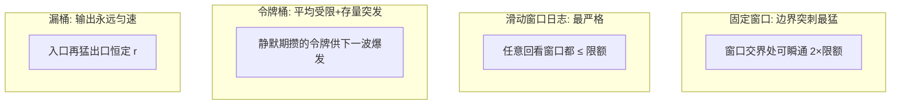

# 第 25 课 · 限流与可靠性

> 所属阶段 4 · 预计时长 90 分钟 · 难度★★★☆☆

## 学习目标

- 逐行走读 `routes/ai.ts` 的固定窗口限流器，说出三个关键参数：60 秒窗口、每 IP 30 次、每 5 分钟清扫一次过期桶。
- 解释 `x-forwarded-for` 头的来源与"取第一个元素"的原因，以及它可被伪造的一面。
- 对比四种经典限流算法（固定窗口 / 滑动窗口日志 / 令牌桶 / 漏桶）的原理、突刺行为与适用场景，能按流量形态选型。
- 论证当前实现为什么在 Node 单线程下没有"检查-自增"竞态，以及什么改动会让竞态出现。
- 论证内存计数器的单机局限，并描述向 Redis 滑动窗口演进的路线图。
- 评价当前"错误透传 + 全部 500"策略的取舍，并动手把限流阈值改为环境变量可配置。

## 前置检查

- 已完成第 22/23 课：能通过 curl 稳定调用 `/api/analyze`（本课要用脚本连打验证 429）。
- 已完成第 21 课：理解请求进入 `ai.post('/analyze')` 前后的分发链路。
- 已知第 20 课作业改过 `/health`——本课不动它。

## 关键文件

| 文件 | 职责 |
|---|---|
| `server/routes/ai.ts` | 本课主角：限流常量、`rateBuckets` Map、清扫 setInterval、`POST /analyze` 的校验/调用/错误透传 |
| `.env.example` | 现状没有限流配置项——作业就是把它加进去 |
| `src/lib/ai/client.ts` | 消费端如何感知 429/500（`response.ok` 检查 + throw） |
| `.env.example` / `package.json` | `--env-file-if-exists=.env` 是 env 配置的加载通道 |

## 正文

### 概念讲解

**为什么公开接口必须限流？**

`/api/analyze` 的每次调用都会触发一次真实的厂商 API 计费请求。虽然 BYOK 让用户自带 Key，但恶意脚本仍可以：① 用你的服务器当免费 AI 代理（配自己的 Key）；② 海量并发打挂 Node 进程；③ 通过你中转攻击厂商。限流是最小成本的防线：按来源约束单位时间请求数。

**固定窗口计数器（Fixed Window）**

最简单的限流算法：

- 为每个主体（这里是 IP）维护 `{ count, resetAt }`；
- 请求到来时若窗口已过期则重开新窗口、count 归零；
- count 超过上限即拒绝。

优点：O(1) 内存、几行代码。缺点：**边界突刺**——旧窗口最后一秒和新窗口第一秒之间可以瞬间通过 2×上限的请求。更精细的替代有滑动窗口日志、令牌桶等，本项目选择了够用的固定窗口——工程判断："30 次/分对人类用户绰绰有余，突刺无害"。

**单机内存限流的局限**

`Map` 存在进程内存里，意味着：

1. **重启即清零**：部署更新后所有计数丢失；
2. **无法水平扩展**：两个实例各自计数，实际限额翻倍——需要共享存储（Redis）才能一致；
3. **内存泄漏风险**：大量一次性 IP 会无限堆积桶，必须有清扫机制（本项目的 setInterval 就是为此存在）。

**x-forwarded-for 与真实客户端 IP**

`x-forwarded-for` 是代理链标准头，格式 `client, proxy1, proxy2`——最左边是原始客户端。直连时该头不存在（要回退到连接级信息）；经 Nginx/CDN 时由代理追加。注意它**可被伪造**：客户端可以自带一个假 XFF 头，只有可信代理会覆盖/追加，所以生产上应只信任"可信代理数量"那一跳之后的值。

### 代码走读

`server/routes/ai.ts` 前 25 行是限流全部实现，逐行走。

**① 参数与数据结构**（`server/routes/ai.ts:14-17`）

```ts
const RATE_LIMIT_WINDOW_MS = 60_000;
const RATE_LIMIT_MAX = 30; // requests per window

const rateBuckets = new Map<string, { count: number; resetAt: number }>();
```

三个事实：窗口 60 秒；每窗口每主体最多 30 次；桶以字符串（IP）为键，值为 `{count, resetAt}` 二元组。数字字面量 `60_000` 用了下划线分隔符，纯可读性语法糖。两个常量是模块级 const——整个进程生命周期内不可变，这也是它们目前无法从环境变量调整的原因（作业第一件事就是解开这个约束）。

**② 定期清扫**（`server/routes/ai.ts:19-25`）

```ts
// Sweep stale buckets every 5 minutes
setInterval(() => {
  const now = Date.now();
  for (const [key, bucket] of rateBuckets) {
    if (bucket.resetAt <= now) rateBuckets.delete(key);
  }
}, 5 * 60_000);
```

每 300_000 ms（5 分钟）全表扫描一遍，删掉所有窗口已过的桶。没有这段，每个出现过的独立 IP 都会在 Map 里留下一条永不释放的记录——公网上被扫一圈就能撑爆内存。注意它在模块顶层执行而非请求处理器内：**定时器与应用同生命周期，整个进程只有一个**。另一个细节：在 `for...of` 一个 Map 的同时 delete 当前项是安全的（JS Map 迭代器契约允许删除已访问/未访问条目）。

还有一层隐藏含义值得指出：setInterval 让 Node 事件循环始终保持有一个挂起的 timer，只要这个模块被 import，进程就不会因"没有待处理事件"而自然退出——对本项目这种常驻服务无所谓，但如果哪天把 routes/ai.ts import 进一次性脚本，会发现进程"下不来"，根因就在这行。生产级做法是在优雅关闭（SIGTERM 处理）时 clearInterval。

**③ 取 IP**（`server/routes/ai.ts:29`）

```ts
const ip = c.req.header('x-forwarded-for')?.split(',')[0]?.trim() ?? 'unknown';
```

四段式防御链：头可能不存在 → split 可能得到空串 → 元素可能有空白 → 最终兜底 `'unknown'`。所有走同一个反代且没带 XFF 的请求会共享 unknown 这一个桶——这是刻意的保守设计：识别不了的流量合并且受限。

对照真实部署形态检验这个取法：开发环境浏览器/Vite 代理直连 3003，无 XFF → 全部落 unknown 桶；自托管加 Nginx 时，Nginx 追加 `proxy_add_x_forwarded_for` → 第一个元素是真实客户端 ✓；攻击者直连且伪造 XFF 绕过 Nginx 不存在时……等等，如果 Nginx 是唯一入口，伪造头会被 Nginx **追加在尾部**而不是覆盖头部，第一个元素仍是真客户端——所以"取第一个"在"恰好一层可信反代"的标准拓扑下是安全的。危险的是多层代理或反代配置为透传原头的情况，那之后第一个元素就可能来自客户端伪造。结论再强调一次：XFF 的可信度是部署拓扑的函数，不是头的函数。

**④ 核心判定**（`server/routes/ai.ts:30-41`）

```ts
const now = Date.now();
let bucket = rateBuckets.get(ip);

if (!bucket || bucket.resetAt <= now) {
  bucket = { count: 0, resetAt: now + RATE_LIMIT_WINDOW_MS };
  rateBuckets.set(ip, bucket);
}

bucket.count += 1;
if (bucket.count > RATE_LIMIT_MAX) {
  return c.json({ error: 'Rate limit exceeded. Try again shortly.' }, 429);
}
```

逻辑三步：无桶或桶过期就开新窗口；无条件先自增再比较——所以第 31 个请求才被拒（前 30 个都放行）；拒绝时返回 429 与人话消息，且**不返回 Retry-After 头**（改进点之一）。Retry-After 能让合规客户端精确等待而不是盲目重试，也顺带减少窗口刚重置时的无效冲击——一行 `Retry-After: ${Math.ceil((bucket.resetAt - now)/1000)}` 就能补上。限流检查刻意放在 `c.req.json()` 解析之前——被拒的请求不必浪费 body 解析的开销。

**⑤ 校验与正常路径**（`server/routes/ai.ts:43-58`）

```ts
const body = await c.req.json();
const { provider, apiKey, model, baseUrl, prompt } = body;

if (!provider || !apiKey || !model || !prompt) {
  return c.json({ error: 'Missing required fields' }, 400);
}
// ... createProvider + generateText → c.json({ text })
```

第 22 课讲过。顺序总结：限流(429) → 字段校验(400) → 业务(200/500)——便宜的检查永远在前。

**⑥ 错误透传策略**（`server/routes/ai.ts:59-62`）

```ts
} catch (e) {
  const message = e instanceof Error ? e.message : 'Unknown error';
  return c.json({ error: message }, 500);
}
```

厂商 SDK 抛出的任何异常（Key 无效、余额不足、模型名错、网络失败、JSON body 解析失败）都被同一层捕获，message 原文随 500 返回前端；`client.ts:23-26` 再包装成 `Error('AI analysis failed: ...')` 抛给 UI 展示。

利：BYOK 用户能立刻知道"是我的 Key 错了"，自排障体验好，服务端也不用维护错误分类映射。
弊：① 一刀切 500 掩盖了 401/402/429/503 的语义差别，前端无法做针对性提示或自动重试；② 内部错误细节（含 SDK 堆栈片段、上游 URL）暴露给公网，信息面偏大。对 BYOK 自托管场景，利大于弊；若转 SaaS 则必须重构。

### 边学边练（检查点）

不写代码，用四个即时检查点验证你是否真的读懂了限流器。

> **边学边练 ①**：纸面推演——某个 IP 在 t=0s 发第 1 个请求（开桶），随后每秒 1 个连发。第几个请求被拒？t=61s 的那个请求命运如何？
>
> <details><summary>参考答案</summary>
>
> 开桶时 resetAt=60s，t=0..59s 各自增一次共 60 次？不对——上限 30，所以 t=29s 的第 30 个请求放行（count=30），t=30s 的第 31 个请求 count=31 > 30 被拒，此后到 t=59s 全拒。t=61s：resetAt(60) <= now(61)，旧桶过期，开新窗口放行。推演一遍你就永远记住"先自增再比较"和"惰性过期"这对组合了。
>
> </details>

> **边学边练 ②**：用 curl 发 `curl -H "X-Forwarded-For: 9.9.9.9" ...` 直连 3003，限流桶的键是什么？这说明开发环境下 XFF 取值的什么特性？
>
> <details><summary>参考答案</summary>
>
> 键是 `9.9.9.9`——服务器无条件相信客户端带来的任何 XFF。开发环境无所谓，但这演示了伪造路径：只要请求不经过"会规范化 XFF 的可信代理"，任何人换个假头就获得全新配额。生产防线必须建在反代层，应用层这行代码防君子不防小人。
>
> </details>

> **边学边练 ③**：如果把清扫的 setInterval 从模块顶层挪进 `ai.post('/analyze')` 处理器内部，会发生什么？
>
> <details><summary>参考答案</summary>
>
> 每个到达该路由的请求都会注册一个新的定时器——高频访问下定时器数量随请求数线性增长，清扫本身变成新的资源泄漏。这是"副作用必须放在模块顶层或显式生命周期钩子里，不能放进请求处理器"的经典反面教材。ESM 模块缓存保证顶层代码只跑一次，正是这里需要的语义。
>
> </details>

> **边学边练 ④**：写出一段 10 行以内的脚本验证「Map 迭代中 delete 当前项是安全的」，并预测：delete 刚刚还没迭代到的项呢？
>
> <details><summary>参考答案</summary>
>
> ```js
> const m = new Map([[1,'a'],[2,'b'],[3,'c']]);
> for (const [k] of m) if (k === 2) m.delete(k);
> console.log([...m.keys()]); // [1, 3]
> ```
> 未访问项被删则不会被访问到，已删项不会出现——Map 迭代器按当时存活的条目走。规范依据是 Map.prototype.entries 的迭代契约：条目在迭代开始后被删除则不再返回。
>
> </details>

### 四种限流算法对比

固定窗口只是起点。把四种经典算法放在同一张桌上对比，才能说清本项目的选型是"够用"还是"偷懒"。

**① 固定窗口（本项目）**

时间切成等长窗口，每窗独立计数。上面已精读。突刺问题的量化：窗口交界两侧各 30 个 = 瞬时 60 个/2 秒，标称速率两倍。



适用：保护阈值宽松、对瞬时超量不敏感的场景（人类用户工具）。不适用：计费 API、下游有严格 QPS 合同的场景。

**② 滑动窗口日志（Sliding Window Log）**

记录每个主体的每次请求时间戳（队列/ZSET），来一个请求先清理出窗口外的旧时间戳，再看剩余数量。任意时刻回看 60 秒都是精确的 30 个——彻底消灭突刺。代价：内存 O(请求数)（固定窗口 O(主体数)），Redis 实现靠 ZSET 三件套。



适用：需要精确速率承诺的 API（对外收费接口）。不适用：超高 QPS 下时间戳集合本身成为负担。

**③ 令牌桶（Token Bucket）**

恒定速率往桶里放令牌（如 0.5 个/秒），桶容量封顶（如 30）；请求消耗一个令牌，没令牌就拒绝。精髓在于**允许突发**：闲置期攒下的令牌让短时爆发一次通过最多"桶容量"个请求，长期平均仍收敛到投放速率。CDN、网关（如 nginx limit_req 的变体、AWS API Gateway）普遍采用。



适用：天然有突发形态的流量（用户操作、爬虫合规抓取）。参数直觉：容量决定"允许多大的突发"，速率决定"长期平均多快"。

**④ 漏桶（Leaky Bucket）**

请求先进队列（桶），以恒定速率流出处理；桶满则拒绝。与令牌桶互为镜像：令牌桶限制的是**平均速率并允许突发输出**，漏桶强制**输出整流**——不管进来多猛，出去永远是稳定的匀速。适合保护"只能接受匀速负载"的脆弱下游（某些老式数据库、硬件设备）。



**总对比表**

| 算法 | 内存复杂度 | 突刺 | 突发容忍 | 实现难度 | 典型场景 |
|---|---|---|---|---|---|
| 固定窗口 | O(主体数) | 有（最高 2×） | 无（窗口内硬顶） | ★ | 内部工具、粗粒度防护 |
| 滑动窗口日志 | O(主体数×请求数) | 无 | 无 | ★★ | 计费 API、精确承诺 |
| 令牌桶 | O(主体数) | 无（平滑到速率） | 有（存量突发） | ★★ | 网关、CDN、云厂商标配 |
| 漏桶 | O(排队数) | 无 | 整流（削峰填谷） | ★★★ | 保护脆弱下游 |

回到本项目的选型判断："人类使用模式 + 单机 + 最少代码"三个条件下固定窗口是最优解；一旦变成对外计费产品，滑动窗口或令牌桶立刻上位。**算法选型跟着流量形态与失败代价走，不跟着技术时髦走。**

### 并发竞态问题：现在安全，别乱动

限流器的灵魂是"检查-自增-判定"必须是原子动作。当前实现为什么安全？

Node 的 JavaScript 执行是单线程事件循环模型：同步代码块一旦开始执行就不会被打断（没有其他回调能插进两条同步语句之间）。看 `routes/ai.ts:31-39`——`get`、条件判断、`set`、自增、比较全部是同步语句，中间没有一个 `await`，因此两个并发请求不可能交错执行这段代码。第一个请求的事件循环 turn 里完整走完限流判定，第二个请求才轮到。**单线程把 TOCTOU（check 时间与 use 时间分离）竞态免费送给了我们**。

什么时候会被打破？只要在读取与写入之间插入任何一个 `await`：

```ts
// 反例：引入异步后竞态出现
const bucket = await loadBucketFromRedis(ip);   // ← await 让出事件循环
await someAsyncLogging();                        // ← 更多让出点
bucket.count += 1;                               // 此刻另一请求可能已读过同一份旧值
if (bucket.count > MAX) { ... }                  // 两边都判 30 ≤ 30，双双放行
```

两个请求都在对方让出时读到了同一个旧计数，各自 +1 后写回，实际放行了本该只放行一个的额度。演进到 Redis 时这个问题必然重现（网络调用必是异步），解法是把"读-改-写"打包成服务端原子操作：`INCR` 天然原子；滑动窗口用 Lua 脚本把 ZADD+ZREMRANGEBYSCORE+ZCARD 捆成一个原子单元。**记住这条规律：内存方案的安全依赖单线程，分布式方案的安全依赖原子命令——两者都失效时才有竞态。**

### 演进路线：从 Map 到 Redis 滑动窗口

单机内存限流的三大局限（重启清零、无法水平扩展、依赖进程生命周期）指向同一个终点：共享存储。演进分两步走。

**第一步：INCR + EXPIRE（仍是固定窗口，但分布式）**

```text
key = ratelimit:{ip}:{分钟序号}     ← 把窗口编进 key，避免 EXPIRE 竞态
count = INCR key                    ← 原子自增，首个请求触发创建
if count == 1: EXPIRE key 60        ← 只有第一个请求设 TTL
if count > 30: 429
```

改动极小：路由里 `rateBuckets` 的 get/set/delete 换成 Redis 调用，判定逻辑不变。注意 key 里编入窗口序号的小技巧——它规避了"INCR 之后、EXPIRE 之前进程崩溃导致永不过期键"的经典事故。

**第二步：ZSET 滑动窗口日志（消灭突刺）**

```text
ZADD ratelimit:{ip} <now> <uuid>          ← 本次请求时间戳入集
ZREMRANGEBYSCORE ratelimit:{ip} 0 <now-60000>  ← 清理窗口外旧戳
count = ZCARD ratelimit:{ip}              ← 当前窗口内精确计数
EXPIRE ratelimit:{ip} 61                  ← 兜底 TTL，防空集残留
count <= 30 ? 放行 : 429
```

四条命令打包在一个 Lua 脚本里保证原子性。所有实例读写同一个 Redis，水平扩展后限额语义不变；重启不清零；Redis 自身的淘汰策略接管了内存回收（应用层的 setInterval 清扫光荣退休）。

**迁移成本为什么低？** 因为当初把限流写成了 20 来行的内聚代码块，没有渗进业务逻辑——换存储只碰数据访问那一小截。这是"横切关注点要写得可拔插"的一次现场示范。

### 图示



四种算法对同一波"密集 20 个 + 静默 + 再密集 20 个"流量的放行差异（示意）：



## 实操作业

### 第 1 层 · 基础（必做）：把限流阈值改为可配置（env），并用脚本连打验证 429

分步指导：

1. 修改 `server/routes/ai.ts` 顶部两个常量为 env 可配：
   ```ts
   const RATE_LIMIT_WINDOW_MS = Number(process.env.RATE_LIMIT_WINDOW_MS ?? 60_000);
   const RATE_LIMIT_MAX = Number(process.env.RATE_LIMIT_MAX ?? 30);
   ```
2. 在 `.env.example` 补充注释文档（保持现有风格）：
   ```text
   # Rate limit for POST /api/analyze (per IP)
   # RATE_LIMIT_WINDOW_MS=60000
   # RATE_LIMIT_MAX=30
   ```
3. 重启 dev 服务，先用默认阈值确认行为不变；然后建一个临时 `.env` 写 `RATE_LIMIT_MAX=3`，再次重启。
4. 连打验证：
   ```bash
   node -e "
     let i = 0;
     const t = setInterval(() => {
       i++;
       fetch('http://localhost:3003/api/analyze', {
         method: 'POST',
         headers: { 'Content-Type': 'application/json' },
         body: JSON.stringify({ provider: 'openai', apiKey: 'x', model: 'm', prompt: 'hi' }),
       }).then(r => console.log(i, r.status));
       if (i >= 6) clearInterval(t);
     }, 150);
   "
   ```
5. 观察输出应为 `1..3 → 非429状态`（400 或 500 都说明过了限流层），`4..6 → 429`。等待 60 秒后再发一次，应恢复非 429（新窗口）。
6. （可选）把阈值调大、删掉 `.env`，验证回落到 30 次/分。

验收标准：

- [ ] 不配置任何 env 时行为与改造前完全一致（默认 60s/30 次）;
- [ ] `RATE_LIMIT_MAX=3` 时第 4 个请求起稳定收到 429，body 为 `{"error":"Rate limit exceeded. Try again shortly."}`;
- [ ] 新窗口开启后计数恢复正常（等待约 60s 后不再 429）;
- [ ] 能口头解释：为什么第 4 个请求被拒而不是第 3 个？（先自增再比较）

### 第 2 层 · 进阶：补齐 429 的语义（Retry-After 头 + 伪造 XFF 实验）

1. 在限流分支返回前计算剩余等待秒数，给 429 响应补上标准头：
   ```ts
   return c.json(
     { error: 'Rate limit exceeded. Try again shortly.' },
     429,
     { 'Retry-After': String(Math.ceil((bucket.resetAt - Date.now()) / 1000)) }
   );
   ```
2. curl -i 验证响应头确实出现 `Retry-After: N`，且 N 随时间递减；
3. 伪造实验（加深对 XFF 的理解）：连打时每次随机换一个 `X-Forwarded-For: 10.x.x.x` 头，观察是否永远打不到 429——亲手复现"按 IP 限流可被伪造绕过"；
4. 思考题写进笔记：如果要在应用层防御这种伪造而不改部署拓扑，有哪些思路？（提示：多信号组合指纹、提高 unknown 桶权重都治标，根治在可信反代规范化）

验收标准：

- [ ] 429 响应带正确的 Retry-After 数值（与窗口剩余时间吻合）；
- [ ] 伪造 XFF 实验成功复现"无限配额"，并能解释原因；
- [ ] 笔记中写出了至少一条应用层缓解思路及其局限。

### 第 3 层 · 挑战：单进程内实现滑动窗口日志，实测消灭突刺

1. 在 `routes/ai.ts` 里新增一个并行实现：`slidingBuckets = new Map<string, number[]>()`，值为时间戳数组；
2. 判定逻辑：入队前先过滤掉 `<= now - WINDOW_MS` 的旧戳，`length >= MAX` 则拒（不入队），否则 push 后放行；
3. 写一个对比脚本：以 `RATE_LIMIT_MAX=5` 分别对两版限流各跑一轮"窗口末尾密集 4 个 + 新窗口开头立即 4 个"的流量，记录各自的放行序列；
4. 观察：固定窗口在交界处放行数冲高，滑动窗口全程 ≤ 5；同时记录两版的内存痕迹（数组长度 vs 单个二元组），体会精度换内存的账；
5. 收尾：保留固定窗口为默认实现，把滑动窗口版本写成注释掉的备选或单独 gist——重点是对比数据，不是替换上线。

验收标准：

- [ ] 滑动窗口实现在任意时刻回看 60 秒放行数都不超过上限；
- [ ] 有一轮含具体数字的突刺对比记录（两版在同一流量下的放行差异）；
- [ ] 能说出这套实现搬上 Redis 时对应哪三条命令、为什么要用 Lua 打包。

## 本课与面试

这一节把限流知识点翻译成面试语言，四个考点全是后端面试常客。

**Q：「Node 是单线程的，为什么还要担心并发问题？什么时候会有？」**

答题骨架：先纠正前提——单线程指的是 JS 执行层面，I/O 与回调天然并发；真正的规则是**同步代码段内不会被打断，await 让出点之间才会交错**。举例就用本课：限流的读-改-写全同步所以安全，插一个 await 就出现丢更新。延伸：多进程（pm2 cluster）下每个进程独立计数，"伪并发"让内存限流失真；Worker threads 共享的可变状态需要 Atomics。一句话总结式收尾：Node 的并发安全模型 = 事件循环原子性 + 显式锁原语（跨进程时），知道边界在哪比背结论重要。

**Q：「429、503、403 都表示'不行'，怎么区分？限流响应该带什么？」**

答题骨架：429 Too Many Requests——你太快了，等等再来（配 Retry-After 指明等多久）；503 Service Unavailable——我这边暂时不能服务（过载/维护，也可带 Retry-After）；403 Forbidden——身份或权限不允许，等多久都没用。限流响应的专业配置：状态码 429 + `Retry-After`（秒或 HTTP 日期）+ 可选的 `RateLimit-Limit`/`RateLimit-Remaining`/`RateLimit-Reset`（IETF 标准草案字段）让客户端自适应调速。加分观察：本项目的 429 缺 Retry-After，客户端只能盲试——进阶作业就是补这一行。

**Q：「设计一个 Express/Hono 的限流中间件，说说你的结构。」**

答题骨架：借洋葱模型组织答案——中间件在 `next()` 之前做限流判定（请求进入侧），命中则直接 return 响应短路，后续路由处理器根本不执行；未命中 `await next()` 放行。要点清单：① 主体识别策略（IP/XFF/API key）及各自伪造面；② 存储选型（单机 Map vs Redis）与淘汰机制；③ 异步存储时的原子性（Lua）；④ 白名单通道（健康检查探针不该消耗配额）；⑤ 响应头语义。能主动对比"中间件统一限流"与"路由内嵌限流"的粒度差异（本项目选择后者，因为只有 analyze 这一条计费路由需要）更显思考深度。

**Q：「线上服务突然出现大量 429，你怎么排查？」**

答题骨架：按链路二分——先确认是谁在限（自家网关/上游厂商/中间层）；再看维度：单个用户还是全局？（单用户→其自身脚本 bug 或重试风暴；全局→容量不足或有共享出口 NAT 导致多用户共用一个 IP 桶）；然后看分布：突刺型集中爆发指向固定窗口边界效应，均匀触顶指向真实容量不足。修复选项排序：调参（临时）→ 加缓存/去抖（治标）→ 换算法或扩容（治本）。本题考的不是背算法而是"用限流知识做故障定位"的工程直觉。

## 常见坑

- **改了常量不生效**：`pnpm dev` 有 `--watch` 会自动重启，但如果手动启动或 watch 失灵，旧进程还持有旧值；另外确认 `.env` 在项目根目录且键名拼写与代码一致。
- **测试时把自己限死**：dev 里 Vite 代理和浏览器都从 `127.0.0.1` 来，XFF 不存在 → 全部落进 `unknown` 桶。连续调试时频繁撞 429 别奇怪，等一分钟或重启进程即可。
- **以为 429 是 JSON 解析错误**：连打实验里故意发的假 body 会产生 400/500，注意区分三种状态码对应的代码位置（429→限流层、400→字段校验、500→catch 兜底）。
- **在生产 Nginx 后误信客户端 XFF**：如果反代没有配置"覆盖"而非"追加" XFF，攻击者每次换一个假头就能绕过按 IP 限流。生产必须在可信代理层规范化该头。
- **给限流代码随手加 await 日志**：在读取桶与写入之间插入异步调用会当场制造竞态（正文并发一节的反例）。改造限流器前先问自己：这段还有原子性吗？
- **env 数字忘了 Number()**：`process.env` 读出来全是字符串，`RATE_LIMIT_MAX="3"` 直接参与 `>` 比较时会按字典序闹鬼（"10" < "3" 为 true）。包一层 Number 或用 ?? 默认值兜底是最低保障。

## 自测题

<details>
<summary>1. 写出本课限流器的三个关键数字及其代码出处。</summary>

窗口 60000ms（<code>RATE_LIMIT_WINDOW_MS = 60_000</code>）、每窗口上限 30 次（<code>RATE_LIMIT_MAX = 30</code>），均在 ai.ts:14-15；过期桶清扫周期 5×60_000ms 即 5 分钟（setInterval，ai.ts:20-25）。
</details>

<details>
<summary>2. 如果删掉那个 setInterval，程序功能看起来一切正常。它防的是什么问题？什么时候会爆发？</summary>

防内存泄漏。功能上没有任何即时差异，但当公网流量带来海量不同 IP 后，每个 IP 的桶永久滞留在 Map 中无法回收，进程 RSS 缓慢上涨直至 OOM——典型的延迟爆炸型缺陷，也是面试高频考点"缓存/计数器要有淘汰机制"的本例。
</details>

<details>
<summary>3. 为什么取 x-forwarded-for 的第一个元素？什么情况下这个值不可信？</summary>

XFF 格式为 "client, proxy1, proxy2"，最左是原始客户端地址。当请求未经任何可信代理直连时该头不存在（走 unknown 兜底）；而当客户端自带伪造 XFF 且反代只是追加而非覆盖时，第一个元素可能是攻击者编造的假 IP，限流随之被绕过——因此只应信任可信代理写入的部分。
</details>

<details>
<summary>4. 固定窗口的"边界突刺"是什么？举出具体数字说明本项目中它的最大瞬时放量。</summary>

窗口交界处两窗额度叠加：旧窗口最后 1 秒发 30 个 + 新窗口最初 1 秒再发 30 个 = 2 秒内 60 个请求，是标称速率的两倍。对计费的 AI 代理来说意味着瞬时成本翻倍，但对人类使用模式无害——这是"够用就好"的工程取舍。
</details>

<details>
<summary>5. 错误透传策略在本项目中利大于弊的理由是什么？如果明天转为官方托管 SaaS，你会先改哪两点？</summary>

利：BYOK 用户直接看到厂商原文错误（Key 错/欠费/模型名错）可自助解决，服务端免维护错误映射；弊可控因为服务器是用户自己部署的。SaaS 化先改：① 把 500 细分为 401/402/429 等语义码并脱敏内部细节；② 限流/审计从单机 Map 迁移到共享 Redis，并区分免费/付费配额。
</details>

<details>
<summary>6. 为什么当前的"检查-自增-判定"不存在竞态？给出让它产生竞态的最小代码改动。</summary>

Node 单线程事件循环中同步代码段原子执行，ai.ts:31-39 之间没有任何 await，两个并发请求无法交错。最小破坏性改动：在 get 之后插入任意一个 await（如异步日志），事件循环在此让出，另一请求即可读到同一份旧计数，双双通过判定——丢更新竞态就此出现。
</details>

<details>
<summary>7. 令牌桶与漏桶的核心区别一句话？分别举一个最适合的接入方。</summary>

令牌桶限制平均速率但允许存量突发（突发友好型，适合 CDN/云 API 网关应对用户正常爆发）；漏桶强制输出匀速整流（削峰填谷，适合保护只能承受稳定负载的脆弱下游）。镜像记忆法：令牌桶管"能进来多快"，漏桶管"出去得多稳"。
</details>

<details>
<summary>8. 把限流迁到 Redis 固定窗口（INCR+EXPIRE）时，为什么要把窗口序号编进 key 而不是对固定 key 做 EXPIRE？</summary>

INCR 与 EXPIRE 是两条命令，存在"INCR 成功后进程崩溃、EXPIRE 未执行"的间隙，固定 key 会变成永不过期的计数器，用户被永久限死。把 key 写成 ratelimit:{ip}:{分钟序号} 后，新窗口自然使用新 key，旧 key 即使漏设 TTL 也不再参与判定，配合 TTL 只是提前回收内存——用 key 设计消化了命令间非原子的问题。
</details>
