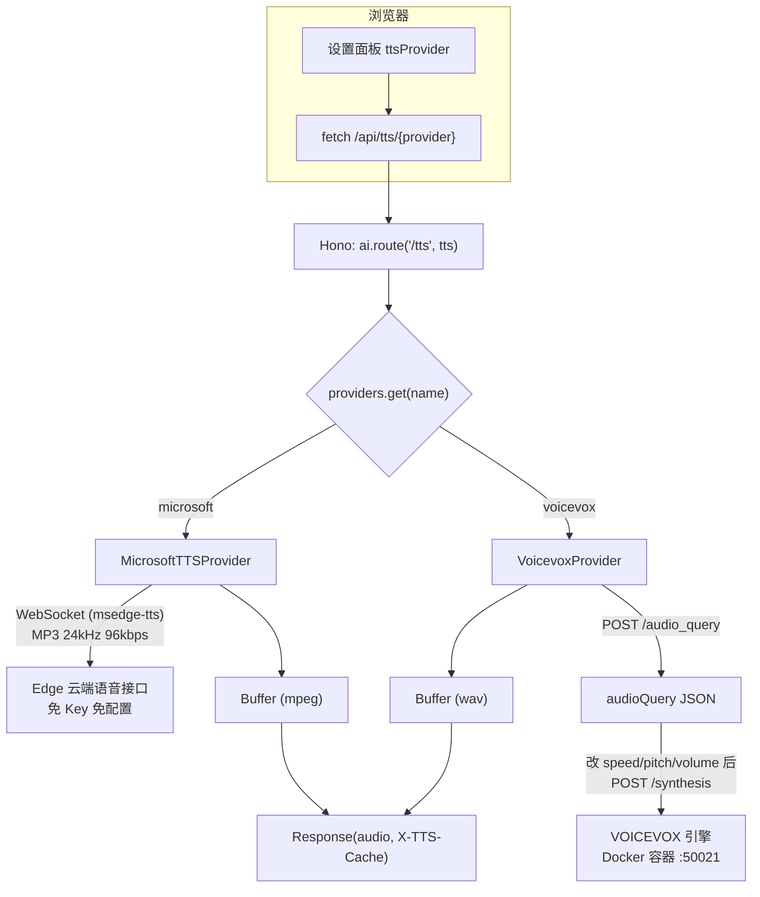

# 第 26 课 · TTS 原理与双引擎：msedge-tts vs VOICEVOX

> 所属阶段 5 · 预计时长 75 分钟 · 难度★★★☆☆

## 学习目标

- 说清 TTS（Text-To-Speech）从文本到音频的两条技术路线：云端神经网络语音 vs 本地声学引擎，以及各自的延迟/音质/隐私权衡。
- 解释项目里 `TTSProvider` 接口如何把两种截然不同的引擎抽象成同一种调用方式。
- 走读 `MicrosoftTTSProvider` 与 `VoicevoxProvider` 的实现，指出两者在「韵律参数换算」上的差异。
- 理解 `speaker` 与 `styles` 数据结构（VOICEVOX 风格）为何被选作全项目的统一音声模型。
- 会用 Docker Compose profile 按需启动/停止 VOICEVOX 引擎容器。
- 能用一段话向外行讲清三代 TTS 技术（拼接式 → 参数式 → 神经网络）的核心思路与音质分界线。
- 知道 SSML 是什么，能指出 msedge-tts 的韵律参数最终被拼进了哪种标记语言的哪个标签。
- 能对比浏览器原生 Web Speech API 与本项目「服务端代理引擎」方案，说出项目为何不选前者。


## 前置检查

- 完成第 25 课：理解 Hono 路由与中间件；本课的 TTS 路由就挂在同一个 Hono 应用下。
- 知道第 6 课讲过的 `useSettingsStore.getState()`——设置面板里的 `ttsProvider` 字段决定前端请求哪个引擎。
- 本地能跑 `pnpm dev`（不需要 Docker；Docker 内容在作业部分才用）。

## 关键文件

| 文件 | 职责 |
|---|---|
| `server/tts/types.ts` | 定义 `TTSProvider` 接口、`Speaker`、`SynthesisOptions`——双引擎的共同契约 |
| `server/tts/microsoft.ts` | `MicrosoftTTSProvider`：封装 msedge-tts 库调 Edge 免费接口 |
| `server/tts/voicevox.ts` | `VoicevoxProvider`：两步 HTTP 调用本地 VOICEVOX 引擎 |
| `docker-compose.yml` | `app` + `voicevox` 两个服务，后者用 profile 按需启停 |
| `docs/self-hosting.md` | 自托管文档：profile 启动命令与环境变量表 |
| `src/stores/settingsSlice.ts` | 前端 `ttsProvider` 设置字段（`'voicevox' \| 'microsoft'`） |

## 正文

### 概念讲解

**TTS 是什么。** TTS 把一段文字变成可播放的音频。现代方案大致分两类：

1. **云端神经语音**：文本发到厂商接口，服务端用神经网络模型合成后回传音频流。优点是零本地算力、免配置；缺点是依赖网络、受制于厂商接口稳定性。本项目用的 `msedge-tts` 库复用了 Microsoft Edge 浏览器「朗读 aloud」功能的 WebSocket 接口——不需要 Azure 账号和 Key，属于灰色但广泛使用的免费通道。
2. **本地引擎**：VOICEVOX 是开源的日语语音合成引擎（含声学模型+声码器），以 HTTP 服务形式跑在本机或局域网，暴露 `/audio_query`、`/synthesis` 等 REST 接口。优点是音质对日语更自然（二次元配音级）、完全离线；代价是约 2GB 的 Docker 镜像和 CPU/GPU 合算力。

**speaker / style 概念。** VOICEVOX 的 API 里，「说话人」是 `speaker_uuid` 标识的角色（如四国めたん、ずんだもん），每个角色有多个「风格」(`styles`)：正常、欢快、低语等，每个风格有自己的数字 `id`。合成的所有接口都只认这个数字 id。本项目直接把这个结构当作统一音声模型：

```ts
// server/tts/types.ts
export type Speaker = {
  name: string;
  speaker_uuid: string;
  styles: { id: number; name: string }[];
};
```

注意 `synthesize(text, speaker, options)` 的第二个参数 `speaker` 实际传的是 **style 的数字 id**——这是全链路（前端下拉框 → 缓存键 → 引擎参数）通用的那个整数。

**SynthesisOptions：跨引擎的韵律抽象。**

```ts
export type SynthesisOptions = {
  speedScale?: number;   // 语速倍率，1 为原速
  pitchScale?: number;   // 音高偏移，0 为不变
  volumeScale?: number;  // 音量倍率，1 为原始
};
```

两个引擎内部单位不同（微软用半音符字符串和 0~100 音量），换算逻辑各自写在 provider 里——这正是抽象的价值。

**TTS 技术原理速览：三代技术路线。** 前文按「云端 vs 本地」分类，那是部署视角；拉远看技术演进，TTS 走过三代：

| 代际 | 核心思路 | 音质 | 可控性 | 代表 |
|---|---|---|---|---|
| 拼接式（Concatenative） | 真人录制海量音素/音节片段，合成时检索、拼接 | 真实（本来就是录音）但拼接点生硬 | 差：一改语速语调就露馅 | 早期车载导航、部分电话客服 |
| 参数式（Parametric / HMM） | 统计模型把文本转成声学参数（基频/时长/频谱包络），再用声码器还原波形 | 有「机器味」，偏闷 | 好：参数天然可调 | HTS；早期 GPS 语音 |
| 神经网络式（Neural） | 端到端模型从文本生成梅尔频谱甚至直接生成波形 | 接近乃至超越真人 | 好，还支持情感/风格控制 | Tacotron、WaveNet、VITS、微软 Neural 声音 |

一条记忆线：**拼接式「放录音」→ 参数式「算参数」→ 神经网络式「学分布」**。本项目恰好横跨两代：msedge-tts 是纯神经网络的云端方案——`ja-JP-NanamiNeural` 名字里的 Neural 就是这个意思；VOICEVOX 则是「轻量声学模型 + 声码器」的本地方案，CPU 就能实时推理，这也是它能塞进一个约 2GB 的 Docker 容器在笔记本上跑的原因。

**SSML：语音合成的「HTML」。** SSML（Speech Synthesis Markup Language）是 W3C 标准的 XML 方言，用标签告诉合成器「这段话该怎么读」。微软神经声音的接口底层吃的正是 SSML：

```xml
<speak version="1.0" xml:lang="ja-JP">
  <voice name="ja-JP-NanamiNeural">
    <prosody rate="+20%" pitch="+2st" volume="+30%">
      今日は<break time="300ms"/>いい天気ですね。
    </prosody>
  </voice>
</speak>
```

对照 `MicrosoftTTSProvider` 里的三个换算，会发现它们一一落进 `<prosody>` 的属性：

- `speedScale` → `rate`（倍率语义一致，直通）；
- `pitchScale × 20` → `pitch="+N.Nst"`（半音符 st 是 SSML pitch 的合法单位）；
- `volumeScale × 50` → `volume`（换算到微软接口的内部刻度）。

换句话说 provider 并没有发明新协议，它只是把跨引擎抽象的三个数字翻译成 SSML 韵律属性，由 msedge-tts 库组装成完整 SSML 从 WebSocket 发出。而 VOICEVOX 不吃 SSML：它的 audioQuery JSON 是自家中间表示（音素时长、语调曲线都在里面），韵律参数是顶层标量字段。同一个「用户意图」，两套「表达协议」——这正是 provider 层存在的意义。

**Web Speech API 对比：浏览器自带的 TTS 为什么落选。** 浏览器其实内置了语音合成，一行代码就能出声：

```ts
const u = new SpeechSynthesisUtterance('今日はいい天気ですね');
u.lang = 'ja-JP';
speechSynthesis.speak(u);
```

但在本项目场景它有几个硬伤：

| 维度 | Web Speech API | 本项目方案（服务端代理引擎） |
|---|---|---|
| 音源一致性 | 取决于操作系统装了什么语音包，Windows/macOS/Linux 各不相同 | 引擎固定，全平台同一音色 |
| 日语质量 | 系统 TTS 参差不齐，老声音机械感明显 | VOICEVOX 达到配音级 |
| 韵律控制 | `SpeechSynthesisUtterance` 只有 rate/pitch/volume 三个粗粒度属性，且各浏览器实现不一致 | audioQuery / SSML 细粒度可控 |
| **音频字节** | **拿不到。黑盒实时播放，无法导出数据** | Buffer/Blob 全程在手 |
| 离线能力 | 系统声音离线可用（这是它真正的优点） | 微软需联网；VOICEVOX 离线 |

决定性的一条是加粗行：拿不到音频字节，意味着第 27 课的字节上限缓存、第 28 课的 Blob 缓存 + 预取全部无从谈起——进度条 seek、命中率统计、连续朗读预取都建立在「音频是可以持有的一段数据」之上。对朗读学习工具来说，可控性比零成本重要。

**从文本到波形：一条通用的合成管线。** 无论哪一代技术，内部都大致走五步：

```text
文本 → ①文本正则化(TNF) → ②音素化(G2P) → ③声学模型 → ④声码器(vocoder) → 波形
```

① 把「3.14」「2026年」展开成正确读法；② 文字转音素序列，日语还要解决汉字多音字并划分重音短语（accent phrase）；③ 由音素预测基频、时长、频谱——拼接式在这一步退化为「检索录音」，参数式/神经式在这里跑模型；④ 把频谱还原成可播放的波形（经典 Griffin-Lim、神经的 WaveNet/HiFi-GAN 都属此类）。理解这条管线后，两个引擎的行为就都有了坐标系：VOICEVOX 的 audioQuery 正是第②③步之间的中间表示（音素时长、重音位置、语调曲线都在里面）；msedge-tts 则把整条管线藏在微软服务端，只收 SSML、吐 MP3。

两个引擎在这条管线上分工不同：

| 管线阶段 | msedge-tts | VOICEVOX |
|---|---|---|
| ① 正则化 / ② 音素化 | 服务端黑盒完成 | 引擎内完成，结果可经 audioQuery 观察 |
| ③ 声学模型 | 云端神经网络 | 本地轻量模型，audioQuery 即其输出 |
| 韵律修改入口 | SSML `<prosody>` 属性 | 直接改 audioQuery 的标量字段 |
| ④ 声码器 | 云端 | 本地，输出 WAV |


> **边学边练 ⑤** audioQuery 处于管线哪两步之间？`speedScale` 改的是其中哪一步的输出？（答：②和③之间；改的是时长/韵律相关的预测结果，③之后的声码器步骤不变。）


### 代码走读

**① 挂载点：路由怎么进来。** TTS 子路由不是直接挂在主应用上，而是经 AI 路由转发一层：

```ts
// server/routes/ai.ts（节选）
import tts from '../tts/index';
const ai = new Hono();
ai.route('/tts', tts);   // /api/tts/*
```

所以浏览器最终请求的是 `/api/tts/:provider` 和 `/api/tts/:provider/speakers`。

**② 统一契约 `TTSProvider`（types.ts）。**

```ts
export interface TTSProvider {
  readonly name: string;
  synthesize(text: string, speaker: number, options?: SynthesisOptions): Promise<Buffer>;
  getSpeakers(): Promise<Speaker[]>;
}
```

只有两个方法：合成音频、列出可用音声。任何新引擎只要实现这两项就能接入（第 27 课会看到路由层完全不知道具体引擎是谁）。

> **边学边练 ①** 合上文件回答：如果把 `getSpeakers()` 从 `TTSProvider` 接口删掉，前端的音声下拉框会怎么坏？（提示：下拉框的数据最初是从哪个请求来的？）


**③ `MicrosoftTTSProvider`（microsoft.ts）。** 日语声音先硬编码兜底，运行时再动态拉取：

```ts
const JA_VOICES = [
  'ja-JP-NanamiNeural',   // id 0, female
  'ja-JP-KeitaNeural',    // id 1, male
];

async synthesize(text: string, speaker: number, options?: SynthesisOptions): Promise<Buffer> {
  const voice = JA_VOICES[speaker] ?? JA_VOICES[0];   // 越界回退到女声
  const tts = new MsEdgeTTS();
  await tts.setMetadata(voice, OUTPUT_FORMAT.AUDIO_24KHZ_96KBITRATE_MONO_MP3);
```

输出格式固定为 24kHz/96kbps 单声道 MP3——这就是响应头 `Content-Type: audio/mpeg` 的由来。接下来是三个韵律参数的单位换算：

> **边学边练 ②** 口算：96kbps 单声道 MP3 下，10 秒音频约多大？同样 10 秒换成 VOICEVOX 的 24kHz/16bit PCM WAV 又是多大？（答案：12KB/s → 约 120KB；48000 B/s → 约 480KB。带着这两个数字去看第 27 课「为什么缓存按字节管理」。）


```ts
  if (options?.speedScale != null) {
    prosody.rate = options.speedScale;
  }
  if (options?.pitchScale != null) {
    // Convert our -0.15~0.15 range to semitone string
    const st = (options.pitchScale * 20).toFixed(1);
    prosody.pitch = `${Number(st) >= 0 ? '+' : ''}${st}st`;   // 半音符
  }
  if (options?.volumeScale != null) {
    // Convert our 0.2~2 range to 0~100
    prosody.volume = Math.round(Math.min(100, Math.max(0, options.volumeScale * 50)));
  }
```

然后 `tts.toStream(text, prosody)` 返回 Node 流，用 `for await` 收集成 `Buffer.concat(chunks)` 一次性返回——注意这里虽然底层是流式协议，provider 对外仍是「等完整音频」的 Buffer 接口。

**补完 synthesize 的后半段（流收集与资源释放）。** 课程前面只展示了开头，真实文件的剩余主体如下：

```ts
const { audioStream } = tts.toStream(text, prosody);

const chunks: Buffer[] = [];
for await (const chunk of audioStream) {
  chunks.push(Buffer.from(chunk));
}

tts.close();
return Buffer.concat(chunks);
```

三个值得停一停的细节：
1. **`tts.close()` 必须调用**：msedge-tts 底层持有一条 WebSocket，每次 synthesize 都新建一条，不关闭就逐次泄漏连接。这是 provider 里唯一的「手动资源管理」点，也是最容易漏的一行。
2. **`Buffer.from(chunk)` 逐块复制**：流的 chunk 可能是共享内存池的视图，统一复制成独立 Buffer 再 concat，避免整块大缓冲区因小引用无法释放。
3. **对外是「整段 Buffer」而非流**：底层协议是流式的（音频边合成边传输），但 `Promise<Buffer>` 把流吃完才 resolve。代价是首字节延迟被放大成总时长，收益是接口极简、缓存层只需存一个 Buffer。将来若要做「边下边播」，这里是改造第一站。


`getSpeakers()` 先尝试真实拉取 Edge 全部音声并 `filter((v) => v.Locale === 'ja-JP')`，映射成 `Speaker[]`（`speaker_uuid` 用 `ms-${v.ShortName}` 合成）；网络失败时 `catch` 后回落到硬编码的 `JA_VOICES` 两项。**降级路径**让免配置特性真正成立：断网也能至少返回两个声音。

**getSpeakers 完整实现（双层降级全文）。** 对照源码看两条路径如何汇合：

```ts
async getSpeakers(): Promise<Speaker[]> {
  try {
    const tts = new MsEdgeTTS();
    const allVoices = await tts.getVoices();
    const jaVoices = allVoices.filter((v) => v.Locale === 'ja-JP');
    tts.close();

    if (jaVoices.length > 0) {
      return jaVoices.map((v, i) => ({
        name: v.FriendlyName,
        speaker_uuid: `ms-${v.ShortName}`,
        styles: [{ id: i, name: v.ShortName }],
      }));
    }
  } catch {
    // Fall back to hardcoded list
  }

  return JA_VOICES.map((voice, i) => ({
    name: voice.replace('Neural', ''),
    speaker_uuid: `ms-${voice}`,
    styles: [{ id: i, name: voice }],
  }));
}
```

注意这里有**两层降级**：网络失败走 `catch` 回硬编码；网络成功但过滤后日语列表为空（`if (jaVoices.length > 0)` 不成立）也会落到函数尾部的硬编码。动态路径里每个声音的 `styles` 只有一个元素、id 就是数组下标 i。同时也能看到一个已知简化：动态列表的声音数量超过 2 个后，id≥2 传回 `synthesize` 时会命中 `JA_VOICES[speaker] ?? JA_VOICES[0]` 静默回退女声——「列表给的 id」和「合成认的 id」没有对齐，第 3 层作业会让你修复这个不一致。

> **边学边练 ③** 前端从动态列表选中第 5 个声音（id=4）并播放，实际听到的是谁的声音？为什么用户短期内很难发现这个问题？（提示：Nanami 和 Keita 都是自然度很高的 Neural 声音。）


**④ `VoicevoxProvider`（voicevox.ts）。** 构造函数读环境变量并顺手去掉末尾斜杠：

```ts
constructor(baseUrl?: string) {
  this.baseUrl = (baseUrl ?? process.env.VOICEVOX_ENGINE_URL ?? 'http://localhost:50021')
    .replace(/\/$/, '');
}
```

合成是经典的**两步式**：先拿「音频查询计划」，改参后再真正合成：

```ts
const queryRes = await fetch(
  `${this.baseUrl}/audio_query?text=${encodeURIComponent(text)}&speaker=${speaker}`,
  { method: 'POST' },
);
const audioQuery = await queryRes.json();

if (typeof options.speedScale === 'number') {
  audioQuery.speedScale = Math.max(0.5, Math.min(2, options.speedScale));
}   // pitch/volume 同理做区间钳制

const synthRes = await fetch(`${this.baseUrl}/synthesis?speaker=${speaker}`, {
  method: 'POST',
  headers: { 'Content-Type': 'application/json' },
  body: JSON.stringify(audioQuery),      // 把整份查询计划原样送回去
});
return Buffer.from(await synthRes.arrayBuffer());
```

为什么分两步？`audio_query` 返回的 JSON 里包含音素时长、语调曲线等中间表示，客户端可以先修改这些参数再提交合成。本项目只改了三个顶层标量并做了钳制（speed ∈ [0.5, 2]、pitch ∈ [-0.15, 0.15]、volume ∈ [0.2, 2]）。返回的是 WAV（`Content-Type: audio/wav`），比微软的 MP3 大得多——这直接影响第 27 课缓存上限的设计。

`getSpeakers()` 就是简单透传引擎的 `/speakers`，不做任何加工——因为 VOICEVOX 本身就是这套数据结构的出处。

**错误处理走读（前面只看了 happy path，真实文件每个 fetch 都有检查）。**

```ts
if (!queryRes.ok) {
  const detail = await queryRes.text();
  throw new Error(`audio_query failed: ${detail}`);
}
// ……修改 audioQuery ……
if (!synthRes.ok) {
  const detail = await synthRes.text();
  throw new Error(`synthesis failed: ${detail}`);
}
```

错误信息带阶段前缀（`audio_query failed:` / `synthesis failed:`）再透传引擎原文——两步式管线里哪一步出错一目了然。这些 Error 最终被第 27 课的路由 catch 住变成 500 响应体。另一个细节：`audioQuery` 被 cast 成 `Record<string, unknown>`，我们只敢改三个已知标量字段，其余几十个字段不做建模、原样回传——「最小知识原则」，引擎升级新增字段也不会破坏这个 provider。

**全文地图（读完应能在空白文件上复述每段归属）。**

microsoft.ts（68 行）自上而下：import（MsEdgeTTS、OUTPUT_FORMAT、类型）→ `JA_VOICES` 硬编码兜底数组 → 类声明与 `name = 'microsoft'` → `synthesize`（选声回退 → setMetadata 定格式 → 三段韵律换算 → toStream 流收集 → close → concat）→ `getSpeakers`（try 动态拉取过滤映射 / catch 与空列表双层降级回 JA_VOICES）。

voicevox.ts（60 行）自上而下：import（仅类型，无运行时依赖）→ 类声明与 `name = 'voicevox'`、`private baseUrl` → 构造函数（环境变量三级回落 + 去尾斜杠）→ `synthesize`（POST /audio_query → ok 检查 → 三个标量钳制 → POST /synthesis → ok 检查 → arrayBuffer 转 Buffer）→ `getSpeakers`（GET /speakers 透传 + ok 检查）。

> **边学边练 ④** 把 `speedScale` 传 10，VOICEVOX 引擎最终收到多少？传 0.1 呢？（在钳制区间 [0.5, 2] 里找答案：分别是 2 和 0.5。再想想：为什么微软 provider 不做对称的钳制？）


### 图示



### 本课速记

- 三代技术：拼接式放录音、参数式算参数、神经式学分布；本项目一云（Neural）一本地（轻量模型）。
- 管线五步：正则化 → 音素化 → 声学模型 → 声码器；audioQuery 是②③之间的中间表示。
- SSML 的 `<prosody>` 是微软侧韵律落点；VOICEVOX 用 JSON 标量，provider 负责翻译。
- 统一契约只有两个方法：synthesize + getSpeakers；speaker 参数全链路只认 style 的数字 id。
- 免配置的底气来自降级：JA_VOICES 硬编码兜底 + 双层降级 + 可热切的 ttsProvider。

## 实操作业

**目标**：分别用两个引擎合成同一句日语，量化对比延迟、体积、音质（对应大纲作业）。

**第 1 层（基础 · 必做）：双引擎对比实测。** 按下面的主流程拿到四维对比表。

1. 启动开发环境：终端 A `pnpm dev`（只起前后端，不起引擎）。
2. 用 curl 走微软引擎（此时无需任何配置）：
   ```bash
   curl -s -o ms.mp3 -w "%{time_total}s %{size_download}B\n" \
     -X POST http://localhost:3003/api/tts/microsoft \
     -H 'Content-Type: application/json' \
     -d '{"text":"今日はいい天気ですね。","speaker":0}'
   ```
   再打一次同样的请求——观察响应头 `X-TTS-Cache` 从 `MISS` 变成 `HIT`（这是第 27 课的主角，先混个眼熟）。
3. 用 Docker profile 启动 VOICEVOX：
   ```bash
   docker compose --profile voicevox up -d
   ```
   等待镜像拉取（约 2GB），`docker compose logs voicevox` 看到 ready 后继续。
4. 用同一句文本请求 VOICEVOX（WAV，speaker=3 即某角色的一个风格，可在 `curl http://localhost:3003/api/tts/voicevox/speakers` 里挑）：
   ```bash
   curl -s -o vx.wav -w "%{time_total}s %{size_download}B\n" \
     -X POST http://localhost:3003/api/tts/voicevox \
     -H 'Content-Type: application/json' \
     -d '{"text":"今日はいい天気ですね。","speaker":3}'
   ```
5. 用播放器听 `ms.mp3` 与 `vx.wav`，在笔记里记录一张表：首字节延迟 / 文件体积 / 主观音质（自然度、情感）/ 是否需要额外基础设施。
6. 思考题写进笔记：如果用户量到 100 人，两种方案的带宽成本差多少？（提示：WAV vs MP3 的压缩比。）

**验收标准**：
- [ ] 两次请求均返回 200 且能播放；
- [ ] 第二次微软请求的 `X-TTS-Cache` 响应头为 `HIT`；
- [ ] 笔记里有完整的四维对比表，且体积差异能用格式解释（MP3 vs PCM WAV）；
- [ ] 能口头回答「为什么 speaker 参数传的是 style id」。

---

**第 2 层（进阶 · 选做）：audioQuery 解剖与 SSML 对照。**

1. 绕过本项目路由，直接打 VOICEVOX 引擎拿一份完整的 audioQuery（PowerShell 用 `curl.exe`）：
   ```bash
   curl -s -X POST "http://localhost:50021/audio_query?text=こんにちは。&speaker=3" -o query.json
   ```
2. 打开 `query.json` 数一数字段总数，找出 `speedScale`/`pitchScale`/`volumeScale` 三个顶层标量以及音素时长数组（`accent_phrases` 里的 `moras`）。手改几个值后把整份 JSON POST 回 `/synthesis?speaker=3`，用 `-o` 存成 wav 试听——亲手体验「改中间表示再合成」这条两步式管线。
3. 写 100 字笔记：同样是「调语速」，微软走 SSML 属性、VOICEVOX 走 JSON 标量，两个 provider 各自做了什么翻译工作？哪边的「翻译损耗」更小？

**第 3 层（挑战）：修复动态音声 id 映射不一致。**

背景：`getSpeakers()` 动态路径给每个 ja-JP 声音分配 `id = i`（可能大于 1），但 `synthesize` 只认 `JA_VOICES[speaker] ?? JA_VOICES[0]`——前端选中列表第 5 个声音，实际播出的仍是 Nanami。

1. 在 `MicrosoftTTSProvider` 内加模块级缓存 `let dynamicVoices: string[] | null = null`，`getSpeakers` 动态路径成功时记录 ShortName 列表；
2. `synthesize` 改为优先查 `dynamicVoices?.[speaker]`，未命中再回退 `JA_VOICES`；
3. 守住回归底线：`getSpeakers` 失败时 `dynamicVoices` 必须保持 null，此时 synthesize 行为与现在完全一致（断网启动服务验证：speakers 返回兜底两项，speaker=0/1 正常合成）；
4. 思考并写进笔记：id 的「权威来源」应该是什么时刻的快照？如果 Edge 中途下线了一个声音，缓存的 id 列表会发生什么？

**验收标准（第 2/3 层）**：
- [ ] 能说出 audioQuery 里至少 5 个字段名及作用；
- [ ] 修复后，前端选任一动态声音能听到对应音色；
- [ ] 断网回归通过，原有两个兜底声音的行为不变。

## 常见坑

- **VOICEVOX 容器没起就切了引擎**：`/api/tts/voicevox` 会返回 500，错误信息是引擎连接拒绝的原文透传。先用 `docker compose ps` 确认容器状态。
- **`--profile voicevox` 忘了加**：`docker compose up -d` 只会启动 `app`，因为 `voicevox` 服务声明在 profile 下，普通启动不包含它。
- **speaker 越界**：`JA_VOICES[speaker] ?? JA_VOICES[0]` 说明微软引擎传 99 也不报错而是悄悄回退女声；VOICEVOX 则会把无效 id 直接抛错。调试时别被前者的静默回退骗了。
- **baseUrl 末尾斜杠**：环境变量里多写一个 `/` 会拼出 `//synthesis`，构造函数里的 `.replace(/\/$/, '')` 就是为这个准备的。
- **绕过 provider 直打引擎时忘了 URL 编码**：provider 内部已做 `encodeURIComponent(text)`；自己写脚本直接 POST `/audio_query?text=こんにちは` 时若文本带 `&`、`?` 或空格而不编码，会被截断成错误查询。
- **并发压测微软引擎**：msedge-tts 每次调用新建一条 WebSocket 且没有连接池，用脚本高并发猛打会触发对端限速甚至断连；本项目第 25 课的限流中间件正是挡在它前面的缓冲垫。


## 本课与面试

TTS 这一课的面试价值不在「会调 API」，而在借它讲清一批通用工程命题。

**Q：让你从零设计一个多引擎 TTS 网关，怎么分层？**
答题顺序：接口先行（`TTSProvider` 两个方法就是最小完备契约：合成 + 列举音声）→ 注册表解耦（`Map<名字, 实例>`，路由层对具体引擎零感知，新引擎只加一行 set）→ 横切关注点外提（缓存、限流放在路由/provider 之间的公共层，不进任何 provider）→ 差异收敛一处（MP3/WAV 的 contentType 分派只在路由出现一次）。能主动指出「Buffer 整段返回牺牲流式首包换取缓存简单」这类取舍，是明显的加分信号。

**Q：依赖非官方接口（msedge-tts 借用 Edge 通道）如何管理风险？**
本项目给了标准答案的三层防线：① 兜底数据——JA_VOICES 硬编码 + getSpeakers 的双层降级；② 一键切换——ttsProvider 是运行时设置而非编译期选择，故障时可热切；③ 本地替代品——VOICEVOX 离线可用，功能等价。泛化结论：不可控的外部依赖必须有「Plan B + 快速探测/切换手段」，而不是祈祷对方不封。

**Q：两步式合成 API（先 audio_query 再 synthesis）比一步式好在哪？**
本质是向调用方暴露「中间表示」：不改引擎代码即可定制韵律（本项目只改三个标量就实现了跨引擎统一的钳制逻辑），也便于做参数级实验；代价是多一次往返和多份 JSON 序列化。同类设计还有数据库的 prepare/execute、渲染管线的「先构建命令缓冲再提交 GPU」。

**Q：三代 TTS 的取舍用工程语言总结一下？**
拼接式是资产驱动：无推理成本但有录制/存储/版权成本，灵活性最差；参数式模型轻、可本地实时，质量有天花板；神经网络质量最高但推理贵，落地要么上云、要么本地配 GPU 或做优化推理（量化/蒸馏/ONNX Runtime）。选型永远是在「质量预算 × 算力预算 × 隐私边界」三元组里找平衡——本项目两个引擎正好覆盖「云上免配置」与「本地重隐私」两端。

**Q：产品要求朗读首包延迟低于 300ms，你会怎么改造这套架构？**
先说结论：单靠换更快的引擎不够，要把「整段返回」改成「边合成边播」。改造链路：provider 接口从 `Promise<Buffer>` 升级为流式（返回 ReadableStream）→ 路由用 chunked transfer 透传 → 客户端放弃 `new Audio(blobUrl)` 改用 MediaSource/AudioContext 流式解码喂 PCM → 缓存层照常工作（首播边流边攒 Buffer，播完写入缓存，二次命中仍是整段秒回）。能说出「缓存与流式并不冲突，冲突的只是接口形状」这一点，基本就是这道题的高分线了。

**Q：TTS 缓存为什么不直接靠浏览器 HTTP 缓存或 CDN？**
因为合成是 POST 请求且要求 no-store（见第 27 课），HTTP 缓存语义天然不适配；CDN 只能缓存「静态 URL 对应静态内容」，而这里的键是五维输入的哈希、且驱逐策略要按字节精确控制。应用层缓存把「键设计、度量衡、淘汰策略、可观测性」全部握在自己手里——代价是要自己管理内存，这正是下一课的全部内容。


**Q：对外暴露的音声标识，应该用数组下标还是稳定 ID？本项目用了哪种，代价是什么？**
本项目用数字 id（VOICEVOX 的 style id 天然如此；微软侧是数组下标）。下标简单、传输小，但「身份」不稳定：列表顺序变化或条目增删后，同一个 id 指向不同声音——第 3 层作业修的映射不一致就是这种脆弱性的体现。更稳妥的设计是把稳定标识（如 ShortName）作为对外契约、在 provider 内部维护「稳定标识 → 引擎参数」的映射表。答出「缓存键里存的是 id，id 不稳定会导致缓存串音」可以把这道题和第 27 课串起来。

## 自测题

<details><summary>1. 为什么项目选择 VOICEVOX 的 Speaker 结构（name/speaker_uuid/styles）作为统一模型，而不是自己发明一个？</summary>

因为 VOICEVOX 是该结构的原生出处，透传即可零转换接入；微软 provider 反向把自己的音声列表「伪装」成这个结构（`getSpeakers` 里 map 成相同形状）。适配方向是让简单一方迁就更丰富的一方，而不是造第三套结构两边都转。
</details>

<details><summary>2. MicrosoftTTSProvider.synthesize 中 pitchScale=-0.15 最终变成什么字符串？换算公式是什么？</summary>

`(−0.15 × 20).toFixed(1)` = `"-3.0"`，负数不加 `+` 号，得到 `"-3.0st"`（下降 3 个半音符）；正数会补 `+` 前缀如 `"+2.0st"`。
</details>

<details><summary>3. 为什么 VoicevoxProvider 要拆成 audio_query + synthesis 两次请求，而不是一次？</summary>

VOICEVOX 的设计允许拿到包含音素时长、语调曲线的完整中间表示（audioQuery）后自由修改再合成。本项目借此实现跨引擎统一的 speed/pitch/volume 钳制逻辑——只需改 JSON 的三个标量字段，不必理解引擎内部参数体系。
</details>

<details><summary>4. msedge-tts 不需要 API Key，它是怎么工作的？这带来什么风险？</summary>

它模拟 Edge 浏览器「大声朗读」功能所用的 WebSocket 语音接口，借用的是 Edge 客户端身份而非付费 API。风险：非官方契约，随时可能被微软调整或限流；所以代码里 getSpeakers 有硬编码兜底列表，整个系统也支持一键切换到本地 VOICEVOX。
</details>

<details><summary>5. docker-compose.yml 里 app 服务对 voicevox 的 depends_on 为什么写 required: false？</summary>

因为 voicevox 在可选 profile 里：不带 `--profile voicevox` 启动时该服务根本不存在，若强依赖会导致 app 无法启动。`condition: service_started` + `required: false` 表示「有则等待启动，无则照常跑」，对应微软引擎作为默认引擎的免配置卖点。
</details>

<details><summary>6. 三代 TTS 各举一个代表场景，并解释为什么 VOICEVOX 能在普通 CPU 上实时运行，而很多神经 TTS 不能。</summary>

拼接式：早期车载导航（只需固定短语库）；参数式：老款 GPS/客服 IVR（模型小、参数可调但发闷）；神经式：Edge 朗读、有声书配音（质量高、算力贵）。VOICEVOX 采用的是轻量声学模型 + 高效声码器的组合，模型体积和单句推理量都控制在毫秒~秒级 CPU 预算内；而大型端到端神经模型（如高质量 VITS/WaveNet 级声码器）单句推理动辄需要 GPU 或重度优化。核心变量是「每秒音频需要的浮点运算量」。
</details>

<details><summary>7. msedge-tts 库发出的请求体和 VoicevoxProvider 发出的请求体，分别是什么格式？各自的韵律参数长什么样？</summary>

微软：SSML（XML），韵律在 `<prosody>` 标签的 rate/pitch/volume 属性里，rate 是倍率、pitch 是带符号半音符字符串（如 `"+2.0st"`）、volume 是内部刻度数值。VOICEVOX：JSON（audioQuery 中间表示），同名语义的 speedScale/pitchScale/volumeScale 是三个顶层标量字段。provider 层负责在「统一抽象 SynthesisOptions」与这两套格式之间双向翻译。
</details>

<details><summary>8. 如果产品要求「朗读必须有进度条且能拖动」，Web Speech API 方案还可行吗？本项目方案为什么天然支持？</summary>

Web Speech API 几乎不可行：它拿不到音频数据也无法可靠地定位/跳转播放位置（Utterance 没有 seek 语义，实现依赖浏览器内部）。本项目方案里音频是一段持有的数据（服务端 Buffer / 浏览器 Blob），`<audio>` 元素加载 blob: URL 后 duration/currentTime/seek 全部免费获得——第 28 课的 playbackState.currentTime/duration 正是这么来的。「能否拿到音频字节」是两类方案的分水岭。
</details>
