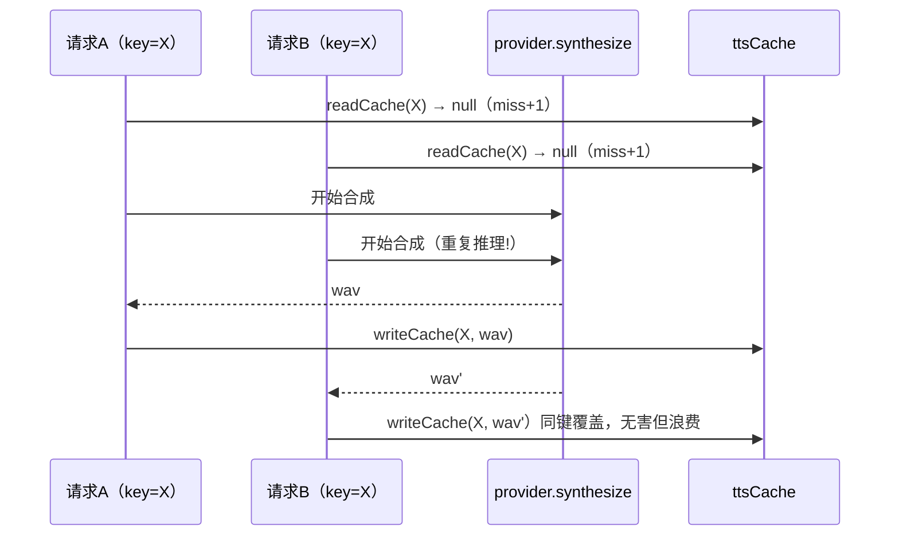
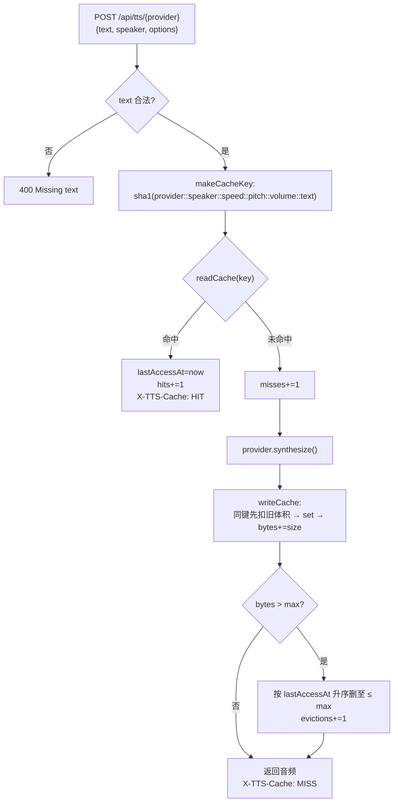
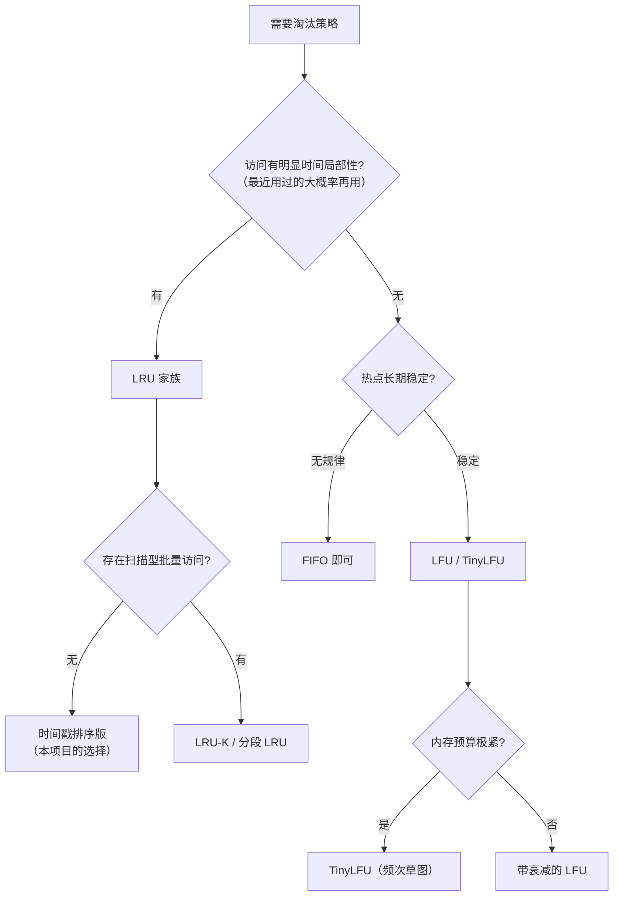

# 第 27 课 · 服务端缓存设计：字节上限 + LRU 驱逐

> 所属阶段 5 · 预计时长 80 分钟 · 难度★★★☆☆

## 学习目标

- 解释策略模式在 `providers` Map 注册表中的落地方式，以及它如何让路由层对具体引擎零感知。
- 说出 `makeCacheKey` 的五个维度（provider/speaker/speed/pitch/volume/text）为什么缺一不可。
- 走读 `evictIfNeeded`/`readCache`/`writeCache`，理解「字节上限 + lastAccessAt 时间戳排序」的简化版 LRU。
- 会用 `/api/tts/cache/stats` 观测命中率、驱逐次数，并复现缓存满载后的驱逐行为。
- 能对比本实现与真 LRU（如 LRU-K、双向链表实现）的差距并说明取舍。
- 能对比 LRU / LFU / FIFO / TinyLFU 四种淘汰策略的原理与适用场景，并说出本实现属于哪一种、为什么。
- 能解释缓存键用 SHA1 哈希压缩的动机，以及「碰撞概率有多低才够」的工程判断方法。
- 能论证为什么音频缓存的度量衡必须是字节而不是条数。


## 前置检查

- 完成第 26 课：知道两个 provider 返回的音频格式不同（MP3 vs WAV），体积差一个数量级。
- 完成第 25 课：熟悉 Hono 的路由匹配与 `c.req.json()`；本课会看到「静态路由必须注册在参数路由之前」的实际案例。
- 理解第 3 课讲过的 Node 进程内存模型——本课所有缓存都在进程内存里，重启即清空。

## 关键文件

| 文件 | 职责 |
|---|---|
| `server/tts/index.ts` | 本课主角：provider 注册表 + 缓存三函数 + 全部 TTS 路由，共 147 行 |
| `server/tts/types.ts` | `TTSProvider` 接口——策略模式的抽象策略 |
| `server/tts/microsoft.ts` / `server/tts/voicevox.ts` | 两个具体策略（第 26 课已精读） |
| `server/routes/ai.ts` | 把 tts 子路由挂到 `/api/tts` |
| `.env.example` | `TTS_CACHE_MAX_BYTES` 配置入口 |

## 正文

### 概念讲解

**策略模式（Strategy Pattern）。** 当一段流程有多个可互换的实现分支时，把每个分支封装成实现同一接口的独立对象，调用方只依赖接口。相比 switch-case 分支，策略模式新增引擎不需要改路由代码，且每个策略可以独立持有状态（如 VOICEVOX 的 baseUrl）。

**TTS 为什么必须配缓存。** 同一句日语文本每次合成都要跑一次神经网络推理（本地 CPU 上可能秒级）。而阅读场景里「重听这句」「连续朗读回放」极其高频。合成结果只由输入决定、无时效性——典型的**纯函数缓存**场景。

**按字节上限管理缓存。** 音频是二进制大对象（WAV 一句话可达几百 KB），不能按条数限制（一条超长句可能顶几十条的量）。正确度量衡是字节数：维护累计 `totalBytes`，超过上限就淘汰。淘汰策略用**最近访问时间戳排序**——每次读命中就刷新 `lastAccessAt`，满了以后从最旧的开始删，即近似 LRU（Least Recently Used）。

**缓存键设计。** 键必须是全部影响输出的输入的组合。这里输出由五个变量决定：哪个引擎、哪个音声、语速、音高、音量，加上文本本身。任何一维漏掉都会出现「改了设置却播旧音频」的事故。

**命中率的收益账。** 缓存值不值 = 省下的合成时间 × 命中率 − 维护成本。粗算：一次 VOICEVOX CPU 合成约几百毫秒到秒级，一次缓存读取 <1ms——每个百分点的命中率都在真金白银地买回推理算力。更重要的是延迟分布：连续朗读场景一句 MISS 就是秒级卡顿、体验断裂，HIT 则即时响应。所以这套缓存优化的不是平均吞吐，而是**消灭关键路径上的长尾**。带着这个目标去看第 28 课的客户端预取，会发现两者是同一件事在两层的展开。

**键归一化的边界：哪些「相同」没有被归一。** 现有实现做了缺省值归一化，但仍有三类「人眼看起来一样」的输入会生成不同的键：
1. **数值精度**：`speedScale: 1.05` 与前端浮点累加出的 `1.0500000000000001` 是两个键。JS 的 `${n}` 会保留双精度完整十进制展开。
2. **文本表面差异**：句尾多一个空格、全角/半角标点差异、不可见的零宽字符——都会 miss。好在键里存的是「原样文本」，语义上安全（不同输入本就可能该有不同读音），只是命中率略降。
3. **options 字段顺序**：无关！模板串按固定顺序逐个取值拼接，与传入对象的键序无关。但要警惕重构诱惑——如果有人把实现改成 `JSON.stringify(options)` 拼接，就会瞬间引入键序敏感性。

结论模式：**归一化只做「确定语义等价」的部分（缺省值），不做「猜测语义可能等价」的部分（文本清洗）**。前者消除假性 miss，后者可能制造真性碰撞。


**淘汰策略四兄弟：LRU / LFU / FIFO / TinyLFU。** 本实现的驱逐依据是 `lastAccessAt` 时间戳——这是 LRU 的思想，但值得把整个策略家族放在一起看：

| 策略 | 驱逐谁 | 优点 | 缺点 | 典型场景 |
|---|---|---|---|---|
| FIFO | 最早进入的 | 实现最简，O(1) | 完全不看使用频率；老而热的数据会被误删 | 队列语义明确的场景 |
| LRU | 最久未被访问的 | 命中模式贴合「局部性」直觉；只需时间戳 | 对扫描型流量脆弱：一次性批量访问会把热数据全部冲刷掉 | 阅读器回放、会话数据（本项目场景） |
| LFU | 访问频次最低的 | 抗扫描冲刷；真热点留得住 | 老热点「赖着不走」（历史高频早已降温却仍占位）；需频次统计与衰减机制 | 推荐系统特征缓存等长期稳定热点 |
| TinyLFU | 按频次近似淘汰 | 用 Count-Min Sketch 等紧凑结构以极小内存近似 LFU，配合 Window/W-LRU 新鲜度机制解决「老热点赖着不走」 | 实现复杂度高一个量级 | Caffeine（Java）、Ristretto（Go）等高性能本地缓存 |

为什么本项目选了最朴素的 LRU 变体？三个理由：① 阅读场景的访问模式天然贴合——用户重听的多是刚听过的句子，「最近访问过」就是很好的热度代理；② 音频缓存不需要对抗扫描攻击；③ 20 行代码的可读性与正确性远比百分之几的命中率提升重要。面试时先讲清业务访问模式再选策略，比上来就背「LFU 更先进」高明得多。

**为什么按字节上限，不按条数上限。** 条数上限隐含假设「每条大小相近」，对音频完全不成立：一句 10 字的日语 WAV 可能 80KB，一段 200 字的长句轻松破 1MB——差一个数量级以上。若限 1000 条，极端情况下 1000 条长句就是 1GB 内存，直接 OOM；反之限得太小，短句场景又浪费容量。字节上限直接约束真正的稀缺资源（进程内存），`ttsCacheBytes` 增量维护让它 O(1) 可查。「按价值计量而非按件数计量」是一切资源池设计的通则：数据库连接池按连接数、内存池按字节、线程池按线程数——选错计量单位，上限就形同虚设。

**缓存键的哈希碰撞讨论。** SHA1 输出 160 位，两个不同输入产生相同摘要即「碰撞」。需要分清两种碰撞：

1. **密码学碰撞**：攻击者可刻意构造两个不同文本 M1≠M2 使 SHA1(M1)=SHA1(M2)。SHA1 已被实际攻破的就是这种（2017 年 SHAttered 攻击）。但注意攻击前提——攻击者要能控制缓存键的两个输入并让系统分别缓存它们。
2. **工程随机碰撞**：非恶意使用下，n 条键里出现任意一对碰撞的概率由生日界近似：P ≈ n²/2^161。取 n = 100 万（10⁶）：P ≈ 10¹²/2.9×10⁴⁸ ≈ 3×10⁻³⁷。作为对照，宇宙射线翻转内存比特的概率都远高于此。

所以这里的判断链是：碰撞后果 = 播错一条已缓存的音频（无安全边界、无资金损失）；碰撞概率 = 天文尺度的小；输入可控性 = 用户只影响自己的文本，无法触达他人缓存条目。三者合起来，SHA1 在这个场景绰绰有余。什么时候该换？当键参与鉴权/签名（如 S3 预签名 URL），或攻击者能注入任意键且命中别人的数据时——那时换 SHA-256 只是改一个函数名，成本趋近于零，别犹豫。

顺带一提客户端（第 28 课）的选择：浏览器端同样的五维拼接**不做哈希**直接当 Map 键。因为客户端条目少（80MB 上限）、字符串键调试可读，而服务端要面对任意长度文本和更长的存活周期，才需要定长摘要控制键本身的内存占用。同一问题，两侧答案不同的原因值得体会。

### 代码走读

按执行顺序走读 `server/tts/index.ts`（147 行）。

**① 模块加载期：注册表与默认引擎。**

```ts
const providers = new Map<string, TTSProvider>();
providers.set('voicevox', new VoicevoxProvider());
providers.set('microsoft', new MicrosoftTTSProvider());

const defaultProviderName = process.env.TTS_DEFAULT_PROVIDER ?? 'microsoft';

function getProvider(name?: string): TTSProvider {
  const key = name ?? defaultProviderName;
  const provider = providers.get(key);
  if (!provider) throw new Error(`Unknown TTS provider: ${key}`);
  return provider;
}
```

这就是策略模式的注册表变体：`Map<名字, 策略实例>` 在模块顶层装配一次，之后所有请求经 `getProvider` 查表。注意 `name` 为空时回落到环境变量指定的默认引擎——URL 写 `/api/tts` 不带 provider 名也能工作吗？看第 113 行的路由签名 `/:provider` 是必填的，所以这个回落实际服务于未来可能的「默认合成端点」，属于预留的弹性。

**② 缓存数据结构与统计计数器。**

```ts
type TtsCacheItem = {
  key: string;          // 冗余存一份，驱逐时用它 delete
  wav: Buffer;          // 合成结果本体
  size: number;         // wav.byteLength，避免反复取属性
  lastAccessAt: number; // LRU 依据
};

const ttsCache = new Map<string, TtsCacheItem>();
const TTS_CACHE_MAX_BYTES = Number(process.env.TTS_CACHE_MAX_BYTES ?? 120 * 1024 * 1024);
let ttsCacheBytes = 0;    // 当前占用（增量维护，不全表累加）
let ttsCacheHits = 0;
let ttsCacheMisses = 0;
let ttsCacheEvictions = 0;
```

四个 `let` 计数器配合第 81 行的 stats 接口，构成可观测性闭环。`TTS_CACHE_MAX_BYTES` 默认 120MB（十进制写法 `120 * 1024 * 1024`），与 docs/self-hosting.md 环境变量表中默认值 `125829120` 一致。

**③ 缓存键：SHA1 压缩五维输入。**

```ts
function makeCacheKey(provider: string, text: string, speaker: number, options?: SynthesisOptions): string {
  const speed = options?.speedScale ?? 1;
  const pitch = options?.pitchScale ?? 0;
  const volume = options?.volumeScale ?? 1;
  return createHash('sha1').update(`${provider}::${speaker}::${speed}::${pitch}::${volume}::${text}`).digest('hex');
}
```

三个细节：
1. **缺省值归一化**：`?? 1` / `?? 0` / `?? 1` 与引擎侧的默认语义对齐——不传 options 和显式传 `{speedScale:1}` 必须命中同一个键，否则同一句会缓存两份。
2. **分隔符 `::`**：避免字段拼接歧义（text 里出现普通字符不会与数字段混淆，因为其他字段都是受限字符集）。
3. **SHA1 压缩**：文本可能很长，直接拼字符串会让 Map 的键占双倍内存。这里只需要防碰撞的唯一性，不需要密码学强度，SHA1 足够。

> **边学边练 ①** 把分隔符从 `::` 换成空字符串会发生什么？构造一对能互相碰撞的具体输入试试（提示：provider 名与 speaker 数字相邻时，`"voicevox"+1` 和 `"voicevox"+1`……再想想 text 从哪里开始、能不能把边界「吃」进自己）。


**④ 读路径：命中即刷新时间戳。**

```ts
function readCache(key: string): Buffer | null {
  const item = ttsCache.get(key);
  if (!item) return null;
  item.lastAccessAt = Date.now();   // 触碰：这是"LRU"的灵魂一行
  ttsCacheHits += 1;
  return item.wav;
}
```

**⑤ 写路径：先扣旧再加新，最后触发驱逐。**

```ts
function writeCache(key: string, wav: Buffer): void {
  const existing = ttsCache.get(key);
  if (existing) ttsCacheBytes -= existing.size;   // 同键覆盖：先归还旧体积

  ttsCache.set(key, { key, wav, size: wav.byteLength, lastAccessAt: Date.now() });
  ttsCacheBytes += wav.byteLength;
  evictIfNeeded();
}

function evictIfNeeded(max = TTS_CACHE_MAX_BYTES): void {
  if (ttsCacheBytes <= max) return;
  const items = [...ttsCache.values()].sort((a, b) => a.lastAccessAt - b.lastAccessAt); // 最旧在前
  for (const item of items) {
    ttsCache.delete(item.key);
    ttsCacheBytes -= item.size;
    ttsCacheEvictions += 1;
    if (ttsCacheBytes <= max) break;   // 够了立刻停，不做全量清扫
  }
}
```

驱逐发生在写入尾部，保证任何时刻读到的 `ttsCacheBytes` 都已结算。复杂度是 O(n log n)（每次驱逐全表排序），对几千条目的进程内缓存完全可接受——面试时能主动指出「真 LRU 应该用双向链表+哈希表做到 O(1)，这里为 20 行代码的可读性牺牲了渐近复杂度」是加分项。

> **边学边练 ②** 假设把驱逐条件从「排序后循环删到达标」改成「每次只删最旧的一条，然后递归再检查」，功能上等价吗？多出来的函数调用深度有什么风险？（提示：一次写入超大 WAV 时递归多少层？）

> **边学边练 ⑤** 把 `evictIfNeeded` 的 `max` 参数设为 `0` 再触发一次写入，会发生什么？这个行为在什么场景下有用？（提示：所有条目都被清空——它其实就是「运行时清缓存」的另一种实现方式，对照 `/cache/clear` 想想两者差别。）


**⑥ 缓存运维路由：先于参数路由注册。**

```ts
// Cache routes — must be registered before /:provider to avoid param match
tts.get('/cache/stats', (c) => {
  return c.json({
    items: ttsCache.size,
    totalBytes: ttsCacheBytes,
    maxBytes: TTS_CACHE_MAX_BYTES,
    hits: ttsCacheHits,
    misses: ttsCacheMisses,
    evictions: ttsCacheEvictions,
  });
});

tts.post('/cache/clear', (c) => {
  ttsCache.clear();
  ttsCacheBytes = 0;
  return c.json({ ok: true });
});
```

注释点明了 Hono 的匹配规则：若先注册 `/:provider`，`GET /cache/stats` 会被当成 `provider="cache"` 的 speakers 路径之外……实际上 `/cache/stats` 有两段，不会被单段 `/:provider` 吃掉，但 `/cache/clear` 这类路径与未来的 `/:provider` 子路径扩展冲突风险真实存在——**顺序即语义**，这条注释是防御性的文档。

**⑦ 主合成路由：读写缓存的完整编排。**

```ts
tts.post('/:provider', async (c) => {
  const { text, speaker = 1, options } = await c.req.json();
  if (!text || typeof text !== 'string') {
    return c.json({ error: 'Missing required field: text' }, 400);
  }

  const provider = getProvider(providerName);
  const cacheKey = makeCacheKey(provider.name, text, speaker, options);
  // 注意：键里的 provider 用的是 provider.name（策略自报的名字），不是 URL 参数
  const contentType = provider.name === 'microsoft' ? 'audio/mpeg' : 'audio/wav';

  const cached = readCache(cacheKey);
  if (cached) {
    return new Response(cached, {
      headers: { 'Content-Type': contentType, 'Cache-Control': 'no-store', 'X-TTS-Cache': 'HIT' },
    });
  }

  ttsCacheMisses += 1;
  const wav = await provider.synthesize(text, speaker, options);
  writeCache(cacheKey, wav);

  return new Response(wav, {
    headers: { 'Content-Type': contentType, 'Cache-Control': 'no-store', 'X-TTS-Cache': 'MISS' },
  });
});
```

三个值得咀嚼的点：
- **`X-TTS-Cache: HIT|MISS` 响应头**：把缓存行为暴露给客户端和 curl 调试者（第 26 课作业里你已经见过它翻转）。这是最低成本的可观测性。
- **`Cache-Control: no-store`**：禁止浏览器/中间代理再缓存一层。因为服务端已有带驱逐策略的缓存，HTTP 层再叠一层会让「清缓存」操作失效、调试混乱。
- **contentType 按 provider 分派**：MP3 与 WAV 格式不同，但缓存键已经包含 provider 维度，不会串格式。

**⑧ speakers 路由与统一错误处理。** 主路由之外还有一个常被忽略的路由：

```ts
tts.get('/:provider/speakers', async (c) => {
  const providerName = c.req.param('provider');

  try {
    const provider = getProvider(providerName);
    const speakers = await provider.getSpeakers();
    return c.json(speakers, 200);
  } catch (e) {
    const message = e instanceof Error ? e.message : 'Unknown error';
    return c.json({ error: message }, 500);
  }
});
```

注意它**不走缓存**：音声列表不是合成产物，体积小、provider 内部各有记忆化（微软有兜底列表，VOICEVOX 由前端 `getVoicevoxSpeakers` 二次缓存），在网关层再叠一层缓存只会引入失效难题——「引擎装了新音色后列表多久更新？」没有好答案就不如不缓存。错误处理模板也在此定型：`e instanceof Error ? e.message : 'Unknown error'` 把 unknown 类型的 catch 收敛成字符串，两个路由完全一致。全文件至此走完：注册表（①）→ 数据结构（②）→ 键（③）→ 读（④）→ 写/驱逐（⑤）→ 运维路由（⑥）→ 主路由（⑦）→ speakers 路由（⑧），147 行无一遗漏。

> **边学边练 ③** 为什么 `/cache/clear` 是 POST 而 `/cache/stats` 是 GET？如果 clear 也用 GET，哪个日常开发环节可能误伤它？


**⑨ 一个诚实的缺口：服务端没有请求去重。** 对照第 28 课将讲到的 `voicePending`：两个携带相同 key 的请求同时到达（连读开始时的多路预取、或用户狂点播放按钮），当前实现会双双 miss → 双双 `synthesize` → 双双 `writeCache`：

```ts
// 现状：MISS 后直接合成，没有「同一 key 是否正在合成中」的检查
ttsCacheMisses += 1;
const wav = await provider.synthesize(text, speaker, options);
writeCache(cacheKey, wav);   // 后写者同键覆盖，无害但浪费一次完整推理
```

为什么服务端可以容忍这个缺口？① 客户端是单用户单进程，`voicePending` 去重收益集中且确定；② 服务端做跨连接去重要回答「等待者如何共享结果、失败如何共同传播」，复杂度上来了；③ 第 25 课的限流中间件已经挡在最前面，重复请求的规模天然受限。面试视角：主动指出自己系统的已知缺口、量化代价（QPS × 键重复概率 × 单次合成成本）、给出「何时值得修」的触发条件，比声称代码完美可信得多。


把上面说的并发缺口画出来（这就是为什么两次同键请求都报 MISS）：



> **边学边练 ④** 给这段路由补一个 `pendingMap: Map<string, Promise<Buffer>>` 版的去重：第二个到达的请求应复用第一个的 Promise。写完检查三件事——失败是否传播给所有等待者？finally 的 delete 是否保证失败后可重试？统计口径里这算一次 miss 还是 0.5 次？

### 图示



淘汰策略怎么选，一张决策图收束概念讲解的全部讨论：



### 本课速记

- 度量衡选字节：条目大小方差大时，按件数限制形同虚设；`ttsCacheBytes` 增量维护 O(1) 可查。
- 键 = 纯函数参数清单：五维缺一不可；SHA1 定长压缩，随机碰撞概率是天文尺度的小。
- 驱逐 = lastAccessAt 升序删到达标：LRU 思想的排序版，用 O(n log n) 换 20 行可读性。
- 可观测性内建：stats 六指标 + `X-TTS-Cache` 头，一切调参以它们为准。
- 已知缺口诚实标注：无请求去重、多实例不共享——演进方向分别是 pending Map 与 Redis。

## 实操作业

**目标**：观测缓存统计并把上限压到 1MB 复现驱逐（对应大纲作业）。

**第 1 层（基础 · 必做）：观测与复现。** 完成下面的主流程，亲眼看到六个指标的变化。

1. 启动服务后，查看初始统计：
   ```bash
   curl http://localhost:3003/api/tts/cache/stats
   # {"items":0,"totalBytes":0,"maxBytes":125829120,"hits":0,"misses":0,"evictions":0}
   ```
2. 用第 26 课的 curl 合成脚本连打 5 句不同的短句，再查 stats：`items=5`、`misses=5`。
3. 重打其中一句，确认 `hits` 加 1 且响应头 `X-TTS-Cache: HIT`。
4. 改动验证「键的五维性」：同一句文本分别传 `"options":{"speedScale":1.2}` 和不传 options，观察两次都是 `MISS`——缺省值归一化让 `{speedScale:1,...}` 显式传入时才与不传共享键。
5. 复现驱逐：设小上限启动 `TTS_CACHE_MAX_BYTES=1048576 pnpm dev`（Windows PowerShell 用 `$env:TTS_CACHE_MAX_BYTES="1048576"; pnpm dev`）。合成一句长文本（WAV 体积轻松破 1MB），然后：
   - 先打长句 A，stats 记录 `totalBytes`；
   - 再打长句 B，观察 `evictions` 变 1、`items` 回落；
   - 再打 A——又是 `MISS`（A 已被 B 挤出）。这就是驱逐的直接证据。
6. （可选）写一个 10 行的循环脚本交替合成 A/B/C 三句，画出 `hits/misses/evictions` 随请求数的变化折线。

**验收标准**：
- [ ] stats 接口六项指标都能随操作正确变化；
- [ ] 能演示并解释一次完整的 MISS→write→evict→再请求 MISS 循环；
- [ ] 笔记里回答：「为什么同键覆盖时 writeCache 要先减 existing.size？」（提示：否则 ttsCacheBytes 只增不减，最终全部条目被误驱逐）；
- [ ] 能口头对比本实现与 O(1) 经典 LRU 的结构差异。

---

**第 2 层（进阶 · 选做）：亲手写一个 O(1) LRU 并迁移。**

1. 不查资料，先用 30 分钟手写经典 LRU：`Map` + 双向链表（或利用 JS Map 的插入序特性：命中时 `delete` 后重新 `set`，尾部即最新，头部即最旧——想想这个技巧为什么成立、`evictIfNeeded` 能简化成什么样）；
2. 把你的实现替换进 `server/tts/index.ts`，保持 readCache/writeCache/stats 的对外行为不变；
3. 用第 6 步的循环脚本对比新旧实现的 hits/misses/evictions——命中率应当完全一致（策略相同，只是复杂度不同），以此验证迁移正确；
4. 写 50 字笔记：O(1) 版多出的代码量值不值？什么规模下才值得？
5. （可选加分）给你的 LRU 写一个 20 行的单元脚本：随机交错读写 + 断言 `bytes ≤ max` 恒成立——这个不变量断言以后每次改缓存代码都能复用；

**第 3 层（挑战）：给缓存加「单条体积上限 + 拒绝策略」。**

现实问题：一句超长文本的 WAV 可能比整个缓存上限还大，当前实现会把它写入 → 立刻把自己驱逐出去，等于白合成一次。


提示：不需要真的去读引擎源码，用「单条体积 = wav.byteLength」这一现成信息即可；关键是想清楚 BYPASS 发生在读路径之后、写路径之前的位置。

1. 在主路由里增加判断：单条超过 `TTS_CACHE_MAX_BYTES / 4` 时照常返回响应但**不入缓存**（并在响应头加 `X-TTS-Cache: BYPASS` 方便观察）；
2. 思考阈值怎么定：太小的条目也占 Map 元数据，要不要同时设「最小可缓存体积」？
3. 回归验证：正常短句仍 HIT；超长句两次请求都是 BYPASS 且 stats 的 items 不增长；
4. 笔记题：BYPASS 的音频在客户端（第 28 课）会经历什么？两端行为不一致时，用户体验如何兜底？

**验收标准（第 2/3 层）**：
- [ ] O(1) LRU 迁移后循环脚本的命中率序列与原实现一致；
- [ ] 超长句演示出 BYPASS 头，且 stats 六项指标解释得清每一项的变化；
- [ ] 能口头说明「拒绝入缓存」和「驱逐出缓存」在统计口径上的区别。
- [ ] 不变量断言脚本在原实现与新实现上都通过。


## 常见坑

- **改了 `TTS_CACHE_MAX_BYTES` 不生效**：它是模块加载期读取的环境变量，必须重启 dev server；而且 `Number(undefined)` 是 `NaN`，所以一定要用 `?? 默认值` 兜底（代码里正是这么写的）。
- **以为 `/cache/stats` 会被 `/:provider` 吞掉而乱调路由顺序**：注册顺序确实敏感，但原因是面向未来的子路径扩展；改动路由时保持注释里「cache routes first」的约定即可。
- **统计口径混淆**：`misses` 是在 `readCache` 返回 null 之后由路由手动加一的，不在 `readCache` 内部——如果自己重构时把它挪进 readCache 又在别处也调用 readCache，会出现重复计数。
- **内存没有真的释放的感觉**：Node 的 Buffer 底层驻留在 V8 外部堆，`process.memoryUsage()` 的 rss 不会因驱逐立即下降，别用任务管理器判断缓存是否生效，要用 stats 接口。
- **重构时把键拼接换成 `JSON.stringify(options)`**：看似更整洁，实际引入了键序敏感与 undefined 字段序列化差异，会让升级前后同一请求生成不同的键——缓存整体冷启动一次。键的序列化格式是对外契约，改动即失效。
- **把 `ttsCacheBytes` 当成精确的 RSS 增量**：它只统计音频 Buffer 本体；Map 元数据、键字符串、V8 堆碎片都不在内。它是下界近似——用来做驱逐决策足够，用来向老板汇报内存占用就偏小。
- **并发压测后误判「缓存失效了」**：两个并发同键请求都报 MISS 且 evictions 不变是正常现象（见走读⑨的无去重缺口），不是 bug；看总命中率而不是单次响应。
- **在 stats 接口上做鉴权前的性能假设**：stats 每次调用都返回全量计数器，本身 O(1)；但如果你给它加了遍历缓存统计最大条目之类的逻辑，它就变成 O(n)——运维接口被监控系统高频轮询时会放大成 CPU 热点。保持 stats 廉价，重活交给指标导出。


## 本课与面试

进程内缓存是最常被考的基础设施话题，本课的实现虽小，五个经典考点全覆盖。

**Q：设计一个有内存上限的本地缓存，你会考虑哪些点？**
按本题代码的顺序答即可，每一层都有得分点：① 度量衡（字节 vs 条数，取决于条目方差）；② 键设计（维度完备性、归一化、哈希压缩与碰撞容忍度）；③ 淘汰策略（按访问模式选 FIFO/LRU/LFU/TinyLFU，说得出扫描冲刷与老化问题）；④ 并发（Node 单线程天然免锁；换成 Java/Go 要谈分段锁或并发 Map）；⑤ 可观测性（命中率/驱逐计数必须内建，否则线上无从调参）。能把 ⑤ 说出来的人通常不超过一半——stats 接口在这份代码里只有 10 行，却是「生产级」三个字的分水岭。

**Q：你这个 LRU 是「真」LRU 吗？差距在哪？**
不是。三点差距：① 结构上是「哈希表 + 每次驱逐全表排序」，驱逐均摊 O(n log n)，经典实现用双向链表做到 O(1)；② 它记录的是单次访问时间而非访问频次，无法区分「偶尔路过」和「持续热点」（LRU-K、LFU 解决的问题）；③ 时间戳精度依赖系统时钟，时钟回拨理论上会扰动顺序。然后反守为攻：在几千条目、单机、无扫描流量的场景里，这些差距不可测量，而 O(1) 版要多维护双向链表的前后指针——工程选型的依据永远是实测收益 vs 复杂度，不是渐近记号。

**Q：缓存键为什么要包含所有输入？漏一维的故障长什么样？**
漏维度的故障特征是「改了设置却播旧结果」且难以复现（取决于另一维是否恰好不同）。更深一层：键维度 = 纯函数的参数清单。一旦 provider 升级导致同输入不同输出（比如换了音色库），键还需要加「引擎版本」维度——这就是缓存失效（invalidation）问题的冰山一角。可以顺势提到常见解法：版本号前缀、TTL 兜底、写路径主动失效，以及本项目「重启即清空」对自托管场景反而是 feature。

**Q：如果要把这个缓存迁到 Redis，键和值分别怎么设计？**
键可直接沿用 sha1 十六进制串（40 字节）；值是二进制音频，用 Redis string 存 Buffer，配 `MEMORY USAGE` 观测。策略上用 Redis 的 `maxmemory-policy allkeys-lru` 直接获得 C 实现的近似 LRU（注意它是采样近似而非精确），或 `volatile-ttl` 加自定义 TTL。要点是意识到迁移改变了权衡：省下的应用内存 vs 每次命中多一跳网络（局域网约 0.5ms，仍远小于秒级合成）；另外 X-TTS-Cache 头的统计口径要改成 Redis INFO 的 keyspace hit rate 或自行维护。

**Q：这个缓存为什么完全没用 TTL？什么时候必须加？**
因为输出是纯函数结果：输入不变则输出恒真，没有天然的「过期」。必须引入时效的信号有三类：① 输出隐含外部可变状态——引擎升级换了音色库，同 key 结果不同，此时给键加版本前缀比 TTL 更精确；② 所在环境无法精确计量内存，TTL 充当兜底回收；③ 业务合规要求内容时效。判断口诀：先问过期保护的是「正确性」还是只是「资源回收」——本项目资源回收已被字节驱逐接管，再加 TTL 属于冗余机制。

**Q：120MB 这个默认上限是怎么定出来的？**
考的是方法而不是数字，答题给框架：① 上界约束——目标部署环境（自托管笔记本/小型 VPS）的内存预算减去 Node 运行时与业务其他部分的占用；② 收益曲线——按平均条目体积估算「容量 × 预期命中率」曲线，找边际收益趋平的拐点（日语短句 WAV 几十 KB 起，120MB 约容纳上千句，覆盖一整本书的精读量还有余）；③ 运营闭环——上限必须可配置（`TTS_CACHE_MAX_BYTES`）且 stats 可观测，上线后按真实占用回调。能说出「默认值是假设，可配置 + 可观测才是承诺」，这道题就答到位了。

**Q：readCache 返回的是 Buffer 引用，路由直接把它塞进 Response——这有什么隐患？**
好问题链：Buffer 是可变对象，如果任何中间件或后续代码原地修改它（比如加密、转码），缓存里的副本就被污染了。当前代码安全是因为返回路径只读；但这是一个隐式契约，没有类型层面的保护。更稳妥的做法是返回时复制一份（`Buffer.from(item.wav)`，代价是每次命中多一次内存拷贝）或在注释/命名上明确「缓存值不可变」。顺带能聊到 Node Buffer 的池化分配（小于 4KB 走内部 slab），展示对运行时的理解深度。

**Q：为什么驱逐循环里 `break` 之后剩下的条目不继续处理？这个「懒」有什么正确性保证？**
`break` 的前提是排序升序遍历、删到达标即止——剩余条目的总字节已 ≤ max，不变量「任何写路径结束后 ttsCacheBytes ≤ max（当条目足够碎时）」依然成立。注意严格说这不是「≤ max 必然成立」：若单条新写入的体积就超过 max，删完全部也降不下来，循环会把整表清空后自然退出——这是设计内的行为（宁可不缓存也不能 OOM），第 3 层作业的 BYPASS 策略正是给这个边界的补丁。

---

这节课的所有设计决定，都可以还原成一句话：「在一个单进程、条目方差大、访问有时间局部性的场景里，用最少的代码换取可观测的正确行为」。面试时无论被问到哪个变体（分布式缓存、浏览器缓存、CDN），先复述这句话里的四个限定条件是否仍然成立——条件变了再换方案，条件没变就别过度设计。
## 自测题


<details><summary>1. 如果 makeCacheKey 漏掉 provider 维度，会发生什么具体事故？</summary>

微软的 MP3 缓存条目会被 WAV 请求命中，客户端拿到错误格式的音频无法播放；反之亦然。contentType 由 provider.name 决定，与实际返回的字节不符，浏览器解码失败触发 audio.onerror。
</details>

<details><summary>2. evictIfNeeded 为什么用「排序后循环删除直到达标」而不是「删除最旧的一条」？</summary>

单条新写入的音频可能远大于当前超额量，也可能很小。删一条可能不够（还超限），也可能过量驱逐刚写入的热数据。循环删到 `ttsCacheBytes <= max` 才停，既保证收敛又最小化驱逐数量。
</details>

<details><summary>3. 这个缓存在多实例部署（PM2 cluster / K8s 多副本）下有什么问题？演进方向是什么？</summary>

Map 在各进程独立，命中率被流量分片稀释，且每个副本都独占 maxBytes 内存；清缓存接口只能清一个实例。方向：换 Redis 等集中式存储（配合 TTL 或近似 LRU 策略），代价是多一次网络往返和序列化开销——对小音频可接受，这也是第 25 课限流从内存桶走向 Redis 的同款演进路线。
</details>

<details><summary>4. 为什么响应头同时给 X-TTS-Cache 和 Cache-Control: no-store？两者矛盾吗？</summary>

不矛盾。X-TTS-Cache 是应用层自报家门（调试/监控用）；no-store 是指令层，告诉 HTTP 缓存（浏览器、CDN、代理）别再缓存这份响应，确保缓存行为的唯一权威是服务端的字节上限缓存——否则清除接口和驱逐统计都无法反映真实情况。
</details>

<details><summary>5. SHA1 已经被认为不安全，这里用有没有问题？换成什么更好？</summary>

没问题。SHA1 的碰撞攻击针对的是对抗性构造的前缀，这里的输入是用户自己朗读的文本，攻击收益仅是「让别人播错音频」，且不涉及认证。追求更稳妥可用 sha256（改一个函数名的事），性能差异在此场景无感。
</details>

<details><summary>6. 为什么 writeCache 里「先扣旧体积再 set」的顺序不能反？写出反过来的事故时间线。</summary>

反过来会先 `set` 再扣旧：中间状态 ttsCacheBytes 同时包含了旧条目和新条目的体积（旧条目已被覆盖但体积还没归还），随后 += 新体积再次重复计入——总之净效果是多算了旧 size，且没有任何后续路径会修正它。事故时间线：覆盖发生 → bytes 虚高旧 size → 达到 max 提前驱逐 → 热数据被误删 → 命中率下降且 evictions 异常偏高。增量维护的字节数账本，任何一步增减不对称都会永久漂移。
</details>

<details><summary>7. TinyLFU 相比 LFU 多出的「Window / 新鲜度机制」解决的是什么问题？本项目场景需要它吗？</summary>

解决「历史热点赖着不走」：纯 LFU 里一个曾经被疯狂访问、如今早已无人问津的条目仍占据榜首。TinyLFU 用准入窗口（新条目先进小 W-LRU）+ 频次草图的老化衰减，让「过气」成为可能。本项目不需要：音频缓存的访问集中在当前阅读章节，旧章句子自然降频，且实现复杂度对一个自托管工具完全不划算。这题考察的是「知道高级方案解决什么问题」比「会用高级方案」更重要。
</details>

<details><summary>8. 如果产品要求「正在被播放的那条音频绝不能被驱逐」，代码该怎么改？改动会影响哪些不变量？</summary>

最小改法：给 TtsCacheItem 加 `pinned: boolean`（或引用计数），evictIfNeeded 的排序改为 `[...未 pin 条目].sort(...)`，pin 全部解除后仍超额则允许驱逐 pinned（兜底防 OOM）。受影响的不变量：① 「驱逐必然收敛到 ≤ max」不再无条件成立，必须有 pinned 总量上限或最终兜底；② stats 需新增 pinnedItems 指标否则观测缺口；③ 客户端第 28 课的同构缓存要同步改，否则两端驱逐行为不一致造成「服务端还有客户端没了」的诡异命中差异。这题的本质：任何「例外规则」都要回答它在统计、收敛性和一致性三处的代价。
</details>
