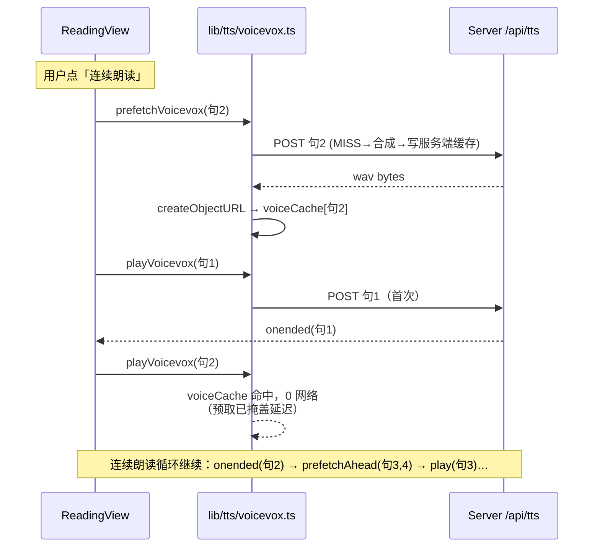
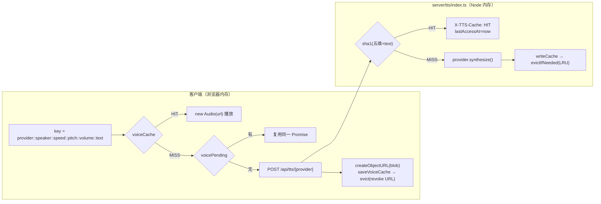

# 第 28 课 · 客户端音频管理：`src/lib/tts/voicevox.ts`

> 所属阶段 5 · 预计时长 90 分钟 · 难度★★★☆☆

## 学习目标

- 说清「模块级单例状态 + 导出函数」这套无 React 的播放器架构为什么适合音频场景。
- 走读 `cleanupCurrentAudio`，掌握单例 `HTMLAudioElement` 与 Blob URL 的生命周期纪律（谁创建、谁释放）。
- 解释 `voiceCache` + `voicePending` 双 Map 如何同时解决缓存与并发去重两个问题。
- 理解 `prefetchVoicevox` 预取如何把网络延迟挪到用户感知之外。
- 掌握 `subscribeVoicevoxEnded` 回调驱动连续朗读的机制，以及在 React 外用 `useSettingsStore.getState()` 读 store 的技巧。
- 能画出 Blob URL 从创建到释放的全部路径，并用 DevTools 定位一次真实的 Blob 泄漏。
- 掌握预取失败的降级原则：fire-and-forget、失败可重试、绝不阻塞朗读主链路。
- 了解 HTMLAudioElement 之外的 Web Audio API 进阶路线，以及每一步的内存代价。


## 前置检查

- 完成第 27 课：知道服务端有 120MB 字节上限缓存——本课客户端还有一层 80MB 缓存，两层键格式一致但客户端**不做哈希**。
- 完成第 5-6 课：会读自定义 Hook 与 Zustand；本课的 `getCurrentTtsProvider` 是第 6 课「组件外用 getState」的实战范例。
- 浏览器基础：知道 `URL.createObjectURL/revokeObjectURL` 是成对操作，泄漏会造成内存无法回收。

## 关键文件

| 文件 | 职责 |
|---|---|
| `src/lib/tts/voicevox.ts` | 本课主角：362 行的浏览器端 TTS 门面（缓存、并发去重、播放、事件订阅） |
| `src/components/reader/ReadingView.tsx` | 消费方：连续朗读循环里调用 `prefetchVoicevox`/`playVoicevox`/`subscribeVoicevoxEnded` |
| `src/components/reader/SentencePairCard.tsx` | 单句卡片：播放按钮接 `playVoicevox`，进度条接 `subscribeVoicevoxPlayback` |
| `src/stores/settingsSlice.ts` | `ttsProvider`/语速等设置字段，被 `getCurrentTtsProvider` 在 React 外读取 |

## 正文

### 概念讲解

**为什么不用 React 组件管理音频？** `<audio>` 元素是命令式、有内部时钟的对象：暂停/跳转/onended 都不是声明式 props 能优雅表达的。若放进组件树，每次重渲染都可能重建元素导致声音中断。本项目把整个播放器做成**纯 TS 模块**：状态放在模块级变量里（天然单例），对外暴露普通函数和订阅接口。React 组件只是它的「遥控器」——按下按钮调函数，想显示进度就订阅回调再 setState。这本质上是观察者模式 + 门面模式的组合，也是前端管理 WebSocket、音视频等长生命周期资源的经典姿势。

**Blob URL 的生命周期。** `fetch` 拿到的 `Blob` 不能直接喂给 `<audio>` 的 `src`（跨进程拷贝且无法流式），标准做法是 `URL.createObjectURL(blob)` 生成一个 `blob:` 协议的短 URL。它持有真实内存直到显式 `revokeObjectURL` 或文档卸载。纪律只有一条：**每条创建路径都要有确定的释放路径**。

**预取（prefetch）。** 用户点下一句到实际听到声音之间有「网络往返 + 引擎合成」两段延迟（本地 VOICEVOX CPU 合成可达秒级）。预取的思路是：在用户还在听当前句时，提前把后续句子的音频请求好放进缓存；真正点击时 `ensureVoiceUrl` 直接命中缓存返回现成 URL，延迟被完全掩盖。

**Blob URL 生命周期与内存泄漏专题。** 把前面那句「成对操作」展开成完整的心智模型：

- `URL.createObjectURL(blob)` 不「上传」任何东西，它在浏览器的 Blob 存储区登记一个条目，返回 `blob:<origin>/<uuid>` 形式的引用字符串。从这一刻起，Blob 的二进制数据（可能几 MB）被浏览器**强制持有**——即使没有任何变量引用这个 Blob、没有任何 audio 在播放。
- 唯一的解除方式是 `URL.revokeObjectURL(url)`；文档卸载（刷新/关页）时才整体清空。所以泄漏的单位是「整个音频文件」：泄漏几十条长句 WAV 就是几十 MB 永久拿不回来。
- 一个反直觉现象：revoke 之后，**已经加载**了该 URL 的 `<audio>` 通常还能播完（媒体元素对已加载资源有自己的生命周期），但新的加载会立刻失败。因此「能播」不代表没泄漏，「不能播」也不一定是 revoke 错了对象——一切以 DevTools 为准。

排查工具链（以 Chrome 为例）：
1. Memory 面板拍堆快照，按构造器筛选 `Blob`，观察 retained size 是否随播放次数单调上涨且从不回落；
2. Performance Monitor 里盯 JS heap 与 total footprint：正常情况下连读若干句后应稳定在「缓存上限以内」，持续爬升即泄漏嫌疑；
3. 配对审计法：在 createObjectURL 处记录每个生成的 url，跑一轮完整操作后核对每个 url 是否都有对应的 revoke——本模块里对应驱逐、同键覆盖、clear 三条路径。

本文件给出的标准答案：**创建 1 处**（`ensureVoiceUrl`），**释放 3 处**（`evictVoiceCache`、`saveVoiceCache` 覆盖旧条目、`clearVoicevoxCache`），外加 `cleanupCurrentAudio` 里那道正常恒为 null 的安全阀。不漏的根因是**所有权单一化**：URL 的生死只由缓存层裁决，播放层永远只是借用者。面试聊内存管理时，这套「创建/释放配对清单 + 所有权归属表」是可以直接复用的表达框架。

### 代码走读

按文件结构自上而下走读 `src/lib/tts/voicevox.ts`（362 行），先看全貌再进函数。

**① 类型层（1-38 行）。**

```ts
export type VoicevoxSpeaker = { name: string; speaker_uuid: string; styles: VoicevoxSpeakerStyle[] };
type VoicevoxPlaybackState = { pairId: string | null; isLoading: boolean; isPlaying: boolean;
                               currentTime: number; duration: number; };
type VoiceCacheItem = { key: string; url: string; size: number; lastAccessAt: number; };
type VoiceCacheStats = { items: number; totalBytes: number; pending: number;
                         maxBytes: number; hits: number; misses: number; evictions: number; };
```

与服务端 `TtsCacheItem` 几乎同构（第 27 课）——双层缓存的镜像设计。多出来的 `pending` 字段统计进行中的请求，是客户端独有的观测点。

> **边学边练 ①** `VoiceCacheStats` 里哪个字段是服务端 stats 接口没有的？它对应模块里哪个变量的哪个属性？（答案在第 27 课 stats 六项之外找不同。）


**② 模块级状态（40-63 行）：全部私有可变状态集中在此。**

```ts
let currentAudio: HTMLAudioElement | null = null;   // 单例播放器
let currentAudioUrl: string | null = null;
const voiceCache = new Map<string, VoiceCacheItem>();      // 层1：成品 URL 缓存
const voicePending = new Map<string, Promise<string>>();   // 层2：进行中请求去重
const DEFAULT_MAX_CACHE_BYTES = 80 * 1024 * 1024;
let cacheMaxBytes = DEFAULT_MAX_CACHE_BYTES;
let cacheBytes = 0, cacheHits = 0, cacheMisses = 0, cacheEvictions = 0;
let cachedSpeakers: VoicevoxSpeaker[] | null = null;       // 音声列表记忆化
let speakersRequest: Promise<VoicevoxSpeaker[]> | null = null;
const listeners = new Set<PlaybackListener>();
const endedListeners = new Set<PlaybackEndedListener>();
```

注意 `import { useSettingsStore }` 放在第 40 行而非文件头——类型定义先行、依赖靠后只是风格选择，不影响语义。**`currentAudioUrl` 在正常播放路径下始终是 `null`**（见 ⑦），它是给非缓存来源预留的安全阀。

**③ 发布-订阅骨架（65-80 行）。**

```ts
function setPlaybackState(partial: Partial<VoicevoxPlaybackState>): void {
  playbackState = { ...playbackState, ...partial };
  emitPlaybackState();          // 遍历 listeners 广播新快照
}
function emitPlaybackEnded(pairId: string | null): void {
  for (const listener of endedListeners) listener(pairId);
}
```

每次状态变化都广播完整快照（不可变替换而非原地改），订阅者拿到的一定是自洽状态。

**④ 在 React 外读 store（88-91 行）。**

```ts
/** Read the current TTS provider from settings store (works outside React) */
function getCurrentTtsProvider(): string {
  return useSettingsStore.getState().ttsProvider;
}
```

Zustand 的 store 对象自带 `getState()`——不需要 Hook、不触发订阅、任何普通 JS 里都能调用。这是本模块能保持「零 React 依赖」的关键：设置面板改了引擎，下一次 `makeVoiceCacheKey` 和 `requestVoiceBlob` 立刻读到新值。

> **边学边练 ②** 如果把 `getCurrentTtsProvider` 改成模块加载时调用一次并缓存结果（`const provider = useSettingsStore.getState().ttsProvider` 提到顶层），会埋下什么 bug？（提示：用户切换引擎后，缓存键和网络请求各会发生什么？什么时候才能恢复？）


**⑤ 缓存键与驱逐（93-138 行）。**

```ts
function makeVoiceCacheKey(text: string, speaker: number, options?: VoicevoxSynthesisOptions): string {
  const provider = getCurrentTtsProvider();
  const speed = options?.speedScale ?? 1;
  ...
  return `${provider}::${speaker}::${speed}::${pitch}::${volume}::${text}`;
}
```

与服务端 `makeCacheKey` 五维完全一致，但**不哈希**——浏览器内存里字符串键可以直接比较，省一次哈希还便于调试。驱逐逻辑与第 27 课同款（按 `lastAccessAt` 升序删到达标），唯一区别是多一行：

```ts
// evictVoiceCache 内
URL.revokeObjectURL(item.url);   // 服务端 Buffer 直接丢弃即可；客户端必须先撤销 URL
```

`saveVoiceCache` 同样处理了同键覆盖：旧 item 先 `revokeObjectURL` 再扣体积。这就是「创建路径都有释放路径」纪律的落点：创建在 `ensureVoiceUrl`，释放在驱逐 / 同键覆盖 / `clearVoicevoxCache` 三处。

> **边学边练 ③** `saveVoiceCache` 覆盖旧条目时的顺序是 revoke → 扣体积 → set 新条目。哪一步如果忘了会泄漏？哪一步如果漏了会让账本虚高？（两问答案不同，分别对应「内存」和「驱逐正确性」两类事故。）


**⑥ 核心双检：`ensureVoiceUrl`（160-194 行）。**

```ts
async function ensureVoiceUrl(text, speaker, options): Promise<string> {
  const key = makeVoiceCacheKey(text, speaker, options);
  const cached = voiceCache.get(key);
  if (cached) {                       // 第一检：成品缓存
    cacheHits += 1;
    touchVoiceCache(cached);          // 刷新 LRU 时间戳
    return cached.url;
  }
  const pending = voicePending.get(key);
  if (pending) return pending;        // 第二检：别人正在请求同一句 → 共享同一个 Promise

  cacheMisses += 1;
  const task = (async () => {
    const blob = await requestVoiceBlob(text, speaker, options);   // POST /api/tts/{provider}
    const url = URL.createObjectURL(blob);                          // Blob → blob: URL
    saveVoiceCache(key, url, blob.size);
    return url;
  })();
  voicePending.set(key, task);
  try {
    return await task;
  } finally {
    voicePending.delete(key);         // 无论成败都摘除，失败的 key 允许重试
  }
}
```

`voicePending` 解决的问题：连续朗读开始时 `prefetchAhead` 会为后面好几句各发一个预取，用户又恰好手动点了其中一句——没有第二检就会对同一文本发两次 HTTP（服务端虽然也有缓存，但第二次请求仍要等第一次完成才能命中，白白排队）。共享 Promise 后两个调用方拿到的是同一个 URL。

> **边学边练 ④** 第二检命中 pending Promise 时直接 `return pending`，**没有**加 `cacheHits`——为什么？这次调用既没命中成品也没发起网络，统计上它是什么都不算合理吗？


**⑦ 预取与清理（196-225 行）。**

```ts
export function prefetchVoicevox(text, speaker = 1, options?): Promise<void> {
  return ensureVoiceUrl(text, speaker, options).then(() => undefined);
}
```

预取没有任何特殊通道——就是「提前调用 ensureVoiceUrl 并丢弃结果」。因为结果必然落入 `voiceCache`，后续正式播放自动命中。这个设计的妙处：预取和实取共享同一套缓存/去重/统计代码，不存在两套逻辑漂移的风险。

```ts
function cleanupCurrentAudio(): void {
  if (currentAudio) {
    currentAudio.pause();
    currentAudio.currentTime = 0;
    currentAudio.onended = null;    // 六个事件处理器逐一摘除……
    currentAudio.onerror = null;
    currentAudio.ontimeupdate = null;
    currentAudio.onplay = null;
    currentAudio.onpause = null;
    currentAudio.onloadedmetadata = null;
  }
  if (currentAudioUrl) {            // 安全阀：仅当存在非缓存来源的 URL 时才 revoke
    URL.revokeObjectURL(currentAudioUrl);
  }
  currentAudio = null;
  currentAudioUrl = null;
  setPlaybackState({ pairId: null, isLoading: false, isPlaying: false,
                     currentTime: 0, duration: 0 });
}
```

两个易错点它都做对了：
1. **先摘事件再丢弃元素**。`onended` 若不置空，旧 audio 的 GC 可能被闭包引用拖延，甚至在新播放开始后才触发旧回调（串音事故）。
2. **不 revoke 缓存里的 URL**。`playVoicevox` 里 `currentAudioUrl = null`（见 ⑧）正是因为播放用的 URL 归 `voiceCache` 所有——如果这里顺手 revoke 了，下次命中缓存播放的就是已失效地址。释放权在缓存层（evict/clear），播放层只借用。

> **边学边练 ⑤** 清理时只摘 `onended` 而不摘 `ontimeupdate` 行不行？构造一条具体的串音路径。（提示：旧 audio 对象在失去模块引用后未必立刻被 GC，媒体管线还握着它。）


**⑧ 播放主流程 `playVoicevox`（315-362 行）。**

```ts
export async function playVoicevox(text, speaker = 1, pairId?, options?): Promise<void> {
  cleanupCurrentAudio();                                   // 打断上一句（单例纪律）
  setPlaybackState({ pairId: pairId ?? null, isLoading: true, isPlaying: false });
  const url = await ensureVoiceUrl(text, speaker, options); // 缓存/去重/网络 全在这一行背后
  const audio = new Audio(url);

  currentAudio = audio;
  currentAudioUrl = null;   // ← URL 属于 voiceCache，不能由播放层释放

  audio.onloadedmetadata = () => setPlaybackState({ duration: audio.duration || 0 });
  audio.ontimeupdate   = () => setPlaybackState({ currentTime: audio.currentTime || 0 });
  audio.onplay         = () => setPlaybackState({ isLoading: false, isPlaying: true });
  audio.onpause        = () => setPlaybackState({ isPlaying: false });

  audio.onended = () => {
    const endedPairId = playbackState.pairId;   // 清理前先把"播的是哪句"抄出来
    cleanupCurrentAudio();
    emitPlaybackEnded(endedPairId);             // 触发连续朗读链
  };

  audio.onerror = () => cleanupCurrentAudio();  // 解码失败也要复位状态机
  await audio.play();
}
```

`onended` 里的顺序是精髓：先取 `pairId` 再 cleanup（cleanup 会把它重置为 null），最后广播。消费端 `ReadingView.tsx` 订阅它实现连读：

```ts
// ReadingView.tsx（节选）
const unsubscribe = subscribeVoicevoxEnded((endedPairId) => {
  if (!autoReadRequestedRef.current) return;
  const endedIndex = endedPairId ? currentChapter.pairs.findIndex(...) : ...;
  // 找到下一句 → scrollPairToCenter + prefetchAhead + playVoicevox(next)
});
```

播放结束 → 广播 pairId → ReadingView 定位下一句 → 播放下一句 → 再广播……**回调驱动的朗读链**，ReadingView 自己不轮询任何状态。而预取在链内同步发生：`prefetchAhead(pair.id)` 在播放当前句时就为后续句子铺路（91-112 行的候选扫描循环）。

其余小函数快速过：`toggleVoicevoxPause`/`seekVoicevox` 操作单例并同步 playbackState；`getVoicevoxSpeakers` 用 `cachedSpeakers` + `speakersRequest` 双检查做了与 `ensureVoiceUrl` 同构的记忆化+并发去重；`setVoicevoxCacheLimit` 下限钳到 1MB 并立即触发一次驱逐。

**⑨ 收尾小函数逐段（226-280 行）：单例的「遥控器」面板。** 前文一句带过的这段，值得逐个看完：

```ts
export function toggleVoicevoxPause(): void {
  if (!currentAudio) return;
  if (currentAudio.paused) {
    void currentAudio.play();
  } else {
    currentAudio.pause();
  }
}
```

注意 `void currentAudio.play()`：play() 返回 Promise，恢复播放不需要等待结果，`void` 显式声明「我故意不处理」——既满足 lint 对未处理 rejection 的检查，也向读者传达意图。这里不手动 `setPlaybackState`，因为 onplay/onpause 回调（注册于 playVoicevox）会驱动状态机——事件驱动的状态不在两个地方重复赋值，是避免状态漂移的纪律。

```ts
export function seekVoicevox(seconds: number): void {
  if (!currentAudio) return;
  currentAudio.currentTime = Math.max(0, Math.min(seconds, currentAudio.duration || 0));
  setPlaybackState({ currentTime: currentAudio.currentTime });
}
```

`duration` 在元数据加载前可能是 NaN，`|| 0` 兜底后 min/max 钳制才能保证写入 `currentTime` 的永远是合法数字——NaN 一旦混进 playbackState，所有依赖它的进度条比较逻辑全部静默失效。

```ts
export function setVoicevoxCacheLimit(maxBytes: number): void {
  cacheMaxBytes = Math.max(1024 * 1024, Math.floor(maxBytes));
  evictVoiceCache(cacheMaxBytes);
}

export function clearVoicevoxCache(): void {
  for (const item of voiceCache.values()) {
    URL.revokeObjectURL(item.url);
  }
  voiceCache.clear();
  cacheBytes = 0;
}
```

setLimit 两个细节：下限钳到 1MB，防止传 0 或负数把缓存变成「写了就删」的黑洞；改小后**立即**驱逐而不是等下一次写入——设置变更即时生效。clear 是三条释放路径里最重的一条：先遍历 revoke 再 `clear()`，顺序反了就是一次性全量泄漏。

```ts
export async function getVoicevoxSpeakers(): Promise<VoicevoxSpeaker[]> {
  if (cachedSpeakers) {
    return cachedSpeakers;
  }
  if (speakersRequest) {
    return speakersRequest;
  }
  speakersRequest = (async () => {
    const response = await fetch('/api/tts/voicevox/speakers');
    if (!response.ok) {
      const detail = await response.text();
      throw new Error(detail || 'Failed to fetch speakers');
    }
    const data = await response.json();
    if (!Array.isArray(data)) {
      throw new Error('Invalid VOICEVOX speakers response');
    }
    cachedSpeakers = data as VoicevoxSpeaker[];
    return cachedSpeakers;
  })();
  try {
    return await speakersRequest;
  } finally {
    speakersRequest = null;
  }
}
```

这就是 `ensureVoiceUrl` 双检模式的镜像：`cachedSpeakers` 管「已完成」（记忆化），`speakersRequest` 管「进行中」（并发去重），finally 摘除保证失败可重试。多出的 `Array.isArray` 校验是防御式编程——引擎返回意外结构时给出可读错误，而不是让下游在 `undefined.map` 上爆炸。同一个文件里同一配方出现两次不是巧合：「缓存 + 单飞（single-flight）」就是异步记忆化的标准形态，值得整体记住。


### 图示



双层缓存读写路径总图：



### 进阶专题一：预取失败后的降级策略

预取不在关键路径上，失败就该「安静地失败」。分层拆解当前行为：

1. **网络失败/超时**：`prefetchVoicevox` 内部 `ensureVoiceUrl` reject，而 `.then(() => undefined)` 不接 rejection——返回的 Promise 会成为 unhandled rejection，消费方（ReadingView 的预取循环）必须自行 catch。阅读源码时确认这一点，是本课作业的一部分。
2. **失败即自动获得重试资格**：`finally { voicePending.delete(key) }` 保证失败的 key 下次请求重新走完整路径。用户手点那句时等于天然重试——这是把 delete 放 finally 而不是 catch 里的全部意义。
3. **用户体验的降级形态**：预取失败不损正确性，只损延迟——点击时退化为普通 MISS（isLoading 转圈等待）。真正要防的是「连锁放大」：如果连读循环写成 `await 预取完成 → 播下一句`，一次预取失败就能卡死整条朗读链。正确姿势是 fire-and-forget 预取 + 播放侧无条件 `await ensureVoiceUrl`（它自带缓存/去重重试语义）。
4. **一个反向练习**：「给预取加指数退避重试」值不值得做？推演：预取窗口只有当前句的播放时长（几秒量级），退避重试大概率还没完成就轮到该句播放——届时播放路径自己的请求已在路上，重试纯属浪费流量与算力。结论是低价值优化，不做反而是对的。面试里能主动论证「为什么不做什么」，往往比列举做了什么更能体现判断力。

### 进阶专题二：AudioContext / Web Audio API 进阶路线

本模块用的是最省事的 HTMLAudioElement。将来若遇到它的能力边界，WebAudio 是下一站：

| 需求 | HTMLAudioElement | Web Audio API |
|---|---|---|
| 播放/暂停/seek | 免费获得 | 要自己搭 BufferSource 调度 |
| 变速不变调 | playbackRate 粗糙且兼容性参差 | preservesPitch / DSP 精细可控 |
| 波形/频谱可视化 | 无能为力 | AnalyserNode 几行搞定 |
| 多轨混音、淡入淡出 | 无 | GainNode 图谱 |
| 精确低延迟调度 | 毫秒级不可控 | `audioContext.currentTime` 硬件时钟 |

务实的迁移路线：第一步只引入 `AudioContext.decodeAudioData(blob)` 把缓存音频解码为 AudioBuffer 并存进 `VoiceCacheItem`（播放仍走 audio 元素）——解码是一次性的 CPU 成本，换来后续零解码延迟；第二步换成 AudioBufferSourceNode 播放，获得精确 `startTime` 调度，连读句间 gap 可以压到零；第三步才考虑 AudioWorklet 做实时 DSP。**代价预警**：decodeAudioData 会把压缩音频展开成 PCM，一句长句的内存占用可达原 WAV 的数倍——届时 80MB 字节上限要按 PCM 口径重新估算。这正呼应本课的主题：度量衡必须跟着资源的真实形态走。

### 本课速记

- 架构 = 模块级单例 + 导出函数 + 观察者广播：React 组件只是遥控器。
- 双 Map：voiceCache 管成品，voicePending 管进行中（single-flight）；两者共用一套键。
- Blob URL 所有权归缓存层：创建 1 处、释放 3 处、播放层只借用。
- 预取 = 提前调用 ensureVoiceUrl 并丢弃结果；失败安静降级，绝不阻塞朗读链。

## 实操作业

**目标**：实现「连续朗读时提前高亮下一句」（对应大纲作业）。

**第 1 层（基础 · 必做）：预告高亮。** 完成下面的主流程。

1. 精读 `ReadingView.tsx` 中 `subscribeVoicevoxEnded` 的订阅块与 `prefetchAhead` 循环，画出「当前句播放中」时哪些句子已被预取（建议直接 console.log key 前几个字符验证）。
2. 在 `ReadingView.tsx` 里新增一个 state：`nextHighlightId: string | null`。
3. 修改 ended 订阅回调：算出下一句 id 后，除了滚动和播放，先 `setNextHighlightId(next.id)`；当该句变为正在播放句（`playVoicevox` 成功后）或连读停止时清除高亮。
4. 高亮的 UI 表达：给目标句对卡片的容器加一个区分度足够的 class（如左侧橙色描边），参考现有当前句样式但不重复其视觉语言。
5. 手动验证路径：开启连读 → 观察第 N 句播放期间第 N+1 句已带高亮 → 第 N+1 句开播后高亮转移/消失；中途按 Esc（`stopVoicevoxPlayback` → `cleanupCurrentAudio`）确认高亮也被清掉。
6. 边界确认：最后一播完时 `findIndex` 找不到下一句，确保 `nextHighlightId` 被置回 null 而不是悬挂。

**验收标准**：
- [ ] 连读模式下，肉眼可在下一句开播前看到预告高亮；
- [ ] Esc 停止/播完最后一季后无残留高亮；
- [ ] 未开启连读（`autoReadRequestedRef.current === false`）时不出现高亮；
- [ ] 能口头解释：为什么这个功能天然适合做在 ended 订阅回调里而不是 useEffect 监听播放进度。

---

**第 2 层（进阶 · 选做）：Blob 泄漏实验室。**

1. 临时注释掉 `evictVoiceCache` 里的 `URL.revokeObjectURL(item.url)`，并把 `DEFAULT_MAX_CACHE_BYTES` 临时调成 2MB 制造频繁驱逐；
2. 打开 Chrome DevTools Memory 面板：连读 20 句前后各拍一次堆快照，按构造器筛 `Blob` 比较 retained size——应当看到明显上涨且不回落；
3. 恢复代码重跑同样流程，确认曲线回落到相近水位；两组数据记进笔记；
4. 对照实验：只删掉 `saveVoiceCache` 同键覆盖分支里的 revoke，构造同键重复合成场景（改一下 options 的浮点尾数即可生成新键再切回旧键），观察这条单独路径的泄漏量级。

**第 3 层（挑战）：全局语速接入缓存键。**

背景：`makeVoiceCacheKey` 的 speed 目前只来自每次调用传入的 options。目标是让设置面板的全局语速参与键生成，同时不破坏任何现有行为。

1. 仿照 `getCurrentTtsProvider` 的模式，从 settings store 读全局语速，并入键的 speed 维度（注意缺省值归一化：未设置时必须与 `speedScale ?? 1` 语义一致）；
2. UI 加滑杆（0.5~2），并做一个明确的设计决定：切换语速时正在播放的句子要不要立即重启？把决定与理由写进笔记（两种选择都有道理：立即重启体验一致但打断收听；下句生效不打断但存在新旧速度并存期）；
3. 回归三连：改语速后首点是 MISS、再点是 HIT；stats 的 items 因新键增长；切回原语速能命中历史缓存条目；
4. 思考题写进笔记：这个改动让「键维度」多了一个隐式输入（store 状态），它和第 27 课「键 = 纯函数参数清单」的原则冲突吗？如何在文档层面补救？

**验收标准（第 2/3 层）**：
- [ ] 泄漏实验室有修复前后的两组快照证据，能指出每一处泄漏对应的缺失 revoke；
- [ ] 语速改动通过回归三连，且旧缓存条目在切回后确实被复用；
- [ ] 能口头说明「键里引入 store 状态」后，纯函数性质靠什么约定维持。

## 常见坑

- **在 cleanupCurrentAudio 里顺手 revoke 播放中的 URL**：会把 voiceCache 里的条目变成死链接，下次「命中缓存」却无声。记住释放权属于缓存层（evict/clear），`currentAudioUrl` 只是防御字段，正常路径恒为 null。
- **忘记 finally 里 delete voicePending**：一旦某次请求 reject，Promise 残留在 map 里，之后所有对该句的请求都会 await 一个已 rejected 的 Promise，表现为「这句永远播不出来且刷新前无法恢复」。
- **在 React 渲染期直接调用 playVoicevox 等副作用函数**：它们操作模块级单例并 setState 到外部系统，必须在事件处理器/useEffect 回调里调用；渲染期调用会被 StrictMode 双执行放大成双重播放。
- **测试预取效果时误判**：DevTools Network 里看不到请求不代表预取失败——很可能命中了服务端缓存（X-TTS-Cache: HIT）秒回。判断客户端预取要看 `getVoicevoxCacheStats()` 的 hits/pending，而不是网络面板。

## 本课与面试

这一课几乎是「前端资源管理」面试题的题库本体——音频只是载体。

**Q：前端怎么管理音频/WebSocket 这类长生命周期资源？**
答出本课架构即可满分：命令式对象不放组件树（重渲染会重建实例、打断会话）；模块级单例持状态，导出命令函数 + 订阅接口（观察者 + 门面）；React 组件退化为遥控器，useEffect 里只做订阅/退订。补充一句「这与 React 官方的 external store 思路一致：把命令式世界挡在外部 store 边界外」可以展示知识面。

**Q：线上发现内存持续增长，你怎么排查是不是 Blob URL 泄漏？**
流程化回答：① 先看 Performance Monitor / 任务管理器区分 JS heap 与原生占用（Blob 属后者为主）；② Memory 快照按构造器筛 Blob，对比两次操作间的 retained 增量；③ 用「创建/释放配对审计」定位漏 revoke 的路径；④ 修复后在释放路径加临时日志回归验证。最后升华：根治手段是所有权单一化——每条创建路径在写代码时就写下它的唯一释放者。

**Q：什么是 single-flight？前端哪里用到了？**
定义：并发相同 key 的请求共享同一次在途调用。本文件 `voicePending` 就是教科书实现：Map<key, Promise> + finally 摘除。要点三个：等待者共享成功也共享失败；摘除必须在 finally（失败可重试）；统计口径要想清楚（共享命中不算 miss）。对比服务端（第 27 课⑨）没有去重的取舍，能体现「同一模式在不同层的成本收益不同」的层次感。

**Q：连续朗读的预取窗口怎么定？预取多少句合适？**
框架化作答：窗口时长 ≥ 当前句剩余播放时长才有意义；预取深度受三约束——客户端缓存预算（80MB ÷ 单句体积）、服务端压力（限流阈值，第 25 课）、跳读概率（用户越爱跳，深预取浪费率越高）。本项目 prefetchAhead 取小常数句是三者平衡的结果。加分项：提出「预取命中率 = 预取且被播 / 总预取数」作为调参指标，以及按用户翻页习惯动态调整深度的可能性。

**Q：为什么广播完整状态快照而不是增量消息？**
快照让订阅者无脑替换 state，不存在漏收某条增量导致的状态撕裂；代价是每次全量比较（React 侧配合浅比较可忽略）。配套问题「订阅时立即回调一次当前状态为什么重要」——新订阅者无需等待下一个事件即可完成初始渲染（SentencePairCard 的进度条就是这么拿到初值的）。

## 自测题

<details><summary>1. 为什么 makeVoiceCacheKey 不像服务端那样做 sha1 哈希？两端键不一致会有问题吗？</summary>

浏览器端字符串键可直接作 Map 键且调试时可读（能直接看到是哪句话），无需压缩长度；服务端要控制键内存且防长文本膨胀所以哈希。两端键互不传输、各自独立成体系，不一致没有任何问题——只要各自的五维组成一致即可保证语义正确。
</details>

<details><summary>2. 如果删掉 voicePending 这层，最坏会发生什么？</summary>

并发场景（预取+手点、快速连点两句相同文本、StrictMode 下 effect 双执行）会对同一 key 发起多个并行 fetch：浪费带宽和服务端合成算力，且后完成的覆盖先完成的（saveVoiceCache 会 revoke 旧 URL），期间拿到旧 URL 的调用方可能正要播放一个刚被 revoke 的地址。
</details>

<details><summary>3. playVoicevox 开头的 cleanupCurrentAudio 如果漏掉，连续朗读会怎样？</summary>

模块只维护一个 currentAudio 指针，旧 Audio 对象失去引用但不会停止发声（媒体元素由浏览器音频管线持有）；出现多句叠音，旧的 onended 还可能晚触发把新句的 playbackState 重置，状态机彻底错乱。
</details>

<details><summary>4. subscribeVoicevoxEnded 返回一个函数，这个返回值应该在哪使用、不用的后果是什么？</summary>

返回取消订阅函数，React 中应在 useEffect 的 cleanup 里调用。不调用则组件卸载后监听器残留在模块级 Set 里：闭包持有的旧章节数据无法回收（内存泄漏），且回调会在下一轮连读时引用过期状态造成错误滚动/播放。
</details>

<details><summary>5. 预取为什么能「掩盖」而不是「消除」延迟？什么情况下预取无效？</summary>

预取把请求提前到用户听上一句的时间窗内执行，点击时的等待从「网络+合成」降为「Map.get」，感知上零延迟——但总耗时没少，只是被挪出了关键路径。无效场景：用户跳读速度超过预取速度（预取还没回来就点了）、句子被逐出 80MB 客户端缓存后再点、以及切换 ttsProvider 导致键变化全部 miss。
</details>

<details><summary>6. currentAudioUrl 这个安全阀在什么情况下才会真的非 null？举一个未来可能的合法使用场景。</summary>

当前所有播放都走 voiceCache 的 URL，播放层创建的 URL 不存在，所以它恒为 null。合法场景示例：将来支持「导入本地音频文件跟读对比」之类功能时，播放层直接 `createObjectURL(file)`——这种 URL 不属于缓存层，必须由播放层自己在 cleanup 里 revoke，安全阀正是给这类「借用者自己创建的资源」预留的释放钩子。防御字段的成本是一行代码，收益是把未来扩展的正确性约束提前显式化。
</details>

<details><summary>7. 为什么 subscribeVoicevoxPlayback 订阅时立即回调一次当前状态，而 subscribeVoicevoxEnded 不会？</summary>

播放状态是「持续态」：新订阅者需要立刻知道 isLoading/isPlaying/currentTime 才能渲染出正确的 UI，补发当前快照让它免于等待下一个事件。ended 是「一次性事件」：历史结束事件对新订阅者是噪音甚至是假信号（可能导致误滚动到旧句）。一句话：持续态补发快照，瞬时事件绝不补发——订阅接口设计的通用准则。
</details>

<details><summary>8. 连续朗读播完最后一句话时，整条链是如何自然终止的？哪些状态在哪里被复位？</summary>

链路：末句 onended → 抄下 pairId → cleanupCurrentAudio（playbackState 全量复位、audio 摘除）→ emitPlaybackEnded(末句 id) → ReadingView 回调里 findIndex 找不到下一句 → 不再调用 playVoicevox，循环自然断开，同时应清除 autoReadRequestedRef 与高亮等应用态。注意分工：模块内的播放器状态由 cleanup 保证干净；应用层 UI 状态靠消费方在回调里自觉清理——这是「模块不管业务」分层的代价，也正是它保持通用的原因。
</details>
