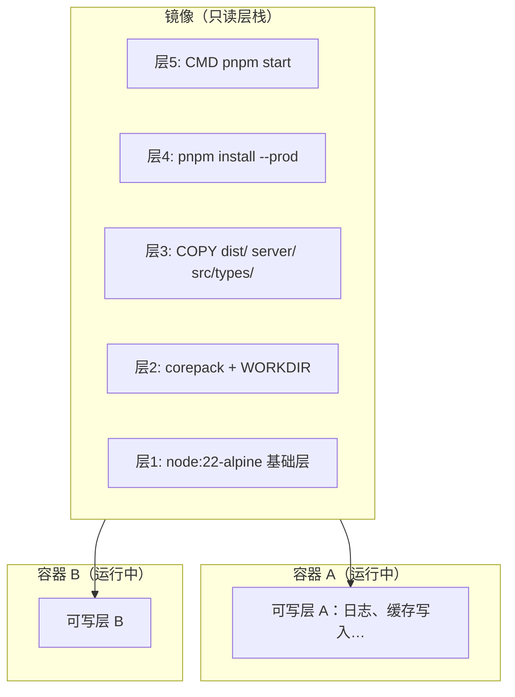
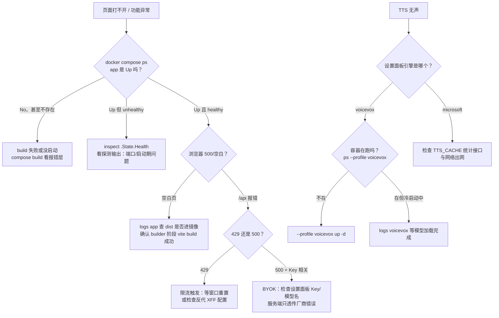
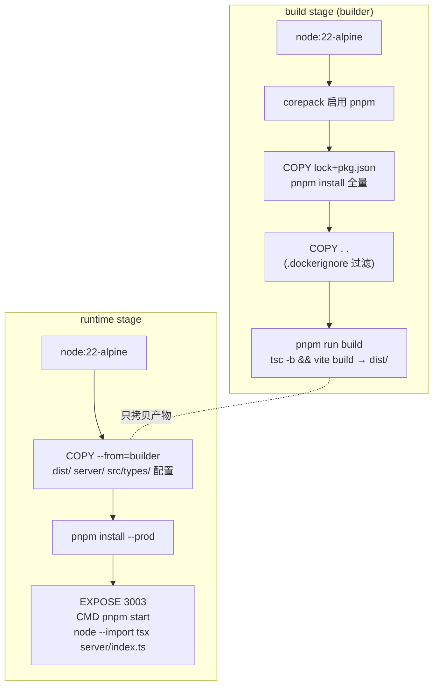
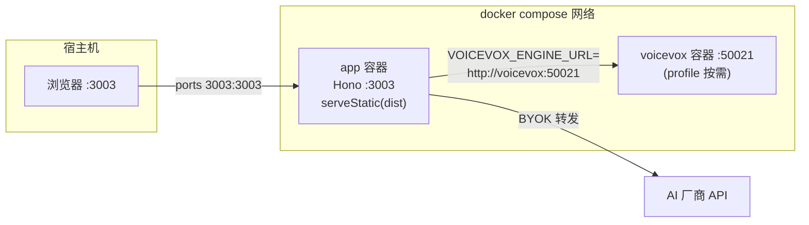

# 第 29 课 · Docker 化与自托管

> 所属阶段 6 · 预计时长 90 分钟 · 难度 ★★★★☆

## 学习目标

1. 能逐层解释本项目 Dockerfile 的两个阶段各自做什么、为什么这样分层。
2. 能说清 `docker-compose.yml` 中 `profiles: [voicevox]` 的按需启动机制，并用 `--profile voicevox` 正确启停。
3. 能对照 `.env.example` 列出全部服务端配置项（PORT / TTS_DEFAULT_PROVIDER / VOICEVOX_ENGINE_URL / TTS_CACHE_MAX_BYTES / CORS_ORIGIN）及其默认值和生效位置。
4. 能提出至少三条镜像体积优化思路，并说明本项目已经用了哪几条。
5. 能用自己的话讲清镜像、层、容器三者关系与 BuildKit 层缓存的失效规则。
6. 能为 `app` 服务配置基于真实端点的健康检查，并解释 `service_started` 与 `service_healthy` 的差别。
7. 能画出至少两种生产部署拓扑（直连 vs 反代 HTTPS），并说清楚反代之后 `x-forwarded-for` 限流语义的变化。
8. 遇到「页面空白」「VOICEVOX 无声」等故障时能按 FAQ 排查路径定位问题。

## 前置检查

- 已完成第 21 课：理解 `server/index.ts` 的 CORS 双策略与 `serveStatic` 托管 dist——本课会解释为什么生产镜像里**不需要** CORS 配置。
- 已完成第 26-27 课：知道 TTS 双引擎与服务端字节上限缓存——本课的 `TTS_CACHE_MAX_BYTES` 就是第 27 课读过的那个常量。
- 本机已安装 Docker Desktop（Windows/macOS/Linux 均可），`docker --version` 能输出版本号。

## 关键文件

| 文件 | 职责 |
|---|---|
| `Dockerfile` | 两阶段构建：builder 编译前端产物，runtime 只带运行所需文件 |
| `.dockerignore` | 构建 context 黑名单：node_modules/dist/.git/*.md 等不进镜像 |
| `docker-compose.yml` | 声明 `app` 与 `voicevox` 两个 service，后者挂 voicevox profile |
| `.env.example` | 服务端全部可配置环境变量的样例与默认值 |
| `docs/self-hosting.md` | 自托管用户手册：快速开始、环境变量表、FAQ |
| `package.json` | `start` 脚本定义了生产态进程的启动方式（决定 CMD 怎么写） |
| `server/index.ts` | 运行时读取 `PORT` 与 `CORS_ORIGIN` 的地方；第 24 行还暴露了 `GET /health` 健康检查端点 |

## 正文

### 概念讲解

#### Docker 核心概念速成：镜像、层、容器

动手改 Dockerfile 之前，先把四个最容易混淆的概念一次理清：

- **镜像（image）**：一个只读的文件系统快照 + 启动元数据（暴露端口、启动命令等）。它是一个「模板」，本身不运行。本项目 build 出来的 baku-yomi 镜像就是一份「Node 22 + 编译好的 dist + server 源码 + 生产依赖」的完整快照。
- **层（layer）**：镜像不是一整块，而是由一条条 Dockerfile 指令产出的**只读层堆叠**而成。每条 `RUN` / `COPY` 指令在前一层之上叠加一层；层一旦生成就是不可变的，且可以被多个镜像共享复用。`node:22-alpine` 的那些基础层被你机器上所有基于它的镜像共享——这就是为什么第二个 alpine 项目几乎不再占磁盘。
- **容器（container）**：「运行中的镜像」。启动时 Docker 在镜像的只读层栈顶再加一层**可写层**（write layer），进程的所有文件写入都落在这层里。容器删除，可写层随之销毁，镜像原封不动——所以容器可以随便删随便起，`docker compose down && up` 不损坏任何构建产物。
- **写时复制（copy-on-write）**：容器要读镜像里的文件直接读；要改一个文件，先把它从镜像层复制到可写层再改。这保证了 N 个容器可以安全共享同一份镜像层，同时各自修改互不可见。

一句话串起来：**Dockerfile 描述如何逐层造出镜像；镜像是模板；容器 = 镜像 + 一块临时可写层在跑进程。**



#### 缓存机制：BuildKit 怎么判断「这层要不要重跑」

构建不是每次从零执行指令。BuildKit 为每条指令计算一个**缓存键**，规则可以归纳成三句话：

1. **指令文本变了 → 失效**。`RUN pnpm install --frozen-lockfile` 改成加参数，该层及其后全部重跑。
2. **COPY 的源文件内容变了 → 失效**。`COPY pnpm-lock.yaml package.json ./` 只看这两个文件的校验和——它们没变，这层就命中缓存。这就是「先拷锁文件再拷源码」能省时间的底层原理。
3. **某一层失效 → 它之后的所有层全部失效**（除非走 `--mount=type=cache` 这类缓存挂载）。缓存是链式的，断一处断到底。

另外两个实战要点：

- **`corepack prepare pnpm@latest` 是缓存稳定性的隐患**：它不带版本号，远端发布新版 pnpm 后这层的输入实质上变了，可能造成偶发的全量重建。钉死版本（如 `pnpm@10`）是 CI 场景的标准做法（见下文优化思路第 7 条）。
- **CI 里缓存不会自动延续**：本地构建有本机缓存，GitHub Actions 等全新 runner 上没有。要用 `docker/build-push-action` 的 `cache-from` / `cache-to`（registry 或 gha 缓存后端）显式接上，否则每条流水线都在全量重装依赖——这正是面试高频题「Docker 层缓存在 CI 的意义」（见「本课与面试」）。

> **边学边练 ①** 不看上文，向自己复述：镜像/层/容器各是什么？为什么「改一行业务代码不必重新 `pnpm install`」？（提示：缓存键第二条 + COPY 顺序）

**多阶段构建（multi-stage build）**：Dockerfile 允许多个 `FROM`，每个阶段是一个独立镜像。前面的阶段装全量依赖做编译，最后一个阶段只 `COPY --from=` 拿走编译产物 + 生产依赖。好处是编译工具链（devDependencies、TypeScript、Vite、源码）统统不会进入最终镜像——最终镜像更小、攻击面更小。

**层缓存（layer cache）**：每条指令生成一层，某层的输入没变就直接复用缓存。所以依赖清单要先 COPY、先 install，源码后 COPY——改一行代码不必重装依赖。这是「把变化少的放前面」原则在 Dockerfile 里的应用。

**compose profiles**：`docker compose up` 默认只启动没有 profile 的 service；标了 profile 的 service 要显式 `--profile xxx` 才启动。适合「可选重型组件」——比如约 2GB 的 VOICEVOX 引擎镜像，不用语音的用户完全不必拉取。

**配置面（12-factor）**：同一份镜像通过环境变量适配不同环境，而不是为每个环境构建不同镜像。`.env.example` 就是这个项目的配置面契约。

### 代码走读

#### 1. Dockerfile 构建阶段

```dockerfile
# -- build stage --
FROM node:22-alpine AS builder
RUN corepack enable && corepack prepare pnpm@latest --activate
WORKDIR /app
COPY pnpm-lock.yaml package.json ./
RUN pnpm install --frozen-lockfile
COPY . .
RUN pnpm run build
```

- `node:22-alpine`：与仓库要求一致（Node ≥ 22），alpine 变体基础镜像只有 ~50MB。
- `corepack prepare pnpm@latest`：Node 自带的包管理器管理器，免掉单独装 pnpm 的一层。
- **先锁文件后源码**：`COPY pnpm-lock.yaml package.json ./` → `pnpm install --frozen-lockfile` → `COPY . .`。只要你不动依赖，改多少业务代码都命中依赖层缓存，重装只发生在 lock 文件变化时。
- `pnpm run build` 即 `tsc -b && vite build`（见 package.json 第 10 行），产出前端静态资源 `dist/`。

注意 `COPY . .` 能安全执行，靠的是 [.dockerignore](/.dockerignore)：`node_modules`、`dist`、`.git`、`*.md`、`*.epub` 等都被排除。没有它，宿主机的 node_modules 会覆盖镜像内刚装好的依赖（Windows/macOS 宿主的原生二进制还会直接把 Linux 镜像搞坏）。

> **边学边练 ②** 用缓存三规则推演：如果你只改了 `README.md`，哪些层会失效？如果改了 `pnpm-lock.yaml` 呢？前者因 `.dockerignore` 排除了 `*.md`，连 `COPY . .` 层都不会失效——整个构建全绿缓存。

#### 2. Dockerfile 运行阶段

```dockerfile
FROM node:22-alpine
RUN corepack enable && corepack prepare pnpm@latest --activate
WORKDIR /app
COPY --from=builder /app/dist ./dist
COPY --from=builder /app/server ./server
COPY --from=builder /app/src/types ./src/types
COPY --from=builder /app/package.json /app/pnpm-lock.yaml ./
COPY --from=builder /app/tsconfig*.json ./
RUN pnpm install --frozen-lockfile --prod
EXPOSE 3003
CMD ["pnpm", "start"]
```

关键问题：为什么运行镜像里还有 `server/` 和 `src/types/` 这些 TS 源码？看 package.json：

```json
"start": "NODE_ENV=production node --env-file-if-exists=.env --import tsx server/index.ts"
```

这个项目的后端**生产态也不预编译**，而是用 `tsx` 直接跑 TypeScript。因此运行镜像需要：

- `server/` —— 后端 TS 源码本体；
- `src/types/` —— `server/providers.ts` 第一行 `import type { AIProviderType } from '../src/types/settings'`，类型被跨目录引用，必须一起带上；
- `tsconfig*.json` —— tsx 解析路径别名/编译选项需要；
- `--prod` 安装 —— 只装 dependencies，Vite/TS 等 devDependencies 不进镜像；
- `--env-file-if-exists=.env` —— Node 原生读取 compose 挂进来的 env，这就是「.env 配置面」在运行时的落点。

`EXPOSE 3003` 是文档性声明（声明容器监听端口，便于人和工具阅读）；真正映射端口靠 compose 的 `ports`。

> **边学边练 ③** 对着运行阶段的 7 条 COPY/RUN，逐条说出「这条层的输入是什么、什么情况下会缓存失效」。说不出来的那条，回去看重读缓存机制一节。

#### 3. docker-compose.yml 与 profiles

```yaml
services:
  app:
    build: .
    ports:
      - "3003:3003"
    environment:
      - NODE_ENV=production
      - PORT=3003
      - TTS_DEFAULT_PROVIDER=microsoft
      - VOICEVOX_ENGINE_URL=http://voicevox:50021
    depends_on:
      voicevox:
        condition: service_started
        required: false      # ← 关键：voicevox 未启动也不阻塞 app

  voicevox:
    image: voicevox/voicevox_engine:latest
    ports:
      - "50021:50021"
    profiles:
      - voicevox             # ← 属于 voicevox profile，默认不启动
```

三个设计点：

1. **`VOICEVOX_ENGINE_URL=http://voicevox:50021` 用的是 service 名而非 localhost**——compose 会建内部网络，service 名就是 DNS 名；容器之间走内网，`50021` 的宿主端口映射只是给宿主机调试用的。
2. **`required: false`**：即使你用 `--profile voicevox` 启动导致 voicevox 在场，或根本没启动它，app 都照常起。VOICEVOX 引擎冷启动要加载几十秒模型，绝不能让它挡住主应用。
3. **profile 生效方式**：
   - `docker compose up -d` → 只有 app（默认 microsoft 引擎，零额外配置）；
   - `docker compose --profile voicevox up -d` → app + voicevox（对应 docs/self-hosting.md 的启用说明，首次拉取约 2GB）。

> **边学边练 ④** 在纸上回答：`docker compose ps`、`docker compose ps --profile voicevox`、`docker compose stop voicevox` 三条命令各会看到/发生什么？然后实际敲一遍验证自己的答案。

#### 4. .env 配置面

`.env.example` 全文即配置面契约，逐项对应到代码里的真实读取点：

| 变量 | 默认值 | 代码读取位置 | 说明 |
|---|---|---|---|
| `PORT` | `3003` | `server/index.ts`: `Number(process.env.PORT ?? 3003)` | 服务监听端口 |
| `TTS_DEFAULT_PROVIDER` | `microsoft` | `server/tts/index.ts`: `process.env.TTS_DEFAULT_PROVIDER ?? 'microsoft'` | 默认引擎，`microsoft \| voicevox` |
| `VOICEVOX_ENGINE_URL` | `http://localhost:50021` | `server/tts/voicevox.ts` 构造函数：`process.env.VOICEVOX_ENGINE_URL ?? 'http://localhost:50021'` | compose 里已被 environment 覆写为 `http://voicevox:50021` |
| `TTS_CACHE_MAX_BYTES` | `125829120`（120MB） | `server/tts/index.ts`: `Number(process.env.TTS_CACHE_MAX_BYTES ?? 120 * 1024 * 1024)` | 服务端音频缓存字节上限，超出按 `lastAccessAt` LRU 驱逐 |
| `CORS_ORIGIN` | 注释掉（不设） | `server/index.ts`: 仅 `isProd` 且设置了该值才 `cors({ origin })` | 生产跨域白名单 |

关于 `CORS_ORIGIN` 有个反直觉的点（第 21 课埋的伏笔）：生产模式下**什么都不配反而最安全**。因为生产由同一个 Hono 服务经 `serveStatic` 托管 `dist/`，页面与 API 同源，浏览器同源策略天然隔离了第三方站点；一旦配了 `CORS_ORIGIN`，等于主动给某个外部来源开了跨域口子。只有当你把前端单独部署到别的域名时才需要它。

另外注意 `.env.example` 里注释掉的三个 AI Key（`OPENAI_API_KEY` 等）：本项目是 BYOK 模式，Key 存在浏览器 localStorage、随请求体传给 `/api/analyze`，服务端环境变量里的 Key 只是给想省事的自托管者的可选项，并非必需。

#### 5. 健康检查配置：让编排系统知道「真的活着」

进程在 ≠ 服务可用。容器里的 Node 进程可能因为端口占用、依赖初始化失败而处于「活着但永远响应不了请求」的状态。Docker 提供两层机制：

**(a) 应用侧已有现成探针端点**。[server/index.ts](/server/index.ts) 第 24 行：

```ts
app.get('/health', (c) => c.json({ status: 'ok' }));
```

注意它注册在 `app.route('/api', ai)` 之后、静态托管之前——任何环境（包括开发模式）都能访问，返回体只有一个固定 JSON，无副作用、无鉴权，是标准的 liveness probe 形态。

**(b) Dockerfile 加 HEALTHCHECK 指令**（alpine 自带 busybox wget，无需额外安装）：

```dockerfile
HEALTHCHECK --interval=30s --timeout=3s --start-period=15s --retries=3 \
  CMD wget -qO- http://127.0.0.1:3003/health || exit 1
```

四个参数的含义值得背下来：

| 参数 | 含义 | 为什么这样设 |
|---|---|---|
| `--interval=30s` | 每 30 秒探测一次 | 太密浪费资源，太疏故障发现慢 |
| `--timeout=3s` | 单次探测超时 | 一个 `/health` 应答毫秒级，3 秒足够宽裕 |
| `--start-period=15s` | 启动宽限期，期内失败不计入 retries | 给 tsx 编译加载留时间；VOICEVOX 这类重服务要放大到分钟级 |
| `--retries=3` | 连续失败 3 次才标记 unhealthy | 抖动一次就判死太激进 |

**(c) compose 里同样可配**，且能与 `depends_on` 联动出真正的启动顺序控制：

```yaml
services:
  app:
    # ...
    healthcheck:
      test: ["CMD", "wget", "-qO-", "http://127.0.0.1:3003/health"]
      interval: 30s
      timeout: 3s
      retries: 3
      start_period: 15s
```

有了健康状态，另一个服务的等待条件就能从「进程已启动」升级为「探测已通过」：

```yaml
depends_on:
  app:
    condition: service_healthy   # 而非默认的 service_started
```

这正是本项目 `depends_on.voicevox.condition: service_started` 写法的对照面：`service_started` 只保证**容器进程被拉起**（弱保证），`service_healthy` 保证**健康检查连续通过**（强保证）。VOICEVOX 引擎冷启动几十秒，若想「带 profile 启动时一定等引擎就绪」，可以把它的 condition 改为 `service_healthy` 并给它配上指向自身 API 的 healthcheck——但代价是引擎未就绪期间 app 也起不来，所以当前仓库选择弱保证 + 应用层容错，这是权衡而非疏漏。

排查健康状态的三板斧：`docker compose ps` 看 STATUS 列的 `(healthy)`/`(unhealthy)`；`docker inspect --format='{{json .State.Health}}' <容器>` 看最近几次探测的输出与退出码；`docker compose events` 实时观察 health_status 事件。

> **边学边练 ⑤** 给本地 Dockerfile 手动加上上面的 HEALTHCHECK，rebuild 后用 `docker compose ps` 观察状态从 `starting` 变 `(healthy)`；再把 `/health` 路由临时注释掉 rebuild，确认容器最终变成 `(unhealthy)`，然后还原。

#### 6. 镜像体积优化思路

本项目已经做到的：

1. **alpine 基础镜像**：比 debian 变体小一个数量级。
2. **多阶段构建**：Vite、TypeScript、全部 devDependencies、完整源码都不进运行镜像。
3. **`pnpm install --prod`**：运行期只装 dependencies。
4. **`.dockerignore`**：`*.epub`、`images/`、`.git`（可能几百 MB）不进构建 context——context 小了，`COPY . .` 这层也小。

还可以进一步做的（思考题方向）：

5. **消灭 tsx**：如果加一个 `tsc` 编译 server 的步骤、运行纯 JS，就可以去掉 tsx 依赖，甚至换成更小的运行时镜像；代价是多维护一份编译产物路径。
6. **`node --run` / 直接 CMD**：`CMD ["pnpm", "start"]` 意味着运行镜像里必须保留 pnpm；改成 `CMD ["node", "dist-server/index.js"]` 后 pnpm/corepack 都可以不要。
7. **lockfile 级别的确定性**：`corepack prepare pnpm@latest` 每次 build 可能拿到不同的 pnpm 版本，钉死版本（如 `pnpm@10`）能让层缓存更稳定。

### 多阶段构建完整原理图

把两个阶段放到一张图里，标出每一层的输入、产出与跨阶段数据流——这张图值得自己手画一遍：

```mermaid
flowchart TB
    subgraph ctx["构建 context（.dockerignore 过滤后上传给 docker daemon）"]
        SRC["src/ server/ public/<br/>pnpm-lock.yaml package.json tsconfig*"]
    end
    subgraph builder["阶段一 builder（会被丢弃）"]
        B1["FROM node:22-alpine<br/>~50MB 基础层"] --> B2["corepack 启用 pnpm<br/>+WORKDIR"]
        B2 --> B3["COPY 锁文件<br/>【缓存键: lock 校验和】"]
        B3 --> B4["pnpm install 全量依赖<br/>【最大层之一】"]
        B4 --> B5["COPY . .<br/>【缓存键: 其余源码校验和】"]
        B5 --> B6["pnpm run build<br/>tsc -b && vite build<br/>产出 dist/"]
    end
    subgraph runtime["阶段二 runtime（最终交付物）"]
        R1["FROM node:22-alpine<br/>与 builder 共享同一份基础层"] --> R2["corepack + WORKDIR"]
        R2 --> R3["COPY --from=builder<br/>dist/ server/ src/types/<br/>package.json pnpm-lock.yaml tsconfig*"]
        R3 --> R4["pnpm install --frozen-lockfile --prod<br/>只装 dependencies"]
        R4 --> R5["EXPOSE 3003<br/>CMD [\"pnpm\",\"start\"]<br/>tsx 直跑 TS"]
    end
    ctx --> B3
    ctx --> B5
    B6 -. "只带走三个目录+配置文件<br/>node_modules/devDeps/工具链全部留在 builder 内" .-> R3
```

三个容易忽略的原理细节：

1. **builder 阶段的最终镜像并不存在于最终结果里**。`docker images` 里你只会看到一个 baku-yomi 镜像（runtime）；builder 的中间层只在本次构建过程中存在，BuildKit 还会积极回收它们。「多阶段」省体积的本质是：**最终镜像只由最后一个 FROM 决定**，前面阶段的任何东西不 `COPY --from` 就等于不存在。
2. **两个 FROM 同用 `node:22-alpine` 不是巧合**：runtime 阶段的基础层与 builder 完全相同，本地已有该基础层的缓存时第二阶段零下载；若 runtime 换成别的基镜像（如 `node:22-slim`），就要多拉一份。
3. **`COPY --from=builder` 是唯一合法的数据通道**。阶段之间没有共享文件系统，想带走的每一个路径都要显式列出——这也是一种强制的好设计：它逼你审问「这个文件运行期真的需要吗」，漏掉会立刻在启动时报错而不是静默带上垃圾。

### pnpm deploy 与 monorepo 场景展望

当前 Dockerfile 运行阶段的做法是「拷源码 + 进容器里再 `pnpm install --prod`」。这在单包仓库完全够用，但如果项目演进成 monorepo（比如拆成 `apps/web` + `apps/server` + `packages/shared`），有更工程化的方案——**`pnpm deploy`**：

- `pnpm deploy` 是 workspace 专用命令：`pnpm --filter ./apps/server deploy --prod /out/server` 会把目标包**及其 workspace 依赖**打成一个自包含目录——只含生产依赖的 node_modules、编译产物、manifest，不含任何 devDependency 和无关包。
- Dockerfile 随之简化为：builder 阶段跑完 build + `pnpm deploy`，runtime 阶段只需一行 `COPY --from=builder /out/server ./`，**运行镜像里连 pnpm/corepack 都可以删掉**，CMD 直接 `node dist/index.js`。
- 收益三条：镜像更小（没有包管理器和多余 workspace 包）、启动更快（不用容器内 install）、职责更清晰（「什么是可部署单元」由 pnpm 显式回答，而不是靠一排 COPY 语句人工枚举——正是本课运行阶段那 5 条 COPY 要手工维护的问题）。

对照本项目现状可以体会差距在哪：现在 `COPY --from=builder /app/src/types ./src/types` 这类语句之所以存在，就是因为「可部署单元的边界」没有被工具显式管理，只能靠人肉枚举源码依赖。monorepo + `pnpm deploy` 把这件事交给工具链，是这套 Dockerfile 最自然的下一步演进（本课只需理解方向，不动手改造）。

### 常见生产部署拓扑

`docker compose up -d` 之后浏览器访问 `:3003` 只是起点。真实公网部署通常长这样：

**拓扑 A：单机 compose 直连（当前默认）**

```
用户 ──HTTP──▶ :3003 app 容器
```

适合家庭内网、VPN 后的个人服务。公网上裸奔 HTTP 有两个问题：明文传输（BYOK 用户的 AI Key 在请求体里！）以及无域名证书。

**拓扑 B：宿主机反代 + HTTPS（最常见的小规模生产形态）**

```
用户 ──HTTPS:443──▶ Caddy/Nginx（宿主机）──HTTP──▶ 127.0.0.1:3003 app 容器
```

Caddy 配置只要四行，自动申请续期 Let's Encrypt 证书：

```caddyfile
baku.example.com {
    reverse_proxy 127.0.0.1:3003
}
```

Nginx 等价配置（证书需自行用 certbot 管理）：

```nginx
server {
    listen 443 ssl;
    server_name baku.example.com;
    ssl_certificate     /etc/letsencrypt/live/baku.example.com/fullchain.pem;
    ssl_certificate_key /etc/letsencrypt/live/baku.example.com/privkey.pem;
    location / {
        proxy_pass http://127.0.0.1:3003;
        proxy_set_header X-Forwarded-For $proxy_add_x_forwarded_for;
        proxy_set_header Host $host;
    }
}
```

此时 compose 的端口映射应收紧为 `"127.0.0.1:3003:3003"`——app 只监听回环地址，公网流量必须过反代。

**拓扑 C：反代本身也是 compose service**

```
用户 ──HTTPS:443──▶ caddy 容器 ──compose 内网──▶ app 容器
```

把 caddy 加进 docker-compose.yml、挂载 Caddyfile 与证书卷、`ports` 只暴露 443。好处是整套栈一条命令拉起、可移植；代价是 compose 文件复杂度上升。三种拓扑的选择标准：只有一台机器且求简→A；已有宿主机 Web 栈→B；追求一键迁移整栈→C。

**反代带来的两个连锁反应，务必理解：**

1. **限流的 IP 语义改变**。[routes/ai.ts](/server/routes/ai.ts) 的限流键取自 `c.req.header('x-forwarded-for')?.split(',')[0]?.trim()`。直连场景下这个头**来自客户端请求、可以被任意伪造**，攻击者每个请求换个假 IP 即绕过 30 次/分限制；上了反代并在配置里 `proxy_set_header X-Forwarded-For $proxy_add_x_forwarded_for` 之后，该头由可信代理追加真实来源，限流才真正按用户生效。反过来，若反代后面还叠了一层代理，`split(',')[0]` 取到的是最外层 IP，多层链路下要取「第一个不可信代理之前」的那一段——这是经典的信任边界题。
2. **CORS 维持不配**。反代让页面和 API 统一在一个 https 域名下，同源策略照旧保护 API，`CORS_ORIGIN` 依然保持注释状态——第 21 课的结论在反代拓扑下不变。

> **边学边练 ⑥** 本地起一个最小验证：`docker compose up -d` 后，用 `curl -H "X-Forwarded-For: 1.2.3.4" ...` 与不带该头各打一次 `/api/analyze`（错 Key 即可），观察日志/行为差异；再把 compose 端口改成 `127.0.0.1:3003:3003` 重启，确认外网网卡上的端口扫描（或换局域网另一台机器）已经摸不到 3003。


### 常用命令速查（本课范围）

| 命令 | 作用 | 备注 |
|---|---|---|
| `docker compose build` | 构建镜像 | 加 `--progress=plain` 可看每层输出 |
| `docker compose up -d` | 后台启动默认服务集 | 不带 profile 时只有 app |
| `docker compose --profile voicevox up -d` | 连同 VOICEVOX 引擎一起启动 | 首次拉取约 2GB |
| `docker compose exec app sh` | 进入运行中的容器排查 | 看文件是否真的 COPY 进来了 |
| `docker compose config --profiles` | 列出 compose 文件里的全部 profile | 忘记 profile 名时用 |
| `docker compose ps` | 看容器状态与健康检查结果 | STATUS 列有 `(healthy)` 标记 |
| `docker compose logs -f app` | 跟踪主应用日志 | 排查页面空白第一站 |
| `docker compose down` | 停止并移除容器与网络 | 不删镜像；数据卷按声明保留 |
| `docker images` / `docker history ` | 看镜像体积与逐层大小 | 优化体积的依据 |
| `docker inspect --format '{{json .State.Health}}' <c>` | 导出健康检查最近记录 | unhealthy 排查必备 |
| `docker builder prune` | 清理构建缓存 | 缓存膨胀时使用；慎防拖慢后续 build |

记忆锚点：**看状态用 `ps`，看历史用 `logs`，看健康用 `inspect`，看体积用 `history`。**

### 开发态 vs 生产态对照

同一份代码在两种形态下的差异，用一张表收束（左列全部来自你前 28 课读过的源码）：

| 维度 | `pnpm dev` | 容器生产态 |
|---|---|---|
| 进程 | Vite dev server + tsx --watch 两个进程 | 单个 node 进程托管 API + 静态资源 |
| 前端 | Vite 内存编译、HMR | builder 阶段预构建的 dist/ 由 serveStatic 托管 |
| 跨域 | 前端 :5173 调后端 :3003，靠 `cors()` 全开 + Vite 代理 | 同源于 ：3003，无需任何 CORS 配置 |
| 环境变量 | shell / `.env`，改完热重启 | compose environment 或挂载的 `.env`，重建容器才生效 |
| 失败可见性 | 控制台直出堆栈 | 要看 `compose logs`；健康检查把「进程死」变成可观测状态 |
| 端口暴露 | dev 各自监听本地回环 | `ports` 决定对外面；公网部署应收紧为 `127.0.0.1:` 前缀 |

理解这张表的关键是第 3 行：**dev 的双端口架构在容器里坍缩成单端口单进程**——这正是为什么 Dockerfile 不需要为前端单独建镜像、也不需要 CORS_ORIGIN。面试中被问「你们项目怎么部署的」，能把这张表的因果讲顺，就超过了背命令的水平。

### 故障排查决策树

把 docs/self-hosting.md 的 FAQ 经验压缩成一棵可执行的决策树，遇到故障从顶部往下走：



使用要领：**先分类「构建期 / 运行期」**。构建期的症状是 `compose build` 或首次 `up` 直接失败，看的是最后一条失败的 Dockerfile 指令；运行期的症状是容器曾正常启动后劣化，看的是 `logs` 与健康检查记录。两类问题的证据源完全不同，混着查会浪费时间。

### 图示





## 实操作业

**目标：从零 build 镜像并跑通 `docker compose up`，记录每一层的作用。**

1. `docker compose build --progress=plain 2>&1 | tee layers.log`，然后打开 `layers.log`：
   - 标记出每条 Dockerfile 指令对应的层；
   - 第二次再跑一遍同样的命令，确认哪些层显示 `CACHED`——重点验证「只改一个前端源码文件后重建，依赖安装层是否仍命中缓存」（先随便改一下 `src/App.tsx` 再 build 验证）。
2. `docker images` 记录 baku-yomi 镜像体积；再用 `docker history <镜像名>` 看每层占了多大，找出最大的三层并解释它们为什么存在。
3. `docker compose up -d`，访问 http://localhost:3003 ，导入一本 EPUB、完成一次回译分析（验证 BYOK 请求转发正常）。
4. 按「健康检查配置」一节给 Dockerfile 加上 HEALTHCHECK，观察 `docker compose ps` 的 STATUS 列从 `starting` 到 `(healthy)` 的变化，记录耗时。
5. 可选：`docker compose --profile voicevox up -d`，等引擎就绪后在设置面板切到 VOICEVOX 合成一句话；随后 `docker compose down`(观察 profile 内服务是否一并停止）。
6. 写一份自己的「层作用笔记」：两阶段各层的输入、输出、缓存条件各是什么。

**验收标准**：
- [ ] 浏览器能完整走通导入 → 阅读 → 回译 → 评分展示；
- [ ] 能口头回答：为什么改业务代码不需要重新 `pnpm install`？
- [ ] `docker compose down && docker compose up -d` 后服务自动恢复，无需 rebuild；
- [ ] `docker compose ps` 显示 app 为 `(healthy)`，且能说出 healthy 判定依据的是哪个端点；
- [ ] 笔记中每个环境变量都能指出它在哪个源码文件哪一行被读取。

## 本课与面试

这一课的内容在面试中的高频落点是「层缓存与 CI/CD」：

- **为什么 Docker 层缓存在 CI 里意义重大？** 全新 runner 没有任何本地缓存，若无外部缓存接入，每次流水线都会重跑 `pnpm install`（分钟级）与 `vite build`。主流解法是把层缓存推到远端：`docker/build-push-action` 配 `cache-from: type=gha` / `cache-to: type=gha,mode=max`（GitHub Actions）或 registry 缓存（`type=registry`），配合「锁文件层前置」的 Dockerfile 结构，依赖不变时整条流水线秒级完成。**缓存命中率取决于 Dockerfile 分层质量**——这也是为什么「先 COPY 锁文件」不只是本地图省事，而是 CI 成本的直接决定因素。
- **追问：怎么让缓存更稳？** 钉死一切「浮动输入」：`corepack prepare pnpm@10` 替代 `@latest`；`.dockerignore` 排除与构建无关又常变的文件（本项目排除 `*.md` 就是例子——文档改动不应触发任何层失效）；需要大缓存目录（如 pnpm store）时用 BuildKit cache mount（`RUN --mount=type=cache`）而不是塞进层里。
- **第二落点：健康检查与滚动更新**。能讲清 `service_started` / `service_healthy` 差别、HEALTHCHECK 参数语义，以及「没有健康检查的滚动更新 = 把流量切给还没准备好的实例」，基本就是生产级答案。
- **第三落点：反代之后的限流信任边界**。`x-forwarded-for` 谁能伪造、谁必须可信、多层代理下取哪一段——本题在本项目的限流实现里有现成代码可以展开讲（见「常见生产部署拓扑」第 1 点），面试时结合自己项目讲远胜背八股。

## 常见坑

1. **忘了 `.dockerignore` 导致构建爆炸或运行异常**：把宿主机 `node_modules` COPY 进去后，Linux 容器里装的是 Windows/macOS 平台的二进制依赖，轻则体积巨大，重则 esbuild/rollup 原生绑定直接报错。
2. **VOICEVOX 无声却去查 app 日志**：多半是没用 `--profile voicevox` 启动引擎，或设置面板还停在 microsoft；先 `docker compose logs voicevox` 看引擎状态（docs/self-hosting.md FAQ 同款排查路径），再确认设置面板切换。
3. **改了 `.env` 不生效**：compose 的 `environment:` 段优先于 `.env` 文件里同名变量；且 Node 的 `--env-file-if-exists` 只在进程启动时读一次，改完必须 `docker compose up -d`（重建容器）而不是 restart 之外想当然。
4. **页面空白**：通常是 `pnpm run build` 在 builder 阶段失败但旧容器还在跑；`docker compose logs app` 看日志，确认 dist 是否真的进了镜像。
5. **加了 HEALTHCHECK 却永远 unhealthy**：多半是 `start-period` 太短（tsx 冷启动超过宽限期就被计入 retries），或 `test` 命令在 alpine 里不存在（如用了 curl 而 busybox 只有 wget）；`docker inspect --format '{{json .State.Health}}'` 能看到每次探测的真实报错。
6. **公网部署忘了收紧端口映射**：拓扑 B 下仍写 `"3003:3003"` 等于在反代之外开了第二条明文 HTTP 通道，BYOK Key 可被中间人截获；应写 `"127.0.0.1:3003:3003"`。
7. **在 compose 里改了 Dockerfile 却「没生效」**：compose 的 `build: .` 不会自动感知 Dockerfile 变化，必须显式 `docker compose build`（或 `up -d --build`）才会重建镜像；只 restart 永远跑的还是旧镜像层。

## 自测题

1. 运行阶段为什么要 `COPY --from=builder /app/src/types ./src/types`？不拷会发生什么？

<details><summary>答案</summary>
因为 server/providers.ts 通过 `import type { AIProviderType } from '../src/types/settings'` 跨目录引用了前端目录下的类型文件，而生产是用 tsx 直接跑 TS 源码（无编译产物），模块解析需要该文件真实存在于相对路径上。不拷贝则 `pnpm start` 时 providers.ts 加载报错，/api/analyze 整个不可用。
</details>

2. `depends_on` 里写了 `voicevox`，为什么 `docker compose up -d`（不带 profile）不会报错？

<details><summary>答案</summary>
因为该依赖声明了 `required: false`。voicevox 属于 voicevox profile，默认不被选中启动；`required: false` 表示这只是「如果它在场就先启它」的软依赖，不在场也不阻塞 app。若写成默认的 `required: true`，不带 profile 启动会直接失败。
</details>

3. 生产模式为什么不建议配置 `CORS_ORIGIN`？

<details><summary>答案</summary>
生产模式下前端静态资源由同一个 Hono 服务经 serveStatic 托管，页面与 /api/* 天然同源，浏览器的同源策略已经阻止了其他站点跨域调用你的 API。此时配置 CORS_ORIGIN 反而是主动放开某个外部 origin 的访问权，扩大攻击面。只有前端单独部署在其他域名时才需要配置。
</details>

4. `TTS_CACHE_MAX_BYTES` 调小后如何验证驱逐生效？

<details><summary>答案</summary>
连续合成多段长文本后请求 `/api/tts/cache/stats`（第 27 课讲过的统计接口），观察返回中的 `totalBytes` 是否被压在新的 maxBytes 以内、`evictions` 计数是否增长——该接口直接暴露了 `ttsCacheBytes`、`evictions` 等模块级计数器。
</details>

5. 为什么 `COPY pnpm-lock.yaml package.json` 必须出现在 `COPY . .` 之前？调换顺序的后果是什么？

<details><summary>答案</summary>
Docker 层缓存自上而下生效：依赖清单不变则 `pnpm install` 层永远命中缓存，改任何源码都只需重跑其后的 `COPY . .` 和 `pnpm run build`。调换后每次改动任意文件都会使后续所有层失效，包括依赖安装——每次构建都全量重装依赖，慢且浪费。
</details>

6. 镜像、层、容器三者是什么关系？为什么删除容器不会破坏镜像，而多个容器可以共享同一个镜像？

<details><summary>答案</summary>
镜像是若干只读层的堆叠快照，是模板；容器是镜像之上加一块可写层后运行的实例。容器的一切写入都落在自己的可写层，镜像层始终保持只读、不可变——因此删容器只丢可写层，镜像完好；多个容器通过写时复制安全地共享同一套只读镜像层，各自的修改互相不可见。
</details>

7. `service_started` 和 `service_healthy` 有什么区别？本项目对 voicevox 用前者的理由是什么？

<details><summary>答案</summary>
service_started 只保证依赖容器的进程已被拉起（弱保证）；service_healthy 要求其健康检查连续通过后才继续（强保证），后者要求被依赖方配置了 healthcheck。本项目选择前者是因为 VOICEVOX 引擎冷启动要几十秒，若用 service_healthy 会让 app 在引擎就绪前一直阻塞；而 app 对 voicevox 本就是可选依赖（required: false），晚一点连上也无妨，应用层容错即可覆盖。
</details>

8. 直连部署与反代部署下，`/api/analyze` 的 IP 限流分别有什么漏洞或变化？

<details><summary>答案</summary>
直连时限流键取自客户端可自行携带的 x-forwarded-for 头，攻击者每个请求伪造一个新 IP 即可完全绕过 30 次/分限制。反代部署且配置 proxy_set_header X-Forwarded-For $proxy_add_x_forwarded_for 后，该头由可信代理追加真实来源，伪造值会被覆盖/追加在后，取第一段即真实客户端 IP，限流才真正生效；但多层代理链路下要注意取的位置必须是最外层不可信代理之前的一段，否则限流键会退化成代理自身 IP，把所有用户算进同一个桶。
</details>
