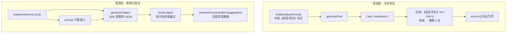
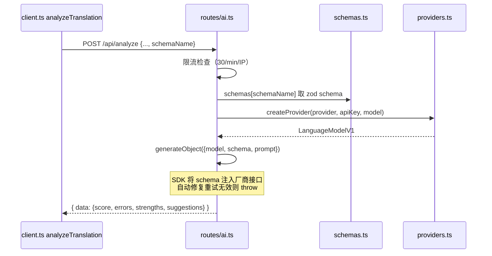

# 第 30 课 · 毕业项目：generateObject 结构化输出改造

> 所属阶段 6 · 预计时长 120 分钟 · 难度 ★★★★☆

## 学习目标

1. 能解释 `generateText` 与 `generateObject` 的差异，以及为什么「正则抠分数」是当前架构的脆弱点。
2. 能独立完成服务端 zod Schema 定义 → `generateObject` 替换 → 前端类型适配 → prompt 同步修改的四步改造。
3. 能列出改造后需要回归验证的全链路清单，并逐项执行。
4. 能按 Conventional Commits 规范把改造拆成可 review 的一系列 commit。
5. 能不看资料复述本课给出的四段参考实现，并说清每一段「哪些行在防什么错」。
6. 能说出至少两条结构化输出的可靠性论证（解码层约束 + 运行时校验 + 显式失败路径），以及一条它的局限。

## 前置检查

- 已完成第 22-24 课：理解 `generateText` 统一接口、`createProvider` 工厂与三个 prompt 的角色设计——本课只动其中评分链路。
- 已完成第 25 课：知道 `/api/analyze` 的限流与错误透传策略，改造时不要破坏它们。
- 已完成第 15 课：pairBuilder 有你自己的 Vitest 测试（大纲毕业要求之一），本课回归时要一并跑通。
- 已完成第 29 课：改造完成后用 Docker 镜像做一次端到端验收。

## 关键文件

| 文件 | 职责 | 本课改动 |
|---|---|---|
| `server/routes/ai.ts` | POST /api/analyze 路由：限流、调 provider、返回 `{text}` | 核心改动①：`generateText` → `generateObject` |
| `server/providers.ts` | `createProvider` 工厂，产出 LanguageModelV1 | 不改 |
| `src/lib/ai/prompts.ts` | 三个 prompt 构造器；`buildAnalysisPrompt` 约束了【综合评分】等文本格式 | 核心改动④：输出格式段改为结构化说明 |
| `src/lib/ai/client.ts` | 前端 fetch 封装；`analyzeTranslation` 里正则 `/【综合评分】\s*(\d+)/` 抠分 | 核心改动②③：请求体带 schema 标识；删掉正则解析 |
| `src/types/analysis.ts` | `AnalysisResult` / `AnalysisError` / `ErrorCategory` 类型定义 | 核心改动③：新增与服务端 Schema 对应的类型来源 |

## 正文

### 概念讲解

**现状问题**：AI 返回的是一整块 Markdown 文本。前端想拿到分数，只能在 [client.ts](/src/lib/ai/client.ts) 里写：

```ts
const scoreMatch = rawMarkdown.match(/【综合评分】\s*(\d+)/);
const score = scoreMatch ? parseInt(scoreMatch[1], 10) : 0;
```

而 `errors / strengths / suggestions` 三个字段更是直接硬编码为空数组——模型明明输出了这些内容（见 buildAnalysisPrompt 的【错误与差异分析】【优点】【总体建议】段落），却因为无法可靠地从自由文本中抽取而白白丢弃。这就是「用正则和模型对暗号」：模型哪天换个标题写法、漏个全角括号，分数就静默变成 0。

**结构化输出**：让 LLM 直接产出符合 JSON Schema 的对象。Vercel AI SDK 提供 `generateObject({ model, schema, prompt })`：

- SDK 把 Schema 编译进请求（OpenAI 走 structured outputs / function calling，Anthropic 走 tool use，Google 走 responseSchema），从解码层面约束模型只能生成合法 JSON；
- 返回值是 `result.object`——一个已经过校验的强类型对象，配合 zod 还能在运行时兜底校验；
- 校验失败或模型拒不服从会抛错，走现有的 catch → 500 错误透传路径，而不是静默给 0 分。

**改造策略**：`/api/analyze` 目前同时服务三个调用方（提示、译文优化、分析）。前两个的输出本来就是给人读的自由文本，保留 `generateText` 不动；只有评分链路切到 `generateObject`。做法是在请求体里加一个可选字段 `schemaName`，服务端据此选择 Schema 与调用方式——向后兼容，一次迁移一个调用点。

> **边学边练 ①** 打开 client.ts 数一数：三个 fetch 封装函数里有几个在读 `data.text`？答案：全部三个——这提醒你路由分支必须保持自由文本路径原样不动，任何「顺手统一」都会同时炸掉提示和译文优化。

### 代码走读

按执行顺序走读现有链路，标出每一步要改什么。

#### 1. 入口：PracticePanel → analyzeTranslation（前端）

`analyzeTranslation(config, original, chinese, userTranslation, pairId)` 组装 prompt 后 fetch `/api/analyze`，拿到 `{ text }` 后做两件事：正则抠分 + 构造 `AnalysisResult`。注意它返回的对象里：

```ts
return {
  pairId,
  userTranslation,
  originalJapanese: original,
  score,
  errors: [],        // ← 永远为空，正则时代的妥协
  strengths: [],     // ← 同上
  suggestions: [],   // ← 同上
  rawMarkdown,
  analyzedAt: Date.now(),
};
```

#### 2. 服务端路由：server/routes/ai.ts

```ts
const { provider, apiKey, model, baseUrl, prompt } = body;
// ...
const llm = createProvider(provider, apiKey, model, baseUrl);
const result = await generateText({ model: llm, prompt });
return c.json({ text: result.text });
```

限流（30 次/分/IP）、参数校验、错误透传都在这一层——改造必须保持这些不变。

#### 3. Prompt 层：buildAnalysisPrompt

prompt 里用【综合评分】X/100、【错误与差异分析】等标记约定文本格式——这正是前端正则所依赖的「暗号」。改成 generateObject 后，格式约定由 Schema 承担，prompt 只负责语义指令。

---

### 改造实施（四步）· 完整参考实现

下面给出可直接落盘的四段代码。它们不是伪代码骨架，而是基于当前仓库真实源码逐行推演的成品；动手前请先通读一遍，再对照自己写的版本查漏。

> **动手前置**：本项目 dependencies 里目前没有 zod（见 package.json），服务端用 Schema 前先安装：
>
> ```bash
> pnpm add zod
> ```

#### 第一步：服务端定义 zod Schema（server/schemas.ts · 完整文件）

新建 `server/schemas.ts`。Schema 字段直接对应 `src/types/analysis.ts` 中已有的 `AnalysisResult` 子集与 `AnalysisError`/`ErrorCategory`——不发明新概念，让前后端共享同一份领域模型：

```ts
import { z } from 'zod';

/**
 * 回译评分的结构化输出契约。
 * 字段与 src/types/analysis.ts 的 AnalysisError/ErrorCategory 一一对应，
 * 枚举值手抄自该文件——改动任一侧都必须同步另一侧。
 */
export const analysisSchema = z.object({
  /** 综合评分，0-100 整数 */
  score: z.number().int().min(0).max(100),
  /** 逐条错误分析 */
  errors: z.array(
    z.object({
      category: z.enum([
        '文法', '語彙', '助詞', '敬語',
        '時制', '表現', '語順', 'その他',
      ]),
      /** 学习者回译中的问题片段 */
      userText: z.string(),
      /** 更正确的表达 */
      correctText: z.string(),
      /** 具体说明（日语） */
      explanation: z.string(),
    }),
  ),
  /** 做得好的地方 */
  strengths: z.array(z.string()),
  /** 1-2 条学习建议 */
  suggestions: z.array(z.string()),
});

export type AnalysisPayload = z.infer<typeof analysisSchema>;

/**
 * Schema 注册表：新增结构化端点时在这里登记，
 * 路由层通过 schemaName 查表，不写 if/else。
 */
export const schemas = {
  'translation-analysis': analysisSchema,
} as const;

export type SchemaName = keyof typeof schemas;
```

要点：

- `ErrorCategory` 的八个枚举值照抄 `src/types/analysis.ts`——单一事实来源原则下更理想的做法是把该文件挪到前后端都能 import 的位置再引用，作为选做进阶；
- 用注册表对象而非 if/else，将来加新结构化端点只扩一张表；
- `z.infer<typeof analysisSchema>` 导出的 `AnalysisPayload` 是给前端消费用的类型来源（第四段会用到），不要在前端另写一份形状相同的 interface；
- `.min(0).max(100)` 不是装饰：它会被编译进厂商的结构化约束里，模型给出 120 分时会在运行时校验层被拦截并抛错，而不是漏进 UI。

#### 第二步：服务端路由分支（server/routes/ai.ts · 改造后完整文件）

下面是改造后的完整文件。对照原文件你会发现：限流器、参数校验、catch 透传逐字未动，新增只有三处——import、解构多取一个字段、try 块内一个分支。

```ts
import { Hono } from 'hono';
import { generateText, generateObject } from 'ai';
import { createProvider } from '../providers';
import { schemas, type SchemaName } from '../schemas';
import tts from '../tts/index';

const ai = new Hono();

// Mount TTS sub-routes
ai.route('/tts', tts);

// ---------------------------------------------------------------------------
// Simple in-memory rate limiter for /analyze (per-IP, per minute)
// ---------------------------------------------------------------------------
const RATE_LIMIT_WINDOW_MS = 60_000;
const RATE_LIMIT_MAX = 30; // requests per window

const rateBuckets = new Map<string, { count: number; resetAt: number }>();

// Sweep stale buckets every 5 minutes
setInterval(() => {
  const now = Date.now();
  for (const [key, bucket] of rateBuckets) {
    if (bucket.resetAt <= now) rateBuckets.delete(key);
  }
}, 5 * 60_000);

ai.post('/analyze', async (c) => {
  // Rate limit check
  const ip = c.req.header('x-forwarded-for')?.split(',')[0]?.trim() ?? 'unknown';
  const now = Date.now();
  let bucket = rateBuckets.get(ip);

  if (!bucket || bucket.resetAt <= now) {
    bucket = { count: 0, resetAt: now + RATE_LIMIT_WINDOW_MS };
    rateBuckets.set(ip, bucket);
  }

  bucket.count += 1;
  if (bucket.count > RATE_LIMIT_MAX) {
    return c.json({ error: 'Rate limit exceeded. Try again shortly.' }, 429);
  }

  const body = await c.req.json();
  const { provider, apiKey, model, baseUrl, prompt, schemaName } = body;

  if (!provider || !apiKey || !model || !prompt) {
    return c.json({ error: 'Missing required fields' }, 400);
  }

  try {
    const llm = createProvider(provider, apiKey, model, baseUrl);

    // ── 结构化分支：仅评分链路使用 ──────────────────────────
    if (typeof schemaName === 'string' && schemaName.length > 0) {
      const schema = schemas[schemaName as SchemaName];
      if (!schema) {
        return c.json({ error: `Unknown schema: ${schemaName}` }, 400);
      }
      const result = await generateObject({
        model: llm,
        schema,          // zod schema：SDK 自动转 JSON Schema 并做运行时校验
        prompt,
      });
      return c.json({ data: result.object });
    }

    // ── 自由文本路径：提示 / 译文优化仍在用，保持不动 ────────
    const result = await generateText({
      model: llm,
      prompt,
    });

    return c.json({ text: result.text });
  } catch (e) {
    const message = e instanceof Error ? e.message : 'Unknown error';
    return c.json({ error: message }, 500);
  }
});

export default ai;
```

设计决策逐条说明（面试可展开的点）：

- **`schemas[schemaName as SchemaName]` 之后立刻判空**：`as` 只是类型断言，运行时客户端可以传任意字符串；查表 miss 返回 400 而不是 undefined 一路穿透到 generateObject 内部炸出难懂的错误。
- **未知 schema 用 400 而非 500**：这是客户端输入错误（调用方拼错了名字），语义上属于 Bad Request；500 会误导监控把它当服务端故障。
- **generateObject 抛出的校验错误落进现有 catch**：Schema 重试耗尽后 SDK throw，被同一个 catch 捕获转成 500 + 原始 message——错误路径零新增代码，因为第 25 课的错误透传策略本来就是「服务端不吞错」。
- **响应包一层 `{ data }`**：与自由文本路径的 `{ text }` 对称，前端可以靠响应体的 key 区分两种模式，也为未来再加第三种响应形态留了命名空间。

> 注意：`providers.ts` 完全不用动。`generateObject` 接受的就是同一个 `LanguageModelV1`，多模型切换能力原样继承——这是第 23 课工厂模式的红利。

#### 第三步：前端消费（src/lib/ai/client.ts · analyzeTranslation 整函数替换）

用下面的实现整体替换现有的 `analyzeTranslation`（正则抠分与三个空数组一起删除）：

```ts
import type { AIProviderConfig, AnalysisPayload, AnalysisResult } from '../../types';
import { buildAnalysisPrompt } from './prompts';

export async function analyzeTranslation(
  config: AIProviderConfig,
  original: string,
  chinese: string,
  userTranslation: string,
  pairId: string
): Promise<AnalysisResult> {
  const prompt = buildAnalysisPrompt(original, chinese, userTranslation);

  const response = await fetch('/api/analyze', {
    method: 'POST',
    headers: { 'Content-Type': 'application/json' },
    body: JSON.stringify({
      provider: config.type,
      apiKey: config.apiKey,
      model: config.model,
      baseUrl: config.baseUrl,
      prompt,
      schemaName: 'translation-analysis',   // ← 唯一的新增字段
    }),
  });

  if (!response.ok) {
    const err = await response.text();
    throw new Error(`AI analysis failed: ${err}`);
  }

  const data = await response.json();

  // 服务端已用 zod 校验过，这里是类型收窄而非二次校验
  const obj: AnalysisPayload = data.data;

  return {
    pairId,
    userTranslation,
    originalJapanese: original,
    score: obj.score,            // ← 来自校验过的对象，不可能因「模型换了写法」静默变 0
    errors: obj.errors,          // ← 第一次真正有数据
    strengths: obj.strengths,
    suggestions: obj.suggestions,
    rawMarkdown: '',             // 过渡期保留字段赋空串；彻底删除方案见类型适配一节
    analyzedAt: Date.now(),
  };
}
```

注意两点：

- `data.data` 取值的 key 必须与服务端 `c.json({ data: result.object })` 一致；如果打错成 `data.text`，TypeScript 不会报错但运行时拿到 undefined——这正是回归清单第 4 项要在 Network 面板亲眼确认响应体形状的原因。
- 失败路径一行没改：`!response.ok` 时抛出的错误消息就是服务端 catch 透传的内容（可能是 Schema 校验失败的原始信息）。UI 的 loading/error 态由第 17 课的组件逻辑处理，本函数职责边界不变。

#### 第四步：类型适配（src/types/analysis.ts · 追加代码）

在该文件末尾追加 payload 类型，并决定 `rawMarkdown` 的去留：

```ts
import type { z } from 'zod';
import type { analysisSchema } from '../../server/schemas';

/**
 * 与服务端 zod Schema 同源的分析载荷类型。
 * 直接从 schema 推导，保证两端永不漂移。
 */
export type AnalysisPayload = z.infer<typeof analysisSchema>;
```

关于 `rawMarkdown` 的两条路线：

1. **彻底删除（推荐）**：从 `AnalysisResult` 里删掉该字段，然后 `grep -rn "rawMarkdown" src/` 找出全部消费方——重点是第 17 课的分析面板渲染组件，把原来渲染整段 Markdown 的地方改为渲染结构化列表（score 大数字 + errors 按 category 分组卡片 + strengths/suggestions 列表）。删得干净，commit 也干净。
2. **保守过渡**：保留字段但如上面第三步那样赋空串，commit message 注明废弃计划（例如 `refactor(client): keep rawMarkdown field as empty string during structured-output migration`），下一个 PR 再删。

无论选哪条，`AnalysisPayload` 都应从 schema 推导而不是手写——这样枚举值、字段名、可空性的任何漂移都会在 `tsc -b` 阶段直接报错，而不是等用户点了评分按钮才炸。

> 若选择路线 1 但发现 `zod` 出现在了前端的 import 图里（types 文件 import 了 server 目录）：把 `server/schemas.ts` 移到共享位置（如 `shared/schemas.ts`）或改用手写类型 + 注释指向 schema 文件即可，别为了一个 type import 把整个 zod 打进前端 bundle。

`errors: []` 变成真实数据后，UI 侧（第 17 课读过的分析面板）终于能按 `category` 分类展示每个错误的 `userText` / `correctText` / `explanation`——这是本改造对用户可见的最大收益。

> **边学边练 ②** 合上文档，默写四段各自的「一句话职责」：schemas.ts 管____，routes/ai.ts 管____，client.ts 管____，types/analysis.ts 管____。（答案方向：契约定义与注册表／双路径分支与校验兜底／协议切换与类型消费／单一事实来源的类型推导）

### 回归验收清单（可勾选）

改完后按下表全链路验证，任何一项不过都回退定位。**每一项都要留下证据**（截图 / curl 输出 / 测试输出），PR 描述里附勾选结果：

| # | 场景 | 验证步骤（逐项做完打勾） | 通过标准 |
|---|---|---|---|
| 1 | EPUB 解析无回归 | ☐ 导入一本正常书籍<br>☐ 导入第 12 课那本格式怪异的书 | 解析管线无回归（本课没动它，但必须证明没被牵连） |
| 2 | 提示功能 | ☐ 点击句子取回译提示<br>☐ Network 面板确认响应体仍是 `{ "text": ... }` | 仍走 generateText 自由文本路径，Markdown 正常显示 |
| 3 | 译文优化 | ☐ 触发译文改写<br>☐ 确认响应体同为 `{ "text": ... }` | 同上 |
| 4 | 评分显示 | ☐ 完成一次回译提交<br>☐ Network 面板检查 `/api/analyze` 响应体 | 分数来自 `data.data.score`，响应是 JSON 对象而非 markdown |
| 5 | 错误列表 | ☐ 故意翻错一句（如漏掉助词）<br>☐ 检查分析面板渲染 | errors 数组非空，category/userText/correctText/explanation 正确展示 |
| 6 | 多厂商一致性 | ☐ OpenAI 测一次评分<br>☐ Anthropic 测一次评分<br>☐ （可选）Google/openai-compatible 各一次 | 各家 structured output 都生效（SDK 已抹平差异，但要用事实确认） |
| 7 | 失败路径 | ☐ 填错 API Key 提交<br>☐ 观察错误提示 UI | 走 catch → 500 → loading/error 态，不出现假 0 分 |
| 8 | 校验兜底 | ☐ curl 直发一个会让模型越界的需求，或在本地临时把 schema 收紧后重放<br>☐ 观察 500 响应内容 | 校验失败是显式 500 + 可读 message，绝不静默降级 |
| 9 | 限流 | ☐ 连打超过 30 次<br>☐ 确认第 31 次起返回 429 | 仍返回 429（证明改造没碰限流逻辑） |
| 10 | 未知 schema | ☐ curl 带 `"schemaName": "not-exist"` 请求 | 返回 400 `Unknown schema`，不是 500 |
| 11 | 单元测试 | ☐ `pnpm vitest run`（含你第 15 课写的 pairBuilder 测试） | 全绿 |
| 12 | Docker 冒烟 | ☐ 第 29 课流程 rebuild 镜像<br>☐ 容器内完整走一遍 1→5 | 生产构建下同样通过 |

其中第 8、10 两项是本次扩展新加的：第 8 项验证「校验失败显式化」这条核心主张真的成立，第 10 项验证注册表的防御分支。用 curl 快速做第 10 项：

```bash
curl -X POST http://localhost:3003/api/analyze \
  -H "Content-Type: application/json" \
  -d '{"provider":"openai","apiKey":"sk-xxx","model":"gpt-4o-mini","schemaName":"not-exist","prompt":"hi"}'
# 期望：{"error":"Unknown schema: not-exist"}，HTTP 400
```

> **边学边练 ③** 只看回归清单的「场景」列，不看验证步骤列，自己先写出每一项你会怎么验、期望看到什么；然后逐行对照标准答案。写不出的那几行，就是你对这条链路理解最薄弱的位置——回到正文对应小节重读。

### 扩展挑战（选做）

完成基础改造后，还有两个进阶方向。它们不要求必做，但思考过程本身就是极好的面试素材。

**挑战 A：流式输出——generateObject → streamObject**

评分要等模型完整输出才返回，长分析可能十几秒白屏等待。AI SDK 提供对称的流式版本 `streamObject`（同样从 `'ai'` 包导入，接受同一套 `{ model, schema, prompt }` 参数）：

```ts
// 思路示意：服务端边解析边推送部分对象
import { streamObject } from 'ai';

const stream = streamObject({ model: llm, schema, prompt });

for await (const partial of stream.partialObjectStream) {
  // partial 是 { score?: number, errors?: [...] } 形状的渐进对象，
  // 已到达的字段已通过 zod 校验
  console.log(partial); // 实际场景：序列化为 NDJSON/SSE 写入 Response 流
}

const final = await stream.object; // 流结束后的完整对象
```

要点与坑：

- `errors` 在 Schema 里是数组，流的早期阶段它是 `undefined` 或残缺数组——**消费方必须把所有字段当可选处理**，UI 要为「分数已出、错误列表还在路上」画中间态（骨架屏或渐进填充）。这会显著增加前端状态复杂度，是收益/成本的真实权衡点。
- Hono 下最朴素的做法是自己开一个 `ReadableStream`，把每个 partial 序列化成一行 JSON（NDJSON）推给前端，前端逐行 `JSON.parse` 渲染。不必引入 SSE 库也能跑通。
- 思考题：评分场景里「渐进显示」的用户价值到底有多大？（对比：聊天场景流式几乎是刚需，而一张最终才会填满的评分卡，用户是否在乎早两秒看到分数？）能论证「这里不值得上流式」同样是好答案。

**挑战 B：多语言支持抽象**

当前 Schema 把日语学习的领域词汇（八个错误分类、「回译」概念）硬编码进了契约。如果要支持英语学习者学日语、或中文学习者学英语，抽象思路分两层：

1. **Schema 参数化**：把 `analysisSchema` 改造成工厂函数 `makeAnalysisSchema(categoryEnum)`，分类枚举作为参数注入；`schemas` 注册表随之变成 `(lang) => schema` 的二级查找。注意 z.enum 需要字面量元组，参数要用 `as const` 传入。
2. **Prompt 与 Schema 的语言解耦**：`buildAnalysisPrompt` 增加目标语言参数（「用英语解释错误」），但 `category` 枚举保持固定词表不变——分类是程序消费的键，永远不该被本地化；本地化的只是 `explanation` 这类给人读的自由文本字段。这条「机器可读字段不翻译」原则值得记住。
3. 进阶一步：把分类词表本身做成 `Record<UiLocale, readonly [...]>` 映射，Schema 按 UI 语言选词表，前端展示时再映射回界面文案——体会一下什么时候该停手：抽象层级每深一层，Schema 注册表的可读性就降一分，两个学习方向以内也许平铺两个 schema 文件反而更清晰。

### commit 规范建议

采用 Conventional Commits，按「每个 commit 可独立编译、可独立 review」拆分：

```
feat(server): add zod analysis schema registry          # server/schemas.ts
feat(server): support generateObject via schemaName     # routes/ai.ts 分支
refactor(client): consume structured analysis result    # client.ts + types/analysis.ts
feat(ui): render structured errors/strengths lists      # 若动了分析面板
docs(prompts): align analysis prompt with json contract # prompts.ts
test: cover pairBuilder edge cases (capstone)           # 大纲要求的测试补齐
docs: update README screenshots and self-hosting notes  # 大纲要求的文档更新
```

规则：`type(scope): summary`；scope 用 server/client/ui/prompts/test/docs 表达改动面；一个 commit 不混跨层改动（服务端 Schema 与前端消费分开提交，review 时能分别验证）；PR 描述里附上面 12 项回归清单的勾选结果。

### 图示

改造前后的数据流对照：



一次结构化调用的服务端时序：



## 实操作业

按正文四步完成改造，然后执行回归验收清单：

1. **建 Schema**：`pnpm add zod` 后新建 `server/schemas.ts`，枚举值与 `src/types/analysis.ts` 逐一核对，不许多不许少。
2. **改路由**：`server/routes/ai.ts` 加 `schemaName` 分支；用 curl 先行验证（第 22 课的技能复用）：
   ```bash
   curl -X POST http://localhost:3003/api/analyze \
     -H "Content-Type: application/json" \
     -d '{"provider":"openai","apiKey":"sk-...","model":"gpt-4o-mini","schemaName":"translation-analysis","prompt":"..."}'
   ```
   确认响应是 `{ "data": {...} }` 且字段齐全；再发一个 `schemaName: "not-exist"` 确认 400。
3. **改前端**：`client.ts` 删正则、传 schemaName；`types/analysis.ts` 加 payload 类型并处理 `rawMarkdown` 去留；更新分析面板渲染结构化数据。
4. **同步 prompt**：`buildAnalysisPrompt` 删除所有【】标记约定，换成 JSON 字段说明。
5. **跑回归**：完成验收清单 1-11 项并记录证据（截图 / curl 输出）；第 12 项 Docker 冒烟用第 29 课的镜像流程。
6. **补测试**：给 pairBuilder 补齐 JA→ZH、ZH→JA、混合、单语四种 case 测试（若第 15 课已做则查漏）。
7. **收尾文档**：更新 README 截图与分析功能说明；按上面的 commit 规范整理提交历史。
8. **选做挑战**：时间充裕则尝试扩展挑战 A 或 B 之一，并在 PR 里单独用一个 commit 展示。

**验收标准**：
- [ ] 全仓库搜索不到 `/【综合评分】/` 正则残留；
- [ ] Network 面板中评分响应体是纯 JSON 对象，分数不可能因「模型换了写法」而变 0；
- [ ] errors/strengths/suggestions 在 UI 中展示真实数据；
- [ ] 提示与译文优化两条旧链路行为不变；
- [ ] 12 项回归清单全绿，commit 历史符合 Conventional Commits。

## 本课与面试

毕业项目的技术点恰好覆盖一道高频面试题：「如何保证 LLM 输出可以被程序可靠地消费？」完整的可靠性论证应该分三层讲，且每一层在本项目都有落地位置：

- **第一层：生成时约束（防患于未然）**。`generateObject` 把 JSON Schema 编译进厂商接口——OpenAI 的 structured outputs 在 token 解码阶段就把非法 JSON 排除掉，Anthropic 用 tool use 强制参数结构。这不是「求模型输出 JSON」，而是让非法输出**无法被生成**。对比：只在 prompt 里写「请输出 JSON」，模型仍可能在前面加一句解释、用 ```json 围栏包裹、数字写成字符串，任何一种都会让 `JSON.parse` 或下游逻辑翻车。
- **第二层：运行时校验（纵深防御）**。即便有解码层约束，zod 校验仍然必要：厂商行为可能变化、SDK 升级可能有 bug、`.min(0).max(100)` 这类跨字段/范围约束并非所有厂商都原生支持。校验失败立即抛错，进入第三层。
- **第三层：显式失败路径（故障可观测）**。改造前正则失配的最坏情况是**静默 0 分**——错误被吞掉且污染数据；改造后任何一层失败都会变成 catch → 500 → 前端明确报错。面试金句：**「宁要响亮的失败，不要安静的假数据」（fail loudly over silently wrong）。** 可以顺势展开：为什么 AI 应用尤其需要这条原则——因为模型输出天然带随机性，「偶尔出错」是常态而非异常，架构必须假设它会错。
- **诚实的局限（加分项）**：结构化输出不是银弹。Schema 复杂到一定程度，模型的遵循率会下降（重试成本上升）；字段语义正确性（比如 score=85 是否真的合理）Schema 管不了，那是 prompt 工程与评测集的事；另外结构化约束会把模型的「表达自由度」压窄，对开放性创作类任务反而是损失——所以本项目只把评分切过去，提示和译文优化保留自由文本，这个取舍本身就是答案的一部分。

## 常见坑

1. **忘了第三条旧链路还在共用 `/api/analyze`**：把整个 handler 无条件换成 generateObject，导致提示和译文优化功能炸掉。务必用 `schemaName` 分支保持双路径。
2. **zod 枚举与 ErrorCategory 手抄不一致**：服务端 Schema 写了 `'文法'`，前端类型里却是别的字，运行时校验直接抛错且极难排查。核对两遍，进阶做法是共享同一份定义。
3. **prompt 里还留着【综合评分】格式的残迹**：模型可能试图在 JSON 字符串值里继续输出标记语法污染内容。第四步要删干净，不能只加不改。
4. **删除 `rawMarkdown` 后 UI 白屏**：分析面板可能还在 `dangerouslySetInnerHTML` 渲染该字段（第 13 课讲过风险边界）。先 grep 所有消费方再动手，别只改类型定义指望 TS 替你兜底运行时。
5. **忘了装 zod 就开始写 schemas.ts**：编辑器满屏红线还以为是类型写错。本项目 dependencies 里原本没有 zod，第一步先 `pnpm add zod`。
6. **前端取值 key 写错**：服务端返回 `{ data: ... }`，前端习惯性写 `data.text`——TS 不报错（都是 any 来的 json），运行时 undefined 一路穿透。以 Network 面板的实际响应体为准，别凭记忆写。

## 自测题

1. 为什么 generateObject 能做到「模型不可能输出不合法 JSON」而 prompt 里写「请输出 JSON」做不到？

<details><summary>答案</summary>
generateObject 会把 JSON Schema 编译进厂商的结构化输出机制（OpenAI structured outputs 在解码阶段约束 token 合法性；Anthropic 走 tool use 强制参数结构；Google 走 responseSchema），这是推理引擎层面的硬约束。仅在 prompt 里口头要求 JSON 是软约束，模型可以违反，且输出后没有任何校验环节。
</details>

2. 改造后如果模型持续无法产出符合 Schema 的对象，前端用户会看到什么？和改造前的最坏情况有何本质区别？

<details><summary>答案</summary>
改造后会进入 ai.ts 现有的 catch 分支，返回 500 与错误消息，前端显示明确的失败态——失败是显式的、可观测的。改造前最坏情况是正则匹配失败后静默给 score=0，用户以为自己的翻译得了零分，错误完全不可见。显式失败优于静默错误数据。
</details>

3. `createProvider` 为什么一行都不用改？

<details><summary>答案</summary>
generateText 和 generateObject 都接受 LanguageModelV1 类型的 model 参数，providers.ts 的工厂职责就是把 (type, apiKey, model, baseUrl) 映射成这个抽象，不关心上层用哪种调用方式。这正是第 22-23 课讲的 SDK 统一接口与工厂模式解耦的红利。
</details>

4. 为什么提示功能和译文优化不一起改成 generateObject？

<details><summary>答案</summary>
它们的输出本质是给人阅读的自由文本（提示角度列表、改写后的中文句子），没有需要程序消费的字段，强行结构化只会增加 Schema 维护成本并束缚模型表达。结构化改造应当只作用于「程序需要从中提取机器可读数据」的链路，即评分。
</details>

5. 如果要把 `ErrorCategory` 改成真正的单一事实来源，你会怎么做？

<details><summary>答案</summary>
把 src/types/analysis.ts 中的 ErrorCategory 移到前后端共享位置（server 已经 import src/types/settings，说明跨目录引用在本项目可行），服务端用 z.enum 或基于该类型的 zod 定义生成 Schema，前端直接 import 该类型，两端从同一处派生。这样新增类别只需改一处，TypeScript 会在另一端报出未同步的错误。
</details>

6. 服务端收到未知的 `schemaName`（如 `"foo"`）时应返回 400 还是 500？为什么这个区别重要？

<details><summary>答案</summary>
应返回 400。schemaName 是客户端传入的查表键，传错属于请求方输入错误（Bad Request）；500 语义是服务端自身故障。区别重要是因为监控系统通常按状态码区分告警级别：把客户端错误标成 500 会制造虚假的服务端故障告警，掩盖真正的线上事故；反过来这也是为什么查表 miss 必须显式判断，而不能让 undefined 一路穿透后在 generateObject 内部炸出一个真正的 500。
</details>

7. `z.number().int().min(0).max(100)` 这类范围约束，既然厂商的结构化输出已经保证了「合法 JSON」，为什么还要写？

<details><summary>答案</summary>
结构化解码约束保证的主要是「形状与类型合法」（是整数、是数组、枚举值存在），但数值范围这类业务约束各厂商支持程度不一，且即使语法层面被支持也不能替代业务校验——纵深防御原则下，运行时的 zod 校验是最后一道闸门：任何越过前几层的非法值（SDK bug、厂商行为变更、直连绕过）都在这里显式失败，而不是让 120 分出现在用户的评分卡上。
</details>

8. 扩展挑战 A 中，如果把评分链路改成 streamObject，前端消费代码最大的变化是什么？什么场景下这种改造成本不值得付？

<details><summary>答案</summary>
最大变化是所有字段必须按可选处理：流式过程中 partial 对象的 errors 可能是 undefined 或残缺数组，UI 需要为「部分数据已到达」设计中间态（渐进渲染/骨架屏），状态管理复杂度显著上升。当渐进显示的用户价值很低时就不值得付这个成本——评分卡是一次性呈现的终态结果，不像聊天文本那样边生成边阅读有即时反馈价值；十几秒的等待更应该用 loading 动画与预期管理解决。判断标准是「用户是否会消费中间态」，而不是「流式更先进」。
</details>

---

## 毕业：30 课总检查清单

完成全部课程后，用下面这份清单做最终验收。每一项都要求**不看书、向别人（或对着录音）讲清楚**——讲不出来就是没学会。

### 三条核心流程（毕业硬标准）

- [ ] **EPUB 解析流程**：File → `parseEpubFile`（解压/元数据/TOC）→ `sentenceSplitter`（块级切句/ruby 分离/兜底分支）→ `languageDetector`（假名码点判定）→ `pairBuilder`（相邻配对/单语降级）→ Zustand → localStorage。能画出全图并指出沉浸式翻译格式的旁路。
- [ ] **AI 请求生命周期**：PracticePanel 提交 → `/api/analyze` 限流（30 次/分/IP 内存桶）→ `createProvider` 工厂 → 厂商 SDK → 错误透传/限流 429 → 前端消费。改造后还应能讲清 generateObject 的结构化路径。
- [ ] **TTS 双层缓存读写路径**：客户端 `prefetchVoicevox` 预取 + Blob URL 缓存与释放；服务端字节上限 + lastAccessAt LRU 驱逐 + 统计接口；预取为什么能掩盖网络延迟。

### 分阶段能力抽查

- [ ] 阶段 0-1：能说清 Vite 代理、tsx 直跑 TS 的原理；能解释「UI = f(store)」与 slice/persist 设计。
- [ ] 阶段 2：`sanitizeRubyHtml` 白名单占位符法的顺序为什么不可打乱；XSS 与 dangerouslySetInnerHTML 的风险边界。（面试权重极高）
- [ ] 阶段 3：两个最大组件的状态组织方式；键盘路由如何避免焦点冲突。
- [ ] 阶段 4：BYOK 的威胁模型——Key 经过谁的手；生产不配 CORS 为什么反而最安全。（面试权重极高）
- [ ] 阶段 5：缓存键为什么要含 provider 维度；多实例部署下内存缓存的局限与演进方向。
- [ ] 阶段 6：Dockerfile 每一层的作用；`.env` 配置面每个变量的代码读取点；generateObject 与正则协议的本质差异。

### 动手产出核对

- [ ] 自己的架构手绘图（第 2 课）
- [ ] pairBuilder / sentenceSplitter 有自己写的 Vitest 测试且通过（第 15、30 课）
- [ ] 结构化输出改造已合入：仓库中搜不到【综合评分】正则残留，errors/strengths/suggestions 展示真实数据
- [ ] Docker 从零 build 并跑通，层作用笔记一份（第 29 课）
- [ ] README 截图与文档已随毕业项目更新

全部打勾，即达到大纲定义的毕业标准：**三条核心流程讲得清，结构化评分链路是自己写的。**

