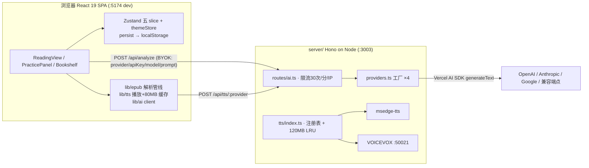

# baku-yomi 技术速查表（面试前一天冲刺）

> 一页式浓缩，全部数字与符号来自真实源码。先扫架构图 → 背三流程链 → 过表。

---

## 1 · 架构一图



生产模式（NODE_ENV=production）：同一端口 serveStatic 托管 dist + SPA fallback；CORS 仅在显式设置 CORS_ORIGIN 时挂载，否则同源即最安全。开发模式 cors() 全开。

---

## 2 · 目录地图

```
src/
  components/
    reader/      ReadingView(18KB 键盘j/k/gi/Esc/r/?) PracticePanel BookmarkList
                 SelectionPopover SentencePairCard ShortcutHelp
    settings/    SettingsModal AISettingsPanel VoiceSettingsPanel
    layout/      MainLayout Sidebar TopBar
    bookshelf/   BookshelfPage BookCard     import/EpubUploader
    analysis/AnalysisPanel  onboarding/WelcomeGuide
  hooks/         useAnalysis useEpubParser useTextSelection
  lib/
    epub/        parser → sentenceSplitter → languageDetector → pairBuilder (+immersiveTranslate)
    ai/          prompts(3个) client(fetch /api/analyze)
    tts/         voicevox.ts(单例Audio/Blob缓存80MB/预取)
  stores/        book bookmark practice settings(version:2+migrate) ui(不持久化)
  theme/         themeStore(6模式+KEY_MAP) ThemeOverlays(Canvas动效) applyBodyClass
  types/         book.ts analysis.ts settings.ts index.ts
server/
  index.ts       CORS双策略 /health serveStatic+SPA fallback PORT默认3003
  routes/ai.ts   POST /api/analyze + 挂载tts子路由
  providers.ts   createProvider switch工厂
  tts/           index.ts(注册表+缓存) microsoft.ts voicevox.ts types.ts
```

localStorage 键名：`book-store` `practice-store` `settings-store`(v2) `baku-yomi-bookmarks` `baku-yomi-theme`

---

## 3 · 三条核心流程步骤链

**① EPUB → 句对（全在浏览器）**
`parseEpubFile(file)` → `initEpubFile`(解压) → 元数据(`extractText`处理`{_,$}`形状 / `extractCreator`) → `getSpine`+`getToc`→`flattenToc`→按 spineIndex 排序 → 预载全部 spine HTML → 封面探测(manifest cover-image?前3个spine:第1个; blob:→FileReader→dataURL) → 每章 `extractPairsFromHtml`：
- 先试沉浸式翻译 span 格式(`immersive-translate-target-wrapper`)，null 则通用管线
- `extractSentences`: DOMParser 取 `p,h1-h6,div,li`，含内嵌 p/div 的外层跳过；ruby 双轨（纯文本剥 rt/rp + `sanitizeRubyHtml` 白名单占位符 \x01\x02 法）；无块级元素按 `\n+` 兜底
- `detectLanguage`: 有假名[\u3040-\u309F\u30A0-\u30FF]=ja，否则有[\u4E00-\u9FFF]=zh
- `buildPairs`: 无任何相邻双语→整章单语降级(chinese:'')；否则相邻 JA↔ZH 配对 `i+=2`，未配对 ja 保留、zh 丢弃

**② 回译练习 → AI**
`buildAnalysisPrompt`(三个prompt之一) → `useAnalysis.analyze`(校验key/译文, setAnalyzing) → `analyzeTranslation` fetch POST `/api/analyze` body{provider,apiKey,model,prompt} → 服务端限流(固定窗口60s/30次/IP, x-forwarded-for首段, 每5min清扫) → `createProvider` → `generateText({model,prompt})` → 返回{text} → 前端正则 `/【综合评分】\s*(\d+)/` 抠分(失败=0)

**③ TTS 连续朗读**
客户端 ensureVoiceUrl(Blob缓存命中?) → POST `/api/tts/:provider` {text,speaker=1,options} → sha1键(provider::speaker::speed::pitch::volume::text) 查缓存(HIT头X-TTS-Cache) → 未命中 synthesize → writeCache(字节累计,超120MB按lastAccessAt驱逐) → 客户端单例 Audio 播放 → ended回调下一句 + prefetchVoicevox 预取(提前 voicevoxPrefetchWindow=4 句, voicePending 去重)

---

## 4 · 环境变量全表

| 变量 | 默认值 | 说明 |
|---|---|---|
| `PORT` | `3003` | 服务端口 |
| `TTS_DEFAULT_PROVIDER` | `microsoft` | microsoft \| voicevox |
| `VOICEVOX_ENGINE_URL` | `http://localhost:50021` | VOICEVOX 引擎地址 |
| `TTS_CACHE_MAX_BYTES` | `125829120`（120MB） | 服务端音频缓存上限 |
| `CORS_ORIGIN` | 不设=仅同源 | 生产跨域白名单 |
| `OPENAI_API_KEY` / `ANTHROPIC_API_KEY` / `GOOGLE_API_KEY` | 空 | 可选服务端 key（默认 BYOK 不用） |
| `NODE_ENV` | development | `production` 触发静态托管+CORS收紧 |

注意：前端默认 `ttsProvider: 'voicevox'`（settingsSlice），与服务端默认 microsoft 不一致——已知坑。

---

## 5 · API 端点全表

| 方法 | 路径 | 说明 |
|---|---|---|
| GET | `/health` | `{status:'ok'}` |
| POST | `/api/analyze` | body{provider,apiKey,model,prompt}→{text}；缺字段400、超限429、错误500透传message |
| GET | `/api/tts/cache/stats` | items/totalBytes/maxBytes/hits/misses/evictions |
| POST | `/api/tts/cache/clear` | 清空缓存（注册在 /:provider 之前防参数吞噬） |
| GET | `/api/tts/:provider/speakers` | Speaker[]（name/speaker_uuid/styles{id,name}） |
| POST | `/api/tts/:provider` | body{text必填,speaker=1,options{speedScale,pitchScale,volumeScale}}→音频(microsoft=mpeg其余wav)+X-TTS-Cache头 |

---

## 6 · 关键类型速记

```ts
Book      {id:`book-${Date.now()}`, title, author, description?, publisher?, chapters, coverUrl?, importedAt}
Chapter   {id:`${bookId}-ch${n}`, title, index, pairs}
SentencePair {id:`ch${chapterIndex}-p${pairIndex}`, japanese, japaneseHtml?(ruby净化HTML),
              chinese(''=未译/单语), chapterIndex, pairIndex}
AnalysisResult {pairId, userTranslation, originalJapanese, score, errors[], strengths[],
              suggestions[], rawMarkdown, analyzedAt}
ErrorCategory '文法'|'語彙'|'助詞'|'敬語'|'時制'|'表現'|'語順'|'その他'
AIProviderType 'openai'|'anthropic'|'google'|'openai-compatible'
DEFAULT_MODELS  gpt-4o / claude-sonnet-4-20250514 / gemini-2.0-flash / gpt-4o
TextBookmark  {id:`bm-${Date.now()}-${rand36}`, pairId, chapterId, startOffset, endOffset,
              text, colorId(六色red/orange/yellow/green/blue/purple), createdAt}
TTSProvider {name; synthesize(text,speaker,options?):Promise<Buffer>; getSpeakers():Promise<Speaker[]>}
```

---

## 7 · 快捷键表

| 键 | 功能 | 出处 |
|---|---|---|
| `j` / `k` | 下一句 / 上一句 | ReadingView keydown |
| `gi`（g 后 500ms 内 i） | 进入输入框 | giPending 状态机 |
| `Esc` | 退出输入 / 关面板 | 先判 isInput |
| `r` | 开关连续朗读 toggleAutoRead | ⚠️ KEY_MAP 里 r 也是雨主题，双监听冲突已知 |
| `N M D S R W` | Night/Moonlight/Day/Sunny/Rain/Snow | themeStore KEY_MAP |
| `?` | 快捷键帮助面板 | setShowHelp |

---

## 8 · 高频命令

```bash
pnpm install && pnpm dev        # 并行: vite(:5174) + tsx watch server(:3003)
pnpm build                      # tsc -b 类型门禁 && vite build
pnpm start                      # NODE_ENV=production 同端口服务 API+静态
pnpm lint                       # eslint .

docker compose up                          # 默认仅 microsoft TTS
docker compose --profile voicevox up       # 附带 VOICEVOX 引擎(:50021)

curl http://localhost:3003/health
curl http://localhost:3003/api/tts/cache/stats    # 看命中率/驱逐
curl -X POST localhost:3003/api/analyze -H 'Content-Type: application/json' \
  -d '{"provider":"openai","apiKey":"sk-..","model":"gpt-4o","prompt":"hi"}'
```

---

## 9 · 数字卡（考前最后 60 秒背这格）

- 限流 **30 次/分/IP** 固定窗口 60s，桶每 **5 分钟**清扫
- 服务端 TTS 缓存 **120MB**（125829120）；客户端 Blob 缓存 **80MB**；预取窗口默认 **4 句**
- 字号缩放 **0.8~1.4** 步进 0.1；语速 0.5~2 / 音高 ±0.15 / 音量 0.2~2 / 缓存 16~512MB
- persist version：settings-store = **2**（migrate 单 aiProvider→aiProviders 数组）
- 封面探测：声明 cover-image 看 spine 前 **3** 个，否则第 **1** 个
- 分数正则匹配不到 → **0** 分（静默缺陷，改进=generateObject）
- Node ≥ 22 / pnpm；前端 ：5174 / API ：3003 / VOICEVOX :50021

*基于 2026-08-26 代码库实际通读编写。*
