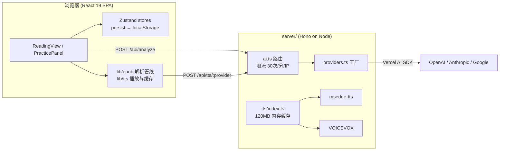

# baku-yomi 项目学习指南（面试准备）

> 目标：深入理解这个 AI 辅助开发的项目的结构与技术栈，能够独立讲清每条核心流程，从容应对面试追问。

---

## 一、项目定位（一句话版本）

**baku-yomi**（双語回訳）：一个「日语双语阅读器 + 回译练习工具」。

导入中日双语的 EPUB → 逐句对齐显示 → 你看中文、用日语回译 → AI 打分纠错。附带 TTS 朗读（连续播放 + 预取）、书签、6 个 Canvas 动效主题。整体是 **BYOK（Bring Your Own Key，用户自带 AI Key）** 的本地/自托管应用。

---

## 二、架构与技术栈



| 层 | 技术 | 关键文件 |
|---|---|---|
| 前端框架 | React 19 + Vite 7 + TS 5.9 | `src/App.tsx` |
| 状态管理 | Zustand 5（slice 拆分 + `persist` 存 localStorage） | `src/stores/*Slice.ts` |
| EPUB 解析 | `@lingo-reader/epub-parser` + 自研配对管线 | `src/lib/epub/` |
| AI | Vercel AI SDK `generateText`，多 provider 工厂 | `server/providers.ts`、`server/routes/ai.ts` |
| 后端 | Hono（同时托管 API 和生产静态文件 + SPA fallback） | `server/index.ts` |
| TTS | msedge-tts（免费）/ VOICEVOX，策略模式注册表 | `server/tts/index.ts`、`src/lib/tts/voicevox.ts` |
| 部署 | Docker Compose（可选 voicevox profile） | `Dockerfile`、`docker-compose.yml` |

### 源码目录速查

```
src/
  components/     # UI：reader（阅读+练习）、settings、layout、bookshelf、import…
  hooks/          # useAnalysis / useEpubParser / useTextSelection
  lib/
    ai/           # client.ts（调 /api/analyze）、prompts.ts（3 个中文 prompt）
    epub/         # parser → sentenceSplitter → languageDetector → pairBuilder
    tts/          # voicevox.ts 客户端缓存与预取
  stores/         # Zustand slice：book / bookmark / practice / settings / ui
  theme/          # themeStore + Canvas 动态特效 overlay
  types/          # Book / Chapter / SentencePair / AnalysisResult 等领域类型
server/
  index.ts        # Hono 入口：CORS、静态文件、SPA fallback
  routes/ai.ts    # POST /api/analyze（内存限流 30 次/分/IP）
  providers.ts    # AI provider 工厂（openai / anthropic / google / openai-compatible）
  tts/            # provider 注册表 + 字节上限内存缓存（默认 120MB）
```

---

## 三、必须吃透的三条核心流程

### 流程 1：EPUB → 句对（项目最核心、最有讲头的部分）

入口 `parseEpubFile()`（`src/lib/epub/parser.ts`），管线：

1. **DOMParser 解析章节 HTML**（`sentenceSplitter.ts`）
   - 提取 `p/h1-h6/div/li` 块级元素为「句子」（跳过内嵌 p/div 的外层容器避免重复）。
   - 特殊处理 **ruby 注音**：纯文本剥掉 `<rt>/<rp>`；另保留一份只含 ruby 标签的白名单净化 HTML（占位符替换法），用于界面显示注音。
   - 兜底：无块级元素时按换行切分纯文本。
2. **语言检测**（`languageDetector.ts`）：判断每句是 ja 还是 zh。
3. **句对构建**（`pairBuilder.ts`）
   - 扫描相邻句子：`JA→ZH` 或 `ZH→JA` 配成一对（`i += 2` 跳过已配对的）。
   - 无任何相邻双语结构时降级为单语模式（chinese 为空串），保证纯日文书也能导入。
   - 未配对上的日语行单独保留，支持后续回填译文。
4. **沉浸式翻译格式兼容**（`immersiveTranslate.ts`）：识别其特定 span class 结构（原文 `<p>` 内嵌 `immersive-translate-target-wrapper`），优先尝试该格式解析。
5. 全部在**浏览器端**完成；书籍数据存 Zustand persist → localStorage。

### 流程 2：回译练习 → AI 分析

1. 前端拼 prompt：`src/lib/ai/prompts.ts` 有三个 prompt——
   - `buildHintPrompt`：回译提示（只给方向不给答案）
   - `buildBacktranslateHintPrompt`：把机翻译文改写成适合回译的版本
   - `buildAnalysisPrompt`：分析打分（要求输出含【综合评分】等标记）
2. `POST /api/analyze`（body 携带 provider/apiKey/model/prompt —— BYOK）。
3. 服务端限流：内存版固定窗口，per-IP 每分钟 30 次，超限返回 429；每 5 分钟清扫过期桶。
4. `createProvider()` 工厂按厂商创建模型实例 → Vercel AI SDK `generateText()`。
5. 返回 Markdown 文本；前端用正则 `/【综合评分】\s*(\d+)/` 从文本里抠出分数。

### 流程 3：TTS 连续朗读

三层设计：

- **服务端**：provider 注册表（Map）+ 字节上限的 LRU 式内存缓存（默认 120MB，可 `TTS_CACHE_MAX_BYTES` 调整），命中计数/驱逐计数可通过 `/api/tts/cache/stats` 查看。
- **客户端**（`src/lib/tts/voicevox.ts`）：独立一份带淘汰的音频 Blob 缓存（约 80MB）+ **预取**（`prefetchVoicevox` 提前合成下一句）+ 单例 HTMLAudioElement 播放管理。
- **连续朗读**：逐句自动播放，播完回调驱动下一句。

---

## 四、学习路径（按优先级）

### 第 1 步：跑通并操作一遍（半天）

```bash
pnpm install && pnpm dev
# 前端 http://localhost:5174，API http://localhost:3003
```

导入一本书 → 做一次回译 → 开连续朗读 → 切主题。必须能完整演示每个功能。

### 第 2 步：按数据流精读代码（2~3 天，顺序很重要）

1. `src/types/*.ts`（很小，先建立领域模型：Book / Chapter / SentencePair / AnalysisResult）
2. `src/lib/epub/` 全部 5 个文件 ← **重点，这是项目的差异化**
3. `src/stores/bookSlice.ts` + `settingsSlice.ts`（理解 Zustand slice + persist）
4. `src/components/reader/PracticePanel.tsx` 和 `ReadingView.tsx`（最大的两个组件，UI 主战场）
5. `server/index.ts` → `routes/ai.ts` → `providers.ts` → `tts/index.ts`（后端总共不到 500 行，全读完）

### 第 3 步：准备「为什么」层面的答案（面试真正考的）

每个技术选型都要能答「为什么」和「代价」：

- **为什么 Zustand 不用 Redux？** 体积小、无 Provider 包裹、`persist` 中间件开箱即用，适合这种以 localStorage 为持久层的本地应用。
- **为什么 Hono 不用 Express？** Web 标准 API（fetch 风格）、轻量、TS 优先；一个 `app.fetch` 就能同时服务 API 和 `serveStatic` 静态资源 + SPA fallback。
- **为什么 EPUB 解析放浏览器端不放服务端？** 零服务端状态、书籍不出浏览器（隐私）、部署简单——代价是受 localStorage 容量限制、大书解析阻塞主线程。
- **为什么用正则从 Markdown 抠分数而不是 JSON mode / structured output？** 当前实现简单直接；但这是已知可改进点（见第五节防守点 6）。
- **为什么 BYOK？** 自托管场景下没有服务端可以保管密钥，让用户自带 Key 最简单且无密钥托管责任。

### 第 4 步：动手改一处代码证明所有权（最重要）

面试官一定会问细节或让你现场改代码。挑一个小改动亲手完成，推荐：

> 把 `/api/analyze` 改用 AI SDK 的 `generateObject` 输出结构化评分（schema 定义 score/feedback 等），顺便消灭前端正则抠分数的逻辑。

做完这一处，你对 prompt → 服务端路由 → SDK → 前端消费整条链路就真的懂了。

---

## 五、面试防守点（现有弱点，提前想好说辞）

1. **没有任何测试**
   应答：个人项目优先快速迭代；下一步计划用 Vitest 给 `pairBuilder` / `sentenceSplitter` 这类纯函数补单测。最好真补上几个。

2. **内存态限流和缓存**
   多实例部署失效、重启丢失。主动指出并给出 Redis 方案——主动暴露比被问到强。

3. **BYOK 安全叙事要精确**
   文档说「Key 不经过任何中间服务器」，实际是 Key 从浏览器发到**你自己部署的服务器**再转发给厂商。要说清威胁模型：自托管场景下服务器就是用户自己的，所以成立；但如果部署在公网共享实例上，Key 会经过你的服务器。

4. **`dangerouslySetInnerHTML`（ruby HTML 渲染）**
   面试官可能抓 XSS。现有代码做了白名单净化（sanitizeRubyHtml 只保留 ruby/rt/rp 标签，其余标签全部剥除）。要能讲清这个思路及残余风险（属性注入等）。

5. **README 还有 `<!-- TODO: add screenshot -->`**
   开源作品集没截图很扣分，尽快补一张界面截图到 `docs/screenshot.png` 并取消注释。

6. **评分靠正则解析自由文本**
   LLM 输出格式不稳定时可能抠不到分（当前 fallback 为 0）。改进方向：`generateObject` + JSON Schema 结构化输出。

7. **localStorage 容量上限**（通常 ~5MB）
   整本书的句子对都存进去，大部头书可能超限。改进方向：IndexedDB。

---

## 六、面试自测问题清单

答不上的回到第三节对应流程重读。

1. 从上传 EPUB 到屏幕上出现中日对照句，中间经过哪几步？每步的输入输出是什么？
2. ruby 注音是如何做到「纯文本不含注音、但界面又能显示注音」的？
3. 如果一本书是中日在同一段落交错而不是相邻段落，`pairBuilder` 还能正确配对吗？（读代码后回答：不能，它只看相邻行）
4. 用户点「提交分析」后，一个请求从前端到 AI 厂商经过了哪些函数？
5. 连续朗读时如何保证下一句不卡顿？（预取 + 双层缓存）
6. 为什么生产模式不配 CORS_ORIGIN 时反而是最安全的？
7. Zustand 的 persist 中间件做了什么？如果 store 结构升级了怎么迁移？
8. 服务端 TTS 缓存满了怎么淘汰？（字节累计 + LRU 触碰时间戳）

---

*生成于 2026-08-26，基于当时代码库实际通读结果。*
