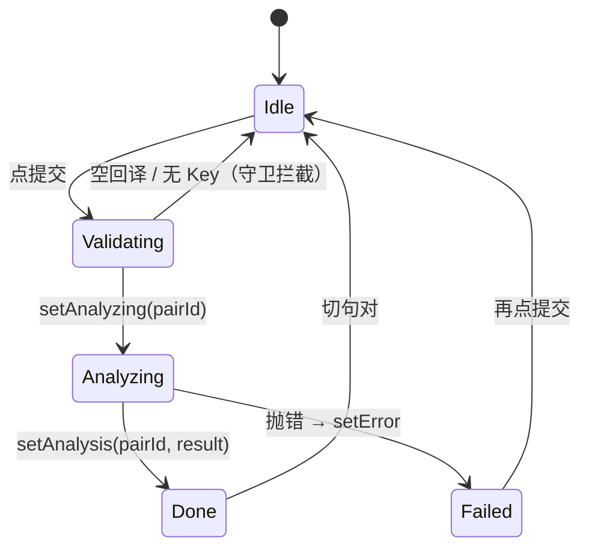

# M5 · 从零构筑：练习面板

> 目标：把 M4 的 AI 能力组装成回译练习的完整交互闭环——点击句对展开右侧面板，完成「看译文 → 想日语 → 输入回译 → 提交分析 → 看评分与讲解」的练习流程，练习痕迹全部持久化。
> 产出形态：右侧滑出的练习面板（原文 / 译文 / 回译辅助 / 笔记 / 分析结果 + 底部回译输入区），提交分析与获取提示走 `/api/analyze`。
> 关联课程：L17（练习面板与结果展示）、L24（提示工程：三个 prompt 的设计与消费）。
> 前置：M2 的面板壳已建（Header + 原文 + 译文 + 编辑，选中即弹出）；M3 的 practiceSlice 骨架已建（translations/analyses/notes 三个字典 + setter）；M4 的 client/prompts/AnalysisPanel 已就位。

## 构筑总览（本里程碑结束时的项目结构）

```
src/
├── stores/
│   └── practiceSlice.ts       # 补齐 hints / analyzingPairId / getters（本卡扩充）
├── hooks/
│   └── useAnalysis.ts         # 提交动作 + 全局 loading（本卡新建）
├── lib/ai/client.ts           # M4 已建：analyzeTranslation / generateBacktranslateHints / optimizeTranslationForBacktranslation
├── components/
│   ├── analysis/AnalysisPanel.tsx   # M4 最小版 → 本卡补 MarkdownContent 行级解析器
│   └── reader/
│       ├── PracticePanel.tsx        # 本卡扩充：回译辅助 / 笔记 / 分析结果 / Composer
│       └── ReadingView.tsx          # 本卡接线：selectedPair + inputRef/inputMode 传下去
```

**最终差异说明**：
- PracticePanel 最终版在译文区还有「编辑」按钮与草稿编辑态——那是 **M2 已建成**的部分，本卡从略（最终代码仍在同一位置）
- `noteRef` 声明并挂到笔记 textarea 上但当前只占位（最终代码同）
- practiceSlice 的 `clearPracticeData` 要到 M9 书架页删除书籍时才被调用，本卡先建好 action

一次提交的生命周期（本卡的核心，要能讲给面试官）：



---

## Step 1 · practiceSlice 补齐：hints、analyzingPairId 与 getters

M3 已建前三组字段（translations/analyses/notes + 各自 setter）与 persist。本步把最终形态补齐——关键设计：**loading 态也存 store 而不是组件里**，且用「句对 id」而不是布尔值，这样任何组件都能问「现在正在分析哪一句」。

```ts
import { create } from 'zustand';
import { persist } from 'zustand/middleware';
import type { AnalysisResult } from '../types';

interface PracticeState {
  translations: Record<string, string>;
  analyses: Record<string, AnalysisResult>;
  notes: Record<string, string>;
  hints: Record<string, string>;
  analyzingPairId: string | null;
  hintLoadingId: string | null;

  setTranslation: (pairId: string, text: string) => void;
  setAnalysis: (pairId: string, result: AnalysisResult) => void;
  setAnalyzing: (pairId: string | null) => void;
  setNote: (pairId: string, text: string) => void;
  setHint: (pairId: string, text: string) => void;
  setHintLoading: (pairId: string | null) => void;
  getTranslation: (pairId: string) => string;
  getAnalysis: (pairId: string) => AnalysisResult | null;
  clearPracticeData: (bookId: string) => void;
}

export const usePracticeStore = create<PracticeState>()(
  persist(
    (set, get) => ({
      translations: {},
      analyses: {},
      notes: {},
      hints: {},
      analyzingPairId: null,
      hintLoadingId: null,

      setTranslation: (pairId, text) =>
        set((state) => ({
          translations: { ...state.translations, [pairId]: text },
        })),

      setAnalysis: (pairId, result) =>
        set((state) => ({
          analyses: { ...state.analyses, [pairId]: result },
          analyzingPairId: null,
        })),

      setAnalyzing: (pairId) =>
        set({ analyzingPairId: pairId }),

      setNote: (pairId, text) =>
        set((state) => ({
          notes: { ...state.notes, [pairId]: text },
        })),

      setHint: (pairId, text) =>
        set((state) => ({
          hints: { ...state.hints, [pairId]: text },
          hintLoadingId: null,
        })),

      setHintLoading: (pairId) =>
        set({ hintLoadingId: pairId }),

      getTranslation: (pairId) => get().translations[pairId] ?? '',

      getAnalysis: (pairId) => get().analyses[pairId] ?? null,

      clearPracticeData: (_bookId) =>
        set({ translations: {}, analyses: {}, notes: {}, hints: {} }),
    }),
    { name: 'practice-store' }
  )
);
```

**逐行讲解：**
- 四个 Record 全部以句对 id 为键（O(1) 查找、切句零成本）；`hints` 键是外部手工拼的 `pair.id + '_hint'`（PracticePanel 里这么用，是历史痕迹，照做即可）。
- `setAnalysis` 里**顺带清掉 analyzingPairId**——「分析完成」与「loading 结束」绑定在同一次 set，不会出现结果已到但转圈残留的窗口。
- `analyzingPairId: string | null` 而非 `boolean`：存的是「哪一句在分析」。分析中切走再切回来，`isAnalyzing = analyzingPairId === pair.id` 依然成立，正在进行的分析不被中断。
- `getTranslation` / `getAnalysis` 是带兜底的读方法（`?? ''` / `?? null`），调用方不用判空。
- persist 键名 `practice-store`（M3 已定），新字段自动入库。

**验证：** 浏览器控制台 `usePracticeStore.getState().setTranslation('p1', '今日は雨だ。')` → 刷新页面 → `getTranslation('p1')` 仍在。

## Step 2 · useAnalysis：提交动作与全局 loading

把「提交分析」抽成自定义 hook：校验 → 置 analyzing → 调 client → 落 store。loading 态从 hook 里读出来，面板与将来的卡片都能用。

```ts
import { useCallback } from 'react';
import { usePracticeStore } from '../stores/practiceSlice';
import { useSettingsStore } from '../stores/settingsSlice';
import { analyzeTranslation } from '../lib/ai/client';

export function useAnalysis() {
  const { setAnalysis, setAnalyzing, analyzingPairId } = usePracticeStore();
  const aiProvider = useSettingsStore((s) => s.getActiveAIProvider());

  const analyze = useCallback(
    async (
      pairId: string,
      original: string,
      chinese: string,
      userTranslation: string
    ) => {
      if (!aiProvider.apiKey) {
        throw new Error('请先在设置中配置AI API Key');
      }
      if (!userTranslation.trim()) {
        throw new Error('请先输入你的日语回译');
      }

      setAnalyzing(pairId);
      try {
        const result = await analyzeTranslation(
          aiProvider,
          original,
          chinese,
          userTranslation,
          pairId
        );
        setAnalysis(pairId, result);
        return result;
      } catch (e) {
        setAnalyzing(null);
        throw e;
      }
    },
    [aiProvider, setAnalysis, setAnalyzing]
  );

  return { analyze, analyzingPairId };
}
```

**逐行讲解：**
- 两道前置守卫（Validating 状态）：无 Key、空回译直接 throw——错误文案从这里产生，面板的 catch 负责展示。
- `setAnalyzing(pairId)` 进入 Analyzing；成功走 `setAnalysis`（它会顺带清 loading）；**失败路径手动 `setAnalyzing(null)`**——异常先复位再抛给调用方，保证失败后按钮恢复可点、无残留转圈。
- `useCallback` 依赖 `[aiProvider, ...]`——`getActiveAIProvider()` 返回的是新对象（每次 selector 求值都重建），依赖它会让 analyze 引用在 settings 变化时刷新，行为正确。
- 返回 `{ analyze, analyzingPairId }`：动作 + 全局 loading 一起给出去。

**验证：** 无 Key 时调 `analyze('p1', 'a', 'b', 'c')` 立即抛「请先在设置中配置AI API Key」；配好 Key 后能真实走通。

## Step 3 · PracticePanel：回译输入、提交状态机、回译辅助与笔记

本步把 M2 的面板壳（Header/原文/译文）扩展成完整练习面板。译文编辑块在 M2 已建（最终代码位于译文区），本卡专注四块新增：回译辅助（优化译文 + 获取提示）、笔记、分析结果、底部 Composer。

```tsx
import { useState, useRef, useEffect } from 'react';
import type { SentencePair as SentencePairType } from '../../types';
import { usePracticeStore } from '../../stores/practiceSlice';
import { useSettingsStore } from '../../stores/settingsSlice';
import { useBookStore } from '../../stores/bookSlice';
import { useAnalysis } from '../../hooks/useAnalysis';
import { generateBacktranslateHints, optimizeTranslationForBacktranslation } from '../../lib/ai/client';
import { AnalysisPanel } from '../analysis/AnalysisPanel';
import { FiX, FiSend, FiMessageSquare, FiZap, FiHelpCircle } from 'react-icons/fi';

interface Props {
  pair: SentencePairType | null;
  onClose: () => void;
  inputRef: React.RefObject<HTMLTextAreaElement | null>;
  inputMode: boolean;
}

export function PracticePanel({ pair, onClose, inputRef, inputMode }: Props) {
  const hasChinese = pair ? pair.chinese.trim().length > 0 : false;
  const translation = usePracticeStore((s) => pair ? s.translations[pair.id] ?? '' : '');
  const analysis = usePracticeStore((s) => pair ? s.analyses[pair.id] : null);
  const note = usePracticeStore((s) => pair ? s.notes[pair.id] ?? '' : '');
  const hint = usePracticeStore((s) => pair ? s.hints[pair.id + '_hint'] : '');
  const setTranslation = usePracticeStore((s) => s.setTranslation);
  const setNote = usePracticeStore((s) => s.setNote);
  const setHint = usePracticeStore((s) => s.setHint);
  const updatePairChinese = useBookStore((s) => s.updatePairChinese);
  const { analyze, analyzingPairId } = useAnalysis();
  const aiProvider = useSettingsStore((s) => s.getActiveAIProvider());

  const [error, setError] = useState<string | null>(null);
  const [showNote, setShowNote] = useState(false);
  const [loadingOptimize, setLoadingOptimize] = useState(false);
  const [loadingHint, setLoadingHint] = useState(false);
  const [optimizeError, setOptimizeError] = useState<string | null>(null);
  const [hintError, setHintError] = useState<string | null>(null);
  const noteRef = useRef<HTMLTextAreaElement>(null);

  const isAnalyzing = analyzingPairId === pair?.id;

  // 切换句对时清掉上一句的交互残留（持久数据不动）
  useEffect(() => {
    if (pair?.id) {
      setShowNote(false);
      setError(null);
      setOptimizeError(null);
      setHintError(null);
    }
  }, [pair?.id]);

  // inputMode 变化时控制 focus（M6 的 gi 快捷键的落点）
  useEffect(() => {
    if (inputMode && pair?.id && inputRef.current) {
      inputRef.current.focus();
    }
  }, [inputMode, inputRef, pair?.id]);

  const handleSubmit = async () => {
    if (!pair || !translation.trim()) return;
    setError(null);
    try {
      await analyze(pair.id, pair.japanese, pair.chinese, translation);
    } catch (e) {
      setError(e instanceof Error ? e.message : '分析失败');
    }
  };

  const handleOptimizeTranslation = async () => {
    if (!pair || !aiProvider.apiKey) {
      setOptimizeError('请先在设置中配置 AI API Key');
      return;
    }
    setLoadingOptimize(true);
    setOptimizeError(null);
    try {
      const optimized = await optimizeTranslationForBacktranslation(aiProvider, pair.japanese, pair.chinese);
      updatePairChinese(pair.id, optimized);
    } catch (e) {
      setOptimizeError(e instanceof Error ? e.message : '优化译文失败');
    } finally {
      setLoadingOptimize(false);
    }
  };

  const handleGetHint = async () => {
    if (!pair || !aiProvider.apiKey) {
      setHintError('请先在设置中配置 AI API Key');
      return;
    }
    setLoadingHint(true);
    setHintError(null);
    try {
      const text = await generateBacktranslateHints(aiProvider, pair.japanese, pair.chinese);
      setHint(pair.id + '_hint', text);
    } catch (e) {
      setHintError(e instanceof Error ? e.message : '获取提示失败');
    } finally {
      setLoadingHint(false);
    }
  };

  if (!pair) {
    return null;
  }

  return (
    <aside
      className="reader-practice-panel animate-fade-in"
      style={{ width: '24rem', borderLeft: '1px solid var(--border-light)' }}
    >
      {/* Header */}
      <div className="flex items-center justify-between px-5 py-4" style={{ borderBottom: '1px solid var(--border-light)' }}>
        <span className="text-xs font-medium" style={{ fontFamily: 'var(--font-ui)', color: 'var(--ink-muted)', letterSpacing: '0.08em' }}>
          练习
        </span>
        <button onClick={onClose} className="p-1 opacity-40 hover:opacity-100 transition-opacity">
          <FiX size={16} />
        </button>
      </div>

      {/* Content */}
      <div className="reader-practice-panel-content p-5 space-y-5">
        {/* Japanese original */}
        <div>
          <span className="tag mb-2 block">原文</span>
          <p className="text-reading" style={{ lineHeight: '1.9' }}>
            {pair.japanese}
          </p>
        </div>

        {/* Chinese translation */}
        <div>
          <div className="flex items-center justify-between mb-2">
            <span className="tag">译文</span>
          </div>
          <p className="text-reading" style={{ fontSize: '0.9em', opacity: hasChinese ? 0.7 : 0.48, fontStyle: hasChinese ? 'normal' : 'italic' }}>
            {hasChinese ? pair.chinese : '暂无译文'}
          </p>
        </div>

        {/* 回译辅助 */}
        <div>
          <div className="flex items-center justify-between mb-2">
            <span className="tag">回译辅助</span>
            <div className="flex gap-2">
              <button
                onClick={handleOptimizeTranslation}
                disabled={loadingOptimize}
                className="flex items-center gap-1 text-xs px-2 py-1 rounded transition-all"
                style={{ fontFamily: 'var(--font-ui)', backgroundColor: 'var(--accent-subtle)', color: 'var(--accent-secondary)', opacity: loadingOptimize ? 0.5 : 1, border: '1px solid var(--border-light)' }}
              >
                {loadingOptimize ? <div className="w-3 h-3 border-2 border-current border-t-transparent rounded-full animate-spin" /> : <FiZap size={11} />}
                优化译文
              </button>
              <button
                onClick={handleGetHint}
                disabled={loadingHint}
                className="flex items-center gap-1 text-xs px-2 py-1 rounded transition-all"
                style={{ fontFamily: 'var(--font-ui)', backgroundColor: 'var(--accent-subtle)', color: 'var(--accent-primary)', opacity: loadingHint ? 0.5 : 1, border: '1px solid var(--border-light)' }}
              >
                {loadingHint ? <div className="w-3 h-3 border-2 border-current border-t-transparent rounded-full animate-spin" /> : <FiHelpCircle size={11} />}
                获取提示
              </button>
            </div>
          </div>

          {optimizeError && <p className="text-xs mb-2" style={{ color: 'var(--error-color)' }}>{optimizeError}</p>}
          {hintError && <p className="text-xs mb-2" style={{ color: 'var(--error-color)' }}>{hintError}</p>}

          {hint && (
            <div className="p-3 rounded text-sm space-y-2" style={{ backgroundColor: 'var(--bg-secondary)', fontFamily: 'var(--font-body)', color: 'var(--ink-secondary)', lineHeight: '1.6' }}>
              <p className="text-xs opacity-50" style={{ fontFamily: 'var(--font-ui)' }}>回译提示</p>
              {hint.split('\n').filter(Boolean).map((line, i) => {
                if (line.startsWith('【') && line.includes('】')) {
                  const match = line.match(/^(【[^】]+】)(.*)$/);
                  if (match) {
                    return (
                      <p key={i}>
                        <strong style={{ color: 'var(--accent-primary)' }}>{match[1]}</strong>
                        {match[2]}
                      </p>
                    );
                  }
                }
                return <p key={i}>{line}</p>;
              })}
            </div>
          )}
        </div>

        {/* Note */}
        {(note.trim() || showNote) && (
          <div>
            <button
              onClick={() => setShowNote(!showNote)}
              className="flex items-center gap-1.5 text-xs mb-2"
              style={{ fontFamily: 'var(--font-ui)', color: 'var(--accent-secondary)' }}
            >
              <FiMessageSquare size={13} />
              笔记
            </button>
            {showNote && (
              <textarea
                ref={noteRef}
                value={note}
                onChange={(e) => setNote(pair.id, e.target.value)}
                placeholder="添加笔记..."
                rows={2}
                className="w-full px-3 py-2 text-sm resize-none"
                style={{ border: '1px solid var(--border-color)', borderRadius: '4px', backgroundColor: 'var(--bg-secondary)', fontFamily: 'var(--font-body)' }}
              />
            )}
          </div>
        )}

        {!note.trim() && !showNote && (
          <button
            onClick={() => setShowNote(true)}
            className="flex items-center gap-1.5 text-xs opacity-40 hover:opacity-80 transition-opacity"
            style={{ fontFamily: 'var(--font-ui)', color: 'var(--ink-muted)' }}
          >
            <FiMessageSquare size={13} />
            添加笔记
          </button>
        )}

        {/* Analysis result */}
        {analysis && <AnalysisPanel result={analysis} />}
      </div>

      {/* Composer */}
      <div className="reader-practice-panel-composer px-5 py-4 space-y-3" style={{ borderTop: '1px solid var(--border-light)' }}>
        <div>
          <span className="tag mb-2 block">你的回译</span>
          <textarea
            ref={inputRef}
            value={translation}
            onChange={(e) => setTranslation(pair.id, e.target.value)}
            placeholder="输入日语回译..."
            rows={3}
            className="w-full px-4 py-3 text-reading resize-none"
            style={{ border: '1px solid var(--border-color)', borderRadius: '4px', backgroundColor: 'var(--bg-secondary)' }}
          />
        </div>

        <div className="flex justify-between items-center gap-3">
          <span className="text-xs" style={{ color: 'var(--error-color)' }}>
            {error}
          </span>
          <button
            onClick={handleSubmit}
            disabled={isAnalyzing || !translation.trim()}
            className="btn btn-primary flex items-center gap-2"
            style={{ opacity: isAnalyzing || !translation.trim() ? 0.4 : 1 }}
          >
            {isAnalyzing ? (
              <>
                <div className="w-4 h-4 border-2 border-current border-t-transparent rounded-full animate-spin" />
                分析中
              </>
            ) : (
              <>
                <FiSend size={14} />
                提交分析
              </>
            )}
          </button>
        </div>
      </div>
    </aside>
  );
}
```

**提交状态机逐段讲解（对照总览的 stateDiagram）：**

| 状态 | 由哪些字段承载 | 表现 |
|---|---|---|
| Idle | 无 `analyzingPairId`、无 `error` | 按钮可点（回译为空时 `disabled`，也是守卫） |
| Validating | `handleSubmit` 入口 `!pair \|\| !translation.trim()` return；`useAnalysis` 里 Key/空输入两道 throw | 无 UI，纯守卫 |
| Analyzing | `analyzingPairId === pair.id` → `isAnalyzing` | 按钮转圈 + 禁用 + 「分析中」 |
| Done | `analyses[pair.id]` 存在 | `AnalysisPanel` 渲染评分与正文 |
| Failed | `error` state（来自 catch） | 按钮旁红色文案；`setAnalyzing(null)` 已复位 |

- **状态分两层**：持久数据（translation/analysis/note/hint）进 store、刷新不丢；交互瞬态（error/showNote/loading*/optimizeError/hintError）留组件 useState——持久化瞬态反而会造成陈旧错误残留。
- 三个异步 handler 同构：守卫 → 置 loading → try/finally 复位 → 错误独立文案。`handleOptimizeTranslation` 是唯一越界写：结果写回 **bookSlice** 的 `updatePairChinese`（改的是书库译文本体），面板与阅读卡片同步更新。
- Composer 的 textarea 是**受控**的（value + onChange → `setTranslation`），随敲随存；`ref={inputRef}` + `inputMode` 是 M6 `gi` 快捷键的接口，本卡先建立。
- 提示渲染：AI 返回的行里 `【标题】内容` 拆成加粗标题 + 正文（`match(/^(【[^】]+】)(.*)$/)`），其余行原样输出——与 M4 评分正则同源的「契约行」消费。

**验证：** `pnpm dev` → 导入书 → 点句子 → 面板出现。填 Key 后：输入回译提交 → 按钮转圈 → 评分条 + Markdown 正文出现；关面板再开同一句，结果仍在。断网提交 → 错误文案出现、按钮恢复。

## Step 4 · 分析结果渲染升级 + ReadingView 接线

**① AnalysisPanel 补 MarkdownContent：** M4 的版本用 `whiteSpace: pre-wrap` 平铺原文。现在换成行级解析器——AI 输出格式是自己 prompt 约束的子集（`【标题】` / `#### 小节` / `- 列表` / `- **加粗**列表`），按行渲染就够了，不引 markdown 库（省包体、省 XSS 审计面）。把 M4 版的 raw div 换成 `<MarkdownContent text={result.rawMarkdown} />`，并新增：

```tsx
function MarkdownContent({ text }: { text: string }) {
  // Simple markdown rendering - split by headers and format
  const lines = text.split('\n');
  const elements: React.ReactNode[] = [];

  for (let i = 0; i < lines.length; i++) {
    const line = lines[i];

    if (line.startsWith('【') && line.includes('】')) {
      elements.push(
        <h3 key={i} className="text-sm font-medium mt-5 mb-2" style={{ fontFamily: 'var(--font-ui)', color: 'var(--accent-primary)', letterSpacing: '0.02em' }}>
          {line}
        </h3>
      );
    } else if (line.startsWith('####')) {
      elements.push(
        <h4 key={i} className="text-sm font-medium mt-4 mb-1.5" style={{ fontFamily: 'var(--font-ui)', color: 'var(--ink-secondary)' }}>
          {line.replace(/^####\s*/, '')}
        </h4>
      );
    } else if (line.startsWith('- **')) {
      const formatted = line.replace(/\*\*(.*?)\*\*/g, '<strong>$1</strong>');
      elements.push(
        <p key={i} className="text-sm ml-4 my-1" dangerouslySetInnerHTML={{ __html: formatted }} style={{ fontFamily: 'var(--font-body)' }} />
      );
    } else if (line.startsWith('- ')) {
      elements.push(
        <p key={i} className="text-sm ml-4 my-1" style={{ fontFamily: 'var(--font-body)' }}>
          {line}
        </p>
      );
    } else if (line.trim()) {
      elements.push(
        <p key={i} className="text-sm my-1.5" style={{ fontFamily: 'var(--font-body)' }}>
          {line}
        </p>
      );
    }
  }

  return <div>{elements}</div>;
}
```

讲解：四类行四种渲染——`【标题】` 用主题色小标题、`####` 剥掉井号做小节、`- **` 列表先转义加粗标记再 `dangerouslySetInnerHTML`（注意：加粗替换只处理 `**…**` 这一种内联格式，是白名单式渲染，不引入任意 HTML）、`- ` 普通列表缩进、纯文本段落原样。局限：不支持嵌套列表/表格/代码块——prompt 改了格式就得同步改解析器。

**② ReadingView 接线：** M2 已有选中态与 `handleSelectPair`。本步把面板挂进渲染（`inputRef`/`inputMode` 是本卡新加的，M6 会用 `gi` 驱动 `inputMode`）：

```tsx
// ReadingView 组件内新增：
const inputRef = useRef<HTMLTextAreaElement>(null);
const [inputMode, setInputMode] = useState(false);

// selectedPair 是渲染期推导，不存 state：
const selectedPair = currentChapter?.pairs.find((p) => p.id === selectedPairId) ?? null;

const handleClosePanel = () => {
  setInputMode(false);
};

// JSX 中渲染（放在阅读区之后）：
<PracticePanel
  pair={selectedPair}
  onClose={handleClosePanel}
  inputRef={inputRef}
  inputMode={inputMode}
/>
```

**验证：** 点卡片选中 → 右侧滑出面板；✕ 按钮退出输入态（M6 的 Esc 负责真正收起面板）；点另一句面板整体切换；点阅读区空白收起。

## 收尾验收清单

- [ ] 点击句对卡片，右侧滑出练习面板，显示该句日语原文与中文译文；点击另一句面板内容整体切换；点 ✕ 或阅读区空白收起
- [ ] 收起再打开同一句，回译/分析/笔记/提示全部还在（localStorage 里能看到 `practice-store`）
- [ ] 输入回译后点「提交分析」：按钮立即转圈禁用、文案变「分析中」；完成后评分条与 Markdown 正文渲染
- [ ] 未配置 API Key / 网络失败：错误文案可见、按钮恢复可点、无残留转圈
- [ ] 分析进行中切到另一句再切回来：原句分析不中断、结果正常（`analyzingPairId` 是句对 id 而非布尔）
- [ ] 「获取提示」：loading → 成功展示（【】标题行加粗渲染）；失败有独立错误文案
- [ ] 「优化译文」成功后面板与阅读卡片的译文同步更新；失败有独立错误文案
- [ ] 笔记可展开编辑，刷新后内容还在；空笔记时只显示「添加笔记」入口
- [ ] 切到另一句，上一句的 loading 与错误不残留（pair?.id effect 清理）
- [ ] 能对着代码说出四态状态机（Idle→Validating→Analyzing→Done/Failed）每个状态由哪些字段承载

## 与最终代码的差异复盘

1. PracticePanel——最终版在译文区多了「编辑」按钮 + 草稿 textarea + 保存/取消（**M2 已建成**，本卡从略；最终代码就在本卡译文区的 `</div>` 前，`editing/editText` 两个 state 与 `updatePairChinese` 写回逻辑同 M2 卡）。
2. AnalysisPanel——本卡 Step 4 已把它升级到最终形态（评分条 + MarkdownContent），与最终文件一致。
3. `noteRef`——最终代码声明并挂到笔记 textarea，当前仅占位（L17 也提到），保持即可。
4. `clearPracticeData`——M9 书架页删除书籍时才会被调用，本卡先备好 action。
5. ReadingView——最终版在 M6 加键盘导航、M7 加书签/划选、M8 加 TTS 按钮，本卡只接线面板。

## 设计注记（历史弯路）

- 右侧面板迭代过三轮：常驻（38662cb）→ 不用时隐藏（d940bdd）→ 只留 fade-in（6711b27）。每轮都在删视觉噪音，最终形态是「选中才出现」——复刻直接做最终形态，别走常驻的老路。
- 提交 loading 存 store 而非组件布尔：`analyzingPairId` 是句对 id，任何组件都能问「正在分析哪一句」，也为将来卡片级转圈留了路（L17 专门点了这个设计）。
- 分析结果用手写 ~60 行行级解析器而非 react-markdown：AI 输出格式是 prompt 约束的子集，引库增加包体与 XSS 审计面——「按需造轮子」的正确场景；代价是 prompt 一改格式解析器就得同步改。
- 划选与滚动打架（0ea6ac1）在 M6/M7 还会出现——面板打开后阅读区点击行为的豁免逻辑，是后续键盘导航与书签的地基。

## 下一步

进入 [M6 · 键盘导航](./M06-keyboard.md)：让阅读器完全脱离鼠标——`j/k` 切句、`gi` 聚焦本卡 Composer 的输入框、`Esc` 收起本卡的面板。
