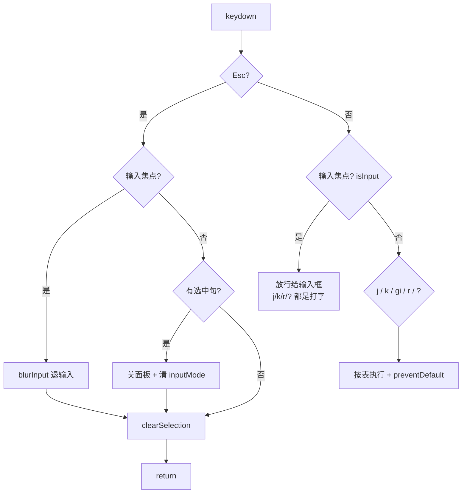

# M6 · 从零构筑：键盘导航

> 目标：让阅读器可以完全脱离鼠标——`j/k` 切句并滚动居中、`gi` 聚焦回译输入框、`Esc` 关闭、`r` 连续朗读（占位）、`?` 帮助面板，且输入框打字时一切快捷键自动让路。
> 产出形态：ReadingView 内一套 window 级 keydown 路由 + 滚动居中算法 + `ShortcutHelp` 组件。
> 关联课程：L19（键盘交互体系与主题快捷键）、L16（ReadingView 精读）。
> 前置：M5 的 PracticePanel 已接进 ReadingView（`inputRef`/`inputMode` 两个 prop 已就位）；M2 的选中逻辑与 `hasJustSelected` 划选豁免已存在；M3 的进度恢复已可用。

## 构筑总览（本里程碑结束时的项目结构）

```
src/components/reader/
├── ReadingView.tsx    # 本卡主角：window 级 keydown 路由 + scrollPairToCenter + 输入态守卫
└── ShortcutHelp.tsx   # 按 ? 弹出的快捷键帮助面板（本卡新建）
```

**最终差异说明**：
- ReadingView 最终版还有 TTS 集成（M8 加：voicevox 导入、预取/播放/自动续播、悬浮按钮）与书签/划选（M7 加）——本卡**不写**这些，`r` 键先用占位实现
- M10 主题层会在 `document` 上注册主题快捷键（n/m/d/s/w/r），与本卡的 window 级监听靠「延迟裁决」共存——本卡先把路由结构留好

本卡的快捷键行为总表（验收就对着它逐条过）：

| 键 | 行为 | 守卫条件 |
|---|---|---|
| `j` | 选下一句，滚动居中 | 非输入态 |
| `k` | 选上一句，滚动居中 | 非输入态 |
| `g` `i` | 500ms 内连按：聚焦回译输入框 | 非输入态 + 已有选中句 |
| `r` | 连续朗读开/停（M6 占位） | 非输入态 |
| `Esc` | 输入中退输入 / 有选中关面板；总是清选区 | 无守卫（永远生效） |
| `?` | 打开帮助面板 | 非输入态 |

---

## Step 1 · M6 版 ReadingView：快捷键路由 + 滚动居中

M5 的 ReadingView 已有选中态、`PracticePanel` 接线与进度恢复。本步加入：`scrollPairToCenter` 居中算法、`focusInput`/`blurInput`、`lastSelectedPairId` 位置记忆、`skipNextScrollRef` 点击豁免，以及整套 window 级 keydown 路由。**这是本卡的主体文件，一次贴全**——下面各 Step 逐分支讲解。

```tsx
import { useState, useRef, useEffect, useCallback } from 'react';
import { useBookStore } from '../../stores/bookSlice';
import { useSettingsStore } from '../../stores/settingsSlice';
import { SentencePairCard } from './SentencePairCard';
import { PracticePanel } from './PracticePanel';
import { ShortcutHelp } from './ShortcutHelp';
import { useTextSelection } from '../../hooks/useTextSelection';
import { EpubUploader } from '../import/EpubUploader';

export function ReadingView() {
  const currentBook = useBookStore((s) => s.getCurrentBook());
  const currentChapter = useBookStore((s) => s.getCurrentChapter());
  const setReadingProgress = useBookStore((s) => s.setReadingProgress);
  const getReadingProgress = useBookStore((s) => s.getReadingProgress);
  const fontZoom = useSettingsStore((s) => s.fontZoom);

  const scrollHostRef = useRef<HTMLDivElement | null>(null);
  const stageRef = useRef<HTMLDivElement>(null);
  const restoredRef = useRef<string | null>(null);
  const pairRefs = useRef<Map<string, HTMLElement>>(new Map());
  const inputRef = useRef<HTMLTextAreaElement>(null);

  const [selectedPairId, setSelectedPairId] = useState<string | null>(null);
  const [showHelp, setShowHelp] = useState(false);
  const [inputMode, setInputMode] = useState(false);
  const [isAutoReadOn, setIsAutoReadOn] = useState(false); // M6 占位，M8 接真播放器
  const lastSelectedPairId = useRef<string | null>(null);
  const skipNextScrollRef = useRef(false);

  const { clearSelection, hasJustSelected } = useTextSelection();

  const selectedPair = currentChapter?.pairs.find((p) => p.id === selectedPairId) ?? null;

  // 把目标句滚动到阅读区垂直中央：手动算 scrollTop，不用 scrollIntoView
  const scrollPairToCenter = useCallback((pairId: string) => {
    const container = scrollHostRef.current;
    const element = pairRefs.current.get(pairId);
    if (!container || !element) return;

    const containerRect = container.getBoundingClientRect();
    const elementRect = element.getBoundingClientRect();
    const targetScrollTop =
      container.scrollTop +
      (elementRect.top - containerRect.top) -
      containerRect.height / 2 +
      elementRect.height / 2;

    container.scrollTo({ top: targetScrollTop, behavior: 'smooth' });
  }, []);

  useEffect(() => {
    scrollHostRef.current = stageRef.current;
  }, []);

  const handleSelectPair = (pairId: string | null) => {
    if (pairId) {
      lastSelectedPairId.current = pairId;
    }
    setSelectedPairId(pairId);
  };

  const focusInput = useCallback(() => {
    if (inputRef.current) {
      inputRef.current.focus();
      setInputMode(true);
    }
  }, []);

  const blurInput = useCallback(() => {
    if (inputRef.current) {
      inputRef.current.blur();
    }
    setInputMode(false);
  }, []);

  // M6 占位：只切状态打日志，M8 换成真播放器（预取 + 播放 + 自动续播）
  const toggleAutoRead = useCallback(() => {
    setIsAutoReadOn((v) => !v);
    console.log('[M6 占位] 连续朗读', isAutoReadOn ? '停止' : '开启');
  }, [isAutoReadOn]);

  // j/k 导航 & gi/ESC 快捷键
  useEffect(() => {
    const pairs = currentChapter?.pairs ?? [];
    let giPending = false;

    const handleKeyDown = (e: KeyboardEvent) => {
      const target = e.target as HTMLElement;
      const isInput = target.tagName === 'TEXTAREA' || target.tagName === 'INPUT' || target.isContentEditable;

      if (e.key === 'Escape') {
        if (isInput) {
          blurInput();
        } else if (selectedPairId) {
          setSelectedPairId(null);
          setInputMode(false);
        }
        clearSelection();
        return;
      }

      if (isInput) return;

      // 用 lastSelectedPairId 作为当前位置基准
      const currentId = selectedPairId ?? lastSelectedPairId.current;

      if (e.key === 'j') {
        e.preventDefault();
        const currentIndex = currentId ? pairs.findIndex(p => p.id === currentId) : -1;
        if (currentIndex < pairs.length - 1) {
          const newId = pairs[currentIndex + 1].id;
          lastSelectedPairId.current = newId;
          setSelectedPairId(newId);
        } else if (currentIndex === -1 && pairs.length > 0) {
          const newId = pairs[0].id;
          lastSelectedPairId.current = newId;
          setSelectedPairId(newId);
        }
      } else if (e.key === 'k') {
        e.preventDefault();
        const currentIndex = currentId ? pairs.findIndex(p => p.id === currentId) : -1;
        if (currentIndex > 0) {
          const newId = pairs[currentIndex - 1].id;
          lastSelectedPairId.current = newId;
          setSelectedPairId(newId);
        }
      } else if (e.key === 'g' && !e.repeat) {
        giPending = true;
        setTimeout(() => { giPending = false; }, 500);
      } else if (e.key === 'i' && giPending && selectedPairId) {
        e.preventDefault();
        focusInput();
        giPending = false;
      } else if (e.key === 'r') {
        e.preventDefault();
        toggleAutoRead();
      } else if (e.key === '?') {
        setShowHelp(true);
      }
    };

    window.addEventListener('keydown', handleKeyDown);
    return () => window.removeEventListener('keydown', handleKeyDown);
  }, [currentChapter, selectedPairId, focusInput, blurInput, clearSelection, toggleAutoRead]);

  // 选中变化时滚动到可视区域（鼠标点击不滚动，避免干扰文本选择）
  useEffect(() => {
    if (!selectedPairId) return;
    if (skipNextScrollRef.current) {
      skipNextScrollRef.current = false;
      return;
    }
    scrollPairToCenter(selectedPairId);
  }, [selectedPairId, scrollPairToCenter]);

  // 关闭面板：点击阅读区空白
  const handleReadingAreaClick = (e: React.MouseEvent) => {
    if (hasJustSelected()) return;
    if (selectedPairId && e.target === e.currentTarget) {
      setSelectedPairId(null);
    }
    clearSelection();
  };

  // 切换章节时恢复进度（M3 已有）
  useEffect(() => {
    if (!currentChapter) return;
    if (restoredRef.current === currentChapter.id) return;
    restoredRef.current = currentChapter.id;

    const savedIndex = getReadingProgress(currentChapter.id);
    if (savedIndex > 0) {
      requestAnimationFrame(() => {
        const container = scrollHostRef.current;
        if (container) {
          container.scrollTo({ top: savedIndex * 100, behavior: 'instant' });
        }
      });
    }
  }, [currentChapter, getReadingProgress]);

  // 滚动跟踪写进度（M3 已有）
  useEffect(() => {
    if (!currentChapter) return;
    const container = scrollHostRef.current;
    if (!container) return;

    const handleScroll = () => {
      const scrollTop = container.scrollTop;
      const currentIndex = Math.floor(scrollTop / 100);
      if (currentIndex >= 0 && currentIndex < currentChapter.pairs.length) {
        setReadingProgress(currentChapter.id, currentIndex);
      }
    };

    container.addEventListener('scroll', handleScroll, { passive: true });
    return () => container.removeEventListener('scroll', handleScroll);
  }, [currentChapter, setReadingProgress]);

  if (!currentBook) {
    return <EpubUploader />;
  }

  if (!currentChapter) {
    return (
      <div className="flex items-center justify-center h-full text-reading opacity-50" style={{ color: 'var(--ink-muted)' }}>
        左侧选择章节
      </div>
    );
  }

  const savedProgress = getReadingProgress(currentChapter.id);
  const progressPct =
    currentChapter.pairs.length > 0
      ? Math.round((savedProgress / currentChapter.pairs.length) * 100)
      : 0;

  return (
    <div className={`reader-layout ${selectedPair ? 'reader-layout-with-panel' : ''}`}>
      {/* Reading area */}
      <div
        ref={stageRef}
        className="reader-stage"
        style={{ fontSize: `${17 * fontZoom}px` }}
        onClick={handleReadingAreaClick}
        tabIndex={-1}
      >
        <div className="reader-stage-inner">
          {currentChapter.pairs.map((pair) => (
            <SentencePairCard
              key={pair.id}
              pair={pair}
              isSelected={selectedPairId === pair.id}
              onSelect={() => {
                if (hasJustSelected()) return;
                skipNextScrollRef.current = true;
                handleSelectPair(pair.id === selectedPairId ? null : pair.id);
              }}
              ref={(el) => {
                if (el) {
                  pairRefs.current.set(pair.id, el);
                } else {
                  pairRefs.current.delete(pair.id);
                }
              }}
            />
          ))}
        </div>
      </div>

      {/* Practice panel（M5 已接线） */}
      <PracticePanel
        pair={selectedPair}
        onClose={() => setInputMode(false)}
        inputRef={inputRef}
        inputMode={inputMode}
      />

      {/* Reading progress */}
      <div className="reading-progress" style={{ width: `${progressPct}%` }} />

      {/* Shortcut help */}
      {showHelp && <ShortcutHelp onClose={() => setShowHelp(false)} />}
    </div>
  );
}
```

**关键设计讲解（j/k 与滚动）：**
- `scrollPairToCenter` 是**手动计算**的滚动居中：`目标 scrollTop = 当前 scrollTop + 元素与容器的相对偏移 - 容器高/2 + 元素高/2`。为什么不用 `scrollIntoView({ block: 'center' })`？它会把**所有**可滚动祖先（包括外层页面）一起滚，而这里只想滚阅读容器——手动算只作用于 `scrollHostRef` 这一个容器，行为完全可控（真实项目踩过坑后的修复，见设计注记）。
- `pairRefs` Map 由 `SentencePairCard` 的 ref 回调维护（挂载 set / 卸载 delete）——j/k 导航需要「按 id 拿 DOM 元素」。
- `currentId = selectedPairId ?? lastSelectedPairId.current`：**位置记忆**。关闭面板（selectedPairId 清空）后再按 j/k，从最后选中句继续，而不是从第一句重来。
- j/k 的边界：从未选中时按 j 选第一句（`currentIndex === -1` 分支）；首句按 k、末句按 j 都静默不越界。每个分支先 `e.preventDefault()`——拦截浏览器的「按 j 滚动/查找」类默认行为。
- **滚动联动**：键盘改变 `selectedPairId` → 下方 effect 调 `scrollPairToCenter`；鼠标点击则先置 `skipNextScrollRef.current = true`（一次性豁免）——鼠标点击不需要居中滚动，且划选后的程序化滚动会干扰文本选择（0ea6ac1 的教训）。

**验证：** `pnpm dev` → 导入书 → 按 `j` 逐句下移、`k` 上移，每句滚动到阅读区垂直中央；末句按 j、首句按 k 无报错；关面板后按 j 从最后位置继续。

## Step 2 · gi 双键序列与输入态守卫

`g` 后 500ms 内按 `i` 聚焦回译输入框。注意 Step 1 代码里两个关键守卫：

```ts
if (e.key === 'Escape') { … return; }   // Esc 永远最先处理
if (isInput) return;                     // 输入焦点时，除 Esc 外一切放行
```

**讲解：**
- `isInput` 用**事件目标的实时 tagName** 判断（TEXTAREA/INPUT/contentEditable），不依赖自己维护的 state——焦点在哪，守卫就跟到哪，永远与浏览器真相一致。
- 双键序列是 effect 闭包里的一个布尔 + 定时器：按 `g` 置 `giPending = true` 并启动 500ms 复位；`g` 分支带 `!e.repeat`——**长按 g 连发不反复重挂 pending**。按 `i` 时要求 `giPending && selectedPairId`——没有选中句时 gi 不生效（输入框属于当前句）。
- 命中后 `e.preventDefault()` + `focusInput()`。`focusInput` 把焦点移进 Composer 的 textarea 并置 `inputMode = true`；M5 的 PracticePanel 里有个 effect 监听 `inputMode` 变化主动 focus——两条路都汇聚到同一个输入框（M5 的 `inputRef` 在这里真正派上用场）。
- **输入态守卫的语义**：焦点在输入框时按 `j/k/r/?` 都是**打字**（字母 j、k、r 会进 textarea），所以 `if (isInput) return` 在 Esc 之后、业务分支之前放行一切——「打字优先」是唯一规则。将来给非输入区加快捷键时，还得补 `e.isComposing` 判断（IME 合成中，L19 提到的潜在缺口）。

**验证：** 点选一句 → 按 `g` 后 500ms 内按 `i` → 光标进入回译输入框；在输入框里按 `j` → 输入字母 j、句子不切换；快速连打 `gggi` / `gxi` 不误触发；`g` 后等 1 秒再按 `i` 不触发。

## Step 3 · Esc 的多义处理

Esc 是唯一**无守卫**的键（输入态也要响应），但行为分叉：

```ts
if (e.key === 'Escape') {
  if (isInput) {
    blurInput();
  } else if (selectedPairId) {
    setSelectedPairId(null);
    setInputMode(false);
  }
  clearSelection();
  return;
}
```

**讲解：** 输入焦点中 → 只退输入（`blurInput` 清焦点 + 关 inputMode），**不动选中句**——Esc 退输入不该把正在练的句子也关掉；非输入且有选中 → 取消选中并关面板；两种情况下都顺带 `clearSelection()`（M2 的 useTextSelection 提供的清选区，为 M7 划选系统的收尾做准备）；两态皆无 → 无副作用。`return` 保证 Esc 不会落入后面的输入守卫与业务分支。

**验证：** 输入框聚焦按 Esc → 退出输入、句子仍选中；有选中按 Esc → 面板收起、浏览器选区清空；无选中无输入按 Esc → 无任何变化。

## Step 4 · ShortcutHelp 帮助面板

按 `?` 弹出的帮助面板。`shortcuts` 数组是**唯一数据源**——加新快捷键时改数组即可，面板与行为永远同步。

```tsx
interface Props {
  onClose: () => void;
}

const shortcuts = [
  { keys: ['j'], desc: '选择下一句（Vim 模式）' },
  { keys: ['k'], desc: '选择上一句（Vim 模式）' },
  { keys: ['r'], desc: '开启 / 停止连续朗读' },
  { keys: ['gi'], desc: '进入输入框' },
  { keys: ['Esc'], desc: '退出输入 / 关闭面板' },
  { keys: ['?'], desc: '显示帮助' },
];

export function ShortcutHelp({ onClose }: Props) {
  return (
    <div
      className="fixed inset-0 z-50 flex items-center justify-center animate-fade-in"
      style={{ backgroundColor: 'rgba(45, 45, 45, 0.3)', backdropFilter: 'blur(2px)' }}
      onClick={onClose}
    >
      <div
        className="w-full max-w-sm mx-4 p-6 animate-slide-up"
        style={{
          backgroundColor: 'var(--bg-paper)',
          borderRadius: '6px',
          boxShadow: '0 8px 32px rgba(44, 74, 110, 0.15)',
        }}
        onClick={(e) => e.stopPropagation()}
      >
        <div className="flex items-center justify-between mb-5">
          <h3
            className="text-sm font-medium"
            style={{ fontFamily: 'var(--font-ui)', color: 'var(--ink-primary)', letterSpacing: '0.08em' }}
          >
            快捷键
          </h3>
        </div>

        <div className="space-y-3">
          {shortcuts.map(({ keys, desc }) => (
            <div key={desc} className="flex items-center justify-between">
              <div className="flex items-center gap-1.5">
                {keys.map((key, i) => (
                  <span key={i}>
                    <kbd
                      className="px-2 py-1 text-xs"
                      style={{
                        fontFamily: 'monospace',
                        border: '1px solid var(--border-color)',
                        borderRadius: '3px',
                        backgroundColor: 'var(--bg-secondary)',
                        color: 'var(--ink-secondary)',
                      }}
                    >
                      {key}
                    </kbd>
                    {i < keys.length - 1 && (
                      <span className="text-xs mx-0.5 opacity-40">+</span>
                    )}
                  </span>
                ))}
              </div>
              <span className="text-sm" style={{ color: 'var(--ink-muted)' }}>
                {desc}
              </span>
            </div>
          ))}
        </div>

        <p className="text-xs text-center mt-6 opacity-40" style={{ fontFamily: 'var(--font-ui)' }}>
          按 <kbd className="px-1.5 py-0.5" style={{ border: '1px solid var(--border-color)', borderRadius: '2px' }}>?</kbd> 或{' '}
          <kbd className="px-1.5 py-0.5" style={{ border: '1px solid var(--border-color)', borderRadius: '2px' }}>Esc</kbd> 关闭
        </p>
      </div>
    </div>
  );
}
```

**讲解：** 遮罩点击 `onClose`、面板本体 `stopPropagation`（点面板内部不关）；键帽用 `<kbd>` + 等宽字体 + 边框模拟键盘视觉，组合键（`gi` 拆成两个键帽）用 `+` 连接。一个诚实的细节：**最终代码里 Esc 分支并没有处理 `showHelp`**——帮助面板实际只能点遮罩关闭，footer 那句「按 ? 或 Esc 关闭」是仓库里遗留的提示瑕疵（`?` 只开不关）。复刻时照抄最终行为即可；若你想让 Esc 也能关，在 Esc 分支加一行 `setShowHelp(false)` 就行，但那就与最终仓库行为不同了。

**验证：** 按 `?` 弹出面板，列表与行为一致；点遮罩关闭；`g` 后按 `?` 不误触发。

## Step 5 · r 键：连续朗读占位与未来的主题冲突

`r` 分支 `e.preventDefault()` + `toggleAutoRead()`。M6 阶段 TTS 还没实现（M8 才做），占位版只切状态 + 打日志：

```ts
const [isAutoReadOn, setIsAutoReadOn] = useState(false);

// M6 占位：只切状态打日志，M8 换成真播放器（预取 + 播放 + 自动续播）
const toggleAutoRead = useCallback(() => {
  setIsAutoReadOn((v) => !v);
  console.log('[M6 占位] 连续朗读', isAutoReadOn ? '停止' : '开启');
}, [isAutoReadOn]);
```

**r 键冲突怎么讲（L19 的核心）：**
1. **输入框内**：按 r 是打字（`if (isInput) return` 守卫天然隔离）——这是「输入态守卫」最直接的体现。
2. **M10 的主题层**：主题快捷键（n/m/d/s/w/r）挂在 `document` 上、全应用生效。键盘事件沿 bubble 路径 `target → document → window`，**document 先于 window 收到**。M10 的主题监听器用 `setTimeout(0)` 延迟裁决：先让本卡的 window 监听器跑完，`setTimeout` 回调里检查 `e.defaultPrevented`——阅读页按 r 时本卡已 `preventDefault`，主题就不切换；书架页没有本卡监听器，`defaultPrevented` 为 false，r 正常切主题。**同一物理键在不同上下文路由到不同处理器，靠 preventDefault 信号仲裁，互不误伤。**
3. 本卡把 `r` 分支的 `preventDefault` 现在就写上——这是给 M10 的协议接口，别删。

**验证：** 按 r → 控制台出现占位日志、状态可观察地切换（M8 之前没有声音是正常的）；输入框聚焦按 r → 打出字母 r、无日志。

## Step 6 · 输入态守卫总述与快捷键自测

把本卡的路由逻辑压缩成一张决策图，自测时对着过一遍：



**自测清单：** ① 从未选中按 j 从第一句开始；② 首句 k、末句 j 静默；③ 关面板后 j/k 从记忆位置继续；④ 输入框内 j/k/r/? 全为打字、Esc 退输入；⑤ `gggi`、`gxi`、g 后超时不触发 gi；⑥ 长按 j 不卡死；⑦ 按 r 有日志占位；⑧ 全程无控制台报错。

## 收尾验收清单

- [ ] 按 `j` 选中句依次下移、`k` 上移，目标句滚动后位于阅读区垂直中央（不碰鼠标也能看清当前句）
- [ ] 从未选中时按 `j` 从第一句开始；首句按 `k`、末句按 `j` 不越界不报错
- [ ] 关闭面板后按 `j/k` 仍从最后选中句继续（`lastSelectedPairId` 记忆）；快速交替按 j/k 不抖动、不反向跳格
- [ ] 回译输入框聚焦时按 `j/k/r/?` 都是正常打字，不触发任何阅读器行为；`Esc` 退出输入并恢复快捷键响应
- [ ] `g` 后 500ms 内按 `i` 聚焦回译输入框；长按 `g`（连发）不反复触发；`g` 后超时或按别的键不触发
- [ ] `Esc` 在输入态退出输入、在选中态关闭面板并清选区；两态皆无时无副作用
- [ ] 按 `r` 有可观察的开启/停止占位行为（状态 + 日志）；阅读页外的同键（若已存在）不冲突
- [ ] 按 `?` 弹出帮助面板，面板列出的每个快捷键与实际行为一致；点遮罩能关闭（注意：最终代码里 Esc 不处理帮助面板，footer 提示与实际行为不一致是仓库遗留瑕疵）
- [ ] 按住 `j` 不放（连发）不会卡死或重复滚动同一句
- [ ] 能说出 `scrollPairToCenter` 为什么不用 `scrollIntoView`；能说出输入态守卫的判定依据为什么是事件目标而非 state

## 与最终代码的差异复盘

1. ReadingView——最终版还有：TTS 集成（M8：voicevox 导入、`startPlayPair`/`prefetchAhead`、`subscribeVoicevoxEnded` 自动续播、右下悬浮按钮）、书签按钮与列表（M7）、`SelectionPopover` 划选弹层（M7）。本卡的 `r` 占位被 M8 整个替换成真播放器。
2. `clearSelection`——最终版在 M7 的 useTextSelection 完整化后依然由本卡 Esc 分支调用（本卡已用 M2 版本，行为一致）。
3. M10 主题层——会在 `document` 上加 n/m/d/s/w/r 监听，与本卡 window 级监听靠 `setTimeout + defaultPrevented` 延迟裁决共存；本卡 Step 5 已把 `r` 的 preventDefault 留好。
4. 快捷键实现位置——最终版就是组件内联（本卡形态）；早期独立的 `useKeyboardShortcuts.ts`（134 行）在 1d25db3 被删除收敛进 ReadingView。
5. 滚动居中——最终版算法与本卡一致（bfde7bf 后的形态）。

## 设计注记（历史弯路）

- 快捷键曾抽成独立 hook `useKeyboardShortcuts.ts`（134 行），后来被 1d25db3 删除、逻辑收敛进 ReadingView 内联：全局快捷键只服务一个调用方时，独立文件只是多一层间接——**等出现第二个调用方再抽**。
- 键盘导航（ce66e5d）与居中滚动修复（bfde7bf）是两次提交：初版用 `scrollIntoView`，发现它会连带滚动外层页面、位置不稳，改成手动计算 `scrollTop` 只滚阅读容器——「滚动行为要精确控制时，手动算比浏览器启发式可靠」。
- 划选滚动豁免（0ea6ac1）：在句子上拖选文字时，选中回调抢走滚动位置——`skipNextScrollRef` 一次性豁免就是为它生的；M7 的划选系统与书签跳转同样依赖这条纪律。
- 输入守卫与 IME（L19）：`isComposing` 未检查是潜在缺口——输入框内的 IME 已被 `isInput` 守卫间接覆盖，但将来给非输入区加快捷键（如 k 翻页）必须补 `e.isComposing` 判断，否则中文输入法选词时会把候选键当快捷键。

## 下一步

进入 [M7 · 书签系统](./M07-bookmarks.md)：在同样的划选与滚动机制上做书签——本卡 Esc 清选区的行为正是为它的划选收尾准备的。
